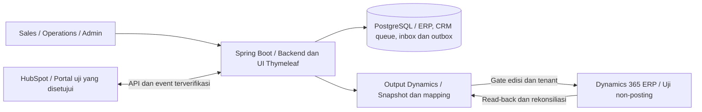
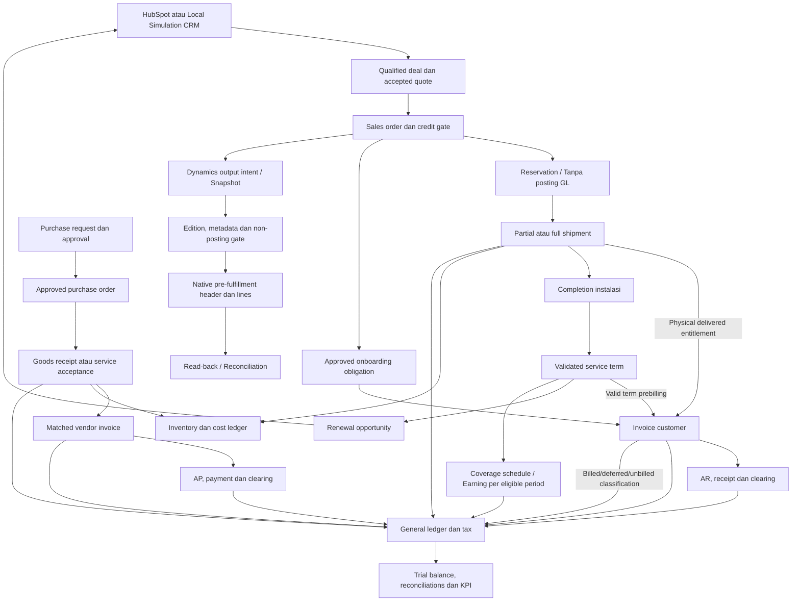
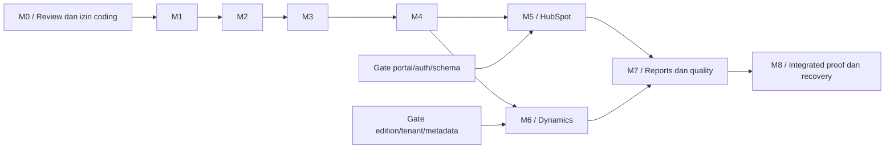

# Lab Sales Systems - Spesifikasi Simulasi Operasional ERP-CRM

Revisi: 2026-11-12 (izin tetap progress CRM dan publikasi launcher dipulihkan atas instruksi PO: komentar REN-6 lengkap serta satu Slack summary terverifikasi setelah reload. Status M1 In Progress/Medium dipertahankan; bukan automatic sync/background automation, full M1 atau izin operasi lain). Identitas simulasi: **rendgraagrida Lab Systems** (fiktif).

**Status: KOREKSI REFERENSI P2 LOKAL LOLOS UNTUK SCOPE INI; FULL M1/AC22 DAN ERP-CRM BELUM DITERIMA.** Source `content:39dd3ea5149d665d5d8fccde09d42104f9644f58b474f0f9c8747a06e0ba8d82` mempertahankan reference ID+version asli saat validasi400 membaca pilihan terbaru; perbaikan field lain tetap409 tanpa menghapus relasi. Actual24 tes dan smoke Chrome/Edge lulus; review GPT independen canonical correct/confidence0.96 tanpa temuan. Ini kandidat pertama koreksi referensi yang baru diizinkan PO, kumulatif kandidat7, bukan penggantian riwayat gate awal rejected3/3 atau kelanjutan sebelumnya rejected3/3. Tidak ada delete data existing, Git publication, SaaS write, Mac atau deploy; external gates, M0/P5 dan deferred launcher/runtime CD tetap terpisah.

**Launcher lokal Windows: LOLOS pada kandidat3/max3.** Actual lifecycle dan kedua ownership interleaving lulus QA; independent GPT correct/confidence0.95 tanpa temuan. Wrapper native, immutable artifact/readiness, native listener PID, shared lock dan owned cleanup tersedia pada 11.8.9. Kandidat2 tetap rejected untuk dua race, bukan retroactive PASS. Ini scope lokal, bukan runtime CD atau closure full M1; referensi defer historis tetap provenance lama.

Pada awal permintaan implementasi sempat dibuat fragmen lokal dan diunduh runtime portable; seluruh implementasi fitur kemudian dihentikan. Penggantian identitas dan satu preview HTML statis pernah diperiksa, bukan bukti ERP runnable. Fase review awal tidak membangun aplikasi, menginisialisasi database atau mengakses akun HubSpot/Dynamics. Penataan workspace dan verifikasi tooling CI berikutnya dibedakan pada 11.7; inventaris gap aplikasi ada pada 4.4 dan 11.6.

Perintah eksplisit sebelumnya memberi izin menata workspace, mengirim snapshot terpilih ke Mac dan membuat CI build/verify serta artefak; pengguna menunda runtime CD karena target deployment belum ada. Selanjutnya PO memilih baseline rancangan, policy approval tanpa self-approval, target lab dan contact identity pada 11.5. Pilihan ini bukan instruksi implementasi bisnis, aktivasi runtime/database, provisioning akun, pembelian lisensi, commit/push atau deployment. Persetujuan baseline/policy dibedakan dari verifikasi implementasi, finalisasi detail yang masih terbuka serta izin operasinya.

**Keputusan kerja aktif:** seluruh tugas CRM dikerjakan dari `D:/DEVELOPMENT/lab-sales-systems` pada laptop Windows ini sesuai 11.3.1. Perintah transfer, pemeriksaan, parity dan review Mac pada arsip berikut hanya provenance, bukan langkah yang harus diulang. Tidak ada akses/dispatch/sync Mac pada kelanjutan ini, penghapusan data Mac atau perubahan konfigurasi global/SSH/Tailscale. Perubahan pembagian kerja ini bukan instruksi implementasi aplikasi, DB provisioning atau publikasi.

**Otorisasi implementasi M1 terbaru:** instruksi PO di atas mengizinkan perubahan source serta setup DB uji baru yang terisolasi. Catatan sebelum izin ini yang menyebut belum coding/build/DB adalah provenance fase desain, bukan blocker izin aktif. Integration owner membuktikan target fresh tanpa menyentuh DB/data/listener lain, menjaga legacy migration bytes dan mencatat hasil aktual sebelum acceptance; dokumen tidak menganggap kode terbentuk sebagai PASS.

**Bukti implementasi aktif:** fondasi LOCAL c643b843 pada11.8.15 tetap diterima untuk komponen identik. Gate delivery14bf9bca3/3 tetap rejected GPT incorrect0.98 pada11.8.16. Koreksi M1-CD-01/P1 dan M1-CD-02/P2 yang diotorisasi PO kini **LOLOS** kandidat1/max3: source `content:69a0f9c0e39c65cde9cbade69885997890a7cdfd90b2cdf71ce8bfef0b00d8cb`, actual24 tooling Linux dan consumer CI/rollback/recovery fixture, GPT canonical correct/confidence0.96 tanpa temuan pada [11.8.17](#11817-koreksi-m1-cd-01-dan-m1-cd-02). FullM1/AC22 belum Done; tidak ada reset gate lama, GitHub activation, deployment nyata, atau perubahan requirement/oracle/final owner AC.

**Navigasi review:** [Scope dan stack](#4-arsitektur-dan-stack-pilihan-kita) / [Readiness setup](#44-readiness-setup-dan-batas-bukti) / [Kontrak HubSpot](#54-kontrak-konektor-hubspot-untuk-review) / [Output Dynamics](#55-output-microsoft-dynamics-365-erp) / [Parity output](#554-kontrak-parity-output-dan-bukti-pembanding) / [Oracle Dynamics](#811-oracle-output-dynamics-untuk-validasi) / [Struktur data](#7-struktur-data-dan-ownership) / [Flow dan skenario](#8-skenario-end-to-end-dengan-data-sintetis) / [Timeline/milestone](#11-timeline-milestone-dan-gate-review) / [Workflow satu laptop Windows](#1131-workflow-satu-laptop-windows) / [Operasional Slack-Linear](#1132-panduan-operasional-slack-linear-dan-milestone) / [Checklist persetujuan](#115-checklist-keputusan-pengguna-sebelum-coding) / [Kesiapan P0-P9](#118-penerapan-application-design-checklist-pada-crm).

## 1. Tujuan dan batas peniruan

Membangun **aplikasi simulasi operasional ERP-CRM yang menerima input pengguna dan benar-benar memproses pesanan**, bukan aplikasi presentasi, kumpulan layar contoh, atau mock order/stok. Scope mencakup Order-to-Cash, Procure-to-Pay, inventory/costing, finance/AR/AP, pajak sintetis, legal entity, installed base dan kontrak layanan. Aplikasi web Java/Spring Boot dan database SQL akan terhubung ke HubSpot CRM milik pengguna.

Pengguna harus dapat membuat customer, contact, supplier, product, price book dan transaksi baru melalui UI; mengedit draft; mengirim approval; memproses sebagian/seluruh quantity; mencari kembali dokumen; serta melanjutkan pekerjaan setelah logout atau restart. Nilai, validasi, stok, open items dan jurnal diturunkan dari input serta aturan bisnis, bukan hasil yang dihardcode untuk contoh seed. Seluruh perubahan disimpan persisten.

Interview dan pembelajaran merupakan **penggunaan tambahan dari aplikasi operasional yang sama**. Guide presentasi boleh membantu navigasi, tetapi keberhasilan presentasi bukan pengganti keberhasilan input data dan transaksi bebas. Semua data tetap sintetis; tidak ada transaksi uang, pengiriman fisik, kampanye pelanggan nyata atau pelaporan pajak resmi.

Yang dipertahankan adalah **struktur konseptual produk, relasi data, tanggung jawab modul, dan alur CRM-ERP**: produk modal, pasokan berulang, suku cadang, instalasi, kontrak layanan, quotation, order, inventory, installed base, renewal, sinkronisasi, rekonsiliasi, dan laporan. Ini bukan salinan skema database atau konfigurasi privat perusahaan mana pun; detail internal tersebut tidak tersedia dari bukti publik.

Yang diganti seluruhnya pada UI, seed data, contoh payload, SKU, serial, dokumen penjualan, namespace, dan tampilan aplikasi:
- Nama perusahaan, lini produk, nama komersial, kode dan label kategori internal.
- Institusi pelanggan, pemasok, nama kontak, alamat email, gudang, harga, diskon, lead time, nomor transaksi, dan ketentuan layanan.
- Logo, ilustrasi, deskripsi produk, teks pemasaran, template quotation, serta desain visual: dibuat mandiri, bukan disalin lalu diganti namanya.
- Semua portal ID, form ID, webhook target, domain, dan kredensial perusahaan sumber: **tidak digunakan**. Koneksi hanya ke portal uji milik pengguna yang diizinkan.

Nama HubSpot, Java, Spring Boot, PostgreSQL, dan Microsoft Dynamics 365 boleh muncul sebagai nama teknologi atau rujukan faktual; tidak dipakai untuk mengesankan dukungan atau afiliasi.

### 1.1. Batas kekayaan intelektual

- Nama perusahaan dan produk terutama berkaitan dengan **merek dagang** dan risiko kebingungan/afiliasi; logo tertentu juga dapat dilindungi hak cipta. Menyebut nama sebagai referensi faktual tidak sama dengan memakainya sebagai merek aplikasi.
- Kode, gambar, tulisan, datasheet, ilustrasi, dan bentuk ekspresi dokumen dapat dilindungi **hak cipta**. Materi yang dapat diakses publik tidak otomatis bebas disalin.
- Menurut WIPO, hak cipta melindungi ekspresi, bukan gagasan, prosedur, atau metode operasi itu sendiri [R6]. Namun hak lain, misalnya merek, paten, desain, hak database, rahasia dagang, kontrak/NDA dan ketentuan layanan, tetap perlu diperhatikan.
- Jangan memasukkan materi rahasia hasil interview, data pelanggan nyata, ekspor CRM perusahaan, atau kode privat tanpa izin. Jangan mengakses portal perusahaan sumber atau mencoba melewati autentikasi.
- Nama **rendgraagrida Lab Systems** dan seluruh nama produk di sini adalah nama kerja fiktif, **belum melalui pemeriksaan ketersediaan merek**. Lakukan pemeriksaan merek pada wilayah yang relevan sebelum peluncuran publik/komersial. Status edukasi dan disclaimer bukan kekebalan hukum.
- Ini pedoman pengurangan risiko untuk proyek, bukan pendapat hukum spesifik yurisdiksi. Rujukan prinsip: WIPO Copyright [R6] dan Trademarks [R7].

Teks pemberitahuan yang harus tampil pada lingkungan simulasi dan quotation:

> Simulasi operasional independen. rendgraagrida Lab Systems, produk, pelanggan, harga, dan transaksi dalam aplikasi ini adalah fiktif. Tidak mewakili, disponsori, atau terafiliasi dengan perusahaan yang menjadi referensi pembelajaran. Bukan penawaran komersial maupun alat untuk keputusan klinis.

## 2. Fakta sumber dan keputusan desain harus dibedakan

| Hal yang ditinjau | Bukti yang tersedia | Batas kesimpulan |
|---|---|---|
| Java, HTML, CSS, JavaScript | Lowongan resmi sistem penjualan menyebut teknologi ini [R1] | Tidak membuktikan Spring Boot, Thymeleaf, versi Java, SPA atau server rendering |
| Relational SQL, query, stored procedures, Git, pekerjaan sinkronisasi REST/JSON | Kebutuhan pekerjaan dalam lowongan [R1] | MySQL, PostgreSQL, dan SQL Server disebut sebagai contoh pengalaman; bukan kepastian engine atau topologi database mereka |
| HubSpot untuk informasi customer, contact, deal, instrument, dan sales | Lowongan resmi Inside Sales [R2], selaras dengan keterangan interview pengguna | Informasi instrument tidak membuktikan penggunaan custom object tertentu; shared inbox tidak otomatis membuktikan produk Conversations |
| Lead scoring dan analisis MQL/SQL | Studi kasus penyedia implementasi [R3] | Bukti historis implementasi, bukan akses konfigurasi atau kepastian paket langganan saat ini |
| Microsoft Dynamics 365 | Studi kasus proyek ERP grup, terbit 2023 [R4] | Tidak menetapkan edisi, modul, API tenant, atau konfigurasi setiap unit perusahaan saat ini |
| Monolith atau microservices, jumlah pipeline, properti, objek kustom, framework dan versi | Tidak ada bukti langsung yang memadai | **Belum terverifikasi**; tidak boleh disebut hampir pasti atau identik |

Semua sembilan modul, tiga pipeline, custom object, kebijakan harga/akuntansi, gudang, skema, dan aturan bisnis di bawah adalah **DESAIN SIMULASI KITA**. Modular monolith dipilih karena scope transaksi dan batas modul yang jelas, bukan karena terbukti sebagai arsitektur perusahaan sumber. Aset CMS atau form publik juga tidak membuktikan arsitektur aplikasi internal, paket lengkap HubSpot, ataupun kepatuhan GDPR.

Kesepadanan terhadap kebutuhan perusahaan sumber dinilai dari fungsi operasional yang disebut [R1]/[R2]: pemeliharaan product/pricing/customer/opportunity/order/forecast/inventory, annual pricing dan NPI, quotation dan lead-time, consumables reorder, service coverage/renewal, input informasi HubSpot, integrasi REST, scheduled sync, data quality dan reporting. Form/CRUD serta dampak transaksinya wajib berjalan. Detail posting finance, skema DB, layar internal, jumlah pipeline dan policy approval tetap rancangan kita, bukan temuan konfigurasi privat mereka.

## 3. Identitas dan katalog fiktif

| Elemen | Keputusan simulasi |
|---|---|
| Nama perusahaan | rendgraagrida Lab Systems |
| Nama aplikasi | Lab Sales Systems |
| Kode perusahaan/awalan SKU | `RGA` |
| Nama proyek rencana | `lab-sales-systems` |
| Namespace Java rencana | `dev.labtrial.salestools` |
| Nama portal uji yang disarankan | `Lab Sales Simulation - rendgraagrida` |
| Pelanggan | Institusi riset, biotech, pharma, CRO, dan distributor yang seluruhnya fiktif |
| Gudang | `RGA-EU-01` dan `RGA-NA-01`; lokasi operasional fiktif |
| Mata uang contoh | EUR dan USD; price book terpisah, bukan kurs tetap tersembunyi |
| Data kontak dan transaksi eksternal | Domain `.example`; email/SMS keluar, perpindahan uang dan pengiriman fisik dinonaktifkan. Pencatatan receipt/payment sintetis di subledger tetap wajib berfungsi |
| Clock fixture | `2027-01-15T00:00:00Z` hanya baseline regresi; business date skenario/transaksi dapat dipilih pengguna pada periode yang sah |

### 3.1. Kategori dan lini produk

Label berikut dibuat untuk simulasi. Kategori generik seperti peralatan, consumables, dan kontrak layanan tetap punya makna bisnis yang sama; tidak mengklaim spesifikasi teknis atau kesetaraan produk vendor tertentu.

| Kategori internal | Label UI fiktif | Peran data dan transaksi |
|---|---|---|
| `LAB_UNIT` | Platform eksperimen | Barang modal; satu serial per unit; dapat diinstal dan memiliki kontrak layanan |
| `LAB_SUPPLY` | Paket pasokan eksperimen | Pembelian berulang; stok per SKU/gudang; lot dan expiry bila berlaku |
| `REPLACEMENT_PART` | Komponen pemulihan | Bagian pengganti yang kompatibilitasnya tercatat, bukan otomatis kompatibel dengan semua alat |
| `SERVICE_PLAN` | Program Assurance | Layanan berdurasi; tanpa stok fisik; cakupan dan renewal diikat ke aset |
| `IMPLEMENTATION_SERVICE` | Aktivasi dan pelatihan | Jasa sekali pelaksanaan; tidak menambah/mengurangi stok barang |

Lini perangkat `TRANSFER`, `CLEANUP`, `PREPARATION`, `RINSE`, dan `WORKCELL` mempunyai relasi perangkat, pasokan, komponen dan layanan. Kemampuan fisik tidak disimulasikan; proyek memodelkan proses penjualan dan operasionalnya.

### 3.2. Master produk sintetis

Semua harga EUR berikut adalah harga satuan fiktif sebelum pajak/biaya kirim. Kuantitas pasokan memakai unit `PACK`; isi kemasan bukan konversi harga tersembunyi. Price book USD membutuhkan nilai tersendiri.

| SKU | Nama produk fiktif | Kategori | Lini | Unit | Harga EUR | Pelacakan |
|---|---|---|---|---|---:|---|
| `RGA-UNIT-TR120` | RGA-Transfer 120 | `LAB_UNIT` | `TRANSFER` | EA | 24000.00 | Serial |
| `RGA-UNIT-TR360` | RGA-Transfer 360 | `LAB_UNIT` | `TRANSFER` | EA | 46000.00 | Serial |
| `RGA-UNIT-CL240` | RGA-Clean 240 | `LAB_UNIT` | `CLEANUP` | EA | 18500.00 | Serial |
| `RGA-UNIT-PR360` | RGA-Prep 360 | `LAB_UNIT` | `PREPARATION` | EA | 58000.00 | Serial |
| `RGA-UNIT-RI480` | RGA-Rinse 480 | `LAB_UNIT` | `RINSE` | EA | 21000.00 | Serial |
| `RGA-UNIT-WC600` | RGA-Cell 600 | `LAB_UNIT` | `WORKCELL` | EA | 125000.00 | Serial |
| `RGA-SUP-CS080` | Cassette Kit 80 | `LAB_SUPPLY` | `TRANSFER` | PACK | 100.00 | Lot |
| `RGA-SUP-CS160` | Cassette Kit 160 | `LAB_SUPPLY` | `TRANSFER` | PACK | 180.00 | Lot |
| `RGA-SUP-RS020` | Reservoir Set 20 | `LAB_SUPPLY` | `PREPARATION` | PACK | 240.00 | Lot |
| `RGA-SUP-QM010` | QualityMix 10 | `LAB_SUPPLY` | `CLEANUP` | PACK | 320.00 | Lot + expiry |
| `RGA-SVC-BASE12` | Assurance Base 12 | `SERVICE_PLAN` | `CROSS_LINE` | TERM | 1800.00 | Kontrak 12 bulan |
| `RGA-SVC-PLUS12` | Assurance Plus 12 | `SERVICE_PLAN` | `CROSS_LINE` | TERM | 3200.00 | Kontrak 12 bulan |
| `RGA-PART-MD010` | Motion Drive 10 | `REPLACEMENT_PART` | `TRANSFER` | EA | 950.00 | Stok |
| `RGA-PART-SN020` | Level Sensor 20 | `REPLACEMENT_PART` | `RINSE` | EA | 450.00 | Stok |
| `RGA-IMP-ONB01` | StartLab Onboarding | `IMPLEMENTATION_SERVICE` | `CROSS_LINE` | JOB | 1200.00 | Penyelesaian jasa |

Contoh kompatibilitas fixture: Cassette Kit 80/160 dan Motion Drive 10 hanya untuk lini TRANSFER; Reservoir Set 20 untuk PREPARATION; QualityMix 10 untuk CLEANUP; Level Sensor 20 untuk RINSE. Assurance dan onboarding mengikuti matriks layanan aktif per perangkat. Jangan menyalin daftar kompatibilitas vendor asli.

### 3.3. Customer, contact, supplier, dan aset

| ID fixture | Entitas fiktif | Detail sintetis |
|---|---|---|
| `RGA-CUST-001` | Orbelis Research Lab | `ACADEMIA`, `EUROPE`, `orbelis.example` |
| `RGA-CUST-002` | Teralune Bioanalytics | `BIOTECH`, `NORTH_AMERICA`, `teralune.example` |
| `RGA-CUST-003` | Orbelis Translational Lab | Cabang berbeda dengan parent fiktif yang sama; bukan duplikat otomatis customer pertama |
| `RGA-CON-001` | Mira Senara | Lab manager sintetis, `mira@orbelis.example`, terkait customer pertama |
| `RGA-CON-002` | Arin Velden | Procurement sintetis, `arin@teralune.example`, terkait customer kedua |
| `RGA-SUPPLIER-001` | Nuvarek Components | Pemasok fiktif, `ops@nuvarek.example`; tidak ada pembelian riil |
| `RGA-ASSET-001` | Perangkat terpasang contoh | SKU `RGA-UNIT-TR120`, serial `SIM-RGA-TR120-00001`, milik `RGA-CUST-001` |
| `RGA-CONTRACT-001` | Assurance Base 12 | Aset pertama; `[2026-04-15, 2027-04-15)`; tepat 90 hari menuju akhir pada clock fixture |

Alamat jalan, telepon, ID pajak sah, data bank, dan data biologis/pasien tidak diperlukan untuk fixture. Bila dibutuhkan UI, gunakan label `SIM-*` yang jelas tidak valid untuk transaksi nyata. Email `.example` untuk record uji, bukan alamat kirim; uji pengiriman hanya memakai pengguna test account yang diizinkan penyedia.

## 4. Arsitektur dan stack pilihan kita

Prioritas: kebenaran input dan transaksi, otorisasi, auditability, maintainability, dan bukti alur konsumen, bukan sekadar penghematan RAM atau tampilan presentasi. Modular monolith adalah keputusan awal untuk scope ini; microservices baru layak bila ada kebutuhan deployment, kepemilikan tim, isolasi atau skala independen yang terukur. Tidak perlu Kafka, Kubernetes, service discovery, atau broker tambahan hanya agar terlihat enterprise.



ERP simulasi memiliki boundary domain dan penyimpanan persisten, bukan server yang mengembalikan sukses tanpa mutasi. Pengguna memilih **ERP simulasi + output Dynamics**, bukan Dynamics sebagai ERP utama dan bukan Microsoft 365/Office. ERP lokal tetap pemilik stok/finance; output native hanya uji non-posting pada tenant terisolasi yang diizinkan. Kita tidak mengklaim API ERP lokal kompatibel OData atau menyalin seluruh modul vendor. Konektor native Dynamics merupakan deliverable terpisah bagian 5.5 dan M6, dengan gate edisi, metadata, lisensi, tenant dan otorisasi; belum diimplementasikan.

| Lapisan | Pilihan rancangan | Ketentuan |
|---|---|---|
| Runtime | Java 21 LTS, Temurin `21.0.13+9` lokal | Binary Windows dipakai pada build dan aplikasi nyata; support/provenance tetap 11.8.7. Concurrency dibatasi kapasitas DB/API; tidak ada prerequisite host kedua |
| Backend dan build | Spring Boot `4.1.2` BOM tunggal; Spring MVC/Security; Maven `3.9.16` | POM telah cutover dari `4.0.9`; real application clean verify dan PostgreSQL dijalankan pada 11.8.9. Tidak menyatakan semua domain/connector masa depan kompatibel atau selesai |
| Modularitas | Package per domain dan interface eksplisit | Spring Modulith dapat dipakai untuk pemeriksaan batas modul bila memberi manfaat; bukan syarat agar desain benar |
| UI | Thymeleaf `3.1.5.RELEASE` melalui starter BOM; HTML/CSS/JS sesuai kebutuhan | Satu UI SSR, tanpa SPA kedua; target, trade-off dan cutover shell lama pada 11.8.7. Layout/copy/tema mandiri; Bootstrap/HTMX/grafik hanya bila benar-benar dipakai |
| Database | PostgreSQL `17.11`; explicit Maven Flyway `12.4.0` dan PostgreSQL module | Native cluster milik proyek dan fresh schema-only V1-V3 telah dijalankan; runtime tidak memuat/memanggil Flyway. Bukan H2/SQLite atau auto-upgrade DB existing |
| Akses data | Spring JDBC `7.0.10` dari BOM, typed scoped repository/service | Query dan transaksi M1 memakai PostgreSQL nyata; tidak menambah JPA atau mengklaim RLS/isolasi end user hanya dari shared DB role |
| Integrasi | Rancangan RestClient, mapping external ID, inbox dan transactional outbox | Deliverable M5/M6 sesuai gate native; belum diimplementasikan dan tidak diganti stub/fake success. Retry hanya ketika semantik aman; tidak ada jaminan exactly-once antar SaaS |
| Scheduling | Rancangan scheduler dengan lock/lease persisten | Deliverable domain berikut; tidak ada scheduler kosong atau job yang mengaku menyelesaikan operasi belum tersedia |
| Pemeriksaan | Tes aplikasi PostgreSQL nyata dan smoke SSR Chrome/Edge Windows; native connector test pada milestone terkait | Local host memakai runtime native, bukan Docker otomatis. CI memakai service PostgreSQL disposable pada hosted runner; belum ada run GitHub aktual |
| Operasi | Git, health checks, job history, backup/restore teruji | Pilihan VPS mengikuti pengukuran workload; tidak ada klaim kapasitas atau production-ready dari dokumen ini |

### 4.1. Scope yang diajukan untuk persetujuan

| Domain | Fungsi operasional wajib | Batas yang dinyatakan |
|---|---|---|
| Organization/master data | Dua legal entity sintetis dengan base currency EUR dan USD, customer/vendor, products, warehouse, akun dan fiscal period | Transaksi dan ledger terisolasi per entity; tidak ada transaksi lintas entity, eliminasi konsolidasi atau revaluasi FX |
| Sales / O2C | Input quote/revision/approval, acceptance/PO customer, order, reservation, partial delivery, instalasi/jasa, invoice, AR, partial/full receipt dan clearing | Perubahan stok/dokumen/jurnal benar-benar tersimpan; pengiriman fisik dan pembayaran eksternal tidak dilakukan |
| Procurement / P2P | Input purchase request, approval, PO, partial receipt, pencocokan PO-receipt-vendor invoice, AP dan partial/full payment | Pembelian stok dan jasa operasional sederhana; bukan sourcing/tender enterprise atau EDI vendor |
| Inventory | Serial/lot/expiry, reserve/release, receipt/issue/transfer/adjustment berizin, stock ledger, moving weighted-average costing | Tidak ada produksi, BOM manufaktur, MRP, quality control lab fisik, landed cost impor atau penghitungan kapasitas mesin |
| Finance | Chart of accounts, journal/subledger AR/AP, bank/cash simulasi, input/output tax, GRNI, unbilled receivable, deferred service revenue, period close dan reversal terkontrol | Bukan sertifikasi IFRS/GAAP, bank reconciliation berbasis bank sungguhan, laporan pajak resmi, payroll atau fixed asset accounting lengkap |
| Service | Asset terpasang, coverage history, expiry/renewal, pelepasan pendapatan layanan per periode yang ditetapkan | Bukan field-service dispatch, spare-parts repair work order lengkap, ataupun telemetry instrumen |
| CRM dan integrasi | CRM queue/routing/follow-up/reactivation/scoring simulasi, Local Simulation fungsional, konektor HubSpot serta output Dynamics dengan mapping/reconciliation | Tidak ada outbound nyata, silent fake success atau dual-master. Output Dynamics mengikuti boundary non-posting bagian 5.5; native acceptance tidak diganti ekspor file |
| Pendalaman dan presentasi | Process explorer, document lineage, penjelasan jurnal, data dictionary dan guide interview opsional di atas aplikasi operasional | Bukan alur klik tetap, bukan aplikasi read-only, dan bukan sistem resmi atau production-ready ERP |

Semua baris di atas adalah satu baseline scope yang diterima PO pada 11.5, bukan daftar fitur yang boleh dihilangkan diam-diam atau implementasi yang sudah lulus. Kekurangan entitlement, data, atau lingkungan tetap blocked sesuai dependency; perubahan scope memerlukan keputusan pengguna. Tanggal target penggunaan/interview belum diberikan, sehingga timeline bagian 11 tetap relatif terhadap T0 dan kapasitas nyata, bukan janji tanggal selesai.

### 4.2. Kontrak input data dan transaksi operasional

**Seed hanya contoh awal, bukan batas data yang boleh dibuat.** Pengguna dapat memulai dari workspace dengan baseline pilihan atau workspace kosong yang disiapkan melalui form master data. Operasi di bawah harus tersedia melalui UI berizin; tidak boleh mensyaratkan edit SQL/source code untuk menyelesaikan pemesanan normal.

| Area | Input yang harus bisa dibuat/diubah pengguna | Dampak yang wajib persisten | Batas perubahan |
|---|---|---|---|
| Organisasi dan akses | Legal entity, base currency saat setup, warehouse, fiscal period, account master dan assignment role/entity | Master/configuration version serta audit | Entity/base currency atau account yang sudah dipakai posting tidak diubah destruktif |
| Customer dan contact | Nama institusi baru, parent/child, segment, territory, contact role/email, billing/shipping address sintetis dan payment terms per entity | Customer/contact/association dan entity account yang bisa dicari kembali | Credit approval terpisah; deactivate master yang sudah direferensikan, bukan delete histori |
| Supplier | Supplier sintetis baru, entity assignment, terms dan status | Supplier dan reference pada PR/PO/AP | Tidak memakai data bank atau mengirim pesanan sungguhan |
| Product dan kompatibilitas | SKU baru di luar 15 seed, nama, category, product line, UOM, tracking serial/lot, compatibility dan bundle | Product master, entity settings dan referensi transaksi | Unique SKU dan integrity checks; produk posted tidak diganti tracking/UOM tanpa proses migrasi yang disetujui |
| Pricing dan NPI | Price book baru, currency, unit price, effective dates, proposal annual update, preview dan approval | Price versions, run history dan publication intent | Quote accepted menyimpan snapshot lama; tidak ada perubahan massal tanpa preview/approval |
| Inquiry, lifecycle dan deal | Source/need/contact, shared queue, assignment, routing rule, follow-up/outcome, dormant-customer candidate, score/explanation, qualification, owner dan stage | Inquiry/activity/routing/scoring/reactivation history, opportunity dan association | Pencatatan email/call adalah simulasi, bukan pengiriman. Score/assignment bukan consent, respons pelanggan, credit approval atau order otomatis |
| Quotation | Entity/customer, produk multi-line, quantity, tanggal berlaku, discount, tax code dan customer reference | Draft/revision, calculable net/tax/gross, approvals dan accepted snapshot | Harga berasal dari price book; override yang diizinkan harus diaudit/disetujui; output angka dihitung backend |
| Sales order dan delivery | Accepted quote/PO, warehouse, planned date, reservation, shipment quantity parsial, serial/lot dan alasan cancel | Order/lineage, reservation, stock movement, source event dan posting | Order dari entry ERP langsung boleh untuk skenario yang valid; guard yang sama berlaku tanpa ketergantungan pada label Won atau guide interview |
| Procurement | Request lines, supplier, quantity/cost, approval, PO, received quantity, lot/expiry dan vendor invoice reference | PR/PO/revision, receipt/service acceptance, matching, stock/valuation, AP dan journal | Quantity/cost/tax/reference divalidasi; mismatch di luar tolerance ditahan untuk review |
| Finance dan settlement | Posting date, invoice eligible, amount/reference pembayaran sintetis, allocation parsial, correction reason dan period action | AR/AP items, allocation/reversal, tax snapshot, cash ledger dan GL | Tidak mengedit langsung posted amounts; reject overpayment, duplicate posting dan tanggal closed period |
| Installed base dan layanan | Asset/serial, pemilik/operator, completion date, service plan, coverage term, renewal selection dan quote | Installation event, asset/contract history, schedule dan renewal intent/deal | Tidak terikat satu serial/customer seed; overlap atau duplicate renewal ditolak |
| Integrasi dan rekonsiliasi | Mode/account berizin, connector profile, mapping/schema version, sync trigger, preview output Dynamics, failure review dan replay | Intent/delivery/item status, mapping/checkpoint, snapshot/hash dan read-back evidence | Secrets tidak masuk chat/MD; Dynamics edition/company dan HubSpot portal harus terikat eksplisit; file lokal/HTTP 2xx saja bukan native success |
| Pencarian dan laporan | Search/filter dokumen, nomor referensi, customer/SKU, status, entity, currency dan date range | Hasil dihitung dari state persisten; export sesuai filter/izin | Bukan hanya menampilkan contoh seed atau KPI statis; tidak ada console SQL bebas |

Kontrak umum form: field wajib dan referensi valid diperiksa di backend; error menempel pada input yang salah dan tidak menyebabkan commit parsial; draft disimpan dan dapat dibuka lagi; quantity, UOM, tax, currency, date, role, entity dan version concurrency ikut divalidasi. Submit berulang atau dua operator memproses stok yang sama tidak boleh menggandakan transaksi atau menghasilkan stok negatif.

Tanggal baseline fixture tidak mengunci semua transaksi pada Januari 2027. Business date skenario dapat dipilih pada periode yang valid dan digunakan untuk pricing, expiry, aging, coverage serta recognition. Timestamp keamanan webhook, autentikasi dan observability tetap memakai waktu aktual, bukan clock bisnis yang dapat diubah pengguna.

### 4.3. Persistensi, mode operasi dan batas presentasi

- Aplikasi wajib menerima beberapa customer/product/order yang dibuat pengguna dan tetap konsisten setelah browser reload, logout/login, atau restart proses aplikasi.
- Workspace skenario memisahkan dataset latihan, legal-entity access dan business date. Membuat workspace baru atau memilih baseline adalah tindakan eksplisit; startup, reload, atau masuk guide tidak boleh mereset/menimpa transaksi.
- Master yang direferensikan memakai deactivate/versioning; draft boleh diedit sesuai state. Dokumen accepted/posted memakai revision/correction/reversal. Penghapusan/reset dataset memerlukan tindakan terpisah yang jelas, berizin dan diaudit, bukan bagian tombol next pada presentasi.
- Mode `LOCAL_SIMULATION`: input CRM lokal memakai model dan validasi yang sama, tersimpan persisten, dan belum diklaim tersinkron ke HubSpot. Mode `HUBSPOT_SANDBOX`: field CRM mengikuti authority/source HubSpot; input pada portal sendiri atau perubahan melalui konektor yang disetujui harus melalui validation/mapping/audit.
- Beralih mode tidak otomatis menyalin data, merge Company berdasarkan domain, atau mengirim semua record lokal ke HubSpot. Promotion/sync record sintetis yang dipilih memerlukan mapping, account scope dan izin write; error provider tetap berstatus pending/failed/review.
- Guide interview dan baseline regression bukan engine bisnis terpisah. Perubahan quantity, harga yang disetujui, customer, produk, tanggal, atau urutan transaksi harus memengaruhi hasil nyata, bukan mengikuti hasil contoh tetap.
- Normalisasi ASCII berlaku untuk **format dokumen ini**, bukan pembatasan input aplikasi. UI/database tetap mendukung teks UTF-8 yang sah dan aman; nama kontak beraksen tidak boleh rusak karena dokumen dibuat ASCII.

### 4.4. Readiness setup dan batas bukti

Tabel ini merangkum status lokal pada 11.8.9; inventaris awal dan bukti fase CI/desain tetap arsip 11.6/11.7/11.8.7. `LOCAL_VERIFIED` hanya berlaku pada input/surface yang benar-benar diamati, bukan verdict final, seluruh AC, full M1 atau production. Gate eksternal dan delivery tertunda tidak diubah menjadi N/A.

| Area | Status lokal terbaru | Bukti dan batas |
|---|---|---|
| Dokumen dan identitas | AVAILABLE | Baseline/policy serta izin M1 lokal sudah diberikan; seluruh M0/P5 tidak otomatis selesai |
| Java/Maven/PostgreSQL portable | LOCAL_VERIFIED | Temurin21.0.13+9, Maven3.9.16, PostgreSQL17.11 dipakai nyata; tanpa instalasi global atau Docker host |
| Manifest dan modul | LOCAL_FOUNDATION_ACCEPTED / FULL_M1_OPEN | Current M1-REF-02 candidate2 sourcec643b843 actual27tes dan immutable artifact, integratedGPT correct0.95/no findings menerima tujuh localfoundationboundaries11.8.15. Candidate1incorrect0.94/d57incorrect0.96 tetap riwayat. Bukan approval fullM1/delivery atau sembilan modul |
| Target UI | VERIFIED_SCOPED / PARTIAL | Currentc643b843 Chrome156/Edge157 actual1366x768 existing-lineactive/inactive400 exacttoken/input/errorretention, amountonly409, explicitrefresh/save/history. Currentcandidate2restartHTTPreadback. Prior179actionproof hanya untuk komponen unchanged, bukan seluruhnewJAR/role/viewport permutations |
| Setup/local/check entrypoint | LOCAL_VERIFIED_SCOPED | Native `local.cmd`/`local.ps1`: final candidate3 actual root/cwd/path-spaces, native listener-PID readiness, receipt lock, foreign/same-port race, dua root dan stop/crash proof; GPT correct/confidence0.95. Kandidat1/2 rejected; runtime CD/full M1 delivery OPEN |
| Database dan schema | LOCAL_VERIFIED | Cluster fresh terisolasi, explicit migrate/validate V1-V3, scoped FK/keys dan transaksi PostgreSQL nyata. Tidak ada upgrade applied-legacy yang diklaim |
| Seed | VERIFIED_SCOPED / PARTIAL | Current canonical rows/EMPTY/opening11.8.11, ditambah late final-audit rollback38 core tables dan conflicting EMPTY/O2C race satu receipt11.8.12. Bukan seluruh fault/concurrency permutation; FULL_OPERATIONS tetap M4 |
| DB privilege | VERIFIED_SCOPED / PARTIAL | Future-object/owner/migrator denial11.8.12 dan current missing/unavailableDB/revision/schema/old-unknownhistory startup failclosed11.8.11/13. Explicit foreign-lineage migration ditolak tanpa repair; bukan approved legacyupgrade |
| Auth dan otorisasi | PARTIAL_SCOPED_ACCEPTED | SEC-M1-01 accepted; exact current session rotation/idle1800/absolute8h/no-replay, actual HTTP workspace revoke404 serta dua urutan revoke/write terbukti11.8.12. Bukan full integrated foundation approval |
| HubSpot receiver/connector/jobs | NOT_IMPLEMENTED_M5 | Tidak ada public receiver atau fake provider aktif; signature, tenant, inbox/outbox dan lease mengikuti gate M5 |
| HubSpot portal/capabilities | EXTERNAL_GATE | Tipe test account, scope/seats/currency/objects/quote, app identity, signing contract dan HTTPS ingress belum diperiksa pada portal |
| HubSpot provisioning toolchain | NOT_VERIFIED | Node/HubSpot CLI yang kompatibel dengan project platform belum dipastikan; hanya tooling provisioning, bukan perubahan backend Java atau izin install/upload app otomatis |
| Dynamics output/native adapter | EXTERNAL_GATE | Belum ada konektor atau tenant. Edisi perusahaan sumber, metadata, company, master/reference setup, app permission dan native read-back belum terverifikasi |
| Backup/restore dan recovery | PARTIAL | Current app+owned PostgreSQL restart mempertahankan counts/fullrowSHA25638 tabel fixture, no reseed, login dan exact master values. Original37 tabel identik. Ini bukan isolated restore/RPO/RTO M8 atau remote recovery |
| VPS/remote CI/deployment | HOST_READONLY_VERIFIED / CRM_NOT_DEPLOYED | Setelah izin PO, SSH read-only mengamati Java21.0.13+9/Maven3.9.16, PostgreSQL17.11 aktif loopback55439 dengan cluster identity cocok, effective runtime tanpa CREATE/owner membership, app0tables/nohistory, noCRMservice/8187listener dan nginx inactive. Metadata secret diperiksa tanpa isinya; tidak ada restart/migration/bootstrap/deploy. Pin SSH cocok priorTOFU, bukan independent cloud-console proof. Host prerequisite bukan runtime CD/M1/AC22; detail owner tetap README |

Entrypoint, pin/env tanpa nilai secret, loopback ports, native launcher/ownership/stop, migration/bootstrap/baseline terpisah serta `/health` didokumentasikan pada README dan 11.8.9. Scope launcher lokal lulus actual QA dan independent GPT review kandidat3. Launcher bukan runtime deployment adapter dan tidak mengaktifkan WSL/Docker atau service Windows global.

Seed workspace adalah tindakan eksplisit setelah schema siap; startup/reload tidak memasukkan ulang baseline. Backup mencakup database, versi schema/config/mapping dan referensi secret, bukan menyalin secret ke laporan. Restore tidak menimpa dataset pengguna dan tidak langsung me-replay seluruh remote writes.

Resolusi library/no-DB pada 11.8.7 adalah bukti desain historis. Pembuktian aplikasi sekarang pada 11.8.9 memakai database, role, migration, HTTP, browser dan artefak nyata. Nama role/file atau output `--version` sendiri tetap bukan bukti schema/data/privilege sehat; inventory awal tidak dipromosikan menjadi PASS baru.


## 5. Konfigurasi HubSpot milik pengguna

### 5.1. Gate akun dan izin

Pengguna telah menyatakan mengaktifkan akun developer. Itu tidak membuktikan developer test account, paket, scope, atau seluruh fitur premium sudah aktif.

Dokumentasi resmi menyebut developer test accounts memiliki trial 90 hari untuk **banyak**, bukan seluruh, fitur enterprise [R5]. Trial produk, masa berlaku account, dan syarat perpanjangan berbeda; jangan berasumsi token private app selalu memperpanjang semuanya. Menu resmi menyediakan `Renew trials`; perpanjangan melalui API memiliki ketentuan OAuth pada dokumentasi tersebut.

Volume latihan yang rendah tidak menjamin seluruh arsitektur gratis. Akses CRM dasar, developer test account, trial fitur premium, quote/custom object entitlement, hosting dan tenant/lisensi Dynamics adalah prasyarat berbeda. Tidak ada pembelian atau provisioning otomatis; catat kemampuan dan masa berlaku aktual sebelum M5/M6. Ringkasan percakapan lama yang menyebut integrasi selalu gratis bukan kontrak biaya atau bukti entitlement.

Sebelum implementasi yang bergantung akun, verifikasi lewat UI portal uji yang benar:
- Account ID/tipe account, portal uji, timezone, currency, pengguna dan izin per role.
- Kemampuan membuat pipeline, custom properties, associations, custom objects, workflows, scoring, inbox, reporting, serta quotes/CPQ.
- Entitlement quote/CPQ dan commerce terpisah dari kemampuan dasar menyimpan deals. Jangan membeli paket hanya berdasarkan nama Starter/Professional/Enterprise tanpa memeriksa Hub, seats, limit, dan quotation resmi terbaru.
- Metode app/auth dan event yang didukung, scope minimum untuk fitur yang benar-benar dipakai, quota API dan pagination/batch limits.
- Email marketing test account dibatasi ke alamat pengguna account [R5]; dataset sintetis tidak boleh memicu kampanye ke orang nyata. Google Ads dan layanan berbayar lain tidak diaktifkan.
- Sebelum remote write M5, pemilik portal memeriksa workflow enrollment/re-enrollment, sequences, notifikasi dan integrasi downstream yang dapat terpicu oleh create/update properties atau associations [R35]. Buktikan record sintetis terisolasi dari outbound/automation yang tidak diizinkan; email `.example` dan payment/billing false saja tidak cukup. Catat portal, record scope, pengendalian, pemilik dan bukti pemeriksaan; jika keamanan belum terbukti, write tetap `BLOCKED`. Mengubah otomasi portal juga memerlukan izin terscope, bukan efek samping review atau startup connector.

Tugas saat ini tidak mengakses akun pengguna. Jangan membagikan password, recovery code, token, client secret, atau signing secret di chat/MD/Git. Provisioning schema memakai izin sementara yang terpisah dari runtime bila memungkinkan; simpan referensi secret di environment/secret store lokal yang di-ignore, dan redaksi log.

### 5.2. Objek dan properti rancangan

| Objek | Data simulasi | Pemilik data/ketentuan |
|---|---|---|
| Companies | Customer dan parent/child institusi | HubSpot untuk relasi komersial; kode customer ERP terpisah per legal entity |
| Contacts | Peneliti/operator/procurement fiktif | HubSpot untuk kontak dan lifecycle; perusahaan bukan relasi satu-satu wajib |
| Deals | Peluang peralatan, pasokan, renewal | HubSpot untuk pipeline; kode status ERP adalah projection, bukan pemilik deal stage |
| Products | Publikasi SKU dan harga katalog aktif | Katalog/pricing internal authoritative; quote menyimpan snapshot |
| Line items | Item penawaran, qty, mata uang, harga, diskon | Snapshot per transaksi; satu parent per native line item, dengan identitas tersendiri untuk Deal dan Quote [R19] |
| Quotes | Publikasi quote bila entitlement mendukung | Quote revision internal tetap authoritative; tidak ada klaim API legacy/premium tersedia sebelum gate akun |
| Custom object `Lab Assets` | Serial, model, customer, instalasi | Pilihan desain kita; butuh entitlement yang diverifikasi. Object type ID/association ID diselesaikan dari schema portal, tidak ditebak |
| Service contract projection | Masa cakupan dan renewal | Kontrak lokal terpisah dengan histori; custom object tambahan hanya bila entitlement dan kebutuhan relasi mengharuskan |

Gunakan prefix custom property `sim_`, misalnya `sim_record_key`, `sim_erp_customer_code`, `sim_segment`, `sim_territory`, `sim_asset_serial`, `sim_erp_order_number`, dan `sim_coverage_end`. `sim_record_key` adalah ID fixture/integrasi, bukan pengganti ID record yang diberikan HubSpot.

`Lab Assets` terkait ke Company pemilik, Contacts operator, Deal pembelian, dan Deal renewal lewat association yang disimpan dari schema account. Kontrak tidak ditumpuk sebagai satu tanggal pada Company ketika ada banyak unit/periode. Shared mailbox, tickets, sequences, ads, dan CPQ tidak boleh dinyatakan aktif hanya karena objek dasar ada.

### 5.3. Tiga pipeline simulasi

Ini konfigurasi edukasi, bukan pipeline perusahaan sumber. Nama tampilan boleh berubah; simpan ID pipeline/stage yang diperoleh dari portal dan maknanya dalam mapping konfigurasi. Jangan hardcode `closedwon` sebagai ID universal.

| Kode pipeline | Tahapan simulasi |
|---|---|
| `EQUIPMENT_SALES` | Qualified opportunity -> Technical fit -> Demonstration -> Quote issued -> Customer acceptance -> Won / Lost |
| `SUPPLY_REORDER` | Reorder inquiry -> Availability checked -> Quote/PO confirmed -> Won / Lost |
| `SERVICE_RENEWAL` | Renewal due -> Coverage reviewed -> Renewal quote -> Won / Lost |

Lead -> MQL -> SQL adalah lifecycle kualifikasi contact/account, bukan wajib deal stage. Buat Deal setelah peluang memenuhi kriteria; lead score dan peluang tidak membuktikan consent marketing. Probabilitas forecast adalah konfigurasi model simulasi yang dapat diperiksa, bukan data performa perusahaan nyata.

### 5.4. Kontrak konektor HubSpot untuk review

Profil usulan `RGA-HS-TEST-01`: satu authorized test portal, developer-platform project private distribution dan static auth sesuai dokumentasi saat implementasi [R8]. Baseline platform `2026.09` dan family REST GA `2026-09` harus diverifikasi serta dipin; pengecualian endpoint legacy dicatat per operasi, tidak mengganti URL secara mekanis. OAuth bukan dependency default satu portal dan bukan pengganti pemeriksaan entitlement. Label aplikasi `HUBSPOT_SANDBOX` tidak membuktikan tipe account sandbox.

Tooling provisioning memakai Node LTS dan HubSpot CLI yang kompatibel, dipin setelah approval; usulan Node 22+ memenuhi kebutuhan project tooling yang dirujuk [R8, R21]. CLI install/auth/app upload dan schema writes adalah operasi terscope terpisah, bukan bagian startup ERP atau izin dari review MD. Tidak membuat frontend Node/SPA kedua.

| Bagian profile | Kontrak wajib sebelum remote write |
|---|---|
| Identity dan authority | Approved portal/app, workspace binding, allowed record scope, schema/mapping version dan field writer; mismatch fail closed |
| Auth/privilege | Runtime read/write hanya capability yang disetujui; schema/pipeline/association provisioning terpisah. Static auth memakai required scopes; entitlement gated bukan sekadar optional-scope label |
| Field mapping | Local path, object/internal property, type/fieldType, enum internal, requiredness termasuk conditional-required dan Create Record rules portal, date/datetime/decimal, null/omit/explicit-clear policy, authority dan response properties [R22] |
| External IDs | String scoped environment/portal/object/workspace; owner memakai owner `id`, bukan `userId`; pipeline/stage dan association direction/category/type ID berasal dari portal |
| Unique recovery | `sim_record_key` unik pada object/endpoint yang mendukungnya; stable key disimpan sebelum create. Recovery memakai mapped ID atau supported unique lookup, bukan domain atau search kosong |
| Currency dan catalog | Portal/deal currency cocok dengan accepted currency; publish active price per mapping, bukan seluruh history buku harga ke satu `price`. Tidak auto FX atau mengubah currency/rate portal |
| Amount | `Deal.amount` diproyeksikan secara eksplisit sebagai commercial net setelah diskon sebelum tax; ini konvensi integrasi kita, bukan kalkulasi native yang dijamin HubSpot. Sebelum acceptance memakai approved quote aktif; sesudahnya snapshot terkunci. Write/read-back amount terpisah dari line items karena perubahan via API tidak otomatis menghitung ulang amount [R23] |
| Quote dan line item | Quote internal authoritative; family/entitlement dipilih dahulu. Deal dan Quote memakai line item berbeda dengan source-line/revision/parent binding. Setiap input batch membawa properti pembeda yang disetujui, misalnya `sim_record_key` scoped parent/source-line/revision; identical batch inputs dapat digabung diam-diam oleh HubSpot. Cocokkan setiap returned ID/key/association, bukan urutan respons atau count saja [R19] |
| Tax/commerce | Tax sintetis dipetakan ke approved provider tax-rate ID, bukan teks SIM-VAT7 sebagai native ID. Set payment/billing false dan read-back. Tidak menghubungkan processor, publish/share/e-sign atau mengirim campaign tanpa izin terpisah |
| Anti-automation | Gate 5.1 terbukti sebelum write; record scope, properties/associations dan guard portal yang disetujui cocok dengan profile. Perubahan profile/otomasi yang relevan memerlukan verifikasi ulang; read-back mencakup bukti tidak ada enrollment/outbound yang dilarang, bukan hanya field commerce false |
| Result dan read-back | Persist returned ID dan baca property/association aktual. Field ignored, wrong enum/owner/currency atau jumlah line berbeda masuk review, bukan sukses hanya karena 2xx |

Quote baru mempunyai ketentuan Revenue Hub tersendiri [R9]; developer account tidak membuktikan CPQ tersedia. Internal `APPROVED`/`ACCEPTED`, provider quote state dan buyer acceptance adalah fakta berbeda; acceptance provider tidak boleh mengganti revision sumber. Projection yang tidak mempunyai entitlement/mapping tetap `BLOCKED`; ERP lokal tidak berubah menjadi fake live success. Native HubSpot score dan score simulasi disimpan sebagai konsep berbeda.

Timeout remote create adalah hasil ambigu. Cari melalui mapped ID/unique lookup yang didukung, cocokkan snapshot dan simpan mapping sebelum sukses. CRM Search mempunyai indexing delay dan tidak memuat archived records [R10]; hasil kosong bukan izin blind-create. Object tanpa recovery identity yang terverifikasi harus masuk manual review, bukan dijamin exactly-once.

Pada REST `2026-09`, mapping memuat conditional-required dan required properties pada Create Record portal. Error validasi memerlukan koreksi input/mapping sebelum replay, bukan retry payload identik. Required associations pada UI bukan jaminan enforcement public API; pemeriksaan relasi bisnis tetap tanggung jawab konektor. Restriksi Edit Associations bagi user-level OAuth tidak boleh dianggap sama dengan portal-level static token [R22].

Default deal calculation dan native quote/line-item behavior dicatat pada profile. Jika operasi primary quote/finalization diizinkan terpisah, operasi tersebut dapat mengganti amount/line items Deal; reconcile ulang projection dan mapping, bukan mengubah accepted source lokal agar cocok. Native clone menghasilkan line IDs baru dan tidak menyalin unique property values; rebind identitas tiap line dan baca balik parent sebelum dianggap tersinkron. Recovery berdasarkan SKU/nilai komersial yang kebetulan sama dilarang [R19, R23, R24].

Tax/discount precision dan rounding HubSpot diuji terhadap snapshot sumber sebelum mapping disetujui. Recurring billing/subscription bukan representasi wajib service schedule ERP; satu fee term pada fixture tidak boleh berubah menjadi charge berulang native atau mengaktifkan billing. Mismatch amount/lines/tax masuk `NEEDS_REVIEW`, bukan dianggap sah karena total transport sukses.

Webhook memakai profile signature yang didukung app; proposal v3 harus dibuktikan dari konfigurasi nyata [R11]. Validasi raw body, timestamp actual, canonical external URI dan HMAC constant-time sebelum mutasi. Jangan mempercayai forwarded host sembarang atau fallback ke signature lebih lemah. Cocokkan portal/app/record scope; acknowledge 2xx hanya sesudah durable inbox commit. Public HTTPS ingress adalah gate tersendiri, bukan port loopback lokal. Subscription/event identity, quota, bounded retry dan delivery semantics dipin per profile.

### 5.5. Output Microsoft Dynamics 365 ERP

**Keputusan pengguna:** ERP simulasi + output Dynamics; bukan Dynamics sebagai pemilik ERP utama. Output ini menjadi deliverable wajib M6, tetapi belum diimplementasikan. Request berikutnya menyebut Microsoft 365 telah diklarifikasi menjadi Dynamics 365 ERP; Office/Graph/Outlook/SharePoint/Teams tidak ditambahkan ke scope.

**Batas bukti edisi:** [R4] menyebut keluarga Microsoft Dynamics 365, bukan bukti Finance/Supply Chain versus Business Central yang dipakai unit perusahaan saat ini. Permintaan menyesuaikan perusahaan sumber tidak boleh dijawab dengan mengarang edisi. Edisi/module/API/tenant/company tetap `EXTERNAL_GATE`. Dua profile referensi di bawah bukan izin membangun dua adapter sekaligus; implementasi nanti memilih satu setelah bukti edisi dan metadata disetujui.

| Kandidat profile native | Discovery dan identitas | Kontrak yang tidak boleh dicampur |
|---|---|---|
| Finance / Supply Chain berbasis F&O | OAuth/Entra dan dedicated service identity; approved HTTPS environment; `/data` dan `/data/$metadata`; company/dataAreaId dan seluruh entity key | Sales order headers V2 lalu lines V2 bila entity tersedia. Public collection contoh resmi adalah `SalesOrderHeadersV2` dan `SalesOrderLines`, bukan menebak suffix V2 untuk semua entity [R12-R15] |
| Business Central | Approved tenant/environment, company GUID dan API v2.0 metadata | `companies(...)/salesOrders` dan salesOrderLines memakai kontrak BC. Company GUID bukan dataAreaId; native `shipAndInvoice` adalah posting action yang dilarang dalam boundary ini [R16] |

F&O OData memakai business validation langsung; DMF/batch berbeda dan job accepted tidak berarti import selesai [R12]. Pilihan transport dipin pada profile setelah edition/volume/metadata diketahui; tidak menambah DMF/custom service hanya untuk menyerupai enterprise. Nama field import uppercase pada dokumentasi bukan bukti casing/key OData tenant; gunakan metadata dan required/default fields yang nyata.

#### 5.5.1. Authority dan guard non-posting

- ERP lokal tetap memproses order, reservation, shipment, invoice, stock dan ledger sesuai bagian 6-8. Native Dynamics record adalah salinan uji, bukan order operasional kedua atau sumber pembaruan credit/stock/payment lokal.
- Default connector Dynamics disabled. Setiap target memakai tenant/company uji yang disetujui, reference/master data sintetis dan app permission least privilege. Jangan menggunakan tenant perusahaan sumber atau production.
- Create/update native dibatasi pada dokumen sales order pre-fulfillment yang disetujui profile. Automatic reservation, release, picking, shipment, invoice, payment, subscription, notifications dan downstream workflow harus dinonaktifkan/dibatasi pada test company; order creation sendiri tidak diasumsikan tanpa side effect.
- Posting/confirmation/ship-and-invoice/settlement actions tidak masuk allowlist. Native read-back harus membuktikan order belum diproses operasional dan stok/financial balances target tidak berubah. Bila ini tidak dapat dijamin, native write tetap blocked.
- Customer, item/released product, UOM, warehouse/site/dimension, delivery address, terms, number sequence dan tax group harus tersedia/mapped. Admin dapat menyiapkan master sintetis lewat prosedur yang disetujui; connector tidak membuat konfigurasi finance/tax atau master production diam-diam.
- Output file lokal, preview mapping dan uji schema lokal diberi label berbeda dari native acceptance. Tidak ada JSON umum yang otomatis disebut compatible Dynamics, dan tidak ada native-success tanpa tenant read-back.

#### 5.5.2. Paket output kanonikal dan input sumber

Ini kontrak data untuk review, bukan payload OData universal atau file implementasi. Paket dihasilkan dari state persisten dan source revision yang sah; source snapshot/hash dan mapping version tidak berubah pada retry.

| Bagian output | Field/isi minimum | Validasi dan tujuan |
|---|---|---|
| Manifest | Schema version, batch/record key, workspace/entity, target profile/environment/company, generated-at actual, business date, source type/key/revision, payload hash, simulation marker dan expected mode | Semua reference terikat approved target; marker simulasi bukan property liar yang dikirim ke native entity |
| Customer/product references | Local party/entity account dan SKU, approved external IDs/codes, address snapshot, UOM, currency, terms dan required reference mappings | Domain/email bukan kunci customer; SKU baru tanpa mapping menghasilkan `MAPPING_REQUIRED`, bukan diganti produk seed |
| Sales order header | Local order/accepted quote revision, CRM reference, ordering/bill-to customer, company, currency, tax-exclusive flag, payment terms, requested ship/delivery date dan alamat historis | Bill-to, ordering party dan target company terverifikasi; native number/ID terpisah dari local document number |
| Sales order lines | Stable source-line key/ordinal, SKU/item reference, category, quantity/UOM, unit price, discount basis/amount, tax version/rate/reference, net/tax/gross expectation dan service/coverage reference bila berlaku | Tidak menggabungkan dua baris identik; discount tidak diterapkan dua kali; satu currency/entity; native writable/read-only fields dipilih profile |
| Procurement/fulfillment evidence | PO/receipt/vendor-invoice references, eligible quantities, shipment/serial/lot dan source timestamps | Paket referensi/audit, bukan pemicu receipt/shipment/AP posting native pada scope non-posting |
| Invoice/settlement evidence | Invoice header/line/tax snapshots, AR/AP open item, cash allocation/reversal, currency dan source journal references | Dokumen simulasi/reference; tidak menulis posted invoice, payment, open balance atau journal native |
| Inventory/finance/service evidence | Quantity/value movements, costing reference, balanced journal/trial-balance reconciliation, asset/term/renewal lineage | Sumber ERP lokal; tidak menganggap akun/posting rule atau subscription engine Dynamics sama dengan policy simulasi |
| Result/read-back | Correlation key, source hash/revision, provider request/error ID, remote header/line keys, native state, totals/currency, mapping version, observed-at dan mismatch list | `SUBMITTED` bukan `RECONCILED`; respons transport dan hasil bisnis dibedakan |

Nilai uang/currency/UOM/date mengikuti bagian 7. Native mapping harus membuktikan expected net/tax/gross tanpa menulis calculated/read-only totals secara paksa. Tax sintetis 7% memerlukan mapping test tax setup yang disetujui; jika tidak ada, output native blocked, bukan diubah ke zero tax/FX agar diterima. Nomor urut native mengikuti profile/number sequence; jangan mengasumsikan externalDocumentNumber unik atau menjadikan remote auto-number sebagai idempotency contract.

#### 5.5.3. Alur, kegagalan dan kriteria native selesai

1. Validated/accepted local order menghasilkan explicit output intent dengan stable source key, revision/hash dan target. Hak export/preview diperiksa; mutasi domain dan outbox atomik.
2. Local validation memeriksa field, mapping, master references, currency/tax, non-posting guard dan approved profile. State `LOCAL_VALIDATED` belum menyatakan Dynamics menerima data.
3. Profile yang siap mengirim native header lalu line sesuai kontrak. Gunakan transaction/changeset hanya bila dukungannya terbukti; jangan menganggap seluruh rangkaian HTTP atomik.
4. Jika header berhasil tetapi line gagal, simpan remote header ID dan item error. State `PARTIAL_FAILURE`; retry hanya line yang belum terbukti tersimpan dengan source-line identity sama. Jangan membuat header kedua.
5. Timeout create menghasilkan `AMBIGUOUS`: reconcile menggunakan mapped key/correlation identity yang didukung target. Tidak blind retry; jika unique recovery tidak tersedia, perlukan review. Header/line native tanpa identitas sumber yang dapat dilacak tidak boleh ditandai selesai.
6. Read-back mencocokkan company/customer, seluruh source lines, quantity/UOM, price/discount, currency/tax/totals dan native non-posting state. Native mismatch menjadi `NEEDS_REVIEW`, bukan menimpa accepted quote/ledger lokal.
7. State output: `BLOCKED`, `LOCAL_VALIDATED`, `READY_FOR_D365`, `SUBMITTED`, `PARTIAL_FAILURE`, `AMBIGUOUS`, `NEEDS_REVIEW`, `RECONCILED`. Tidak ada status yang melewati capability/permission gate karena pengguna mengganti filter/mode.
8. Export ulang snapshot yang sama memakai batch/item identity sama. Perubahan draft memerlukan snapshot/version baru; order accepted/posted tidak diubah melalui edit output. Penghapusan native draft tidak otomatis membatalkan order lokal.

M6 mempunyai gate terpisah: **M6A** menghasilkan paket/preview/validation serta lineage yang benar; **M6B** membuktikan native acceptance dan read-back pada satu profile terkonfirmasi. Jika edition/tenant/izin belum tersedia, M6B dan acceptance Dynamics keseluruhan tetap `BLOCKED`; M6A tidak boleh dilabeli integrasi native selesai. Tidak ada izin mengurangi scope atau membeli/provision tenant otomatis.

#### 5.5.4. Kontrak parity output dan bukti pembanding

"Sesuai output Dynamics 365" berarti semantic parity pada satu profile yang disetujui, bukan JSON yang sekadar bisa diparse, layar mirip, atau ledger lokal yang dipaksa sama dengan ERP vendor. Selama edisi/tenant/contoh read-back belum tersedia, oracle lokal bagian 8.11 adalah expected result rancangan, bukan hasil asli Dynamics.

| Dimensi kanonikal | Finance / Supply Chain F&O | Business Central API v2.0 | Pembandingan wajib |
|---|---|---|---|
| Target/entity/currency | Approved environment/company/dataAreaId; `CURRENCYCODE` adalah nama katalog [R14], exact OData field dari metadata | Approved tenant/environment dan `companies({companyGuid})`; `currencyId`/`currencyCode` [R16] | Company dan effective currency sama dengan accepted source. Nilai kosong/default native hanya diterima melalui semantic mapping yang dibuktikan, bukan diasumsikan EUR |
| Header/customer/lineage | `SalesOrderHeadersV2`; ordering/invoice customer dan seluruh key dari metadata [R13, R14] | `id`/`number`, `customerId`/`customerNumber`, `billToCustomerId`/`billToCustomerNumber` | Satu native header per source lineage; ordering dan bill-to cocok. Nomor lokal/CRM/externalDocumentNumber bukan proven unique native key |
| Source line/product/UOM | `SalesOrderLines`; seluruh key, item dan sales-unit fields dari metadata [R15] | Line `id`/`documentId`/`sequence`, approved `lineType`, `itemId`/`lineObjectNumber`, `unitOfMeasureId`/`unitOfMeasureCode` [R25] | Bijection source-line/native-line dalam parent sama, termasuk dua commercial lines identik. Service category tidak otomatis menjadi Resource/Account; UOM conversion dan service representation harus disetujui |
| Quantity/price/discount | Ordered quantity, sales price, price-unit basis dan discount fields yang writable harus dibuktikan dari metadata | `quantity`, `unitPrice`, satu approved discount input (`discountPercent` atau `discountAmount`) dan effective discount read-back | Original unit price/basis dan line discount cocok; tidak mengirim discounted unit price sekaligus diskon lama atau menerapkan automatic discount/charges yang tidak disetujui |
| Line net/tax/gross | Approved pre-confirmation calculation/read-back surface; katalog line amount saja tidak membuktikan tax/gross | Final `netAmount`/`netTaxAmount`/`netAmountIncludingTax`; juga `invoiceDiscountAllocation`, `taxPercent` dan `taxCode` bila didukung localization [R25] | Tiap line cocok dengan source decimal, bukan hanya header total. Fixture line-discount-only mensyaratkan invoiceDiscountAllocation=0.00; dengan kondisi ini amountExcludingTax/totalTaxAmount/amountIncludingTax juga diperiksa konsisten |
| Header net/tax/gross | Exact header total/calculation observation belum dibuktikan hanya oleh R14/R15; wajib dipin pada profile | `totalAmountExcludingTax`/`totalTaxAmount`/`totalAmountIncludingTax`; header `discountAmount` adalah invoice-level discount [R16] | Sum rounded source lines tepat sama dengan header; header invoice discount BC=0.00 pada fixture ini. Total line discount bukan document discount kedua |
| Tax-exclusive/rounding | Calculation method, rounding-by, origin, marginal base dan precision/method dipin pada approved test setup [R26] | `pricesIncludeTax=false`, effective `taxPercent=7.00`, approved tax reference dan pricing/discount setup [R16, R25, R28] | Decimal equality pada precision currency; 1579.2 sama dengan 1579.20, tetapi selisih 0.01 gagal. Tidak PATCH read-only taxPercent/pricesIncludeTax/calculated totals, zero-tax atau FX fallback |
| Tanggal/alamat/layanan | Metadata-proven date/timestamp dan address/reference fields | `orderDate`, `requestedDeliveryDate`, historical sell/bill/ship-to fields sesuai profile | Business date bukan actual timestamp. Native draft tidak otomatis membuat installation/coverage/subscription; local evidence bukan perintah posting |
| Native pre-fulfillment | Allowed state/fulfilled quantities dan observation reservation/stock/finance yang terbukti | Profile-pinned status, `fullyShipped=false`, setiap line `shippedQuantity=0` dan `invoicedQuantity=0` [R16, R25] | Pisahkan proposed shipQuantity/invoiceQuantity dari completed quantities. postingDate terisi atau state Draft/Open saja bukan bukti posting/tidak posting. Before/after reserved quantity, physical on-hand dan financial posting/balance delta harus nol akibat connector |

Profile menyimpan canonical field -> native path/type/key, writable/calculated, required/default, transform/null policy, precision, read-back path dan approved metadata version. Field referensi/evidence lokal tidak diteruskan sebagai properti native yang tidak dikenal. Nama enum/state serta kemampuan membaca calculated totals berasal dari target nyata; jangan menebak dari caption UI atau memposting order hanya untuk memperoleh totals.

F&O reads default ke company service user; semua lookup/recovery harus memakai company-aware query dan seluruh key yang benar [R13]. Hasil kosong di default company bukan bukti create gagal di company target. Nama katalog seperti `INVENTORYLOTID` bukan alasan memakai lot fixture `SIM-LOT-*` sebagai native line key. Public entity names tidak membuktikan transport tersedia pada setiap deployment; cloud/on-premises dan API support termasuk gate profile [R12].

Pada F&O, stored per-line Sales tax amount dapat baru terisi saat confirmation/posting atau tetap kosong/nol sesuai parameter [R26]. Profile harus membuktikan surface kalkulasi/read-back read-only sebelum confirmation untuk tax dan totals. Jika tidak tersedia, M6B `BLOCKED`; jangan confirm/post order, mengubah parameter pajak atau menambah custom service tanpa izin untuk memaksakan bukti. Native totals yang hanya dihitung ulang dari input lokal bukan native acceptance.

Read-back mengambil seluruh collection lines, mengikuti pagination bila ada. `RECONCILED` mensyaratkan seluruh field, key, amount, state dan observation guard tersedia serta cocok. Prasyarat diketahui gagal sebelum write adalah `BLOCKED` dengan reason seperti `MAPPING_REQUIRED`; native mismatch yang sudah diamati adalah `NEEDS_REVIEW`. State, reason dan per-item results tidak disamakan.

Paket evidence mencatat fixture/input pengguna, approved profile/reference output, source/hash, target/company, header dan semua line keys, sanitized native before/after/read-back, waktu observasi, comparison per field dan alasan mismatch. Local validation, native write dan reconciliation mempunyai hasil terpisah. Verdict `RECONCILED` berlaku untuk snapshot dan observasi tersebut, bukan jaminan perpetual jika native record atau mapping berubah.

Retry memakai snapshot yang sama, bukan menghitung ulang harga/tax atau mengambil evidence terbaru di tengah batch. Shipment/invoice/payment lokal yang terjadi kemudian menghasilkan evidence snapshot/version baru yang menaut source order sama; tidak membuat native order kedua atau memutasi snapshot lama. External edit/native version conflict memerlukan read-back/review sebelum update; jangan overwrite perubahan remote atau mengubah accepted source lokal tanpa proses domain yang sah.

## 6. Sembilan modul aplikasi dan invariannya

### 6.1. `catalog` - Product, pricing dan pengenalan produk

- Katalog berisi kategori/lini, unit of measure, tipe tracking, compatibility, bundel, status draft/approved/published, dan SKU fiktif bagian 3.
- Price book berversi per mata uang dan rentang tanggal berlaku. NPI memerlukan validasi kelengkapan dan approval sebelum publikasi produk.
- Pembaruan tahunan adalah pricing run dengan ID unik, preview diff, daftar SKU yang dipilih, tanggal efektif, actor dan approval. Ulangi run ID yang sama tidak boleh mengalikan kenaikan lagi.
- Quote yang sudah disetujui menyimpan price-book version dan line snapshot; perubahan harga katalog tidak mengubah quote/order historis.
- Publikasi ke HubSpot dipisahkan dari transaksi approval melalui outbox; jika API gagal, status tetap `PENDING`/`FAILED`, bukan ditandai sudah tersinkron.
- Routine SQL dirancang untuk operasi set-based, kontrol konkurensi dan audit; tidak memakai loop per record tanpa alasan atau perubahan harga massal tanpa preview.

### 6.2. `crm` - Contact, company, deal dan HubSpot mapping

- Sinkronkan fields yang dimiliki masing-masing sistem, bukan menulis semua fields dua arah. Simpan account, object type, external ID, local ID, serta source version/checkpoint.
- Dukung pagination, batch partial failure, archive/delete, relasi banyak kontak/perusahaan, dan pemetaan primary association sesuai kontrak portal.
- Remote archive/delete menghasilkan tombstone/projection state dan review bila masih direferensikan. Jangan cascade-delete quote/order/invoice/journal lokal atau mengubah posted history; master archived dapat menahan handover baru tanpa membatalkan transaksi lama diam-diam.
- Company dengan domain sama bisa merupakan cabang berbeda. Fuzzy match hanya kandidat review, bukan kunci customer.
- Webhook/event diterima sesuai mekanisme signature yang didokumentasikan untuk app yang dipilih; persist inbox dahulu lalu proses asynchronous.
- Payload bisa duplikat, datang terlambat atau tidak berurutan. Fetch kondisi authoritative bila event tidak cukup; perubahan ERP projection tidak boleh memicu loop penulisan balik.
- Shared inquiry queue menyimpan source key, received-at, subject/need, optional contact/customer, status, priority, assignee, due follow-up dan history. Status minimal `NEW`, `IN_PROGRESS`, `WAITING`, `RESOLVED`, `CANCELLED`; claim/reassignment memakai version concurrency dan filter unassigned/my/team/overdue. Unknown party tidak dipaksa menjadi dummy customer. Queue ini tidak mengklaim native HubSpot Conversations/mailbox aktif.
- Routing rule berversi memakai territory/product-line dan priority/tie-break deterministik; owner tidak tersedia masuk unassigned/review. Activity mencatat linked inquiry/party/deal, type, assignee, due/completed-at, outcome dan actor. Task/note/call/email/meeting adalah pencatatan simulasi; assignment bukan first response. SLA memakai event respons substantif yang dicatat dan berlabel simulasi, bukan waktu claim.
- Reactivation memakai rule/as-of berversi: default usulan 180 hari sejak qualifying fulfilled purchase terakhir, bukan last-modified. No-history dibedakan dari dormant; transaksi void dan future events dikecualikan. Open opportunity/inquiry atau active reactivation menahan kandidat sesuai rule. Kandidat menyimpan alasan/tanggal sumber; tindakan berizin membuat satu follow-up tanpa campaign. Identity dan rescan mengikuti aturan berikut.
- Batas dormant usulan adalah `as_of-last_qualifying_purchase_date>=180 hari`. Case identity memakai customer/entity dan last qualifying purchase source, bukan tanggal scan; rule/as-of evaluation disimpan dalam case. Resolusi tidak menghasilkan task baru pada rescan berikutnya; reopen/cycle baru adalah tindakan berizin, dan open case lintas rule version tetap menahan duplikasi.
- Score simulasi melekat ke inquiry dan menyimpan normalized inputs, rule version, as-of, source version, contribution dan missing-input reason. Fixture usulan: approved territory +20, compatible product need +30, confirmed timeframe +25, budget confirmed +25, cap 0..100; missing memberi 0 dengan alasan. Input/version/as-of sama menghasilkan score sama. Usulan recommendation MQL >=60 dan SQL >=75 tetap memerlukan qualification/review eksplisit; score tidak memberi consent/credit/Won/order. Existing customer tidak diturunkan lifecycle-nya ke Lead/MQL hanya karena inquiry baru.

### 6.3. `order` - Quotation sampai pelunasan piutang

- Konfigurator menggunakan kompatibilitas/bundel fiktif; produk jasa tidak dianggap barang fisik. Quote memiliki revision, validity, currency, harga snapshot, subtotal, diskon eksplisit, tax snapshot dan approval.
- Diskon perangkat di atas 10% memerlukan Sales Manager sebagai policy simulasi. Perubahan draft setelah approval membatalkan approval revision terkait. Acceptance mengunci snapshot, actor, actual timestamp, accepted business date dan PO/reference; validity diperiksa saat acceptance, bukan menghitung ulang harga/offer expiry pada retry setelah order terbentuk.
- Deal Won hanya memicu permintaan handover. Credit customer/entity dan accepted source yang sah tetap diperiksa; tidak memberi approval otomatis. Direct ERP entry memakai approved commercial source sendiri, bukan memalsukan Deal ID.
- Identity handover memakai workspace/entity/quote lineage, bukan Deal + revision saja. Satu accepted lineage hanya menghasilkan satu order; Deal berbeda atau revision baru tidak otomatis membuat order kedua. Supersession sebelum handover memerlukan withdrawal dan acceptance baru. Setelah booked, snapshot tidak ditulis ulang; cancel mempertahankan identity sehingga retry mengembalikan order/status yang sama, tidak resurrect. Kebutuhan baru memakai source baru yang eksplisit.
- Commercial, reservation, fulfillment, billing dan settlement adalah dimensi terpisah. Order tanpa invoice tidak disebut settled hanya karena AR nol; partially fulfilled dengan cancelled remainder bukan seolah seluruh order tidak pernah terjadi.
- Reservation tidak mengurangi on-hand. Delivery memicu stock movement/cost posting dan peristiwa transfer barang pada policy demo yang eksplisit. Completion instalasi/jasa adalah peristiwa terpisah.
- Invoice memakai billing entitlement yang sah: delivered physical quantity, completion/onboarding obligation atau validated service term. Allocation sumber menyimpan interval/slice dan amounts; cumulative active billing tidak melampaui entitlement. Reversal membuka slice asal, bukan menghapus history atau mengembalikan stok.
- Customer receipt menyelesaikan open items melalui cash/allocation dua sisi bagian 6.8. Tidak ada over-allocation, cross-party/entity/currency clearing atau paid flag buatan. Nilai invoice, allocation dan jurnal diturunkan dari sumber yang sama.
- Untuk physical line, `Q=F+C+O`, dengan ordered Q, fulfilled F, cancelled-unfulfilled C, remaining O, reservation `0<=R<=O` dan effective invoiced `0<=I<=F`. Ship mengonsumsi reservation/on-hand atomik. Cancel hanya quantity yang belum fulfilled dan melepaskan reservation secukupnya. Service memakai entitlement completion/term, bukan stock. Prebilled service yang hendak dibatalkan harus melewati correction/cash guard; return/RMA tidak disamarkan sebagai cancel.
- Tidak ada e-invoice resmi, pembayaran uang riil, email komersial atau carrier label. Istilah invoice/payment dalam demo berarti dokumen dan posting internal yang fungsional dengan data sintetis.

### 6.4. `inventory` - Stock, installed base dan kontrak layanan

- Stok disimpan per SKU/gudang/lot sesuai tracking, bukan kolom tetap per kota. Bedakan `on_hand`, `reserved`, dan `available`; sumber ERP simulasi authoritative.
- Deal Won tidak memotong `on_hand`. Reservation mengurangi `available`; shipment mengurangi `on_hand` dan reservation secara atomik. Jasa tidak mengubah stok.
- Lot kedaluwarsa tidak bisa dialokasikan; serial tidak boleh dipakai dua unit/order sekaligus. Ketersediaan mempunyai timestamp; ATP/lead time tidak dijanjikan real-time bila sumber hanya periodic snapshot.
- Aset berstatus `INSTALLED` hanya setelah completion instalasi yang sah dalam simulasi, bukan otomatis saat paket dikirim.
- Pisahkan instrument dari kontrak/periode layanan: satu alat dapat mempunyai histori kontrak. Gunakan interval `[coverage_start, coverage_end)` dan hindari overlap tidak sah pada tipe cakupan yang sama.
- Renewal H-90 memakai unique contract/target-term key. Won hanya memicu validasi term baru; term future menjadi `SCHEDULED` dan coverage `ACTIVE` ketika tanggal sah tercapai, bukan menghapus histori atau mengaktifkan lebih awal.
- Valuation pool adalah workspace/entity/product, sedangkan warehouse/lot/serial memisahkan quantity/tracking. Pool menyimpan quantity Q dan carrying value V; WAC berasal dari V/Q, bukan harga jual/cost master. Receipt menambah approved net cost tanpa recoverable input tax; matched invoice hanya membersihkan GRNI, tidak menilai stok kedua kali.
- Issue mengambil proporsi V dengan precision perhitungan memadai lalu monetary HALF_UP; simpan authoritative `value_delta` dan cost snapshot. Issue terakhir menghabiskan seluruh sisa V, sehingga Q=0 mengharuskan V=0. Receipt berikutnya tidak menghitung ulang issue lama. Negative adjustment memakai WAC; positive adjustment butuh cost non-negatif eksplisit, alasan dan approval.
- Transfer antar warehouse dalam workspace/entity sama diposting atomik dengan counterpart/source identity dan carrying value yang sama; tidak menambah revenue/COGS atau mengubah entity pool Q/V. Reserved stock tidak dipakai transfer/adjustment kebutuhan lain. Physical return/RMA penuh tetap di luar scope ini.
- Transfer/zero-cost movement yang tidak berdampak GL tetap mempunyai stock posting/audit/source reference; journal reference boleh tidak ada untuk no-GL-effect yang sah. Jangan membuat journal line 0/0 hanya untuk mengisi FK atau menghitung ulang carrying value dari cost display.
- Setiap stock posting, termasuk transfer/adjustment, memperbarui pool business-date watermark dan sequence monotonik. Tanggal sebelum stock posting terakhir pool ditolak; tanggal sama memakai sequence/locking. Koreksi memakai compensating event pada tanggal/periode terbuka, bukan mengubah history. Business clock mundur tidak merevaluasi issue atau membalik posted movement.

### 6.5. `sync` - Inbox, outbox dan kendali job

- Job rancangan: `PUBLISH_CATALOG_PRICES`, `SYNC_COMMERCIAL_PARTIES`, `HANDOVER_ACCEPTED_DEALS`, `REFRESH_INVENTORY_AVAILABILITY`, `PROJECT_ORDERS_ASSETS`, `SCAN_SERVICE_RENEWALS`, `SCAN_CRM_REACTIVATION`, dan `EXPORT_DYNAMICS_OUTPUT`. Connector/profile menentukan target dan izin; output Dynamics bukan worker yang memposting finance kedua kali.
- Event-driven processing dilengkapi scheduled reconciliation untuk event hilang. Interval/job window merupakan konfigurasi, bukan asumsi jadwal vendor.
- Simpan `inbox_events`, `outbox_messages`, `sync_runs`, `sync_failures`, `sync_checkpoints` dan lock/lease. Transaksi data domain dan penambahan outbox harus atomik; HTTP eksternal tidak dipegang dalam transaksi database panjang.
- Jangan menganggap provider event ID unik global. Dedupe memakai identitas dan jaminan yang didokumentasikan provider, dengan scope source/account/subscription serta proteksi idempotency domain.
- Batasi concurrency dan retry; patuhi limit endpoint/account dan respons `Retry-After` bila tersedia. Quota endpoint pencarian/batch dapat berbeda. Tidak ada angka global request/detik yang diasumsikan aman.
- Bedakan `RUNNING`, `SUCCEEDED`, `PARTIAL_FAILURE`, `FAILED`, dan `NEEDS_REVIEW`. Jangan menandai batch sukses hanya karena HTTP 200 jika ada item gagal.
- Replay/manual trigger memakai lock yang sama dan RBAC; kegagalan validasi/otorisasi perlu perbaikan, bukan retry tak terbatas. Log menampilkan ringkasan teredaksi, bukan secrets atau seluruh payload kontak.
- Setiap remote create memiliki durable intent, stable business identity, target profile dan immutable snapshot/hash sebelum HTTP. Attempt ID boleh berbeda, source key tidak. Timeout tetap ambiguous sampai lookup/read-back yang sah membuktikan hasil; aturan khusus HubSpot dan Dynamics ada di bagian 5.4-5.5.
- Restore/credential change tidak otomatis mengaktifkan jobs. Rebind account/company, replay preview, checkpoint dan remote reconciliation diperiksa dahulu; replay tidak mengubah source revision atau ownership.

### 6.6. `quality` - Deduplication dan rekonsiliasi

- Deteksi kandidat duplikat berdasarkan field yang relevan, bukan domain saja; contoh child lab Orbelis tetap terpisah.
- Rekonsiliasi memeriksa harga aktif per mata uang/tanggal, accepted Won deal yang belum dihandover, relasi customer/ERP, ketidaksesuaian stok dan asset/contract mapping.
- Simpan issue dengan fingerprint stabil, first/last seen, evidence ringkas, status, actor dan resolution. Audit berulang memperbarui issue; **jangan menghapus semua issue OPEN** sebelum scan.
- Merge perlu preview, keputusan manusia berizin, pemeriksaan asosiasi dan dampak lintas sistem. Jangan auto-merge di HubSpot hanya dari kemiripan nama; operasi yang tidak reversibel tidak masuk tombol perbaikan buta.
- Reconcile menulis field sesuai authority matrix dan audit trail; credit status tidak diperbaiki menjadi approved agar order terlihat sukses.

### 6.7. `reporting` - SQL analytics dan forecast

- Weighted forecast = jumlah nilai open opportunity dikalikan probabilitas konfigurasi. Tampilkan asumsi, currency dan waktu snapshot.
- Bedakan bookings/order value, shipped value, invoiced value, cash receipt dan recognized revenue berdasarkan event serta jurnal `finance`. Kebijakan revenue demo dijelaskan di bagian 8.6; jangan mengklaim kesesuaian standar akuntansi negara/perusahaan tanpa analisis tersendiri.
- Laporan meliputi pipeline vs bookings, quote conversion, pasokan per installed base, renewal rate, lead response time, serta sync/data-quality health.
- Pembelian pasokan bukan pengukuran penggunaan fisik alat. Jika order tidak memiliki asset allocation yang sah, attach rate hanya dilaporkan per customer dengan batas atribusi yang jelas.
- Query/view SQL read-only, filter berparameter, role/region permission konsisten dengan layar sumber. Ekspor CSV/Excel mencegah formula injection dari teks record.
- Laporan as-of memakai posting/business effective date serta reversal effective date. Payment atau reversal di masa berikutnya tidak mengubah aging/cash report periode sebelumnya; jangan memakai current paid/status flag sebagai laporan historis. Lead response, scoring dan dormant-customer metric tetap menunjukkan sumber waktu/rule version.

### 6.8. `finance` - General ledger, subledger, tax dan legal entity

- Setiap document, posting, open item, nomor urut, warehouse dan fiscal period berada pada satu legal entity. Schema referensi memakai FK/entity scope; pengguna tidak boleh mengakses entity lain hanya dengan mengganti ID request.
- Entity memiliki base currency; transaksi demo EUR pada entity EUR dan USD pada entity USD. Tidak mencampur currency pada jurnal, stock valuation, clearing, dashboard atau export. Foreign-currency invoice/FX settlement lintas base currency belum termasuk usulan ini.
- Chart of accounts memisahkan bank, AR, AP, inventory, GRNI (goods received not invoiced), unbilled receivable, input/output tax, pendapatan barang/jasa, deferred revenue, COGS dan opening equity.
- Setiap journal batch harus seimbang sebelum status POSTED, dengan reference source dan posting key unik. Source mutation, subledger, stock valuation dan journal/outbox yang terkait harus konsisten secara transaksional.
- Tax master berversi memuat code, effective dates, rate, inclusive/exclusive flag, exemptions serta posting account. Fixture `SIM-ZERO`/`SIM-VAT7` 7% bersifat sintetis dan tax-exclusive. Commercial source memakai decimal: subtotal=HALF_UP(quantity*unit_price,2), discount=HALF_UP(subtotal*discount_pct/100,2), net=subtotal-discount, tax=HALF_UP(net*rate/100,2), gross=net+tax; header menjumlah rounded lines, bukan menghitung ulang tax dari header net. Amount-based discount memakai approved monetary amount, bukan diterapkan lagi bersama percent. Partial documents memakai alokasi snapshot bagian 6.8.1.
- AR/AP memakai open items dan allocation records dengan party/entity/currency yang sah. Cash DRAFT belum berdampak GL; cash POSTED wajib fully allocated terhadap saldo invoice yang sah. Reversal tidak menghapus histori dan tidak menghasilkan posted unapplied cash. Detail di bagian 6.8.2.
- Schedule layanan milik validated contract term, bukan invoice. Invoice mengubah billed/deferred/unbilled, sedangkan earning mengikuti coverage/completion yang sah; earning dapat terjadi sebelum invoice. Posting unique per term/schedule-version/period, bukan per run/invoice saja; detail di bagian 6.8.3.
- Period close mencegah posting baru pada tanggal tertutup; reopen berizin dan beraudit. Koreksi setelah close menggunakan periode terbuka dan reference asal, bukan mengubah histori.
- Trial balance, AR/AP aging, stock-to-GL, GRNI dan deferred revenue reconciliation harus dapat ditelusuri ke dokumen sumber. Opening balance juga jurnal berimbang, bukan nilai dashboard buatan.

#### 6.8.1. Partial amount, tax dan source allocation

Accepted sales line atau approved procurement source menyimpan quantity Q, discount D, net N, tax T, currency dan tax version. Untuk cumulative source position x, cumulative net/discount/tax adalah HALF_UP masing-masing total source dikali x/Q; amount slice adalah selisih cumulative akhir dan awal. Subtotal slice diturunkan dari net + discount, gross dari net + tax; jangan membulatkan empat komponen independen hingga net negatif atau hilang. Saat seluruh source diproses, jumlah slice tepat sama dengan snapshot.

Billing/fulfillment/receipt menyimpan source interval atau entitlement slice yang dikonsumsi. Journal shipment/completion dan invoice clearing memakai alokasi sumber yang sama. Reversal membalik slice/amount/discount/tax asal, bukan current tax/master atau allocator dari total net-billed quantity. Rebill slice yang dilepas mempertahankan jumlahnya walaupun invoice lain sudah posted; cancel sisa tidak memindahkan discount/tax ke unit yang sudah dipenuhi.

TERM memakai approved fee/amount entitlement dalam satu contract term; partial billing tidak membuat fractional asset/coverage term. Quantity UOM EA/PACK/TERM/JOB pada fixture adalah bilangan bulat positif; UOM master menentukan precision input yang diizinkan. Price nol yang sah tidak membuat journal line debit=credit=0 atau pembayaran palsu; free physical goods tetap memposting cost issue bila nilainya positif.

#### 6.8.2. Cash, allocation dan correction

| Transisi | Guard dan efek wajib |
|---|---|
| Cash DRAFT | Amount/reference/rencana allocation dapat diedit; belum memutasi Bank, AR/AP atau active posted allocations |
| DRAFT ke POSTED | Amount positif; sum allocations tepat sama dengan cash amount; semua target mempunyai saldo cukup. Lock cash dan open items dalam urutan deterministik; source key unik |
| Customer receipt | Hanya AR pada customer entity account, workspace/entity/currency yang sama; tidak netting vendor atau customer lain |
| Supplier payment | Hanya AP pada supplier entity account, workspace/entity/currency yang sama; bukan transaksi uang riil |
| POSTED ke REVERSED | Satu reversal beralasan pada periode terbuka membalik cash journal dan seluruh allocation aktif secara atomik; membuka kembali invoice terkait |
| Invoice correction | Invoice dengan active cash allocation ditahan sampai cash terkait di-reverse. Correction/rebill mempertahankan source slice, original references dan open-item/GL reconciliation |

`sum(active allocations on cash)<=cash amount` dan `sum(active allocations on invoice)<=invoice amount` berlaku bersamaan; amount tiap allocation positif. Tidak ada standalone unallocation yang meninggalkan posted cash tanpa allocation penuh. Koreksi cash memakai full reversal lalu repost yang benar; jika satu cash membayar beberapa invoice, semuanya terbuka kembali sebelum repost. Reversal allocation bukan posting AR/AP kedua di luar cash reversal. Historical allocations append-only dan setiap reversal menunjuk asal yang hanya dapat dibalik sekali.

#### 6.8.3. Earning, prebilling dan revenue correction

Untuk setiap service obligation/term secara terpisah, N adalah approved net fee, E cumulative recognized net dan B cumulative effective invoiced net setelah correction: `0<=E<=N`, `0<=B<=N`, `Unbilled=max(E-B,0)`, `Deferred=max(B-E,0)`. Tidak melakukan offset antar term. Nilai derived dari posted lineage; jika dimaterialisasi, pembaruannya atomik.

| Event | Posting net dan batas |
|---|---|
| Validated term | Buat satu schedule authoritative sesuai net fee dan coverage [start,end); tidak menunggu invoice |
| Recognition eligible | Debit Deferred sejauh tersedia, sisanya Unbilled; kredit Service Revenue. Anniversary-month period diakui sesudah period_end, bukan seluruh fee pada start/invoice |
| Invoice | Debit AR gross; kredit Unbilled sejauh earned-but-unbilled, sisanya Deferred; kredit tax. Tidak mengubah earning/coverage |
| Invoice correction saat coverage berlanjut | Koreksi AR/tax serta reclass Unbilled/Deferred agar persamaan E/B tetap benar; earning yang sah dan schedule tidak dihapus |
| Catch-up | Pertahankan earning period sumber dan unique key; posting date harus periode terbuka. Clock mundur tidak membalik recognition yang sudah posted |

Period anniversary dihitung dari tanggal start asli ditambah n bulan, bukan hasil bulan sebelumnya; jika hari tidak ada gunakan hari terakhir bulan target, lalu clamp pada coverage_end. Contoh start 2027-01-31 menghasilkan boundary 2027-02-28 lalu 2027-03-31, bukan drift ke 28 Maret. Full term 12 bulan membagi fee menjadi 12 amounts HALF_UP dan residual terakhir; term nonstandar memakai jumlah interval yang benar-benar terbentuk. Eligibility adalah business_date >= period_end dengan unique source period dan posting date terbuka.

Barang fisik tetap hanya ditagih setelah delivery, bukan customer deposit. Onboarding boleh prebill terhadap accepted obligation yang belum complete; earning baru saat completion. Service plan boleh prebill term VALIDATED/SCHEDULED dengan asset/dates/fee/source pasti. New-installation plan yang start-nya menunggu completion ditahan sampai tanggal sah diketahui; jangan membuat installation/date palsu untuk invoice. Renewal future yang dates-nya valid boleh prebill tanpa mengaktifkan coverage awal.

Invoice correction bukan coverage cancellation. Term future yang belum earned dapat dibatalkan setelah billing/cash terkait dikoreksi, dengan histori tetap ada. Early termination/fee amendment untuk coverage aktif yang sudah earned memerlukan policy tersendiri dan tidak disamarkan sebagai reversal invoice/refund otomatis.

### 6.9. `procurement` - Purchase request sampai pelunasan vendor

- Request dari kebutuhan pasokan/operasional dibuat sebagai requisition; approval berizin diperlukan sebelum menjadi PO. Supplier harus aktif pada legal entity yang dipilih.
- PO menyimpan supplier, warehouse, UOM, quantity, unit cost/currency, tax snapshot dan reference approval; perubahan nilai/quantity setelah approval memerlukan revisi/reapproval.
- Goods receipt dapat parsial; quantity diterima kumulatif tidak melebihi PO. Receipt stok memicu stock ledger/valuation serta debit Inventory dan kredit GRNI. Jasa menggunakan service acceptance, bukan stock receipt.
- Matching mempunyai tolerance overbilling/price mismatch nol: partial invoice boleh menagih subset receipt/acceptance yang belum billed. Cocokkan supplier/entity/currency, source quantity slice, approved unit cost, net/discount dan tax allocation. Mismatch menjadi `HELD_FOR_REVIEW`; approval tidak mengesahkan variance tanpa policy/account baru.
- Vendor invoice stok yang cocok mendebit GRNI dan input tax serta mengkredit AP. Biaya jasa diakui sesuai jenis expense/periodenya; jangan memasukkannya ke inventory secara otomatis.
- Supplier invoice reference unik dalam supplier/entity scope mencegah pencatatan ganda. Payment allocation melunasi sebagian/seluruh AP; kesalahan atau reverse tidak menghapus goods receipt yang sudah terjadi.
- Receipt yang bersamaan, retry dan duplicate submit tidak boleh menggandakan stok atau AP. Negative cases dan nilai jurnal fixture ada pada bagian 8.7 dan milestone M2.
- Resolusi held invoice adalah memperbaiki draft/reference atau merevisi/reapprove source yang masih boleh berubah. PO revision hanya memengaruhi sisa belum diproses; receipt/cost yang posted tidak ditulis ulang. Supplier invoice reference tidak harus sama dengan nomor PO, tetapi unik dalam workspace/supplier/entity. Tidak ada variance posting tersembunyi ke inventory/expense/GRNI.


## 7. Struktur data dan ownership

Skema berikut adalah rancangan independen, bukan hasil ekspor database perusahaan sumber. Semua relasi bisnis penting dipertahankan; nama produk dan isi datanya sintetis. DDL/Flyway final harus diimplementasikan dan diuji saat coding; tidak ada klaim migrasi executable atau stored procedure production-ready di dokumen ini.

| Kelompok tabel | Field/relasi utama | Constraint atau invariant |
|---|---|---|
| `products`, `product_compatibilities`, `bundle_components` | SKU, kategori, lini, UOM, tracking, compatibility dan komponen | SKU unik; referensi produk valid; bundle tidak bersiklus |
| `price_books`, `price_book_lines`, `pricing_runs`, `price_change_audit` | Currency, version, rentang efektif, harga SKU, approval/run ID | Harga non-negatif; versi approved immutable; tidak ada periode aktif overlap per SKU/book; run ID unik |
| `customers`, `contacts`, `customer_contact_links` | Global party ID, parent customer, segmen, territory, email dan role | Relasi N:M; nama/domain mirip bukan unique key; party global tidak menggandakan kontak karena ada dua legal entity |
| `suppliers`, `customer_entity_accounts`, `supplier_entity_accounts`, `product_entity_settings` | Supplier global; assignment per entity, ERP code, credit/payment terms, active product dan akun posting | Credit approval per entity; kode customer/vendor unik dalam entity; tidak menyimpan bank/payment instruction riil |
| `party_addresses`, `party_address_versions`, `document_address_snapshots` | Customer/supplier, address role, versi alamat sintetis, valid dates dan snapshot billing/shipping pada dokumen | Edit master tidak mengubah alamat quote/order/invoice historis; relasi dan scope workspace/entity valid |
| `crm_inquiries`, `crm_activities`, `lifecycle_events`, `crm_routing_rules`, `crm_score_evaluations`, `crm_reactivation_cases` | Source/party optional, queue/owner, due/outcome, rule/input/as-of version, score contributions dan candidate window | Assignment concurrency; event response bukan claim; deterministic score dan stable reactivation identity tanpa outbound |
| `opportunities`, `opportunity_lines` | Deal mapping, pipeline/stage, currency, qty, price/probability snapshot | Quantity positif; satu currency per dokumen; source IDs tidak dipalsukan |
| `quotes`, `quote_revisions`, `quote_lines`, `quote_approvals` | Revision, accepted version, validity, harga/diskon per baris, actor | Accepted revision immutable; revised quote butuh approval baru bila diwajibkan |
| `sales_orders`, `sales_order_lines`, `shipments`, `shipment_lines`, `sales_invoices`, `sales_invoice_lines`, `billing_source_allocations` | Quote lineage/accepted revision, entity, fulfilled/cancelled/billed source slice dan allocated discount/net/tax | Handover identity bertahan setelah cancel; Q=F+C+O; R<=O; physical I<=F; exact reversal/rebill slice |
| `warehouses`, `inventory_balances`, `inventory_reservations`, `stock_movements`, `inventory_valuation_pools` | Pool workspace/entity/product dengan Q/V/watermark/sequence; warehouse/lot/serial quantity; value_delta/counterpart | Q/V non-negatif; Q=0 mengharuskan V=0; issue/transfer/adjustment atomik dan no backdating sebelum watermark |
| `inventory_lots`, `instrument_serials`, `installed_instruments` | SKU/lot/expiry atau serial, pemilik, instalasi | Serial unik; asset menunjuk SKU perangkat; expiry hanya bila berlaku |
| `purchase_requests`, `purchase_request_lines`, `purchase_approvals`, `purchase_orders`, `purchase_order_lines` | Entity, supplier, approved request/revision, warehouse, qty/cost/tax snapshot | Approval dan state transition sah; supplier/entity cocok; perubahan approved PO tidak overwrite histori |
| `goods_receipts`, `goods_receipt_lines`, `service_acceptances`, `vendor_invoices`, `vendor_invoice_lines` | PO revision, receipt/acceptance slice, expected allocated net/tax/cost, supplier reference dan match state | No overbilling; zero mismatch tolerance; HELD_FOR_REVIEW tidak boleh bypass; reference unik workspace/supplier/entity |
| `legal_entities`, `entity_memberships`, `document_sequences`, `fiscal_periods` | Base currency, role/entity access, penomoran, tanggal period dan status | Semua transaksi/references terikat entity yang sama; periode tidak overlap; nomor unik per entity/jenis |
| `scenario_workspaces`, `workspace_settings`, `scenario_baseline_versions`, `opening_balance_sources` | Workspace/business date/baseline; opening cutoff, balances, contract B/E dan covered periods, approval/journal/source references | Opening history tertelusur; source sebelum cutoff tidak diposting ulang; reset tidak otomatis; FULL_OPERATIONS tidak mengubah workspace M1 |
| `app_users`, `roles`, `user_roles` | Identitas pengguna lokal, password hash, roles dan membership | Credential tidak disimpan plaintext; akses workspace/entity diperiksa di backend dan export |
| `chart_accounts`, `posting_rules`, `journal_entries`, `journal_lines` | Entity, source, date, currency, debit/credit, reversal reference | Batch POSTED berimbang, posting key unik, posted immutable; FK/account/entity/currency konsisten |
| `tax_codes`, `tax_versions`, `document_tax_lines` | Effective rate, basis, inclusive/exclusive, rounding, akun pajak dan tax snapshot | Effective version tunggal yang valid; exemption/reversal mempertahankan basis dan histori |
| `ar_open_items`, `ap_open_items`, `cash_transactions`, `payment_allocations` | Party entity account, direction, invoice/cash amount, due date, status, allocation/reversal dan source journal | Cash posted fully allocated; dua sisi balance, same party/entity/currency; invoice correction didahului full cash reversal |
| `revenue_schedules`, `revenue_schedule_lines`, `revenue_posting_runs` | Validated term/source version, coverage periods, net fee, eligibility, earning period/posting date/key dan journal | Total schedule sama contractual net fee, bukan current Deferred; recognition sekali per term/version/period; residual tertelusur |
| `service_contracts`, `service_contract_assets`, `service_contract_terms`, `renewal_intents` | Kontrak-asset, periode cakupan, renewal term, linked deal | Tidak overlap tak sah; satu renewal intent per kontrak/target term; histori dipertahankan |
| `external_mappings`, `integration_profiles`, `integration_schema_mappings` | Connector/workspace/environment/account/company/type, source/remote identity, property/relationship map dan approved metadata version | Profile-specific scopes dan key direction; local identity tidak dicampur dengan native company/record ID; schema approval sebelum write |
| `inbox_events`, `outbox_messages`, `sync_runs`, `sync_failures`, `sync_checkpoints`, `job_leases`, `integration_output_items` | Target profile, source/revision/hash, delivery/attempt/item key, remote header/line keys, error/read-back dan checkpoint | Durable intent sebelum HTTP, ambiguous recovery, child item status, bounded retry dan checkpoint sesudah hasil persisten |
| `data_quality_issues`, `audit_events` | Fingerprint, first/last seen, perubahan, actor, resolution | Issue histori tidak dihapus scan; audit append-only dan akses terbatas |

Semua nilai uang memakai decimal/BigDecimal dengan currency eksplisit dan monetary rounding yang terkonfigurasi; cost/unit valuation boleh memakai precision lebih tinggi, tetapi ledger memakai monetary precision dengan residual tertelusur. Quantity dan UOM konsisten. Setiap **aggregate transaksi** mempunyai `legal_entity_id`, timestamp UTC, ID stabil serta versi konkurensi. Product/party/contact master boleh global dengan assignment per entity; jangan memaksa satu customer mempunyai satu credit status global. FK transaksi harus memverifikasi entity, bukan FK ID saja. Retensi payload ditetapkan sebelum ingest; label lifecycle tidak menggantikan event timestamp untuk SLA.

`workspace_id` memberi scope dataset latihan, sedangkan `legal_entity_id` memberi scope akuntansi/otorisasi. Master global berarti global **di dalam workspace**, bukan dapat diakses lintas workspace. Audit/system-security events tetap memakai actual timestamp; business date transaksi merupakan field eksplisit. Kunci bisnis, external mappings dan lookup harus mencakup workspace/account/entity yang relevan; tidak ada pencampuran data local simulation dan portal uji.

Workspace yang memakai HubSpot harus mempunyai binding account dan scope record yang disetujui. Pull/push tidak boleh mencampur semua dataset lokal ke satu portal tanpa ownership marker dan mapping. `sim_record_key` untuk record integrasi mencakup workspace serta local business identity; memindahkan record antar workspace bukan side effect mengganti filter atau mode.

### 7.1. Pemilik field

| Domain | Authority | Salinan/projection |
|---|---|---|
| Kontak dan lifecycle/deal komersial | `HUBSPOT_SANDBOX`: HubSpot portal uji; `LOCAL_SIMULATION`: CRM lokal | ERP menyimpan reference/projection; perpindahan mode tidak memindahkan authority atau melakukan sync diam-diam |
| Approved catalog dan price book | Modul `catalog` | HubSpot Products dan quote baru |
| Accepted quotation | Quote revision internal yang disetujui | Publikasi quote CRM bila entitlement tersedia |
| Credit approval, reservation, order, receipt/issue, invoice dan settlement | Modul domain ERP terkait | HubSpot menerima projection ringkas, bukan menjadi pemilik ledger atau stok |
| Installation dan service coverage | Modul installed base/kontrak | HubSpot Lab Assets dan renewal reference |
| KPI/reconciliation | Derived read model dengan source timestamp | Bukan jalur write-back untuk master data |
| Posting, fiscal period, tax snapshot, open item dan service revenue schedule | Modul `finance`, berdasarkan source event yang sah | Reporting read-only dan dokumen drill-down; tidak ditulis balik dari CRM |
| Inquiry/routing/reactivation dan score simulasi | Modul `crm` lokal pada kedua mode | Live mode menaut verified HubSpot references; bukan klaim native inbox/scoring |
| Activity dibuat aplikasi | CRM lokal | Remote Task/Note projection hanya jika capability disetujui; native HubSpot activity diimpor read-only sebagai source terpisah |
| Native HubSpot score dan lifecycle | HubSpot pada mode live | Score lokal hanya recommendation; approved lifecycle command harus berhasil/read-back, bukan menimpa tanpa authority |
| Output Dynamics | Snapshot dan output intent ERP lokal | Native draft/reference adalah salinan uji; ID/state hasil read-back tidak menjadi master stok/finance/credit lokal |

Satu global Company HubSpot dapat menjadi customer pada beberapa legal entity. `erp_customer_code`, credit dan payment terms yang berlaku diselesaikan dari `customer_entity_accounts` serta mapping internal; satu properti teks flat di CRM bukan pengganti relasi ini. Handover selalu memilih entity dari accepted quote dan tidak boleh berpindah entity hanya karena pengguna mengganti filter UI.

**Keputusan PO untuk pilot:** satu portal uji HubSpot terikat eksklusif ke satu workspace CRM. Workspace lain tetap lokal atau memakai portal uji berbeda yang diotorisasi; berbagi portal antar workspace tidak diaktifkan melalui filter atau mode. Profile harus menyimpan dan memvalidasi binding portal/workspace serta scope record. Kebijakan ini tidak membuktikan portal/account type, entitlement atau izin write sudah tersedia; capability dan safety 5.1/5.4 tetap gate. Custom unique key tidak membuat email sama aman sebagai dua contact terisolasi; tidak ada migrasi contact atau data remote dari keputusan dokumen ini.

### 7.2. Kontrak routine SQL

- `apply_approved_pricing_run(run_id)`: hanya run approved; validasi versi dan effective date; materialisasi harga baru tanpa mengubah snapshot lama; catat change audit dan outbox pada transaksi sama. Pemanggilan ulang run ID yang selesai mengembalikan hasil yang sama tanpa kenaikan kedua.
- `reconcile_sales_data(run_id, as_of)`: gunakan query set-based dan fingerprint issue; threshold orphan handover harus benar-benar memakai timestamp serta window konfigurasi. Perbarui last-seen dan resolusi yang sah, bukan delete-all. Drift harga dibandingkan pada currency/effective version yang sama.
- Laporan menggunakan SQL berparameter/view yang dapat dilacak; operator tidak diberi console SQL bebas terhadap database produksi.

### 7.3. Data dictionary inti untuk review

Ini struktur logis, bukan SQL/migration yang dieksekusi. Proposal PK internal `id BIGINT`, sedangkan `record_key`/nomor dokumen adalah identitas bisnis stabil; ID HubSpot disimpan sebagai external ID dan tidak dipakai sebagai PK lintas object/account. Money menggunakan `NUMERIC(18,2)`, unit cost `NUMERIC(18,6)`, rate `NUMERIC` dengan precision yang ditetapkan, date untuk periode bisnis, serta `TIMESTAMPTZ` untuk event.

| Aggregate / record | Field inti yang diajukan | Kunci relasi / validasi |
|---|---|---|
| Legal entity | `id`, `code`, `name`, `base_currency`, `active` | `code` unik; base currency bukan label UI yang bisa diubah setelah posting |
| Customer entity account | `customer_id`, `legal_entity_id`, `erp_customer_code`, `credit_status`, `payment_terms` | Pasangan customer/entity unik; entity approval tidak otomatis berlaku di entity lain |
| Product | `id`, `sku`, `category`, `product_line`, `uom`, `tracking`, `status` | SKU unik; harga/cost bukan satu field global yang menimpa semua mata uang/entity |
| Price book line | `price_book_id`, `version`, `product_id`, `currency`, `amount`, `valid_from`, `valid_to` | Version approved dan interval efektif; quote menyimpan reference serta snapshot harga |
| Quote revision | Quote lineage/revision, legal entity/customer account, status/valid_until, approved source amounts, accepted_at actual dan accepted_business_date | Accepted immutable; satu handover lineage; expiry divalidasi saat acceptance; supersession explicit sebelum booked |
| Order / line / billing slice | Source lineage/revision/key; line product/ordered/fulfilled/cancelled/reserved; allocation interval dan discount/net/tax/gross/reversal reference | Quantity/status dimensions terpisah; slice sudah posted tidak dialokasikan ulang dengan current price/tax; retry/cancel tidak membuat order lain |
| Stock movement / pool | Workspace/entity/product/warehouse/lot/serial, source_line, quantity/value delta, pool sequence/date, actual posted_at, cost snapshot, transfer counterpart dan journal | Pool Q/V authoritative, value_delta untuk GL; watermark seluruh stock posting; transfer entity-neutral; reservation terpisah |
| Purchase invoice line | PO revision dan receipt/service-acceptance slice, quantity, expected/actual net/tax/gross, match status/reason | Quantity yang sah boleh parsial; zero mismatch tolerance; posted source cost tidak diubah agar invoice match |
| Journal entry / line | Header: `legal_entity_id`, `posting_date`, `currency`, `source_type`, `source_id`, `posting_key`, `reversal_of`; line: `account_id`, `debit`, `credit` | Posting key unik; satu sisi debit/kredit positif per line; total debit=credit pada POSTED; tidak mengedit posted lines |
| Open item / cash allocation | Party/entity/currency/direction, invoice amount/due date; cash amount/state/reference; allocation amount/journal/reversal_of/version | Dua sisi balance dan party cocok; cash POSTED fully allocated; full reversal/repost, bukan standalone unallocation |
| Contract term / schedule | Validated source/asset/type/dates/net fee/currency/status/version; period_start/end/eligible_at, recognized amount, period identity/posting date/journal | Satu authoritative schedule/term version; E/B/Unbilled/Deferred derived; invoice existence bukan prerequisite schedule |
| Mapping / output / checkpoint | Connector/profile/workspace/account/company/type, local source/revision/hash, remote header/line keys, delivery state/read-back; cursor/watermark/last_success_at | Scope dan native keys eksplisit; submitted bukan reconciled; checkpoint setelah commit; ambiguous outcome tidak blind-create |
| Scenario workspace | `id`, `name`, `business_date`, `operation_mode`, `baseline_version_id`, `created_by` | Entity/master/transaction assignments terikat dataset; startup tidak menghapus data; business clock terpisah dari actual security clock |
| Party address / inquiry | Address: `party_id`, `address_role`, `version`, `address_fields`; inquiry: `contact_id`, `owner_id`, `source`, `received_at`, `first_response_at`, `product_need` | Address snapshot historis; inquiry/activity menaut ke contact/deal yang sah dan menurunkan KPI dari event |

Minimum lineage ditelusuri dua arah: Inquiry/Deal -> accepted Quote lineage/revision -> Order line -> Fulfillment/Service obligation -> Invoice source allocation -> AR/AP cash allocation -> Journal; PO revision -> Receipt/Acceptance slice -> Vendor invoice -> AP -> Journal; Contract term -> Schedule period -> Recognition. Output Dynamics menaut snapshot/revision/hash ke native header/lines/read-back tanpa menjadi source posting lokal kedua. Ini invariant rancangan independen, bukan skema privat perusahaan sumber.


### 7.4. Lifecycle data, akses dan retensi untuk review

Rincian ini menerapkan cek P2 pada model yang sudah ada. PO telah memilih target retensi/recovery 11.8.2; mekanisme, akses kategori data dan bukti aktual tetap perlu dirinci sesuai dependency. `workspace_id`, membership/entity scope, ownership 7.1 dan immutable source history tetap berlaku. Semua data latihan harus sintetis; redaksi tidak menggantikan pembatasan akses.

| Kategori | Kontrak yang dipertahankan | Keputusan atau bukti yang masih diperlukan |
|---|---|---|
| Master dan dokumen transaksi | Referenced master memakai deactivate/versioning; accepted/posted document memakai correction/reversal, bukan overwrite/cascade-delete. Reset workspace adalah aksi terpisah yang berizin dan diaudit | PO/data owner menetapkan kebutuhan retensi/penghapusan serta kewenangan reset; tidak menghapus ledger, source allocations atau histori yang masih menjadi dasar saldo |
| Inbox/outbox, payload dan external mapping | Raw integration payload mempunyai target retensi 30 hari. Intent/source identity, ambiguity, mapping dan checkpoint dipisahkan dari raw payload agar recovery/replay sah; akses/error view dibatasi dan disanitasi | Sebelum ingest, definisikan kategori, akses, replay horizon dan purge yang menjaga durable identity. Bila unresolved intent masih memerlukan raw payload melampaui 30 hari, minta keputusan retensi/recovery, bukan purge buta atau penahanan tanpa batas. Belum ada purge yang dijalankan |
| Audit dan lineage | Histori append-only dengan actor dan actual timestamp, tanpa credential/raw sensitive payload; audit dan ledger tidak dihapus otomatis sesuai pilihan PO | Rinci akses dan lifecycle yang relevan; tidak ada retention job yang diotorisasi menghapus audit/ledger atau menyamarkan resolusi issue |
| Backup dan hasil restore | Target RPO 24 jam, RTO 60 menit dan retensi backup 14 hari; snapshot menyertakan data serta schema/config/mapping version dan referensi secret, bukan nilainya. Restore terisolasi, connector/jobs disabled sampai rebind/reconcile | Rinci jadwal/owner/target/prosedur yang dapat memenuhi target dan buktikan AC15. Ini target desain, bukan bukti restore, jaminan SLA atau izin menghapus backup yang ada sekarang |

**Keputusan PO akses awal M1:** satu akun `SYSTEM_ADMIN` bernama dibuat melalui bootstrap eksplisit pemilik saat setup yang diotorisasi, dengan credential terscope melalui mekanisme lokal dan password hash persisten; tidak ada password bawaan, public signup, shared login atau pembuatan akun oleh startup/seed. Pemilik menentukan workspace awal dan grant admin secara eksplisit dalam tindakan setup, bukan grant semua workspace/entity. Setelah bootstrap, akun serta pemberian/pencabutan role dan membership workspace/entity dikelola melalui UI berizin, persisten dan diaudit. Akun tanpa grant tidak memperoleh akses; `SYSTEM_ADMIN` tidak otomatis memperoleh role bisnis, hak membaca seluruh data bisnis atau bypass approval.

**Keputusan PO visibility master:** master tetap satu record global di dalam workspace. List/search/detail/export hanya memperlihatkan master yang berelasi dengan setidaknya satu entity yang diizinkan, atau draft milik pembuat yang masih mempunyai izin workspace/role yang relevan. Kepemilikan draft tidak membuka entity yang tidak diizinkan. Field harga/cost/credit/stok/terms/transaksi tetap mengikuti role dan entity yang sah; assignment atau histori entity lain tidak boleh bocor. User yang boleh melihat identitas master tidak otomatis boleh mengubahnya, menambah assignment atau melihat semua projection entity. Dokumen historis berizin mempertahankan snapshot/reference yang sah, bukan memberi akses baru ke master di luar izin saat ini.

Grant/revoke, deactivation dan perubahan assignment diperiksa di backend saat akses/submit, termasuk halaman lama, search, export dan tindakan privileged; bukan hanya menyembunyikan menu atau mempercayai scope dari browser. Audit mencatat actor, scope, perubahan dan actual timestamp tanpa nilai credential. Perubahan assignment tidak memindahkan master lintas workspace, menggandakan identity, mengubah source history atau membuat transaksi lintas entity. Policy ini diterima sebagai desain; bootstrap/UI/session/constraint/denial belum diimplementasikan atau diuji. Larangan self-approval creator/editor dan admin bypass pada bagian 9 tetap berlaku.

## 8. Skenario end-to-end dengan data sintetis

### 8.0. Baseline, opening balance dan urutan milestone

Baseline dipilih saat membuat workspace, bukan disuntik oleh startup. Setiap kasus berjalan pada workspace yang sesuai agar tanggal posting, saldo dan data kasus lain tidak saling mengubah. `EMPTY` tetap bisa disiapkan lewat form: entity/currency, warehouse, role, account, tax/terms, fiscal period, approval customer/vendor dan opening journal. Tidak ada SQL manual sebagai syarat pemesanan.

| Baseline | Tersedia pada milestone | Isi dan opening yang diusulkan |
|---|---|---|
| EMPTY / OPS-INPUT-001 | M1 setup; alur penuh M3 | SKU baru initial stock 0; untuk acceptance OPS input opening Bank 1000.00 / Equity 1000.00, tanpa AR/AP/deferred awal |
| O2C_GOODS | M1-M3 | EUR, cutoff 2027-01-15; TR120 1 unit @12000.00 dan CS080 20 pack @55.00 di RGA-EU-01. Inventory 13100.00; Bank 1800.00; Equity 14900.00; tidak memasukkan kontrak lama |
| FULL_OPERATIONS | M4, workspace baru terpisah | Stok/bank sama dengan O2C_GOODS, ditambah asset/coverage lama serta financial opening yang tertelusur: Inventory 13100.00 + Bank 1800.00 = Deferred 450.00 + Equity 14450.00 |

Serial `SIM-RGA-TR120-00002` sudah tercatat IN_STOCK untuk satu TR120 yang akan dijual, bukan dibuat tanpa receipt/opening saat shipment. Serial `SIM-RGA-TR120-00001` adalah installed asset milik customer dan **tidak** dihitung sebagai stok gudang. CS080 memiliki lot sintetis yang sah; SKU stok lain awalnya nol sampai receipt/approved adjustment. Financial/stock openings memakai source key, approval dan journal yang berimbang; bukan nilai dashboard atau paid flag.

Pada FULL_OPERATIONS, term lama [2026-04-15,2027-04-15) mempunyai net fee 1800.00, billed opening B=1800.00, recognized opening E=1350.00 dan Deferred=450.00 pada cutoff 2027-01-15, tanpa AR/AP awal. Opening statement sintetis menyimpan referensi billing/settlement dan sembilan anniversary-month periods yang telah tercakup; tandai `OPENING_COVERED` dengan opening-source reference, bukan memposting ulang revenue historis. Sisa tiga periode masing-masing 150.00 diakui pada batas eligible berikutnya. Laporan sebelum cutoff tidak diklaim memiliki transaksi historis lengkap.

M1 tidak harus memproses kontrak/schedule lama yang baru dibangun M4. FULL_OPERATIONS dibuat baru setelah capability tersebut ada, tidak mengubah opening journal workspace M1 yang sudah dipakai. Satu periode fee 150.00 pada fixture adalah per term; laporan global boleh berisi pengakuan beberapa kontrak dan tidak dihardcode ke 150.00.

### 8.1. Penjualan platform eksperimen

1. Contact Mira Senara di Orbelis Research Lab mengirim formulir demo sendiri atau input record manual pada portal uji. Jangan submit formulir situs perusahaan sumber.
2. Qualification contact mencatat fit dan kebutuhan; buat Deal `EQUIPMENT_SALES` setelah ada peluang nyata dalam skenario.
3. Sales membuat quote revision berikut. Harga dan diskon tetap sintetis; kolom total adalah **net sebelum pajak**. Proposal tax `SIM-VAT7` berlaku 7% tax-exclusive pada seluruh baris fixture; freight tidak dimodelkan.

| SKU | Qty | Harga EUR/unit | Subtotal EUR | Diskon EUR | Net EUR |
|---|---:|---:|---:|---:|---:|
| `RGA-UNIT-TR120` | 1 | 24000.00 | 24000.00 | 1440.00 | 22560.00 |
| `RGA-SUP-CS080` | 2 | 100.00 | 200.00 | 0.00 | 200.00 |
| `RGA-IMP-ONB01` | 1 | 1200.00 | 1200.00 | 0.00 | 1200.00 |
| `RGA-SVC-BASE12` | 1 | 1800.00 | 1800.00 | 0.00 | 1800.00 |
| **Total** | | | **27200.00** | **1440.00** | **25760.00** |

4. Setelah quote diterima, customer approval dan PO fixture valid, Deal Won memicu satu handover. Buat order `SIM-SO-00001`; simpan external ID dari respons HubSpot secara nyata saat integrasi diimplementasikan, bukan mengisi ID portal lain.
5. Untuk Cassette Kit 80 di gudang `RGA-EU-01`, awal `on_hand=20`, `reserved=0`. Reserve 2 menghasilkan `on_hand=20`, `reserved=2`, `available=18`. Ship 2 menghasilkan `on_hand=18`, `reserved=0`, `available=18`.
6. Alokasikan serial IN_STOCK `SIM-RGA-TR120-00002` dari opening/receipt yang sah; jangan membuat quantity atau serial baru tanpa sumber. Shipment mengeluarkan barang, bukan otomatis installation. Onboarding completion terpisah menetapkan asset baru `INSTALLED`.
7. Kontrak layanan baru memakai periode `[2027-01-15, 2028-01-15)` jika completion pada clock fixture. Contract asset dan terms disimpan terpisah dari aset lama.
8. Invoice fungsional dan jurnal memakai rincian bagian 8.6. HubSpot menerima projection nomor order/status/asset; reporting memisahkan booking net, invoice gross, cash dan recognized revenue. Nilai net quote EUR 25760.00 tidak otomatis berarti seluruhnya pendapatan yang diakui.

### 8.2. Pemesanan ulang pasokan

1. Customer fiktif yang sudah disetujui membuat inquiry `SUPPLY_REORDER` untuk Cassette Kit 160 atau pasokan kompatibel lain.
2. Sales mengecek price-book version, unit `PACK`, stok dan lot/expiry; quote/PO disetujui sebelum handover.
3. Partial shipment mengubah hanya quantity yang dikirim; sisa order tetap terbuka. Retry handover tidak membuat pesanan/reservation kedua.
4. Hasil order memperbarui riwayat pembelian customer dan laporan attach rate sesuai batas atribusinya; tidak mengklaim konsumsi fisik alat.

### 8.3. Perpanjangan layanan

1. Aset `RGA-ASSET-001` mempunyai kontrak `RGA-CONTRACT-001` dengan coverage berakhir eksklusif `2027-04-15`.
2. Clock `2027-01-15` memicu jendela H-90: satu `renewal_intent` dan satu Deal `SERVICE_RENEWAL`; menjalankan job lagi tidak menambah Deal baru.
3. Sales memeriksa coverage lalu memberi quote Assurance Base 12 atau Assurance Plus 12 sesuai matriks layanan.
4. Acceptance/order renewal yang valid membuat term `[2027-04-15, 2028-04-15)`. Term sebelumnya tetap tercatat; asset tidak diganti SKU dan tidak ada pengurangan stok.

### 8.4. Fixture machine-readable untuk smoke implementasi

Blok ini hanya baseline data sintetis untuk regresi, bukan daftar input yang membatasi aplikasi, credentials, konfigurasi account, atau hasil respons HubSpot. Harga harus dikalkulasi dengan decimal, bukan binary float. Kasus `user_input_case` sengaja memakai customer/supplier/SKU baru di luar seed untuk membuktikan operasi bebas.

```json
{
  "simulation": {
    "company": "rendgraagrida Lab Systems",
    "company_code": "RGA",
    "as_of": "2027-01-15T00:00:00Z",
    "outbound_enabled": false,
    "baseline_key": "FULL_OPERATIONS"
  },
  "baseline_opening": {
    "warehouse": "RGA-EU-01",
    "inventory": [
      {"sku": "RGA-UNIT-TR120", "quantity": 1, "unit_cost": "12000.00", "serial": "SIM-RGA-TR120-00002"},
      {"sku": "RGA-SUP-CS080", "quantity": 20, "unit_cost": "55.00", "lot": "SIM-LOT-CS080-001"}
    ],
    "inventory_value": "13100.00",
    "bank": "1800.00",
    "legacy_contract_fee": "1800.00",
    "legacy_billed": "1800.00",
    "legacy_recognized": "1350.00",
    "legacy_opening_covered_periods": 9,
    "deferred": "450.00",
    "equity": "14450.00"
  },
  "customer": {
    "key": "RGA-CUST-001",
    "name": "Orbelis Research Lab",
    "segment": "ACADEMIA",
    "contact_email": "mira@orbelis.example"
  },
  "quote": {
    "key": "RGA-QUOTE-00001",
    "revision": 1,
    "currency": "EUR",
    "tax_code": "SIM-VAT7",
    "tax_rate_pct": "7.00",
    "lines": [
      {"source_line_key": "QL-001", "ordinal": 1, "sku": "RGA-UNIT-TR120", "quantity": 1, "unit_price": "24000.00", "discount_pct": "6.00", "expected_net": "22560.00", "expected_tax": "1579.20", "expected_gross": "24139.20"},
      {"source_line_key": "QL-002", "ordinal": 2, "sku": "RGA-SUP-CS080", "quantity": 2, "unit_price": "100.00", "discount_pct": "0.00", "expected_net": "200.00", "expected_tax": "14.00", "expected_gross": "214.00"},
      {"source_line_key": "QL-003", "ordinal": 3, "sku": "RGA-IMP-ONB01", "quantity": 1, "unit_price": "1200.00", "discount_pct": "0.00", "expected_net": "1200.00", "expected_tax": "84.00", "expected_gross": "1284.00"},
      {"source_line_key": "QL-004", "ordinal": 4, "sku": "RGA-SVC-BASE12", "quantity": 1, "unit_price": "1800.00", "discount_pct": "0.00", "expected_net": "1800.00", "expected_tax": "126.00", "expected_gross": "1926.00"}
    ],
    "expected_subtotal": "27200.00",
    "expected_discount": "1440.00",
    "expected_net": "25760.00",
    "expected_tax": "1803.20",
    "expected_total": "27563.20"
  },
  "stock": {
    "warehouse": "RGA-EU-01",
    "sku": "RGA-SUP-CS080",
    "on_hand_before": 20,
    "reserved_before": 0,
    "ordered_quantity": 2,
    "expected_on_hand_after_reservation": 20,
    "expected_reserved_after_reservation": 2,
    "expected_available_after_reservation": 18,
    "expected_on_hand_after_shipping": 18,
    "expected_reserved_after_shipping": 0
  },
  "renewal": {
    "contract_key": "RGA-CONTRACT-001",
    "asset_serial": "SIM-RGA-TR120-00001",
    "product_sku": "RGA-UNIT-TR120",
    "current_coverage_start": "2026-04-15",
    "current_coverage_end_exclusive": "2027-04-15",
    "lead_days": 90,
    "expected_open_renewal_count_after_two_scans": 1,
    "next_coverage_start": "2027-04-15",
    "next_coverage_end_exclusive": "2028-04-15"
  },
  "user_input_case": {
    "case_key": "OPS-INPUT-001",
    "business_date": "2027-02-01",
    "customer_name": "Lunavera Research Unit",
    "supplier_name": "Velaris Supply Lab",
    "product_sku": "RGA-SUP-USR01",
    "product_name": "Sample Supply 47",
    "category": "LAB_SUPPLY",
    "uom": "PACK",
    "unit_price": "125.00",
    "initial_stock": 0,
    "opening_bank": "1000.00",
    "opening_equity": "1000.00",
    "purchase": {
      "quantity": 10,
      "unit_cost": "60.00",
      "receipt_quantities": [6, 4],
      "invoice_quantities": [6, 4],
      "tax_rate_pct": "7.00",
      "expected_net": "600.00",
      "expected_tax": "42.00",
      "expected_total": "642.00",
      "payment_amounts": ["200.00", "442.00"],
      "expected_final_payable": "0.00"
    },
    "sale": {
      "quantity": 7,
      "discount_pct": "4.00",
      "tax_rate_pct": "7.00",
      "shipment_quantities": [3, 4],
      "invoice_quantities": [3, 4],
      "expected_net": "840.00",
      "expected_tax": "58.80",
      "expected_total": "898.80",
      "payment_amounts": ["400.00", "498.80"],
      "expected_final_receivable": "0.00",
      "expected_cogs": "420.00",
      "expected_final_stock": 3,
      "expected_final_inventory_value": "180.00"
    }
  }
}
```

### 8.5. Peta flow ERP-CRM



### 8.6. Fixture O2C dan kebijakan posting untuk review

Ini policy akuntansi edukasi yang diusulkan, bukan klaim kebijakan perusahaan sumber atau jaminan IFRS/GAAP. Pada skenario ini delivery mewakili transfer barang yang memenuhi policy demo; onboarding selesai sebelum invoice; kontrak tahunan mulai pada completion instalasi. Jika transfer, acceptance atau timing jasa berbeda, jurnal mengikuti event tersebut, bukan status CRM semata.

| Komponen fixture O2C | Nilai EUR | Basis |
|---|---:|---|
| Net perangkat dan pasokan | 22760.00 | RGA-Transfer setelah diskon + 2 pack pasokan |
| Net onboarding | 1200.00 | Jasa selesai sebelum invoice |
| Net kontrak tahunan | 1800.00 | Assurance Base 12, didefer saat invoice |
| Total net | 25760.00 | Dasar pajak fixture |
| Output tax sintetis 7% | 1803.20 | Bukan pajak resmi |
| Total invoice / AR awal | 27563.20 | Net + tax |
| Cost barang yang dikirim | 12110.00 | Perangkat cost 12000.00 + 2 pack cost 55.00 |
| Pelepasan service revenue per periode bulanan | 150.00 | 12 anniversary-month periods, total 1800.00; residual terakhir jika diperlukan |

| Event | Debit | Kredit |
|---|---|---|
| Shipment barang | Unbilled receivable 22760.00; COGS 12110.00 | Pendapatan barang 22760.00; Inventory 12110.00 |
| Completion onboarding | Unbilled receivable 1200.00 | Pendapatan implementasi 1200.00 |
| Invoice customer setelah kedua event di atas | AR 27563.20 | Unbilled receivable 23960.00; Deferred service revenue 1800.00; Output tax 1803.20 |
| Pelunasan penuh sintetis | Bank simulasi 27563.20 | AR 27563.20 |
| Pengakuan satu periode service setelah coverage eligible | Deferred service revenue 150.00 | Pendapatan layanan 150.00 |

Prebilling dan invoice correction mengikuti bagian 6.8.3: onboarding obligation atau validated term boleh billed sebelum earning, tetapi plan yang dates-nya belum valid ditahan. Invoice reversal mempertahankan shipment, coverage dan earning yang masih sah; setelah earning, gunakan reclassification Unbilled/Deferred yang diperlukan, bukan membalik credit Deferred awal secara buta. Nilai alokasi slice sumber dan tax tidak dihitung ulang dari master terkini.

### 8.7. Fixture P2P dan costing

Skenario P2P terpisah memakai `RGA-SUP-CS160`, 10 pack, unit cost EUR 55.00 dan tax sintetis 7%. Ini harga beli buatan, bukan harga jual katalog atau biaya vendor nyata.

| Komponen fixture P2P | Nilai EUR |
|---|---:|
| Net pembelian / receipt valuation | 550.00 |
| Input tax sintetis | 38.50 |
| Vendor invoice / AP awal | 588.50 |

| Event | Debit | Kredit |
|---|---|---|
| Goods receipt sesuai PO | Inventory 550.00 | GRNI 550.00 |
| Matched vendor invoice | GRNI 550.00; Input tax 38.50 | AP 588.50 |
| Pembayaran penuh sintetis | AP 588.50 | Bank simulasi 588.50 |

Receipt dan vendor invoice dapat parsial; hanya quantity received/accepted yang sah boleh ditagih. Costing boundary lain untuk verifikasi: saldo awal 20 unit @ EUR 50.00 ditambah receipt 10 unit @ EUR 65.00 menghasilkan 30 unit dengan rata-rata EUR 55.00. Test ini terpisah dari fixture quote dan tidak boleh mengubah snapshot cost issue lama.

### 8.8. Panduan pendamping untuk presentasi interview

Panduan opsional ini memakai aplikasi operasional yang sama. Durasi berikut hanya contoh sesi presentasi, bukan batas kemampuan aplikasi, alur klik wajib, rekaman, atau hasil aplikasi yang sudah berjalan. Pengguna tetap dapat keluar dari guide dan membuat data/transaksi baru dengan form yang sama. Semua layar harus menunjukkan workspace dan mode Local Simulation CRM atau HubSpot yang sebenarnya.

| Slot | Durasi menit | Yang diperlihatkan | Pokok pembahasan interview |
|---|---:|---|---|
| Konteks dan batas | 2 | Arsitektur, legal entity, data sintetis dan status integrasi | Apa yang diketahui dari sumber publik versus keputusan desain sendiri |
| O2C | 4 | Deal/quote -> approval/acceptance -> order -> delivery -> invoice -> receipt | Ownership CRM vs ERP, idempotency, credit gate, partial fulfillment |
| P2P | 3 | Request/PO -> receipt -> matched invoice -> payment | Inventory costing, GRNI, three-way matching, AP |
| Finance drill-down | 2 | Source document -> journal -> trial balance/open item | Tax snapshot, deferred revenue, balanced posting dan period controls |
| Installed base dan renewal | 2 | Serial/coverage -> scan H-90 -> satu opportunity | Asset vs product vs contract, coverage history, duplicate prevention |
| Integrasi dan kegagalan | 2 | Mapping, last sync, item gagal dan replay berizin | Rate limit, retry, audit dan network/credential limits; local simulation bukan bukti live |

Interview mode boleh menavigasikan dan mempersiapkan input, tetapi tidak menampilkan hasil transaksi yang dihardcode. Guide harus memuat pertanyaan: bagaimana mereka memisahkan CRM/ERP ownership, menangani revisi harga, deal-to-order failure, multi-company data, partial delivery, renewal dan financial reconciliation, tanpa meminta data atau konfigurasi rahasia.

### 8.9. Kasus wajib input bebas dan pemesanan baru

Kasus `OPS-INPUT-001` pada JSON bagian 8.4 harus dikerjakan lewat UI menggunakan nama/SKU baru, bukan tombol yang langsung memasukkan hasil jadi. Nama, nilai, quantity dan tanggal di kasus ini adalah **input uji yang dapat diganti**, bukan special-case di engine.

| Langkah operasional | Input/tindakan pengguna | Hasil yang harus berasal dari perhitungan dan persistensi |
|---|---|---|
| Setup skenario | Workspace EMPTY sendiri; entity EUR, business date 2027-02-01, account/tax/terms/approval/period sah; input opening Bank 1000.00 / Equity 1000.00 melalui Finance | Tidak menimpa workspace lain atau bergantung implicit overdraft/stock seed; opening journal berimbang |
| Master baru | Buat customer Lunavera Research Unit, supplier Velaris Supply Lab, SKU `RGA-SUP-USR01`, UOM PACK dan price book EUR 125.00 | Master dapat dicari/dipakai kembali, initial stock 0; customer/entity dan supplier perlu status approval yang sah |
| Pengadaan | Buat request/PO 10 pack @ EUR 60.00; approve; receive 6 lalu 4; vendor invoices mengikuti receipt dengan reference berbeda | Stok menjadi 10; net AP total 600.00, input tax 42.00, gross AP 642.00; partial invoice tidak menagih ulang receipt |
| Pembayaran vendor | Alokasikan pembayaran sintetis 200.00 lalu 442.00 | AP akhir 0.00; bank/GL dan allocation history konsisten |
| Penawaran/order baru | Inquiry/deal yang sesuai atau entry ERP langsung; quote 7 pack dengan discount 4% dan tax 7%; acceptance/credit/PO valid | Net 840.00, output tax 58.80, gross 898.80; bukan angka quote seed |
| Pemenuhan parsial | Reserve 7; ship 3 lalu 4; invoice sesuai quantity eligible | Setelah ship 3: on-hand 7, reserved 4; setelah ship 4: on-hand 3, reserved 0; total COGS 420.00 |
| Pelunasan customer | Alokasikan receipt 400.00 lalu 498.80 | AR akhir 0.00, stock value tersisa 180.00, posted journal balanced; tidak ada uang riil dipindahkan |
| Lanjutkan pekerjaan | Reload browser, logout/login dan restart aplikasi; cari customer/SKU/order/invoice baru | Data, saldo, status, audit, mapping dan source lineage tidak hilang atau kembali ke baseline |
| Ubah input secara sah | Buat quote kedua dengan quantity atau customer berbeda; edit draft sebelum acceptance | Hasil berubah sesuai input dan aturan; accepted quote/order pertama tidak berubah |

Negative cases wajib menggunakan form/endpoint yang sama: duplicate SKU/reference, mandatory field kosong, quantity nol/negatif, stock shortage, expired lot, duplicate submit, invalid association/entity, closed period, payment melebihi saldo, approval role yang salah dan revision conflict. Error harus jelas, tidak menyebabkan commit sebagian, dan tidak dianggap transaksi berhasil oleh UI atau scheduler.

### 8.10. Boundary cases dan expected outcome untuk implementasi

Tabel ini adalah oracle rancangan, **bukan hasil aplikasi yang telah diuji**. Jalankan melalui surface yang relevan setelah coding diizinkan; jangan membuat special-case fixture atau duplicate test yang hanya memeriksa wiring.

| ID kasus | Input dan tindakan | Expected outcome |
|---|---|---|
| COST-01 | Pool 20 unit/value 1000.00, receipt 10/value 650.00, transfer 5 ke warehouse lain lalu issue 7 | Pool setelah receipt 30/1650.00, WAC 55.00; transfer +/-275.00 tetap pool sama; issue 385.00 dan sisa 23/1265.00 |
| COST-02 | Pool 3 unit/value 1.00, issue satu unit tiga kali; lalu ajukan posting sebelum stock business-date watermark | Issue 0.33,0.34,0.33; akhir Q=0,V=0.00; backdating ditolak tanpa side effect walaupun fiscal period terbuka |
| CASH-01 | Invoice A 60.00 dan B 50.00, customer sama; cash 100.00 | Alokasi 60+50 ditolak; 60+40 boleh, saldo B=10.00. Full reversal membuka A=60.00 dan B=50.00, Bank/AR dibalik tepat sekali |
| ALLOC-01 | Source Q=3, subtotal 3.00, discount 1.00, net 2.00, tax 0.14; invoice satu unit tiga kali | Net 0.67,0.66,0.67; discount 0.33,0.34,0.33; tax 0.05,0.04,0.05; gross total 2.14 |
| ALLOC-02 | Reverse invoice tengah ALLOC-01 lalu rebill slice tersebut | Lepas dan rebill net 0.66, discount 0.34, tax 0.04 yang sama; invoice lain dan source allocation tidak berubah |
| MATCH-01 | PO 10 @55.00, receipt 6, invoice 4 dengan tax 7% | Net 220.00, tax 15.40, gross 235.40 sah; sisa receipt eligible 2. Invoice tambahan 3 atau harga 55.01 ditahan, bukan variance posting |
| REV-01 | Term baru 1800.00/12 period; satu period selesai sebelum invoice | Dr Unbilled 150.00 / Cr Service Revenue 150.00. Invoice penuh: Dr AR 1926.00 / Cr Unbilled 150.00 / Cr Deferred 1650.00 / Cr Tax 126.00 |
| REV-02 | Invoice term penuh lebih dahulu, recognize 150.00, lalu reverse invoice unpaid tanpa cancel coverage | Dr Deferred 1650.00 + Unbilled 150.00 + Tax 126.00 / Cr AR 1926.00. Revenue tetap 150.00; reinvoice tidak membuat schedule kedua |
| ORD-01 | Q=10, reserve 7, ship 3, cancel 4 unfulfilled | F=3,C=4,O=3; reservation setelah ship 4 harus dilepas minimal 1 agar R<=3. Ship sisa 3 menyelesaikan 6 uncancelled units, bukan wholly cancelled |
| ORD-02 | Cancel order yang sudah terbentuk, replay event lama, lalu coba accepted revision lain pada lineage sama | Temukan order yang sama dengan status cancelled; tidak create/resurrect order baru atau mengganti snapshot booked |
| CRM-01 | Territory/need/timeframe benar, budget missing; replay rule/input sama | Score 75 dengan budget contribution 0 dan alasan; replay tetap 75, tidak otomatis lifecycle/Won/order. Dua operator claim inquiry menghasilkan satu pemenang |
| CRM-02 | Customer tepat 180 hari sejak qualifying purchase; scan ulang; customer lain tanpa purchase atau punya open case/opportunity | Boundary eligible sesuai rule; tanpa history dibedakan dan excluded; tidak ada task/case ganda atau outbound; resolution/history bertahan |
| DYN-01 | Mixed fixture memakai separately committed header/line requests; satu line gagal setelah header diterima | Simpan header dan successful line keys, status PARTIAL_FAILURE; recover hanya item belum terbukti, bukan header/line kedua. Untuk varian transport atomic yang terbukti, kegagalan merollback unit tersebut, bukan mengklaim partial persistence [R13, R27] |
| DYN-02 | Missing SKU/reference mapping, wrong company/currency, timeout create, atau native tax/gross menyimpang 0.01 | BLOCKED dengan reason sebelum submit; AMBIGUOUS sampai unique recovery; native mismatch NEEDS_REVIEW. Tidak substitusi seed, FX/zero-tax fallback, tolerance sen, blind-create atau perubahan accepted source/finance lokal |

Concurrency acceptance meliputi cash versus invoice balance, invoice versus recognition pada term sama, handover versus cancel, dan dua receipt/issue dalam pool sama. Transaksi yang kalah version/lock tidak meninggalkan journal, allocation, stock movement atau outbox sebagian. Uji as-of juga harus membuktikan future payment/reversal tidak mengubah laporan sebelum effective date-nya.


### 8.11. Oracle output Dynamics untuk validasi

Ini expected result rancangan yang dapat dihitung lokal, **bukan capture tenant Dynamics**. Input mixed fixture dan per-line amounts berasal dari JSON 8.4. Source-line key/ordinal hanya identitas lokal dalam workspace/entity/quote lineage dan revision; bukan native ID. Approved profile menambahkan native mapping nyata. Tidak ada placeholder tenant/customer/item ID yang boleh dikirim sebagai record sungguhan.

| Kasus output | Input/source | Expected comparison dan batas |
|---|---|---|
| Mixed quote baseline | Empat source lines QL-001..004 pada quote 8.4 | Tepat empat native lines dengan setiap net/tax/gross sesuai fixture; header subtotal/discount/net/tax/gross sama dengan expected fields 8.4. HubSpot Deal.amount projection memakai net, bukan gross atau recognized revenue |
| DYN-03: duplicate lines dan tax rounding | Dua source-line keys berbeda; SKU mapped `RGA-SUP-CS080`, masing-masing quantity 1, unit price EUR 0.50, discount 0%, tax 7% | Masing-masing net 0.50, tax 0.04, gross 0.54; header net 1.00, tax 0.08, gross 1.08, discount 0.00. Merge menjadi satu qty=2 atau tax 0.07 gagal; replay mempertahankan dua native keys. HubSpot batch inputs membawa source-line property pembeda |
| DYN-04: discount rounding | Satu source line mapped supply, quantity 3, unit price EUR 0.05, discount 10%, tax 7% | Subtotal 0.15, discount 0.02, net 0.13, tax 0.01, gross 0.14; header sama dengan line. Header invoice discount/invoiceDiscountAllocation BC tetap 0.00. Native rounding berbeda tidak ditutupi overwrite calculated amounts |
| DYN-05: input bebas | Sale `OPS-INPUT-001` setelah mapping customer/SKU/UOM baru disetujui: 7 PACK @125.00, discount 4%, tax 7%, EUR dari order/entity lokal | Subtotal 875.00, discount 35.00, net/tax/gross sesuai expected sale 8.4. Satu accepted native order line quantity 7; split shipment/invoice lokal 3/4 bukan dua native posted documents. COGS, purchase/payment dan later evidence tetap lokal |

Pada semua kasus native: reservation/physical on-hand/financial posting delta target nol, completed shipped/invoiced quantities nol, dan tidak ada subscription/billing/outbound. Line-discount-only berarti tidak ada invoice/header discount tambahan atau charges. Jika pricing/tax setup target tidak dapat mempertahankan rounding sumber, gate tetap blocked/review sampai mapping/setup yang aman disetujui; bukan mengganti oracle agar tenant terlihat lulus.

Register bukti M6B wajib diisi dari observasi aktual: edisi/deployment dan API version, approved environment/company, metadata/mapping version, authorized actor, source/input/hash, native before/after/read-back, comparator results dan verdict. Saat revisi ini seluruh native observations **NOT_VERIFIED**, M6B **BLOCKED**, dan M6A belum diimplementasikan. Pemeriksaan angka dokumen tidak menaikkan status tersebut.

## 9. Surface UI dan otorisasi

| Surface rencana | Isi dan tindakan konsumen |
|---|---|
| Dashboard | Pipeline, bookings, shipment, invoice/cash dan health per entity/currency, dengan timestamp sumber |
| CRM | Shared inquiry queue, claim/routing/assignee, follow-up/outcome/overdue, score/explanation, reactivation, customer/contact/deal/lifecycle dan sumber Local/HubSpot |
| Catalog dan pricing | Form SKU/category/UOM/tracking/compatibility baru, NPI, versioned price book, preview/approval annual update serta histori |
| Sales | Form quote multi-line/revision/approval, acceptance, order, reservation, partial delivery, jasa/instalasi, invoice dan AR allocation |
| Procurement | Form request baru, approval, PO, receipt/service acceptance, three-way match, vendor invoice dan AP allocation |
| Inventory | Warehouse/entity, available/on-hand/reserved, serial/lot/expiry, movement/valuation dan transfer/adjustment berizin |
| Finance | Chart of accounts, journal drill-down, AR/AP aging, bank simulasi, tax, GRNI/deferred schedule, fiscal periods dan trial balance |
| Service | Installed asset, serial, coverage history, renewal intent dan opportunity |
| Integration dan quality | Connector/capability/schema mapping, HubSpot jobs, Dynamics output preview/batch/item/native read-back, sanitized errors, replay, drift dan duplicate review |
| Reports dan pendamping presentasi | Search/filter/export data pengguna serta source lineage; guide interview opsional pada bagian 8.8, bukan batas penggunaan |

Layar operasional menyediakan daftar, detail, create/edit draft, validation, search/filter dan tindakan state transition sesuai role. Read-only dictionary/prototype, tombol next, atau tampilan seed saja tidak memenuhi scope. Banner simulasi, label workspace/entity, indikator LOCAL/HUBSPOT serta status pending/failed harus jelas; tidak ada logo/screenshot CRM perusahaan sumber.

Role baseline: `INSIDE_SALES`, `SALES_MANAGER`, `OPERATIONS`, `FINANCE`, dan `SYSTEM_ADMIN`. Manager menyetujui diskon, Finance mengendalikan credit/period/payment/posting, Operations melakukan receipt/delivery/instalasi, admin mengatur integrasi. Hak per legal entity diberlakukan di backend, termasuk export. Admin tidak melewati approval bisnis; CSRF, authentication/session hygiene, audit privileged changes dan permission HubSpot tetap diperlukan. Persetujuan role/policy bukan bukti enforcement.

**Keputusan PO (REN-5/F2):** policy maker/checker berikut diterima untuk simulasi. Approver harus memiliki role dan akses workspace/entity yang sesuai serta berbeda dari pembuat/pengubah revisi yang diajukan. Memiliki beberapa role atau `SYSTEM_ADMIN` tidak menghapus larangan self-approval.

| Aksi yang memerlukan approval/reapproval | Approver yang disahkan | Scope dan guard |
|---|---|---|
| NPI/product publication dan annual pricing | `SALES_MANAGER` | Hanya workspace/entity/produk yang menjadi lingkup izin; creator/editor revisi tidak boleh menyetujui revisinya sendiri |
| Positive stock adjustment | `FINANCE` | Workspace/entity/gudang yang sah, alasan dan source revision tercatat; tidak boleh self-approval atau melewati stock/cost guard |
| PR/PO approval dan reapproval | `FINANCE` | Workspace/entity/revisi procurement yang sah; creator/editor revisi tidak boleh menjadi approver; perubahan setelah approval mengikuti reapproval |

Revisi yang berubah harus dievaluasi ulang terhadap approval revision yang benar; audit mencatat pembuat/pengubah, approver, role/scope, actual timestamp dan keputusan. Dua identitas aplikasi yang dimainkan satu orang boleh digunakan untuk latihan, tetapi bukan bukti pemisahan petugas independen untuk produksi. Policy F2 dan akses awal/visibility 7.4 sudah dipilih PO; implementasi, enforcement dan pengujian denial belum dilakukan. Role admin provisioning tidak menjadi role approver bisnis atau akses otomatis ke master/transaksi.

### 9.1. Alur UI dan boundary akses untuk review

Target tetap satu UI Thymeleaf sesuai bagian 4; fragmen HTML statis bukan implementasi kontrak ini. Berikut rincian observable untuk surface/AC yang sudah ada, bukan tambahan portal self-service customer/vendor atau provider IAM baru. Policy approval F2 sudah dipilih PO di bagian 9; detail akses material yang belum diputus tetap mengikuti 7.4/11.5.

| Alur atau kondisi | Perilaku konsumen yang dirancang | Pembuktian saat implementasi |
|---|---|---|
| Login dan konteks kerja | Bootstrap satu admin secara eksplisit; akun/grant berikutnya dikelola berizin dan persisten. Pilih workspace/entity yang diizinkan; master mengikuti visibility 7.4, termasuk search/detail/export. Ganti filter bukan perubahan authority atau grant akses | Login role/entity berbeda, akun tanpa grant, draft sendiri tanpa izin, direct wrong-scope IDs serta grant yang dicabut dari halaman lama ditolak tanpa kebocoran/mutasi. Reload/restart tidak mengembalikan role atau membuat admin/seed ulang |
| Input bebas sampai dokumen | Daftar/search -> create/edit master atau draft -> validasi backend -> simpan -> detail/lineage -> buka kembali. Empty/loading/error tidak diganti data contoh atau sukses semu | Input baru di luar seed, invalid reference/amount dan error form memberi hasil sesuai AC14/16-19; tidak ada partial commit atau reset setelah reload/login/restart |
| Approval dan revisi | Tampilkan state, revision dan alasan penolakan; submit/reapproval mengikuti matriks bagian 9, termasuk penolakan self-approval dan invalidated revision. Policy di luar cakupan yang disahkan tidak diberi fallback | Role, revision, scope dan creator/editor/approver diuji menurut matriks; multiple-role user dan admin tetap tidak boleh menyetujui revisinya sendiri |
| Version conflict atau submit bersamaan | Konflik ditampilkan terhadap versi/state terbaru; jangan overwrite accepted/posted history atau melakukan retry side effect otomatis. Pengguna meninjau hasil sebelum intent berikutnya | Dua claim/submit pada versi sama mempunyai hasil tunggal yang sah; refresh/retry tidak menggandakan order, reservation, invoice atau posting |
| Session habis atau izin ditolak/dicabut | Tidak melakukan commit atau replay intent baru tanpa autentikasi/otorisasi yang sah. Setelah login ulang, pengguna membuka draft/state persisten yang masih boleh diakses; pesan tidak membocorkan record di luar scope | Uji session expired dan izin efektif saat submit, termasuk action dari halaman lama; form atau notifikasi tidak menyatakan sukses atas mutasi yang ditolak |
| Integrasi pending/failed/ambiguous | Tampilkan intent/item status, alasan tersanitasi dan tindakan review/reconcile yang berizin. HTTP 2xx atau local export tidak mengubah label menjadi native success | Portal/company, source version dan read-back sesuai 5.4/5.5; mode switch, double click atau refresh tidak mengirim ulang tanpa kontrak idempotency |

Baseline aksesibilitas yang diterima PO: alur utama dapat dipakai lewat keyboard; label/pesan error terkait field, fokus terlihat serta hasil/error dapat dipahami tanpa warna saja. Sesuai perubahan PO ke satu laptop, target verifikasi aktif adalah Chrome dan Edge Windows pada desktop minimum 1366x768 (11.8.2), tanpa gate Chrome Mac/macOS. Ini bukan klaim compliance atau dukungan lintas OS yang sudah diuji. Versi browser saat verifikasi harus dicatat. Sketsa alur kritis boleh dipakai bila membantu, tanpa mewajibkan mockup seluruh layar.

## 10. Acceptance criteria implementasi

Daftar berikut harus dibuktikan saat implementasi, **belum merupakan hasil tes sekarang**:

1. Seluruh UI, record test portal, quote/export dan fixture memakai identitas sintetis; tidak ada portal/form ID perusahaan sumber atau klaim afiliasi.
2. Sembilan modul mempunyai jalur konsumen nyata. Data/order/stock/finance tersimpan persisten; koneksi live HubSpot hanya disebut lulus setelah record aktual diamati pada portal uji yang diizinkan.
3. Quote fixture menghasilkan net EUR 25760.00, tax sintetis EUR 1803.20 dan gross EUR 27563.20; pricing run idempotent dan accepted revision tidak berubah.
4. Won tanpa credit/acceptance/approval yang diwajibkan tidak membuat order. Duplicate request/event dan timeout reconciliation tidak menggandakan order, posting atau reservation.
5. Reservation, partial delivery, receipt, transfer dan adjustment menjaga quantity/cost; jasa tidak memutasi stok; expired lot, negative stock, overdelivery dan double invoice ditolak.
6. PO-receipt-invoice cocok atau ditahan dengan alasan. Fixture P2P net EUR 550.00, tax EUR 38.50, gross EUR 588.50; GRNI/AP/payment direkonsiliasi sampai selesai.
7. Setiap posted journal berimbang, source key unik dan source document dapat ditelusuri. Stock valuation sejalan GL; open item sejalan AR/AP control accounts.
8. Cash posted fully allocated; allocation tidak melampaui kedua sisi cash/invoice dan party/entity/currency cocok. Full reversal/repost, invoice correction dan koreksi periode mempertahankan histori serta subledger/GL; standalone unallocation yang meninggalkan posted unapplied cash ditolak.
9. Schedule milik validated term; fixture net fee 1800.00 dan satu eligible period 150.00 per term, bukan global dashboard. Recognition sebelum invoice dan correction setelah earning tidak menggandakan revenue/schedule.
10. Shipment bukan installed. Asset serial unik; coverage/contract history bertahan dan dua scan H-90 menghasilkan satu renewal opportunity.
11. Semua transaksi/jurnal/warehouse/nomor dokumen/role terikat legal entity. EUR/USD tidak digabung tanpa basis; periode tertutup dan akses entity yang tidak diizinkan ditolak.
12. Dua cabang Orbelis tidak digabung berdasarkan domain; quality scan idempotent dan mempertahankan resolution/audit history.
13. Quota/429, timeout, batch partial failure dan out-of-order event memberi status benar. Signature/body/actual timestamp/canonical URI serta portal/app scope diperiksa; invalid/stale request ditolak dan inbox commit failure tidak di-ack sukses. Log/payload tidak membocorkan secrets.
14. UI browser aktual mendukung alur dan role di atas, termasuk error/empty/loading states. Export mematuhi izin dan mencegah formula injection.
15. Backup/restore ke target terisolasi membuktikan records/journal/stock/mapping/checkpoint konsisten. Connector/jobs tetap disabled sampai explicit rebind/reconcile, bukan langsung replay remote writes. Build/unit test saja bukan bukti recovery atau production readiness.
16. Pengguna dapat membuat dan mencari kembali customer, contact, supplier, product/SKU, price book dan transaksi baru di luar seed melalui UI; tidak perlu edit SQL/source code atau mengaktifkan guide.
17. Kasus `OPS-INPUT-001` bagian 8.9 berjalan dengan input baru: pembelian gross EUR 642.00, penjualan gross EUR 898.80, COGS EUR 420.00, on-hand akhir 3 dan stock value EUR 180.00. Kedua open balances selesai setelah alokasi; jumlah ini acceptance fixture, bukan output hardcoded.
18. Data yang diinput tetap tersedia setelah reload, logout/login dan restart; startup/guide tidak mereset transaksi. Workspace/entity yang berbeda tidak saling bocor, termasuk search, export, jobs dan external mappings.
19. Quantity/harga yang disetujui/customer/tanggal baru menghasilkan hasil yang sesuai tanpa special-case SKU atau nomor dokumen. Edit draft dan correction setelah posting mengikuti state/approval, bukan overwrite histori.
20. Mode Local Simulation dan HubSpot dibedakan nyata. Perpindahan mode tidak auto-push/auto-merge data; provider error tidak disamarkan sebagai sukses lokal. Accepted/published changes tetap mengikuti owner field dan mapping account.
21. Business date dapat diubah pada skenario yang sah tanpa mengubah actual timestamps/signature checks. Form menerima UTF-8 yang valid secara aman, walaupun dokumen review dibuat ASCII.
22. Fresh-host setup mengikuti entrypoint yang benar-benar ada; runtime/dependency pin dan missing-env failure aman. EMPTY/O2C_GOODS serta master pengguna tersimpan; runtime DB role ditolak DDL/role creation; baseline tidak masuk ulang saat startup.
23. Shared queue claim/reassignment mempunyai satu pemenang pada version yang sama; routing deterministik/beralasan, follow-up due/outcome persisten dan assignment bukan first response.
24. Score fixture 75 tetap 75 pada replay; missing reason dan rule history tersedia. Boundary dormant 180 hari, no-history, open case/opportunity dan rescan tidak membuat duplikat/outbound atau mengubah lifecycle/credit/order otomatis.
25. ALLOC-01/02 membuktikan discount/net/tax residual source-preserving dan non-last reversal/rebill mempertahankan slice asal. Zero-value yang sah tidak membuat pembayaran atau journal 0/0 palsu.
26. COST-01/02 membuktikan entity/product WAC pool, transfer entity-neutral, issue residual terakhir, reserved-stock guard dan penolakan stock backdating tanpa side effect.
27. REV-01/02, valid-term/onboarding prebilling dan invoice/recognition concurrency memenuhi E/B/Unbilled/Deferred. Invoice correction bukan cancel coverage; closed-period history tidak ditulis ulang.
28. ORD-01/02 membuktikan Q/F/C/O/R/I, partial cancellation serta handover lineage setelah retry/cancel/revision. Deal berbeda atau expiry setelah acceptance tidak menghasilkan order kedua.
29. HubSpot create/read-back/hydration memakai property types/enums, conditional-required/Create Record rules, owner ID, association direction, primary company, currency/tax dan source revision yang cocok. Dua identical commercial lines mempunyai differentiating input properties dan distinct per-parent mappings; line API writes serta Deal.amount diverifikasi terpisah. Wrong portal/owner/enum/mapping ditahan.
30. Remote create yang sukses tetapi response hilang dipulihkan menjadi satu record/mapping melalui identity yang didukung. Search indexing delay tidak menghasilkan duplicate create; unsupported recovery tetap review.
31. Quote projection sesuai capability/entitlement, per-parent line identity dan payment/billing false pada read-back. Gate anti-automation 5.1/5.4 terbukti sebelum remote write; perubahan properties/associations tidak memicu workflow, sequence, notifikasi atau downstream outbound yang tidak diizinkan. Native clone/primary quote/finalization yang diizinkan terpisah direkonsiliasi tanpa mengubah accepted source; tidak ada processor, auto-billing/subscription, campaign, publish/share/e-sign atau outbound yang tidak diizinkan.
32. M6A menghasilkan paket Dynamics 5.5.2 dari data pengguna/source lineage dengan version/hash, per-item validation, source-line identity dan monetary oracle 8.11. Local evidence terpisah dari native writable fields; unresolved mapping tidak menjadi native payload rekaan. LOCAL_VALIDATED/file export bukan native success.
33. M6B memakai satu edition/profile terkonfirmasi dan tenant/company uji berizin. Matrix 5.5.4 dibuktikan: seluruh source-line/native-key bijection, customer/currency/quantity/UOM/price/discount dan per-line/header tax/totals cocok, tax dapat diamati sebelum confirmation/posting, serta no-reservation/no-physical-stock/no-financial-posting terbukti terpisah. Missing tenant/metadata/observation surface tetap blocked.
34. DYN-01..05 membuktikan transport-specific partial failure/atomic rollback, timeout ambiguity, missing references, wrong company/currency, exact monetary/rounding parity, duplicate lines dan input bebas tanpa header ganda, fallback data atau perubahan finance lokal. Selisih 0.01 bukan PASS.
35. FULL_OPERATIONS opening 8.0 tertelusur dan tidak mengakui ulang sembilan covered periods. As-of reports tidak memasukkan future payments/reversal; total schedule/opening/subledger/GL sejalan tanpa mengklaim detail transaksi sebelum cutoff.

Fase ini hanya memverifikasi dokumen melalui pembacaan statis dan perhitungan sementara; seluruh acceptance aplikasi di atas masih masa depan. Preview HTML statis pada penggantian nama adalah bukti historis branding saja, bukan smoke aplikasi pada audit ini. Tidak ada build, tes aplikasi, server/browser aplikasi, migrasi DB atau akses akun dijalankan. HubSpot/Dynamics yang belum memenuhi prerequisite tetap blocked, bukan diganti label sukses lokal.

## 11. Timeline, milestone dan gate review

### 11.1. Asumsi estimasi

- **T0** adalah hari kerja pertama setelah pengguna menyetujui dokumen dan memberi izin eksplisit memulai coding. Bukan hari dokumen ini ditulis.
- Estimasi untuk satu integration owner/engineer dengan bantuan AI sesuai kebutuhan, 5 hari kerja per minggu; sudah mencakup coding, review integrasi, perbaikan dan pemeriksaan per milestone.
- Rebaseline usulan: **56-82 hari kerja ekuivalen, sekitar 12-17 minggu kerja**, menggantikan estimasi lama 37-52 hari. M0 review diperkirakan 3-5 hari kerja aktif di luar total. Tambahan mencakup setup/seed cutover yang nyata, CRM queue/activity/scoring/reactivation, closure finance/stock, kontrak HubSpot, output Dynamics satu native profile dan recovery; bukan janji atau hasil benchmark.
- Ini estimasi perencanaan, bukan janji selesai atau biaya. Waktu tunggu keputusan, deadline penggunaan/interview, lisensi, credential, instalasi runtime yang belum disetujui, masalah API/entitlement dan dependency eksternal tidak dihitung sebagai hari implementasi.
- Minggu di bawah adalah target jendela relatif. Hari kerja milestone tetap sumber angka utama; paralelisasi hanya setelah shared schema/API stabil dan satu integration owner tetap menjalankan checks gabungan.

### 11.2. Milestone dan deliverable

| ID | Nama milestone Linear | Target jendela | Estimasi hari kerja | Prasyarat | Deliverable | Gate penerimaan |
|---|---|---|---:|---|---|---|
| M0 | Scope dan kesiapan kerja | Sebelum T0 | 3-5, di luar implementasi | Draft tersedia; belum coding | Review scope, baseline/cash/cost/tax/service policies, authority/contract dan evidence register; native external gates tercatat | Pengguna menyetujui dokumen dan memberi instruksi coding terpisah. Gate eksternal belum siap tetap tertulis blocked, bukan approval tersirat |
| M1 | Fondasi aplikasi dan data | Minggu 1-2 | 6-9 | M0 approved + izin coding eksplisit | Runtime/BOM/entrypoint nyata, target Thymeleaf, migration/DB roles, workspace/entity/RBAC/master forms, periods/opening dan EMPTY/O2C_GOODS | Fresh setup/negative env/DDL denial, master baru, restart persistence dan isolation terbukti; seed lama tidak dipakai sebagai oracle; belum wajib term/schedule legacy |
| M2 | Pengadaan, stok dan AP | Minggu 2-4 | 8-11 | M1 | P2P input bebas, PR/approval/PO, partial receipt/service acceptance, WAC/transfer/adjustment, zero-tolerance matching dan AP cash/reversal | P2P fixture/new SKU, per-receipt entitlement, CASH/COST/MATCH boundaries dan atomic/concurrent posting benar |
| M3 | CRM lokal dan O2C barang | Minggu 3-7 | 10-14 | M2 | CRM queue/routing/follow-up/score/reactivation lokal; quote/acceptance/handover dan O2C barang, invoice/AR/cash dengan source slices | OPS-INPUT-001 penuh, ALLOC/ORD/CRM boundaries dan barang-only quote benar. Mixed fixture jasa/asset lengkap bukan gate M3 dan tidak dipalsukan dengan placeholder |
| M4 | Asset dan kontrak layanan | Minggu 5-9 | 5-8 | M3 | Asset/installation, validated terms/schedule/renewal, prebilling/earning/correction dan FULL_OPERATIONS baru dengan covered opening periods | Mixed fixture 8.1/8.6, H-90, REV cases dan legacy opening B/E benar; per-term recognition, input serial/term baru dan concurrency tanpa replay historical revenue |
| M5 | Integrasi HubSpot | Minggu 6-11 | 8-12 | M4 + gate HubSpot | Approved app/auth/schema/field/association profile, actual connector, inbox/outbox/jobs/recovery UI dan commerce-disabled projections | Actual portal create/read-back/hydration, typed fields/dua lines, timeout/invalid-event/partial/quota cases dan authority terbukti; unsupported capability tetap blocked |
| M6 | Output Dynamics 365 non-posting | Minggu 8-13 | 7-11 | M4; M6B juga gate edition/tenant Dynamics | M6A canonical output/manifest/mapping preview dan oracle source lines; M6B satu native adapter non-posting dengan approved field/read-back matrix dan item reconciliation | AC32-34 dan DYN-01..05 lulus; M6A bukan pengganti M6B. Edition/metadata, master/tax/rounding, pre-confirmation observations dan non-posting proof tersedia |
| M7 | Pricing, laporan dan rekonsiliasi | Minggu 9-15 | 5-7 | Local slice setelah M4; gate lengkap setelah M5-M6 | Annual pricing/NPI lengkap, quality review, historical/as-of reports/exports, source-to-GL dan connector/output health | Pricing replay, issue history, user-created data/report, opening/stock/AR/AP/deferred reconciliation serta currency/role/export guards benar |
| M8 | Validasi terintegrasi dan recovery | Minggu 10-17 | 7-10 | M1-M7 termasuk native gates | Integrated consumer smoke, role/error/concurrency/restart/restore, bukti HubSpot/Dynamics, panduan setup/operasi/recovery; rehearsal opsional | Seluruh AC1-35 mempunyai bukti; input bebas berfungsi tanpa guide, data pulih konsisten, kedua integrasi tidak diklaim sukses tanpa live evidence |

M1-M7 menyertakan surface UI dan smoke vertical slice setelah implementasi; UI bukan pekerjaan akhir. M3 memakai EMPTY/O2C_GOODS untuk barang dan input bebas, sedangkan fixture campuran/legacy contract diterima M4. M8 bukan tempat menyembunyikan kegagalan slice. Semua milestone saat ini belum lulus; folder, file, compile atau presentasi bukan acceptance.

### 11.3. Dependency dan definisi selesai



- M5 dan M6 tidak mempunyai dependency fungsional satu sama lain; keduanya bergantung domain M4. Jendela estimasi memperhitungkan kapasitas satu integration owner yang dapat menjadwalkan pekerjaan bergantian, bukan memaksa dependensi API palsu.
- Readiness HubSpot/Dynamics dapat direncanakan sejak M0; akses/provisioning tetap memerlukan izin terpisah. Menunggu portal HubSpot tidak menghalangi M6A atau local report slice yang prerequisite-nya sudah siap.
- M5 blocked bila portal/capability belum siap; M6B blocked bila edisi/tenant/metadata/permission/non-posting safety belum siap. Local work yang independen boleh berjalan hanya setelah izin coding; scope/gate keseluruhan tidak dikurangi diam-diam.
- Bukti milestone: skenario dan input, state sebelum/sesudah, hasil jurnal/stock/CRM, error boundary yang diperiksa, perintah/entrypoint nyata, serta batas verifikasi.
- Definition of Done: seluruh input bebas dan persistence, workspace/entity/RBAC, baseline/schema, domain invariants/source-to-GL, UI nyata, HubSpot typed read-back, Dynamics M6A+M6B native non-posting read-back, historical reports dan isolated restore terbukti. Presentasi atau export file tidak menggantikan integration acceptance.
- Deploy VPS, domain publik, CI remote, push/PR dan release production tidak termasuk persetujuan coding; masing-masing memerlukan izin terpisah. Readiness deploy tidak sama dengan deploy.
- Aplikasi, launcher dan artefak delivery lokal tetap satu acceptance scope/gate sesuai SOP kanonikal bagian 9; tidak menunggu M8 untuk membuat delivery runnable. Windows integration owner memiliki integrasi, dengan satu pemilik validasi per scope/environment/revisi dan reviewer GPT independen. M1 memiliki baseline delivery runnable; M2-M7 memperbarui check/build/packaging ketika kontrak slice berubah; M8 memiliki closure recovery dan bukti integrasi akhir. Tidak ada milestone baru atau pemindahan owner AC1-35.
- Gate delivery tambahan M1: controller/launcher native yang menghitung root dari lokasi file, readiness fungsional dan ownership cleanup; CI check/test/build terisolasi, artefak immutable beridentitas SHA/content digest, adapter deployment dengan validasi input/target, lock, revision read-back dan recovery nyata. Pilihan target/transport mengikuti keputusan proyek saat implementasi, bukan menyalin host/port/secret Gomoku. Smoke mencakup cwd/path berspasi, konflik listener asing, argumen invalid, dua proyek terisolasi dan cleanup child sendiri; rollout fixture membuktikan penolakan sebelum mutasi, serialisasi, persistensi layanan setelah deployer keluar dan rollback kandidat gagal readiness. Tidak ada transaksi/credential produksi untuk smoke.
- Gate delivery tambahan M8: bukti final terhadap artefak/revisi terintegrasi yang sama serta restore data terisolasi AC15. Delivery mengikuti routing quality -> staging pada branch integrasi, main CI saja dan production eksplisit; deploy job fail-closed sampai aktivasi diotorisasi, termasuk `vars.DEPLOYMENT_ENABLED == 'true'` untuk GitHub. Lokal runnable/lulus tidak berarti remote aktif. Required checks/proteksi, environment, runner/transport, secret provisioning dan aktivasi staging/production tetap prasyarat serta izin terpisah; kekurangannya dicatat blocked tanpa mengganti adapter dengan no-op.

Final owner tiap acceptance ditetapkan berikut. Bukti sebagian dikumpulkan pada slice lebih awal; owner final wajib melengkapi prasyaratnya, bukan menganggap AC selesai sebelum domain/connector tersedia.

| Milestone final owner | Nomor acceptance yang ditutup |
|---|---|
| M1 | 22 |
| M2 | 6, 26 |
| M3 | 4, 17, 23, 24, 25, 28 |
| M4 | 9, 10, 27 |
| M5 | 13, 20, 29, 30, 31 |
| M6 | 32, 33, 34 |
| M7 | 3, 7, 12, 35 |
| M8 | 1, 2, 5, 8, 11, 14, 15, 16, 18, 19, 21 |

#### 11.3.1. Workflow satu laptop Windows

**Keputusan terbaru PO:** tidak ada lagi pembagian tugas atau pengecekan wajib ke Mac. Seluruh desain, implementasi, migrasi/seed yang diotorisasi, QA, browser smoke, dokumentasi dan review proyek dijalankan dari laptop Windows ini pada root `D:/DEVELOPMENT/lab-sales-systems`. Mac tidak menjadi worker, reviewer, backup target, staging atau dependency kesiapan proyek. Tidak ada transfer/SSH/Tailscale/agent dispatch Mac tanpa permintaan baru yang spesifik.

| Peran pada laptop ini | Ownership | Batas |
|---|---|---|
| Driver / integration owner | Satu pemilik integrasi; setelah izin coding, mengerjakan source, schema, UI dan connector sesuai milestone | Menjaga perubahan pengguna dan menjalankan scope lokal; tidak auto-commit/push/PR/merge/deploy |
| Pemilik QA lokal | Driver untuk scope kecil atau tester kanonikal bila memang diperlukan; satu pemilik per scope/environment/revisi | Jalankan command dan consumer smoke Windows yang relevan sekali setelah integrasi; kegagalan/prerequisite tidak disamarkan menjadi PASS |
| Reviewer GPT independen lokal | Role reviewer kanonikal yang didispatch dari workspace Windows, read-only atas input/bukti revisi yang sama | Metadata model GPT dan schema verdict aktual wajib terbukti; tidak mengulang QA, mengedit patch atau mendelegasikan lagi. Independen berarti penilaian terpisah, bukan laptop kedua |

Pengguna tetap Product Owner untuk scope, keputusan material dan izin operasi. Gunakan roster/command/SOP global yang sudah ada pada profil Windows; tidak membuat tim/agent/workflow kedua, menyalin credential atau mengubah model/approval global. Task kecil tetap inline; pemakaian subagent lokal mengikuti kompleksitas, bukan kewajiban fan-out.

Milestone M0-M8, nomor/final owner AC1-35, dependency, angka fixture dan estimasi tetap satu proyek; perubahan mesin kerja tidak menggandakan kapasitas atau menjanjikan tanggal baru. Setiap issue mempunyai satu assignee manusia yang nyata dan reviewer yang ditugaskan lokal. Dua sesi operator untuk uji isolasi/concurrency tetap diperlukan sesuai envelope, tetapi dapat berjalan di dua profil browser pada laptop yang sama; itu bukan dua tim.

Satu Linear project `Lab Sales Systems` tetap terpisah dari Gomoku, tanpa team per mesin atau project/issue/milestone duplikat. Reuse native team existing; perubahan mesin tidak mengotorisasi rename/move/delete integrasi atau work items [R31]. Slack tetap `#lab-sales-crm` (`C0CGNMDKLBE`); REN-5 adalah synced pilot M0, sedangkan pekerjaan M1 memakai existing REN-6 dan thread yang benar-benar terhubung. Jangan menambah bot/bridge/listener.

Linear melacak backlog, dependency, owner, acceptance dan tautan bukti; Slack untuk diskusi/notifikasi. Blueprint ini tetap pemilik spesifikasi teknis, bukan disalin menjadi SOP lain di Slack/Linear. Perubahan requirement dari diskusi harus direkonsiliasi pada blueprint sebelum implementasi. Tidak mirror seluruh chat/source/log atau memberi agent akses semua kanal/account; hanya materi sintetis terpilih yang disetujui.

Paket bukti lokal minimum: issue/scope, acceptance/non-goal, izin/dependency, source revision termasuk working-tree/content digest, file/input yang dinilai, environment, command/exit code/hasil aktual, blocker dan verdict reviewer. Simpan manifest di luar isi yang dihash. Reviewer lokal membaca source/artefak terpilih dari workspace yang sama; receipt atau snapshot identik pada host kedua tidak diperlukan. Source, fixture, MD dan transcript tidak diunggah ke SaaS tanpa pemilihan/izin eksplisit; secrets tidak dibagikan.

Alur kerja lokal: tetapkan acceptance dan owner -> implementasi terintegrasi -> satu QA owner menjalankan proof Windows -> reviewer GPT independen memakai bukti itu -> driver merekonsiliasi temuan -> Done hanya jika gate scope lengkap. Tidak ada pembagian implementasi/quality antarperangkat, QA macOS, parity profil lintas host, Java/Maven Mac atau sign-off Mac pada gate aktif. Semua subagent berjalan melalui sesi Windows ini; worker tidak memulai workflow/delegasi bertingkat.

Alur issue tetap Backlog -> Ready setelah prerequisite/izin cukup -> In Progress -> In Review -> Done setelah acceptance, validasi dan review. Petakan ke status native CRM yang tersedia; blocker memakai alasan/owner/unblock condition tanpa mengubah workflow workspace atau Gomoku. Driver/reviewer bukan akun SaaS rekaan. Batasi satu issue aktif end-to-end untuk pilot; persentase milestone atau notifikasi Slack bukan bukti aplikasi/production selesai.

Pilot M0 memakai REN-5 existing untuk review scope/kontrak serta bukti native Linear-Slack, bukan bug runtime fiktif. Judul lama menyebut Windows-Mac karena pilot historis; pertahankan ID/link/thread dan jangan membuat duplikat atau rename remote dari perubahan dokumen ini. Kelanjutan memakai review lokal atas revisi tepat, rekonsiliasi temuan serta keputusan/blocker yang jelas; penerimaan snapshot atau hasil Mac baru tidak disyaratkan. Link biasa bukan otomatis synced comments [R30]; bukti dua arah yang sudah diamati tidak diulang tanpa perubahan kontrak yang relevan.

##### Izin tetap update progress CRM

PO mengizinkan setiap task CRM yang sudah diotorisasi untuk mem-post progress, hasil development dan memperbarui status tanpa meminta izin rutin per pesan. Scope terbatas pada Linear project `Lab Sales Systems` dan Slack `#lab-sales-crm`, selama sesi OMP aktif; bukan daemon, cron, polling backlog atau izin menjalankan instruksi dari payload SaaS.

1. Cocokkan project/issue/milestone dan status native aktual sebelum write, pertahankan perubahan pengguna. Reuse issue yang sesuai, hindari duplikat, akun agent rekaan dan perubahan Gomoku/team/workflow. REN-6 adalah M1; REN-5 adalah pilot M0 historis, bukan penampung semua development.
2. Update pada mulai kerja, progress material/blocker, review dan hasil akhir. Batasi satu ringkasan per transisi bermakna, bukan per tool call. Saat belum selesai gunakan In Progress; review status hanya bila native tersedia, selain itu comment. Blocker memuat sebab, owner dan syarat lanjut.
3. Done hanya setelah seluruh acceptance item, verifikasi aktual dan gate GPT yang berlaku lulus pada input yang sama. Slice launcher selesai tidak menutup REN-6/milestone M1, full AC22, runtime CD atau external gates. Jangan mengarang persentase, ETA, tanggal, nilai benchmark atau hasil check.
4. Pilih ringkasan aman: scope, perubahan, bukti/perintah dan hasil aktual, revisi, verdict, batas/blocker serta next action. Tidak mengunggah seluruh MD/source/log/transcript atau data private/credential. Blueprint tetap pemilik kontrak teknis. Owner, priority dan tanggal tidak diubah otomatis.
5. Linear adalah sumber status. Gunakan existing synced thread bila benar-benar terhubung; jika tidak, satu Slack summary dengan issue link/marker, bukan klaim semua komentar tersinkron otomatis. Buktikan write/read-back Linear dan kemunculan Slack secara terpisah. Idempotency operasional memakai issue/revisi/marker; outcome ambigu harus direkonsiliasi sebelum write lain.
6. Izin publikasi progress tidak memberi izin technical scope baru, Git/commit/push/PR/merge/deploy, provisioning, transaksi, account/integration changes atau delete. Pembatalan browser/OAuth menghentikan operasi; jangan reconnect atau berganti transport untuk melewati cancellation. Koneksi gagal berarti pending publication, bukan status sukses.

**Observasi awal penerapan:** UI Linear aktual memperlihatkan REN-6 `M1 - Fondasi aplikasi dan data` In Progress, priority Medium, assignee rendgra agrida, project/milestone M1; REN-5 sudah Done dan M0 tampil100%. Itu keadaan remote saat dibaca, bukan keputusan driver menutup M0 atau bukti semua acceptance dari persentase. Project masih Backlog dan description lama menyebut belum coding; keduanya tidak diubah dalam percobaan ini.

**Publikasi belum terverifikasi:** marker `CRM-M1-LAUNCHER-AFE3212C` sempat terbit sebagai own comment terpotong akibat input multiline browser mengaktifkan submit/shortcut. Priority yang tidak sengaja berubah sudah dipulihkan ke Medium dan dibaca kembali; status/assignee/project/milestone yang terlihat tetap sesuai. Komentar yang sama dibuka untuk koreksi, bukan delete/repost/issue baru; seluruh paragraf draft hasil launcher cocok setelah normalisasi rich text, tetapi save final dan Slack belum terkonfirmasi. Chrome kemudian eksplisit `canceled_by_user`; tidak ada reconnect atau write lewat transport lain setelah cancellation. Percobaan narrow native MCP import sebelum cancellation gagal karena dependency `@oh-my-pi/pi-natives` tidak tersedia untuk source import; tidak memasang/mengubah runtime atau mengekspor credential. Lanjut hanya setelah akses diizinkan kembali dan comment existing direkonsiliasi; jangan mengklaim post sukses atau mengirim duplikat.

**Publikasi dipulihkan dan terverifikasi setelah izin baru PO:** perintah `oke eksekusi todo nya` membuka kembali operasi yang sebelumnya dihentikan. Fresh REN-6 read-back memperlihatkan satu komentar hanya marker; driver mengedit komentar itu melalui native editor insertion dan explicit Save handler, tanpa multiline keypress, delete atau duplicate post. Setelah reload, seluruh paragraf hasil launcher ada, tepat satu marker/comment, label edited, tanpa save editor terbuka. Status In Progress, priority Medium, assignee rendgra agrida, project Lab Sales Systems dan milestone M1 tetap. Tautan: [komentar hasil REN-6](https://linear.app/rendgraagrida-lab/issue/REN-6/m1-fondasi-aplikasi-dan-data#comment-3fa2e892).

Slack exact-channel search untuk marker yang sama menghasilkan Nothing turned up. Driver kemudian membuat tepat satu ringkasan tertaut di composer channel `C0CGNMDKLBE` yang dipastikan kosong, bukan reply pilot REN-5. [Pesan Slack hasil launcher](https://rendgraagrida-lab.slack.com/archives/C0CGNMDKLBE/p1794462438388149) berisi hasil, QA/review, batas M1 dan link komentar. DOM/read-back setelah Send memperlihatkan satu pesan lengkap/permalink serta composer kosong; reload channel kembali membuktikan semua paragraf dan count1. Screenshot surface diperiksa. Ini publikasi ringkasan Slack langsung, bukan bukti native REN-6 thread sync, issue-card popup atau project update otomatis; tidak mengubah binding/integrasi.

Kegagalan tooling kelanjutan: stale borrowed Slack target ditolak No tab with given id; fresh workspace tab membuka channel terakhir new-channel, sehingga tidak ada write sampai native sidebar memilih exact lab-sales-crm dan header/URL cocok. Archive navigation sempat target_closed, bukan canceled_by_user; discovery/fresh UI dilanjutkan di dalam izin baru. Tidak menyentuh draft/channel/user tab yang tidak terkait. Marker/comment existing direkonsiliasi sebelum kirim; hanya incomplete own reply draft yang cocok persis dibersihkan tanpa submit. Kedua owned publication tabs ditutup setelah bukti. Runtime/DB/launcher/global settings/Git/deploy dan status keseluruhan M1 tidak diubah.


Pelajaran sejak M0 tetap kandidat berbukti: masalah, input/revisi, tindakan, hasil, batas generalisasi dan sumber. Promosi rule/skill memerlukan evaluasi terpisah, review, versi dan rollback; Hermes/bridge tidak diaktifkan otomatis. Hilangnya host kedua tidak menghapus review independen GPT, invariant bisnis atau batas izin operasi.

##### Arsip kolaborasi dua host sebelum keputusan satu laptop

Paragraf sampai akhir 11.3.1 berikut mempertahankan hasil/instruksi historis sebagaimana konteks saat dijalankan. Bukan entrypoint aktif atau alasan memeriksa, memperbarui maupun menyinkronkan Mac lagi; kontrak kerja aktif hanya bagian di atas.

**Bukti historis setup dua tim pada penyelarasan awal:** konektivitas Tailscale dan native SSH MacBook telah terbukti dengan strict host-key checking. Mac menjalankan Darwin arm64 dan OMP 18.18.1 di `/Users/rendgra/.bun/bin/omp`; versi CLI Windows yang diamati saat itu adalah 18.14.2. Daftar host SSH OMP kosong bukan bukti Mac tidak dapat dijangkau. Angka versi ini bukan inventaris runtime terkini; perbedaan versi tidak ditutupi dengan upgrade otomatis.

Atas izin pengguna, profil global Mac telah diselaraskan dari backup terlindungi, tanpa upgrade OMP atau perubahan repository aplikasi:
- SOP versi 1.6 dicerminkan byte-identik dari sumber kanonikal; `AGENTS.md` mengimpornya melalui path native Mac dan membedakan path/bukti historis Windows dari kondisi Mac. Tujuh definisi agent, 15 command kanonikal termasuk `/usage-report`, serta `RULES.md` global menggantikan instruksi lama. `/task` tidak otomatis membuat issue, `/push` tidak stage/commit, dan rollback tidak lagi dipatok satu commit.
- Sebanyak 17 konfigurasi role dan chain memakai GPT. Resolusi SDK aktual untuk role chat/helper dan role custom, termasuk advisor yang mewarisi slow, juga menghasilkan GPT; tujuh override agent mempertahankan alias role/fallback. Ini bukti konfigurasi, parsing dan preflight, bukan bukti live quota failover.
- Reviewer menetapkan `structured: true`. Preflight aktual mempertahankan schema saat caller/global structured nonaktif; validator menerima verdict kanonikal dan menolak alias, confidence hilang, enum salah serta confidence bertipe salah. `sonic` tetap disabled dan ditolak sebelum dispatch.
- `bash.gitGuard=true`; `tools.approvalMode=yolo`, default thinking `auto`, global `task.structured=false`, per-call model `off` dan daftar disabled dipertahankan. Shell aktual menolak `git reset --hard` di checkout fixture utama dengan exit 1. Guard bukan sandbox, izin publikasi atau pemblokir semua Git: `git clean -fd` tidak dicegah pada versi ini. Tidak ada perintah destruktif yang dicoba pada repository pengguna.
- Discovery proses baru memuat tujuh agent user dan seance bundled, 15 command, impor SOP serta RULES always-apply. Tiga puluh kasus render argumen terisi/kosong mempertahankan literal ekspresi CI/template. Sesi lama dan scoped override repository tidak diklaim ikut termigrasi; mulai sesi baru sebelum tugas CRM.
- Backup sebelum perubahan berada di `/Users/rendgra/.omp/profile-backups/mac-alignment-20261110T141038Z-35225a`, direktori `0700` dengan file/manifest `0600`. Hash baseline diperiksa sebelum penggantian; config baru tetap `0600` dan nilai global di luar empat key yang disetujui dipertahankan.

Dispatch reviewer nyata melalui SDK dan CLI OMP 18.18.1 terpasang telah lulus pada fixture sintetis read-only. Metadata assistant parent/worker membuktikan `openai-codex/gpt-6.1-sol`; alur CLI task -> wait -> hasil reviewer -> final berakhir exit 0. Worker hanya memakai read dan yield, tanpa QA ulang; verdict `overall_correctness=correct` dengan explanation/confidence diterima validator. CLI `/coder` tanpa brief juga exit 0, hanya meminta tugas/target/acceptance dan tidak memanggil tool. Probe SDK dibatasi ke read/task tanpa MCP; bukti ini tidak mengklaim integrasi bridge, aplikasi CRM atau native Dynamics sudah berjalan.

Pelajaran setup sejak M0: CLI headless melalui SSH perlu EOF stdin, dan parent dengan toolset terbatas perlu wait untuk barrier job async. Percobaan awal menunggu `readPipedInput`; percobaan tanpa wait mencapai deadline parent meski child selesai. Kegagalan itu dicatat, lalu controller sementara diperbaiki dengan `stdin=DEVNULL` dan native wait sebelum alur CLI lengkap lulus. Tidak mengubah package runtime, approval atau credential untuk melewati kegagalan. Ini kandidat prosedur berbukti, bukan promosi skill/rule global atau klaim Level 7 sudah aktif.

Pada pemeriksaan awal sebelum fase 11.7, workspace aplikasi `/Users/rendgra/DEVELOPMENT/lab-sales-systems` belum ada. Atas izin pengguna, satu blueprint lebih dahulu dikirim melalui SCP/SSH Tailscale ke `/Users/rendgra/DEVELOPMENT/general/LAB_SALES_HUBSPOT_ERP_BLUEPRINT.md`, permission `0600`, tanpa menimpa file lama. Pembacaan ulang Windows/Mac membuktikan 189600 byte, ASCII-only dan SHA-256 identik `98e50d06fa493241f3096ce60ac8eead977b42eadd5811f65ecaf9551108f445` sebelum rekonsiliasi. Salinan Mac pada folder `general` tetap snapshot review historis; workspace dan snapshot baru mengikuti 11.7. Kanal manual lama `C0CG1EF9CJ3` dilaporkan pengguna diarsipkan; kanal native aktif `#lab-sales-crm` adalah `C0CGNMDKLBE`. Pengiriman bot historis 2026-11-10 pada kanal lama hanya bukti outbound dua mesin, bukan listener atau komunikasi Slack-ke-OMP.

Token bot tersebut pernah ditempel ke percakapan dan digunakan/disalin oleh assistant; perlakukan sebagai credential terekspos. Klaim terdahulu "aman dan terisolasi" diperbaiki: Windows User Environment dan file plaintext `0600` bukan vault, tidak memisahkan identitas kedua mesin, dan tidak membatalkan paparan di chat/tool history. Pada perbaikan ini salinan yang masih identik di Windows User Environment dan Mac `~/.omp/agent/slack.env` dihapus dengan pemeriksaan kecocokan; token pengganti tidak disentuh. `.zshrc` tidak diubah dan guard source file yang kini tidak ada tetap inert. Proses lama dapat menyimpan environment terdahulu. Token tidak dipakai ulang untuk API atau smoke; pencabutan server belum dibuktikan dan wajib dilakukan pemilik melalui pengaturan app Slack. Menghapus salinan lokal atau pesan chat bukan revocation. Jangan menonaktifkan koneksi native Linear-Slack/Gomoku saat menangani bot khusus ini [R32].

Konfigurasi bot yang ditunjukkan sebelumnya memilih `chat:write` tanpa event subscription. Scope ini tidak memberi riwayat percakapan, tetapi bukan token khusus satu kanal atau izin hanya membuat pesan: method kompatibelnya termasuk update/delete pesan bot [R33]. Target channel harus dibatasi lagi oleh controller bila kelak benar-benar dibangun; tidak ada controller/event listener persisten yang dibuat di sini. Bot khusus bersifat opsional dan tidak digunakan sampai credential aman serta kontrak penggunaannya diperlukan. Integrasi native Linear-Slack tetap jalur utama.

Milestone M0-M8 pada project `Lab Sales Systems` dan kedua arah komentar native telah ditunjukkan pengguna melalui screenshot. Sesudah pengguna memasang OMP Browser Relay, sesi Windows berhasil membaca REN-5 secara terautentikasi di team `Rendgraagrida lab`, assignee `rendgra agrida`, project `Lab Sales Systems`, milestone `M0 - Scope dan kesiapan kerja`, status `Backlog`. Resource bertanda `Synced` dan activity memuat dua komentar uji serta hasil review dari `gomokuspace` di synced thread. Tidak membaca cookie/auth database atau memakai token bot terekspos. Akses browser ini manual dan terscope, bukan listener/otomatisasi tugas OMP. Tidak ada perubahan status, komentar baru, perubahan Gomoku, CRM runtime, commit/push atau deployment dari rekonsiliasi ini.

#### 11.3.2. Panduan operasional Slack-Linear dan milestone

**Pilihan operasional:** Slack dipertahankan untuk percakapan/notifikasi, Linear untuk eksekusi dan pelacakan; blueprint ini pemilik requirement/gate. Pakai integrasi native dan handoff terscope. Pilot awal manual tetap provenance; kelanjutan penulisan on-demand OMP resmi yang diotorisasi dicatat pada 11.3.4. Tidak membangun bridge, listener, scheduler agent atau bot kedua. Integrasi bukan bukti Level 5-7 atau izin menjalankan seluruh backlog otomatis.

**Struktur minimum dan milestone:**
1. Buka project CRM yang benar di Linear dan periksa workspace, project URL/ID, lead dan team-nya. Gunakan/reuse `Lab Sales Systems` bila itu targetnya; jangan membuat duplikat atau menambah milestone pada Gomoku. Bila belum ada project CRM, konfirmasikan target sebelum membuatnya. Satu lead manusia tetap bertanggung jawab; tidak perlu akun baru untuk tiap mesin [R34].
2. Pada project Overview, gunakan bagian Milestones dan `+` untuk menambahkan sembilan native milestones M0-M8. Nama lengkap adalah ID, ` - ` dan kolom Nama milestone Linear pada 11.2. Reuse milestone yang sudah cocok; periksa ID/isi sebelum mengubah yang berbeda. Milestone adalah hasil/gate proyek, issue adalah unit kerja; jangan menjadikan semua milestone issue raksasa atau sembilan project baru [R29].
3. Deskripsi milestone memuat hasil/gate yang relevan dari 11.2 dan referensi versi blueprint, bukan salinan seluruh spesifikasi. M6A dan M6B menjadi issue/deliverable terpisah di M6; M6B tetap blocked bila tenant/native safety belum tersedia. Jangan menambah milestone "Slack selesai", "Linear selesai", atau "Level 7" sebagai acceptance aplikasi; readiness tersebut masuk issue M0.
4. Tanggal milestone boleh kosong [R29]. Sebelum T0 dan scope disetujui, jangan mengubah jendela relatif menjadi tanggal kalender atau menganggap sembilan milestone sudah dijanjikan. Estimasi 56-82 hari kerja, M0 di luar total, dependency dan final owner AC1-35 tetap mengikuti 11.1-11.3.
5. Isi issue rinci M0 dahulu; rincikan milestone berikutnya saat prerequisite cukup. Semua milestone tetap belum diterima sampai gate-nya benar-benar dibuktikan. Progress otomatis Linear menggambarkan status issue terkait, bukan kualitas, coverage atau readiness production.

**Urutan M0 sebelum coding:**
- Keamanan: bukti administratif pencabutan app `OMP-TwoTeam-Bridge` telah diterima dari screenshot owner; D8 tercatat selesai untuk bukti owner, dengan batas observasi 11.8.3. Jangan meminta bukti yang sama lagi, mencoba token terekspos atau meminta token pengganti untuk native Linear-Slack. Salinan lokal yang cocok sudah dibersihkan pada fase terdahulu; sesi lama yang masih mewarisi environment lama perlu direstart tanpa mencetak credential. Ini bukan penghapusan app Linear atau izin coding/DB.
- Readiness target: catat URL project CRM, team/lead sebenarnya, kanal Slack tujuan dan apakah Linear tersedia di kanal tersebut. Pada kanal privat, invite `@Linear` bila diperlukan [R30]. Hubungan Gomoku tetap terpisah dan tidak dikonfigurasi ulang.
- Pilot: jalankan satu issue review dokumen di M0 sesuai template berikut. Security task dan readiness boleh menjadi issue M0 terpisah bila perlu pemilik/bukti berbeda; jangan membuat banyak issue kosmetik untuk menaikkan angka progress.
- Keputusan: rekonsiliasi temuan review dan checklist 11.5 bersama Product Owner. Issue pilot boleh Done setelah review/sync terbukti, tetapi itu tidak otomatis menutup M0 atau memberi izin coding; M1 hanya mulai setelah gate dan instruksi implementasi eksplisit.

**Kontrak REN-5 existing untuk kelanjutan lokal; judul remote adalah provenance, bukan gate Mac:**
- Judul remote historis: `M0 - Review blueprint CRM dan buktikan handoff Windows-Mac`. ID/link/thread tetap; belum ada rename remote dari keputusan satu laptop ini.
- Project/milestone: project CRM terverifikasi / M0; satu assignee manusia, integration owner dan reviewer GPT lokal pada laptop Windows ini; bukan akun mesin rekaan.
- Scope: review boundary ERP-HubSpot, output Dynamics non-posting, prerequisite/risiko dan checklist persetujuan. Review bukan izin mengubah policy bisnis atau mulai implementasi.
- Input: source/kontrak dan manifest revisi lokal yang tepat, acceptance/non-goal serta izin. Tidak memerlukan salinan, runtime atau receipt perangkat lain dan tidak upload blueprint/source/log otomatis.
- Acceptance: issue/team/project/milestone tepat; thread native dan komentar dua arah yang sudah terbukti tetap evidence historis; reviewer GPT lokal menulis verdict pada revisi tepat, driver merekonsiliasi temuan, keputusan/blocker tersisa dicatat. Tidak ada penerimaan, pemeriksaan atau sign-off Mac baru.
- Bukti: URL issue dan thread, versi/digest snapshot, environment/pemilik verifikasi, hasil pengamatan sync, tautan hasil review dan keputusan. Jangan menandai Done hanya karena notifikasi masuk atau milestone mencapai 100%.
- Non-goal pilot awal: kode CRM, perubahan HubSpot/Dynamics, integrasi otomatis OMP/Hermes, instalasi/pembelian, Git remote dan deployment. Otorisasi tambahan satu komentar OMP ke REN-5 pada 11.3.4 tidak mengubah non-goal lainnya atau mengaktifkan background agent.

**Prosedur thread dan notifikasi native:**
1. Di `#lab-sales-crm`, gunakan satu pesan sintetis terpilih untuk pilot, lalu menu pesan `More actions` -> `Connect to apps` -> `Create new issue...`. Pilih team, project CRM dan M0, lalu opsi synced comment thread jika tersedia. Linear harus tersedia di kanal agar thread sync terbentuk [R30]. Jangan sekaligus membuat issue pilot kedua di UI Linear.
2. Buktikan satu komentar dari Slack muncul di synced thread Linear dan satu balasan Linear muncul di Slack. Penuhi acceptance review sebelum status Done; amati update terminal sesuai konfigurasi. Jika opsi sync tidak tersedia, tandai acceptance sync blocked, jangan menggantinya dengan link biasa lalu mengklaim sinkron.
3. Bila issue sudah ada, jangan membuat duplikat. `Link existing issue` biasa hanya menautkan, bukan membuat synced thread. Gunakan aksi sync pada rich issue link bila tersedia dan diizinkan, atau catat gap; API sync bukan alasan meminta token admin atau memasang connector baru otomatis [R30].
4. Pada project CRM, ikon bell mengatur notifikasi project ke `#lab-sales-crm` untuk event yang tersedia. Pilih update/gate dan blocker yang berguna; jangan menyalakan semua notifikasi team sekaligus. Hindari notifikasi ganda dari native Linear dan bot custom. Jangan mengaktifkan auto-create channel global, Loops/AI, atau mengganti konfigurasi Slack workspace yang juga dipakai Gomoku [R30].
5. Posting hanya ringkasan issue, perubahan/keputusan, evidence link berakses tepat dan blocker dengan owner. Satu thread per issue, bukan satu thread panjang untuk seluruh milestone. Jangan mem-post token, transcript penuh, isi environment, raw payload atau log privat.

**Disiplin kerja dan pembelajaran:**
- Sebelum Ready: scope/acceptance, satu assignee, reviewer, prerequisite, izin dan input tersedia. Sebelum Done: hasil aktual, boundary relevan, bukti revisi, review independen dan rekonsiliasi lengkap. Pergantian status tidak menjalankan OMP, commit atau deploy.
- Untuk pilot pakai satu issue aktif; setelah stabil, ukur waktu handoff/review dan jumlah rework yang nyata. Tidak menebak metrik/ROI dari jumlah agent, thread atau milestone.
- Pelajaran M0 disimpan sebagai kandidat pada issue: masalah, revisi/input, tindakan, bukti dan batas generalisasi. Jika kelak mencoba Level 5, tentukan baseline, metrik utama/penyeimbang, kasus uji terpisah dan batas percobaan terlebih dahulu; Slack-Linear hanya pelacakan buktinya.
- Level 6 memerlukan incident drill, recovery dan izin operasi nyata; Level 7 memerlukan kurasi/evaluasi independen, versi dan rollback. Tidak mempromosikan isi chat menjadi rule global atau mengaktifkan Hermes otomatis. Ini kontrak kerja, bukan implementasi Level 5-7.

**Status penerapan:** milestone M0-M8 dan REN-5 existing dipertahankan. Bukti sync serta review lintas host terdahulu ada pada 11.3.3/11.3.4/11.8.8 sebagai riwayat; kelanjutan mengikuti workflow lokal 11.3.1. Perubahan dokumen ini tidak mengubah komentar, judul, acceptance/status remote atau salinan lama di perangkat lain. Tidak menyinkronkan Mac atau memakai token/password dari chat; akun terhubung bukan listener OMP.

Kelanjutan: satu komentar remote OMP telah ditulis dan dibaca kembali sesuai izin 11.3.4. Ini bukan mirror dokumen atau perubahan status/acceptance; bukti sinkronisasi Slack untuk komentar baru tetap terpisah dari bukti historis dua arah.

#### 11.3.3. Rekonsiliasi Windows atas review Mac REN-5

**Arsip:** bagian ini menyimpan sumber dan disposisi review terdahulu. Rujukan review/snapshot Mac di bawah bukan requirement kerja baru; seluruh pemeriksaan dan review berikut dijalankan lokal sesuai 11.3.1.

Sumber: [hasil review Mac pada REN-5](https://linear.app/rendgraagrida-lab/issue/REN-5/m0-review-blueprint-crm-dan-buktikan-handoff-windows-mac#comment-80b414bf), dibaca Windows melalui relay; [thread Slack terkait](https://rendgraagrida-lab.slack.com/archives/C0CGNMDKLBE/p1794339417323819). Catatan Mac menyebut belum diposting ke Linear; kalimat itu adalah konteks saat hasil disusun, bukan status sekarang karena pengguna sudah mem-postingnya. Review merupakan pembacaan dokumen, bukan bukti aplikasi berjalan.

| Temuan Mac | Disposisi Windows | Tindakan dan kondisi penutupan |
|---|---|---|
| F1 - Gate anti-automation HubSpot belum eksplisit | Diterima sebagai gap safety dokumen; side effect masih risiko, bukan insiden teramati | Gate ditambahkan pada 5.1, profile 5.4 dan AC31. Pemilik portal + integration owner wajib membuktikannya sebelum M5 write; keamanan portal belum diverifikasi di sini |
| F2 - Pemilik approval bisnis belum lengkap | Diterima; policy diputuskan PO, bukan implementer | Pada rekonsiliasi awal policy belum dipilih. Keputusan PO berikutnya di bagian 9/11.5 menetapkan approver dan larangan self-approval; gap keputusan F2 terselesaikan untuk cakupan itu, bukan bukti permission/runtime lulus |
| F3 - Owner/gate artefak delivery lokal belum eksplisit | Diterima sebagai gap pemetaan dokumen | Bagian 11.3 menetapkan owner dan gate M1-M8. Scope CI/artefak yang kemudian diotorisasi serta buktinya ada pada 11.7; runtime CD dan aktivasi remote tetap terpisah dan ditunda eksplisit |

Bukti handoff awal: identitas transfer kedua mesin cocok pada digest 11.3.1; issue/project/milestone dan komentar uji dua arah sudah diamati. [Catatan Mac lanjutan](https://linear.app/rendgraagrida-lab/issue/REN-5/m0-review-blueprint-crm-dan-buktikan-handoff-windows-mac#comment-0d3817c9) kemudian mencantumkan digest input review yang sama, sehingga identitas baseline awal dapat dicocokkan Windows. Mac secara eksplisit menyatakan tidak ada dispatch reviewer, metadata model aktual atau verdict formal; catatan naratif itu bukan PASS schema reviewer. Tidak meminta metadata yang memang tidak pernah dihasilkan atau menganggap hash baseline lama sebagai revisi Windows baru. Review formal berikutnya harus mengacu snapshot/revisi yang benar dan bukti QA terkait.

Pada rekonsiliasi awal, baru tiga keputusan eksplisit yang dicentang dan posting hasil bukan approval scope/policy/coding. Setelah itu PO memberi empat pilihan yang dicatat pada 11.5: baseline rancangan, policy approval tanpa self-approval, target lab dan contact identity eksklusif. Pemilik portal HubSpot masih perlu membuktikan capability/auth/schema/HTTPS ingress dan safety F1; pemilik tenant Dynamics melengkapi edition/company/metadata/parity/non-posting sebelum M6B. Revocation server token lama tetap perlu bukti pemilik app, bukan diganti penghapusan lokal.

Status remote yang diamati: pengguna telah mem-posting [rekonsiliasi Windows ke synced thread REN-5](https://linear.app/rendgraagrida-lab/issue/REN-5/m0-review-blueprint-crm-dan-buktikan-handoff-windows-mac#comment-2b243f42). Catatan itu mendahului keputusan PO terbaru; pembaruan dokumen lokal tidak otomatis mem-posting keputusan atau mengganti status `Backlog`. Pilot/M0 tidak dinyatakan Done, dan review dokumen/izin tooling bukan bukti AC aplikasi atau instruksi coding.


#### 11.3.4. Pilot penulisan OMP ke Linear - project-only

Setelah pengguna meminta melanjutkan input otomatis, PO memilih `Hanya proyek CRM` untuk koneksi resmi Linear. Windows menambahkan definisi endpoint non-secret `.omp/mcp.json` dengan nama `linear`, transport HTTP dan URL `https://mcp.linear.app/mcp` [R38]. Discovery native menemukan koneksi pada root CRM, tidak pada cwd home. Konfigurasi global Windows/model/approval tidak diubah; koneksi atau credential tidak disalin/diaktifkan di Mac. File proyek hanya memuat `type` dan `url`; jangan menambahkan token, auth header atau OAuth client secret.

OAuth berjalan melalui API autentikasi native OMP dan consent browser biasa, bukan browser relay atau API key dari chat. Callback selesai dan helper keluar 0; credential disimpan melalui mekanisme OMP profil Windows, tanpa write-back auth ke config proyek. Ini bukan klaim vault/enkripsi atau sandbox. Endpoint read-write dan izin akun tetap berlaku: project scope hanya mengatur discovery, bukan ACL Linear satu project/issue. Izin satu pilot tidak memberi hak otomatis mengubah backlog lain, status, milestone atau operasi Git/deploy.

| Identitas/bukti aktual | Hasil pilot yang diamati |
|---|---|
| Workspace resmi | `rendgraagrida lab`, ID `40a99875-e5c8-418d-98b1-0ef06c3f877f`, URL `https://linear.app/rendgraagrida-lab` |
| Issue/project | [REN-5](https://linear.app/rendgraagrida-lab/issue/REN-5/m0-review-blueprint-crm-dan-buktikan-handoff-windows-mac), UUID `cda9dd13-7df9-41d9-a0c5-e05ba36f14de`; project `Lab Sales Systems`, ID `df4b78c7-fb36-4f3d-9530-eb6590afa16f` |
| Parent synced thread | `ca60787e-13a6-4154-8147-9feafe7f5416`; body parent mengidentifikasi [thread Slack CRM](https://rendgraagrida-lab.slack.com/archives/C0CGNMDKLBE/p1794339417323819) |
| Komentar pilot awal (historis) | ID `76165594-bc61-4422-a345-6deb357b8fb9`, dibuat `2026-11-11T11:52:05.092Z`, actor `rendgra agrida`; marker `CRM-REN5-OMP-PILOT-20261111T114004Z`. Komentar ini kemudian dihapus di Linear sesuai instruksi PO; penggantinya dicatat di bawah |
| Read-back pilot awal | Body persis dan parent benar; marker ditemukan tepat satu kali dan komentar lain tetap tersedia pada pemeriksaan saat itu; bukan klaim bahwa ID pilot awal masih ada setelah penggantian |
| Metadata issue | Tetap `Backlog`, assignee `rendgra agrida`, M0, Medium, estimate/due date kosong; field yang diperiksa sebelum/sesudah identik |
| Slack pilot awal (historis) | Screenshot owner memperlihatkan marker pilot yang persis, pengirim `rendgra agrida (via Linear)` dan isi ringkasan yang cocok; bukti kemunculan komentar awal terpenuhi dengan batas crop di bawah, bukan bukti pesan pengganti |
| Kartu issue / rich preview | Screenshot owner setelah post ulang memperlihatkan URL REN-5 dan kartu Linear dengan judul review M0, status `Backlog`, assignee `rendgra agrida` serta project `Lab Sales Systems`; owner mengonfirmasi hasil sesuai. Acceptance tampilan kartu pada pesan terpilih terpenuhi, bukan bukti penghapusan pesan lama di Slack atau jaminan semua pesan berikut |
| Komentar pilot pengganti | ID `75127c2e-895e-45ca-ac64-d3d961d50171`, dibuat `2026-11-11T13:24:27.250Z`; parent/body termasuk URL sama persis. ID lama tidak ada di read-back Linear, delapan ID lainnya tetap, total sembilan komentar dan marker satu; field issue yang diperiksa tidak berubah |

Komentar memuat keputusan PO, batas review dokumen dan langkah M1 berikutnya, bukan blueprint/source/transcript penuh. Snapshot yang disebut adalah input review terpilih sebelum perubahan MCP/dokumen pilot: 22 file dengan content manifest `32c42ffa248c8f63e1e0da088a7223c1306312212eba39e47945378c31c48185`, bukan commit atau hash workspace terkini. Dokumen terbaru dan receipt berikutnya mempunyai identity baru; jangan mengubah komentar lama seolah hash review mencakup config yang baru ditambah.

Satu temporary operator memakai client/tool schema MCP resmi, memeriksa workspace/issue/parent sebelum `save_comment(parentId, body)`, membatasi satu percobaan write dan melakukan read-back. Client ditutup setelah pemeriksaan, bukan service background atau API controller aplikasi. Jangan mengirim ulang jika hasil create ambigu; cari marker/ID lebih dahulu. Kelanjutan memakai OMP dari root CRM dengan koneksi yang dimuat pada sesi/reload berikutnya. `/mcp list` dan `/mcp test linear` adalah command native yang tersedia untuk pemeriksaan; `/mcp reauth linear` menjalankan consent baru bila memang diperlukan, bukan alasan mencetak token atau menyalin credential.

Untuk verifikasi Slack, PO secara eksplisit mengizinkan koneksi relay read-only baru setelah pembatalan historis. Dua upaya buka exact thread yang diotorisasi gagal `target_closed`; satu retry dilakukan hanya setelah PO menyatakan web siap. Tidak ada target CRM Slack yang dapat diadopsi saat enumerasi. Retry dihentikan; tidak ada pesan Slack, komentar kedua atau perubahan setting Slack yang dikirim. Blocker visual kemudian dibuka oleh screenshot owner 532x660 yang memperlihatkan marker `CRM-REN5-OMP-PILOT-20261111T114004Z`, pengirim `rendgra agrida (via Linear)`, keputusan desain, digest snapshot terpilih dan batas review dokumen yang cocok. SHA-256 gambar `c9ee1c26e3608060ec12080d89d1e999950bd237d7235d0f0a4e2d8a15aac604` dicatat pada receipt terpilih; gambar tidak diunggah ulang ke SaaS/Mac.

Screenshot adalah bukti visual dari owner, bukan akses browser ulang. Crop tidak menampilkan heading/URL kanal, timestamp absolut atau seluruh sisa komentar. Korelasi komentar memakai marker unik, bagian body/digest yang cocok, pengirim dan bukti parent/thread Linear yang sudah diverifikasi, bukan klaim bahwa semua metadata itu terlihat pada gambar. Bukti ini cukup untuk kemunculan satu komentar pilot di Slack, bukan pengukuran latensi, inspeksi seluruh kanal, jaminan delivery berikutnya atau eksekusi command Slack -> OMP.

Batas keamanan alat pada pilot: enumerasi target relay mencetak metadata query callback OAuth yang sudah selesai dipakai. Nilainya tidak disalin ke project, SaaS, Mac atau receipt; masalah pencetakan otomatis dilaporkan ke tool. Helper OAuth/operator tidak mencetak access/refresh token. Jangan mengulang enumerasi tab atau mengumpulkan credential untuk menyelesaikan bukti visual. Saat pilot, bukti pencabutan bot masih tugas pemilik; sekarang bukti administratif owner telah diterima sebagai D8 pada 11.8.3. Native integration/MCP tidak memakai token bot tersebut dan bukan pelaksana revocation.

Status scope: endpoint/discovery/OAuth, satu penulisan-read-back Linear dan kemunculan komentar yang sama di Slack telah terbukti dari gabungan bukti native MCP dan screenshot owner. **Bukti alur satu komentar pilot OMP -> Linear -> Slack terpenuhi.** Tidak ada pengiriman ulang, inspeksi browser ulang, perubahan status/milestone/tanggal, coding bisnis, DB/account provisioning CRM, pembelian, Git publication atau deployment pada penutupan bukti ini. Ini bukan penutupan REN-5/M0/P5, sign-off Quality Mac, bukti aplikasi berjalan atau otomasi background.

**Kelanjutan kartu preview, otorisasi terpisah:** owner menjelaskan bahwa output yang diinginkan juga memuat kartu issue Linear berisi judul, status, assignee dan project, bukan sekadar teks atau notifikasi desktop. Payload awal tidak menyertakan URL issue. Native rich unfurl adalah perilaku tautan dan pengaturan integrasi/visibility, bukan konsekuensi otomatis semua balasan synced thread [R30]. Menambahkan URL adalah koreksi minimal yang dapat diuji, bukan jaminan bahwa edit pesan aplikasi akan memicu kartu.

Setelah owner meminta melanjutkan perbaikan, Windows memakai schema resmi `save_comment(id, body)` untuk menambahkan hanya label `Issue REN-5:` dan URL issue 11.3.4 pada komentar `76165594-bc61-4422-a345-6deb357b8fb9`. Workspace/issue/parent dan body lama diperiksa; hash body serta `updatedAt` diperiksa ulang tepat sebelum edit. Guard ini point-in-time, bukan atomic compare-and-swap atau lock; schema MCP tidak menyediakan expected-version precondition. Hasil edit bertimestamp `2026-11-11T13:00:58.722Z` dan read-back membuktikan body lama utuh ditambah URL, ID/parent sama, set sembilan ID komentar tidak berubah, marker tetap satu, serta field issue sebelum/sesudah identik. Operator menutup koneksi dan keluar 0; tidak ada create comment/issue, perubahan status/milestone/tanggal, setting Slack, runtime atau kode aplikasi.

**Hasil setelah edit: URL sampai ke Slack, kartu tidak muncul.** Screenshot owner 572x622 memperlihatkan akhir ringkasan, label/tautan REN-5 dan URL yang sama tepat di atas composer, tanpa kartu. SHA-256 gambar `954cc34ba8e304e6a43e51bac612e6ac5d245bcd57e14dc6b1684b38ab55d690` dicatat pada receipt; gambar tidak disalin ke Mac atau SaaS. Crop tidak memperlihatkan marker, pengirim atau heading kanal, sehingga korelasi memakai teks tambahan yang cocok, identifikasi owner dan bukti native parent/comment, bukan klaim semua metadata terlihat. Laporan owner diterima tanpa mengulang kegagalan; edit sebagai penyebab masih hipotesis, bukan diagnosis pasti.

**Penggantian atas instruksi PO:** setelah owner meminta `coba delete dan post ulang`, schema resmi `delete_comment(id)` dan `save_comment(parentId, body)` diperiksa. Workspace/issue/parent, body/version/author pilot, marker tunggal dan ketiadaan reply anak diperiksa ulang sebelum mutasi; guard tetap point-in-time, bukan atomic CAS/lock. Satu delete menargetkan hanya komentar pilot awal; read-back memastikan ID itu tidak ada sebelum satu create pada parent asli. Komentar pengganti `75127c2e-895e-45ca-ac64-d3d961d50171` dibuat `2026-11-11T13:24:27.250Z` dengan body yang sama persis, termasuk URL, SHA-256 `30b7b68c24c7678a914df07c6dd6dbd261de17d5272df1032cbf33c742f55da1`. Delapan ID komentar lainnya dan field issue tetap; total sembilan komentar serta marker satu. Dua kegagalan preflight lokal (bentuk config discovery tanpa tipe transport dan input PTY yang tidak menyelesaikan readline) terjadi sebelum delete/create; keduanya tidak dipakai sebagai bukti sukses. Invocation finite non-PTY memakai definisi HTTP proyek yang sudah ada, selesai exit 0 dengan tepat satu delete dan satu create, tanpa replay mutasi ambigu, perubahan config/credential atau service tersisa.

Status sebelum screenshot lanjutan: native read-back penggantian sudah berhasil, tetapi kartu pesan baru masih menunggu pengamatan Slack. Status menunggu tersebut kemudian ditutup oleh bukti berikut; screenshot hasil edit dan contoh kartu lama tetap bukan bukti pesan pengganti.

**Penutupan acceptance kartu pada pesan terpilih:** owner mengirim screenshot 481x621 dan menyatakan hasil sudah berjalan sesuai. Gambar memperlihatkan akhir body pilot, URL REN-5 yang tepat dan kartu native Linear: judul/description review blueprint M0 terpotong sesuai crop, status `Backlog`, assignee `rendgra agrida`, project `Lab Sales Systems` serta label relatif `As of today at 20:24`. SHA-256 gambar `e8b130a6397c9861c044a7bd160895c322bf4463b73e9e6b59e07c0ffc86e595` dicatat pada receipt; gambar tidak diunggah ke SaaS atau disalin ke Mac. Korelasi memakai body/URL yang cocok, konfirmasi owner dan native read-back komentar pengganti `75127c2e-895e-45ca-ac64-d3d961d50171`; crop tidak memperlihatkan marker penuh, pengirim, heading kanal, timestamp absolut atau seluruh thread.

**Hasil: sinkronisasi teks pilot dan tampilan kartu pesan hasil post ulang terpenuhi dalam scope observasi ini.** Tidak perlu delete/post ulang, relay retry, mengubah preview settings atau membuat bot baru untuk membuktikan ulang laporan owner. Penyebab edit tidak menghasilkan kartu belum diisolasi; ini bukan aturan universal bahwa semua edit gagal atau setiap create pasti unfurl. Penghapusan pesan lama di Slack tetap tidak terlihat dalam crop dan tidak diasumsikan; batas itu tidak membuka kembali bukti kartu yang sudah ada. REN-5/M0/P5, aplikasi, Quality Mac, native HubSpot/Dynamics dan Level 5-7 tidak otomatis selesai; tidak ada penulisan SaaS baru, perubahan status/milestone/tanggal atau izin coding bisnis dari konfirmasi tampilan ini.

### 11.4. Risiko dan pengendalian

| Risiko | Dampak pada milestone | Pengendalian |
|---|---|---|
| Deadline penggunaan/interview belum diketahui | Tidak dapat menjanjikan tanggal kalender | Review target di M0; aplikasi tetap operasional, bukan disederhanakan diam-diam menjadi presentasi; perubahan scope perlu persetujuan |
| HubSpot custom object/CPQ/workflow tidak termasuk entitlement | M5 dan sebagian service projection terblokir | Periksa capability portal dahulu; jangan menganggap seluruh enterprise trial tersedia atau membeli lisensi otomatis |
| Edisi Dynamics perusahaan sumber belum terbukti | Salah endpoint/key/mapping dan rework M6 | Tetap external gate; gunakan keluarga Dynamics yang terbukti, konfirmasi edition/metadata sebelum satu adapter dipilih; jangan menyebut F&O/BC sebagai fakta privat |
| Native order memicu automation/reservation/posting | Operasi/stock/finance terduplikasi | Dedicated test company, allowlist non-posting, no-post permission, automation guard dan before/after native read-back; tanpa jaminan aman write diblokir |
| Tenant Dynamics belum tersedia | M6B/M8 belum bisa lulus | M6A/local work tidak diberi label native success; tidak membeli/provision otomatis atau meniru response sukses |
| Legacy seed/opening bertentangan atau fixture M3 memerlukan M4 | Gate lulus palsu, stok atau revenue awal salah | Baseline 8.0, approved cutover M1 dan FULL_OPERATIONS baru M4; no phantom serial, implicit overdraft atau replay covered periods |
| Kebutuhan sumber perusahaan belum terdokumentasi lengkap | Risiko salah menyebut replika | Pisahkan fakta publik dan asumsi; bawa pertanyaan nonrahasia ke interview |
| Posting/costing, partial quantity, reversal dan currency | Risiko saldo salah meski UI tampak benar | Invariant DB/domain, negative-case tests, source-to-subledger-to-GL reconciliation |
| Runtime lokal/network/dependency belum siap | M1/M5 dapat mundur | Host-local setup terscope dan disetujui; tidak menyalakan Docker atau mengganti database diam-diam |
| Scope bertambah menjadi seluruh fitur ERP vendor | Timeline tidak lagi berlaku | Catat perubahan requirement, dependency dan estimasi, lalu minta review; bukan memasukkan diam-diam |
| Implementasi hanya menerima seed/alur klik tetap | Tidak memenuhi kebutuhan input dan pemesanan pengguna | Wajib form CRUD/transaksi, case SKU/customer baru, perhitungan dinamis, data setelah restart dan penggunaan tanpa guide |

### 11.5. Checklist keputusan pengguna sebelum coding

Keputusan spesifik pengguna dicatat terpisah dari persetujuan scope/policy. Checklist belum memberi izin coding otomatis:

- [x] Nama kerja rendgraagrida dan kode RGA digunakan.
- [x] Target tambahan adalah Dynamics 365 ERP, bukan Microsoft 365/Office; boundary yang dipilih ERP simulasi + output Dynamics non-posting.
- [x] PO mengganti simulasi dua tim lintas perangkat menjadi satu laptop Windows ini; seluruh implementasi/QA/review lokal dengan satu integration owner dan reviewer GPT independen sesuai 11.3.1. Tidak perlu akses/sync/QA/sign-off Mac; perubahan ini bukan izin coding, provisioning atau publikasi otomatis.
- [x] D8: owner memberikan screenshot audit Slack dengan event `Removed` untuk `OMP-TwoTeam-Bridge`; bukti administratif diterima sesuai 11.8.3. Bukan probe validitas token, bukti live sync Linear-Slack, penutupan M0 atau izin coding/provisioning.

- [x] Tujuan utama: simulasi operasional ERP-CRM dengan input data/pesanan bebas dan persisten; presentasi interview hanya pendamping, bukan clone atau production ERP.
- [x] Baseline scope 4.1-4.4, CRM operational minimum, kontrak HubSpot/Dynamics 5.4-5.5, sembilan modul serta isolasi dua entity/workspace diterima; actual external capability/permission tetap gate terpisah.
- [x] Java 21, Spring Boot supported stable, Spring JDBC, PostgreSQL/Flyway, satu UI Thymeleaf/HTML/CSS/JS dan modular monolith diterima sebagai rancangan; exact patch/BOM/support tetap direkonsiliasi sebelum implementasi.
- [x] Katalog/data sintetis dan disclaimer identitas rendgraagrida diterima.
- [x] Source-level tax allocation, entity/product WAC/watermark, zero-tolerance matching, fully allocated cash/full reversal, term earning/prebilling/correction, opening B/E dan scoring/reactivation diterima sebagai policy sintetis; bukan kepatuhan akuntansi/pajak nyata atau approval atas source seed lama.
- [x] Approval F2 disahkan: `SALES_MANAGER` untuk NPI/publication/pricing, `FINANCE` untuk positive adjustment dan PR/PO/reapproval; scope workspace/entity berlaku, tanpa self-approval creator/editor atau admin bypass (bagian 9).
- [ ] HubSpot portal uji/entitlements dan objek yang akan diprovision ditetapkan; siapa yang memberi akses terscope dan izin remote jelas.
- [x] Contact identity pilot dipilih: satu portal uji HubSpot terikat eksklusif ke satu workspace CRM. Pilihan ini bukan bukti account/entitlement/akses atau izin remote write.
- [ ] Evidence edisi Dynamics sesuai target, tenant/company uji, native API/metadata, master/reference/tax setup, auth/permission dan non-posting guard dikonfirmasi; jika belum tersedia, M6B secara eksplisit blocked.
- [x] Usulan runtime/BOM pin, target UI Thymeleaf, seed/schema cutover dan baseline/opening 8.0 sudah direview pada input historis 11.8.7/11.8.8. Bukti diterima untuk desainnya saja; review perubahan berikut lokal sesuai 11.3.1, bukan pengulangan atau penerapan otomatis hasil lama.
- [ ] Timeline estimatif dan gate milestone ditinjau berdasarkan form, input bebas, persistensi, transaksi serta integrasi; deadline penggunaan/interview belum diasumsikan.
- [ ] Keadaan file lokal bagian 11.6 dipahami; fragmen lama akan dievaluasi setelah approval, bukan dianggap implementasi yang sudah disetujui.
- [x] Target awal workload, respons lokal, browser/keyboard dan recovery/retensi lab 11.8.2 dipilih sesuai proposal yang ditunjukkan; belum diukur, bukan SLA atau PASS kapasitas.
- [ ] Detail resource CPU/RAM/storage, workload mix/measurement window, freshness/quota/retry integrasi, akses kategori data dan prosedur/jadwal/owner recovery dirinci sebelum keputusan/aksi terkait; tidak menganggap pemilihan target awal menutup seluruh P3.
- [x] Akses awal M1: satu admin bernama melalui bootstrap eksplisit, lalu pengelolaan akun/role/membership workspace/entity lewat UI persisten dan audit; tanpa default grant, shared login, role bisnis otomatis atau admin bypass (7.4).
- [x] Master visibility mengikuti assignment entity yang diizinkan atau draft sendiri yang tetap berizin; identity tetap global dalam workspace, sedangkan field dan operasi tetap terscope role/entity (7.4).
- [ ] Mekanisme lifecycle/retensi 7.4, akses kategori payload/audit, replay/purge dan prosedur backup/restore dirinci sebelum aksi terkait; policy akses awal/master sudah dipilih, bukan alasan meminta ulang keputusan yang sama.
- [x] Pengguna memberi instruksi eksplisit memulai M1 lokal sesuai blueprint, termasuk PostgreSQL uji terisolasi, roles, migration, bootstrap admin dan baseline eksplisit. Larangan penghapusan data existing, commit, push dan deploy tetap; permission bukan acceptance aplikasi atau scope runtime CD yang ditunda.

Provenance keputusan baseline: pada pertanyaan terstruktur PO memilih `Terima baseline rancangan`, `Tanpa self-approval`, `Pakai baseline lab usulan` dan `Portal-workspace eksklusif`. Nilai target sebelum pilihan dicatat pada 11.8.2. Yang disahkan adalah cakupan masing-masing pilihan, bukan seluruh checkbox terbuka, izin coding/operasi remote, aktivasi runtime atau hasil verifikasi. Pada fase keputusan ringkasan belum diposting; kemudian satu komentar Linear diotorisasi terpisah dan kemunculannya di Slack dibuktikan melalui screenshot owner pada 11.3.4. Posting atau sinkronisasi komentar bukan persetujuan tambahan.

Provenance kelanjutan: setelah hasil parity dan dua proposal akses ditunjukkan, PO memilih `Satu admin awal, grant eksplisit` dan `Master mengikuti assignment entity`. Pilihan ini hanya mengesahkan policy desain 7.4/9/9.1; tidak membuat akun/database, melanjutkan coding, memberi izin remote atau mengubah setting global. Tidak ada persetujuan baru atas pin/BOM/schema/seed lama maupun penutupan M0/P5.

### 11.6. Keadaan aktual saat implementasi dihentikan

**Arsip sebelum izin implementasi M1:** paragraf berikut mempertahankan keadaan fragmen saat pekerjaan dihentikan. Bukan inventory source/runtime terkini atau blocker coding aktif; cutover berizin serta bukti aplikasi yang menggantikannya ada pada 11.8.9.

- Tiga pekerjaan implementasi ERP, CRM, dan UI telah dibatalkan setelah pengguna meminta dokumen lebih dahulu.
- Folder lokal `D:/DEVELOPMENT/lab-sales-systems` berisi `pom.xml`, `.gitignore`, entrypoint Java, konfigurasi security/session/error, `application.properties`, serta fragmen `finance/Ledger.java`, `crm/CrmService.java`, migration `V1__erp_schema.sql`/`V2__synthetic_seed.sql`/`V3__crm_integration.sql`, `static/index.html` dan `static/styles.css`.
- `.tools` berisi arsip dan direktori persiapan Java/Maven/PostgreSQL portable; `.runtime` juga sudah dibuat. Seluruh job download selesai/tidak berjalan saat diperiksa; tidak ada instalasi global, PATH global, service Windows atau Docker yang diubah.
- Fragmen **belum diintegrasikan, belum dibangun atau diuji sebagai ERP operasional dan bukan baseline approved**. Preview HTML statis untuk nama pernah diperiksa, bukan smoke transaksi/SSR/API. Tidak ada database aplikasi diinisialisasi, live HubSpot/Dynamics diakses, transaksi uang, commit/push atau deploy. Readiness aktual tetap mengikuti 4.4.
- File yang terlanjur dibuat dipertahankan dan tidak dilanjutkan/dihapus diam-diam. Setelah review, baseline kode/dependency harus direkonsiliasi terhadap dokumen ini sebelum dipakai; keberadaan file bukan acceptance milestone.
- Fase ini hanya mengubah Markdown kanonikal. Tidak ada code/config/script/test source yang dibuat atau diubah, binary aplikasi/JDK/Maven/PostgreSQL yang dijalankan, atau remote account action. Perhitungan sementara di alat analisis bukan implementasi aplikasi. M0 dan perintah eksplisit coding berikutnya tetap diwajibkan.

### 11.7. Workspace proyek, sinkronisasi dan CI artefak

**Izin dan batas:** keputusan delivery existing tetap "CI + artefak dulu; target deploy belum ada". Scope mencakup penataan dokumen/source lokal dan asset CI build/verify/packaging; runtime CD, app launcher dan gate delivery runtime M1 tetap tertunda eksplisit. Perubahan PO ke satu laptop menghapus pekerjaan lintas perangkat, bukan requirement akhir ERP-CRM, approval M0 atau izin memperbaiki bisnis agar CI hijau.

Master blueprint ada di `D:/DEVELOPMENT/lab-sales-systems/docs/LAB_SALES_HUBSPOT_ERP_BLUEPRINT.md`; `README.md` entrypoint lokal. SOP global tetap di luar repository. Root dan salinan `general` Mac yang pernah dibuat hanya snapshot historis, tidak dikelola, diperiksa atau disinkronkan dalam workflow aktif; tidak ada master kedua.

Transfer awal yang dahulu diotorisasi memakai SCP/SSH Tailscale, membuat root Mac dan memverifikasi 16 file terpilih tanpa `.tools`, `.runtime`, `.git`, cache/build output, DB, env atau secrets. Ini provenance, bukan prosedur transfer berikut. Mulai keputusan satu laptop, tidak ada Mac worker/staging/backup target, prior-hash sync atau kebutuhan penerimaan lintas host. Tidak menghapus/mengubah file, profil maupun akses remote lama.

Kontrak CI menggunakan Java Temurin `21.0.13+9`, dengan selector/guard action memakai SemVer lengkap `21.0.13+9.0.LTS` sesuai [metadata resmi](https://github.com/adoptium/temurin21-binaries/releases/download/jdk-21.0.13%2B9/OpenJDK21U-jdk_x64_linux_hotspot_21.0.13_9.tar.gz.json) dan [pembanding versi setup-java yang dipin](https://github.com/actions/setup-java/blob/cf277c60eb25467037889841efdb72551f06f6c3/src/util.ts). Maven Wrapper memin distribusi Maven `3.9.16`; Python tooling memakai standard library dan kompatibel dengan Python 3.9+. Workflow hanya quality pada PR ke `local`/`main`, push kedua branch dan manual dispatch; runner hosted ephemeral, permission minimum, checkout SHA event tanpa credential persisten dan actions berpin immutable. Tidak ada job runtime deployment atau environment production yang dibuat pada scope ini.

CI menjalankan gate Markdown ASCII/tautan, tes perilaku tooling, lalu Maven verify pada seluruh aplikasi aktual. Packaging dan upload hanya sesudah quality berhasil. Verifikasi download terikat artifact ID pada run yang sama, revision dan run ID. Artefak hanya `application.jar` serta manifest ukuran/SHA-256; direktori output immutable secara prosedural (create menolak tujuan yang sudah ada), bukan signing, vault atau bukti runtime sehat. Command dan prasyarat operasional dimiliki [README proyek](../README.md#ci-commands-and-artifacts).

Packaging memvalidasi snapshot sumber pada temporary file sebelum membuat output dan menulis manifest terakhir. Tidak ada cleanup rekursif terhadap pathname output. Kegagalan I/O selanjutnya keluar nonzero dan dapat meninggalkan output parsial yang harus diperiksa manual, bukan dipublikasi sebagai terverifikasi. Gunakan ancestry yang dikuasai pemilik; pemeriksaan symlink/reparse adalah point-in-time, bukan confinement atomik atau jaminan aman terhadap penyerang yang dapat mengganti ancestor.

**Arsip blocker awal CI:** pada fase ini `CrmService` merujuk `ErpService`/`HubSpotService` yang belum tersedia dan build gagal tanpa stub/exclusion. Cutover M1 berikut pada 11.8.9 menghapus caller/scaffold lama dan menggantinya dengan implementasi fondasi nyata, bukan berpura-pura mengimplementasikan domain/connector mendatang. Keberhasilan tooling fixture lama tetap bukan bukti aplikasi.

Status publikasi: belum ada Git repository/remote terkonfigurasi pada root saat scope dimulai. Branch `local`/`main` adalah kontrak yang direncanakan, bukan branch yang diam-diam dibuat. Asset lokal tidak berarti GitHub CI aktif; publikasi, required checks/proteksi serta aktivasi perlu izin dan bukti tersendiri. Runtime CD baru dirancang untuk target nyata beserta isolasi staging/production, same-revision quality, readiness/revision identity, ownership lifecycle, serialisasi dan rollback.

**Verifikasi historis fase CI/artefak (integration owner Windows, dua environment saat itu):** hasil lama berikut tidak diperbarui atau dijalankan ulang di Mac. Verifikasi revisi baru memakai laptop Windows sesuai 11.3.1; batas skip/coverage lama tidak dipromosikan menjadi PASS lokal.

| Surface/input | Hasil yang benar-benar diamati | Batas |
|---|---|---|
| Markdown proyek pada kedua host | CLI ASCII/tautan berhasil dari cwd lain; master ada di `docs` | Bukan persetujuan isi/policy bisnis |
| Tes tooling Windows, Python 3.14.7 | 15 kasus dijalankan: 12 lulus, 3 skip karena pembuatan symlink tidak tersedia | Bukan bukti tiga kasus symlink/race Windows; kasus tersebut dijalankan di Mac |
| Tes tooling Mac, Python 3.9.6 | 15 kasus lulus, termasuk penolakan symlink, regresi ancestor swap dan kegagalan manifest write | Fixture awal diperbaiki ke path fisik; regresi cleanup terbukti gagal sebelum fix dan lulus setelahnya pada direktori disposable |
| Maven Wrapper Windows native dan POSIX melalui Git Bash | Maven 3.9.16 / Java 21.0.13 berjalan; archive JDK cocok digest release resmi | Mac hanya lolos syntax wrapper; Java runtime belum tersedia, tidak ada build Java Mac |
| Build aplikasi aktual dengan Maven verify | Exit 1 pada unresolved `ErpService`/`HubSpotService`; JAR aplikasi tidak terbentuk | Build aplikasi BELUM LOLOS; kode bisnis tidak diperbaiki dalam scope ini |
| CLI artefak dengan JAR Java disposable | Package/verify pada path berspasi berhasil; salinan JAR dijalankan JVM menghasilkan 42 dari 17+25; wrong candidate, overwrite dan tampering ditolak | Bukti tooling fixture, bukan aplikasi CRM, upload GitHub atau deployment |
| Workflow YAML dan kompatibilitas action | 19 kontrol termasuk kecocokan SemVer, 8 kasus routing event/dependency serta 3 guard JDK Bash sesuai kontrak | Belum ada run GitHub aktual atau bukti transfer artifact antarscheduler |
| Snapshot Mac terpilih | 22 file sumber/dokumen/CI disinkronkan dengan hash yang sama; `mvnw` executable | Tidak memuat runtime/cache/secrets; identitas content manifest bukan Git commit |

Fixture smoke bersifat sementara dan dibersihkan setelah bukti dicatat. Review putaran kedua menemukan mismatch SemVer dan risiko cleanup ancestor swap; putaran ketiga mengganti selector/guard dan menghilangkan penghapusan rekursif output. Satu pemilik validasi mengulang hanya scope terdampak; hasil wrapper dan blocker build aplikasi dipakai ulang karena input terkait tidak berubah. Tidak ada DB/service aplikasi, HubSpot/Dynamics live, instalasi global, perubahan role/model, operasi Git remote atau deployment. **Tooling lokal terverifikasi; build aplikasi BELUM LOLOS; remote BELUM AKTIF; runtime CD ditunda sesuai keputusan pengguna.**


### 11.8. Penerapan application design checklist pada CRM

**Scope penerapan dan kelanjutannya:** checklist diterapkan sebagai asesmen/pelengkapan dokumen, kemudian PO menerima baseline/policy/target tertentu pada 11.5. Blueprint tetap satu pemilik requirement; README adalah entrypoint. M0-M8, AC1-35, final owner 11.3 dan estimasi 11.1 dipertahankan. Pilihan desain tidak menutup M0/P5 keseluruhan, tidak membuktikan runtime dan bukan instruksi coding bisnis/aktivasi CI/operasi akun.

Acuan di luar repository adalah `APPLICATION_DESIGN_CHECKLIST.md` versi 1.0 dan SOP `WORKFLOW_7_LEVELS.md` versi 1.9 bagian 12.7 pada `D:/DEVELOPMENT/general`, dimuat profil Windows yang aktif. Jangan menyalin checklist/SOP/roster global ke repo atau membuat milestone P0-P9. P adalah lensa kesiapan, M outcome proyek; tidak ada sinkronisasi atau pemeriksaan binding host kedua.

Input asesmen awal: blueprint/README/POM, bukti historis 11.3/11.7 dan read-only REN-5. Audit progress sebelumnya membaca overview project dan aktivitas REN-5 yang terlihat: project/issue masih `Backlog`, M0 mempunyai 1 issue dan M1-M8 masing-masing 0 issue; semuanya menampilkan 0%. Tidak terlihat approval coding baru pada aktivitas itu. Empat keputusan baseline kemudian diberikan langsung melalui pilihan sesi, dilanjutkan dua keputusan akses 11.5, bukan disimpulkan dari payload komentar. Observasi SaaS sebelumnya tidak dijalankan ulang pada kelanjutan parity/akses ini. Tidak ada status/komentar/issue/milestone SaaS yang diubah; batas pemeriksaan detail ada pada 11.9.

#### 11.8.1. Kesiapan P0-P9 dan hubungan milestone

`PARTIAL` berarti sebagian kontrak atau bukti terbatas tersedia, bukan PASS tahap/milestone; `BLOCKED` berarti keputusan/prasyarat material belum terpenuhi; `NOT_VERIFIED` berarti perilaku belum dibuktikan. `EXTERNAL_GATE` mengikuti 4.4. Penundaan runtime adalah keputusan eksplisit 11.7, bukan `N/A` atau penghapusan scope akhir. Label berikut hanya asesmen lokal, bukan status baru pada Linear.

| Fase | Penilaian saat penerapan | Hasil/bukti yang tersedia | Syarat lanjut dan hubungan milestone |
|---|---|---|---|
| P0 - Masalah, scope dan izin | PARTIAL; baseline dan workflow satu laptop diterima | Tujuan/scope, stack/policy 11.5 serta satu integration owner dan QA/reviewer lokal 11.3.1 berlaku | Jangan meminta ulang keputusan yang sudah dipilih. Closure M0, detail tersisa dan instruksi coding tetap terpisah; tidak ada gate review/sync Mac |
| P1 - Alur dan acceptance | PARTIAL; alur dan target UI baseline tersedia | Form/flow 4.2, skenario 8, surface 9/9.1, policy F2 dan AC1-35 tersedia; target desktop/keyboard dipilih | Buktikan flow/akses dan detail yang relevan per slice setelah izin; final AC14 tetap M8, bukan alasan menunda UI. Belum ada visual/runtime PASS |
| P2 - Data, invariant dan keamanan | PARTIAL; policy F2/contact/akses awal/master dipilih | Authority, synthetic policy, approval tanpa self-approval, satu admin awal dengan grant eksplisit, visibility master mengikuti entity dan binding portal/workspace eksklusif diterima; target retensi/recovery dipilih | Implementasikan dan buktikan enforcement, audit, session revocation, constraint/cutover serta akses kategori payload/purge/recovery sesuai scope. Keputusan policy bukan default grant atau bukti foreign key/domain/session |
| P3 - Workload, kualitas dan operasi | PARTIAL; target awal disetujui, belum diukur | Envelope 2 operator, dataset/respons desktop serta target RPO/RTO/retensi pada 11.8.2 diterima; tidak ada pembelian layanan | Rinci workload/methodology/host resource dan target integrasi yang bergantung quota/profile; buktikan setelah runtime tersedia. Target bukan benchmark, SLA atau jaminan kapasitas |
| P4 - Solusi, stack dan delivery | Usulan teknis M1 ditetapkan; runtime NOT_VERIFIED dan integrasi EXTERNAL_GATE | Pin/support/BOM dan cutover 11.8.7 tersedia; Maven dependency resolution serta smoke selected libraries Java 21 lulus secara terisolasi | POM/source masih lama; actual app compile/SSR/PostgreSQL/migration/denial dan delivery belum lulus. M5 perlu portal/profile/F1, M6B satu profile native. Launcher/runtime CD tetap ditunda, remote belum aktif |
| P5 - Siap implementasi | BLOCKED untuk closure keseluruhan dan coding bisnis | Keputusan baseline dan akses PO pada 11.5 mengurangi gap M0; dependency/final owner dan rencana bukti tersedia | Selesaikan detail material terkait, baseline teknis/review/keputusan operasi yang diperlukan, lalu instruksi coding eksplisit. Gate native eksternal hanya memblokir dependency terkait, bukan semua desain/local work yang kelak diotorisasi |
| P6 - Implementasi terintegrasi | PARTIAL hanya untuk workspace/tooling yang diotorisasi | Fragmen dan CI/artefak dipertahankan. Ledger 11.7 mencatat build aplikasi gagal dan tidak ada JAR CRM | Implementasi domain tetap belum diotorisasi. Setelah izin, evaluasi fragmen pada M1 tanpa stub, skip compilation atau mengganti PostgreSQL agar CI hijau |
| P7 - Pembuktian dan review | PARTIAL pada bukti dokumen/tooling; AC aplikasi NOT_VERIFIED | Ledger membedakan fixture/provenance historis, schema reviewer dan source revision. Semua AC aplikasi pada 10 masih memerlukan perilaku nyata | Satu QA owner Windows dan reviewer GPT independen lokal pada input/revisi tepat; M1-M7 membuktikan slice, M8 closure seluruh AC. Tidak perlu host kedua atau mengulang PASS identik |
| P8 - Rilis dan aktivasi | NOT_VERIFIED; runtime ditunda eksplisit | Asset CI tersimpan, branch/remote belum diaktifkan menurut baseline 11.7; belum ada target runtime | Sisa delivery M1/M8 mengikuti target, artefak, health/revision, lifecycle dan recovery nyata. Publikasi/aktivasi/deploy memerlukan izin tersendiri; tidak ada milestone rilis baru atau auto-production |
| P9 - Operasi dan evaluasi | PARTIAL pada kandidat pelajaran M0; operasi NOT_VERIFIED | Catatan EOF/barrier, handoff/review dan perbaikan tooling merupakan pelajaran berbukti terbatas | Catat temuan sejak M0, operasi setelah scope yang diizinkan tersedia. Level 5-7 perlu baseline/evaluasi/batas/drill yang relevan; Slack/Linear/Hermes bukan bukti level tersebut aktif |

Kesimpulan desain: baseline/policy/target tertentu telah diterima dan review dapat dilanjutkan tanpa membuka ulang keputusan tersebut. **M0/P5 keseluruhan belum ditutup dan coding bisnis belum diotorisasi.** Tidak ada AC/milestone aplikasi yang lulus melalui keputusan dokumen. Kegagalan build pada ledger diterima sebagai bukti existing, tidak dijalankan ulang hanya untuk mengonfirmasi.

#### 11.8.2. Target kualitas dan operasi lab

PO memilih baseline lab yang ditunjukkan pada sesi keputusan M0. Angka berikut adalah **target/envelope pengujian**, bukan limit produk, hasil benchmark, SLA, jaminan kapasitas atau izin membeli layanan. Pengguna tetap dapat membuat data di luar seed; jika kebutuhan melampaui envelope ini, evaluasi kapasitas/estimasi secara eksplisit, bukan menolak input bisnis dengan batas fixture tersembunyi.

| Area | Target awal yang dipilih PO | Cara pembuktian dan batas |
|---|---|---|
| Workload lokal | 2 operator simultan; dataset uji sampai 1000 party, 1000 SKU dan 5000 order, maksimal 20 baris per order pada dataset uji | Rinci mix/payload/distribusi/window sebelum ukur. Dua sesi/profil browser terisolasi pada laptop ini cukup untuk target concurrency; bukan dua laptop/tim atau batas tersembunyi input bisnis |
| Respons lokal umum | p95 <= 2 detik setelah warm-up untuk operasi lokal umum pada envelope yang disepakati | Definisikan operasi/jalur, timing boundary, warm-up, jumlah sampel dan host runtime saat QA. Catat p95/error/saturation, bukan average saja. Tidak memakai target ini untuk membenarkan kegagalan correctness atau menjamin latensi API eksternal/restore |
| Browser dan aksesibilitas | Desktop Chrome dan Edge Windows pada laptop ini, minimum 1366x768; alur utama dapat dipakai lewat keyboard | Catat versi browser/OS/viewport, gunakan UI aktual termasuk error, label, focus dan hasil tanpa warna saja. PO menghapus gate Chrome Mac/macOS; dukungan lintas OS/mobile/Safari tidak diklaim dari bukti Windows |
| Recovery | RPO 24 jam, RTO 60 menit | Rinci source/cutoff, jadwal/target/owner backup dan start/end pengukuran recovery pada environment yang diotorisasi. Restore terisolasi membuktikan konsistensi AC15 dengan connector/jobs disabled; belum ada recovery run atau jaminan 24/7 |
| Retensi | Backup 14 hari; raw integration payload 30 hari; audit dan ledger tidak dihapus otomatis | Mekanisme/lifecycle 7.4 menjaga durable identity/lineage dan akses/redaksi. Pemilihan target bukan izin cleanup backup/data yang sudah ada atau penghapusan source history; konflik unresolved intent di luar horizon perlu keputusan terscope |
| Biaya/operasi | Tidak ada pembelian layanan yang diotorisasi | Host resource/target/runtime quota dan lisensi aktual masih perlu dicatat. Keberadaan akun/free tier tidak membuktikan entitlement, kapasitas tanpa batas atau biaya nol |

Inventaris historis host read-only pada 2026-11-11 09:21 UTC, tanpa aplikasi/install; baris Mac disimpan sebagai provenance, bukan resource atau target QA aktif:

| Host/ownership | Arsitektur dan CPU logis | RAM fisik | Ruang bebas volume workspace saat observasi |
|---|---|---:|---:|
| Windows / integration | AMD64, 8 CPU logis | 7.89 GiB | 102.03 GiB |
| Mac / Quality | arm64, 8 CPU logis | 8.00 GiB | 110.20 GiB |

RAM/ruang bebas ini fakta historis sesaat, bukan resource reservasi CRM, batas heap/DB, rekomendasi VPS atau PASS performa. Budget serta measurement berikut hanya memakai laptop Windows ini. Baris/inventory Mac tidak perlu diperbarui dan tidak menetapkan worker, Quality, staging atau backup target; tidak ada pemeriksaan SSH baru.

Rencana ukur respons lokal: pilih jalur consumer yang tersedia pada slice (list/search/detail dan create/edit/save master/draft sesuai izin), nyatakan dataset serta input, jalankan dua sesi operator dengan hasil/state yang benar, dan catat timing boundary, warm-up, jumlah sampel/window, error, p95, CPU/RAM dan DB saturation. Jangan mengecualikan error/timeout agar p95 terlihat lulus. M1 membuktikan alur fondasi yang sudah ada; envelope order lengkap baru diukur setelah domain prerequisite tersedia. Pengukuran lokal tidak menyatakan waktu native HubSpot/Dynamics, job/restore atau seluruh kapasitas telah lulus. Semua ini prosedur rencana, belum benchmark/run saat ini.

Rincian yang masih terbuka, bukan target yang perlu dipilih ulang:
- [ ] Inventaris host sudah dicatat; budget resource proses/DB serta operating envelope, pemilik dan prosedur setup/backup/restore tetap perlu dirinci pada scope terkait.
- [ ] Workload mix/timing/sample plan untuk operasi lokal; batch/job frequency dan batas backlog/freshness sesuai profile integrasi yang benar-benar tersedia.
- [ ] Account quota/timeout/retry budget, entitlement/expiry dan akses data yang relevan sebelum native ingest/write; jangan mengganti prasyarat dengan angka provider rekaan.
- [ ] Deadline penggunaan, kapasitas owner dan lead time akses/review bila diperlukan untuk menjadwalkan. Usulan 56-82 hari kerja ekuivalen dan M0 3-5 hari di luar total tetap estimasi; T0 belum dimulai dari pemilihan desain ini.

Ketentuan yang memang tidak diperlukan untuk lab dapat diberi alasan sesuai kebutuhan yang diputuskan; tidak boleh diberi `N/A` karena lingkungan/akses/bukti belum tersedia. Correctness, persistence, isolation, rounding dan native safety pada AC tetap tidak diturunkan menjadi target performa yang dapat ditoleransi gagal.

#### 11.8.3. Register keputusan, blocker dan kondisi pembukaan

ID D berikut hanya memudahkan rujukan keputusan lokal, bukan issue/milestone baru. Checkbox 11.5 tetap pemilik persetujuan; nama owner adalah peran kerja, bukan assignee SaaS atau akun mesin rekaan.

| ID | Keputusan/status saat ini | Owner dan kondisi pembukaan yang tersisa | Dampak/dependency |
|---|---|---|---|
| D1 | Baseline tujuan/scope, stack, katalog/disclaimer dan policy sintetis DISETUJUI PO pada 11.5 | Tidak meminta persetujuan yang sama ulang. Detail implementasi/cutover harus konsisten dengan baseline; perubahan scope/policy material memerlukan keputusan baru. Instruksi coding tetap terpisah | Gap keputusan baseline berkurang; ini bukan M0/P5 Done atau izin coding M1+ |
| D2 | F2 serta akses awal/master visibility DISETUJUI: satu admin bootstrap, grant eksplisit dan master mengikuti entity/draft sendiri yang tetap berizin | Windows merinci dan membuktikan enforcement/audit revisi, akun/membership persisten, revocation dan data-scope 7.4/9. Jangan meminta ulang policy yang sudah dipilih atau memberi admin hak bisnis otomatis | Fondasi RBAC M1, procurement/adjustment M2, quote M3 dan NPI/pricing M7; AC11/14/18/22 masih memerlukan bukti runtime. Dua identitas lab bukan petugas produksi independen |
| D3 | Target awal workload/respons/browser/keyboard/RPO/RTO/retensi dan tanpa pembelian DIPILIH pada 11.8.2; inventory host dan rencana ukur tersedia | Windows merinci workload/sample plan, budget aplikasi/DB serta operasi backup/restore; PO menetapkan sisa batas material bila diperlukan. Integrasi mengikuti quota/profile terverifikasi, bukan target lokal | P3 belum PASS kapasitas; M1/recovery M8 dan scheduling M5/M6 memakai target yang dipilih tanpa mengarang hasil pengukuran atau menjadikan spesifikasi host sebagai alokasi aplikasi |
| D4 | Usulan pin/support/BOM serta cutover identity/schema/seed/UI M1 ditetapkan pada 11.8.7; evidence terbatas metadata/library tersedia | Terapkan hanya setelah izin coding dan target/inventory DB yang diotorisasi menentukan fresh versus applied path. Verifikasi seluruh aplikasi, enforcement, migration, persistence dan denial pada revisi implementasi | Detail desain bukan upgrade atau compatibility PASS aplikasi; fragmen in-memory/unscoped/seed lama tidak diterima dan tidak ditutupi stub/source exclusion. Sisa delivery serta M0/P5 tetap terpisah |
| D5 | Contact identity eksklusif portal/workspace DIPILIH; gate HubSpot/F1 belum terbukti | Pemilik portal + Windows mengikat account/app/workspace yang nyata dan membuktikan capability/auth/schema/HTTPS/signature/anti-automation sebelum write. Tidak meminta ulang pilihan shared portal | M5/closure M7-M8 tetap EXTERNAL_GATE; tidak memblokir independent local simulation/M6A yang kelak memenuhi prerequisite dan izin |
| D6 | Satu target edition/profile Dynamics dan native non-posting proof | PO/pemilik tenant menyediakan bukti edition/company/metadata, reference/tax/rounding, permission dan observation surface 5.5.4; Windows memilih satu adapter terkonfirmasi. Tidak membeli/provision atau memilih edisi demi kemudahan | M6B dan closure M7/M8 BLOCKED. M6A adalah output lokal AC32, tidak menggantikan native AC33/34 |
| D7 | Launcher lokal kandidat3 LOLOS actual QA dan GPT correct/confidence0.95; target/transport/runtime CD tetap ditunda | PO menentukan scope/target runtime bila kelak diotorisasi; Windows menjaga proof lifecycle saat input berubah. Remote repository/proteksi/CI memerlukan izin dan bukti tersendiri | Local launcher proof bukan closure delivery M1/M8 atau deploy no-op; runtime CD/remote tetap OPEN |
| D8 | RESOLVED_OWNER_EVIDENCE: pencabutan administratif app Slack lama | Screenshot owner diterima 2026-11-12; provenance/digest serta batas observasi dicatat di bawah. Tidak menguji token atau meminta pengganti | Bukti owner bukan blocker berulang; native Slack-Linear tetap terpisah dari bot custom. Bukan pembuktian validitas setiap credential, M0 Done atau izin coding/DB |
| D9 | Keputusan baseline dan dua policy akses sudah tercatat; closure M0, waktu dan review revisi yang tepat masih terbuka | PO/Windows menyelesaikan keputusan material yang tersisa dan mencatat scope/izin berikutnya; Quality memakai snapshot/bukti yang cocok, bukan narasi atas hash lama | REN-5/M0 tidak otomatis Done dari keputusan desain, snapshot diterima atau CI tooling lulus; estimasi/tanggal tidak direbaseline tanpa dasar |

**Bukti owner D8:** gambar audit Slack 1443x373 yang diberikan pengguna memperlihatkan baris `OMP-TwoTeam-Bridge`, type `App`, event `Removed`; baris `Linear` dengan event `Installed` adalah riwayat, bukan pemeriksaan integrasi aktif. SHA-256 screenshot `f83957635d1f12061603ec397091d812414db8412e5d8f30037f2175ba1156dd`; gambar tidak diunggah ulang ke SaaS/Mac dan email acting user tidak disalin. Tanggal 2026-11-12 adalah tanggal penerimaan bukti, bukan waktu event: crop tidak menampilkan app ID, URL workspace, timestamp absolut atau urutan pemasangan/pencabutan yang terverifikasi. Status ini menerima konfirmasi administratif owner atas app lama; tidak mengklaim introspection/server-response atas token individual, revocation app/credential lain atau audit keamanan menyeluruh. Nilai credential tidak dipakai, dicetak, diminta ulang atau disimpan pada dokumen; keputusan izin operasi tetap terpisah.

#### 11.8.4. Keterlacakan acceptance ke alur, invariant dan bukti

Seluruh nomor berikut merujuk daftar 10 tanpa menambah, menghapus atau memindahkan final milestone owner 11.3. Tabel mengelompokkan rencana pembuktian, bukan hasil test. **Status seluruh AC1-35: NOT_VERIFIED sebagai perilaku aplikasi pada penerapan ini.** Satu bukti sah boleh mencakup beberapa AC terkait; jangan mengulang tes identik atau memakai PASS tooling sebagai PASS konsumen.

| Nomor AC | Alur konsumen/invariant yang harus dibuktikan | Rencana bukti aktual dan boundary |
|---|---|---|
| 1, 11, 14 | Identitas sintetis, role/workspace/entity/currency serta UI/export berizin | Browser aktual menurut 9/9.1, salah-scope direct IDs/search/export/job ditolak, closed-period guard dan export formula safety. Periksa hasil/akses, bukan teks source atau screenshot branding saja |
| 2, 16, 17, 18, 19, 21, 22 | Sembilan jalur nyata, setup/master/transaksi input bebas, persistensi dan clock yang benar | Fresh setup/EMPTY/O2C_GOODS, runtime-role DDL denial, customer/SKU baru dan OPS-INPUT-001 8.9, input UTF-8 sah, reload/login/restart tanpa reset atau kebocoran. Hasil berubah mengikuti input, bukan seed/guide; reference/correction/version guard tetap berlaku |
| 3, 4, 25, 28 | Pricing/accepted snapshot, credit/approval handover, source amount slices dan lineage order | Expected amounts 8.4/8.6, pricing replay, Won tanpa guard, double submit/timeout, partial cancel/revision, ALLOC/ORD cases, non-last reversal/rebill serta zero-value sah tanpa posting palsu |
| 5, 6, 26 | Receipt/reservation/delivery/WAC dan P2P matching/AP | Fixture P2P dan SKU baru, receipt/partial/source entitlement, COST/MATCH cases, lot expiry, negative/overdelivery/double invoice/backdate/reserved-stock guards; amati quantity/value/GL dan penolakan atomik |
| 7, 8 | Journal/source-to-GL serta fully allocated cash/correction | Reconcile journal/stock/subledger/control accounts; over-allocation dan wrong party/entity/currency ditolak; full reversal/repost serta period correction mempertahankan source/history |
| 9, 10, 27 | Installation, coverage/term, revenue/prebilling/correction dan renewal | Mixed/service fixtures setelah M4, asset serial baru, dua scan H-90, REV cases serta invoice/recognition concurrency; E/B/Unbilled/Deferred per term, tidak replay covered periods atau membatalkan coverage dari invoice correction |
| 12, 35 | Quality history dan historical/as-of/opening reports | Dua cabang Orbelis tidak digabung via domain; repeated scan menjaga resolution history. FULL_OPERATIONS/opening lineage, covered periods, future payments/reversal dan per-entity/currency reconciliation diperiksa pada state persisten |
| 13, 20, 29, 30, 31 | Authority mode CRM, safety dan typed native HubSpot projection | Approved portal/profile/F1 sebelum write; actual create/read-back/hydration, distinct lines/per-parent mapping, Deal.amount terpisah, quote/payment/billing state, 429/partial/timeout/index delay/signature/inbox-commit failure. Mode switch dan provider error bukan fake local success |
| 23, 24 | Shared queue/activity serta score/reactivation deterministik | Dua claim pada version sama, routing/reassignment/follow-up persisted; score 75 pada replay, rule history dan dormant/no-history/open-case boundaries tanpa duplicate/outbound/credit/order otomatis |
| 15 | Restore data dan integration state ke target terisolasi | Setelah restore, records/journal/stock/mapping/checkpoint konsisten; jobs/connectors tetap disabled sampai explicit rebind/reconcile. Nilai recovery dinilai terhadap target yang diputuskan, bukan build/unit test |
| 32 | M6A canonical output dari sumber persisten yang sah | Source/hash/version, manifest, stable line identity, local validation/mapping preview dan oracle 8.11. Unresolved reference bukan native payload rekaan; file/LOCAL_VALIDATED bukan M6B success |
| 33 | M6B satu profile native dengan parity dan non-posting | Approved edition/company dan semua source-line/native-key bijection, customer/currency/UOM/quantity/price/discount/per-line/header tax/totals read-back; no-reservation/no-physical-stock/no-financial-posting dibuktikan terpisah sebelum confirmation/posting |
| 34 | Dynamics failure/replay/rounding/identity tetap benar | DYN-01..05 menurut transport aktual: partial versus atomic rollback, timeout ambiguity, missing reference/wrong company, duplicate lines dan input bebas. Decimal parity wajib; selisih 0.01 bukan PASS, tidak membuat header kedua atau mengubah finance lokal |

Bukti masa depan mencatat AC/scope/input, owner, environment, revisi/working tree atau content digest, entrypoint/perintah, exit code, state sebelum/sesudah dan batas observasi. Perubahan input/profile/source membatalkan bukti terdampak. Owner final pada 11.3 tidak berarti semua pemeriksaan ditunda sampai milestone tersebut.

#### 11.8.5. Urutan kerja lokal berikut

1. Usulan teknis M1 dan review historisnya tetap diterima untuk input yang tercatat pada 11.8.7/11.8.8. Keputusan terbaru PO mengganti pembagian perangkat dengan workflow lokal 11.3.1; tidak perlu review ulang, penerimaan snapshot atau kesiapan Mac. Selesaikan keputusan keamanan/operasi M0 yang relevan dan instruksi M1 lokal tanpa membuka ulang stack/policy; review desain bukan runtime PASS.
2. Simpan keputusan pada section pemiliknya; gunakan REN-5 dan satu synced thread `#lab-sales-crm` untuk ringkasan/tautan bukti yang dipilih bila penulisan remote diotorisasi. Jangan membuat issue/milestone P0-P9, menambah bot/bridge, upload blueprint penuh otomatis atau mengubah Gomoku.
3. Catat file/input/revisi dan ledger bukti lokal di luar isi yang dihash; reviewer GPT lokal memakai revisi dan QA yang tepat pada workspace ini. Tidak mentransfer dokumen/source, mencocokkan snapshot peer atau menunggu sign-off host kedua. Hash review historis tetap provenance lama, bukan identity revisi baru.
4. Setelah M0 terkait disahkan dan coding eksplisit diizinkan, slice awal M1 membuktikan login/workspace/entity/master input -> PostgreSQL -> search/detail -> restart persistence serta denial scope/DDL. Rekonsiliasi UI/schema/seed/BOM, bukan menyelesaikan presentasi dulu. Sisa launcher/runtime delivery yang ditunda tetap perlu keputusan/otorisasi dan bukti sebelum M1 lengkap diterima.
5. Lanjutkan dependency M2 -> M3 -> M4 pada 11.3; M5 dan M6 tidak saling bergantung fungsional. M6A/local reporting dapat maju bila prerequisite domain dan izin tersedia, tetapi M6B serta closure penuh M7/M8 tetap blocked tanpa native proof. P6-P7 memakai gate/counter scope terintegrasi yang sama, bukan reset per fase/mesin.
6. Pelajaran sejak M0 dicatat dengan input/revisi/bukti/batas; target runtime, incident drill dan eksperimen optimasi/pembelajaran tidak diaktifkan oleh penerapan checklist. Tanggal kalender baru ditetapkan setelah scope, kapasitas, keputusan dan lead time nyata tersedia.

Rekonsiliasi requirement awal: POM aktual masih Spring Boot `4.0.9`, Java `21` dan Maven Wrapper `3.9.16`; requirement resmi 4.0.9 menerima Java 17-27 dan Maven 3.6.3+ [R36]. Finalisasi usulan pin/BOM berikutnya ada pada 11.8.7: kandidat Boot `4.1.2` dipilih dan diuji secara terisolasi, tanpa mengubah dependency/source/runtime aplikasi atau mengulang build gagal lama. Kompatibilitas requirement atau library tidak dipromosikan menjadi PASS aplikasi [R37].

Cutover yang harus dikerjakan dalam M1 setelah izin: tambahkan dependency/templates Thymeleaf untuk satu UI SSR; ganti `InMemoryUserDetailsManager` dan role lama `SALES`/`MANAGER`/`ADMIN` dengan identity/grant persisten sesuai 7.4/9; pisahkan migration owner dari runtime DB role tanpa DDL; bangun schema dengan workspace/entity/role constraints dan audit. V1/V3 lama belum memenuhi scope tersebut. V2/V3 memasukkan seed lewat migration, termasuk katalog/opening/asset berbeda dari baseline 8.0; pisahkan schema dari baseline eksplisit `EMPTY`/`O2C_GOODS`, tanpa menjalankan atau menyesuaikan oracle agar seed lama cocok. M4 menambahkan `FULL_OPERATIONS` pada workspace baru. Source tetap dipertahankan sebagai input cutover, bukan dihapus atau dijalankan pada fase desain.

**Paket persiapan setelah bukti kartu terpenuhi:** fokus tetap M0 untuk menyiapkan M1. Pembacaan source mengonfirmasi POM belum memuat Thymeleaf, identity masih in-memory/role lama, serta datasource default `lab_owner` dan Flyway startup. Permintaan finalisasi berikutnya menghasilkan usulan pin, kontrak cutover dan acceptance 11.8.7; bukan instruksi memperbaiki source, menjalankan DB atau menerima seed lama. Build gagal yang sudah diketahui tidak diulang.

| Urutan / owner | Keluaran kerja | Syarat lanjut dan batas |
|---|---|---|
| 1 / Driver lokal, M0-D4 | Usulan pin/support/BOM, schema/identity/seed/UI dan acceptance tersedia pada 11.8.7; bukti desain yang cocok tetap berlaku | Bukan bukti aplikasi/runtime/DB atau izin coding/provisioning. Tidak menjalankan seed lama, repair/drop/reset atau memasang toolchain pada host lain |
| 2 / Reviewer GPT lokal setelah QA | Review source/kontrak/manifest dan bukti Windows pada revisi yang sama, tanpa mengulang QA atau menulis patch. Siapkan ringkasan untuk REN-5/synced thread bila write diotorisasi | Metadata GPT aktual dan verdict schema wajib; tidak perlu receipt/sync/sign-off Mac. Hasil dokumen bukan acceptance aplikasi; jangan membuat issue/milestone duplikat atau mengunggah credential/transcript |
| 3 / Product Owner dan Windows, M0 | Rekonsiliasi keputusan yang masih terbuka pada 11.5/D3/D7/D9, batas operasi/delivery dan instruksi coding berikutnya. D8 sudah tercatat dari bukti administratif owner 11.8.3, bukan permintaan ulang screenshot/token | Jangan meminta ulang policy/bukti yang sudah diterima atau menetapkan T0/Done otomatis. Gate HubSpot/Dynamics tetap sesuai dependency; tidak menyamarkan ketiadaan native access sebagai sukses atau mengulang setup Slack yang terbukti |
| 4 / Windows, M1 hanya setelah izin | Satu vertical slice: bootstrap admin berizin -> login -> workspace/entity yang sah -> create/edit master -> PostgreSQL -> search/detail -> reload/logout-login/restart; verifikasi wrong-scope access, grant dicabut dan runtime DDL ditolak. User/grant/audit persisten, satu UI SSR, tanpa role bisnis otomatis atau reset seed | Acceptance fondasi memakai AC11/14/16/18/22 dan invariant terkait, bukan hanya compile atau screenshot. Sisa launcher/runtime delivery M1 yang ditunda masih membutuhkan scope/target dan bukti tersendiri; M1 lengkap belum diterima dari slice ini saja |

Ringkasan lokal yang siap dipakai: `CRM satu laptop Windows; D8 pencabutan administratif app bot lama tercatat berdasarkan screenshot owner. Implementasi, QA dan review GPT independen tetap lokal, tanpa gate Mac. Berikutnya: izin implementasi/setup M1 serta keputusan operasi yang relevan; tidak ada penutupan M0, perubahan milestone/date atau operasi remote otomatis.` Ini draft dokumen, belum diposting. Penyelarasan milestone dan komentar terdahulu tetap provenance, bukan izin write baru atau coding.

#### 11.8.6. Kesetaraan setup global dua host

**Arsip parity:** bukti dua host di bawah disimpan hanya sebagai riwayat. Kesetaraan versi/profil/global Mac tidak lagi diperiksa, disinkronkan atau menjadi gate proyek; gunakan kontrak lokal 11.3.1.

Pemeriksaan read-only native SDK pada 2026-11-11 dijalankan dari home dan root CRM masing-masing host, tanpa model/tool dispatch, pembacaan credential atau perubahan setting. SOP `WORKFLOW_7_LEVELS.md` 1.9 dan checklist 1.0 byte-identical; import SOP, rute checklist dan RULES always-apply/12.7 terbukti efektif pada kedua cwd. Ini bukti discovery pada scope tersebut, bukan jaminan hot-reload sesi lama atau semua repository/profil lain.

Lima belas command global memiliki nama dan isi yang sama setelah normalisasi path OS. Tujuh definisi agent user byte-identical; delapan agent aktif termasuk `seance` bundled mempunyai nama sama, dengan primary/fallback tujuh role kerja yang cocok dan seluruhnya GPT. Reviewer masing-masing terdeteksi `structured: true` dengan field verdict kanonikal walau `task.structured` global false. Discovery/config tidak membuktikan setiap model sudah didispatch atau tersedia pada akun; identitas assistant aktual tetap diverifikasi saat review yang sebenarnya.

| Aspek yang memang berbeda | Windows saat pemeriksaan | Mac saat pemeriksaan | Keputusan |
|---|---|---|---|
| Runtime OMP / Bun | 18.18.7 / 1.4.4 | 18.18.8 / 1.4.4 | Versi OMP tidak identik; bukan gap SOP atau izin update otomatis |
| Default thinking | high | auto | Pertahankan pilihan profil; role kerja yang dibandingkan tetap memakai high |
| Shell dan binding path | Git Bash native, path profil Windows | Shell/path native macOS | Jangan menyalin executable/path Windows ke Mac |
| Role tambahan/default fallback | Konfigurasi tambahan Windows | Konfigurasi tambahan Mac berbeda | Bukan bagian roster kerja CRM yang perlu disalin; model utama/fallback tidak diubah |
| Approval dan Git guard | yolo dari config; guard true | yolo default efektif; guard true | Nilai efektif sama, sumber setting berbeda; yolo bukan izin publikasi/deploy |

Tidak perlu migrasi global untuk melanjutkan desain CRM. Snapshot dokumen proyek, kesiapan Java/PostgreSQL, QA aplikasi dan aktivasi CI/SaaS adalah bukti terpisah; kesetaraan SOP tidak menyatakan aplikasi berjalan atau semua Level 5-7 aktif.

#### 11.8.7. Finalisasi usulan baseline teknis M1

**Arsip finalisasi desain sebelum izin M1:** record ini menetapkan usulan pin, data/security contract, clean cutover dan acceptance. Pada fase desain tersebut source/POM/SQL/config/CI dan DB/runtime belum diubah; itu bukan keadaan aplikasi sekarang. Implementasi berizin serta bukti yang menggantikan blocker lama dicatat pada 11.8.9. Checklist M0/P5 dan seluruh AC aplikasi tetap terpisah dari penerimaan dokumen.

Read-only MCP pada finalisasi terdahulu mengonfirmasi milestone M1 `6cd84594-89ff-4bb2-8faf-5d15141243a9` pada project `Lab Sales Systems`, deliverable/final owner AC22 sesuai 11.2/11.3 serta binding Slack `C0CGNMDKLBE`, tanpa write. Itu observasi historis, bukan pembacaan SaaS baru. Integration, QA dan review berikut semuanya lokal di laptop Windows sesuai 11.3.1.

##### 11.8.7.1. Pin, dukungan dan bukti kompatibilitas terbatas

| Komponen | Usulan pin M1 | Dasar, trade-off dan batas |
|---|---|---|
| Java | Eclipse Temurin `21.0.13+9`, target bytecode Java 21 | Binary Windows cocok release metadata dan probe berjalan dengan `21.0.13+9-LTS`. Java 21 LTS availability setidaknya Desember 2029 menurut roadmap; community support bukan SLA. Hanya toolchain Windows lokal yang diperlukan pada workflow ini [R39] |
| Framework/BOM | `spring-boot-starter-parent:4.1.2` / `spring-boot-dependencies:4.1.2` | Stable resmi saat pemeriksaan; Java 17-27 dan Maven >=3.6.3. Satu BOM mengendalikan starter dan library, bukan pin manual yang saling berbeda. Pilih minor stable ini untuk baseline yang belum runnable; 4.2 RC/snapshot tidak dipilih. POM `4.0.9` tetap aktual sampai authorized cutover, bukan diam-diam di-upgrade [R37, R40] |
| MVC/JDBC/transaction | Spring Framework dan `spring-jdbc:7.0.10` | Resolved melalui BOM/starter webmvc+jdbc; tanpa JPA/R2DBC. Gunakan typed scoped repository/service dan transaksi nyata, bukan raw `select *` yang bocor scope |
| Security | Spring Security `7.1.2` | BOM-managed; unused import `AntPathRequestMatcher` pada source lama tidak ada dalam jar kandidat dan harus dihapus pada cutover. Gunakan matcher yang benar-benar dibutuhkan, bukan menambah pengganti import yang tak dipakai |
| PostgreSQL server | `17.11` | Prepared binary melaporkan versi ini melalui `postgres --version`, tanpa server start. Lini 17 didukung sampai 2029-11-08 dan 17.11 adalah minor current yang tercantum saat pemeriksaan; tidak memilih 18/19 hanya demi terbaru. Artifact/provenance target dan DB state tetap diverifikasi sebelum provisioning; server tidak dikelola BOM [R41] |
| PostgreSQL JDBC | `org.postgresql:postgresql:42.7.14` | BOM-managed, juga current security release pgJDBC saat pemeriksaan. Driver Java/platform-independent tidak menghilangkan perlunya uji koneksi/SCRAM/transaksi pada PostgreSQL nyata [R42] |
| Migration | `org.flywaydb:flyway-core:12.4.0` dan `flyway-database-postgresql:12.4.0` | Pin pasangan dari BOM; PostgreSQL membutuhkan module terpisah. Matriks vendor mencakup PostgreSQL 17, tetapi ini bukan actual migrate/validate PASS. Gunakan foundational OSS migrate/validate; tidak bergantung pada Teams undo, advanced compare atau fitur berbayar [R43] |
| SSR | `spring-boot-starter-thymeleaf:4.1.2` -> `thymeleaf` dan `thymeleaf-spring6:3.1.5.RELEASE` | Nama artifact `spring6` tidak diganti menjadi `spring7` rekaan; kombinasi BOM telah diresolusi dan `SpringTemplateEngine` diuji dengan Framework 7.0.10. Tanpa layout dialect/security extras/SPA tambahan kecuali consumer nyata memerlukannya |
| Pool/JSON | HikariCP `7.0.2`, Jackson 3 databind `3.1.7` | Versi hasil BOM, bukan dependency baru yang perlu dipin terpisah. Runtime memakai satu pool DB berizin rendah. Jangan menyalin namespace/properti Jackson lama tanpa verifikasi binding pada pin ini |
| Build | Maven `3.9.16`, Wrapper `3.3.4` | Pertahankan distribution URL/checksum wrapper existing; tidak upgrade build tool, plugin CI atau JDK global otomatis. Starter dan test starter dipakai tanpa version override per library |

Policy Spring menyebut support minor setidaknya 12 bulan dan mengharuskan minor yang masih didukung; halaman requirement/release menandai 4.1.2 stable. Ini tidak membuktikan kontrak support berbayar, tanggal EOL setiap transitive library atau bebas CVE. Flyway `12.4.0` adalah pin managed yang terpilih, **bukan** versi vendor terbaru (release notes saat diperiksa sudah 13.12.1); tidak ada klaim LTS individual Flyway 12.4. Default tetap BOM yang telah diuji, bukan override major spekulatif. Tinjau release/advisory dan matriks dependency sebelum real DB write/rilis; advisory relevan atau patch support baru memicu re-resolve/retest versi yang diusulkan, bukan auto-upgrade [R37, R43].

Release SHA-256 Temurin Windows ZIP yang dipilih tetap `a4dbaa05fca4bd89d84584e58c459bd732efebb1722af80ab13c6516832004f9`; metadata platform/digest dicocokkan sebelum install berizin. Digest Mac ARM64 yang pernah dicatat `bf036b35b071bfb2f54f2c0af8ee8d88afa95ee6eb3dce02c0f94cfc2524d04a` hanya provenance release terdahulu, bukan target download/install atau gate build baru.

**Bukti aktual scope desain:** satu POM disposable tanpa source memakai parent 4.1.2, dependency target di atas serta test starter MVC/JDBC/Thymeleaf/security. Maven native 3.9.16/Java 21 menjalankan `help:effective-pom`, `dependency:tree` dan `dependency:build-classpath` dengan versi plugin eksplisit, settings tanpa credential serta repository terisolasi; exit 0. Seluruh koordinat target teresolusi dan identitas effective POM/tree/jar terpilih dicatat pada manifest bukti di luar dokumen yang dihash. Probe tidak menjalankan lifecycle compile/test/package aplikasi.

Throwaway Java yang dikompilasi/dijalankan dengan classpath itu lulus tujuh pemeriksaan: rendering Spring-Thymeleaf meng-escape input HTML, Spring JDBC membedakan literal colon dan binding/list, pgJDBC serta module PostgreSQL Flyway menerima URL PostgreSQL dan menolak vendor lain, serta linkage module memilih driver yang benar. Compile/run exit 0, tanpa koneksi DB atau server. Ini selected-library behavior/linkage, bukan actual SSR browser, full application compatibility, migrasi, SQL privilege, security audit, Windows-Mac runtime parity atau PASS AC22. Probe/helper sementara dibersihkan setelah evidence diperoleh; build aplikasi gagal lama tidak diulang.

##### 11.8.7.2. Identity, scope, state dan audit M1

| Boundary/data logis | Target cutover dan invariant |
|---|---|
| Identity dan grant | `app_users` menyimpan login key unik, hash, active/security version; `roles`, `workspace_memberships`, `user_roles`, `entity_memberships` memakai FK/version yang sah. Role adalah grant workspace yang diiriskan dengan entity membership, bukan role global atau `NULL` sebagai wildcard. Role catalogue tidak menciptakan user/grant |
| Bootstrap | Satu named admin dan intent workspace/grant admin eksplisit, atomik dengan setup receipt unik; dua invocation bersamaan tidak menciptakan admin kedua. Bukan startup/seed/public signup. Akun serta grant berikut melalui UI admin berizin dan diaudit; admin tidak mendapat role bisnis atau semua data otomatis |
| Session dan credential | Reuse delegating password encoder dengan format hash yang memuat id algoritma; tanpa password bawaan/plaintext. Usulan teknis lab: idle session 30 menit dan absolute 8 jam, actual clock, rotasi ID saat login dan invalidasi saat logout. Cukup server-side HttpSession untuk satu proses M1; restart boleh meminta login ulang. Authority user active/security version/grant tetap dibaca dari DB pada akses dan recheck saat submit, bukan cache role dalam session |
| Revoke dan recovery akun | Deactivate/password reset atau security-version change menginvalidasi session lama; grant/assignment revoke efektif pada request/submit berikutnya. Serialisasi revoke-versus-write pada row security/membership/version dengan urutan lock konsisten memberi urutan commit yang tegas. Recovery admin melalui tindakan lokal eksplisit berizin dan audit tanpa membagikan credential/menambah default admin; bukan reset publik otomatis |
| Workspace/entity | Workspace membatasi dataset serta menyimpan mode, business date, baseline/config version dan initialization state persisten; entity membatasi akuntansi/akses. Business date tidak mengganti actual security/audit clock. Master unik di workspace, assignment/account/settings per entity. `UNIQUE(workspace_id,id)` dan scoped composite FK/NOT NULL menjaga reference; aggregate entity juga membawa `(workspace_id,legal_entity_id,id)`, business key/version/actual timestamp. Email/domain/nama bukan dedup key customer |
| Visibility master | Read predicate mengikuti 7.4: authorized workspace/role AND assigned entity yang sah atau own draft yang tetap berizin. List/search/detail/export, count dan projection tidak membocorkan entity lain. Melihat identity tidak berarti boleh edit, assign entity, cost/credit/terms atau stock. Historical document memakai snapshot sah, bukan bypass master policy |
| Master/config | Customer/contact/supplier/product dan N:M contact links; entity accounts/settings; warehouse, UOM, price book/version, chart/tax/terms/fiscal periods sesuai M1. Scoped business keys dan FK mengikat kedua sisi; fiscal periods tidak overlap. Harga/cost/credit/currency bukan satu field global; master referenced memakai deactivate/version, bukan cascade-delete histori |
| Audit dan concurrency | Audit append-only actor/scope/target/revision/outcome/actual timestamp, tanpa hash/password/token/raw payload. Domain/privileged successful write dan audit satu transaksi; audit gagal berarti rollback. Edit membawa expected version; dua save versi sama satu menang, satu conflict. Approval menyimpan creator dan editor revisi, tidak hanya editor terakhir; policy no-self-approval/admin bypass tetap |

Usulan session timeout di atas adalah pilihan teknis reversibel untuk lab, bukan SLA/policy produksi atau hasil ukur; tidak menambah framework session/Redis. Session, hak data dan DDL adalah boundary berbeda: satu shared DB runtime role tidak otomatis mengisolasi user/entity. Backend scope checks melindungi read/write authority dan composite FK melindungi integrity; tidak mengklaim row-level security atau SQL console pengguna dari desain ini.

##### 11.8.7.3. Pemisahan migration dan runtime DB

| Identitas logis | Hak yang dirancang dan distribusi credential |
|---|---|
| Schema/object owner | Owner NOLOGIN untuk schema/objek aplikasi yang dipilih operator. Bukan identitas pool aplikasi; tidak ada global schema/user production yang dihardcode di desain |
| Migration executor | Login terpisah untuk command migrasi eksplisit yang diotorisasi; ownership/SET ROLE yang diperlukan hanya di proses ini. Tanpa default superuser/CREATEDB/CREATEROLE. Credential dan config migration tidak dimount/diberikan kepada proses aplikasi. Jika memakai SET ROLE, init SQL dan actual object creator/ACL harus dibuktikan, bukan mengandalkan callback yang belum diuji |
| Application runtime | LOGIN non-owner; NOSUPERUSER/NOCREATEDB/NOCREATEROLE/NOREPLICATION/NOBYPASSRLS, bukan member owner/migrator langsung maupun transitif. CONNECT/USAGE dan DML table/column/routine allowlist yang perlu saja, tanpa grant option/DDL/ownership escalation; NOINHERIT sendiri bukan pengganti larangan SET ROLE |

Runtime memerlukan `LAB_DB_URL`, `LAB_DB_USER`, `LAB_DB_PASSWORD` yang terscope dan valid, tanpa fallback `lab_owner` atau password kosong. Nama config migration yang diusulkan `LAB_MIGRATION_DB_URL`, `LAB_MIGRATION_DB_USER`, `LAB_MIGRATION_DB_PASSWORD` hanya untuk entrypoint migration terpisah; tidak ada nilainya di source/chat/snapshot. Normal app startup menonaktifkan Flyway, tidak memakai privileged secondary pool, dan memeriksa expected schema version/state secara read-only/fail-closed. Missing env, unknown/old schema atau DB unavailable bukan alasan auto-create/repair/baseline, seed ulang atau fallback in-memory.

Entrypoint migration yang dipilih untuk implementasi berikutnya adalah explicit Maven Flyway plugin `org.flywaydb:flyway-maven-plugin:12.4.0`, versi dari parent plugin management, tanpa binding ke normal build/start lifecycle. Plugin classpath harus memuat PostgreSQL module dan driver yang sama dengan pin di atas; dependency management aplikasi tidak dianggap otomatis mengendalikan plugin dependencies. Hapus starter/module Flyway dari runtime aplikasi bila tidak ada consumer Flyway runtime, dan berikan runtime hanya SELECT schema-history yang diperlukan untuk readiness. Artifact serta descriptor goal migrate/validate plugin sudah diresolusi terisolasi exit 0; **tidak ada goal database plugin dijalankan**. Future controller/entrypoint memvalidasi intent/target dan hanya proses migrasi menerima credential migration; script tersebut belum dibuat.

Privilege harus berlaku untuk objek existing dan future: schema/search_path tepercaya, tanpa CREATE/TEMP/writable shadowing untuk runtime, table/sequence/routine allowlist dan tanpa grant option. Default privileges mengikuti object-creator role pada database yang benar; khusus fungsi, cabut default PUBLIC EXECUTE pada level database `FOR ROLE owner` tanpa `IN SCHEMA`, karena revoke per-schema tidak membatalkan default bawaan global. Revoke existing ACL lalu berikan hanya invoker allowlist; tidak memakai SECURITY DEFINER sebagai jalan pintas. Runtime hanya sequence USAGE, audit INSERT/authorized SELECT tanpa UPDATE/DELETE/TRUNCATE, dan tidak menulis ulang POSTED ledger. Role aplikasi adalah data, bukan izin SQL GRANT oleh runtime. Bukti aktual dan perbaikan default ACL ada pada 11.8.9 [R44].

Seluruh denial harus diamati pada PostgreSQL uji yang nanti diotorisasi: CREATE TABLE/SCHEMA/FUNCTION, ALTER/DROP objek owner, CREATE ROLE, SET ROLE owner/migrator, grant escalation, audit rewrite, sequence reset dan routine tak diizinkan ditolak sementara authorized DML berhasil. Belum ada command SQL, DB connection, role provisioning atau denial run pada tugas desain ini.

##### 11.8.7.4. Preservation, seed dan urutan cutover source

**Inventory sebelum migrasi:** ketika izin DB tersedia, operator memverifikasi target/identity, catalog/data/Flyway history/checksum/success serta ownership/ACL secara read-only, bukan menyalakan app yang masih auto-migrate. History table yang tidak ada tidak membuktikan DB kosong. State/ownership ambigu menghentikan aksi terkait; jangan memilih entity/ID pertama atau menganggap dataset legacy aman.

- Jika lineage terbukti belum pernah applied/dipublikasi dan tidak ada data yang harus dipertahankan, implementasi berizin dapat mengganti migration yang belum applied menjadi canonical schema-only M1. Business INSERT V2/V3 tidak berada di fresh path; baseline dijalankan terpisah secara eksplisit.
- Jika V1/V2/V3 pernah applied, pertahankan byte/checksum-nya. Gunakan forward-only upgrade dengan approved mapping/expand/backfill/constraint/cutover serta backup/recovery evidence; tidak edit-applied/repair/clean/drop/reset atau silent baseline-on-migrate. Ambiguous workspace/entity/party/asset/opening mapping memerlukan rekonsiliasi owner, bukan fallback grant/data.
- Fresh install setelah legacy applied tetap perlu explicit schema-only fresh lineage/location/target yang dibedakan dari jalur legacy upgrade. Jangan menjalankan seeded legacy V1-V3 pada semua fresh host hanya agar checksum lama bertahan. Konvergensi schema, data-preservation dan history mapping dibuktikan per path; belum memilih atau mengeksekusi path tanpa inventory.

Baseline `EMPTY`/`O2C_GOODS` mengikuti sumber angka/identity tunggal 8.0 dan katalog kanonikal, dipilih saat explicit workspace initialization dengan receipt/version/source/approval/audit serta transaksi atomik stock/opening/journal. Tidak memakai literal FK ID=1, runtime setval, paid flag atau hasil dashboard hardcoded. `EMPTY` tidak otomatis memberi opening OPS-INPUT-001; opening itu tindakan Finance eksplisit. Replay intent/payload yang sama mengembalikan hasil persisten, intent konflik ditolak; gagal audit/stock/journal tidak meninggalkan workspace READY parsial. Startup/login/reload/guide tidak memasukkan ulang user, grant, transaksi atau baseline. FULL_OPERATIONS/legacy term/schedule tetap M4 pada workspace baru, tidak mengubah opening M1.

| Urutan / actual source yang terpengaruh | Clean cutover saat implementasi diotorisasi |
|---|---|
| 1. `pom.xml`, config dan migration V1/V2/V3 | Terapkan pin kandidat sebagai satu BOM dan tambahkan Thymeleaf hanya bersama consumer SSR nyata. Bangun scope/identity/master/config/period/opening schema pada path preservation yang benar, command migrasi terpisah dan runtime sans Flyway. Tidak membuat tabel/worker domain masa depan hanya agar ada scaffold |
| 2. `SecurityConfig` dan lima `lab.auth.*` env lama | Ganti pembuatan lima user in-memory serta role SALES/MANAGER/ADMIN dengan persistent identity/grants/explicit bootstrap dan role kanonikal 7.4/9. Hapus env/error-command provisioning lama setelah seluruh consumer dipindahkan. Hapus unused import AntPathRequestMatcher; rule public/CSRF exemption webhook yang belum mempunyai receiver tidak dibawa ke M1. M5 membukanya hanya bersama verifier/inbox nyata |
| 3. Master pada `CrmService.state()`/`contact()` | Migrasikan list/search/create/edit customer/contact dan master M1 lain ke typed scoped service -> domain JDBC repository -> PostgreSQL/audit. Contact-company N:M sesuai blueprint. Context actor/grant berasal dari server; hidden workspace/entity field bukan authority. Jangan mengganti aggregate state dengan deal/mapping/syncRuns kosong |
| 4. `CrmService` dan seluruh missing-service caller | Setelah real master replacement terintegrasi, hapus fragmen obsolete utuh beserta constructor/import/helper tak terpakai. Actual missing calls: `hubspot.portal()` pada state SQL binding; `hubspot.status()` pada state map; `erp.createOrder(quote, sourceKey)` pada stage/Won; `erp.scanRenewals()` pada renewals. Deklarasi/return type kedua service tidak ada dan tidak ditebak. Tidak ada Java/HTTP caller CrmService lain pada inventaris aktual. Requirement CRM/O2C tetap M3, renewal M4, HubSpot M5; tidak membuat stub/no-op/optional bean/profile/source exclusion atau menghapus acceptance |
| 5. `finance/Ledger.java` | Rework untuk real explicit opening M1: context workspace/entity/currency/posting date/source/revision, scoped period/account/sequence, validate one-sided nonnegative balanced nonzero lines, journal/stock/source/audit atomik dan posted immutable. Lock period terhadap close dan stable source identity terhadap duplicate. Hapus singleton lab.date/hardcoded EUR/global code lookup/J-id; full finance/P2P/O2C tetap milestone masing-masing |
| 6. `static/index.html`, stylesheet dan `SessionController` | Ganti static loading shell/root dengan Thymeleaf pages/forms/server links pada perubahan yang sama; hapus missing app.js reference, orphan hash shell/placeholder DOM dan CSS inert/obsolete. Pindahkan user/context/business date/CSRF ke SSR model, hapus orphan `/api/session`; tidak membuat SPA/shim kedua. Pertahankan `/health` minimal, tetapi readiness juga harus memeriksa expected schema/function dan candidate identity, bukan select 1 saja |
| 7. `ApiErrors`, security error rendering dan `LabSalesApplication` | Pisahkan form/HTML errors dari JSON pada endpoint JSON yang benar-benar dipertahankan; jangan catch-all validation menjadi JSON500 atau meneruskan message exception/SQL mentah. CSRF/session/denial dari filter chain diuji terpisah. Hapus scheduling scaffold yang belum punya job; satu executable modular monolith, bukan controller/worker dummy |
| 8. App tests, CI, README dan artefak | Real `mvnw verify` mengompilasi seluruh source dan menjalankan test aplikasi/PostgreSQL nyata; missing DB test prerequisite berarti gate belum lulus, bukan H2 substitution/skip. Tooling tests/artifact script existing dipertahankan kecuali interface aktual berubah. Package/upload tetap sesudah quality untuk revisi sama; fixture JAR bukan artefak aplikasi, YAML bukan remote CI aktif |

CrmService saat ini adalah bean dengan constructor missing dependencies walaupun belum ada controller pemanggil; mengabaikan route tidak memperbaiki compile/graph. Menghapus fragmen nonfunctional menjadi sah hanya sebagai bagian clean cutover berizin setelah consumer M1 dipindahkan, bukan perbaikan pada tugas desain ini. Semua consumer query lama harus migrasi/hilang bersamaan dengan schema, agar compile hijau tidak berubah menjadi runtime query gagal atau kebocoran scope. Boundary M3 order handover kelak memakai accepted source/revision dan typed persisted identity; jangan mempertahankan generic ErpService raksasa/Map contract demi shim.

##### 11.8.7.5. Acceptance vertical slice dan batas delivery

Matriks ini menetapkan acceptance, bukan mengubah final owner 11.3 atau menutup seluruh AC. Customer-only demo bukan seluruh M1; implementasi memperluas master/config/period/opening pada 11.8.9. Bukti lokal yang sudah diamati dibedakan dari full M1/delivery, domain lanjutan dan external gates yang belum diterima.

| Alur/boundary | Hasil yang harus diamati pada implementasi berizin | Keterlacakan dan batas |
|---|---|---|
| Bootstrap/login/admin | Satu named admin explicit, concurrent bootstrap satu hasil; normal startup tidak membuat user/grant. Admin mengelola user/membership yang diizinkan, tanpa automatic business role/data access. Login/CSRF/logout/expiry/security-version revoke berlaku | AC11/14/18/22 terkait; tidak perlu akun eksternal untuk membuktikan fondasi lokal |
| Master persistence SSR | Login -> pilih workspace/entity sah -> buat beberapa customer/contact/supplier/SKU/price book/config di luar seed -> search/detail/edit -> reload/logout-login/restart. Nilai/identity/grant/audit bertahan; UTF-8 valid diterima aman dan HTML ter-escape | Bukti parsial AC14/16/18/19/21; final owner tetap M8. Chrome dan Edge Windows aktual serta keyboard pada laptop ini sesuai 9.1/11.8.2, bukan template/unit test saja; tidak ada gate browser Mac |
| Scope/visibility/revoke | Dua workspace dan entity EU/US, same business key di workspace berbeda; assignment/credit/terms/projection entity tidak bocor. Wrong direct ID/search/detail/export, own draft tanpa izin, stale revoked grant dan multi-role/admin bypass ditolak | AC11/14/18/22 terkait; safe not-found untuk unknown/wrong-scope detail, insufficient role pada context sah ditolak tanpa leak. Backend/DB constraints diamati, bukan menu saja |
| Validation/concurrency | Input/reference/currency tidak sah memberi field-safe error tanpa partial commit. Dua edit expected version sama satu menang/satu conflict; auth revoke yang sudah commit tidak dilalui stale submit. Tidak auto-replay POST setelah login/conflict | AC14/18/19/22 terkait; state domain dan audit sebelum/sesudah diamati. Provider error tidak disamarkan menjadi sukses lokal |
| Baseline/opening | EMPTY dan O2C_GOODS explicit pada workspace berbeda menghasilkan tepat canonical 8.0; opening source/journal/stock/serial/lot/account/currency reconcile. Wrong-scope FK, closed/overlap period, audit failure dan duplicate/concurrent opening menjaga atomisitas/uniqueness; POSTED tidak ditulis ulang | Structural opening M1, parsial AC7/11/18/22. Full OPS-INPUT-001 tetap M3; mixed/legacy service/FULL_OPERATIONS tetap M4; oracle tidak diubah agar seed lama lulus |
| Setup/migration/privilege | Entry setup yang benar-benar ada, exact pins/target identity, missing env/DB/schema fail-closed. Fresh schema-only dan applied upgrade diuji sesuai inventory; runtime DML berhasil tetapi DDL/role escalation/audit rewrite ditolak nyata | AC22 final owner M1. Fresh PASS bukan upgrade PASS; tidak menjalankan denial pada DB pengguna tak terisolasi |
| System/CI/readiness | Missing DB/schema, expired session, CSRF/denial, validation dan unexpected errors punya status/rendering aman; readiness menyatakan candidate/schema yang benar | App compile/JAR dan actual negative startup sekarang dibuktikan pada 11.8.9; bukan mengulang library probe atau mengklaim CI remote aktif. Tidak ada source exclusion, test disable atau fake success |
| Delivery M1 penuh | Native launcher/root/cwd/path-spaces, konflik listener asing, owned cleanup dan artifact/revision/readiness/recovery sesuai 11.3/11.7 dibuktikan pada scope yang diotorisasi | CI+artefak tetap scope existing; native launcher lulus actual QA dan GPT review kandidat3 pada 11.8.9. Runtime CD/target/transport/full M1 delivery tetap OPEN, bukan N/A |

Target dua operator/p95/RPO/RTO/retensi tetap 11.8.2, belum benchmark atau restore PASS. Runtime DB/host budget, test dataset/sample plan dan recovery owner/prosedur terkait ditetapkan sebelum run yang bergantung; tidak membeli resource atau mengklaim free tier tak terbatas. Native HubSpot M5 dan Dynamics M6B tetap EXTERNAL_GATE masing-masing; tidak diperlukan untuk membuktikan slice lokal setelah prerequisite/izin tersedia.

**Review dan keputusan berikut:** usulan teknis serta bukti historisnya tetap tercatat; perubahan berikut dinilai reviewer GPT independen lokal setelah QA Windows atas input/revisi yang sama. Parent menyimpan per-file/combined content digest dan ledger di luar isi yang dihash, tanpa kirim/sync/receipt/sign-off Mac. Sebelum implementasi, izin coding, intent admin/workspace/grants, target/state DB dan scope provisioning/migration/delivery terkait tetap tersedia; tidak meminta ulang policy yang dipilih. Tidak ada auto-post Slack/Linear, milestone Done, database reset, instalasi host lain, Git publish atau deploy dari perubahan workflow.

**Arsip portabilitas snapshot Mac:** pada handoff lama, 12 file dengan backslash Windows literal diperbaiki ke native `src/main/...` setelah backup/target-absent/hash/samefile guards, tanpa perubahan source byte atau overwrite target existing. Receipt historis `/Users/rendgra/.omp/profile-backups/crm-m1-native-layout-c9e1456c38b7418fa6562fa9b8a796db/receipt.json` menyimpan hasil pada revisi saat itu, bukan snapshot terkini. Catatan ini bukan entrypoint transfer atau requirement layout/build lintas host; file/receipt Mac tidak diperiksa, diubah atau disinkronkan lagi. Evidence lokal memakai normalized relative paths dan source identity yang benar, tanpa mengklaim aplikasi/DB lulus.


#### 11.8.8. Riwayat review terdahulu dan gate coding lokal

**Batas arsip:** paragraf hasil Mac berikut adalah provenance review yang sudah selesai. Keputusan terbaru PO pada 11.3.1 meniadakan dispatch/QA/sign-off Mac berikutnya; gate aktif pada tabel/T0 di bawah dijalankan dari laptop Windows ini.

Atas permintaan PO untuk mengeksekusi langkah berikut dan menjelaskan kapan coding dimulai, Windows menjalankan satu review desain native pada Mac melalui SSH Tailscale dengan host-key checking. OMP Mac aktual adalah `18.18.8` pada macOS 14.5 arm64. Driver memakai SDK resmi untuk dispatch langsung role `reviewer`, definition user `structured: true`, tanpa parent model prompt atau delegasi bertingkat; model utama/profil/global permission tidak diganti.

**Input review, bukan commit Git atau hash catatan sesudah review:** doc pair `b5814dbe68aebd3b3a3f6304a6ba3d4b6088140c7cfcdd5ac7065a401c4869fd`, canonical POSIX shared22 `c39e86cd7478494a63faff9b4bbf1186e926b7312898b5b35391bf85231c51b9`. Seluruh selected files dicocokkan sebelum dispatch dan sesudah job; tidak ada perubahan byte source dari reviewer. Penambahan catatan ini menghasilkan revisi dokumen baru; verdict Mac tidak diklaim meninjau catatan administratif yang ditulis Windows setelah review.

**Hasil aktual:** native schema carrier `source=agent`, `status=valid`; `overall_correctness=correct`, `confidence=0.95`, findings kosong. Metadata assistant journal/event native membuktikan `openai-codex/gpt-6.1-sol` untuk seluruh message yang diamati, bukan preview dashboard atau self-report saja. Tool aktual hanya `read`, `grep`, `yield`; tidak ada command, QA ulang, edit, workflow/agent kedua, DB, instalasi atau SaaS/Git/deploy. Reviewer menerima desain sebagai cukup untuk slice M1 lokal setelah izin coding/setup dan prerequisite terkait tersedia, bukan menerima aplikasi runnable.

Bukti Mac: `/Users/rendgra/.omp/profile-backups/crm-m1-mac-quality-a656b45d6e8346579863e2e1e190f11a-attempt3/review-summary.json`. Controller akhir exit 0, tidak timeout, stderr kosong. Dua percobaan controller sebelumnya belum memanggil model: accessor Settings lama tidak tersedia, lalu batch native menolak context kosong dan proses SDK tertahan pada handle sesudah error. Driver sementara diperbaiki memakai registry handle API terpasang, context batch eksplisit, native async barrier serta shutdown proses miliknya. Kegagalan awal tetap pada ledger; tidak diperlakukan sebagai review PASS atau alasan mengubah runtime/profil/source CRM.

Windows merekonsiliasi verdict: tidak ada temuan material yang perlu mengubah usulan 11.8.7 atau policy/AC/owner existing. Checkbox technical review 11.5 kini lengkap, tetapi izin coding, security/operation owner decisions dan acceptance runtime bukan otomatis lengkap. Bukti library/docs sebelumnya dipakai hanya pada input/scope yang cocok; tidak menjalankan ulang compile failure existing atau menyamakan review dengan app/DB/browser/restore proof.

| Syarat menuju source edit pertama / T0 | Status dan tindakan berikut |
|---|---|
| Review teknis dan policy | Usulan dan review terdahulu diterima hanya untuk inputnya; baseline/F2/visibility/admin tidak ditanyakan ulang. Perubahan berikut memakai satu QA owner dan reviewer GPT independen lokal, tanpa gate Mac |
| Izin implementasi | SUDAH DIBERIKAN: instruksi eksplisit memulai M1 lokal, PostgreSQL uji terisolasi, roles, migration, bootstrap admin dan baseline; bukan lagi hanya review. Tanpa data deletion, Git publication, SaaS write atau deployment |
| Keamanan M0 | D8 RESOLVED_OWNER_EVIDENCE berdasarkan screenshot event app lama `Removed` pada 11.8.3; tidak menunggu bukti yang sama lagi. Bukan token introspection atau klaim native Linear-Slack mencabut credential; jangan mencoba token atau meminta pengganti. Izin coding/DB dan closure M0 tetap terpisah |
| DB/setup uji | SUDAH DIEKSEKUSI pada fresh cluster unik milik proyek setelah identity/port/ownership preflight, tanpa reset data existing. Applied V1-V3 dipertahankan; unknown/old schema ditolak, tidak di-repair |
| Intent bootstrap dan budget | Satu named admin/workspace dibuat eksplisit dan credential disimpan private lokal; tidak ada default role bisnis. Budget lab: app heap384MiB, Maven512MiB/test384MiB, PG shared_buffers64MiB/max24 connections, pool4/min1; bukan hasil benchmark/SLA |

Inventaris sebelum setup mendapati `.runtime` kosong dan kedua port target loopback diperiksa sebelum fresh init. Cluster kini berada pada target unik `.runtime/m1_local_a1b1efa6`; identity sistem dan dataset persisten diverifikasi, bukan diasumsikan dari URL default lama. Tidak menyentuh database/listener lain, memilih entity pertama diam-diam atau memindah port tanpa bukti.

**T0 sudah dimulai:** source edit M1 berizin telah dieksekusi. Jalur bootstrap -> login -> workspace/entity -> create/edit/search/detail master -> PostgreSQL -> reload/re-login/restart serta audit/scope/revocation/concurrency/DDL denial mempunyai bukti lokal 11.8.9. Native launcher mempunyai actual lifecycle QA dan independent GPT correct pada kandidat3; tidak ada gate Mac. Native HubSpot/Dynamics tetap dependency milestone terkait; runtime CD/full M1 delivery tetap OPEN dan izin remote/production tidak tersirat.

Milestone/status/tanggal/komentar SaaS tidak diubah oleh implementasi ini. REN-5 dan synced thread `#lab-sales-crm` tetap jalur koordinasi; kirim ringkasan hanya dengan scope write baru yang sesuai. M0/P5, seluruh AC dan full M1 tidak otomatis selesai. Manifest, command/result dan verdict reviewer terikat revisi disimpan di luar isi yang dihash.

#### 11.8.9. Implementasi M1 lokal dan bukti aktual

**Scope dan izin:** satu integration owner/QA owner pada laptop Windows ini. Gate cutover awal berakhir ditolak pada tiga putaran total; kelanjutan koreksi P2 berikutnya diotorisasi PO dan dicatat tersendiri di bawah tanpa menghapus kegagalan atau mengubah sejarah counter. Instruksi PO mengizinkan source M1, PostgreSQL uji baru milik proyek, roles, explicit migration/bootstrap/baseline. Tidak menghapus data existing, menginisialisasi Git, commit/push, menulis Slack/Linear, mengakses Mac, mengaktifkan layanan cloud atau deploy.

**Identitas source cutover awal, bukan kandidat koreksi terbaru atau commit Git:** `content:4729be17794c6862451021c1be0ef820cdd421c86aff2f627fef8ae47b25de69`. Digest menghitung file `src`, `scripts` dan POM, bukan seluruh workspace atau isi private runtime. Manifest owner-docs/CI dan verdict disimpan terpisah dari konten yang dihash. Hasil awal/provisional tidak dipromosikan menjadi PASS untuk input lain.

**Artefak cutover awal yang dipertahankan:** `.artifacts/m1-4729be17794c6862/application.jar`; manifest `run_id=local`, SHA-256 JAR `24a657b6d7b17825a1f5b62c1fa2c1578d19429a0f9f87972be3dac4f3b9fff1`. Package/verify exit0 sesudah actual clean build. Aplikasi dijalankan dari JAR immutable itu untuk bukti awal, bukan output stale; `/health` membaca schema/privilege nyata dan melaporkan kandidat yang sama. Sebanyak 86 class/resource hasil build juga dicocokkan dengan isi JAR untuk mengikat proof container tambahan. Artefak ini tidak ditimpa oleh kelanjutan P2.

##### Implementasi dan cutover

- Identity/security: akun, workspace/role/entity membership dan security version persisten; satu named admin/workspace melalui bootstrap non-web eksplisit, receipt idempotent dan tanpa business role/entity otomatis. Admin harus tetap diberi role bisnis bila dibutuhkan; tidak ada approval/data bypass.
- Master/config: typed scoped JDBC service/repository untuk customer/contact/supplier/product, N:M contact relationship, entity account/settings, UOM/warehouse/terms dan draft price book/lines. Input pengguna bukan hanya seed; optimistic version, deactivate/history dan shared list/detail/search/export visibility dipakai.
- Finance M1: chart account, effective tax versions/config, payment posting config, non-overlap fiscal periods, numbering dan explicit balanced opening. Source receipt, journal/stock/audit atomik; SQL menjaga POSTED dan approved price payload tidak ditulis ulang.
- Baseline eksplisit: satu immutable fixture definition menjadi sumber katalog/opening dan source/payload hash. EMPTY tidak memasukkan saldo; O2C_GOODS menghasilkan 15 SKU, tiga customer, dua contact, satu supplier, inventory13100.00 + bank1800.00 = equity14900.00, serial/lot kanonikal dan tanpa legacy service/asset replay. Duplicate/concurrent intent tepat satu efek; wrong target/data existing tidak ditimpa.
- Source lama `CrmService` yang missing-dependency, `/api/session`, scheduler kosong dan static shell/app.js caller dihapus pada clean cutover. Tidak ada ErpService/HubSpotService stub, optional fake bean, build/source exclusion atau test skip untuk menutupi domain belum tersedia.
- Tiga migration lama dipertahankan byte-for-byte pada `db/legacy`; fresh path hanya `db/foundation` V1-V3 schema/catalog, bukan business seed otomatis. SQL yang sudah applied tidak diedit, di-repair, di-clean atau di-baseline ulang. Tidak ada applied-legacy database yang di-upgrade/dianggap lulus dalam scope ini.

##### Target, roles dan proses lokal

Target baru `.runtime/m1_local_a1b1efa6` memakai PostgreSQL17.11 native, loopback55439, SCRAM dan identity cluster yang diverifikasi; aplikasi loopback8187. Private state/password/log/backup tidak masuk snapshot source atau JAR. Helper menghitung root dari berkas dan memegang operation lock; port sibuk bukan izin kill/reuse listener lain. App foreground hanya membersihkan Java child yang dibuatnya. Interrupt service smoke dilaporkan supervisor PTY sebagai exit512; endpoint serta exact owned PID benar-benar berhenti. Ini bukan klaim native launcher penuh.

Owner schema/object adalah NOLOGIN. Login migrator terpisah NOINHERIT memakai SET ROLE owner hanya pada Flyway eksplisit; runtime tidak member owner/migrator, tanpa superuser/CREATEDB/CREATEROLE/replication/BYPASSRLS/CREATE/TEMP/DDL/grant option. Existing table/sequence/function ACL memakai allowlist; future table tidak mendapat DML otomatis. Koreksi default-function ACL menggunakan database-wide `ALTER DEFAULT PRIVILEGES FOR ROLE owner REVOKE EXECUTE ON FUNCTIONS FROM PUBLIC`, sebelum migration dan untuk owned DB existing tanpa re-init; per-schema revoke saja tidak cukup.

Runtime/test child tidak menerima migration/operator credentials. Runtime hanya `LAB_DB_URL`, `LAB_DB_USER`, `LAB_DB_PASSWORD`, `LAB_REVISION`; Flyway plugin/module/driver berada pada command migration, bukan normal app classpath. Startup read-only memeriksa expected history1/2/3, role flags/membership, restricted invoker functions dan catalogue; bukan checksum/ownership attestation lengkap semua objek. Tidak mengklaim RLS atau SQL-console isolation untuk end user.

##### Ledger verifikasi cutover awal yang diamati

| Surface/input | Perintah/skenario aktual dan hasil | Batas |
|---|---|---|
| Aplikasi + PostgreSQL fresh | `python scripts/database.py verify --name m1_local_a1b1efa6`: explicit migrate/validate, runtime ACL, Maven clean verify exit0; 15 tes, 0 failure/error/skip; actual JAR dibangun | Setiap verify memakai DB test unik dan mempertahankan data lama; bukan semua AC atau run GitHub |
| Domain/security/concurrency | Bootstrap concurrent singleton; same-version save satu menang/satu conflict; baseline concurrent satu efek; role/entity revoke, global credential authority, scope/N:M own-draft transition, opening conflict/closed period dan POSTED immutability | Oracle/full operational purchasing/O2C/service masih milestone berikut |
| Privilege existing/future | Runtime authorized DML berhasil; DDL/CREATE ROLE/SET ROLE/audit rewrite/sequence reset ditolak. Newly owner-created table INSERT dan unallowlisted integer-returning routine EXECUTE ditolak SQLSTATE42501 sebelum grant post-step | Empty probe objects buatan run ini saja dibersihkan; user data dan applied SQL dipertahankan |
| Normal startup negatif | Lima actual JAR launches: missing DB URL, missing candidate, unavailable owned loopback DB, missing schema, synthetic old/unknown history99; masing-masing exit1 tanpa auto migrate/seed/repair | History99 adalah fixture negatif baru, bukan bukti upgrade legacy yang nyata |
| Browser SSR + keyboard | Installed Chrome156 dan Edge157 Windows, owned headless profiles1366x768; 15 master list/new/detail dan enam finance/config renders; keyboard skip/focus/Tab/Enter membuat contact/customer non-seed UTF-8, reload dan gambar nyata diamati | Bukan headed/manual browser, browser Mac atau audit WCAG menyeluruh |
| Projection/export/scope | Lima master + tiga config CSV actual200 text/csv; quote/formula neutralization serta private ERP field exclusion. Reader EU/US/other-workspace direct ID, lookup, list dan CSV menjaga 200/403/404 yang benar | Tidak mengklaim interoperability semua spreadsheet atau native Dynamics dari CSV |
| Session HTTP nyata | Real embedded Tomcat dari actual built classes: idle interval1800 detik, auth age8h; controlled per-session timestamps memberi POST401 absolute/403 idle, real session removal/rotation, explicit re-login dan tanpa POST replay/partial audit | Hanya disposable session fixture di-aging; OS/application clock tidak diubah dan tidak mengklaim menunggu delapan jam |
| Financial/validation errors | Real authenticated CSRF-bearing POST: extreme exponent ditolak400 oleh batas domain sebelum materialisasi, foreign workspace account400, overlap period409. Required audit INSERT fault menghasilkan safe500 dan rollback customer; privilege dipulihkan dalam finally | Status/reason dan row counts diperiksa, bukan sekadar halaman error; semua data sintetis |
| Persistence/restart | Owned PG stop/start exit0 mempertahankan sepuluh tabel terpilih; exact-JAR app restart mempertahankan count/complete-row hashes pada37 tabel publik yang diperiksa. Chrome/Edge re-login dan membaca kembali master/journal non-seed | Password-hash table tidak diekstrak; akun/grant dibuktikan melalui login dan scope nyata. Bukan HA atau isolated restore |
| Tooling/artefak/backup | Existing Python tooling15 kasus:12 lulus/3 skip Windows symlink; actual application package/verify exit0; native private pg_dump exit0. Java session proof sementara dibersihkan sesudah bukti | Tiga symlink cases bukan PASS; backup bukan restore; immutable manifest bukan signing, production health atau CI activation |

Dua audit keamanan read-only sebelum koreksi akhir menemukan default function ACL dan extreme-exponent materialization. Keduanya direkonsiliasi pada source/owned ACL, dengan actual routine42501, domain400 dan no-partial-commit proof. Benturan GET numeric-ID versus CSV export, copy master yang salah, resource build lama serta main/language landmarks juga diperbaiki sebelum kandidat UI final. Tidak menangani resource exhaustion dengan catch OOM, timeout palsu, source skip atau menurunkan acceptance.

Review GPT independen umum hanya memakai source/owner-doc snapshot final dan bukti QA, tanpa mengulang suite atau menulis patch. Identitas actual provider/model/fallback, canonical `overall_correctness`, explanation/confidence, scope/input dan verdict dicatat di ledger di luar isi yang dihash; nama role atau audit keamanan terarah bukan pengganti gate ini.

##### Hasil review independen dan blocker

Reviewer native `CrmM1FinalReview-2` menilai source `content:4729be17794c6862451021c1be0ef820cdd421c86aff2f627fef8ae47b25de69` dan selected source/docs/CI bundle `content:bd7fe9a178b6a030c071ef435f37d6ccc9ecdecaba1d04e1011d757aa08cb89c`. Metadata assistant journal membuktikan seluruh message yang diamati memakai `openai-codex/gpt-6.1-sol`; actual tools hanya read/grep/yield, tanpa QA ulang, patch, command atau delegasi.

**Verdict historis schema-valid: `overall_correctness=incorrect`, confidence0.96.** Review menerima batas scope lokal versus M2-M8/deferred delivery, tetapi menemukan tiga cacat P2 berikut pada kandidat lama; koreksinya diuji kemudian pada subsection kelanjutan, bukan dianggap sudah benar saat review lama:

| Temuan tersisa | Lokasi dan dampak | Tindakan yang diperlukan |
|---|---|---|
| State edit admin tidak terikat data persisten | `templates/admin.html` baris4-7; dropdown default Active tidak mengikuti account/membership/role/entity/grant inactive. Edit code/name entity dapat mengaktifkan akses yang sebelumnya ditutup tanpa intent perubahan state | Bind selected state setiap existing record ke nilai persisten; default Active hanya untuk create/grant baru. Buktikan edit non-state tidak menghidupkan ulang entity/grant |
| Required parameter diklasifikasi server failure | `web/ApiErrors.java` baris49-53; MissingServletRequestParameterException melewati handler400 dan masuk catch-all500 pada finance form | Map kegagalan binding/required parameter ke safe400; buktikan missing/blank mandatory input tidak menimbulkan server error atau commit |
| Error backend tidak terhubung field asal | `web/ApiErrors.java` baris26-31 dan template form; error page umum tidak memberi field identity/navigation/value-preservation, misalnya start period setelah end | Kembalikan validasi yang bisa diperbaiki ke form asal dengan nilai non-secret dan field-linked error/keyboard summary; jangan isi ulang password atau replay POST |

Ketiga temuan diterima sebagai blocker correctness/aksesibilitas, bukan kosmetik opsional. Source, JAR dan QA yang teruji tidak diubah untuk menyembunyikannya. Gate yang sama sudah memakai tiga putaran total; implementasi otomatis dihentikan, **BELUM LOLOS**, tanpa reset counter, milestone Done atau melanjutkan domain yang bergantung fondasi ini.

Paragraf verdict ini adalah pencatatan administratif setelah review, bukan input yang diklaim telah direview/diterima GPT. Manifest reviewed bundle dan source tetap tersimpan di ledger luar; penambahan status owner menghasilkan bundle dokumen baru, tidak mengubah identitas aplikasi teruji. Review bukan bukti reproduksi runtime baru untuk tiga temuan statis tersebut; command/browser baru tidak dijalankan hanya untuk mengonfirmasinya.

##### Kelanjutan koreksi P2 atas izin PO

Setelah penghentian gate lama, PO meminta `oke lanjut perbaikan`. Scope tetap tiga temuan P2, pada satu laptop ini; tidak memulai M2-M8 atau menambah izin remote. Satu driver mengintegrasikan slice admin/shared feedback dan dua slice master/config serta finance; worker tidak menjalankan QA. Riwayat awal tiga putaran tetap ditolak. Kelanjutan mempunyai tiga kandidat koreksi yang tercatat, sehingga sejarah kumulatif enam kandidat, bukan counter awal yang diklaim masih tiga atau direset diam-diam.

**Kandidat teruji:** `content:526b684118e565482865e7bc318f694c7555b2397577c05e451878eed32182d2`. Artefak `.artifacts/m1-p2-526b684118e56548/application.jar`, run_id `local`, SHA-256 `f04d37bdd6db9c7b2cd07aa3b44b3f330552341eb6b5a6ed3535afb549e22b6e`; package/verify exit0 dan actual `/health` HTTP200, schema3/UP, revision identik. Ini content identity, bukan commit atau seluruh runtime.

- Existing state account/membership/role/entity/entity grant mengikuti nilai persisten, bukan option pertama Active. Uji non-state edit entity memakai keyboard mempertahankan Inactive.
- `DomainException` mempunyai metadata field milik backend. Binding/required-parameter failures dipetakan ke safe400. Controller menyediakan read-only redisplay melalui GET/model preparation yang sama, dengan pemeriksaan ulang scope; tidak meneruskan atau mengulang handler write.
- Feedback request-local hanya menyalin allowlist nilai non-secret. Form action, stable `_form` dan selector record harus cocok agar nilai/error tidak pindah ke form atau row lain. Metadata itu tidak memberi authorization; CSRF dan optimistic locking tetap berlaku. Submitted version dipertahankan, bukan diganti versi terbaru dari read model.
- Error dapat diperbaiki kembali ke form asal, dengan label/ID, aria-invalid/describedby, inline message dan focusable keyboard-linked summary. Password tidak diisi ulang, POST tidak direplay otomatis. Payload di atas 100 repeated values atau 2000 karakter ditandai dengan notice pemotongan display, tetap ditolak, bukan diterima sebagian.
- Spring exception handler memakai argumen resolved `HandlerMethod` yang [didukung framework](https://docs.spring.io/spring-framework/reference/web/webmvc/mvc-controller/ann-exceptionhandler.html), bukan menebak instance bean dari request attribute.

| Surface/input kandidat koreksi | Bukti aktual oleh driver | Batas |
|---|---|---|
| Combined build, PostgreSQL dan HTTP | Explicit migrate/validate/runtime ACL, actual Maven clean verify exit0; 20 tes, 0 failure/error/skip. Termasuk lima regresi baru: inactive state submit, missing/blank/malformed parameter400, reversed dates then explicit corrected save, stale version conflict, password omission/form isolation/unauthorized recovery | DB test unik; dataset lama tidak di-reset/drop. Bukan native external integration atau full M1 |
| Installed browser UI | Chrome156 dan Edge157, owned headless profiles1366x768. Keyboard entity rename tetap inactive; Edge reversed dates400 mempertahankan dua tanggal, summary Tab/Enter memfokuskan field; corrected POST eksplisit menghasilkan tepat satu period. Chrome admin whitespace400 tidak bleed ke create-user; missing startsOn400 mengembalikan field dan end date | Visual screenshot nyata diperiksa. Missing-parameter browser case memakai controlled disabled input/noValidate untuk mengirim request tidak lengkap; bukan klaim user normal melewati HTML required |
| Seluruh form yang berubah | Lima master new validation + payment terms error400 menjaga nilai dan field link; actual Edge render21 master/config/finance/initialize views HTTP200, tanpa duplicate ID atau marker form yang hilang | Bukan audit WCAG menyeluruh atau seluruh kombinasi bisnis |
| Repeated opening dan scope | Unbalanced amount400, array count mismatch400 dengan tiga debit tetap tampil, 101 rows400 dengan notice dan display100; journal count tidak berubah. Reader finance403, entity tanpa membership404, workspace lain404 | Tidak melakukan posting opening baru atau transaksi uang |
| Preservation dan immutable inputs | Sebanyak193 row existing pada37 tabel yang dicapture sebelum browser setup tetap ada dengan hash isi identik; setup hanya menambah workspace/entity/user/grants sintetis baru serta satu period melalui corrected POST eksplisit. Dua belas input migration/fixture/POM/CI/tooling terpilih tetap identik dengan input sebelum koreksi | Password-hash table tidak diekstrak ke snapshot. New synthetic data dipertahankan, bukan dibuang sebagai cleanup |

**Kegagalan tetap dicatat:** kandidat pertama `content:867442346f750851e442173cb196c03d1c018a9cea1810cc80f61503e621f0a5` gagal20 tes/7 failures karena duplicate `credit` dalam `Set.of` menghambat inisialisasi feedback/login. Kandidat kedua `content:05c4a9a32e80e33219a70b17eebcabcf6d4f731cb5c4a56a2370dcd721fa2590` gagal20 tes/4 failures: status400 benar tetapi form recovery tidak dipilih karena unresolved handler bean. Kandidat ketiga di atas lulus sesudah kedua sebab konkret dikoreksi. Dua assertion smoke sementara juga memakai ekspektasi terlalu sempit (price date error validTo, bukan validFrom; nonmember entity404, bukan403); respons yang sudah dicapture diperiksa tanpa POST ulang, perubahan source atau repin test permanen.

Supervisor service sempat melaporkan readiness timeout karena regex memakai nama main class yang salah; actual process tidak di-restart untuk menyembunyikannya. Functional HTTP health/revision kemudian diperiksa langsung dan benar. Hasil tooling symlink/startup negatives/session aging/backup/restore/performance dari kandidat lama tidak diklaim sudah diulang untuk source baru. Owner Markdown check-docs exit0 membuktikan ASCII/tautan pada input review. Bukti QA bukan pengganti verdict; hasil review kelanjutan tetap incorrect seperti dicatat berikut.

**Review kelanjutan aktual:** `CrmM1P2FinalReview` menilai source `content:526b684118e565482865e7bc318f694c7555b2397577c05e451878eed32182d2` dan selected75-file source/docs/CI bundle `content:f39de8b72e3132769e614b90baf2093f54b9c2f9d1b927fb94d60cc90f7851d1`. Seluruh byte input cocok pada verdict. Native journal membuktikan15 assistant message memakai `openai-codex/gpt-6.1-sol`; tools hanya read/grep/yield, tanpa QA ulang atau patch. Canonical schema-valid `overall_correctness=incorrect`, confidence0.96, satu P2 berikut.

**Blocker yang diterima:** pada `templates/master-form.html` baris13 dan payment-terms selector `master-detail.html` baris12/38, feedback menyimpan reference ID+version lama, tetapi option dibangun dari versi referensi terbaru. Jika validasi field lain gagal setelah referensi berubah, tidak ada option cocok dan browser dapat memilih None. Memperbaiki hanya name/ERP code lalu submit dapat menghapus parent/terms tanpa intent. Ini [INFERENCE] reviewer dari jalur kode; skenario concurrent-reference tersebut belum dieksekusi, dan tidak direrun hanya untuk mengonfirmasi temuan.

**Kontrak koreksi berikut, belum diimplementasikan:** pertahankan pilihan referensi beserta expected version yang disubmit bila masih berizin; bila referensi berubah/tidak lagi dapat dipilih, tampilkan kewajiban review/reselection yang jelas dan fail-closed. Jangan fallback diam-diam ke None atau versi terbaru. Uji parent customer dan terms customer/supplier dengan perubahan referensi di sesi lain, invalid field400, perbaikan hanya field lain, lalu pastikan relasi tidak terhapus tanpa intent dan stale state tetap conflict. Tetap recheck scope, tanpa password echo atau POST replay.

Batas tiga kandidat kelanjutan tercapai; perubahan source otomatis dihentikan **BELUM LOLOS**, tanpa waiver, milestone Done atau memulai domain lanjutan. Perintah koreksi baru memerlukan otorisasi kelanjutan terscope, bukan reset riwayat. Paragraf verdict ini adalah update administratif pascareview; bundle dokumen baru tidak diklaim sudah mendapat review correct. Source/JAR teruji tidak berubah.

**Cleanup aktual:** dua exact owned browser profiles ditutup, service app smoke di-interrupt melalui handle sendiri; supervisor exit512, exact owned Java PID tidak ada dan8187 tertutup. Owned PostgreSQL dihentikan setelah identity check, command exit0, native pg_ctl status3 dan55439 tertutup. Cluster, seluruh dataset/test DB, backup dan credential dipertahankan; tidak mematikan listener/proyek lain.


##### Koreksi referensi berversi dan bukti terbaru

**Izin dan riwayat:** perintah PO terbaru melanjutkan blocker referensi P2 saja pada laptop Windows ini. Kandidat pertama dalam kelanjutan terscope ini adalah kumulatif kandidat7. Dua gate rejected3/3 di atas tidak dihapus, diubah menjadi PASS atau direset. Parent memiliki integrasi dan seluruh QA; satu worker tester hanya menulis regresi, tanpa menjalankan checks. Metadata native worker membuktikan `google-antigravity/gemini-3.8-flash`; reviewer wajib GPT independen. Tidak mengubah routing/model global pada task ini.

**Perilaku:** parent customer dan terms customer/supplier yang disubmit dengan versi lama tetap menjadi option selected dengan token asli, bukan None atau versi baru, ketika field lain gagal400 sesudah concurrent reference update. Option tambahan berlabel generik, tidak mengambil nama/data berdasarkan token, dengan notice terlihat dan terhubung ke field. Koleksi pembanding sama dengan pilihan berizin yang dirender. Unit, contact baru dan product price-line memakai aturan yang sama. Memperbaiki hanya field lain masih menjalani pemeriksaan izin/version backend; explicit reselection pilihan terkini dapat save. None tetap pilihan eksplisit untuk parent/terms nullable. Tidak mengubah schema, applied SQL, dependencies, privilege, domain policy, password handling atau POST replay.

**Identitas teruji:** source `content:39dd3ea5149d665d5d8fccde09d42104f9644f58b474f0f9c8747a06e0ba8d82`; immutable JAR `.artifacts/m1-ref-39dd3ea5149d665d/application.jar`, SHA-256 `e61d1f8423ae2172fd68c4cf91990b36a074b6001d4b9cd9f6da972ed5556861`. Native Java21/Boot4.1.2/PostgreSQL17.11, schema3; actual HTTP health200/UP mengembalikan revision yang sama. Ini content digest working tree, bukan commit atau revision remote.

**QA aktual, satu pemilik:** `python scripts/database.py verify --name m1_local_a1b1efa6` exit0, dengan isolated owned test DB, Flyway migrate/validate dan Maven clean verify:24 tes,0 failure/error/skip. Empat regresi baru membuktikan concurrent parent, customer terms, supplier terms dan foreign-parent isolation; mencakup token asli, field notice, no-write409, explicit current selection dan nullable None. Snapshot aplikasi37 tabel identik setelah QA sebelum fixture browser baru ditambah. Tidak memakai Docker, H2, mocks, skip atau build yang dilemahkan.

**Browser aktual:** Chrome156.0.8078.80 dan Edge157.0.4341.42 memakai isolated owned profiles dan JAR di atas. Dua sesi normal: browser menyimpan form lama, sesi HTTP lain mengubah hanya reference fixture baru. Parent `9:1` dan customer terms `3:1`, serta supplier terms `3:2`, tetap selected tepat satu kali pada400; original record/account versions tetap, summary menerima fokus dan notice field terlihat. Perbaikan name/ERP saja menghasilkan409; query PostgreSQL membuktikan parent/terms/name/ERP/version belum berubah. Explicit reselection ke versi2 atau3 menghasilkan POST302/GET200 dan state tersimpan sesuai intent. Save parent409 juga dijalankan keyboard-only Tab/Enter. DOM Chrome/Edge tidak memiliki duplicate IDs, multiple selected options atau broken aria-describedby pada halaman yang diperiksa.

**Boundary/preservation aktual:** HTTP400 required-unit, contact baru dan product price-line mempertahankan token unavailable sintetis `999999999:1` dengan notice, tanpa membuat relasi. Reader scope mengembalikan403 Finance entity2,404 customer entity1 dan404 workspace2 admin. Perbandingan multiset hash row sebelum/sesudah membuktikan seluruh213 row existing pada37 tabel tidak berubah; hanya fixture smoke/audit baru ditambah dan dipertahankan. Foreign label tidak diambil dari token; regresi foreign-parent memakai real PostgreSQL/HTTP. Ini bukan bukti semua kemungkinan versi atau seluruh AC1-35.

**Kegagalan tooling, bukan disembunyikan:** startup Edge pertama gagal saat navigation context berubah; hanya startup yang gagal diulang pada owned blank tab, Chrome yang berhasil tidak dibuka ulang. Satu query read-only memakai nama kolom parent yang salah, lalu memakai nama aktual dari information_schema. Smoke client juga sempat menggabungkan origin dengan absolute redirect setelah price-book berhasil dibuat; hanya GET/negative step dilanjutkan dengan path redirect sebenarnya, tanpa create ulang. Tidak ada source/build/test ulang untuk menyembunyikan kegagalan tersebut.

**Cleanup aktual:** dua successful owned browser profiles ditutup; app di-interrupt melalui exact service handle, supervisor exit512. Owned Java PID23312 tidak ada,8187 tertutup. Owned PostgreSQL stop setelah identity check exit0; pg_ctl status3 dan55439 tertutup. Seluruh cluster, existing/new test data, backup, credential dan immutable artifacts lama dipertahankan. Tidak mematikan proses dari nama/port atau listener proyek lain.

**Gate final aktual:** reviewer `CrmReferenceFinalReview` menerima source di atas dan selected75-file source/docs/CI bundle `content:125eedf9c40b9f9f8d47e7acfa205109d082d22b8a3d1d97e1cdd2b5b1374171`, canonical `overall_correctness=correct`, confidence0.96, findings kosong. Semua75 hash byte input cocok pada verdict. Native journal membuktikan14 assistant messages memakai `openai-codex/gpt-6.1-sol`; tools hanya glob/grep/read/yield, tanpa QA ulang atau patch. Koreksi referensi P2 **LOLOS**, kandidat1 scope terbaru/kumulatif7, tanpa mengubah dua gate historis rejected3/3 menjadi PASS. Native launcher/runtime CD/full M1, M0/P5, M2-M8, external HubSpot/Dynamics, restore/performance dan aktivasi remote tidak ikut PASS. Tidak ada perubahan milestone/status/tanggal Linear atau posting Slack. Paragraf verdict dan header ini adalah update administratif pascareview; dokumen setelah update tidak diklaim byte-identik dengan reviewed bundle, sedangkan source/JAR teruji tetap sama.

##### Launcher native Windows dan bukti lifecycle lokal

**Scope/ownership:** perintah PO melanjutkan launcher lokal M1, bukan proyek produk baru atau runtime CD. Satu gate maksimum3 kandidat: kandidat1 gagal QA exit-status, kandidat2 ditolak review GPT karena dua ownership race, final candidate3 mengoreksi dan membuktikannya. Gate historis aplikasi dan accepted reference correction tidak direset. Parent pemilik integrasi/seluruh QA; coder hanya helper native, tester hanya author smoke di luar repository tanpa checks mid-flight. Java/template/SQL/POM/CI, policy bisnis dan credential existing tidak berubah.

**Implementasi:** `local.cmd` dan `local.ps1` meneruskan argv ke satu `scripts/local.py`, root dari lokasi script. Artifact path relatif terhadap root; `ci.verify` memeriksa manifest/candidate/run identity, ukuran, SHA-256 dan JAR sebelum spawn. Java21 berjalan native, loopback port eksplisit default8187, heap384MiB. Startup memerlukan existing isolated PostgreSQL yang identitasnya cocok, bukan auto-init/migrate/bootstrap/seed/start/stop DB. Normal credentials hanya runtime, inherited migration/bootstrap dan Java/Spring override options tidak diteruskan. Readiness memerlukan health200/schema3/UP/application/revision yang tepat serta login200 dengan marker aplikasi, bukan process spawn/HTTP sembarang.

**Ownership/failure:** `scripts/native_windows.py` memakai Win32 Job Object KILL_ON_JOB_CLOSE, atomic job-list creation dengan suspended child sebelum resume dan restricted inherited handles. Stop memakai per-instance random named events dari private receipt root/target; tidak memburu PID dari port/nama. Explicit stop mengakhiri job lokal, bukan production drain. Foreground0 untuk stop,130 console interrupt,1 runtime/health failure dan2 argumen malformed. Database/helper berbagi native OS-file lock yang release otomatis saat crash; legacy operation.lock directory ditolak tanpa dihapus. Missing dependency, timeout atau app child exit menghentikan hanya child job sendiri, tanpa retry/reuse/port fallback.

**Koreksi ownership kandidat3:** native `GetExtendedTcpTable` wajib membuktikan loopback listener PID sama dengan held Java child, bersama health/schema/revision/login dan child masih hidup. Dua root dengan revision sama tidak dapat menerima health satu sama lain. Seluruh final receipt publication berada di dalam target lock; tidak ada check-then-replace setelah lock dilepas. Done/failed kernel events menyimpan hasil per-instance untuk stop yang sudah menunggu, meskipun successor kemudian menerbitkan receipt baru.

**Identitas aplikasi dan launcher dibedakan:** actual immutable application tetap `.artifacts/m1-ref-39dd3ea5149d665d/application.jar`, SHA-256 `e61d1f8423ae2172fd68c4cf91990b36a074b6001d4b9cd9f6da972ed5556861`, manifest/health revision `content:39dd3ea5149d665d5d8fccde09d42104f9644f58b474f0f9c8747a06e0ba8d82`. Seluruh Java/resources/POM dan bytes JAR cocok dengan accepted reference correction. Launcher/scripts/docs adalah working-tree input baru dengan hash review terpisah, bukan mengklaim source lama mencakup launcher baru atau commit Git. Suite aplikasi24 tes tidak direrun untuk script-only scope ini; actual Boot/JDBC/SSR login tetap dieksekusi pada setiap skenario lifecycle yang berbeda.

| Acceptance launcher | Bukti aktual final candidate3 | Hasil/batas |
|---|---|---|
| Root/argumen/entrypoint | CMD dari cwd lain dengan spasi, root kedua dan artifact relatif bernama Artifact With Spaces, PowerShell run/status/stop | READY pada root/target/revision/port tepat; malformed/missing/traversal/port80/timeout0/unknown command nonzero dan private file hashes identik setelah8 kasus invalid |
| Kandidat/prasyarat/readiness | Actual JAR manifest/digest, health/schema3/revision dan login200; wrong revision; missing DB; startup timeout1 | Candidate mismatch/missing DB/timeout exit1, tidak mencetak READY dan app port tertutup. Ini bukan benchmark startup/SLA |
| Lock/foreign listener | Same target run pada port berbeda, DB helper operation saat launcher aktif, actual socket listener8199 memakai target DB yang valid | Concurrent actions exit1, instance utama tetap sehat; foreign socket tetap hidup, tidak ada fallback atau kill |
| Dua proyek terisolasi | Dua root dengan PostgreSQL native terpisah55439/55440 dan app8187/8188, wrapper/artifact paths berspasi | Wrong-root target stop ditolak; stopA meninggalkanB sehat; PowerShell stopB sukses; kedua app port tertutup |
| Same-port simultaneous roots | Dua actual root/Java diamati sama-sama starting sesudah preflight pada8190, memakai artifact/revision identik | Tepat satu READY; kernel TCP PID cocok dengan child pemenang dan wrong PID ditolak; child kalah exit1 tanpa READY; stop pemenang0 dan8190 tertutup |
| Receipt shutdown handoff | Parent-only event barrier menjeda actual final publish sebelum penggantian receipt, tanpa mengubah source produksi | Held app handle sudah signaled tetapi target lock masih menolak successor1; receipt instance lama utuh. Setelah release, stop lama0, successor baru READY dengan receipt/stop yang benar |
| Stop/crash/interrupt | Explicit stop -> foreground0; exact spawned Python controller handle di-kill; restart tanpa remove lock; actual Windows console break | Held native Java process handles signaled, app port tertutup, stale status nonzero, restart berhasil, interrupt130. Tidak memakai PID dari netstat/port |
| Dependency/child failure | Exact owned Java handle diberi exit77; native fast stop hanya secondary fresh fixture PG setelah identity check | Controller exit1/cleanup; saat PG kedua gagal, aplikasi dan identity PG utama tetap sehat. Normal DB-operation lock tidak dijadikan instruksi stop sembarang |
| Native descendants | Actual job child/grandchild dengan held process handles, manual-reset event/cross-handle/duplicate-name refusal, unrelated owned control process | Child/grandchild mati pada job close; unrelated control tetap hidup; close idempotent. Supplementary native primitive proof, bukan pengganti actual CRM/JAR smoke |
| Preservation/cleanup | Snapshot seluruh37 tabel sebelum/sesudah final candidate3 identik; private state/initial-login/browser-proof credentials hashes cocok | Tidak ada data existing berubah/dihapus. Kedua pg_ctl status3 dan ports8187/8188/8190/8191/55439/55440 tertutup; original/fresh fixture clusters/data/artefak disimpan |

**Fixture:** root kedua berada di ignored `.runtime/launcher_smoke_e4668023/Second CRM Project With Spaces`, native target `m1_secondary`, PG55440. Fixture init dan explicit Flyway migrate exit0 memakai tools/cache yang sudah tersedia, bukan instalasi dependency baru atau perubahan cluster existing. Tidak ada data existing disalin ke fresh fixture atau dihapus. Runtime root kedua bukan produk/repository baru yang dipublikasikan; hanya acceptance isolation yang dimiliki task.

**Kegagalan dan batas:** kandidat1 mengembalikan0 saat concurrent refusal; kandidat2 memperbaiki exit tetapi reviewer actual GPT Sol menolak bundle79 `content:463c42858335911e549f73f1d2f1f1d4ee4de51577021332293b4da0a6f26f65`, incorrect/confidence0.95, karena same-port false READY dan final receipt race. Ground-truth findings langsung dikoreksi kandidat3 tanpa mengulang kegagalan hanya untuk konfirmasi. Final QA mengulang hanya lifecycle/ownership yang terdampak; tujuh kelompok aktual lulus. Harness barrier pertama keliru menuntut network closure sebelum done dan stop deadline habis saat inspeksi; bukan PASS. Harness diperbaiki memakai held process handle pada barrier dan port closure setelah done, dengan deadline memadai; source tidak diubah untuk meloloskan harness. Missing import signal pada smoke sebelumnya tetap tercatat. Tidak ada Maven/24-test app ulang, remote pipeline aktif, WSL/Docker atau alias Node/Bun yang direka; proyek Java/Maven tidak mempunyai kontrak scripts.local.

**Gate final candidate3 LOLOS:** `CrmLauncherRound3Review` menerima bundle79-file `content:9879bbf89e948ad96851613c9cb7ef74cf8eba86b55a293a997537b71b3de5e0`, working-tree script/source `content:7d7d10f03be225b04693768c1e16f3db9068d127975d66ff6a3e727d3011b17e` dan unchanged application JAR/revision yang dibedakan di atas. Canonical `overall_correctness=correct`, confidence0.95, findings kosong. Semua79 hash input cocok saat verdict; native journal membuktikan7 assistant messages hanya `openai-codex/gpt-6.1-sol`, tools glob/grep/read/yield, tanpa QA ulang/patch. Kandidat ketiga tetap batas akhir, tidak mereset kandidat1/2 rejected atau gate aplikasi historis. Paragraf verdict/header ini adalah update administratif pascareview, bukan klaim byte dokumen sesudahnya termasuk reviewed bundle; source launcher dan JAR tidak berubah. Full M1/AC22/runtimeCD/benchmark/restore/M0-P5/M2-M8 tetap terpisah; tidak ada write Linear/Slack.

##### Batas penerimaan dan langkah berikut

Native launcher lokal lulus actual QA dan review GPT sesuai scope di atas; runtime CD target/transport/service manager/rollout/recovery, remote activation dan full M1/AC22 delivery tetap **OPEN**, bukan N/A atau success no-op. RPO/RTO/p95/capacity/retention belum menjadi hasil benchmark/isolated restore. M2-M4, M5, M6A/M6B, M7 dan M8 tetap deliverable/acceptance nyata masing-masing; tidak ada tenant HubSpot/Dynamics, email/billing/stock/posting remote atau transaksi uang riil.

Command run/status/migration/bootstrap/backup dan private initial-login handoff dimiliki [README](../README.md#local-m1-commands). Proses smoke driver dibersihkan tanpa menghapus cluster/data/backup/credential. Milestone/final owner/estimasi tetap 11.2/11.3; M1 Done memerlukan acceptance lengkap dan tanggal tidak diubah otomatis. Routine progress/status/result CRM kini mengikuti izin tetap 11.3.1 pada Linear dan Slack, bukan izin Git/deploy atau seluruh SaaS; pembatalan akses tetap dihormati.

#### 11.8.10. Audit penutupan M1 dan keputusan tetap VPS

**Snapshot audit sebelum koreksi:** matriks/status dan identitas39dd di bagian ini berlaku saat audit read-only tersebut. Kelanjutan berizin, source d57eac36, koreksi defect dan bukti yang menggantikan gap tertentu dimiliki11.8.11; riwayat lama tidak dihapus atau diklaim sebagai hasil revisi baru.

**Scope:** audit read-only source/evidence, rekonsiliasi dokumen dan progress CRM berizin. Parent Windows adalah satu integration/QA owner; dua slice audit functional/security read-only tidak menjalankan checks, DB atau browser. Tidak ada production fix, migration/bootstrap/seed, perubahan data existing, akses Mac, Git, provisioning atau deployment dalam audit ini. VPS tetap kelas target yang dipilih PO, bukan server yang sudah tersedia. Gate audit/dokumentasi candidate1/max3 berbeda dari gate aplikasi yang historis rejected; tidak mereset counter atau memberi izin kandidat kode keempat.

**Identitas dan applicability:** parent mencocokkan byte current Java/resources/tests/POM dengan input accepted reference39dd, JAR SHA-256 `e61d1f8423ae2172fd68c4cf91990b36a074b6001d4b9cd9f6da972ed5556861` dan runtime/scripts dengan accepted launcher7d7d pada11.8.9. Report existing `target/surefire-reports/TEST-dev.labtrial.salestools.M1IntegrationTest.xml` mempunyai24 tests/0 failures/0 errors/0 skipped, SHA-256 `8d173895e6bd603a335ca196dd89f706fcf12d0bc7719aac882c6f9d3ba41ff2`. Ini reuse pemeriksaan identik beserta input/scope/environment Windows yang tercatat, bukan suite baru yang dijalankan audit. Reference review correct0.96 hanya menerima koreksi referensi; launcher review correct0.95 hanya menerima launcher. Bukti runtime4729/526b dan gate rejected tetap historis bila consumer/input berbeda. Content digests bukan Git commits; dokumen administratif sekarang tidak diklaim byte-identik dengan reviewed bundle lama.

**Actual audit command:** `local.cmd status --name m1_local_a1b1efa6` exit1 dengan safe inactive-owned-instance diagnostic, sesuai cleanup terakhir. Tidak memulai proses, memperbaiki DB atau mengubah data. Ini bukti current CLI stopped-state saja, bukan kegagalan startup baru atau fresh readinessPASS. Audit tidak mengulang Maven24/lifecycle QA identik, menjalankan fixture mutasi baru atau mengklaim complete application smoke terkini.

`VERIFIED_SCOPED` di bawah hanya berarti pemeriksaan aktual tertentu dapat direuse untuk input yang cocok; `HISTORICAL_ONLY` tidak menerima current candidate; `NOT_VERIFIED` berarti bukti kurang, bukan defect yang disimpulkan dari coverage; `OPEN_DEFECT` adalah temuan source konkret.

| Requirement M1/AC22 dan owner consumer | Bukti applicable | Gap nyata / tindakan minimal |
|---|---|---|
| Runtime/BOM, clean caller cutover dan artifact - 11.8.7/pom/ci.py | VERIFIED_SCOPED: real clean verify24 dan immutable reference JAR; launcher memverifikasi manifest/digest/revision | Tidak ada bukti fresh VPS setup. Jangan package stale output atau memberi waiver build |
| Bootstrap singleton/admin tanpa implicit business access - BootstrapService/IdentityService | VERIFIED_SCOPED: bootstrap singleton/concurrency dan admin-business-separation tests | Lengkapi normal business setup UI/account/entity/config dan readback; bootstrap lama bukan proof fresh-host current |
| Customer/contact/supplier/product/price book persisten dan draft/entity assignment - master services/controllers | VERIFIED_SCOPED: relationship/scope/reference concurrency24 dan current reference-form browser traces | Complete arbitrary SKU/supplier/book+line create/search/detail/edit, config forms, reload/relogin dan business restart masih parsial/historis; seed/count/page200 bukan penggantinya |
| Validasi400, unchanged optimistic token, stale409, explicit save dan foreign-reference safety - FormFeedback/master forms | VERIFIED_SCOPED: current PostgreSQL/HTTP24 dan Chrome/Edge reference recovery | Reuse accepted corrected cases; jangan membuka kembali tiga P2 lama atau menganggap semua form permutation sudah diuji |
| Akun/grant/scope/revoke/session/CSRF - AccessControl/SessionValidationFilter | VERIFIED_SCOPED: current bootstrap/admin/isolation/revoke/CSRF/password tests | Workspace-membership revoke/concurrent revoke-write, current idle/absolute-expiry/rotation dan valid mutation after revoked session belum lengkap. Test password memakai POST /customers/new, bukan /save; klaim hanya filter denial |
| Audit privileged change lengkap/atomik/append-only - IdentityService/AuditLog | OPEN_DEFECT SEC-M1-01; current denial test membuktikan append-only operasi tertentu | Isi audit tidak menyimpan resulting active-state; koreksi wajib sebelum closure. Current fault rollback bukti lama belum dapat dipromosikan |
| Runtime DB tanpa DDL versus owner/migrator, applied preservation - database.py/V1-V3/SchemaState | VERIFIED_SCOPED: current create/alter/drop/role/owner/audit/sequence denials; applied SQL tidak diubah | Future-table/routine ACL, SET ROLE migrator, current fail-closed startup negatif dan upgrade/fresh-host tetap memerlukan bukti tepat |
| EMPTY eksplisit, no startup reseed - BaselineService | VERIFIED_SCOPED: READY/idempotency/0 journal/0 inventory pada current24 | Lengkapi current EMPTY UI setup dan explicit opening, bukan menambahkan auto-seed Bank/Equity |
| O2C_GOODS canonical8.0 - BaselineService/Ledger | VERIFIED_SCOPED subset: inventory13100, debit=credit14900, serial/lot identity,15 products, same-intent concurrency | NOT_VERIFIED seluruh per-row qty/cost/warehouse/BANK1800/EQUITY14900/cutoff/status/source lineage/other-stock0/party counts. Jangan memakai FULL_OPERATIONS equity14450/deferred450 |
| Baseline rollback/idempotency dan opening/period boundaries - BaselineService/Ledger/FinanceController | VERIFIED_SCOPED: current same-intent replay, wrong target/preexisting-data rejection, opening conflict/closed-period/amount bounds | Current successful opening UI, distinct concurrent opening/close, baseline fault rollback dan remaining period history/overlap surfaces belum lengkap |
| Persistent business readback dan app/DB restart - master/config/identity/baseline/ledger | HISTORICAL_ONLY full business traces4729; current reference preservation dan accepted launcher37-table preservation terbatas | Setelah koreksi, satu owned current-candidate reload/relogin/app+DB restart trace untuk data buatan pengguna dan no-reseed; jangan ulang matching launcher suite |
| Local launcher/native ownership/readiness/cleanup - local.cmd/local.ps1/local.py/native_windows.py | VERIFIED_SCOPED accepted candidate3, unchanged scripts7d7d dan JAR39dd | Tidak sama dengan service persisten VPS, rollout atau deployment recovery |
| CI quality/immutable artifact - .github/workflows/ci.yml/ci.py | Asset lokal tersedia: isolated Linux PostgreSQL quality dan artifact-ID/revision verification; historical Windows tooling12 pass/3 platform skips | Remote GitHub BELUM AKTIF, bukan current hosted-runPASS. Windows symlink skips bukan lulus; Linux runner proof belum tersedia |
| Runtime CD/target/lifecycle/recovery - mandatory 11.8.7.5 dan11.8.9 | NOT_IMPLEMENTED / prerequisite target OPEN | Tentukan OS/host/transport/service manager/DB topology/isolated ports dan environment; implement adapter/lock/identity/readiness/recovery, buktikan fixture serial rollout/persist/failed-readiness rollback. VPS provisioning/activation/deploy terpisah izinnya |

**SEC-M1-01 - Medium, kelengkapan audit privilege:** `IdentityService.role()` menyimpan boolean `active` tetapi `audit.record()` hanya memberi detail role; helper `event()` untuk account/workspace/entity membership memakai detail kosong. `entity()` juga tidak merekam resulting state. Actor/scope/action/version/timestamp dan append-only storage tidak membedakan grant-then-revoke dari unchanged inactive submissions. Ini temuan source, bukan exploit runtime yang telah dijalankan, authentication bypass atau kemampuan menghapus audit. Requirement650/1583 memerlukan perubahan yang dapat ditelusuri. Koreksi berikut harus mencatat resulting state atau grant/revoke action yang tidak ambigu beserta target/scope/role, tanpa credential/hash/token; verifikasi grant/revoke/unchanged-state dan rollback audit failure pada satu kandidat teridentifikasi.

**Urutan eksekusi berikut:** (1) scope koreksi SEC-M1-01 dan consumer/regresi terkait dengan izin implementasi yang sesuai; tidak otomatis patch dalam audit ini atau mereset gate lama; (2) jalankan QA terdampak dan bukti UI/oracle/persistence/security yang masih kurang secara terisolasi, tanpa mengulang identicalPASS; (3) tetapkan target VPS nyata dan implementasikan/validasi runtime delivery yang masih mandatory dalam izin terpisah; (4) review GPT independen hasil terintegrasi. M2 tetap bergantung pada M1; tidak menjalankan semua milestone sekaligus atau melemahkan acceptance untuk memulai M2.

HubSpot native M5, Dynamics M6, FULL_OPERATIONS M4, pricing/reporting M7 dan integrated restore/performance M8 bukan defect M1 dan tidak menjadi alasan menghalangi QA lokal yang independen. Tidak ada milestone baru, perpindahan final owner AC, perubahan estimasi/tanggal/priority/assignee. REN-6 tetap In Progress dan full M1/AC22 **BELUM LOLOS**. Review correct dokumen audit nanti hanya menerima ketepatan rekonsiliasi ini, bukan aplikasi.

**Progress audit:** start marker `CRM-M1-AUDIT-FAC48C6F` diposting sekali pada [komentar REN-6](https://linear.app/rendgraagrida-lab/issue/REN-6/m1-fondasi-aplikasi-dan-data#comment-299ee117) dan [Slack](https://rendgraagrida-lab.slack.com/archives/C0CGNMDKLBE/p1794463528403239); actual read-back cocok dan field REN-6 terjaga. Percobaan membuka options komentar yang sama untuk hasil final kemudian ditolak `canceled_by_user` sebelum kode berjalan. Tidak ada final edit/post/read-back, reconnect atau jalur pengganti; publikasi final BLOCKED sampai pemilik memberi izin melanjutkan dan akses relay dipulihkan.
 
**Gate rekonsiliasi audit LOLOS candidate1/max3:** `CrmM1ClosureAuditReview` memberi canonical correct/confidence0.96, findings kosong, pada selected79-file bundle `content:935aa792dc85c08a14688d90ab54148e80918bca8059bf0bb951f1bfd9e6c8ba`. Parent membuktikan seluruh79 hash cocok saat verdict dan native journal7 assistant messages hanya `openai-codex/gpt-6.1-sol`, tools glob/grep/read/yield. Ini review ketepatan dokumen/matriks, bukan full M1 atau patch SEC-M1-01. Discovery functional mempunyai mixed-model follow-up dan bukan gate GPT; finding serta evidence applicability diperiksa parent dan reviewer GPT independen. Catatan verdict/publication ini administratif pascareview, tidak diklaim tercakup byte bundle yang diterima. Full M1/AC22 tetap BELUM LOLOS.

#### 11.8.11. Koreksi SEC-M1-01 dan bukti M1 terbaru

**Izin/scope:** PO meminta melanjutkan eksekusi setelah audit: koreksi SEC-M1-01 beserta consumer/regresi/QA lokal dan bukti M1 yang terjangkau. Parent Windows menjadi satu implementer/integration/QA owner. Candidate1/max3 scope koreksi terbaru, bukan kandidat keempat atau reset gate aplikasi/corrective historis yang rejected. Tidak mengubah authority/policy, applied/legacy SQL, launcher/CI/BOM, global config, data existing, Mac, Git, provisioning atau deployment. VPS tetap kelas target, tanpa actual host/OS/transport/service/DB/ports yang dipilih.

**Before/after dan cutover:** query read-only sebelum patch menemukan8 actual `UPDATE_ROLE` audit events lama tanpa resulting active-state. `IdentityService` kini menulis JSON `active` boolean pada account/workspace-membership/entity-membership/entity activation, dan `role` tervalidasi beserta `active` pada role events; invite membership juga mencatat active true. Actor/workspace/entity/target/action/revision/outcome serta transactional append-only insert tidak berubah. JSON role hanya dibentuk setelah allowlist role, boolean berasal dari typed input; tidak ada credential/hash/token dalam detail. Row historis tidak diedit/backfill: state yang dahulu tidak dicatat tetap tidak diketahui. Tidak ada migration baru, shim atau parser yang mengarang historical state.

**Identitas teruji:** source `content:d57eac36498245401e53bd971b1aa05e4e9f80f75595b83f529095c6e7d4e7c2`, immutable `.artifacts/m1-sec01-d57eac3649824540/application.jar`, SHA-256 `915c362b9178de85bf4a14106447df9c4f112e84cf8f52cdc9f1264182e610f9`, run_id local. Ini content identity non-Git, bukan source39dd/JAR lama atau commit remote. Parent menjalankan `python scripts/database.py verify --name m1_local_a1b1efa6`: actual clean verify exit0,25 tests/0 failures/0 errors/0 skipped pada fresh unique test DB. Rerun diperlukan karena IdentityService dan test consumer berubah; script/SQL/launcher/CI tidak diubah. Old24 result tidak dipakai sebagai verifikasi JAR baru.

| Acceptance/consumer terdampak | Bukti aktual pada candidate1 | Hasil dan batas |
|---|---|---|
| Privilege-history reconstruction - IdentityService/AuditLog/actual PostgreSQL audit consumer | New regression menjalankan inactive -> active -> inactive -> inactive dan membaca JSON state/role/scope dari persisted events; actual HTTP/browser fixture mengamati grant/revoke/repeated-state pada role, account, workspace/entity membership dan entity | PASS scoped; no-op submission tidak menutupi interval aktif. Tidak mengklaim historical state lama sudah direkonstruksi |
| Atomic privilege write + audit - real admin role endpoint | Revoke INSERT audit hanya pada secondary fixture, submit authorized role update ->500; active/version/audit-count tetap identik; finally restore ACL, explicit revoke/grant berikutnya302 | PASS rollback/safe failure; bukan perubahan runtime DB policy produk atau fake audit |
| Session revocation valid mutation - existing HTTP regression | Valid `/customers/save`302 sebelum revoke, password security-version berubah, stale POST ke save401 tanpa customer/audit write; login/logout tetap lulus | PASS current test; bukan complete idle30m/absolute8h/rotation atau concurrent workspace revoke proof |
| Explicit setup, EMPTY, config/master - actual authorized SSR/CSRF forms | New named admin pada previously empty owned secondary fixture; create user/entity/workspace/invite/grants normal forms. EMPTY READY dengan0 journal/stock. Tiga config UOM/warehouse/terms dibuat+diedit; lima arbitrary masters dibuat, assigned/link, edit/search/detail dan exact row readback | PASS HTTP trace. Bootstrap admin tanpa entity/business grants menerima404 pada Finance; tidak memberi bypass. Full browser/keyboard permutation belum diuji |
| Freely entered price and explicit opening - PriceBook/Finance/Ledger | New SKU initial stock0, book line137.45 ->148.70; account/tax/payment setup, period302, overlap409/tetap1 period. EMPTY opening Bank1000 debit/Equity1000 credit POSTED EUR2027-01-15; identical replay302 menunjuk journal sama, tepat1 journal | PASS exact values/one-effect; bukan operational pricing M7 atau semua concurrent opening/close cases |
| Canonical O2C goods8.0 - actual persisted rows | TR120 qty1/cost12000; CS080 qty20/cost55; RGA-EU-01; Inventory13100 debit/Bank1800 debit/Equity14900 credit; EUR cutoff2027-01-15, POSTED; serial00002 IN_STOCK+sourcejournal, lotSIM-LOT-CS080-001,2 matching movements/pools,15 products/3 customers/2 contacts/1 supplier/other-stock0 | PASS observed dimensions. Source hash cocok retained original fixture, bukan klaim independently signed full designhash. FULL_OPERATIONS/M4 tidak dipakai |
| Fail-closed actual new JAR startup - config/SchemaState | Missing DB URL, missing revision dan isolated database tanpa schema masing-masing exit1 dengan cause yang sesuai;8192 tertutup, missing-schema DB tetap0 app tables | PASS3 cases tanpa repair/migrate/seed. UnavailableDB/old-unknownschema dan broader ACL cases tidak diklaim baru diuji |
| Persistence/no reseed - actual current artifact + native launcher/PG | Logout/login retained five exact master values; stop app0/PG0,status3; start PG0, actual root/candidate readiness; fullrowSHA256/count38 core tables termasuk credential table dihitung private cocok sesudah DB restart dan app restart. Old session302 ke login, new login/readback berhasil | PASS current bounded trace, no new baseline/audit rows. Bukan fixture restore atau RPO/RTO |
| Real UI/readback - isolated owned Chrome | Native validated role form.requestSubmit -> actual role granted; actual table screenshot. Setelah restart/new login, book/SKU148.70 terlihat pada UI screenshot | PASS visual/DOM-form scope, bukan keyboard proof. Edge worker failed; direct fill/click dan wildcard URL-waiter failures bukan PASS. Tidak reconnect canceled SaaS relay |
| Preservation/cleanup - parent sole owner | Original37 tabel identik sebelum/sesudah suite, fault, restart dan finalstop; both identified clusters stopped/status3, app controller0;8187/8192/55439/55440 tertutup; fixture/data/artifacts/private handoffs retained | PASS observed scope. Temporary synthetic CSRF introspection tidak disimpan/publish; logout/restart/finalshutdown menginvalidasi sesi uji |

**Harness dan batas bukti:** classifier awal mengharapkan403 dari bootstrap admin tanpa entity grant, padahal404 menyembunyikan entity secara sah; redirect customer302 ternyata absolute loopback; discovery opening awal memilih GET line-count form yang action-nya sama dengan POST; startup-cause matcher mengharapkan wording berbeda. Semua direkonsiliasi dari state/response/cause aktual, bukan mengulang POST yang sudah commit, mengubah produk, melonggarkan build atau menghitung percobaan gagal sebagai PASS. Synthetic browser input/waiter failures dicatat; fallback actual rendered HTTP dan native DOM submit bukan klaim keyboard journey. Tidak menambah permanent test wiring/mock echo; regresi baru memeriksa consumer-visible security history, existing stale-session test memakai mutation endpoint yang valid.

**Gate koreksi SEC-M1-01 LOLOS candidate1/max3:** `CrmSec01FinalReview` memberi canonical `overall_correctness=correct`, confidence0.96 dan findings kosong pada source d57eac36 serta selected79-file bundle `content:4aa520080c0931f34eb80007a16257edf1dde0babf9154382dfb4fe4405d208f`. Parent memverifikasi all79 hashes cocok saat verdict, actual9 assistant messages hanya `openai-codex/gpt-6.1-sol`, tools glob/grep/read/lsp/yield; LSP action hanya read-only references. Reviewer tidak menjalankan QA/commands/DB/browser atau patch. Ini menerima koreksi dan ketepatan bounded evidence, bukan full M1/AC22 atau SaaS publication. Catatan verdict/status ini administratif pascareview, tidak diklaim berada dalam reviewed byte snapshot. Gate aplikasi/corrective lama rejected tetap utuh.

**Full M1/AC22 tetap BELUM LOLOS:** remaining full browser/keyboard setup, current idle/absolute session/rotation dan workspace revoke-write concurrency, baseline fault/different-intent race/remaining period-history boundaries, future-object ACL/migrator-role/broader startup evidence serta final integrated foundation review belum lengkap. Hosted CI belum aktif; mandatory runtime CD/adapter/lock/identity/readiness/service persistence/rollback belum tersedia. Prasyarat VPS: actual provider/host/OS, transport/access, native service manager, DB ownership/topology, environment isolation/ports/TLS, artifact transport dan recovery. Jangan menebak target atau menyamakan fixture lokal dengan VPS terdeploy.

**Koordinasi:** REN-6 last verified In Progress/Medium dengan owner/project/M1 sama. [Slack start koreksi](https://rendgraagrida-lab.slack.com/archives/C0CGNMDKLBE/p1794465116469919) marker `CRM-M1-SEC01-START-20261112` count1/body/permalink/composer kosong terbukti. Owner memberi izin resume publikasi; first Save existing komentar audit ternyata tetap body lama, lalu complete body direstage dan separate Save ditolak canceled_by_user sebelum kode berjalan. Final edit/post/read-back belum terbukti, unsaved editor mungkin tersisa. Tidak reconnect, delete/repost, mengganti transport atau mengubah milestone/tanggal/priority/assignee. Publikasi final BLOCKED sampai owner memulihkan akses dan mengizinkan resume.

#### 11.8.12. Penutupan bukti keamanan dan concurrency lokal

**Scope dan ownership:** PO meminta melanjutkan todo M1 lokal serta menyatakan setup VPS berjalan pada sesi lain di laptop yang sama. Sesi ini hanya memverifikasi fixture PostgreSQL secondary miliknya, current immutable application dan rekonsiliasi owner docs; tidak mengubah source produksi/test, applied SQL, CI/launcher, Git/global, host/akses/service/DB/config deployment VPS atau proses milik sesi lain. Parent adalah satu execution/QA owner. Dua author hanya menulis throwaway Java probe terpisah; parent membaca/memperkuat assertion, mengompilasi dan menjalankan setelah integrasi, tanpa QA ganda atau delegasi bertingkat.

**Identitas dan reuse:** current source tetap `content:d57eac36498245401e53bd971b1aa05e4e9f80f75595b83f529095c6e7d4e7c2`, JAR SHA-256 `915c362b9178de85bf4a14106447df9c4f112e84cf8f52cdc9f1264182e610f9` di11.8.11. Probe menggunakan BOOT-INF/classes dan libraries yang diekstrak dari JAR tepat tersebut ke outputdirectory temporary terpisah, bukan target/classes stale atau bytecode aplikasi yang diubah. Accepted25 suite/koreksi sebelumnya tidak diulang karena input/scope identik; hanya boundary yang belum terbukti dijalankan. Ini evidence-only reconciliation candidate1/max3, bukan appgate/counter reset atau penerimaan seluruh M1.

| Acceptance/invariant | Bukti aktual current candidate | Hasil dan batas |
|---|---|---|
| Future-object ACL dan role escalation | Owner membuat tabel+identity sequence dan routine baru di secondary fixture, juga routine pada schema baru dengan USAGE runtime tetapi tanpa EXECUTE. Real runtime psql SELECT/INSERT/sequence/routine app/routine lintas-schema/SET ROLE migrator/SET ROLE owner semuanya exit3,SQLSTATE42501 | PASS7 operasi, no forbidden row; database-wide default EXECUTE revoke melindungi namespace baru. Objek probe retained secondary saja, tidak ada migration produk atau broad grant runtime |
| Login fixation/idle/absolute/no replay - real HTTP/Tomcat | Throwaway context memakai exactJAR. Login ID berubah; configured idle1800 seconds. Hanya timestamp disposable authenticated Tomcat sessions dikontrol: loginTime melewati8h, last/thisAccessed melewati1801s, tanpa mengubah OS/application clock | PASS actual POST save absolute401/idle403, manager invalidation, newlogin berhasil dan rejected intent tetap0 customers/no audit setelah loginulang. Bukan menunggu8h wallclock atau klaim semua browser/session permutations |
| Workspace membership revoke - real stale HTTP form | Form customer/save diambil sebelum revoke; admin membership form302 inactive; stale authenticated save404, zero matchingcustomer dan customer-audit count identik; explicit restore302 | PASS committed revoke efektif saat submit, no partial effect |
| Revoke versus write - actual transaction/service consumer | Outer real Spring transaction menahan first successful mutation sebelumcommit, second operation menunggu actual PostgreSQL advisory lock, diamati pg_stat_activity/pg_blocking_pids pada currentdatabase/user. Revoke-first -> competing customer404/no customer-audit; write-first -> tepat1 customer+CREATE audit revision1, revoke kemudian sukses, subsequent write404 | PASS kedua urutan, membership explicit restoredtrue. Concurrency probe memakai real service consumers, bukan HTTP simultan; HTTP stale submit dibuktikan terpisah |
| Late baseline failure rollback - real HTTP | Workspace sintetis baru NEW/version1; fixture-only trigger menolak hanya final INITIALIZE audit setelah goods/stock/opening ditulis. Initialize O2C500; counts+fullrowSHA256 seluruh38 core tables identik dengan sebelumattempt, workspace tetapNEW/version1; finally guard disabled | PASS full late-fault rollback pada titik itu, bukan semua crash/fault permutation atau mengubah audit produk |
| Conflicting concurrent baseline intent - real HTTP | Dua independently authenticated sessions memakai sameinitialversion, barrier concurrent EMPTY versus O2C; actual EMPTY409/O2C302; winner READY | PASS tepat1 receipt,1 journal,2 stockrows/13100value,1 INITIALIZEaudit; tidak mengeklaim semua scheduling atau mengubah baseline oracle |
| Period close versus opening - actual transaction/controller/Ledger consumer | Close-first heldbeforecommit memblokir opening; sesudahclose409, zero source/journal/opening-audit. Opening-first memblokir close; openingPOSTED dengan2 lines/debit1.00=credit1.00 dan1 audit, laluperiodCLOSED; newopening berikut409 | PASS kedua urutan dengan observed PGadvisorywait; period explicit reopenedOPEN. Bukan HTTP concurrent endpoint trace atau seluruh date-edit/history cases |
| Lifecycle dan preservation | Session probe exit0 tanpa38coretablechanges, transaction probe exit0 dengan newsynthetic customer/opening retained dan membership/period restored. Kedua random context ports58420/60375 tertutup. Native launcher stop0/controller0; secondary PG stop0/status3;8187/55440 tertutup. PrimaryPG hanya diobservasi status3, tidak distart/mutasi | PASS ownedcleanup; no existingdata delete/reset, no OSclock/global/VPSprocess operations. Future-table cleanup inspection sempat runtime42501 lalu diperbaiki memakai operator read-only, bukan broadeninggrant |

**Output actual terpilih:** `SESSION_BOUNDARIES_PASS`, absolute401/idle403/config1800/rotationtrue/noReplaytrue; `CASE_A_MEMBERSHIP_REVOKE_FIRST_PASS`, `CASE_B_WRITE_FIRST_PASS`, `CASE_C_PERIOD_CLOSE_FIRST_PASS`, `CASE_D_OPENING_FIRST_PASS` seluruhnya pg_wait=true; `CRM_TRANSACTION_BOUNDARY_PROBE_PASS`. Javac dan kedua standalone JVM exit0; private logs tidak dipublikasikan. Throwaway source/class/output dihapus setelah reviewer selesai membacanya, dengan hash dan hasil tetap di ledger, bukan fitur/test scaffold permanen.

**Status dan next:** verifikasi di atas menutup gap yang disebut secara spesifik, bukan seluruh security/ACL/financial scope. Full M1/AC22 tetap BELUM LOLOS: full browser/keyboard setup, remaining period date-edit/history/broader startup atau upgrade evidence dan final integrated foundation review belum diterima; runtime CD/target/adapter/lock/service persistence/recovery/hosted activation tetap mandatory. VPS sedang dikerjakan pada sesi owner lain, bukan blocker QA lokal yang independen atau izin sesi ini mengaksesnya. Terima handoff berisi revisi/artifact, target non-secret, command/check exit, readiness/revision, lifecycle/recovery dan batas izin sebelum menilai delivery; jangan memakai asumsi bahwa provisioning berarti deployed/healthy. M2 tetap bergantung full M1, tidak ada milestone baru atau perubahan tanggal/priority/assignee.

**Gate rekonsiliasi bukti LOLOS candidate1/max3:** `CrmLocalGapEvidenceReview` memberi canonical correct/confidence0.95, findings kosong, pada selected79-file bundle `content:af6b2f1bf7b49c914d2aa635954f8b2d328c1beddd5aadc5b12c9f4d8e2b598b` dan dua executed-probe hashes. Parent membuktikan seluruh hash cocok saat verdict dan actual7 assistant messages hanya `openai-codex/gpt-6.1-sol`, tools glob/grep/read/lsp-status/yield read-only. Tidak ada QA ulang, source edit, runtime atau private-log access oleh reviewer. Probe source/classes/extracted JAR copy dihapus sesudah review; original artifact/data/private logs tetap. Ini gate ketepatan scoped evidence, bukan aplikasi/full M1/AC22 atau deployment. Catatan hasil/cleanup/publication ini administratif pascareview, tidak diklaim berada pada reviewed byte snapshot.

**Koordinasi final VERIFIED:** existing [komentar REN-6](https://linear.app/rendgraagrida-lab/issue/REN-6/m1-fondasi-aplikasi-dan-data#comment-299ee117) diperbarui in-place dengan hasil koreksi sebelumnya dan scopedlocalgap/review. Sesudah reload seluruh paragraph cocok, permalinkcount1, InProgress/Medium/owner/project/M1 terjaga. Native REN-6 mention berkembang menjadi judul issue yang tepat; hanya serialisasi itu direkonsiliasi, bukan overwrite useredit atau kirim ulang komentar. [Satu reply hasil Slack](https://rendgraagrida-lab.slack.com/archives/C0CGNMDKLBE/p1794469719652329?thread_ts=1794465116.469919&cid=C0CGNMDKLBE) dikirim pada verified own start-thread untuk menghindari main-channel draft pengguna. Count1/body/permalink/empty reply dan visual screenshot diamati; draft main-channel tetap nonempty dan exact browser-side hash sama, tanpa isi dibaca/dicetak/ditimpa. Ini dua publikasi terpilih, bukan klaim auto-sync atau milestone Done. Hanya owned publication tabs dilepas; user/VPS tabs tidak disentuh.

#### 11.8.13. Browser keyboard, period-history dan startup fail-closed

**Scope/ownership:** PO mengizinkan eksekusi alur browser/keyboard lokal dan boundary period-history/startup yang tersisa. Satu parent integration/QA owner pada fixture secondary `m1_secondary`; tidak mengoperasikan primary cluster, VPS/SSH/global/Git, proses sesi lain atau deployment. Source/resources/tests/POM/scripts/SQL/CI/launcher tetap kandidat d57eac36 dan JAR915c362b pada11.8.11; accepted25 suite tidak diulang atau dipakai sebagai smoke UI baru. Ini evidence/doc reconciliation candidate1/max3, bukan reset gate aplikasi atau izin patch tak terkait.

**Actual browser:** Chrome terpasang dengan owned profile/tab hanya localhost. Native trusted keydown/input dicatat sebagai counts, bukan nilai/keystroke secret.179 recorded actions memakai Tab/Home/Arrow/Enter dan typed text/date/number; tidak memakai DOM value assignment, requestSubmit atau HTTP helper untuk journey UI. Navigasi awal meliputi workspace/entity/context, actual category/master links dan logout/login; reload sengaja dipakai untuk readback. Initial login memakai programmatic focus; native date inner-widget focus direstore setelah actual Tab reach. Jadi bukan klaim seluruh focus transition berasal dari keyboard OS.

| Acceptance/surface | Hasil aktual pada current artifact | Batas |
|---|---|---|
| Native input tanpa tabstealing | Initial login71 trustedkeydown/66 input/mouse0; nextactions native keyboard sampai179 records. Unfocused owned window sempat tidak menerimaTab; corrected per-action isolated CDP focus-emulation, tanpa mengubah fokus/jam/settings OS atau tab user | Failed harness transitions bukan productbug/PASS. CDPfocus perownedtesttab, bukan simulasi DOM value atau bypass policy |
| Config create/search/edit | UOM/warehouse/terms baru suffixFA7990 diketik sendiri, row muncul; ketiganya dicari/diedit dari link aktual. Terms17 diubah18 dan persistedexact | Tiga jenis config yang diperiksa, bukan setiap admin/finance setup variation |
| Master create/search/detail/edit | Customer/contact/supplier/product/price book baru suffixFA7990, field bisnis diketik, actual row/detail/edit dan search code berhasil. Native selects mengatur category/line/unit/tracking/currency; SKU entitysetting aktif, customer/supplier ERPassignment dan customer-contact N:M relationship disimpan | Lima jenis master; tidak mengklaim seluruh role/state/concurrency/viewport permutation |
| Date widget dan freeprice | Windows widget actualdd/mm/yyyy berbeda dari navigatorenUS. Incomplete native segment attempts tidak disubmit; visualmask+innerfocus dan native keys akhirnya menyimpan2027-01-15..2027-12-31. Price283.45 ->294.70 untuk SKU baru, exact SSR/DB readback; initialstockSKU0 | Locale-specific native widget evidence pada laptop ini, bukan universal mask/default aplikasi |
| Recoverable400 keyboard | Customer edit whitespacecode ->actual400, name dan originalversion1 tetap. Summarylink dicapaiTab/Enter dan actualcodefield menerima fokus; explicitcorrection saves, noautomaticreplay. Dateperiodreversed2031 ->400 dengancode/dates dan linkedstart/enderrors; explicitcorrectedsubmit creates | Whitespace passes HTMLrequired tetapi ditolak server. Date400 bukan incidental clientonlyvalidation |
| Reload/logout/login readback | Native logout lalu typedlogin, workspace/entity links, search dan buka lima records; actualreload masih menampilkanupdatednames, customer/supplierERP, contactrole dan price294.70. DB exactvalues danterms18 sesuai | Setelahlogout browser-owned autofill membuat DOMpasswordnonempty; actualresponseHTML tidak punya passwordvalue. Tidak mengklaim serverrepopulates, tidak mencetak credential atau menghapus savedbrowserpassword |
| Posted period-history guard | Native keyboard dateedit periode2027 yang berisiPOSTED entries ->409 `Period contains posted entries`, safe no-replay surface. Counts/fullrowSHA25638 coretables identik sebelum/sesudah | Tidak ada date/version/audit/history write; bukan sekadar statuscode assertion |
| Unposted date correction/version/overlap | Periode baru2031 created setelah400explicitrecovery; legal dateedit2031-01-02 ->version2. Actual capturedversion1 stalePOST409 dan overlap2027POST409, full38coretables identik untukkedua denial; finalOPEN/2031-01-02..2031-12-31/version2 | Stale/overlap memakai actual renderedHTTP forms, bukan keyboardclaim; legal/recovery/postedguard keyboard |
| Current startup boundaries | Exact JAR terpisah terhadap unavailableDB dan oldhistory1,2/unknownhistory1,2,3,999 fixture menghasilkanexit1, causeyangsesuai dilihatprivately,8193tertutup. Main38tables identik; historyrows tetap dan hanya1 historytable, noautoappschema/businessrepair | Old/unknown history-marker fixture menguji versionguard, bukan fullolderdatabase upgradecompatibility. MissingURL/revision/schema sudahdibuktikan11.8.11 dantidakdiulang |
| Explicit migration lineage | Existing `database.py.migrate` terhadap newisolatedDB dengan foreignschema+syntheticrow menolak `Unknown/legacy schema lineage found` sebelumMaven/appmigration; rowexactpreserved,0 apptables | Failclosed refusal, bukan mengaplikasikan legacySQL atau me-repin history; fixtureDB retained |
| Ownedcleanup/data | Nativeappstop0/controller0, secondaryPGstop0/status3,8187/55440/8193/8194tertutup; primaryPGstatus3 hanyaobservasi. OwnedChromeclosed, allnewsyntheticrecords/config/period/DBs retained. Final38tablesidenticalbefore/afterappstop | Initialwhole38hashes sengaja berubah karena newrecords/editownrows; tidak mengklaim seluruh datasetidentik sepanjang createjourney. Tidakhapus/reset existingdata |

**Evidence owners:** selected actual browser action/result JSON dan ledger berada di local session evidence, tanpa password/cookie/CSRF payload; screenshot customer relationship, book294.70 dan409postedperiod menunjukkan surface sebenarnya. Read-only DB assertion mengecek exactbusinessvalues, bukan source-string/mockecho/copywiring test. Tidak ada productionfix atau permanenttest baru; suite aplikasi lama tidakdiulang untuk task evidence-only.

**Concurrent VPS handoff:** saat freshread README, sesi lain sudah menambah section `VPS staging host setup - 2026-11-12` berisi host/runtime/privateDB dan33 host-only checks. Penambahan owner tersebut dipertahankan utuh, tidak dicopy secret, dioperasikan atau dianggap QA sesi ini. Canonical owner detail tetap README; jangan mengulang provisioning. Host section sendiri menyatakan noCRM migration/bootstrap/service/TLS/deployment dan noapplicationhealth acceptance. Status localM1 tidak memakai33hostchecks sebagai proof runtimeCD/appreadiness.

**Status:** scoped browser/period/startup actualproof selesai, check-docs/review input teridentifikasi dicatat setelah aktual. Full M1/AC22 **BELUM LOLOS** sampai acceptancefondasi terintegrasi dan runtime delivery mandatory terverifikasi; no M2/milestone/date/statusDone. Gap lama yang disebut di11.8.12 ditutup hanya pada cases diatas, bukan dihapus dari riwayat atau diperluas ke semua permutations. Native externalHubSpot/Dynamics danM8 integratedrestore/performance tetap scope milestone aslinya.

**Gate scoped evidence LOLOS candidate1/max3:** `CrmKeyboardEvidenceReview` canonical correct/confidence0.95, findings kosong, pada79-file bundle `content:4bd1a242aff07cefd671780d7c559fb4c8ed1d8fc116b969b012f2cb29808215` dan browsertraceSHA256 `590ec0baf311251b0e865311cc9131ffc4154e5e97f997edaff3edb8c623bd81`. Parent memverifikasi semua hashes cocok saat verdict dan actual9 assistant messages hanya `openai-codex/gpt-6.1-sol`, tools glob/grep/read/lsp/yield read-only. Ini penerimaan ketepatan scopedproof/docs, bukan fullfoundation/M1/AC22/delivery. Catatan verdict/publication administratif pascareview tidak diklaim berada dalam byte input yang direview.

**Publikasi VERIFIED:** [komentar REN-6](https://linear.app/rendgraagrida-lab/issue/REN-6/m1-fondasi-aplikasi-dan-data#comment-299ee117) tetap satu, mempertahankan priorresult dan menambah marker `CRM-M1-KEYBOARD-FA7990`; seluruh paragraph sesudahreload cocok, InProgress/Medium/owner/project/M1 terjaga. [Satu Slack summary](https://rendgraagrida-lab.slack.com/archives/C0CGNMDKLBE/p1794472651446999) dikirim setelah emptycomposer/noduplicate check, lalucount1/body/permalink/emptycomposer serta exacttimestampmessage visual terbukti. Screenshot awal dengan sharedLinearlink memilih oldstartmessage, tidak dipakai sebagai bukti visualcurrent dan diperbaiki exactpermalinkselector tanpa sendsulang. Tidakmengklaimauto-sync/VPShealthy/M1Done; ownedpublicationtabs dilepas tanpa user/VPSsessiontabs disentuh.

#### 11.8.14. Penerimaan fondasi M1 terintegrasi

**Scope dan kandidat:** PO mengizinkan eksekusi review fondasi lokal berikut pemeriksaan gap yang aman, bukan deploy atau perubahan VPS. Parent tetap satu integration/QA owner. Source `content:d57eac36498245401e53bd971b1aa05e4e9f80f75595b83f529095c6e7d4e7c2` dan JAR SHA256 `915c362b9178de85bf4a14106447df9c4f112e84cf8f52cdc9f1264182e610f9` identik dengan11.8.11; seluruh non-MD input pada manifest79 cocok. Tidak ada source/test/appliedSQL/launcher/CI/BOM berubah. Review terintegrasi menolak kandidat ini karena M1-REF-02; tidak ada patch otomatis atau reset dua gate historis rejected3/3, reference correction kumulatif7 maupun launcher candidate3/max3. Rekonsiliasi bukti/dokumen candidate1/max3 bukan izin kandidat kode baru.

| Boundary fondasi dari11.8.7.5 | Bukti aktual applicable pada input yang cocok | Status dan batas |
|---|---|---|
| Bootstrap/login/admin | Actual25 PostgreSQL/HTTP tests mencakup concurrent singleton/bootstrap, no startup users, admin-business separation, last-admin guard;11.8.11 actual admin/user/grant/state/audit HTTP trace. Edge terkini mengamati17 adminforms/3 blankpasswordfields melalui admin terpisah | VERIFIED_LOCAL applicable; reviewer tidak menemukan blocker pada boundary ini, tetapi integrated gate ditolak. Tidak memberi admin business bypass |
| Master SSR/persistence/UTF-8 | Lima master+tiga config arbitrary input, relationship/assignment/search/edit/relogin/reload11.8.11/13, current app+DBrestart full38preservation11.8.11. Tambahan Edge157.0.4341.46 actual1366x768: Omega/CJK dan inert script text detail/edit, noexecution, labeltargets sah, noduplicateIDs. Existing price-line recovery berbeda dari normal journey | FAIL M1-REF-02 pada retention token/input existing-line400. Alur lain applicable tidak menghapus failure ini. Input UTF-8 via real HTTP/CSRF, bukan tambahan keyboard journey |
| Scope/visibility/revoke/export | Actual25 suite: samekey dua workspaceEUR/USD, own-draft/N:M/entity-revoke/crossworkspaceadmin, CSVformula/ERP/otherentity isolation. Actual HTTP stale workspace revoke404 serta dua observed PGlocked revoke/write commitorders11.8.12 | VERIFIED_LOCAL tested boundaries; bukan RLS atau isolasi SQL console pengguna |
| Validation/concurrency/session/audit | Actual25 suite: input400/originaltoken/reference409 untuk cases terdahulu, login/CSRF/logout/security-version; audit500rollback11.8.11. Controlled actualTomcat idle1800/absolute8h/rotation/noreplay dan concurrency11.8.12;179 Chromeactions11.8.13. New existing-line repro membuktikan coverage belum lengkap | FAIL M1-REF-02: product48:1 menjadi48:2 pada400, amount hilang/error tidak terhubung; corrected amount saja302. Bukan8hwallclock, historical audit tidak dibackfill |
| Baseline/opening/period | EMPTY/O2C_GOODS canonical8.0 exactrows/currency/cutoff/source/serial/lot11.8.11, full38lateauditrollback/differentintent one-winner/close-opening keduaorders11.8.12, posteddate409 dan unposted400recovery/edit/staleoverlap40911.8.13 | VERIFIED_LOCAL structuralM1; operationalO2C/M2-4 dan FULL_OPERATIONS tidak diterima dari opening fixture |
| Fresh migration/privilege/startup | Current fresh explicit migrate/validate3 dan DDL/role/audit/sequence denial;7 futureobject/migrator/owner42501. Missingconfig/schema/unavailableDB/oldunknownhistory exit1; foreignlineage explicitmigration refused tanpa repair atau partialtables | VERIFIED_LOCAL untuk fresh-only inventory dan guard refusal. Appliedlegacy upgrade tetap unsupported/blocked sampai mapping/recovery disetujui; bukan upgradePASS |
| Build/readiness/local entrypoint | Existing actual cleanverify25/0fail/error/skip, exact immutable JAR. Accepted Windows launcher candidate3/scripts unchanged; currentJAR schema3/UP/revision dan login readiness, status0/stop0. Existing CI quality/immutable-artifact asset dipertahankan | VERIFIED_LOCAL; actual25 suite tidak diulang. Linux hostedCI, publication dan runtimeCD tidak ikut diterima |

**Tambahan smoke dan preservation aktual:** satu customer sintetis `FND-6C761AB5` dibuat302 via operator berizin, readback200 dan rowDB exact; hanya tabel customers/audit_events berubah akibat create eksplisit. Initial admin yang tidak punya business grant menerima404, business operator tidak punya admin role menerima403; itu denial sah, bukan formadminPASS. Setelah login admin terpisah, actual Administration page/formactions serta screenshot terbukti. Appstop0/controller0, full38table snapshots cocok acrossstop, secondaryPGstop0 dan8187/55440 tertutup; newcustomer/audit retained. Tidak mengoperasikan primarycluster/VPS atau menghapus data.

**Batas harness:** owned Edge viewport awal berbeda dari requested, lalu pageviewport dan actualinnerWidth/Height1366x768 dibuktikan. Satu click/navigationwaiter timeout membunuh ownedtab; reopened localhost saja, tanpa duplicatePOST. Raw keyboard Control+A shorthand ditolak sebelum passwordentry, diperbaiki keydown/KeyA/keyup. Tidak menghitung timeout/403/404 sebagai alur berhasil, membaca credential ke output, mengubah jam OS atau reconnect canceledSaaS. Screenshot/DOM dan HTTP/DB dipakai sesuai surface, bukan klaim seluruh admin flow keyboard.

**Handoff VPS aktual dan izin:** read-only SSH sebelumnya exit0 mengamati host/runtime/privateDB sesuai README, clusteridentity cocok, schemaapp0tables/nohistory, noCRMservice/8187listener, nginx inactive/disabled dan UFW SSHonly/defaultdeny. Runtime tanpa owner/migrator membership atau CREATE app/public/database/TEMP. Metadata credential root0700/0600 diperiksa tanpa membaca/copy isinya. Laptop TCP22 berhasil,80/443/5432/55439/8187 timeout; timeout bukan bukti portclosed. Pin host cocok priorTOFU, belum independentcloudconsole. Tidak rerun verifier lama yang restartPG/DDL/write receipt. Ini currenthost prerequisite, bukan apphealth/revision/deployment atau penutupanAC22.

**Review/status BELUM LOLOS:** `CrmIntegratedFoundationReview` canonical `overall_correctness=incorrect`, confidence0.96, satu P2 `M1-REF-02`, pada frozen79-file bundle `content:8b0d021e6db4705769c0cb20aa05781a2fa6f75f50f564c4c374bfc7aeb4bcf8`. Parent memverifikasi all79 hashes cocok saat verdict dan22 assistant messages hanya `openai-codex/gpt-6.1-sol`; tools glob/grep/read/yield, satu write hanya `xd://report_issue` toolQA, tanpa project mutation atau QA ulang. Separate `CrmFoundationSecurityAudit`: no blocking security findings pada local threatscope, actual16 assistant messages hanya model GPT yang sama, tools glob/grep/read. Security tidak mengganti correctness acceptance. Full M1/AC22 juga tetap OPEN untuk mandatory Linuxruntimeadapter/release-boundmigration+grants/bootstrap/servicepersistence/lock/readiness+servedrevision/recovery dan aktivasi berizin. Domain/TLS/privateaccess/offhostbackup, M8 restore/performance dan M5/M6 native gates tidak dipindah. M2 tidak dimulai, REN-6/M1 tidak ditutup, estimasi/owner/priority/date tidak berubah.

**M1-REF-02, actual failing proof setelah review:** `master-detail.html:74` mencocokkan existing line feedback dengan product ID+versi terkini; penambahan line mempunyai recovery berbeda. Parent membuat fresh syntheticSKU48/book6/line12.50 melalui actual HTTP/CSRF, capturetoken48:1, lalu sessionkedua mengedit product menjadi48:2. Submit17-digit amount `10000000000000000` ->400/all38coretablesidentik, tetapi redisplayhiddenproduct48:2, amount12.50 dan no aria-invalid fieldamount. Memperbaiki amount17.25 dengan capturedtoken48:1 ->409/all38identik; memperbaiki hanya amount pada redisplay400 ->302 dan DBamount17.25/lineversion2 tanpa explicitproductreselection. Ini runtime-reproduced correctness defect, bukan hanya source inference atau authority bypass. NewSKU/book/line/audit retained, appstop0/controller0/secondaryPGstop0, full38hashes cocok acrossstop dan8187/55440 tertutup. Tidak mengubah source/appliedSQL/primary/VPS.

**Tindakan berikut:** koreksi terscope M1-REF-02 memerlukan izin implementasi yang mempertahankan riwayat gate; cocokkan form identity tanpa mempromosikan reference version, pertahankan original token/input/error association, buktikan stale409 dan explicit refresh/reselection yang sah, lalu regression dan integrated GPT review pada revisi baru. Ini bukan instruksi patch otomatis, waiver acceptance atau pembukaan M2/delivery. Catatan verdict/reproduction administratif ini ditambahkan setelah frozenreview; tidak diklaim berada dalam bytes yang direview.

**Koordinasi:** checkVPS terakhir tidak diposting karena relay canceled_by_user sebelum composerinspection/send. Eksekusi fondasi ini juga tidak reconnect, mencoba transport lain atau mengubah Slack/Linear. Publikasi hasil pending sampai PO memulihkan akses dan mengizinkan resume; bukti teknis lokal tetap dapat diselesaikan.

#### 11.8.15. Koreksi M1-REF-02 dan review fondasi terbaru

**Izin, ownership dan counter:** PO meminta eksekusi task berikut setelah rejected integratedreview serta actualrepro11.8.14. Izin hanya koreksi M1-REF-02, regression/actualsurfaceproof dan renewed integratedlocalfoundationreview, bukan runtimeCD/VPS/Git/SaaS. Parent soleimplementer/integration/QA; currentcandidate2/max3 pada gate koreksi yang sama sesudah candidate1 ditolak. Dua appgate historis rejected3/3, referencecorrectionkum7, launcher3/max3 dan SEC01candidate1 tetap; tidak ada retroactivePASS atau reset. Tabel candidate1 berikut disimpan sebagai actualproof kasus aktif, bukan acceptance variant inactive.

**Perubahan minimal:** existing price-line feedback sekarang dicocokkan oleh stable form ID produk+action, bukan token current ID:version yang berubah ketika400redisplay. Submitted product/book/lineversion dan amount dibaca dari feedback asli; hiddeninput bukan authority, backend recheck/locking tidak berubah. Notice productchanged mempertahankan token dan memberi explicit GET `Refresh this price book`, bukan retryPOST/rebind otomatis. Shared FormFeedback, controller/serviceJava, migration/legacySQL, runtimepolicy, script/launcher/CI/BOM unchanged. Java test consumer baru membuktikan dua existinglines: targetstale400 danneighborunaffected, exacttoken/amount/errorlink, no-write409 serta explicitfreshGET/singlelinewrite.

**Identitas candidate1 yang rejected:** source `content:2141e57e29827579a101f77eeb48fd1d9380f9d22b64b32425e235e4d005c280`, immutable `.artifacts/m1-ref02-2141e57e29827579/application.jar`, SHA256 `2e7c02903a80979f820e2b26bc0431c034761319d3d510e2d388fe0955cd4f69`, run_id local. Actual `python scripts/database.py verify --name m1_local_a1b1efa6` exit0/fresh uniquelyownedDB/cleanverify:26tests/0failures/0errors/0skipped. Original37tables identik, primaryPGstartstop0, package/verify0. Review berikut menolak kasus inactive yang belum dicakup, bukan mengubah hasil26tes menjadi27tes atau oldJAR menjadi current.

| Acceptance koreksi/fondasi | Bukti aktual candidate1 | Hasil/batas |
|---|---|---|
| Originaltoken/input/error400 | Regression actualHTTP/Postgres captures existingline productv1, secondeditv2, invalidamount17digit400: token/bookVersion/lineVersion/amount retained, amountlinkederror; secondlineamount6.25/version1 tetap | PASS consumer regression, bukan source-string/wiringassertion |
| No silent reference promotion | Regression correctingamountalone409 dan book/lines/auditcount identik; explicitfreshGET currenttokenv2 lalu save302, target17.25/version2, neighborunchanged, tepat1audit | PASS; backend authority/optimisticvalidation tidak diubah atau dilemahkan |
| Actual Edge recovery/keyboard | Installed Edge157.0.4341.46 actual1366x768, newSKU49/book7/line12.50, oldtoken49:1 lalu secondHTTPsessioneditv2; native17digitinput/Tab/Enter400 retains49:1/book2/line1/input, error+noticevisible, noduplicateIDs/overflow. NativeTab/Enter summarylink focusesamount, correcting17.25409 | PASS; all38tables identik setelah400 dan409. Initialfieldfocus/CDPfocus explicit, bukan semuaOSkeyboardfocus |
| Explicit refresh dan accepted save | Deliberate GET ke renderedrefresh target loads49:2, native save17.25 POST302/GET200, SSR+DB amount17.25/lineversion2/bookversion3 | PASS no automaticPOSTreplay; fixtureprep/concurrentedit actualHTTP, bukan keyboardcreationclaim |
| Actual Chrome boundary | Installed Chrome156.0.8078.80 actual1366x768, oldtoken49:2 lalu fixtureeditv3; native400 retains49:2/book3/line2/input/error/notice, correctedamount21.50409 | PASS all38tables identik untuk dua rejection; tidakmengklaim Chromeexplicit save/restart yang dilakukan Edge |
| Persistence/lifecycle | NewJARnativehealth200/schema3/UP/exactrevision dan status0. Appstop0/PGstop0/start0 lalu sameJARrestart; all38fullrowhashes identik, oldsessionloginredirect dan newloginEdge exact17.25/version2. Finalappstop0/controller0/PGstop0;8187/55439/55440closed, ownedbrowserclosed | PASS correctedartifact boundedrestart/noreseed; bukan isolatedrestore/RPO/RTO/M8 atau runtimeVPSserviceproof |

**Applicability fondasi terintegrasi:** produksiJava/SQL/config/scripts/CI/launcher bytes cocok dengan inputd57 reviewed11.8.14 dan threataudit no-blocker; existing-line template dan dua consumerregression satu-satunya non-MD delta. Actual current27suite mengulang seluruh HTTP/Postgresconsumer assertions pada inputbaru. Changedtemplate/currentChromeEdge cases serta app+DBrestart diperiksa sesuai candidate di bawah. Prior component-specific session/revoke/advisorylock/futureACL/lineage/baselinefault/canonicalproof11.8.11-13 dipakai hanya untuk bytes/dependency/environment yang identik, bukan oldJAR=newJAR atau rerun seluruhprobe. Reviewer menilai integratedfoundation/applicability, bukan koreksi saja. Fresh-only refusal bukan approvedlegacyupgrade, sharedDB bukan RLS.

**Batas harness/preservation:** login browser pertama menambahkan input pada autofill sehingga gagal; explicitselectall lalu nativeprivatecredential berhasil, tanpa businessPOSTduplicate atau credentialoutput. Error400/409 dan explicitGET dibuktikan sesuai actualresponse, bukan catch/suppress. Tidak ada source/tmpimplementation scaffold baru selain regression permanen; newSKU/book/line/customer/audit/DB retained, existingdata tidak dihapus/reset. Original37table hashes tetap setelahsuite; all38hashes acrossstop/restart sesuai masing-masing cutoff, bukan seluruhdatasetidentik selama explicitcreate/edit. Source/JAR/SQLlama disimpan, tidak ada VPS/global/SSH/Git/production atau SaaSrelayresume.

**Candidate1 review rejected:** `CrmRef02IntegratedReview` canonical incorrect/confidence0.94, satu P2: deactivatedproduct hilang dari `products.priceable`, sehingga existingline400 tidak merender feedback. Parent memverifikasi actual13 assistantmessages hanya `openai-codex/gpt-6.1-sol`, frozen79input cocok saat verdict sebelumcandidate2. Finding diterima dari source sebagai groundtruth, tidak direrun hanya untuk konfirmasi. Candidate2 memperbaiki dalam gate/counter yang sama, bukan lingkup baru.

**Candidate2 implementation/identity:** recovery form mengikuti authorized persistedline+stableformid/action; active product choice dicari hanya untuk default/currentavailability. Submitted recovery tetap dirender ketika productinactive tetapi line masih boleh dilihat; notice mempertahankan token. FreshGET tanpa submittedfeedback tidak menawarkan editline unavailable. Tidak lookup foreigntoken atau menambah grant/reactivate; backend roles/scope/version/transaction tetap. Source `content:c643b843b0160d112a575bc184fdb25849158aa730c2a7cf1d143a5c0f42b80b`, artifact `.artifacts/m1-ref02-c643b843b0160d11/application.jar`, SHA256 `1321b650d112031b5518f56b6e864ab54051f1277b8b3dd1afc363333ca824b9`. Actualverify command yang sama exit0/27tests/0fail/error/skip, newisolatedtestDB dan cleanverify, original37tablesidentik; package/verify0 dan oldartifactsretained.

**Candidate2 actual smoke:** exactJARhealth schema3/UP/revisionc643b843; actualEdge157.0.4341.46/Chrome156.0.8078.80 actual1366x768. Activepath captures49:3, secondHTTPeditv4, native17digitamount400 retains49:3/book3/line2/input/error+notice; amountonly19.75409/all38identik. ExplicitGET49:4 dan nativeSave finalGET200/exact19.75/linev3/bookv4; POST302 dijamin actual27regression, tidak ditangkap terpisah browserround2. Kedua browser lalu capture49:4/book4/line3, actualHTTPdeactivate49:5. Keduanya native400 tetapmerender originalform/token/input/linkederror/notice dan correctedamount23.50409; all38tablesidentik selamaempat rejection. FreshGET masing-masing tidak merender editlineunavailable, historic19.75 tetap dan productinactive, no automaticreplay/reactivation. Screenshotactual selected400 diamati; fixtureprep/deactivate HTTP bukan keyboardclaim.

**Candidate2 persistence/cleanup:** currentappstop0/controller0/PGstop0/start0 dan exactJARrestart mempertahankan fullrowhashes/count38coretables pada cutoff setelah explicitdeactivation. NewHTTPlogin detail200/exact19.75/noeditableinactiveform, all38identik setelahapprestart danfinalstop. Finalownedapp/controller/primary-secondaryPG stopped0;8187/55439/55440closed; ownedChrome/Edgeclosed, syntheticproduct/book/line/auditretained. Tidak ada VPS/SSH/Git/SaaSrelayresume/globalsetting/datareset. Candidate2 integratedLOCALfoundation diterima pada verdict berikut; fullM1/AC22/runtimeCD tetapOPEN, M2/milestoneDone/date/priority/assignee tidak diubah.

**Gate candidate2/max3 LOLOS, koreksi DAN fondasi LOCAL terintegrasi:** `CrmRef02Round2Review` memberi canonical `overall_correctness=correct`, confidence0.95, findings kosong, pada sourcec643b843/JAR1321b650 dan frozen79-file bundle `content:56f918823c0392a18bbb95afe7561cb9b51c64ef6d43587f505f8af74eacada0`. Parent memverifikasi all79project/evidencehashes cocok saatverdict dan actual11assistantmessages hanya `openai-codex/gpt-6.1-sol`, tools glob/grep/read/yield tanpa QAulang/patch. Reviewer menilai actualconsumer/source ketujuh boundary, bukan sekadar accuracydokumen: bootstrap/auth/admin; SSRmaster/config/persistence/UTF8; scope/revoke/export; validation/concurrency/session/audit; explicitbaseline/opening/period; freshmigration/runtimeprivilege/startup; build/readiness/nativeWindowsentrypoint. Applicableunchangedcomponentproof dan current27suite/changedtemplatebrowser/restart dipisahkan dengan actualZIPdelta; oldJAR tidak dianggapnewJAR.

**Batas dan next:** historicalcandidate1 incorrect0.94/d57incorrect0.96 tetap ditolak. Freshonly/refusal bukan legacyupgradePASS; controlledTomcat expiry bukan8hwallclock, PGtransactionorder bukan semuaHTTPconcurrency. Mandatory LinuxruntimeCD/rollout/servicepersistence/lock/readinessservedrevision/recovery/remoteactivation belum diterima, sehingga fullM1/AC22 tetapBELUMLOLOS. Berikutnya implementasi/validasi deliveryadapter lokal sesuai targetVPS yang dipilih, tanpa deployment atau remoteactivation terselubung; deployment tetapizin terpisah. M2-M8/nativeHubSpot-Dynamics/performance/isolatedrestore/production tidak ikutPASS. Verdict/status ini catatan administratif pascareview, bukan bytefrozeninput.

#### 11.8.16. Delivery Linux dan pembuktian fixture terisolasi

**Arsip gate ditolak:** uraian implementasi, bukti dan finding pada11.8.16 berlaku untuk source14bf9bca/frozen83-file input, bukan spesifikasi aktif yang mengharuskan bootstrap per release. Kelanjutan yang diotorisasi PO, clean cutover dan bukti consumer terbaru dimiliki11.8.17; keputusan/rejection lama tidak dihapus atau dipromosikan menjadi PASS.

**Scope/izin/ownership:** PO meminta kelanjutan sampai M1 selesai; context baru bukan izin reset counter. Pada keputusan operasi terpisah PO memilih `Izinkan fixture uji VPS`: source/artifact terpilih, direktori/cluster PostgreSQL/roles/loopback port/systemd unit uji unik dan synthetic admin boleh dibuat. `lab_sales_staging`, secret staging, nginx/firewall, deployment nyata/production, Git publication dan SaaS relay yang dibatalkan tetap di luar izin. Driver satu integration/QA owner; dua coder mengerjakan adapter Linux versus release/transport/workflow dengan ownership terpisah, tanpa QA mid-flight atau delegasi bertingkat.

**Implementasi:** `scripts/release.py` mempertahankan artifact aplikasi dua file, lalu membentuk release exact-inventory dengan tiga SQL foundation dan POM Flyway turunan POM asli dalam JAR. Verifikasi memerlukan external manifest SHA/revision/run ID serta kesamaan SQL/POM terhadap JAR; recalculated manifest tidak melegitimasi SQL substitusi. `scripts/deploy.py` memverifikasi lokal, mengirim snapshot terpilih lewat strict SSH/SCP, melakukan copy/hash-check ke root-owned upload sebelum privileged execution, lalu memanggil `scripts/deploy_linux.py`. Config/secret tetap server-side. Prasyarat config/role/permission/CLI aktual dimiliki README bagian Linux runtime delivery; bukan operator provisioning otomatis atau credential sandbox.

Adapter memverifikasi machine/cluster/target/config identity, lineage fresh atau tepat1,2,3, allowlist runtime tanpa DDL, release-bound migration/bootstrap receipt, unit hash/fragment dan listener PID. Mutasi diserialkan dengan `flock`; deploy memakai immutable release, pending journal, native systemd persistence, actual health/schema3/revision/login serta MainPID sebelum acceptance. Failed readiness memulihkan release sebelumnya tetapi tetap nonzero; native rollback dan explicit interrupted-journal recovery tidak melakukan DB downgrade/repair. Migrator/bootstrap tidak diwariskan ke normal runtime. Baseline EMPTY/O2C_GOODS tetap aksi eksplisit aplikasi, bukan seed startup.

**Input final kandidat3/max3:**

- Source `content:14bf9bcae9851e06a8768d3f5de639fd23dd52a1baf2901591843d97866a1f1f`; app `.artifacts/m1-delivery-14bf9bcae9851e06/application.jar`, SHA-256 `58523044816350a7eadebf3def0ef44709230fde5f4928037e0d7d1a6e8ecb2f`; run ID `local`.
- Release `.artifacts/release-14bf9bcae9851e06`; external `release.json` SHA-256 `1c5ca9b62739e1ae52a1a185f16dc7bf2a71455a9a168e2bc60cdf3ded150655`. Content digest bukan commit Git; source revision tidak mencakup owner docs/workflow, sehingga review memakai manifest input terpisah.
- Setiap entry JAR dibandingkan dengan accepted c643b843 dan identik; archive SHA berbeda. Bukti browser/security/concurrency fondasi lama hanya berlaku untuk exact unchanged class/library/resource dependencies dan environment terkait; bukan Linux browser/hosted CI PASS baru. Candidate3 menjalankan ulang clean verify aplikasi27 tests/0 failures/errors/skips, original37 tabel laptop identik dan PostgreSQL lokal dihentikan.

| Acceptance delivery yang benar-benar diexercise | Hasil aktual dan batas |
|---|---|
| Release integrity dan preservasi output | Package/verify actual JAR berhasil;4 regresi konsumen mencakup mismatch identity/hash/extra entry, rehashed SQL substitution, unsafe JAR traversal dan existing output preservation. Total tooling19 tes Linux exit0 tanpa skip; Windows19 exit0 dengan3 symlink-platform skips, bukan19 full Windows PASS |
| Fresh native target dan explicit setup | Cluster uji baru port55441 identity7707232584478606430; target A/B roots dengan spasi, DB/roles/config terpisah, synthetic admin/bootstrap eksplisit. A8196 staging-mode/B8197 production-mode hanyalah fixture, bukan environment live |
| Migration/runtime privilege/readiness | Strict transport/root promotion/enroll/migrate/bootstrap/deploy exit0; V1-V3 actual Flyway, runtime password/allowlist/no-DDL checks, health UP/application/schema3/exactrevision, login200 dan listener/MainPID sama |
| Lifecycle dan dua target | Service tetap sehat setelah deployer exit; PID A/B berbeda. Native stop B tidak mematikan A. Kedua target memakai akun OS fixture crmapp yang sama; ini bukan bukti credential/process isolation antar environment nyata |
| Accepted release transition dan native rollback | Actual c3 -> previously tested ec8b646e release -> native rollback c3, health revision cocok; semua fixture table-row hashes identik dan PID B tetap |
| Failed readiness dan recovery | Fixture-only JAR dengan reserved nonlocal bind192.0.2.123 gagal start/readiness, deploy nonzero dan prior accepted revision kembali sehat; tidak diberi label quality PASS. Seluruh row hash tetap dan B tidak terganggu |
| Interrupted rollout | Driver memverifikasi genuine pending journal/candidate-unit hash dan satu exact owned adapter PID, lalu SIGKILL proses itu. Transport nonzero247; explicit recover exit0, prior revision sehat dan pending journal hilang, seluruh data tetap |
| Reject-before-mutation/serialization | Wrong external SHA dan wrong environment ditolak; held real flock membuat stop ditolak tanpa mutasi. Owned disposable foreign listener8196 tidak di-reuse/kill, deploy ditolak; listener exit alami lalu owned restart berhasil |
| CI routing lokal | Native Bun YAML parse dan120 event/ref/input/activation cases cocok; quality/same-run artifacts wajib, third-party actions immutable, per-environment concurrency tidak membatalkan rollout. Tidak ada hosted GitHub run atau provisioning/proteksi remote |
| Cleanup/data preservation | A/B units stopped/disabled; verified owned55441 PG stopped;8196/8197/55441 closed. Data/releases/private secrets retained. Existing55439 cluster7707194218870853736 tetap aktif/app0tables; nginx inactive/UFW SSH-only, tanpa perubahan staging |

**Kegagalan dan counter tetap:** kandidat1 actual deploy gagal sebelum app start karena kutip literal `WorkingDirectory`; pending journal dipertahankan. Kandidat2 actual recover menyelesaikannya, tetapi runtime gagal JDBC karena systemd mengabaikan quoted `EnvironmentFile`; auto recovery berhasil. Actual disposable systemd probe dengan raw absolute path dan spasi pada kedua directive exit0 serta semua runtime env hadir. Kandidat3 memperbaiki directive kedua dan smoke di atas lulus. Satu fixture-preflight PATH/runuser error serta dua kesalahan harness CLI/socket dicatat terpisah, bukan source correctness PASS. Batas3/3 sudah tercapai; bug/penolakan review berikutnya berarti BELUM LOLOS dan tidak ada koreksi kode otomatis keempat.

**Status review/closure: BELUM LOLOS kandidat3/max3.** `M1DeliveryFinalCorrectness` mengembalikan canonical `overall_correctness=incorrect`, confidence0.98, pada frozen83-file bundle `content:193f75280270d0ae7d5cbfebdc489eeec8d000ab32315887aef3fd9e0ad58330` dan source/JAR final di atas. Dua temuan di bawah adalah defect consumer/state-transition, bukan sekadar aktivasi remote yang belum ada. M1-REF-02/fondasi LOCAL tetap accepted untuk komponen identik; full M1/AC22 dan REN-6 Done tidak diterima.

| Finding terbuka | Dampak dan koreksi yang diperlukan |
|---|---|
| M1-CD-01 / P1 - `scripts/deploy_linux.py:941-944` | CI `ci.yml:223-247` hanya migrate lalu deploy; bootstrap receipt baru hanya dibuat explicit bootstrap dan terikat manifest SHA/revision/run ID. Rilis baru atau dispatch baru tetap ditolak meski INITIAL_ADMIN database sah. Pertahankan initial admin eksplisit, tetapi validasi/attest setup target existing untuk rilis rutin tanpa secret bootstrap setiap CI run. Fixture manual-bootstrap per release dan120 routing cases tidak membuktikan consumer ini |
| M1-CD-02 / P2 - `scripts/deploy_linux.py:1124-1128` | Setiap deploy menambah history termasuk same-release restart/retry. `[A,B,B]` membuat `history[-2]` memilih B lagi dan rollback sukses tanpa kembali ke A; pengulangan memperpanjang duplikat. Pilih prior compatible release yang berbeda atau hilangkan consecutive duplicates; perlu actual repeated-release/stop-restart rollback proof, bukan hanya distinct A->B |

Audit terpisah `M1DeliverySecurityAudit` tidak menemukan blocking issue pada assigned artifact-to-root/config/transport/CI trust scope dengan prasyarat yang didokumentasikan. Ini tidak mengganti correctness acceptance atau membuktikan host sandbox/least-privilege credential/real-environment OS isolation. Parent memverifikasi83 project hashes dan6 selected evidence hashes cocok saat kedua verdict; native journal correctness10/security8 assistant messages semuanya `openai-codex/gpt-6.1-sol`, hanya read-only tools tanpa QA ulang/patch. Catatan verdict ini administratif pascareview, bukan bagian frozen reviewed bytes. Batas3/3 tercapai; tidak ada koreksi kode otomatis keempat atau reset lewat sesi/context baru. Kelanjutan harus menangani dua temuan beserta actual consumer proof dan review independen, bukan mengulang subset yang sudah PASS.

**Aktivasi tetap terpisah:** asset workflow tersedia, bukan GitHub aktif: repo/remote, publication authorization, required checks/protections, environment/credential/host access review dan `DEPLOYMENT_ENABLED` belum diaktifkan/diverifikasi. Real staging initial identity/config/deployment memerlukan izin terpisah; public access memerlukan rencana domain/TLS/proxy/firewall. Off-host restore/performance tetap M8, native HubSpot/Dynamics tetap M5/M6; tidak dipalsukan atau dipindah sebagai scope M1.

**Milestone/koordinasi:** tidak perlu milestone baru, perubahan final owner AC22, estimasi/tanggal/priority/assignee. Rekomendasi REN-6 tetap In Progress sampai acceptance dan gate lengkap; tambahkan ringkasan delivery/fixture, bukan tandai M1 Done. Cancellation Browser Relay tetap dihormati: tidak ada read/write/reconnect/bypass Slack/Linear pada run ini, sehingga status SaaS bukan read-back baru. Ledger non-secret teridentifikasi di sesi driver mencatat command/exit/input/fixture identity, preservasi dan batas; tidak mempublikasikan seluruh MD/log/data/credential.

#### 11.8.17. Koreksi M1-CD-01 dan M1-CD-02

**Izin/scope:** setelah laporan gate3/3 ditolak, PO memberi instruksi `oke coba fixing hal tersebut dan eksekusi`. Ini kelanjutan tertarget dua finding, bukan reset riwayat gate lama atau izin scope bisnis/remote baru. Driver implementasi/integrasi/QA inline, satu gate kelanjutan kandidat1/max3; tidak perlu membagi satu file menjadi worker paralel. Izin fixture unik55441/A8196/B8197 dan larangan existing-data deletion/Git/SaaS/real staging-production tetap.

**M1-CD-01:** explicit bootstrap kini menulis root-owned0600 `state/bootstrap_receipt.json` milik target. Attestation mengikat target/environment/config digest/database/cluster serta persistent INITIAL_ADMIN receipt ID/user/workspace/payload hash; manifest/revision/run initial tetap provenance. Deploy memverifikasi attestation dan DB receipt aktual, sementara migration receipt tetap terikat exact release/revision/run. Routine CI tetap `migrate -> deploy`, tanpa bootstrap, admin secret atau default account. Tidak ada perubahan workflow, Java, SQL, auth policy, implicit business grant atau seed.

**Cutover eksplisit:** target lama tanpa attestation baru ditolak meski mempunyai per-release bootstrap receipts. Operator memvalidasi/migrate existing chosen release lalu melakukan satu explicit idempotent bootstrap dengan intent awal yang sama. File lama dipertahankan sebagai arsip, bukan compatibility shim/automatic adoption. Tidak ada password reset, receipt backfill dari inferensi, data delete atau broad privilege waiver. Config/secret prerequisites dan CLI tetap pemilik README.

**M1-CD-02:** `previous_distinct_release` menelusuri history dari terbaru dan memilih identitas `(revision, jar_sha256)` yang berbeda dari accepted release. Consecutive redeploy, stop/start dan manifest/run-only retry dilewati tanpa rewrite/delete history; same revision dengan JAR berbeda tetap distinct. Tidak ada prior distinct berarti fail-closed, bukan successful no-op. Release/migration/target/readiness compatibility gate tetap diterapkan oleh rollout aktual.

**Input dan bukti kandidat1:**

- Source `content:69a0f9c0e39c65cde9cbade69885997890a7cdfd90b2cdf71ce8bfef0b00d8cb`. Hanya existing `scripts/deploy_linux.py` berubah di luar MD; test baru `tests/test_deploy_linux.py` menambah5 regresi rollback yang benar-benar memeriksa selection/refusal boundaries, termasuk legacy duplicate dan run-only retry.
- Exact JAR SHA-256 tetap `58523044816350a7eadebf3def0ef44709230fde5f4928037e0d7d1a6e8ecb2f`; Java/templates/SQL/POM/dependency/database.py unchanged. Actual27 DB/HTTP PASS lama hanya direuse untuk exact unchanged artifact/dependencies/environment terkait, bukan27 tes baru atau bukti consumer delivery. Transport/workflow bytes tetap dan120 routing proof lama tidak diklaim hosted run baru.
- Release101 `.artifacts/cd-release-69a0f9c0e39c65cd-101`, external manifest SHA `64e9e68dcec780e3f10ba41bb9a8dbb58b4e48c0ad2cc7c0ae5bb6d17f917466`; release102 `.artifacts/cd-release-69a0f9c0e39c65cd-102`, SHA `5b8c3db8fe8e9eb8b6a09309febde37b5902a3cc8da1b370e9e72187a490c9d0`. Run IDs101/102 adalah numeric fixture inputs, bukan klaim GitHub run.

| Acceptance finding/consumer | Actual hasil dan batas |
|---|---|
| Permanent regression dan release integrity | Native Linux24/24 tooling exit0 tanpa skips; lima test baru menangkap duplicate current, run-only identity, latest-distinct selection, changed JAR dan no-distinct refusal. Actual package/verify kedua release exit0 |
| Tidak ada implicit setup adoption | Old target tanpa target attestation ditolak; unit/state/PID/all row hashes dua fixture identik. Satu explicit bootstrap cutover per fixture exit0, seluruh data/audit/grant/admin/baseline rows tetap |
| New source dan new run routine CI consumer | Actual strict transport menjalankan101 migrate->deploy dan102 migrate->deploy, tanpa bootstrap atau bootstrap-file argument setelah setup. Health/login/PID/revision match setelah deployer exit; initial target attestation bytes tetapidentik |
| Wrong target atau DB setup identity | Fixture-only attestation target_id dan payload hash dibuat mismatch sementara; kedua deploy nonzero sebelum unit/state/PID/data berubah. Exact attestation bytes dipulihkan dan temporary backup dibersihkan; DB tidak dimutasi |
| Repeated-release rollback | Actual102 redeploy lalu stop/start, rollback ke prior14bf9bca dan rollback kembali69a0f9c0/run102. Full app table-row hashes tetap dan PID B tidak berubah. Existing legacy history dipertahankan; bukan hanya pure-function test |
| No distinct history dan failure recovery | B dengan satu distinct application menolak rollback tanpa mutasi. Deliberately bad fixture JAR gagal readiness/nonzero lalu prior69a0f9c0/run102 kembali sehat, pendingjournal hilang, data/initial attestation/B PID tetap |
| Owned cleanup dan environment preservation | Stop B tidak mengganggu A; kedua fixture units stopped/disabled, verified PG55441 stopped,8196/8197/55441 closed. Data/releases/private secrets tetap. Existing staging55439 clusteridentity7707194218870853736 app0tables, nginx inactive dan UFW SSH-only |

**Gate kelanjutan kandidat1/max3 LOLOS:** `M1CdCorrectionReview` menerima M1-CD-01/P1 dan M1-CD-02/P2 pada source69a0f9c0 dan frozen84-file bundle `content:20d9181aa0ab2e5f60e623ea43994715ef7d6feff6a72770437717239ce7723f`, canonical `overall_correctness=correct`, confidence0.96, findings kosong. Reviewer menelusuri actual CI consumer/bootstrap target trust, exact release/run migration binding, latest-distinct rollback/compatibility serta bukti preservasi tanpa QA ulang/patch. Audit terpisah `M1CdAttestationSecurity` tidak menemukan blocking finding pada changed setup trust scope. Parent membuktikan84 project dan4 selected evidence hashes cocok saat kedua verdict; native assistant metadata correctness9/security8 messages seluruhnya `openai-codex/gpt-6.1-sol`, read-only tools. Catatan verdict/header ini administratif pascareview, bukan bagian frozen reviewed bytes. Gate lama3/3 tetap incorrect0.98; tidak ada klaim M1/fullAC22 Done, hosted CI atau real deployment.

**Delivery/koordinasi:** tidak perlu milestone baru atau perubahan owner/estimasi/tanggal/priority/assignee. REN-6 direkomendasikan tetap In Progress; SaaS relay yang dibatalkan tidak di-reconnect/bypass dan tidak ada post/read-back/status baru. GitHub/publication/protections/environment/credential trust/activation dan real staging deployment tetap izin/prasyarat terpisah; public access/domain/TLS serta M8 restore/performance/M5-M6 integrations tidak ikut diterima.

#### 11.8.18. Publikasi private dan CI quality pertama

**Izin baru yang eksplisit:** setelah audit readiness read-only, PO memilih `Repo private dan CI quality`: git init, branch main/local, initial commit, pembuatan private `rendgraagrida/lab-sales-systems` dan push awal setelah pemeriksaan file/secret. PR/merge/real staging-production deployment, billing upgrade dan credential provisioning tidak termasuk. Account GitHub aktual `rendgraagrida` terautentikasi; calon repo mengembalikan404 sebelum creation. Source69a0f9c0 tetap sama dengan accepted correction; hanya catatan administratif owner MD diselaraskan untuk scope publikasi.

**Publicatie awal aktual:** private repo [rendgraagrida/lab-sales-systems](https://github.com/rendgraagrida/lab-sales-systems) dibuat; main/local dipush atomic tanpa force ke initial SHA `048935b5c460a59078bfc2c1bcc9f1695daad70b`. Exact server84 Git blobs/modes cocok allowlist, mvnw executable, private runtime/data/secret/tool/build/artifacts tidak ikut. Scan credential pola tinggi0 dengan batas heuristik; repo-local noreply identity/autocrlf tidak mengubah config global. `DEPLOYMENT_ENABLED=false` ditulis/read-back sebelum push; remote awal tanpa hooks/secrets/environments. Bukan staging/production activation.

**Hosted CI awal gagal:** pada query awal tidak ada push run/check terlihat untuk exact SHA, lalu satu dispatch `environment=quality` pada main diterima. [Run43221728422](https://github.com/rendgraagrida/lab-sales-systems/actions/runs/43221728422) actual failure pada ci_database.py->database.sql->executable->checked_path: `/usr/bin/psql` wrapper symlink ditolak, sebelum app build/packaging. JDK/docs/tooling steps lulus; verify-artifact/deploy skipped. Bukan PASS atau alasan menonaktifkan guard; kegagalan baseline tetap dicatat pada kandidat1.

**Koreksi CI berizin terpisah:** PO memilih `Perbaiki, commit, push branch fix` setelah melihat failure, mengizinkan hanya branch `fix/ci-postgres-client` dan quality workflow pada SHA perbaikan, tanpa PR/merge/main-local mutation/deploy/billing. Candidate2/max3 source `content:ee3a06a45f8aa7e573cc817f1e584f3755648d745567b6ea4927decab2695e43` mengubah hanya scripts/ci_database.py di luar MD: `pg_config` locator di-resolve lalu canonical `--bindir` dipakai untuk executable client nyata dengan guard yang sama. Tidak me-resolve wrapper psql menjadi pg_wrapper, melonggarkan symlink/reparse check, memasang package atau mengganti exact server17.11/freshness/hosted-only gates. Client Ubuntu installed berbeda dari pin server; tidak mengarang client17 wajib pada image yang menyediakan16.

**QA koreksi sebelum publikasi:** actual24 tooling Linux exit0/no skips; native Ubuntu probe memilih `/usr/lib/postgresql/17/bin/psql` aktual17.11 dari pg_config, original wrapper tetap ditolak, non-hosted main tetap failclosed. Tidak spoof GITHUB_ACTIONS/runner environment atau menjalankan main terhadap VPS staging. Actual full hosted job koreksi dan independentGPT review masih pending; bukti nativepath bukan hostedPASS. Gate validation/review memakai counter yang sama, baselinefailed1/currentfix2, maksimal3.

**Prasyarat tersisa:** private branch protection query actual403 `Upgrade to GitHub Pro or make this repository public to enable this feature`; tidak upgrade/membuka source otomatis atau klaim proteksi terpasang. Target config/initialadmin/real staging deployment, host-access/credential trust dan GitHub protections tetap gate terpisah. Existing staging55439 tetap app0tables/noFlyway/noINITIAL_ADMIN, nginx inactive/UFW SSH-only saat audit. Tidak ada perubahan milestone/final owner/ETA atau SaaS relay retry; fullM1 tetap belumDone.

### 11.9. Audit progress milestone Linear

Atas permintaan eksplisit PO agar milestone Linear diperbarui sebelum langkah teknis berikutnya, Windows membaca detail native seluruh milestone pada [project Lab Sales Systems](https://linear.app/rendgraagrida-lab/project/lab-sales-systems-efb97087f159/overview), UUID `df4b78c7-fb36-4f3d-9530-eb6590afa16f`, melalui MCP resmi. Workspace/project/REN-5 dicocokkan sebelum mutasi. Sembilan nama sudah cocok dengan 11.2; detail M0 masih ringkasan awal dan detail M1-M8 tidak memuat description. Ini pembacaan detail terbaru, bukan simpulan dari overview yang dulu collapsed.

Sembilan milestone existing diperbarui memakai `save_milestone(project, id, description)`; tidak membuat, menghapus atau me-rename milestone. Setiap deskripsi memuat prasyarat, deliverable, gate penerimaan, final owner AC dan estimasi relatif dari 11.2/11.3, ditambah klarifikasi berikut. Rujukan input penyelarasan adalah snapshot dua dokumen owner `d3b90124625c4b065223442f9429d7dd0854c1d9de967290761bd64bb18af12f`, bukan commit atau hasil aplikasi. Catatan audit ini menghasilkan snapshot berikutnya, tanpa mengubah requirement sumber.

| Milestone yang diperbarui | Penegasan pada deskripsi native |
|---|---|
| M0 - Scope dan kesiapan kerja | Keputusan baseline/F2/target/akses yang sudah dipilih, bukti handoff dan pilot Slack-Linear/kartu; D4 serta operasi/revoke/review/izin coding yang masih terbuka |
| M1 - Fondasi aplikasi dan data | Java/PostgreSQL/Flyway/Thymeleaf, akun/grant/audit persisten, scope entity, migration owner versus runtime tanpa DDL, seed eksplisit dan vertical slice persistence/denial; runtime delivery yang ditunda bukan N/A |
| M2 - Pengadaan, stok dan AP | P2P input bebas, approval tanpa self-approval, WAC/GRNI/AP/cash/reversal, zero-tolerance matching dan boundary/concurrency |
| M3 - CRM lokal dan O2C barang | Queue/activity/scoring/reactivation, accepted quote/handover, barang-only EMPTY/O2C_GOODS dan OPS-INPUT-001; mixed service/asset tetap M4 |
| M4 - Asset dan kontrak layanan | Installed asset/serial, term/schedule/prebilling/earning/correction/renewal serta opening FULL_OPERATIONS tanpa replay covered periods |
| M5 - Integrasi HubSpot | Portal/workspace eksklusif, entitlement/profile dan F1, typed native read-back/dua lines, signature/inbox/outbox/recovery serta commerce/outbound guard; bukan dependency M6 |
| M6 - Output Dynamics 365 non-posting | M6A lokal AC32 dan M6B satu native profile AC33-34, exact monetary/line parity dan no-reservation/no-stock/no-posting proof; file export bukan native success |
| M7 - Pricing, laporan dan rekonsiliasi | Local reporting setelah M4; closure penuh setelah M5-M6, approval pricing/NPI, as-of/source-to-GL/currency/export guards |
| M8 - Validasi terintegrasi dan recovery | Bukti seluruh AC1-35, slice QA sebelum M8, restore terisolasi dengan connector/jobs disabled, recovery/delivery pada revisi tepat dan target lab yang belum diukur |

Read-back akhir memeriksa kesembilan description, set ID/nama/sort order/progress serta seluruh field milestone yang diekspos. M0 tersimpan sekali; Linear otomatis mengembangkan mention `REN-5` menjadi link issue yang tepat. Perbedaan serialisasi itu sempat menghentikan literal check, lalu direkonsiliasi read-only sebagai satu-satunya perbedaan teks, tanpa perubahan field lain atau pengiriman ulang M0. Hanya delapan milestone yang belum disentuh dilanjutkan; total sembilan save, satu per ID. Invocation akhir menutup koneksi dan selesai exit 0; helper sementara dibersihkan.

Project dan REN-5 tetap `Backlog`; progress kesembilan milestone tetap 0. Field project selain timestamp dan daftar milestone, field REN-5 yang diperiksa, serta binding Slack `C0CGNMDKLBE` tetap sama. Tanggal start/target project tetap sesuai read-back. `targetDate` milestone tidak dikirim dalam update dan tidak diemit oleh detail MCP sebelum/sesudah; jangan mengklaim inspeksi UI atau nilai tanggal milestone yang tidak diekspos. Tidak ada perubahan summary/resources project, issue, komentar, status, deadline, coding, provisioning, Git atau deploy. Tidak ada klaim notifikasi milestone baru di Slack sudah terlihat; thread native tetap kanal koordinasi.

Audit browser historis sebelumnya hanya melihat overview dan dihentikan ketika relay dibatalkan; pembatalan tetap dihormati. Pembaruan sekarang memakai otorisasi PO baru dan koneksi MCP resmi yang sudah dipilih, tanpa reconnect relay atau membaca credential. Deskripsi native memakai ASCII; hasil capture awal yang memakai encoding Windows diperbaiki ke UTF-8 sebelum perbandingan, bukan mengubah data sumber diam-diam.

**Penutupan audit milestone historis:** deskripsi M0-M8 telah diselaraskan dan dibaca kembali tanpa perlu milestone baru, rename, rebaseline estimasi atau tanggal kalender. Ini bukan acceptance aplikasi/M0/P5. Langkah teknis berikut yang kemudian diotorisasi PO telah menjadi implementasi M1 lokal pada 11.8.9; catatan audit SaaS lama tidak menyatakan source/DB masih diblokir dan tidak menjadi izin mutasi SaaS berikutnya.


## 12. Rujukan dan catatan revisi

Nama perusahaan asli hanya ada pada rujukan/provenance berikut untuk menjelaskan asal pembelajaran; tidak menjadi identitas aplikasi, fixture, package atau klaim afiliasi. Teks sumber diparafrasa, bukan dijadikan copy pemasaran.

- **[R1]** [Lowongan resmi BICO/DISPENDIX - CRM & Sales Systems Specialist, JR100239](https://bico.wd103.myworkdayjobs.com/en-US/External/job/Indonesia/CRM---Sales-Systems-Specialist_JR100239). Bukti kebutuhan Java web, SQL, integrasi dan data maintenance; bukan desain internal lengkap.
- **[R2]** [Lowongan resmi BICO/DISPENDIX - Inside Sales Representative, JR100251](https://bico.wd103.myworkdayjobs.com/en-US/External/job/Inside-Sales-Representative--m-f-d-_JR100251). Bukti pemakaian HubSpot dan jenis aktivitas penjualan/layanan.
- **[R3]** [RevX - studi kasus lead scoring DISPENDIX](https://success.gorevx.com/case-study-dispendix). Klaim implementasi dari penyedia layanan, bukan akses portal.
- **[R4]** [Reqtest - proyek ERP BICO Group, 2023](https://reqtest.com/en/cases/how-bico-group-succeeded-in-their-complex-erp-project/). Bukti historis pemilihan Microsoft Dynamics 365 pada proyek grup.
- **[R5]** [HubSpot - Account Types](https://developers.hubspot.com/docs/getting-started/account-types). Jenis akun, batas developer test account, trial dan renewal; entitlement spesifik tetap diverifikasi di portal.
- **[R6]** [WIPO - What Can I Protect with a Copyright?](https://www.wipo.int/en/web/copyright/protection). Pembedaan ekspresi dari ide/prosedur/metode operasi.
- **[R7]** [WIPO - Trademarks](https://www.wipo.int/en/web/trademarks). Nama/tanda pembeda dan prinsip perlindungan merek; bukan hasil clearance nama fiktif kita.
- **[R8]** HubSpot [authentication](https://developers.hubspot.com/docs/apps/developer-platform/build-apps/authentication/overview.md) dan [platform/API versioning](https://developers.hubspot.com/docs/developer-tooling/platform/versioning.md). Single-account static auth dan versi profile, bukan bukti granted scope/entitlement pengguna.
- **[R9]** [HubSpot Quotes API](https://developers.hubspot.com/docs/api-reference/latest/crm/objects/quotes/guide.md). Quote family/state, currency/associations, entitlement serta payment/billing defaults.
- **[R10]** [HubSpot CRM Search](https://developers.hubspot.com/docs/api-reference/latest/crm/search-the-crm.md). Indexing delay/archived limitations; empty search bukan remote-create failure proof.
- **[R11]** HubSpot [request validation](https://developers.hubspot.com/docs/apps/developer-platform/build-apps/authentication/request-validation.md) dan [webhook configuration](https://developers.hubspot.com/docs/apps/developer-platform/add-features/configure-webhooks.md). Signature/event contract harus sesuai app yang dipilih.
- **[R12]** [Microsoft - integration patterns Finance/Operations](https://learn.microsoft.com/en-us/dynamics365/fin-ops-core/dev-itpro/data-entities/integration-overview). OData versus asynchronous package processing, prerequisite dan error/result handling.
- **[R13]** [Microsoft - F&O OData](https://learn.microsoft.com/en-us/dynamics365/fin-ops-core/dev-itpro/data-entities/odata). Public entities, metadata, full keys, company behavior dan changesets; bukan metadata tenant pengguna.
- **[R14]** [Microsoft - Sales order headers V2](https://learn.microsoft.com/en-us/dynamics365/fin-ops-core/dev-itpro/data-entities/entity-sales-order-headers-v2-salesorderheaderv2). Public collection dan required reference/setup untuk header.
- **[R15]** [Microsoft - Sales order lines V2](https://learn.microsoft.com/en-us/dynamics365/fin-ops-core/dev-itpro/data-entities/entity-sales-order-lines-v2-salesorderline). Header prerequisite, SalesOrderLines collection, line/reference/number-sequence requirements.
- **[R16]** [Microsoft - Business Central salesOrder API v2.0](https://learn.microsoft.com/en-us/dynamics365/business-central/dev-itpro/api-reference/v2.0/resources/dynamics_salesorder). Company GUID, fields dan shipAndInvoice action; tidak membuktikan perusahaan sumber memakai BC.
- **[R17]** [HubSpot Properties API](https://developers.hubspot.com/docs/api-reference/latest/crm/properties/guide.md). Typed property definitions, string IDs dan unique identity.
- **[R18]** [HubSpot Owners API](https://developers.hubspot.com/docs/api-reference/latest/crm/owners/guide.md) dan [association schema](https://developers.hubspot.com/docs/api-reference/latest/crm/associations/associations-schema/guide.md). Owner id dan relasi berarah.
- **[R19]** [HubSpot Line Items API](https://developers.hubspot.com/docs/api-reference/latest/crm/objects/line-items/guide.md). Product/tax linkage dan per-parent line items; metadata/read-back tetap diperlukan.
- **[R20]** [Microsoft - service endpoints/authentication](https://learn.microsoft.com/en-us/dynamics365/fin-ops-core/dev-itpro/data-entities/services-home-page). Entra/OAuth dan dedicated service identity; tidak menyalin contoh Admin sebagai privilege runtime.
- **[R21]** [HubSpot - CLI prerequisites](https://developers.hubspot.com/docs/developer-tooling/local-development/hubspot-cli/install-the-cli.md). Tooling Node/CLI perlu kompatibel dengan project platform; bukan izin instalasi global atau operasi akun.
- **[R22]** [HubSpot - CRM API write validation 2026-09](https://developers.hubspot.com/changelog/crm-api-write-validation-enforcement). Conditional-required dan Create Record properties; koreksi Oktober membedakan required associations UI dan public API serta user-level OAuth versus portal-level tokens.
- **[R23]** [HubSpot - line items pada Deals](https://knowledge.hubspot.com/records/use-line-items-with-deals). Line-item API writes tidak otomatis menghitung ulang Deal.amount; default deal calculations dan currency harus diperiksa.
- **[R24]** HubSpot [primary quote](https://knowledge.hubspot.com/quotes/manage-quotes#manually-update-the-primary-quote-of-a-deal) dan [line item behavior/rounding](https://knowledge.hubspot.com/products/edit-products-and-terms-in-the-line-items-editor#line-item-behavior). Native quote synchronization/clone dapat mengganti projection/IDs; bukan perubahan accepted ERP source.
- **[R25]** [Microsoft - Business Central salesOrderLine API v2.0](https://learn.microsoft.com/en-us/dynamics365/business-central/dev-itpro/api-reference/v2.0/resources/dynamics_salesorderline). Source-line keys, UOM, line discount versus invoice-discount allocation, read-only final net/tax amounts dan completed quantities.
- **[R26]** [Microsoft - Finance sales tax calculation and rounding](https://learn.microsoft.com/en-us/dynamics365/finance/general-ledger/sales-tax-calculation-rounding). Parameter calculation/rounding dan batas stored per-line tax; nol/kosong bukan bukti tax nol sebelum confirmation/posting.
- **[R27]** [Microsoft - Business Central API tips](https://learn.microsoft.com/en-us/dynamics365/business-central/dev-itpro/developer/devenv-connect-apps-tips). Transactional batch behavior harus dibedakan dari separately committed requests; tidak mengasumsikan partial persistence pada unit atomic.
- **[R28]** [Microsoft - Business Central sales prices and discounts](https://learn.microsoft.com/en-us/dynamics365/business-central/sales-how-record-sales-price-discount-payment-agreements). Customer/date/currency/UOM/quantity dapat memengaruhi native pricing; mapping fixture harus membuktikan harga/diskon efektif.
- **[R29]** [Linear - Project milestones](https://linear.app/docs/project-milestones). Native project milestones, tanggal opsional dan progress berbasis linked issues; bukan bukti gate kualitas.
- **[R30]** [Linear - Slack integration](https://linear.app/docs/slack). Project notifications, synced comment threads, create issue dari pesan dan perbedaan link biasa versus sync; fitur/workspace aktual tetap diverifikasi.
- **[R31]** [Linear - Teams](https://linear.app/docs/teams). Team untuk kelompok kerja/workflow, issue hanya satu team dan project dapat lintas team; jumlah team bergantung paket, bukan jumlah mesin.
- **[R32]** Slack [security best practices](https://docs.slack.dev/concepts/security) dan [auth.revoke](https://docs.slack.dev/reference/methods/auth.revoke). Minimum privilege, penanganan token terekspos dan dampak revoke bot; bukan bukti revocation telah dilakukan pada akun ini.
- **[R33]** [Slack - chat:write scope](https://docs.slack.dev/reference/scopes/chat.write). Method yang diizinkan termasuk post/update/delete; scope bukan channel allowlist.
- **[R34]** [Linear - Projects](https://linear.app/docs/projects). Satu lead, project lintas team, milestone dan resources; local filesystem path bukan external link yang dapat diakses semua anggota.

- **[R35]** [HubSpot - Set filter enrollment triggers](https://knowledge.hubspot.com/workflows/set-filter-enrollment-triggers). Workflow dapat mendaftarkan record berdasarkan properties record/association; bukti kemampuan vendor, bukan bukti otomasi portal pengguna aktif atau sudah aman.
- **[R36]** [Spring Boot 4.0 - System Requirements](https://docs.spring.io/spring-boot/4.0/system-requirements.html). Requirement resmi yang saat diperiksa menyebut 4.0.9, Java 17-27 dan Maven 3.6.3+; bukan bukti build, kompatibilitas seluruh source atau dukungan seluruh dependency.
- **[R37]** [Spring Boot - Supported Versions dan support policy](https://github.com/spring-projects/spring-boot/wiki/Supported-Versions). Dukungan minor/dependency harus dicek saat pin dipilih; patch/major tidak di-upgrade otomatis dari dokumen ini.
- **[R38]** [Linear - MCP server](https://linear.app/docs/mcp). Endpoint resmi HTTP/OAuth, read-write versus read-only serta tools issue/project/comment; discovery proyek tidak mempersempit izin akun menjadi ACL satu project.
- **[R39]** [Eclipse Temurin - support roadmap](https://adoptium.net/support/) dan [release resmi 21.0.13+9 beserta asset/digest](https://api.github.com/repos/adoptium/temurin21-binaries/releases/tags/jdk-21.0.13%2B9). Community availability bukan SLA; platform/digest bukan bukti install Mac.
- **[R40]** Spring Boot [4.1 requirements](https://docs.spring.io/spring-boot/4.1/system-requirements.html), [release 4.1.2](https://github.com/spring-projects/spring-boot/releases/tag/v4.1.2), [BOM POM immutable version](https://repo.maven.apache.org/maven2/org/springframework/boot/spring-boot-dependencies/4.1.2/spring-boot-dependencies-4.1.2.pom), dan [4.1 release/migration notes](https://github.com/spring-projects/spring-boot/wiki/Spring-Boot-4.1-Release-Notes). Managed version bukan bukti source lama kompatibel atau seluruh dependency bebas CVE.
- **[R41]** PostgreSQL [versioning/support](https://www.postgresql.org/support/versioning/) dan [17.11 release notes](https://www.postgresql.org/docs/17/release-17-11.html). Minor/support dan preservation major/minor berbeda; runtime/server belum dijalankan.
- **[R42]** [pgJDBC current release dan support](https://jdbc.postgresql.org/) serta [driver setup](https://jdbc.postgresql.org/documentation/setup/). Driver tidak memin server dan connection/auth tetap membutuhkan bukti nyata.
- **[R43]** Flyway [PostgreSQL module](https://documentation.red-gate.com/flyway/reference/database-driver-reference/postgresql-database), [database capability matrix](https://documentation.red-gate.com/flyway/getting-started-with-flyway/system-requirements/supported-databases-and-versions), dan [release notes/version differences](https://documentation.red-gate.com/flyway/release-notes-and-older-versions/release-notes-for-flyway-engine). Foundational OSS dipisahkan dari paid features; BOM-managed 12.4.0 tidak disebut vendor latest atau LTS.
- **[R44]** [PostgreSQL 17 - schema/search_path/privileges](https://www.postgresql.org/docs/17/ddl-schemas.html). Integrity FK, role/database privileges dan authorization aplikasi adalah kontrol berbeda; belum ada grant/denial run pada desain ini.

Revisi 2026-11-09 (audit scope operasional dan karakter): menegaskan input bebas, CRUD master/configuration, pemesanan/transaksi persisten, workspace serta business date, owner data per mode CRM, dan acceptance SKU/customer baru. Guide interview ditetapkan sebagai pendamping, bukan tujuan atau batas fungsi. Unicode dekoratif dan literal backslash-n label diagram diganti dengan ASCII; struktur Markdown/Mermaid dipertahankan. Timeline/milestone direkonsiliasi untuk fungsi operasional wajib. Sembilan modul dan policy finance/tax/legal entity/P2P tetap usulan review. Coding tetap dihentikan; tidak ada klaim implementasi, migration berjalan, integrasi live atau production readiness.

Revisi 2026-11-09 (identitas simulasi): nama kerja menjadi rendgraagrida Lab Systems, dengan kode perusahaan/SKU RGA dan awalan nama lini RGA-. Penggantian diterapkan pada seluruh referensi Markdown, fixture JSON, seed SQL, HTML dan respons session yang sudah dibuat; identifier SKU, gudang, customer, contract dan serial ikut disesuaikan tanpa mengubah nilai transaksi atau alur bisnis. Nama proyek/package yang generik tetap dipertahankan. Semua customer, supplier, contact dan domain fixture tetap sintetis; nama kerja baru belum memperoleh clearance merek.

Izin penggantian identitas ini bukan persetujuan melanjutkan implementasi fitur atau menutup temuan audit. Fragmen seed kode masih memakai katalog awal yang berbeda dari blueprint dan harus direkonsiliasi setelah gate M0; perubahan nama tidak menyatakan schema, harga atau fitur keduanya sudah sama. Preview HTML statis untuk verifikasi identitas bukan bukti aplikasi ERP berjalan. Build, inisialisasi database aplikasi, akses HubSpot, commit/push dan deploy tidak dilakukan untuk perubahan identitas ini.

Verifikasi penggantian identitas: pencarian pada Markdown dan source proyek tidak menemukan sisa nama/prefix sebelumnya. Fixture JSON tetap valid, 15 SKU katalog blueprint dan 15 SKU seed masing-masing tetap unik, referensi produk fixture/seed valid, dan nilai non-identitas tidak berubah. Enam tautan navigasi internal valid; dokumen tetap ASCII tanpa literal backslash-n. Browser memverifikasi title, brand, monogram R, header, footer dan tautan dashboard pada HTML statis; preview ditutup setelah pemeriksaan. Respons session diperiksa pada source, bukan melalui API yang berjalan. Tidak ada build atau database aplikasi yang dijalankan, dan tidak ada akses akun maupun perubahan HubSpot.

Revisi 2026-11-09 (audit ulang setup/logic/flow/milestone): menambahkan readiness berbasis source statis, closing policy ERP dan CRM operational minimum, baseline opening/serial/legacy coverage, connector profile/read-back HubSpot, output Dynamics kanonikal serta native non-posting M6A/M6B. Milestone direbaseline ke M0-M8, dependency M3/M4 dipisahkan, seluruh AC1-35 mempunyai final owner dan estimasi implementasi menjadi 56-82 hari kerja di luar M0/waktu tunggu eksternal. Ini perubahan dokumen saja; policy masih menunggu review, edisi Dynamics privat belum terbukti dan implementasi tetap dilarang tanpa perintah eksplisit pengguna.

Verifikasi dokumen pada revisi ini: fixture JSON dapat diparse; quote/input bebas, opening inventory/bank/equity/deferred, cumulative discount/net/tax, WAC residual, cash allocation, service correction, anniversary boundary dan sembilan legacy covered periods cocok dengan expected outcomes melalui perhitungan sementara di memori. Delapan tautan navigasi valid, 21 rujukan mempunyai definisi, Markdown tetap ASCII dengan fenced blocks berpasangan. Seluruh 35 acceptance mempunyai satu final milestone owner; delapan estimasi milestone implementasi berjumlah 56-82 hari dan dependency rancangan tidak bersiklus. Hash 14 file source/config awal tetap sama dan inventaris tidak menunjukkan penambahan source; tidak ada code/config/migration/test/script file yang diubah. Ini bukan build, smoke UI/API, migration, live SaaS/native acceptance, atau verifikasi kapasitas VPS.

Revisi 2026-11-10 (kelanjutan Markdown dan parity output): memperjelas HubSpot required properties, Deal.amount, differentiating line-item inputs dan native clone/quote synchronization; menambahkan matrix native F&O/BC yang tidak dicampur, pre-confirmation tax observation, complete line read-back dan evidence versioning. Fixture mixed quote memperoleh source-line keys/per-line amounts; DYN-01/02 dipertegas, DYN-03..05 menutup duplicate lines, rounding dan input bebas. AC29/31-34 serta gate M6 direkonsiliasi tanpa mengubah nilai baseline, jumlah acceptance, timeline atau authority ERP lokal. Seluruh perubahan ini spesifikasi, bukan implementasi atau bukti live. Coding/runtime/DB/account writes tetap tidak dijalankan.

Verifikasi lokal revisi 2026-11-10: seluruh Markdown milik proyek dalam scope terdiri dari blueprint ini; tidak ada Markdown milik aplikasi di luar direktori tooling/runtime/build yang di-ignore. Pemeriksaan byte menemukan 0 karakter non-ASCII, tanpa BOM/control character ilegal. Sepuluh tautan internal, 28 definisi rujukan, fenced blocks dan lebar kolom tabel valid secara struktural; fixture JSON dapat diparse. Perhitungan decimal memverifikasi empat source-line/header mixed quote serta oracle DYN-03/04/05, termasuk per-line tax rounding dan discount HALF_UP. Input/expected baseline lama tetap sama, AC1-35 mempunyai satu final owner dan estimasi tetap 56-82 hari kerja. Hash 14 file source/config aplikasi tidak berubah. Pemeriksaan ini memakai analisis sementara di memori, bukan build, smoke aplikasi/DB, akses portal, native read-back atau bukti sistem sudah berjalan. SOP global dan dokumentasi third-party bukan scope normalisasi Markdown proyek.

Revisi 2026-11-10 (setup dua tim): mencatat keputusan pengguna memakai Windows dan MacBook dengan OMP, menggantikan contoh tiga tim pada diskusi. Bagian 11.3.1 menetapkan ownership, satu validation owner per scope/environment/revisi, handoff manual terpilih, pelacakan Slack/Linear, pilot M0 dan kurasi pelajaran. Milestone/acceptance/nilai fixture tidak berubah. Workspace Slack/Linear hanya diketahui ada dari pengguna; target, izin dan koneksi belum diverifikasi. Tidak ada instalasi/config Mac, aktivasi SaaS, app coding, push atau deployment dari perubahan dokumen ini.

Revisi 2026-11-10 (verifikasi keamanan Mac): memperbaiki readiness 11.3.1 berdasarkan akses Tailscale/SSH dan pemeriksaan CLI/policy/role secara read-only. OMP Mac tersedia, tetapi routing non-GPT, aturan lama, enforcement reviewer dan git guard belum memenuhi kontrak tim CRM. Tidak menjalankan agent Mac, menyalin credential/source, mengubah profil global atau mengaktifkan SaaS; target workspace dan keputusan penyelarasan tetap gate pemilik.

Revisi 2026-11-10 (penyelarasan profil Mac): atas izin pengguna, mengganti instruksi global lama dengan SOP 1.6 berbinding native Mac, tujuh agent, 15 command, routing/chain GPT-only dan reviewer structured; Git guard diaktifkan, sedangkan yolo/default thinking/credential/runtime package dipertahankan. Validasi SDK, discovery/import/rules, rendering, guarded reset, CLI guard brief kosong dan alur CLI task/wait/reviewer/final lulus pada fixture disposable. Identitas assistant GPT dan verdict kanonikal yang diterima dibuktikan, tanpa QA ulang worker. Batas gitGuard dan koreksi harness EOF/barrier dicatat sebagai pelajaran M0. Milestone, acceptance, nilai fixture dan source aplikasi tidak berubah; handoff CRM dan aktivasi Slack/Linear tetap gate terpisah.

Revisi 2026-11-11 (best practice Slack-Linear): mempertahankan Slack sebagai kanal koordinasi CRM dan memilih integrasi native untuk pilot M0 tanpa token bot custom sebagai dependency. Menambahkan nama native milestone pada tabel kanonikal M0-M8, prosedur UI, template pilot, acceptance sync, batas WIP/ownership, pemisahan Gomoku, tanggal opsional dan progres yang bukan quality gate. Mengoreksi klaim outbound dua mesin sebagai integrasi dua arah/otomatis serta penyimpanan plaintext sebagai credential isolation. Salinan token terekspos yang masih cocok di Windows/Mac dihapus; revocation server belum terbukti dan tetap tindakan pemilik. Laporan pengguna bahwa Slack-Linear/Gomoku terhubung dibedakan dari akses OMP yang belum terautentikasi; milestone belum ditulis remote. Domain/fixture/AC1-35, estimasi dan source aplikasi tidak diubah; tidak ada login, pemakaian ulang token, pesan Slack baru, perubahan Gomoku, coding atau deployment.

Revisi 2026-11-11 (rekonsiliasi REN-5/F1-F3): Windows membaca komentar review Mac dari synced thread native melalui relay yang dipasang pengguna. Menambahkan safety gate anti-automation HubSpot sebelum write dan pada AC31, mengangkat matriks approval/self-approval sebagai keputusan PO, serta memetakan ownership/gate delivery lokal M1-M8 tanpa milestone tambahan. Memperbarui identitas kanal, pilot, milestone dan bukti transfer snapshot identik; provenance input/model/verdict review Mac, keputusan PO, revocation dan external gates tetap dibedakan dari bukti yang tersedia. Rekonsiliasi hanya dokumen lokal, tidak memperbarui snapshot Mac atau SaaS, tidak memulai coding, runtime, Git remote atau deployment.

Revisi 2026-11-11 (workspace dan CI artefak): atas izin pengguna memindahkan master blueprint ke workspace proyek, membuat entrypoint dokumentasi dan mentransfer snapshot awal terscope ke Mac dengan hash identik. Scope delivery diputuskan eksplisit menjadi CI build/verify dan artefak dahulu; runtime CD ditunda karena target belum tersedia. Source bisnis, approval M0, external gates HubSpot/Dynamics, Git remote dan deployment tidak diubah atau dianggap selesai.

Revisi 2026-11-11 (review CI putaran ketiga): menyelaraskan selector dan guard Temurin ke SemVer resmi lengkap, memvalidasi JAR melalui snapshot temporary file sebelum output dibuat, serta menghapus cleanup rekursif pada pathname caller. Menambah regresi data-preservation untuk ancestor swap dan output parsial saat I/O gagal; tidak mengklaim filesystem confinement atomik. Bukti fixture dan workflow diperbarui, tanpa mengubah bisnis aplikasi atau mengaktifkan remote.

Revisi 2026-11-11 (penerapan application design checklist): menerapkan P0-P9 pada pemilik blueprint tanpa menyalin SOP global atau menambah milestone. Melengkapi kontrak lifecycle/akses/retensi 7.4, alur UI/boundary 9.1, asesmen kesiapan, target kualitas yang belum ditetapkan, register keputusan dan rencana bukti seluruh AC1-35 pada 11.8. M0/P5 tetap belum siap untuk coding bisnis; angka fixture, policy yang belum disahkan, dependency/final owner dan estimasi tidak diubah. REN-5 dibaca read-only, tanpa posting atau perubahan status. Bukti historis tooling/build gagal tetap dibedakan dari verifikasi dokumen penerapan dan acceptance aplikasi yang belum dijalankan.

Revisi 2026-11-11 (keputusan M0 dan audit milestone): setelah PO memilih baseline rancangan, approval tanpa self-approval, target lab usulan dan portal-workspace eksklusif, keputusan dicatat pada pemilik policy 7.1/7.4/9/11.5/11.8 tanpa mengubah nilai fixture/AC atau memberi izin coding. Target kapasitas/recovery adalah rancangan belum diukur; baseline teknis, akses/operasi dan native external gates tetap dibedakan. Audit overview Linear memastikan M0-M8 ada, tanggal kosong dan progress issue belum selesai; pembatalan relay sebelum detail M6 dihormati. Rekomendasi update milestone dicatat pada 11.9, tidak dieksekusi remote atau dijadikan milestone/estimasi baru.

Revisi 2026-11-11 (akses M1 dan parity global): PO memilih satu admin awal/grant eksplisit dan master visibility mengikuti assignment entity; policy dicatat pada 7.4/9/11.5 serta register/readiness tanpa meminta ulang keputusan. Native SDK membuktikan SOP/checklist, command, roster dan reviewer contract setara pada home/CRM Windows-Mac, sambil mempertahankan perbedaan OS/runtime/thinking/role tambahan. Requirement Java/Maven dan rencana cutover in-memory auth/schema/seed/Thymeleaf direkonsiliasi read-only; source, fixture, AC, milestone, global setting, runtime dan remote tidak diubah atau dianggap lulus.

Revisi 2026-11-11 (pilot input OMP resmi): atas pilihan PO `Hanya proyek CRM`, menambahkan endpoint Linear non-secret pada `.omp/mcp.json`, menyelesaikan OAuth native dan mengirim satu komentar ke parent synced thread REN-5 yang diverifikasi. Read-back memastikan body/parent tepat, tidak ada duplikasi dan metadata issue tidak berubah. Bukti Slack baru tetap blocked setelah dua upaya relay yang diotorisasi gagal `target_closed`; retry dihentikan dan screenshot diminta. Callback-query metadata yang tercetak otomatis saat enumerasi dilaporkan sebagai masalah tool, tanpa menyalin nilainya. Tidak ada bot baru, background agent, perubahan global/Mac auth, source aplikasi, milestone, coding atau deploy.

Revisi 2026-11-11 (penutupan bukti visual Slack): screenshot owner memperlihatkan marker unik dan isi komentar pilot dari `rendgra agrida (via Linear)` yang cocok dengan read-back Linear. Batas crop serta provenance/hash bukti dicatat pada 11.3.4; tidak ada browser retry, pengiriman kedua atau mutasi SaaS untuk mengonfirmasi laporan pengguna. Bukti satu-message flow OMP -> Linear -> Slack terpenuhi; dokumen diselaraskan, tetapi REN-5/M0/P5, coding bisnis, aplikasi, Mac Quality dan deployment tidak dianggap selesai atau diotorisasi.

Revisi 2026-11-11 (tautan kartu REN-5): atas instruksi kelanjutan perbaikan, menambahkan URL issue ke komentar pilot yang sama dengan pemeriksaan body/version sebelum edit dan read-back resmi. Satu edit teramati; jumlah/ID komentar dan metadata issue dipertahankan, tanpa create atau setting change. Native helper selesai exit 0. Acceptance rich preview tetap BELUM LOLOS sampai screenshot Slack setelah edit tersedia; PASS sinkronisasi teks sebelumnya tidak dipakai sebagai PASS kartu.

Revisi 2026-11-11 (uji post ulang kartu REN-5): owner menunjukkan screenshot setelah edit dengan URL tetapi tanpa kartu, lalu secara eksplisit mengizinkan delete dan post ulang. Tepat satu komentar pilot diganti melalui MCP resmi di parent yang sama; body utuh, marker satu, delapan komentar lain dan field issue dipertahankan. Operator finite selesai exit 0 setelah dua kegagalan preflight tanpa mutasi. Hasil kartu pesan baru dan penghapusan pesan lama di Slack belum diamati; acceptance rich preview tetap BELUM LOLOS, tanpa perubahan milestone/izin coding.

Revisi 2026-11-11 (kartu terpenuhi dan persiapan M1): screenshot owner dan konfirmasi hasil membuktikan rich card pada pesan terpilih setelah post ulang, terpisah dari hasil edit tanpa kartu. Batas crop, penghapusan lama yang tidak terlihat dan ketidakpastian penyebab tetap dicatat; tidak ada replay atau mutasi SaaS baru. Menyiapkan paket M0-D4 -> review -> keputusan/izin -> vertical slice M1 pada 11.8.5 tanpa mengubah AC, policy, milestone, source/config, membuka kembali keputusan PO atau memulai implementasi.

Revisi 2026-11-11 (milestone Linear diselaraskan): atas izin eksplisit PO, membaca detail dan memperbarui hanya description sembilan milestone M0-M8 existing. Read-back seluruh milestone dan field project/REN-5 yang terlindungi cocok; progress tetap 0 dan binding Slack dipertahankan. M0 native issue-link normalization direkonsiliasi tanpa replay; delapan lainnya diselesaikan sekali, operator akhir exit 0. Tidak ada milestone/issue/comment baru, status/tanggal/coding/Git/deploy atau klaim UI-date/Slack notification yang tidak diamati; requirement/AC dan langkah teknis berikut tetap sama.

Revisi 2026-11-11 (baseline teknis M1): memfinalkan usulan Temurin21.0.13+9/Boot4.1.2 BOM/PostgreSQL17.11 dan managed JDBC/Flyway/Thymeleaf, dengan native milestone read-only, isolated Maven resolution dan tujuh library smoke checks exit 0. Merinci persistent identity/scope/audit, migration/runtime privilege separation, fresh-versus-applied preservation, explicit baseline serta clean caller/UI/finance cutover dan acceptance di 11.8.7. Tidak mengubah source/POM/SQL/CI, membangun aplikasi, menghubungkan DB, menjalankan native external integrations atau memberi izin coding/operasi; M0/P5 dan full M1/delivery tetap belum diterima.

Revisi 2026-11-11 (Quality Mac dieksekusi): role reviewer native pada OMP Mac 18.18.8 menerima input desain M1 yang sama dengan verdict canonical correct/confidence 0.95; metadata GPT dan tool read-only diperiksa, bukan sekadar receipt file. Mencatat dua kegagalan controller sebelum inference dan keberhasilan akhir, merekonsiliasi technical-review checkbox serta gate source edit/T0 tanpa mengubah usulan, policy, source/POM/SQL/CI, milestone/status atau izin coding/database/deploy. Bukti runtime aplikasi tetap belum tersedia.

Revisi 2026-11-12 (cutover satu laptop): atas keputusan eksplisit PO, mengganti pembagian Windows-Mac dengan implementasi, QA, smoke serta review GPT independen pada laptop Windows ini. Menghapus gate transfer/parity/toolchain/sign-off Mac dari alur aktif, menyelaraskan ownership/checklist/pilot dan target browser Chrome/Edge Windows; dua sesi operator/concurrency, AC1-35, milestone/final owner, policy/invariant dan batas delivery tetap. Hasil lintas host lama dipertahankan sebagai arsip, bukan PASS baru atau instruksi remote. Tidak mengakses/mengubah Mac, global profile, SSH/Tailscale, SaaS/Git, source/POM/SQL/CI atau runtime/DB; perubahan workflow bukan izin coding bisnis.

Revisi 2026-11-12 (bukti administratif D8): menerima screenshot owner audit Slack dengan event Removed untuk OMP-TwoTeam-Bridge; mencatat digest, provenance dan batas crop tanpa menyalin acting-user email/credential. Register D8, checklist, urutan kerja dan gate lokal direkonsiliasi agar bukti yang sudah diterima tidak diminta ulang. Tidak mencoba token, menghubungi Slack/Linear/Mac, mengubah SaaS/global/Git/source/POM/SQL/CI atau menjalankan DB; app-removal evidence bukan token introspection, bukti live sync, M0 Done atau izin implementasi/provisioning.

Revisi 2026-11-12 (implementasi M1 lokal): mengeksekusi izin source/owned PostgreSQL/roles/migration/bootstrap/baseline, menerapkan Boot4.1.2 BOM dan typed persistent SSR foundation, clean cutover caller lama tanpa stub serta preservation legacy SQL. Mencatat source/JAR identity, clean verify dengan 15 tes aplikasi PostgreSQL, Chrome/Edge/keyboard/CSV/scope, role/routine denial, actual negative startup/session/financial/audit boundaries, persistence restart37 tabel dan native private backup pada 11.8.9. Hasil awal/provisional tetap di ledger; review GPT harus terikat input final. Full M1/delivery, domain lanjutan, external gates dan remote tetap terpisah. Tidak ada data existing dihapus, Mac/global profile/SaaS/Git publication atau deployment.

Catatan gate final M1 lokal: review GPT native pada source/bundle yang teridentifikasi menghasilkan canonical incorrect/confidence0.96 dan tiga P2 admin state/binding400/field-linked validation; dicatat apa adanya pada 11.8.9. Tiga putaran total tercapai dan tidak ada koreksi otomatis keempat. Status fondasi/M1 tetap BELUM LOLOS, dengan bukti QA terbatas yang dipertahankan, data/credential/backup disimpan dan hanya proses smoke milik run ini dibersihkan. Catatan administratif pascareview tidak diklaim sebagai bundle yang sudah mendapat verdict correct.

Revisi 2026-11-12 (kelanjutan koreksi P2 atas izin PO): memperbaiki persisted admin state dan binding400 serta mengintegrasikan field-linked same-form recovery, dengan actual20 tes PostgreSQL/HTTP dan Chrome/Edge/keyboard/HTTP/scope lulus serta preservation193 row existing/37 tabel. Dua kegagalan kandidat kelanjutan dipertahankan. Review GPT native menolak kandidat ketiga incorrect/confidence0.96 karena referensi berversi dapat berubah menjadi None saat recovery setelah concurrent update; scope koreksi belum selesai. Source/JAR dan applied SQL/fixture/build/CI input dipertahankan, proses smoke own dibersihkan tanpa delete data. Gate awal rejected3/3 tidak direset dan tidak ada kandidat kode otomatis keempat dalam kelanjutan. Full M1/delivery, M0/P5, M2-M8, Slack-Linear/Git/Mac dan deployment tidak diubah atau dianggap selesai.

Revisi 2026-11-12 (koreksi referensi berversi atas izin kelanjutan PO): mempertahankan selected reference token dan versi asli untuk parent, payment terms, unit, contact dan product setelah validation recovery, dengan generic notice tanpa foreign lookup. Actual24 tes PostgreSQL/HTTP, Chrome/Edge concurrency400-409-explicit reselection, scope dan preservation213 row/37 tabel lulus pada source39dd3ea5. Review GPT independen correct/confidence0.96 tanpa temuan, input75 file cocok pada verdict; metadata aktual GPT dibuktikan. Koreksi ini LOLOS pada kandidat pertama scope terbaru/kumulatif7, bukan reset dua gate rejected3/3. Catatan verdict adalah pembaruan administratif pascareview, bukan klaim reviewed bundle mencakup catatan hasilnya sendiri. Source/JAR/applied SQL/data lama dipertahankan; owned smoke app/browser/cluster dihentikan tanpa delete. Full M1/delivery dan milestone lain tetap terpisah, tanpa SaaS/Git/Mac/deploy.

Revisi 2026-11-12 (launcher lokal Windows): satu controller CMD/PowerShell dengan verified immutable artifact/readiness, native listener-PID identity, shared OS target lock serta Win32 job/events. Kandidat1 gagal exit status, kandidat2 ditolak GPT untuk dua ownership race; final candidate3 membuktikan same-port simultaneous roots tanpa false READY dan final receipt handoff di dalam lock, serta lifecycle/preservation/cleanup dalam tujuh kelompok QA aktual. Review GPT final correct/confidence0.95 tanpa temuan,79 input hashes cocok dan actual GPT-only journal dibuktikan; scope launcher LOLOS kandidat3/max3. Java/JAR/SQL/POM/CI/credential existing tidak berubah. Catatan verdict administratif pascareview dibedakan dari input reviewed, counter tidak direset; full M1/runtimeCD/remote terbuka tanpa SaaS/Git/Mac/deploy.

Revisi 2026-11-12 (izin tetap progress CRM): PO mengizinkan publikasi saat task mulai, progress/blocker material, review dan hasil akhir pada project Linear Lab Sales Systems serta Slack lab-sales-crm tanpa approval rutin per pesan. Mempertahankan source-of-truth, native status, full acceptance/GPT gate, deduplikasi dan perlindungan data; bukan listener/background executor atau izin operasi baru. Actual UI menunjukkan REN-6 In Progress/Medium dan REN-5 sudah Done, dipertahankan. Percobaan marker CRM-M1-LAUNCHER-AFE3212C terpotong oleh input browser; priority dipulihkan, koreksi save/Slack belum terverifikasi saat Chrome canceled_by_user. Tidak reconnect/bypass atau mengklaim publikasi selesai; launcher/app/source/DB/global settings/Git/deploy tidak diubah.

Revisi 2026-11-12 (todo publikasi dipulihkan): atas izin baru PO, existing komentar marker REN-6 diperbaiki in-place dan dibaca kembali lengkap setelah reload, dengan status In Progress/Medium serta owner/project/milestone terjaga. Satu Slack summary tertaut diposting setelah channel-scoped marker search kosong, lalu count1/konten/permalink/composer kosong dibuktikan sesudah reload serta screenshot. Bukan klaim auto-sync atau M1 Done; cancellation/side-effect lama tetap arsip. Catatan administratif bukti ini tidak mengubah policy yang telah direview, source/JAR, DB, global config, Git atau deploy.

Revisi 2026-11-12 (audit closure M1 dan target VPS): PO memilih tetap VPS tanpa host Mac. Mencocokkan current source/test/POM/JAR dengan accepted reference39dd dan launcher7d7d, memetakan reusable24 assertions versus bukti historis/gap UI/oracle/persistence/security/CI/runtime delivery di11.8.10, dan memperbaiki inventaris aktif yang masih menganggap dropdown admin-state lama terbuka. Mencatat SEC-M1-01 Medium pada audit resulting privilege state sebagai OPEN, bukan bypass akses atau exploit runtime teramati. Actual launcher status membuktikan stopped-state tanpa mutasi; no duplicate suite, source/data/appliedSQL tetap, full M1 BELUM LOLOS. Tidak ada Mac, provisioning, Git atau deploy; progress CRM mengikuti izin tetap.

Catatan akhir audit closure: rekonsiliasi dokumen diterima reviewer GPT independen correct/confidence0.96 pada79 input yang cocok. Hasil final SaaS tidak dipublikasikan karena browser canceled_by_user sebelum kode options/edit berjalan; start update yang sudah terbukti tetap ada. Tidak reconnect/bypass, mengubah status M1, memperbaiki source/data atau mengklaim publication selesai. Catatan administratif pascareview dibedakan dari input yang direview.

Revisi 2026-11-12 (kelanjutan koreksi SEC-M1-01): atas izin lanjut PO, mencatat resulting active/role pada identity audit tanpa mengubah applied SQL, policy, launcher atau CI. Actual25 tes PostgreSQL/HTTP, real grant/revoke/unchanged-state dan audit failure rollback, bounded master/config/EMPTY/opening/canonical O2C/restart proof tercatat pada11.8.11/source d57eac36; original37 tabel identik, fixture38 tabel private hashes cocok dan owned processes berhenti/data retained. Review GPT koreksi pending; full M1/delivery belum diterima. Slack start terbaca; final SaaS save kembali dibatalkan Chrome, tanpa reconnect/bypass/Git/provision/deploy.

Catatan gate koreksi SEC-M1-01: actual GPT-only reviewer menerima candidate1 dengan correct/confidence0.96 tanpa temuan;79 input hashes dan source/JAR teruji cocok saat verdict. Koreksi LOLOS, full M1/AC22 tetap BELUM LOLOS; final SaaS result masih BLOCKED cancellation. Pembaruan administratif hasil ini tidak diklaim tercakup byte bundle yang direview dan tidak mereset gate historis.

Revisi 2026-11-12 (todo lokal paralel setup VPS owner): tanpa mengubah aplikasi/JAR, membuktikan future-object/SET ROLE deny7, actual session rotation/idle1800/absolute8h/no replay, committed workspace revoke HTTP404, dua urutan revoke/write dan period-close/opening dengan observed PostgreSQL blocking, late baseline rollback38 core tables serta conflictingintent satu receipt pada11.8.12. Primary cluster tidak dioperasikan, secondary/probe processes stopped dan data retained. Setup VPS tetap scope sesi lain; fullM1/delivery belum diterima. Progress Linear terbaca, draft Slack dipertahankan; review/finalpublication belum diasumsikan.

Catatan akhir todo lokal: independent actualGPT evidence review correct/confidence0.95 tanpa temuan;79 project+2 probe hashes cocok. Source/JAR unchanged, temporary probes dibersihkan setelah review. Hasil consolidated REN-6 terbaca setelahreload dan satu Slack reply terbukti pada thread dengan main-channel userdraft exacthashpreserved. Full M1/AC22 belumditerima; setup VPS owner sesi lain tidak diubah/dianggap healthy. Status administratif pascareview ini bukan input bundle yang sudah direview.

Revisi 2026-11-12 (eksekusi browser M1):179 actual nativekeyboard actions pada unchangedartifact d57eac36 membuktikan selected5master/3config create/search/edit, assignment/contactlink, native date/price294.70,400fieldlinkrecovery dan logout/login/reload. Postedperiodedit409/full38preservation, unpostedlegaledit/versionstale/overlapguards, unavailable/oldunknownhistory startupfailclosed dan foreignlineagerefusal tercatat11.8.13. Noappsource/SQL/CI/launcherchange; ownedfixture/backend/browserstopped dan dataretained. ConcurrentREADME VPSowneraddition dipertahankan, hostonlyproof bukan applicationdeployment. FullM1 review/delivery remainOPEN.

Catatan akhir browser M1: actualGPT reviewer correct/confidence0.95 tanpa temuan pada79 input+browsertracehash yangcocok; scoped keyboard/period/startup evidence LOLOS. Hasil combinedREN-6 terbacaafterreload dan selectedSlacksummarycount1/body/permalink/composerempty+visual terbukti. Originalsource/JAR dan concurrentVPSowneradditions tetap; fullM1/integratedfoundation/mandatorydelivery belumditerima. Administrativepostreviewrecord bukan bagian reviewedbytes.

Revisi 2026-11-12 (delivery Linux M1): menambah release JAR-derived, strict SSH/root promotion, explicit migration/bootstrap receipts dan native systemd rollout/lock/readiness/recovery ke workflow existing yang tetap disabled. Actual27 app tests,19 tooling Linux,120 parsed routing cases, dua fixture terisolasi dengan path spasi, transition/rollback/failed readiness/real interrupted-journal recovery/foreign port/lock/data preservation dan owned cleanup dicatat11.8.16. Kandidat1/2 gagal tetap arsip; review GPT final kandidat3 incorrect0.98 dengan P1 per-run bootstrap receipt dan P2 repeated-release rollback, security scoped tanpa temuan. Tidak ada patch otomatis keempat/context-reset. Existing staging tidak dimigrasi/deploy; noGit/SaaS/Mac/production activation, fullM1 BELUM LOLOS.

Revisi 2026-11-12 (kelanjutan M1-CD-01/02): atas instruksi PO setelah rejected delivery3/3, mengganti per-release bootstrap requirement dengan explicit target+DB setup attestation dan memilih prior distinct application saat rollback tanpa menghapus history. Actual24 tooling Linux, two-run migrate->deploy tanpa bootstrap ulang, wrong-attestation refusals, repeated-release stop/start+dua rollback, one-distinct refusal, failed-readiness recovery dan exact data/environment preservation dicatat11.8.17. Candidate1 kelanjutan LOLOS independent actualGPT correct0.96 tanpa temuan dan scoped security tanpa blocking finding;84 project/4 evidence hashes cocok. Catatan verdict administratif bukan frozen reviewed bytes; riwayat gate lama, noGit/noSaaS/no realdeployment dan fullM1 belumDone tetap.

Revisi 2026-11-12 (izin publikasi awal): PO secara eksplisit mengizinkan private repo rendgraagrida/lab-sales-systems, git init/main-local/initialcommit/push awal dan CI quality. Pemeriksaan allowlist/secret/code identity dilakukan sebelum stage;69a0f9c0 unchanged, deploy tetapdisabled dan real staging tidak diubah. Catatan11.8.18 adalah scope/prosedur publikasi, bukan klaim hostedCI PASS, proteksi aktif, runtime deployment atau M1Done.
