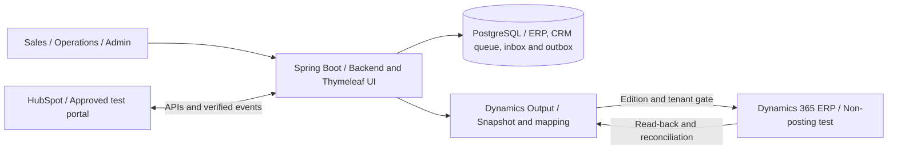
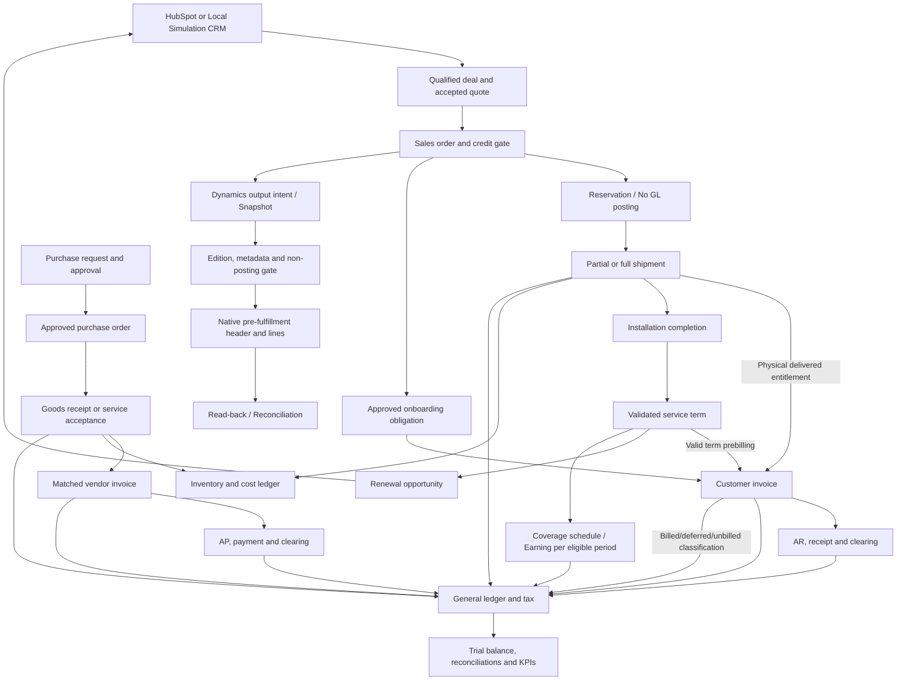
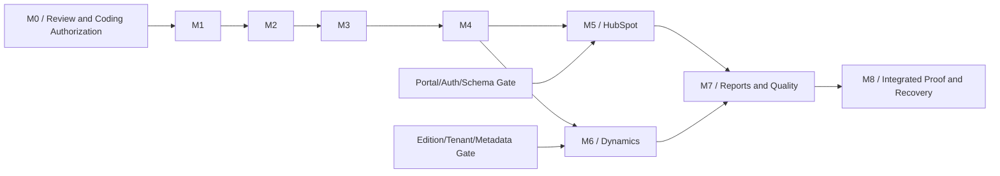

# Lab Sales Systems - Operational ERP-CRM Simulation Specification

Revision: 2026-11-12 (CRM progress permission and launcher publication restored per PO instructions: complete REN-6 comments and one verified Slack summary after reload. M1 In Progress/Medium status maintained; not automatic sync/background automation, full M1, or any other operational permission). Simulation identity: **rendgraagrida Lab Systems** (fictional).

**Status: LOCAL P2 REFERENCE CORRECTION PASSED FOR THIS SCOPE; FULL M1/AC22 AND ERP-CRM NOT YET ACCEPTED.** Source `content:39dd3ea5149d665d5d8fccde09d42104f9644f58b474f0f9c8747a06e0ba8d82` preserves original reference ID+version when validation400 reads the latest selection; other field fixes remain 409 without removing relationships. Actual24 tests and Chrome/Edge smoke tests passed; independent GPT review canonical correct/confidence0.96 with zero findings. This is the first reference correction candidate newly authorized by the PO, cumulative candidate7, not a replacement of the initial gate history rejected3/3 or a continuation of the previous rejected3/3. No deletion of existing data, Git publication, SaaS write, Mac operations, or deployment; external gates, M0/P5, and deferred launcher/runtime CD remain separated.

**Local Windows Launcher: PASSED at candidate3/max3.** Actual lifecycle and both ownership interleavings passed QA; independent GPT correct/confidence0.95 with zero findings. Native wrapper, immutable artifact/readiness, native listener PID, shared lock, and owned cleanup available at 11.8.9. Candidate2 remains rejected for two races, not a retroactive PASS. This is a local scope, not runtime CD or full M1 closure; historical defer references retain former provenance.

At the start of the implementation request, local fragments were briefly created and a portable runtime was downloaded; all feature implementation was subsequently halted. An identity replacement and one static HTML preview were once examined, not runnable ERP proof. The initial review phase did not build the application, initialize the database, or access HubSpot/Dynamics accounts. Subsequent workspace arrangement and CI tooling verification are distinguished in 11.7; application gap inventory is in 4.4 and 11.6.

Prior explicit instructions authorized workspace arrangement, dispatching selected snapshots to Mac, and establishing CI build/verify as well as artifacts; the user deferred runtime CD because a deployment target did not yet exist. Subsequently, the PO selected design baselines, approval policies without self-approval, target labs, and contact identities in 11.5. These selections are not business implementation instructions, runtime/database activations, account provisioning, license purchases, commit/push actions, or deployments. Baseline/policy approvals are separated from implementation verification, finalization of open details, and operational authorization.

**Active working decision:** all CRM tasks are performed from `D:/DEVELOPMENT/lab-sales-systems` on this Windows laptop per 11.3.1. Mac transfer, inspection, parity, and review instructions in the following archives are provenance only, not steps to be repeated. No Mac access/dispatch/sync in this continuation, no Mac data deletion, or global/SSH/Tailscale configuration changes. This work division change is not an application implementation instruction, DB provisioning, or publication.

**Latest M1 implementation authorization:** the PO instructions above authorize source changes as well as setting up an isolated new test DB. Notes prior to this permission stating no coding/build/DB represent design phase provenance, not active permission blockers. The integration owner proves a fresh target without touching other DBs/data/listeners, preserves legacy migration bytes, and records actual results prior to acceptance; documentation does not consider generated code as a PASS.

**Active implementation evidence:** LOCAL c643b843 foundation at 11.8.15 remains accepted for identical components. Gate delivery14bf9bca3/3 remains rejected GPT incorrect0.98 at 11.8.16. PO-authorized M1-CD-01/P1 and M1-CD-02/P2 corrections have now **PASSED** candidate1/max3: source `content:69a0f9c0e39c65cde9cbade69885997890a7cdfd90b2cdf71ce8bfef0b00d8cb`, actual24 Linux tooling and consumer CI/rollback/recovery fixtures, GPT canonical correct/confidence0.96 with zero findings at [11.8.17](#11817-m1-cd-01-and-m1-cd-02-corrections). FullM1/AC22 is not yet Done; no reset of previous gates, GitHub activation, real deployment, or changes to requirements/oracles/final owner ACs.

**Review navigation:** [Scope and stack](#4-our-chosen-architecture-and-stack) / [Readiness setup](#44-setup-readiness-and-evidence-boundaries) / [HubSpot contract](#54-hubspot-connector-contract-for-review) / [Dynamics output](#55-microsoft-dynamics-365-erp-output) / [Output parity](#554-output-parity-contract-and-comparison-evidence) / [Dynamics oracle](#811-dynamics-output-oracle-for-validation) / [Data structure](#7-data-structure-and-ownership) / [Flows and scenarios](#8-end-to-end-scenarios-with-synthetic-data) / [Timeline/milestones](#11-timeline-milestones-and-gate-reviews) / [Single Windows laptop workflow](#1131-single-windows-laptop-workflow) / [Slack-Linear operational guide](#1132-slack-linear-operational-guide-and-milestones) / [Approval checklist](#115-user-decision-checklist-prior-to-coding) / [P0-P9 readiness](#118-application-design-checklist-applied-to-crm).

## 1. Objectives and Boundaries of Simulation

Building an **operational ERP-CRM simulation application that accepts user input and actually processes orders**, not a presentation app, collection of mock screens, or mock order/inventory setups. Scope encompasses Order-to-Cash, Procure-to-Pay, inventory/costing, finance/AR/AP, synthetic tax, legal entity, installed base, and service contracts. The Java/Spring Boot web application and SQL database will connect to the user-owned HubSpot CRM.

Users must be able to create customers, contacts, suppliers, products, price books, and new transactions via the UI; edit drafts; submit approvals; process partial/full quantities; search for documents; and resume work after logout or restart. Values, validations, inventory, open items, and journals are derived from input and business rules, not hardcoded outcomes for seed examples. All mutations are persistently stored.

Interviews and learning are **supplementary use cases of the same operational application**. Presentation guides may aid navigation, but presentation success is no substitute for successful free-form data entry and transaction execution. All data remains synthetic; no real monetary transactions, physical shipments, real customer campaigns, or official tax filings occur.

What is preserved comprises the **conceptual product structure, data relationships, module responsibilities, and CRM-ERP flows**: capital equipment, recurring supplies, spare parts, installation, service contracts, quotations, orders, inventory, installed base, renewals, synchronization, reconciliation, and reporting. This is not a copy of any company's proprietary database schema or private configuration; such internal details are not available from public evidence.

What is entirely replaced across the UI, seed data, sample payloads, SKUs, serial numbers, sales documents, namespaces, and application screens:
- Company names, product lines, commercial names, internal category codes, and labels.
- Customer institutions, suppliers, contact names, email addresses, warehouses, pricing, discounts, lead times, transaction numbers, and service terms.
- Logos, illustrations, product descriptions, marketing copy, quotation templates, and visual design: independently authored, not copied and renamed.
- All portal IDs, form IDs, target webhooks, domains, and source company credentials: **not used**. Connections are established exclusively to authorized user-owned test portals.

The names HubSpot, Java, Spring Boot, PostgreSQL, and Microsoft Dynamics 365 may appear as factual references or technology terms; they are not used to imply endorsement or affiliation.

### 1.1. Intellectual Property Boundaries

- Company and product names primarily involve **trademarks** and risk of confusion/affiliation; specific logos may also be copyright-protected. Mentioning names as factual references is not equivalent to using them as application trademarks.
- Source code, images, texts, datasheets, illustrations, and expressive document forms may be **copyright-protected**. Publicly accessible materials are not automatically free to copy.
- Per WIPO, copyright protects expressions, not ideas, procedures, or operational methods themselves [R6]. However, other rights, such as trademarks, patents, designs, database rights, trade secrets, contracts/NDAs, and terms of service, still demand adherence.
- Do not incorporate confidential interview materials, real customer data, enterprise CRM exports, or private code without authorization. Do not access source company portals or attempt authentication bypasses.
- The name **rendgraagrida Lab Systems** and all product names herein are fictional working titles, **which have not undergone trademark clearance**. Conduct trademark searches in relevant jurisdictions prior to any public/commercial release. Educational status and disclaimers do not constitute legal immunity.
- This is a project risk mitigation guideline, not jurisdiction-specific legal advice. Reference principles: WIPO Copyright [R6] and Trademarks [R7].

Notice text required to appear on simulation environments and quotations:

> Independent operational simulation. rendgraagrida Lab Systems, products, customers, pricing, and transactions in this application are fictional. Not representing, sponsored by, or affiliated with the companies used as learning references. Neither a commercial offer nor an instrument for clinical decision-making.
## 2. Source facts and design decisions must be distinguished

| Item reviewed | Available evidence | Limits of conclusion |
|---|---|---|
| Java, HTML, CSS, JavaScript | Official sales system job posting mentions these technologies [R1] | Does not prove Spring Boot, Thymeleaf, Java version, SPA, or server rendering |
| Relational SQL, queries, stored procedures, Git, REST/JSON synchronization work | Job requirements in posting [R1] | MySQL, PostgreSQL, and SQL Server are mentioned as examples of experience; not certainty regarding their database engine or topology |
| HubSpot for customer, contact, deal, instrument, and sales information | Official Inside Sales job posting [R2], consistent with user interview statements | Instrument information does not prove the use of specific custom objects; a shared inbox does not automatically prove the Conversations product |
| Lead scoring and MQL/SQL analysis | Implementation provider case study [R3] | Historical implementation evidence, not access to current configuration or certainty of subscription tier |
| Microsoft Dynamics 365 | Group ERP project case study, published 2023 [R4] | Does not define the current edition, modules, tenant APIs, or configuration of each corporate unit |
| Monolith or microservices, number of pipelines, properties, custom objects, framework, and versions | No sufficient direct evidence | **Unverified**; must not be claimed as almost certain or identical |

All nine modules, three pipelines, custom objects, pricing/accounting policies, warehouses, schemas, and business rules below are **OUR SIMULATION DESIGN**. A modular monolith was chosen due to transactional scope and clear module boundaries, not because it was proven to be the source company's architecture. Public CMS assets or forms also do not prove internal application architecture, complete HubSpot packages, or GDPR compliance.

Equivalence to the source company's requirements is evaluated based on operational functions cited in [R1]/[R2]: maintenance of product/pricing/customer/opportunity/order/forecast/inventory, annual pricing and NPI, quotation and lead-time, consumables reorder, service coverage/renewal, HubSpot information input, REST integration, scheduled sync, data quality, and reporting. Forms/CRUD operations and their transactional impacts must be operational. Finance posting details, DB schemas, internal screens, pipeline counts, and approval policies remain our design, not findings from their private configuration.

## 3. Fictitious identity and catalog

| Element | Simulation decision |
|---|---|
| Company name | rendgraagrida Lab Systems |
| Application name | Lab Sales Systems |
| Company code/SKU prefix | `RGA` |
| Planned project name | `lab-sales-systems` |
| Planned Java namespace | `dev.labtrial.salestools` |
| Recommended test portal name | `Lab Sales Simulation - rendgraagrida` |
| Customers | Entirely fictitious research institutions, biotech, pharma, CROs, and distributors |
| Warehouses | `RGA-EU-01` and `RGA-NA-01`; fictitious operational locations |
| Example currencies | EUR and USD; separate price books, not hidden fixed exchange rates |
| Contact data and external transactions | `.example` domains; outbound email/SMS, money transfers, and physical shipments are disabled. Synthetic receipt/payment tracking in subledgers must remain functional |
| Clock fixture | `2027-01-15T00:00:00Z` is only a regression baseline; scenario/transaction business date can be selected by the user within a valid period |

### 3.1. Categories and product lines

The following labels were created for the simulation. Generic categories such as equipment, consumables, and service contracts retain the same business meaning; they do not claim technical specifications or equivalence to specific vendor products.

| Internal category | Fictitious UI label | Data and transaction role |
|---|---|---|
| `LAB_UNIT` | Experiment platform | Capital goods; one serial number per unit; can be installed and have service contracts |
| `LAB_SUPPLY` | Experiment supply package | Recurring purchases; stock tracked per SKU/warehouse; lot and expiry where applicable |
| `REPLACEMENT_PART` | Recovery component | Replacement parts with tracked compatibility, not automatically compatible with all instruments |
| `SERVICE_PLAN` | Assurance Program | Duration-based service; no physical stock; coverage and renewal bound to an asset |
| `IMPLEMENTATION_SERVICE` | Activation and training | One-off professional service; does not increase/decrease physical inventory |

The `TRANSFER`, `CLEANUP`, `PREPARATION`, `RINSE`, and `WORKCELL` instrument lines have relationships among devices, supplies, components, and services. Physical capabilities are not simulated; the project models their sales and operational processes.

### 3.2. Synthetic product master

All EUR prices below are fictitious unit prices before tax/shipping costs. Supply quantities use the `PACK` unit; packaging contents are not hidden price conversions. The USD price book requires separate values.

| SKU | Fictitious product name | Category | Line | Unit | EUR Price | Tracking |
|---|---|---|---|---|---:|---|
| `RGA-UNIT-TR120` | RGA-Transfer 120 | `LAB_UNIT` | `TRANSFER` | EA | 24000.00 | Serial |
| `RGA-UNIT-TR360` | RGA-Transfer 360 | `LAB_UNIT` | `TRANSFER` | EA | 46000.00 | Serial |
| `RGA-UNIT-CL240` | RGA-Clean 240 | `LAB_UNIT` | `CLEANUP` | EA | 18500.00 | Serial |
| `RGA-UNIT-PR360` | RGA-Prep 360 | `LAB_UNIT` | `PREPARATION` | EA | 58000.00 | Serial |
| `RGA-UNIT-RI480` | RGA-Rinse 480 | `LAB_UNIT` | `RINSE` | EA | 21000.00 | Serial |
| `RGA-UNIT-WC600` | RGA-Cell 600 | `LAB_UNIT` | `WORKCELL` | EA | 125000.00 | Serial |
| `RGA-SUP-CS080` | Cassette Kit 80 | `LAB_SUPPLY` | `TRANSFER` | PACK | 100.00 | Lot |
| `RGA-SUP-CS160` | Cassette Kit 160 | `LAB_SUPPLY` | `TRANSFER` | PACK | 180.00 | Lot |
| `RGA-SUP-RS020` | Reservoir Set 20 | `LAB_SUPPLY` | `PREPARATION` | PACK | 240.00 | Lot |
| `RGA-SUP-QM010` | QualityMix 10 | `LAB_SUPPLY` | `CLEANUP` | PACK | 320.00 | Lot + expiry |
| `RGA-SVC-BASE12` | Assurance Base 12 | `SERVICE_PLAN` | `CROSS_LINE` | TERM | 1800.00 | 12-month contract |
| `RGA-SVC-PLUS12` | Assurance Plus 12 | `SERVICE_PLAN` | `CROSS_LINE` | TERM | 3200.00 | 12-month contract |
| `RGA-PART-MD010` | Motion Drive 10 | `REPLACEMENT_PART` | `TRANSFER` | EA | 950.00 | Stock |
| `RGA-PART-SN020` | Level Sensor 20 | `REPLACEMENT_PART` | `RINSE` | EA | 450.00 | Stock |
| `RGA-IMP-ONB01` | StartLab Onboarding | `IMPLEMENTATION_SERVICE` | `CROSS_LINE` | JOB | 1200.00 | Service completion |

Example fixture compatibility: Cassette Kit 80/160 and Motion Drive 10 are exclusively for the TRANSFER line; Reservoir Set 20 for PREPARATION; QualityMix 10 for CLEANUP; Level Sensor 20 for RINSE. Assurance and onboarding follow the active service matrix per device. Do not copy compatibility lists from original vendors.
### 3.3. Customer, contact, supplier, and asset

| Fixture ID | Fictitious entity | Synthetic details |
|---|---|---|
| `RGA-CUST-001` | Orbelis Research Lab | `ACADEMIA`, `EUROPE`, `orbelis.example` |
| `RGA-CUST-002` | Teralune Bioanalytics | `BIOTECH`, `NORTH_AMERICA`, `teralune.example` |
| `RGA-CUST-003` | Orbelis Translational Lab | Distinct branch sharing the same fictitious parent; not an automatic duplicate of the first customer |
| `RGA-CON-001` | Mira Senara | Synthetic lab manager, `mira@orbelis.example`, linked to the first customer |
| `RGA-CON-002` | Arin Velden | Synthetic procurement, `arin@teralune.example`, linked to the second customer |
| `RGA-SUPPLIER-001` | Nuvarek Components | Fictitious supplier, `ops@nuvarek.example`; no real purchasing |
| `RGA-ASSET-001` | Sample installed device | SKU `RGA-UNIT-TR120`, serial `SIM-RGA-TR120-00001`, owned by `RGA-CUST-001` |
| `RGA-CONTRACT-001` | Assurance Base 12 | First asset; `[2026-04-15, 2027-04-15)`; exactly 90 days remaining relative to the fixture clock |

Street addresses, phone numbers, valid tax IDs, bank details, and biological/patient data are not required for fixtures. Where a UI requires values, use `SIM-*` labels that are clearly invalid for real transactions. Use `.example` emails for test records rather than outbound addresses; delivery testing must only use provider-approved test account users.

## 4. Our Chosen Architecture and Stack

Priorities: correctness of input and transactions, authorization, auditability, maintainability, and proof of consumer flows, rather than mere RAM savings or presentation appearance. A modular monolith is the baseline decision for this scope; microservices are justified only when there are measurable needs for deployment, team ownership, isolation, or independent scaling. There is no need for Kafka, Kubernetes, service discovery, or extra message brokers solely to appear enterprise-grade.



The simulated ERP possesses a domain boundary and persistent storage, rather than acting as a server returning success without mutations. The user selected **simulated ERP + Dynamics output**, rather than Dynamics as the primary ERP and not Microsoft 365/Office. The local ERP remains the authoritative owner of inventory/finance; native output is restricted to non-posting tests on authorized isolated tenants. We do not claim local ERP API compatibility with OData nor do we duplicate the full vendor module suite. The native Dynamics connector is a separate deliverable under section 5.5 and M6, gated by edition, metadata, license, tenant, and authorization checks; it is not yet implemented.

| Layer | Design choice | Requirements |
|---|---|---|
| Runtime | Java 21 LTS, local Temurin `21.0.13+9` | Windows binaries used for real application and build execution; support/provenance remains 11.8.7. Concurrency is constrained by DB/API capacity; no second host prerequisite |
| Backend and build | Spring Boot `4.1.2` single BOM; Spring MVC/Security; Maven `3.9.16` | POM has cut over from `4.0.9`; real application clean verify and PostgreSQL executed in 11.8.9. Does not assert that all future domains/connectors are compatible or complete |
| Modularity | Package per domain and explicit interfaces | Spring Modulith may be used for module boundary verification where beneficial; it is not a prerequisite for architectural correctness |
| UI | Thymeleaf `3.1.5.RELEASE` via starter BOM; HTML/CSS/JS as needed | Single SSR UI, without a secondary SPA; target, trade-offs, and legacy shell cutover in 11.8.7. Independent layout/copy/theme; Bootstrap/HTMX/charts used only where strictly required |
| Database | PostgreSQL `17.11`; explicit Maven Flyway `12.4.0` and PostgreSQL module | Project-owned native cluster and fresh schema-only V1-V3 migrations executed; runtime does not load/invoke Flyway. Not H2/SQLite or auto-upgrading existing DBs |
| Data access | Spring JDBC `7.0.10` from BOM, typed scoped repository/service | M1 queries and transactions run against real PostgreSQL; does not introduce JPA or claim end-user RLS/isolation derived merely from a shared DB role |
| Integration | RestClient design, external ID mapping, inbox, and transactional outbox | M5/M6 deliverables governed by native gates; not yet implemented and not substituted with stubs/fake success. Retries only when semantics are safe; no exactly-once guarantees across SaaS |
| Scheduling | Scheduler design with persistent lock/lease | Deliverable of subsequent domains; no empty schedulers or jobs claiming completion of unbacked operations |
| Verification | Real PostgreSQL application tests and SSR smoke tests on Windows Chrome/Edge; native connector tests on corresponding milestone | Local host uses native runtime, not automated Docker. CI uses disposable PostgreSQL services on hosted runners; no actual GitHub runs to date |
| Operations | Git, health checks, job history, verified backup/restore | VPS selection based on workload measurements; this document provides no capacity or production-ready claims |

### 4.1. Proposed scope submitted for approval

| Domain | Mandatory operational functions | Stated boundaries |
|---|---|---|
| Organization/master data | Two synthetic legal entities with EUR and USD base currencies, customers/vendors, products, warehouses, accounts, and fiscal periods | Transactions and ledgers isolated per entity; no intercompany transactions, consolidation eliminations, or FX revaluation |
| Sales / O2C | Input quote/revision/approval, customer acceptance/PO, order, reservation, partial delivery, installation/services, invoice, AR, partial/full receipt, and clearing | Stock, document, and journal changes are persistently committed; no physical delivery or external payment processing performed |
| Procurement / P2P | Input purchase request, approval, PO, partial receipt, PO-receipt-vendor invoice three-way matching, AP, and partial/full payment | Inventory purchasing and simple operational services; excludes enterprise sourcing/tendering or vendor EDI |
| Inventory | Serial/lot/expiry, reserve/release, authorized receipt/issue/transfer/adjustment, stock ledger, moving weighted-average costing | No production, manufacturing BOMs, MRP, physical lab quality control, import landed costs, or machine capacity planning |
| Finance | Chart of accounts, AR/AP journals/subledgers, simulated bank/cash, input/output tax, GRNI, unbilled receivable, deferred service revenue, period close, and controlled reversals | Does not constitute IFRS/GAAP certification, live-bank reconciliation, official tax reporting, payroll, or comprehensive fixed asset accounting |
| Service | Installed assets, coverage history, expiry/renewal, service revenue recognition per designated period | Excludes field-service dispatch, complete spare-parts repair work orders, or instrument telemetry |
| CRM and integration | Simulated CRM queue/routing/follow-up/reactivation/scoring, functional Local Simulation, HubSpot connector, and Dynamics output with mapping/reconciliation | No live outbound dispatch, silent fake success, or dual-mastering. Dynamics output strictly follows section 5.5 non-posting boundaries; native acceptance cannot be substituted by file export |
| Deep dive and presentation | Process explorer, document lineage, journal walkthroughs, data dictionary, and optional interview guide layered over the operational application | Not a fixed click-through demo, not a read-only application, and not an official or production-ready ERP system |

All rows above constitute a single baseline scope accepted by the PO on 11.5, not a list of features that may be silently dropped or an assertion of already passed implementation. Gaps in entitlements, data, or environments remain blocked according to dependencies; scope adjustments require user decisions. Target interview/usage dates have not been provided; therefore, section 11 timelines remain relative to T0 and actual capacity, rather than promised completion dates.
### 4.2. Data Input Contracts and Operational Transactions

**Seed data is solely an initial sample, not a boundary on data that may be created.** Users can start from a workspace with a selected baseline or an empty workspace prepared via master data forms. The operations below must be available through an authorized UI; they must not require editing SQL/source code to complete normal ordering.

| Area | Input that must be user-creatable/editable | Mandatory persistent impact | Modification boundaries |
|---|---|---|---|
| Organization and access | Legal entity, base currency during setup, warehouse, fiscal period, account master, and role/entity assignment | Master/configuration versions and audit trail | Entities/base currencies or accounts already used in postings cannot be destructively modified |
| Customer and contact | New institution name, parent/child, segment, territory, contact role/email, synthetic billing/shipping address, and payment terms per entity | Searchable customer/contact/association and entity accounts | Separate credit approval; deactivate referenced masters rather than deleting history |
| Supplier | New synthetic supplier, entity assignment, terms, and status | Supplier and references on PR/PO/AP | Does not use bank data or transmit real orders |
| Product and compatibility | New SKU beyond the 15 seeds, name, category, product line, UOM, serial/lot tracking, compatibility, and bundles | Product master, entity settings, and transaction references | Unique SKU and integrity checks; posted products cannot have tracking/UOM changed without an approved migration process |
| Pricing and NPI | New price book, currency, unit price, effective dates, annual update proposals, preview, and approval | Price versions, run history, and publication intent | Accepted quotes retain previous snapshots; no bulk changes without preview/approval |
| Inquiry, lifecycle, and deal | Source/need/contact, shared queue, assignment, routing rule, follow-up/outcome, dormant-customer candidate, score/explanation, qualification, owner, and stage | Inquiry/activity/routing/scoring/reactivation history, opportunity, and associations | Email/call recording is simulated, not actual delivery. Score/assignment is not consent, customer response, credit approval, or automated ordering |
| Quotation | Entity/customer, multi-line products, quantity, effective date, discount, tax code, and customer reference | Draft/revision, calculable net/tax/gross, approvals, and accepted snapshot | Prices originate from the price book; authorized overrides must be audited/approved; numerical output is computed by the backend |
| Sales order and delivery | Accepted quote/PO, warehouse, planned date, reservation, partial shipment quantity, serial/lot, and cancellation reason | Order/lineage, reservation, stock movement, source event, and posting | Orders from direct ERP entry are permitted for valid scenarios; identical guards apply without dependency on Won labels or guide interviews |
| Procurement | Request lines, supplier, quantity/cost, approval, PO, received quantity, lot/expiry, and vendor invoice reference | PR/PO/revision, receipt/service acceptance, matching, stock/valuation, AP, and journal | Quantity/cost/tax/reference are validated; mismatches exceeding tolerance are held for review |
| Finance and settlement | Posting date, eligible invoices, synthetic payment amount/reference, partial allocation, correction reason, and period actions | AR/AP items, allocation/reversal, tax snapshot, cash ledger, and GL | No direct editing of posted amounts; reject overpayment, duplicate postings, and closed period dates |
| Installed base and service | Asset/serial, owner/operator, completion date, service plan, coverage term, renewal selection, and quote | Installation event, asset/contract history, schedule, and renewal intent/deal | Not tied to a single seed serial/customer; overlapping or duplicate renewals are rejected |
| Integration and reconciliation | Authorized mode/account, connector profile, mapping/schema version, sync trigger, Dynamics preview output, failure review, and replay | Intent/delivery/item status, mapping/checkpoint, snapshot/hash, and read-back evidence | Secrets do not enter chat/MD; Dynamics edition/company and HubSpot portal must be explicitly bound; local files/HTTP 2xx alone do not constitute native success |
| Search and reporting | Document search/filter, reference number, customer/SKU, status, entity, currency, and date range | Results computed from persistent state; exports respect filters/permissions | Not limited to displaying seed samples or static KPIs; no open SQL console |

General form contract: mandatory fields and valid references are validated in the backend; errors are attached to invalid inputs and do not cause partial commits; drafts are saved and can be reopened; quantity, UOM, tax, currency, date, role, entity, and version concurrency are also validated. Repeated submissions or two operators processing the same stock must not duplicate transactions or result in negative inventory.

Fixture baseline dates do not lock all transactions to January 2027. Scenario business dates can be selected within valid periods and used for pricing, expiry, aging, coverage, and recognition. Security timestamps for webhooks, authentication, and observability continue to use actual time, not user-modifiable business clocks.

### 4.3. Persistence, Operating Modes, and Presentation Boundaries

- The application must accept multiple user-created customers/products/orders and remain consistent after browser reload, logout/login, or application process restarts.
- Scenario workspaces isolate training datasets, legal-entity access, and business dates. Creating a new workspace or selecting a baseline is an explicit action; startup, reload, or entering a guide must not reset or overwrite transactions.
- Referenced masters use deactivation/versioning; drafts may be edited according to their state. Accepted/posted documents use revisions/corrections/reversals. Dataset deletion/reset requires separate, explicit, authorized, and audited actions, not a presentation "next" button.
- `LOCAL_SIMULATION` mode: local CRM inputs use identical models and validations, are stored persistently, and are not claimed to be synchronized with HubSpot. `HUBSPOT_SANDBOX` mode: CRM fields follow HubSpot authority/source; inputs on the portal itself or modifications through an approved connector must pass validation/mapping/audit.
- Switching modes does not automatically copy data, merge Companies based on domain, or send all local records to HubSpot. Promotion/sync of selected synthetic records requires mapping, account scope, and write permissions; provider errors remain in pending/failed/review status.
- Guide interviews and baseline regressions are not separate business engines. Changes to quantity, approved pricing, customer, product, date, or transaction sequence must affect real outcomes, rather than following fixed sample results.
- ASCII normalization applies to the **format of this document**, not as an application input constraint. The UI/database continues to support valid, secure UTF-8 text; accented contact names must not be corrupted because the document was drafted in ASCII.

### 4.4. Setup Readiness and Evidence Boundaries

This table summarizes local status as of 11.8.9; initial inventory and CI/design phase evidence remain in archives 11.6/11.7/11.8.7. `LOCAL_VERIFIED` applies only to inputs/surfaces actually observed, not as a final verdict, full AC, full M1, or production. External gates and pending deliveries are not converted to N/A.

| Area | Latest local status | Evidence and boundaries |
|---|---|---|
| Documents and identity | AVAILABLE | Baselines/policies and local M1 permissions have been granted; full M0/P5 is not automatically complete |
| Portable Java/Maven/PostgreSQL | LOCAL_VERIFIED | Temurin21.0.13+9, Maven3.9.16, PostgreSQL17.11 actively used; without global installations or host Docker |
| Manifest and modules | LOCAL_FOUNDATION_ACCEPTED / FULL_M1_OPEN | Current M1-REF-02 candidate2 sourcec643b843 actual27tes and immutable artifact, integratedGPT correct0.95/no findings accepted seven localfoundationboundaries11.8.15. Candidate1incorrect0.94/d57incorrect0.96 remains history. Not approval for fullM1/delivery or nine modules |
| Target UI | VERIFIED_SCOPED / PARTIAL | Currentc643b843 Chrome156/Edge157 actual1366x768 existing-lineactive/inactive400 exacttoken/input/errorretention, amountonly409, explicitrefresh/save/history. Currentcandidate2restartHTTPreadback. Prior179actionproof applies only to unchanged components, not all newJAR/role/viewport permutations |
| Setup/local/check entrypoint | LOCAL_VERIFIED_SCOPED | Native `local.cmd`/`local.ps1`: final candidate3 actual root/cwd/path-spaces, native listener-PID readiness, receipt lock, foreign/same-port race, two roots, and stop/crash proof; GPT correct/confidence0.95. Candidate1/2 rejected; runtime CD/full M1 delivery OPEN |
| Database and schema | LOCAL_VERIFIED | Isolated fresh cluster, explicit migrate/validate V1-V3, scoped FK/keys, and actual PostgreSQL transactions. No applied-legacy upgrades are claimed |
| Seed | VERIFIED_SCOPED / PARTIAL | Current canonical rows/EMPTY/opening11.8.11, plus late final-audit rollback38 core tables and conflicting EMPTY/O2C race one receipt11.8.12. Not all fault/concurrency permutations; FULL_OPERATIONS remains M4 |
| DB privilege | VERIFIED_SCOPED / PARTIAL | Future-object/owner/migrator denial11.8.12 and current missing/unavailableDB/revision/schema/old-unknownhistory startup failclosed11.8.11/13. Explicit foreign-lineage migration rejected without repair; not an approved legacyupgrade |
| Auth and authorization | PARTIAL_SCOPED_ACCEPTED | SEC-M1-01 accepted; exact current session rotation/idle1800/absolute8h/no-replay, actual HTTP workspace revoke404, and two revoke/write sequences verified11.8.12. Not a full integrated foundation approval |
| HubSpot receiver/connector/jobs | NOT_IMPLEMENTED_M5 | No active public receiver or fake provider; signature, tenant, inbox/outbox, and lease follow the M5 gate |
| HubSpot portal/capabilities | EXTERNAL_GATE | Test account type, scope/seats/currency/objects/quote, app identity, signing contract, and HTTPS ingress not yet verified on the portal |
| HubSpot provisioning toolchain | NOT_VERIFIED | Node/HubSpot CLI compatible with project platform not yet confirmed; provisioning tooling only, not Java backend modifications or automated app install/upload permissions |
| Dynamics output/native adapter | EXTERNAL_GATE | No connector or tenant exists yet. Source enterprise edition, metadata, company, master/reference setup, app permissions, and native read-back not yet verified |
| Backup/restore and recovery | PARTIAL | Current app+owned PostgreSQL restart retains counts/fullrowSHA25638 fixture tables, no reseed, login, and exact master values. Original37 tables identical. This is not an isolated restore/RPO/RTO M8 or remote recovery |
| VPS/remote CI/deployment | HOST_READONLY_VERIFIED / CRM_NOT_DEPLOYED | Following PO approval, read-only SSH observed Java21.0.13+9/Maven3.9.16, PostgreSQL17.11 active loopback55439 with matching cluster identity, effective runtime without CREATE/owner membership, app0tables/nohistory, noCRMservice/8187listener, and inactive nginx. Secret metadata inspected without values; no restart/migration/bootstrap/deploy. SSH pin matches priorTOFU, not independent cloud-console proof. Host prerequisites do not constitute runtime CD/M1/AC22; owner details remain in README |

Entrypoints, pins/envs without secret values, loopback ports, native launcher/ownership/stop, separate migration/bootstrap/baselines, and `/health` are documented in the README and 11.8.9. The local launcher scope passed actual QA and independent GPT review candidate3. The launcher is not a runtime deployment adapter and does not enable WSL/Docker or global Windows services.

Workspace seeding is an explicit action after the schema is ready; startup/reload does not re-insert the baseline. Backups cover the database, schema/config/mapping versions, and secret references, without copying secrets into reports. Restores do not overwrite user datasets and do not immediately replay all remote writes.

The library/no-DB resolution in 11.8.7 is historical design evidence. Application verification now in 11.8.9 uses an actual database, roles, migrations, HTTP, browsers, and artifacts. Role/file names or `--version` outputs alone do not constitute proof of healthy schema/data/privileges; initial inventory is not promoted to a new PASS.
## 5. User-Owned HubSpot Configuration

### 5.1. Account and Permission Gates

The user has stated that they activated a developer account. This does not prove that a developer test account, tier, scopes, or any premium features are actually active.

Official documentation notes that developer test accounts include a 90-day trial for **many**, but not all, enterprise features [R5]. Product trials, account validity periods, and renewal requirements differ; do not assume a private app token indefinitely extends everything. The official UI provides `Renew trials`; renewals via API are subject to the OAuth provisions outlined in that documentation.

Low practice volume does not guarantee the entire architecture is free of charge. Basic CRM access, developer test accounts, premium feature trials, quote/custom object entitlements, hosting, and Dynamics tenants/licenses are separate prerequisites. No automated purchases or provisioning will occur; record the actual capabilities and validity periods prior to M5/M6. Prior conversation summaries stating an integration is always free do not constitute a commercial contract or proof of entitlement.

Prior to account-dependent implementation, verify the following via the UI of the correct test portal:
- Account ID/account type, test portal, timezone, currency, users, and role-based permissions.
- Ability to create pipelines, custom properties, associations, custom objects, workflows, scoring, inbox, reporting, and quotes/CPQ.
- Quote/CPQ and commerce entitlements are separate from the baseline capability to store deals. Do not purchase tiers based solely on Starter/Professional/Enterprise naming without checking Hubs, seats, limits, and the latest official quotation.
- Supported app/auth methods and events, minimum scopes strictly for features in actual use, API quotas, and pagination/batch limits.
- Marketing email in test accounts is restricted to account user addresses [R5]; synthetic datasets must never trigger campaigns to real people. Google Ads and other paid services must not be enabled.
- Prior to M5 remote writes, the portal owner must inspect workflow enrollment/re-enrollment, sequences, notifications, and downstream integrations that could be triggered by property or association create/update calls [R35]. Prove that synthetic records are isolated from disallowed outbound/automation paths; `.example` emails and false payment/billing flags alone are insufficient. Log the portal, record scope, controls, owner, and proof of inspection; if safety is not proven, writes remain `BLOCKED`. Modifying portal automations also requires scoped permissions; it must not be a side effect of a review or connector startup.

Current tasks do not access user accounts. Never share passwords, recovery codes, tokens, client secrets, or signing secrets in chat/MD/Git. Schema provisioning must use temporary permissions separated from runtime where possible; store secret references in an ignored local environment/secret store, and redact logs.

### 5.2. Designed Objects and Properties

| Object | Simulated Data | Data Owner / Terms |
|---|---|---|
| Companies | Customers and parent/child institutions | HubSpot for commercial relationships; separate ERP customer code per legal entity |
| Contacts | Fictitious researchers/operators/procurement staff | HubSpot for contacts and lifecycle; company is not a mandatory 1:1 relationship |
| Deals | Equipment opportunities, supplies, renewals | HubSpot for pipelines; ERP status code is a projection, not the deal stage owner |
| Products | Published SKUs and active catalog pricing | Internal catalog/pricing is authoritative; quote stores snapshots |
| Line items | Quoted items, qty, currency, price, discount | Transactional snapshot; single parent per native line item, with distinct identities for Deal and Quote [R19] |
| Quotes | Quote publication if entitlement permits | Internal quote revision remains authoritative; no legacy/premium API claims are assumed prior to account gate verification |
| Custom object `Lab Assets` | Serial number, model, customer, installation | Our design choice; requires verified entitlement. Object type ID/association IDs are resolved from the portal schema, not guessed |
| Service contract projection | Coverage period and renewals | Separate local contract with history; additional custom objects only if entitlement and relational requirements demand it |

Use the custom property prefix `sim_`, such as `sim_record_key`, `sim_erp_customer_code`, `sim_segment`, `sim_territory`, `sim_asset_serial`, `sim_erp_order_number`, and `sim_coverage_end`. `sim_record_key` serves as the fixture/integration ID, not a replacement for the HubSpot-assigned record ID.

`Lab Assets` are linked to the owning Company, operator Contacts, purchasing Deal, and renewal Deal via associations retrieved from the account schema. Contracts must not be collapsed into a single date on the Company when multiple units/periods exist. Shared mailboxes, tickets, sequences, ads, and CPQ must not be declared active simply because base objects exist.

### 5.3. Three Simulated Pipelines

These represent an educational configuration, not the source company's actual pipelines. Display names may change; store the pipeline/stage IDs retrieved from the portal and their meanings within the configuration mapping. Never hardcode `closedwon` as a universal ID.

| Pipeline Code | Simulated Stages |
|---|---|
| `EQUIPMENT_SALES` | Qualified opportunity -> Technical fit -> Demonstration -> Quote issued -> Customer acceptance -> Won / Lost |
| `SUPPLY_REORDER` | Reorder inquiry -> Availability checked -> Quote/PO confirmed -> Won / Lost |
| `SERVICE_RENEWAL` | Renewal due -> Coverage reviewed -> Renewal quote -> Won / Lost |

Lead -> MQL -> SQL is a contact/account qualification lifecycle, not necessarily a deal stage. Create Deals only after an opportunity satisfies criteria; lead scores and opportunities do not prove marketing consent. Forecast probabilities are inspectable simulation model configurations, not real enterprise performance metrics.

### 5.4. HubSpot Connector Contract for Review

Proposed profile `RGA-HS-TEST-01`: single authorized test portal, developer-platform project private distribution, and static auth matching documentation at implementation time [R8]. Platform baseline `2026.09` and REST GA family `2026-09` must be verified and pinned; legacy endpoint exceptions are recorded per operation, without mechanical URL substitution. OAuth is not the default dependency for a single portal and is not a substitute for entitlement verification. The application label `HUBSPOT_SANDBOX` does not prove a sandbox account type.

Provisioning tooling uses Node LTS and a compatible HubSpot CLI, pinned after approval; proposed Node 22+ satisfies referenced project tooling requirements [R8, R21]. CLI install/auth/app upload and schema writes are separate scoped operations, not part of ERP startup or granted via MD review. No secondary Node frontend/SPA will be created.

| Profile Section | Mandatory Contract Prior to Remote Write |
|---|---|
| Identity and authority | Approved portal/app, workspace binding, allowed record scope, schema/mapping version, and field writer; fail closed on mismatch |
| Auth/privilege | Runtime read/write limited strictly to approved capabilities; schema/pipeline/association provisioning decoupled. Static auth uses required scopes; gated entitlements are not merely optional-scope labels |
| Field mapping | Local path, object/internal property, type/fieldType, internal enum, requiredness including conditional-required and portal Create Record rules, date/datetime/decimal, null/omit/explicit-clear policy, authority, and response properties [R22] |
| External IDs | Scoped environment/portal/object/workspace string; owner uses owner `id`, not `userId`; pipeline/stage and association direction/category/type ID originate from the portal |
| Unique recovery | Unique `sim_record_key` on supported objects/endpoints; stable key stored prior to create. Recovery via mapped ID or supported unique lookup, never domain or empty search |
| Currency and catalog | Portal/deal currency matches accepted currency; publish active price per mapping, not entire price book history into a single `price`. No auto FX or portal currency/rate mutations |
| Amount | `Deal.amount` is explicitly projected as commercial net after discount and before tax; this is our integration convention, not a native HubSpot-guaranteed calculation. Prior to acceptance, uses active approved quote; post-acceptance snapshot is locked. Write/read-back amount is decoupled from line items because API updates do not automatically recalculate deal amount [R23] |
| Quote and line item | Internal quote is authoritative; family/entitlement selected first. Deal and Quote use distinct line items with source-line/revision/parent binding. Every batch input must carry approved distinguishing properties, such as `sim_record_key` scoped to parent/source-line/revision; identical batch inputs may be silently merged by HubSpot. Reconcile every returned ID/key/association, not merely response order or count [R19] |
| Tax/commerce | Synthetic tax mapped to approved provider tax-rate ID, not raw text SIM-VAT7 as native ID. Set payment/billing to false and read back. Do not attach payment processors, publish/share/e-sign, or send campaigns without separate authorization |
| Anti-automation | Section 5.1 gate proven prior to write; approved record scope, properties/associations, and portal guards match profile. Relevant profile/automation changes require re-verification; read-back includes proof of no disallowed enrollment/outbound actions, not just commerce false fields |
| Result and read-back | Persist returned IDs and read back actual properties/associations. Ignored fields, invalid enum/owner/currency, or mismatched line counts require review, not marked successful merely on 2xx status |

New quotes have distinct Revenue Hub requirements [R9]; a developer account does not prove CPQ availability. Internal `APPROVED`/`ACCEPTED`, provider quote state, and buyer acceptance are distinct facts; provider acceptance must not overwrite the source revision. Projections lacking entitlement/mapping remain `BLOCKED`; local ERP does not emit fake live success. Native HubSpot scores and simulated scores are maintained as distinct concepts.

A remote create timeout is an ambiguous result. Search via mapped ID/supported unique lookup, verify snapshot, and persist mapping before declaring success. CRM Search has indexing delays and excludes archived records [R10]; an empty result is not authorization for a blind create. Objects lacking verified recovery identity must route to manual review, with no exactly-once guarantees.

On REST `2026-09`, mappings must include conditional-required and required properties from portal Create Record rules. Validation errors require input/mapping correction prior to replay, not identical payload retries. Required associations in the UI do not guarantee public API enforcement; business relationship validation remains the connector's responsibility. Edit Associations restrictions for user-level OAuth must not be assumed identical for portal-level static tokens [R22].

Default deal calculations and native quote/line-item behavior must be documented in the profile. If primary quote/finalization operations are separately authorized, they may overwrite Deal amount/line items; re-reconcile projection and mapping rather than mutating the accepted local source to fit. Native cloning generates new line IDs and does not copy unique property values; rebind each line's identity and read back the parent before considering it synchronized. Recovery based on coincidental SKU or commercial value matches is forbidden [R19, R23, R24].

HubSpot tax/discount precision and rounding must be tested against source snapshots before mapping approval. Recurring billing/subscriptions are not mandatory representations of ERP service schedules; a single fee term fixture must not be converted into a native recurring charge or activate billing. Any mismatch in amount/lines/tax transitions to `NEEDS_REVIEW` and cannot be deemed valid simply because transport succeeded.

Webhooks must use the app-supported signature profile; the v3 proposal must be validated against real configurations [R11]. Validate raw body, actual timestamp, canonical external URI, and constant-time HMAC before processing mutations. Never trust arbitrary forwarded hosts or fall back to weaker signatures. Verify portal/app/record scope; acknowledge with 2xx only after a durable inbox commit. Public HTTPS ingress is an independent gate, not a local loopback port. Subscription/event identity, quotas, bounded retries, and delivery semantics must be pinned per profile.
### 5.5. Microsoft Dynamics 365 ERP Output

**User decision:** Simulated ERP + Dynamics output; Dynamics is not the primary ERP owner. This output is a mandatory deliverable for M6, but it has not been implemented yet. A subsequent request mentioning Microsoft 365 has been clarified as Dynamics 365 ERP; Office/Graph/Outlook/SharePoint/Teams are not added to the scope.

**Edition evidence boundary:** [R4] refers to the Microsoft Dynamics 365 family, not proof of Finance/Supply Chain versus Business Central as used by the current operating company unit. Requests to adapt to the source company must not be answered by fabricating an edition. Edition/module/API/tenant/company remain an `EXTERNAL_GATE`. The two reference profiles below do not grant permission to build two adapters simultaneously; the eventual implementation will select one once edition evidence and metadata are approved.

| Candidate native profile | Discovery and identity | Non-mixable contracts |
|---|---|---|
| F&O-based Finance / Supply Chain | OAuth/Entra and dedicated service identity; approved HTTPS environment; `/data` and `/data/$metadata`; company/dataAreaId and full entity keys | Sales order headers V2 then lines V2 if the entities are available. Official sample public collections are `SalesOrderHeadersV2` and `SalesOrderLines`, rather than guessing a V2 suffix for all entities [R12-R15] |
| Business Central | Approved tenant/environment, company GUID, and API v2.0 metadata | `companies(...)/salesOrders` and salesOrderLines use BC contracts. Company GUID is not dataAreaId; native `shipAndInvoice` is a posting action strictly prohibited within this boundary [R16] |

F&O OData uses immediate business validation; DMF/batch behaves differently, and an accepted job does not imply import completion [R12]. The transport choice is pinned to the profile after edition/volume/metadata are determined; do not add DMF/custom services merely to mimic an enterprise setup. Uppercase import field names in documentation are not proof of tenant OData casing/keys; use actual metadata and real required/default fields.

#### 5.5.1. Authority and Non-Posting Guards

- The local ERP continues to process orders, reservations, shipments, invoices, stock, and ledgers in accordance with sections 6-8. Native Dynamics records are test copies, not a secondary operational order or a source of local credit/stock/payment updates.
- The Dynamics connector is disabled by default. Every target uses an approved test tenant/company, synthetic reference/master data, and least-privilege app permissions. Do not use the source company tenant or production.
- Native create/update is restricted to profile-approved pre-fulfillment sales order documents. Automatic reservation, release, picking, shipment, invoice, payment, subscription, notifications, and downstream workflows must be disabled/restricted in the test company; order creation itself must not be assumed to be free of side effects.
- Posting/confirmation/ship-and-invoice/settlement actions are not allowlisted. Native read-back must verify that the order has not been operationally processed and that target stock/financial balances have not changed. If this cannot be guaranteed, native writes remain blocked.
- Customer, item/released product, UOM, warehouse/site/dimension, delivery address, terms, number sequence, and tax group must be available/mapped. Administrators may prepare synthetic master data through approved procedures; the connector does not silently create finance/tax configurations or production master data.
- Local output files, preview mappings, and local schema tests must be labeled distinctly from native acceptance. No generic JSON is automatically deemed Dynamics-compatible, and there is no native success without a tenant read-back.

#### 5.5.2. Canonical Output Package and Source Inputs

This is a data contract for review, not a universal OData payload or an implementation file. The package is generated from persistent state and a valid source revision; the source snapshot/hash and mapping version must not change on retries.

| Output section | Minimum fields/contents | Validation and purpose |
|---|---|---|
| Manifest | Schema version, batch/record key, workspace/entity, target profile/environment/company, actual generated-at, business date, source type/key/revision, payload hash, simulation marker, and expected mode | All references are bound to an approved target; the simulation marker is not an arbitrary property transmitted to the native entity |
| Customer/product references | Local party/entity account and SKU, approved external IDs/codes, address snapshot, UOM, currency, terms, and required reference mappings | Domain/email is not a customer key; a new SKU without a mapping yields `MAPPING_REQUIRED`, rather than being replaced with seed products |
| Sales order header | Local order/accepted quote revision, CRM reference, ordering/bill-to customer, company, currency, tax-exclusive flag, payment terms, requested ship/delivery date, and historical address | Bill-to, ordering party, and target company are verified; native number/ID is separated from the local document number |
| Sales order lines | Stable source-line key/ordinal, SKU/item reference, category, quantity/UOM, unit price, discount basis/amount, tax version/rate/reference, net/tax/gross expectations, and service/coverage reference where applicable | Does not combine two identical lines; discount is not applied twice; single currency/entity; native writable/read-only fields are selected by profile |
| Procurement/fulfillment evidence | PO/receipt/vendor-invoice references, eligible quantities, shipment/serial/lot, and source timestamps | Reference/audit package, not a trigger for native receipt/shipment/AP posting within the non-posting scope |
| Invoice/settlement evidence | Invoice header/line/tax snapshots, AR/AP open items, cash allocation/reversal, currency, and source journal references | Simulation/reference documents; does not write posted invoices, payments, open balances, or native journals |
| Inventory/finance/service evidence | Quantity/value movements, costing reference, balanced journal/trial-balance reconciliation, asset/term/renewal lineage | Local ERP source; does not assume Dynamics accounts/posting rules or subscription engines match simulation policies |
| Result/read-back | Correlation key, source hash/revision, provider request/error ID, remote header/line keys, native state, totals/currency, mapping version, observed-at, and mismatch list | `SUBMITTED` is not `RECONCILED`; transport responses and business outcomes are differentiated |

Monetary values/currency/UOM/dates follow section 7. Native mapping must verify the expected net/tax/gross without forcibly writing calculated/read-only totals. Synthetic 7% tax requires an approved test tax setup mapping; if absent, native output is blocked, rather than modified to zero tax/FX to force acceptance. Native sequence numbers follow the profile/number sequence; do not assume externalDocumentNumber is unique or rely on remote auto-numbering as an idempotency contract.

#### 5.5.3. Flows, Failures, and Native Completion Criteria

1. A validated/accepted local order generates an explicit output intent with a stable source key, revision/hash, and target. Export/preview permissions are checked; domain mutation and outbox are atomic.
2. Local validation checks fields, mappings, master references, currency/tax, non-posting guards, and approved profiles. The `LOCAL_VALIDATED` state does not assert that Dynamics has accepted the data.
3. A profile that is ready sends the native header followed by lines according to contract. Use transactions/changesets only when support is verified; do not assume the entire HTTP sequence is atomic.
4. If the header succeeds but lines fail, preserve the remote header ID and the item error. State becomes `PARTIAL_FAILURE`; retry only lines not yet proven to be saved, maintaining the same source-line identity. Do not create a second header.
5. A create timeout yields `AMBIGUOUS`: reconcile using target-supported mapped keys/correlation identity. Do not blind retry; if unique recovery is unavailable, require review. Native headers/lines lacking traceable source identity must not be marked as complete.
6. Read-back matches company/customer, all source lines, quantity/UOM, price/discount, currency/tax/totals, and native non-posting state. A native mismatch becomes `NEEDS_REVIEW`, rather than overwriting accepted local quotes/ledgers.
7. Output states: `BLOCKED`, `LOCAL_VALIDATED`, `READY_FOR_D365`, `SUBMITTED`, `PARTIAL_FAILURE`, `AMBIGUOUS`, `NEEDS_REVIEW`, `RECONCILED`. No status may bypass capability/permission gates due to a user switching filters/modes.
8. Re-exporting the same snapshot uses the same batch/item identity. Draft changes require a new snapshot/version; accepted/posted orders are not modified via output edits. Deletion of a native draft does not automatically cancel the local order.

M6 has separate gates: **M6A** delivers correct packages/previews/validations and lineage; **M6B** proves native acceptance and read-back on a single confirmed profile. If the edition/tenant/permissions are not yet available, M6B and overall Dynamics acceptance remain `BLOCKED`; M6A must not be labeled as completed native integration. There is no authorization to reduce scope or automatically purchase/provision tenants.
#### 5.5.4. Output Parity Contract and Comparison Evidence

"In accordance with Dynamics 365 output" means semantic parity on a single approved profile, not merely parseable JSON, a similar screen, or a local ledger forced to match the ERP vendor. As long as the edition/tenant/sample read-back is not yet available, the local oracle in section 8.11 represents the designed expected result, not native Dynamics results.

| Canonical dimension | Finance / Supply Chain F&O | Business Central API v2.0 | Mandatory comparison |
|---|---|---|---|
| Target/entity/currency | Approved environment/company/dataAreaId; `CURRENCYCODE` is the catalog name [R14], exact OData field from metadata | Approved tenant/environment and `companies({companyGuid})`; `currencyId`/`currencyCode` [R16] | Company and effective currency match the accepted source. Empty/native default values are accepted only through proven semantic mapping, not assumed as EUR |
| Header/customer/lineage | `SalesOrderHeadersV2`; ordering/invoice customer and all keys from metadata [R13, R14] | `id`/`number`, `customerId`/`customerNumber`, `billToCustomerId`/`billToCustomerNumber` | One native header per source lineage; ordering and bill-to match. Local/CRM numbers/externalDocumentNumber are not proven unique native keys |
| Source line/product/UOM | `SalesOrderLines`; all keys, item, and sales-unit fields from metadata [R15] | Line `id`/`documentId`/`sequence`, approved `lineType`, `itemId`/`lineObjectNumber`, `unitOfMeasureId`/`unitOfMeasureCode` [R25] | Bijection of source-line/native-line within the same parent, including two identical commercial lines. Service category does not automatically become Resource/Account; UOM conversion and service representation must be approved |
| Quantity/price/discount | Ordered quantity, sales price, price-unit basis, and writable discount fields must be proven from metadata | `quantity`, `unitPrice`, one approved discount input (`discountPercent` or `discountAmount`), and effective discount read-back | Original unit price/basis and line discount match; neither send discounted unit price alongside old discount nor apply unapproved automatic discounts/charges |
| Line net/tax/gross | Approved pre-confirmation calculation/read-back surface; catalog line amount alone does not prove tax/gross | Final `netAmount`/`netTaxAmount`/`netAmountIncludingTax`; also `invoiceDiscountAllocation`, `taxPercent`, and `taxCode` if supported by localization [R25] | Each line matches the source decimal, not merely the header total. The line-discount-only fixture requires invoiceDiscountAllocation=0.00; under this condition, amountExcludingTax/totalTaxAmount/amountIncludingTax are also verified consistent |
| Header net/tax/gross | Exact header total/calculation observation is not yet proven solely by R14/R15; must be pinned to the profile | `totalAmountExcludingTax`/`totalTaxAmount`/`totalAmountIncludingTax`; header `discountAmount` is an invoice-level discount [R16] | Sum of rounded source lines matches the header exactly; header invoice discount BC=0.00 on this fixture. Total line discount is not a second document discount |
| Tax-exclusive/rounding | Calculation method, rounding-by, origin, marginal base, and precision/method are pinned to the approved test setup [R26] | `pricesIncludeTax=false`, effective `taxPercent=7.00`, approved tax reference, and pricing/discount setup [R16, R25, R28] | Decimal equality at currency precision; 1579.2 equals 1579.20, but a 0.01 variance fails. Do not PATCH read-only taxPercent/pricesIncludeTax/calculated totals, zero-tax, or FX fallback |
| Date/address/service | Metadata-proven date/timestamp and address/reference fields | `orderDate`, `requestedDeliveryDate`, historical sell/bill/ship-to fields per profile | Business date, not actual timestamp. Native draft does not automatically create installation/coverage/subscription; local evidence is not a posting instruction |
| Native pre-fulfillment | Allowed state/fulfilled quantities and proven reservation/stock/finance observation | Profile-pinned status, `fullyShipped=false`, each line has `shippedQuantity=0` and `invoicedQuantity=0` [R16, R25] | Separate proposed shipQuantity/invoiceQuantity from completed quantities. Populated postingDate or Draft/Open state alone is not proof of posting/non-posting. Before/after reserved quantity, physical on-hand, and financial posting/balance delta must be zero as a result of the connector |

The profile stores canonical field -> native path/type/key, writable/calculated, required/default, transform/null policy, precision, read-back path, and approved metadata version. Local reference/evidence fields are not forwarded as unrecognized native properties. Enum/state names and the ability to read calculated totals originate from the actual target; do not guess from UI captions or post an order merely to obtain totals.

F&O reads default to the service user company; all lookups/recoveries must use company-aware queries and all correct keys [R13]. An empty result in the default company is not proof of creation failure in the target company. Catalog names such as `INVENTORYLOTID` are not justification for using the fixture lot `SIM-LOT-*` as a native line key. Public entity names do not prove transport availability across every deployment; cloud/on-premises and API support constitute profile gates [R12].

In F&O, stored per-line Sales tax amount may only be populated upon confirmation/posting or remain empty/zero according to parameters [R26]. The profile must prove a read-only pre-confirmation calculation/read-back surface for tax and totals. If unavailable, M6B is `BLOCKED`; do not confirm/post orders, modify tax parameters, or add unauthorized custom services to force evidence. Native totals merely recalculated from local inputs do not constitute native acceptance.

Read-back retrieves the complete collection of lines, following pagination if present. `RECONCILED` requires all fields, keys, amounts, states, and observation guards to be available and matching. Prerequisites known to fail prior to write result in `BLOCKED` with reasons such as `MAPPING_REQUIRED`; observed native mismatches are `NEEDS_REVIEW`. States, reasons, and per-item results are not conflated.

The evidence package records the fixture/user input, approved profile/reference output, source/hash, target/company, header and all line keys, sanitized native before/after/read-back, observation timestamps, per-field comparisons, and mismatch reasons. Local validation, native write, and reconciliation maintain separate results. The `RECONCILED` verdict applies strictly to that snapshot and observation, not as a perpetual guarantee if native records or mappings change.

Retries use the same snapshot, rather than recalculating price/tax or fetching new evidence in the middle of a batch. Subsequent local shipments/invoices/payments generate new evidence snapshots/versions linked to the same source order; they do not create a second native order or mutate the old snapshot. External edits/native version conflicts require read-back/review prior to update; do not overwrite remote changes or modify the local accepted source without a valid domain process.

## 6. Nine application modules and their invariants

### 6.1. `catalog` - Product, pricing, and product introduction

- The catalog contains categories/lines, units of measure, tracking types, compatibility, bundles, draft/approved/published statuses, and section 3 fictitious SKUs.
- Price books are versioned by currency and effective date ranges. NPI requires completeness validation and approval prior to product publication.
- Annual updates are pricing runs with unique IDs, preview diffs, selected SKU lists, effective dates, actors, and approvals. Repeating the same run ID must not compound price increases.
- Approved quotes store price-book versions and line snapshots; catalog price changes do not alter historical quotes/orders.
- Publication to HubSpot is decoupled from approval transactions via an outbox; if the API fails, the status remains `PENDING`/`FAILED`, rather than being marked as synchronized.
- SQL routines are designed for set-based operations, concurrency control, and auditability; do not use per-record loops without justification or perform bulk price changes without previews.

### 6.2. `crm` - Contact, company, deal, and HubSpot mapping

- Synchronize fields owned by each respective system, rather than writing all fields bidirectionally. Store account, object type, external ID, local ID, and source version/checkpoint.
- Support pagination, batch partial failure, archive/delete, many-to-many contact/company relations, and primary association mapping per portal contracts.
- Remote archive/delete generates tombstone/projection states and review flags if still referenced. Do not cascade-delete local quotes/orders/invoices/journals or alter posted history; an archived master can hold new handovers without silently canceling old transactions.
- Companies sharing the same domain may represent distinct branches. Fuzzy matching serves only as review candidates, not customer keys.
- Webhooks/events are received in accordance with documented signature mechanisms for the selected app; persist to inbox first, then process asynchronously.
- Payloads may be duplicated, arrive late, or be out of order. Fetch authoritative state when events are insufficient; ERP projection changes must not trigger writeback loops.
- The shared inquiry queue stores source key, received-at, subject/need, optional contact/customer, status, priority, assignee, follow-up due date, and history. Minimum statuses are `NEW`, `IN_PROGRESS`, `WAITING`, `RESOLVED`, `CANCELLED`; claim/reassignment utilizes version concurrency and filters for unassigned/my/team/overdue. Unknown parties are not forced into dummy customers. This queue does not claim native active HubSpot Conversations/mailboxes.
- Versioned routing rules employ territory/product-line and deterministic priority/tie-breaking; unavailable owners route to unassigned/review. Activities record linked inquiry/party/deal, type, assignee, due/completed-at, outcome, and actor. Tasks/notes/calls/emails/meetings are simulated entries; assignment is not first response. SLA evaluates substantive logged responses labeled as simulated, not claim time.
- Reactivation utilizes versioned rules/as-of dates: proposed default is 180 days since the last qualifying fulfilled purchase, not last-modified. No-history is distinguished from dormant; voided transactions and future events are excluded. Open opportunities/inquiries or active reactivations hold candidates per rule. Candidates store source reasons/dates; authorized actions create a single follow-up without campaigns. Identity and rescanning follow the rules below.
- The proposed dormant threshold is `as_of-last_qualifying_purchase_date>=180 days`. Case identity uses customer/entity and last qualifying purchase source, not scan date; rule/as-of evaluations are stored within the case. Resolution does not generate new tasks upon subsequent rescans; reopen/new cycles require authorized action, and open cases across rule versions continue to suppress duplicates.
- The simulated score attaches to the inquiry and records normalized inputs, rule version, as-of, source version, contributions, and missing-input reasons. Proposed fixture: approved territory +20, compatible product need +30, confirmed timeframe +25, budget confirmed +25, capped at 0..100; missing inputs score 0 with reasons. Identical input/version/as-of yields an identical score. Proposed recommendation thresholds of MQL >=60 and SQL >=75 still require explicit qualification/review; the score does not grant consent/credit/Won/orders. Existing customers do not have their lifecycle demoted to Lead/MQL solely due to a new inquiry.
### 6.3. `order` - Quotation to accounts receivable settlement

- The configurator uses fictitious compatibility/bundles; service products are not considered physical goods. A quote has revision, validity, currency, price snapshot, subtotal, explicit discounts, tax snapshot, and approvals.
- Device discounts exceeding 10% require a Sales Manager as a simulation policy. Draft modifications after approval invalidate the approval of the associated revision. Acceptance locks the snapshot, actor, actual timestamp, accepted business date, and PO/reference; validity is verified upon acceptance, rather than recalculating price/offer expiry on retries after the order is formed.
- Deal Won only triggers a handover request. Customer/entity credit and a valid accepted source are still verified; it does not grant automatic approval. Direct ERP entry uses its own approved commercial source, rather than forging a Deal ID.
- Handover identity uses workspace/entity/quote lineage, not merely Deal + revision. A single accepted lineage yields only one order; a different Deal or a new revision does not automatically create a second order. Supersession prior to handover requires withdrawal and a new acceptance. Once booked, snapshots are not rewritten; cancellation preserves identity so that retries return the same order/status without resurrecting it. New requirements require an explicit new source.
- Commercial, reservation, fulfillment, billing, and settlement are separate dimensions. An un-invoiced order is not termed settled merely because AR is zero; a partially fulfilled order with a cancelled remainder is not treated as if the entire order never occurred.
- Reservation does not deduct on-hand inventory. Delivery triggers stock movement/cost posting and goods transfer events under explicit demo policies. Installation/service completion is a separate event.
- Invoicing uses valid billing entitlements: delivered physical quantity, completion/onboarding obligations, or validated service terms. Source allocation stores intervals/slices and amounts; cumulative active billing must not exceed entitlement. Reversals reopen the original slice, rather than deleting history or returning stock.
- Customer receipt settles open items via two-sided cash/allocation in section 6.8. There is no over-allocation, cross-party/entity/currency clearing, or artificial paid flags. Invoice values, allocations, and journals are derived from the same source.
- For physical lines, `Q=F+C+O`, where Q is ordered, F is fulfilled, C is cancelled-unfulfilled, O is remaining, reservation is `0<=R<=O`, and effective invoiced is `0<=I<=F`. Ship atomically consumes reservation/on-hand inventory. Cancel applies only to unfulfilled quantity and releases reservation accordingly. Services use completion/term entitlements, not stock. Prebilled services slated for cancellation must pass correction/cash guards; returns/RMAs are not disguised as cancellations.
- There are no official e-invoices, real-money payments, commercial emails, or carrier labels. Terms like invoice/payment in the demo denote functional internal documents and postings using synthetic data.

### 6.4. `inventory` - Stock, installed base, and service contracts

- Stock is stored per SKU/warehouse/lot according to tracking, not as static columns per city. Distinguish between `on_hand`, `reserved`, and `available`; the simulated ERP source is authoritative.
- Deal Won does not deduct `on_hand`. Reservation reduces `available`; shipment atomically reduces `on_hand` and reservation. Services do not alter stock.
- Expired lots cannot be allocated; serial numbers must not be used across two units/orders concurrently. Availability is timestamped; ATP/lead times are not promised in real time if the source is merely a periodic snapshot.
- Assets attain `INSTALLED` status only after valid installation completion within the simulation, not automatically upon parcel dispatch.
- Decouple instruments from service contracts/periods: a single instrument may have a contract history. Use `[coverage_start, coverage_end)` intervals and prevent invalid overlaps on the same coverage type.
- M4 owner decision: Base12 and Plus12 share the exclusive `ASSURANCE` coverage type for one asset. Changing tier is permitted on adjacent terms, not as overlapping assurance. The initial explicit device/service matrix contains TR120 -> Base12, Plus12 and Onboarding; other devices require configured pairs, not an implicit universal permission from `CROSS_LINE`. Lapsed renewal is blocked with an actionable policy requirement rather than silently backdating coverage.
- T-90 renewals use a unique contract/target-term key. Won only triggers validation of the new term; future terms become `SCHEDULED` and coverage becomes `ACTIVE` when the valid date is reached, rather than overwriting history or activating prematurely.
- The valuation pool is workspace/entity/product, whereas warehouse/lot/serial segregates quantity/tracking. The pool maintains quantity Q and carrying value V; WAC is derived from V/Q, not sales price/cost masters. Receipts add approved net cost excluding recoverable input tax; matched invoices merely clear GRNI without revaluing stock a second time.
- Issues take a proportion of V with adequate calculation precision followed by monetary HALF_UP rounding; authoritative `value_delta` and cost snapshots are persisted. The final issue depletes the entire remaining V, such that Q=0 mandates V=0. Subsequent receipts do not recalculate prior issues. Negative adjustments use WAC; positive adjustments require an explicit non-negative cost, reason, and approval.
- Transfers between warehouses within the same workspace/entity are posted atomically with identical counterpart/source identity and carrying value; they do not generate revenue/COGS or alter entity pool Q/V. Reserved stock is not consumed for other transfer/adjustment needs. Full physical returns/RMAs remain outside this scope.
- Transfers/zero-cost movements with no GL impact still retain stock posting/audit/source references; journal references may be omitted for valid no-GL-effect scenarios. Do not create 0/0 journal lines merely to populate foreign keys or recalculate carrying value from display costs.
- Every stock posting, including transfers/adjustments, updates the pool business-date watermark and monotonic sequence. Dates prior to the pool's last stock posting are rejected; identical dates use sequencing/locking. Corrections utilize compensating events on an open date/period, rather than mutating history. Reversing the business clock does not revalue issues or reverse posted movements.

### 6.5. `sync` - Inbox, outbox, and job control

- Designed jobs: `PUBLISH_CATALOG_PRICES`, `SYNC_COMMERCIAL_PARTIES`, `HANDOVER_ACCEPTED_DEALS`, `REFRESH_INVENTORY_AVAILABILITY`, `PROJECT_ORDERS_ASSETS`, `SCAN_SERVICE_RENEWALS`, `SCAN_CRM_REACTIVATION`, and `EXPORT_DYNAMICS_OUTPUT`. Connectors/profiles determine targets and permissions; Dynamics output is not a worker that posts finance a second time.
- Event-driven processing is augmented with scheduled reconciliation for lost events. Intervals/job windows are configurable, not assumed vendor schedules.
- Maintain `inbox_events`, `outbox_messages`, `sync_runs`, `sync_failures`, `sync_checkpoints`, and locks/leases. Domain data transactions and outbox additions must be atomic; external HTTP calls are not held within long database transactions.
- Do not assume provider event IDs are globally unique. Deduplication relies on identities and guarantees documented by the provider, scoped to source/account/subscription alongside domain idempotency protections.
- Limit concurrency and retries; adhere to endpoint/account limits and `Retry-After` responses when available. Search/batch endpoint quotas may vary. No global requests-per-second figure is assumed safe.
- Distinguish between `RUNNING`, `SUCCEEDED`, `PARTIAL_FAILURE`, `FAILED`, and `NEEDS_REVIEW`. Do not mark a batch successful merely due to HTTP 200 if items within it failed.
- Replays/manual triggers use the same locks and RBAC; validation/authorization failures require remediation, not infinite retries. Logs display redacted summaries, avoiding secrets or full contact payloads.
- Every remote create possesses durable intent, stable business identity, target profile, and an immutable snapshot/hash prior to HTTP execution. Attempt IDs may vary; source keys do not. Timeouts remain ambiguous until a valid lookup/read-back verifies the outcome; specific HubSpot and Dynamics rules are detailed in sections 5.4-5.5.
- Restores/credential changes do not automatically enable jobs. Account/company rebinds, replay previews, checkpoints, and remote reconciliation are verified first; replays do not modify source revisions or ownership.

### 6.6. `quality` - Deduplication and reconciliation

- Detect duplicate candidates based on relevant fields, not domain alone; for instance, Orbelis child labs remain separate.
- Reconciliation checks active prices per currency/date, accepted Won deals not yet handed over, customer/ERP relationships, inventory discrepancies, and asset/contract mappings.
- Store issues with stable fingerprints, first/last seen timestamps, summarized evidence, status, actor, and resolution. Repeated audits update issues; **do not delete all OPEN issues** prior to scanning.
- Merges require a preview, authorized human decision, association review, and cross-system impact assessment. Do not auto-merge in HubSpot based solely on name similarity; non-reversible operations must not be tied to blind remediation buttons.
- Reconciliation writes fields according to the authority matrix and audit trail; credit status is not falsified to approved simply to make an order appear successful.

### 6.7. `reporting` - SQL analytics and forecasting

- Weighted forecast = sum of open opportunity values multiplied by configured probabilities. Display assumptions, currency, and snapshot timestamps.
- Distinguish bookings/order value, shipped value, invoiced value, cash receipt, and recognized revenue based on events and `finance` journals. Demo revenue policy is detailed in section 8.6; do not claim compliance with statutory/corporate accounting standards without independent analysis.
- Reports encompass pipeline vs bookings, quote conversion, consumables per installed base, renewal rate, lead response time, and sync/data-quality health.
- Consumable purchases do not measure physical instrument utilization. If an order lacks a valid asset allocation, attach rates are reported solely per customer with explicit attribution boundaries.
- SQL queries/views are read-only, filters are parameterized, and role/region permissions are consistent with source screens. CSV/Excel exports mitigate formula injection from record text.
- As-of reports use posting/business effective dates and reversal effective dates. Subsequent payments or reversals do not alter prior-period aging/cash reports; do not use current paid/status flags for historical reporting. Lead response, scoring, and dormant-customer metrics consistently indicate their source timestamp/rule version.
### 6.8. `finance` - General ledger, subledger, tax, and legal entity

- Every document, posting, open item, sequence number, warehouse, and fiscal period belongs to a single legal entity. Reference schemas use FK/entity scope; users must not access other entities merely by modifying the request ID.
- Each entity has a base currency; demo transactions use EUR on the EUR entity and USD on the USD entity. Currencies must not be mixed across journals, stock valuation, clearing, dashboards, or exports. Foreign-currency invoices/FX settlements across base currencies are outside the scope of this proposal.
- The chart of accounts segregates bank, AR, AP, inventory, GRNI (goods received not invoiced), unbilled receivable, input/output tax, revenue from goods/services, deferred revenue, COGS, and opening equity.
- Every journal batch must balance before reaching POSTED status, carrying a unique reference source and posting key. Source mutations, subledgers, stock valuation, and related journals/outboxes must remain transactionally consistent.
- Versioned tax masters contain code, effective dates, rate, inclusive/exclusive flag, exemptions, and posting accounts. The `SIM-ZERO`/`SIM-VAT7` 7% fixtures are synthetic and tax-exclusive. Commercial sources use decimal precision: subtotal=HALF_UP(quantity*unit_price,2), discount=HALF_UP(subtotal*discount_pct/100,2), net=subtotal-discount, tax=HALF_UP(net*rate/100,2), gross=net+tax; the header sums rounded lines rather than recalculating tax from the header net. Amount-based discounts use the approved monetary amount and are not reapplied alongside percentages. Partial documents use the snapshot allocation defined in section 6.8.1.
- AR/AP utilizes open items and allocation records with valid party/entity/currency relationships. DRAFT cash does not affect the GL; POSTED cash must be fully allocated against valid invoice balances. Reversals do not delete history and do not produce posted unapplied cash. Details are in section 6.8.2.
- Service schedules belong to validated contract terms, not invoices. Invoices mutate billed/deferred/unbilled balances, whereas earning tracks valid coverage/completion; earning may precede invoicing. Postings are unique per term/schedule-version/period, not merely per run/invoice; details are in section 6.8.3.
- Period close prevents new postings on closed dates; reopening requires authorization and audit trails. Post-close corrections use open periods and source references rather than altering history.
- Trial balance, AR/AP aging, stock-to-GL, GRNI, and deferred revenue reconciliations must be traceable to source documents. Opening balances are also balanced journals, not arbitrary dashboard figures.

#### 6.8.1. Partial amount, tax, and source allocation

An accepted sales line or approved procurement source stores quantity Q, discount D, net N, tax T, currency, and tax version. For cumulative source position x, the cumulative net/discount/tax is HALF_UP of each source total multiplied by x/Q; the amount slice is the difference between the ending and starting cumulative values. The subtotal slice is derived from net + discount, gross from net + tax; do not round four independent components such that net becomes negative or vanishes. When the entire source is processed, the sum of the slices must match the snapshot exactly.

Billing/fulfillment/receipt records store the source interval or entitlement slice consumed. Shipment/completion journals and invoice clearings utilize the identical source allocation. A reversal reverses the original slice/amount/discount/tax, not the current tax/master or an allocator based on total net-billed quantity. A rebilled released slice retains its amounts even if another invoice has already been posted; canceling a remainder does not shift discounts/taxes to already fulfilled units.

TERM utilizes approved fee/amount entitlements within a single contract term; partial billing does not produce fractional asset/coverage terms. Quantity UOMs EA/PACK/TERM/JOB in fixtures are positive integers; UOM masters govern permitted input precision. A valid zero price does not generate journal lines with debit=credit=0 or mock payments; free physical goods still post an inventory issue cost if their valuation is positive.

#### 6.8.2. Cash, allocation, and correction

| Transition | Guard and mandatory effects |
|---|---|
| Cash DRAFT | Amount/reference/allocation plan can be edited; does not mutate Bank, AR/AP, or active posted allocations |
| DRAFT to POSTED | Amount is positive; sum of allocations exactly equals the cash amount; all targets have sufficient balances. Locks cash and open items in deterministic order; unique source key |
| Customer receipt | AR only on the customer entity account, matching workspace/entity/currency; no netting against vendors or other customers |
| Supplier payment | AP only on the supplier entity account, matching workspace/entity/currency; not a real-money transaction |
| POSTED to REVERSED | A single reasoned reversal in an open period reverses the cash journal and all active allocations atomically; reopens related invoices |
| Invoice correction | Invoices with active cash allocations are held until the related cash is reversed. Correction/rebill preserves source slices, original references, and open-item/GL reconciliation |

`sum(active allocations on cash)<=cash amount` and `sum(active allocations on invoice)<=invoice amount` apply concurrently; the amount of each allocation must be positive. There is no standalone unallocation that leaves posted cash without full allocation. Cash corrections require a full reversal followed by reposting the correct entry; if a single cash transaction pays multiple invoices, all are reopened before reposting. Allocation reversal is not a secondary AR/AP posting outside the cash reversal. Historical allocations are append-only, and every reversal references a source that can only be reversed once.

#### 6.8.3. Earning, prebilling, and revenue correction

For each service obligation/term independently, N is the approved net fee, E is cumulative recognized net, and B is cumulative effective invoiced net after corrections: `0<=E<=N`, `0<=B<=N`, `Unbilled=max(E-B,0)`, `Deferred=max(B-E,0)`. Do not offset across terms. Values are derived from posted lineage; if materialized, updates must be atomic.

| Event | Net posting and boundaries |
|---|---|
| Validated term | Generate one authoritative schedule matching the net fee and coverage [start,end); does not wait for an invoice |
| Recognition eligible | Debit Deferred to the extent available, remainder to Unbilled; credit Service Revenue. Anniversary-month periods are recognized after period_end, not the entire fee at start/invoice |
| Invoice | Debit AR gross; credit Unbilled to the extent earned-but-unbilled, remainder to Deferred; credit tax. Does not alter earning/coverage |
| Invoice correction while coverage continues | Correct AR/tax and reclassify Unbilled/Deferred so the E/B equation remains valid; valid earnings and schedules are not deleted |
| Catch-up | Preserve source earning periods and unique keys; posting date must be in an open period. Winding back the clock does not reverse already posted recognition |

Period anniversaries are calculated from the original start date plus n months, not derived from the preceding month; if the day does not exist, use the last day of the target month, then clamp to coverage_end. For example, a start of 2027-01-31 yields boundaries of 2027-02-28, then 2027-03-31, rather than drifting to March 28. With K actual intervals, periods1..K-1 use HALF_UP(N/K,2) and the final period receives the exact residual (K=12 for a full12-month term). Owner-approved small-fee exception: only if that residual would be negative, use floor(integer cents/K) for the first K-1 periods and all remaining cents for the last period. Thus N=0.06/K=12 yields eleven0.00 periods and final0.06, never negative earning or E>N. Non-standard terms use the count of intervals actually formed. Eligibility requires business_date >= period_end with a unique source period and an open posting date.

Physical goods remain billable only post-delivery, not as customer deposits. Onboarding may be prebilled against an accepted obligation that is not yet completed; earning occurs only upon completion. Service plans may prebill a VALIDATED/SCHEDULED term with defined asset/dates/fee/source. A new-installation plan whose start awaits completion is held until the valid date is known; do not fabricate installations/dates to trigger invoicing. Future renewals with valid dates may prebill without activating premature coverage.

Invoice correction is not coverage cancellation. Future unearned terms may be canceled after correcting related billing/cash, while preserving history. Early termination or fee amendments for active coverage that has already been earned require dedicated policies and must not be disguised as invoice reversals or automated refunds.
### 6.9. `procurement` - Purchase request to vendor settlement

- Requests arising from supply/operational needs are created as requisitions; authorized approval is required before becoming a PO. The supplier must be active on the selected legal entity.
- The PO stores the supplier, warehouse, UOM, quantity, unit cost/currency, tax snapshot, and reference approval; changes to value/quantity after approval require revision/reapproval.
- Goods receipts may be partial; the cumulative quantity received must not exceed the PO. A stock receipt triggers the stock ledger/valuation as well as a debit to Inventory and a credit to GRNI. Services use service acceptance, not stock receipt.
- Matching has zero tolerance for overbilling/price mismatch: partial invoices are permitted to bill an unbilled subset of receipt/acceptance. Match supplier/entity/currency, source quantity slice, approved unit cost, net/discount, and tax allocation. Any mismatch becomes `HELD_FOR_REVIEW`; approval does not authorize a variance without a new policy/account.
- A matched stock vendor invoice debits GRNI and input tax, and credits AP. Service expenses are recognized according to their expense type/period; do not automatically enter them into inventory.
- Unique supplier invoice references within the supplier/entity scope prevent duplicate entries. Payment allocation settles AP partially/fully; an error or reversal does not remove goods receipts that have already occurred.
- Concurrent receipts, retries, and duplicate submissions must not duplicate stock or AP. Negative cases and fixture journal values are in section 8.7 and milestone M2.
- The resolution of a held invoice is to correct the draft/reference or revise/reapprove a source that is still permissible to change. A PO revision only affects the unprocessed remainder; posted receipts/costs are not rewritten. The supplier invoice reference does not have to match the PO number, but must be unique within workspace/supplier/entity. There is no hidden variance posting to inventory/expense/GRNI.


## 7. Data Structure and Ownership

The following schema is an independent design, not an export from any source enterprise database. All essential business relationships are preserved; product names and data contents are synthetic. Final DDL/Flyway must be implemented and verified during coding; no claim of executable migrations or production-ready stored procedures is made in this document.

| Table group | Key fields/relationships | Constraints or invariants |
|---|---|---|
| `products`, `product_compatibilities`, `bundle_components` | SKU, category, line, UOM, tracking, compatibility, and components | Unique SKU; valid product references; non-cyclic bundles |
| `price_books`, `price_book_lines`, `pricing_runs`, `price_change_audit` | Currency, version, effective range, SKU price, approval/run ID | Non-negative price; approved version is immutable; no overlapping active periods per SKU/book; unique run ID |
| `customers`, `contacts`, `customer_contact_links` | Global party ID, parent customer, segment, territory, email, and role | N:M relationship; similar name/domain is not a unique key; global party does not duplicate contacts due to two legal entities |
| `suppliers`, `customer_entity_accounts`, `supplier_entity_accounts`, `product_entity_settings` | Global supplier; per-entity assignment, ERP code, credit/payment terms, active product, and posting accounts | Per-entity credit approval; unique customer/vendor code within entity; does not store real bank/payment instructions |
| `party_addresses`, `party_address_versions`, `document_address_snapshots` | Customer/supplier, address role, synthetic address version, valid dates, and document billing/shipping snapshots | Master edits do not alter historical quote/order/invoice addresses; valid relationships and workspace/entity scopes |
| `crm_inquiries`, `crm_activities`, `lifecycle_events`, `crm_routing_rules`, `crm_score_evaluations`, `crm_reactivation_cases` | Optional source/party, queue/owner, due/outcome, rule/input/as-of version, score contributions, and candidate window | Assignment concurrency; event response is not a claim; deterministic score and stable reactivation identity without outbound |
| `opportunities`, `opportunity_lines` | Deal mapping, pipeline/stage, currency, qty, price/probability snapshot | Positive quantity; single currency per document; source IDs are not spoofed |
| `quotes`, `quote_revisions`, `quote_lines`, `quote_approvals` | Revision, accepted version, validity, line price/discount, actor | Accepted revision is immutable; revised quote requires new approval if mandated |
| `sales_orders`, `sales_order_lines`, `shipments`, `shipment_lines`, `sales_invoices`, `sales_invoice_lines`, `billing_source_allocations` | Quote lineage/accepted revision, entity, fulfilled/cancelled/billed source slice, and allocated discount/net/tax | Handover identity persists after cancellation; Q=F+C+O; R<=O; physical I<=F; exact reversal/rebill slice |
| `warehouses`, `inventory_balances`, `inventory_reservations`, `stock_movements`, `inventory_valuation_pools` | Pool workspace/entity/product with Q/V/watermark/sequence; warehouse/lot/serial quantity; value_delta/counterpart | Non-negative Q/V; Q=0 mandates V=0; atomic issue/transfer/adjustment and no backdating before watermark |
| `inventory_lots`, `instrument_serials`, `installed_instruments` | SKU/lot/expiry or serial, owner, installation | Unique serial; asset references device SKU; expiry only where applicable |
| `purchase_requests`, `purchase_request_lines`, `purchase_approvals`, `purchase_orders`, `purchase_order_lines` | Entity, supplier, approved request/revision, warehouse, qty/cost/tax snapshot | Valid approval and state transition; matching supplier/entity; approved PO modification does not overwrite history |
| `goods_receipts`, `goods_receipt_lines`, `service_acceptances`, `vendor_invoices`, `vendor_invoice_lines` | PO revision, receipt/acceptance slice, expected allocated net/tax/cost, supplier reference, and match state | No overbilling; zero mismatch tolerance; HELD_FOR_REVIEW must not be bypassed; unique reference within workspace/supplier/entity |
| `legal_entities`, `entity_memberships`, `document_sequences`, `fiscal_periods` | Base currency, role/entity access, numbering, period dates, and status | All transactions/references bound to the same entity; non-overlapping periods; unique sequence per entity/type |
| `scenario_workspaces`, `workspace_settings`, `scenario_baseline_versions`, `opening_balance_sources` | Workspace/business date/baseline; opening cutoff, balances, contract B/E and covered periods, approval/journal/source references | Traceable opening history; sources prior to cutoff are not re-posted; reset is not automatic; FULL_OPERATIONS does not alter workspace M1 |
| `app_users`, `roles`, `user_roles` | Local user identity, password hash, roles, and membership | Credentials are not stored in plaintext; workspace/entity access checked at backend and export |
| `chart_accounts`, `posting_rules`, `journal_entries`, `journal_lines` | Entity, source, date, currency, debit/credit, reversal reference | POSTED batches balance, unique posting key, posted entries are immutable; consistent FK/account/entity/currency |
| `tax_codes`, `tax_versions`, `document_tax_lines` | Effective rate, basis, inclusive/exclusive, rounding, tax account, and tax snapshot | Single valid effective version; exemption/reversal preserves basis and history |
| `ar_open_items`, `ap_open_items`, `cash_transactions`, `payment_allocations` | Party entity account, direction, invoice/cash amount, due date, status, allocation/reversal, and source journal | Posted cash is fully allocated; two-sided balance, same party/entity/currency; invoice correction preceded by full cash reversal |
| `revenue_schedules`, `revenue_schedule_lines`, `revenue_posting_runs` | Validated term/source version, coverage periods, net fee, eligibility, earning period/posting date/key, and journal | Total schedule equals contractual net fee, not current Deferred; recognition once per term/version/period; traceable residual |
| `service_contracts`, `service_contract_assets`, `service_contract_terms`, `renewal_intents` | Contract-asset, coverage period, renewal term, linked deal | No invalid overlap; one renewal intent per contract/target term; history is preserved |
| `external_mappings`, `integration_profiles`, `integration_schema_mappings` | Connector/workspace/environment/account/company/type, source/remote identity, property/relationship map, and approved metadata version | Profile-specific scopes and key direction; local identity not mixed with native company/record ID; schema approval prior to write |
| `inbox_events`, `outbox_messages`, `sync_runs`, `sync_failures`, `sync_checkpoints`, `job_leases`, `integration_output_items` | Target profile, source/revision/hash, delivery/attempt/item key, remote header/line keys, error/read-back, and checkpoint | Durable intent prior to HTTP, ambiguous recovery, child item status, bounded retry, and checkpoint following persisted result |
| `data_quality_issues`, `audit_events` | Fingerprint, first/last seen, modifications, actor, resolution | Historical issues are not deleted by scans; audit is append-only with restricted access |

All monetary values use decimal/BigDecimal with explicit currency and configured monetary rounding; cost/unit valuation may use higher precision, but the ledger uses monetary precision with traceable residuals. Quantity and UOM are consistent. Each **transaction aggregate** has a `legal_entity_id`, UTC timestamp, stable ID, and concurrency version. Product/party/contact masters may be global with per-entity assignment; do not enforce a single global credit status per customer. Transaction FKs must verify the entity, not solely the FK ID. Payload retention is established before ingest; lifecycle labels do not replace event timestamps for SLA.

`workspace_id` scopes the training dataset, while `legal_entity_id` scopes accounting/authorization. A global master means global **within the workspace**, not accessible across workspaces. Audit/system-security events continue to use actual timestamps; the transaction business date is an explicit field. Business keys, external mappings, and lookups must include the relevant workspace/account/entity; there is no mingling of local simulation data and test portals.

Workspaces utilizing HubSpot must have an approved binding account and record scope. Pull/push operations must not mix all local datasets into a single portal without ownership markers and mappings. The `sim_record_key` for integration records encompasses the workspace as well as the local business identity; moving records between workspaces is not a side effect of changing filters or modes.

### 7.1. Field owners

| Domain | Authority | Copy/projection |
|---|---|---|
| Commercial contacts and lifecycle/deal | `HUBSPOT_SANDBOX`: HubSpot test portal; `LOCAL_SIMULATION`: Local CRM | ERP stores references/projections; mode switching does not transfer authority or perform silent sync |
| Approved catalog and price book | `catalog` module | HubSpot Products and new quotes |
| Accepted quotation | Approved internal quote revision | CRM quote publishing if entitlement is available |
| Credit approval, reservation, order, receipt/issue, invoice, and settlement | Related ERP domain modules | HubSpot receives concise projections, does not become the owner of ledger or stock |
| Installation and service coverage | Installed base/contracts module | HubSpot Lab Assets and renewal references |
| KPI/reconciliation | Derived read model with source timestamp | Not a write-back path for master data |
| Posting, fiscal period, tax snapshot, open item, and service revenue schedule | `finance` module, based on legitimate source events | Read-only reporting and document drill-down; not written back from CRM |
| Inquiry/routing/reactivation and simulation score | Local `crm` module in both modes | Live mode links verified HubSpot references; not a claim of native inbox/scoring |
| Application-created activity | Local CRM | Remote Task/Note projection only if capability is approved; native HubSpot activity imported read-only as a separate source |
| Native HubSpot score and lifecycle | HubSpot in live mode | Local score is recommendation only; approved lifecycle commands must succeed/read-back, not overwrite without authority |
| Dynamics output | Snapshot and output intent of local ERP | Native draft/reference is a test copy; read-back ID/state does not become local stock/finance/credit master |

A single global HubSpot Company can be a customer across multiple legal entities. The applicable `erp_customer_code`, credit, and payment terms are resolved from `customer_entity_accounts` and internal mappings; a single flat text property in the CRM is not a substitute for this relationship. Handover always selects the entity from the accepted quote and must not switch entities simply because a user changes a UI filter.

**PO decision for pilot:** one HubSpot test portal is bound exclusively to one CRM workspace. Other workspaces remain local or use a different authorized test portal; portal sharing between workspaces is not enabled via filters or modes. Profiles must store and validate portal/workspace bindings and record scopes. This policy does not verify that the portal/account type, entitlements, or write permissions are already available; capability and safety 5.1/5.4 remain gates. A custom unique key does not make identical emails safe as two isolated contacts; no contact or remote data migration arises from the decisions in this document.
### 7.2. SQL routine contracts

- `apply_approved_pricing_run(run_id)`: approved runs only; validate version and effective date; materialize new prices without mutating legacy snapshots; record change audit and outbox within the same transaction. Re-invoking a completed run ID returns the identical outcome without a second increment.
- `reconcile_sales_data(run_id, as_of)`: use set-based queries and issue fingerprints; orphan handover thresholds must strictly utilize timestamps and configuration windows. Update last-seen and legitimate resolutions, never delete-all. Price drift is evaluated against the identical currency/effective version.
- Reports utilize parameterized SQL/traceable views; operators are not granted open SQL consoles against production databases.

### 7.3. Core data dictionary for review

This is a logical structure, not executable SQL/migrations. Proposed internal PK is `id BIGINT`, whereas `record_key`/document number serves as the stable business identity; HubSpot IDs are stored as external IDs and are not used as PKs across objects/accounts. Money utilizes `NUMERIC(18,2)`, unit cost `NUMERIC(18,6)`, rate `NUMERIC` with established precision, date for business periods, and `TIMESTAMPTZ` for events.

| Aggregate / record | Proposed core fields | Relation / validation keys |
|---|---|---|
| Legal entity | `id`, `code`, `name`, `base_currency`, `active` | Unique `code`; base currency is not a UI label that can be mutated post-posting |
| Customer entity account | `customer_id`, `legal_entity_id`, `erp_customer_code`, `credit_status`, `payment_terms` | Unique customer/entity pair; entity approval does not automatically apply to other entities |
| Product | `id`, `sku`, `category`, `product_line`, `uom`, `tracking`, `status` | Unique SKU; price/cost is not a single global field overriding all currencies/entities |
| Price book line | `price_book_id`, `version`, `product_id`, `currency`, `amount`, `valid_from`, `valid_to` | Approved version and effective interval; quote preserves reference as well as price snapshot |
| Quote revision | Quote lineage/revision, legal entity/customer account, status/valid_until, approved source amounts, actual accepted_at and accepted_business_date | Accepted immutable; single handover lineage; expiry validated upon acceptance; explicit supersession prior to booked |
| Order / line / billing slice | Source lineage/revision/key; line product/ordered/fulfilled/cancelled/reserved; allocation interval and discount/net/tax/gross/reversal reference | Quantity/status dimensions segregated; posted slices are not reallocated using current price/tax; retry/cancel does not spawn separate orders |
| Stock movement / pool | Workspace/entity/product/warehouse/lot/serial, source_line, quantity/value delta, pool sequence/date, actual posted_at, cost snapshot, transfer counterpart and journal | Pool Q/V authoritative, value_delta for GL; watermark across all stock postings; entity-neutral transfers; reservations segregated |
| Purchase invoice line | PO revision and receipt/service-acceptance slice, quantity, expected/actual net/tax/gross, match status/reason | Valid quantities may be partial; zero mismatch tolerance; posted source costs are not altered to force invoice matches |
| Journal entry / line | Header: `legal_entity_id`, `posting_date`, `currency`, `source_type`, `source_id`, `posting_key`, `reversal_of`; line: `account_id`, `debit`, `credit` | Unique posting key; single positive debit/credit side per line; total debit=credit on POSTED; posted lines are never edited |
| Open item / cash allocation | Party/entity/currency/direction, invoice amount/due date; cash amount/state/reference; allocation amount/journal/reversal_of/version | Balanced double-sided entries and matching parties; POSTED cash fully allocated; full reversal/repost, never standalone unallocations |
| Contract term / schedule | Validated source/asset/type/dates/net fee/currency/status/version; period_start/end/eligible_at, recognized amount, period identity/posting date/journal | Single authoritative schedule/term version; derived E/B/Unbilled/Deferred; invoice existence is not a schedule prerequisite |
| Mapping / output / checkpoint | Connector/profile/workspace/account/company/type, local source/revision/hash, remote header/line keys, delivery state/read-back; cursor/watermark/last_success_at | Explicit scope and native keys; submitted is not reconciled; checkpoint post-commit; ambiguous outcomes do not blind-create |
| Scenario workspace | `id`, `name`, `business_date`, `operation_mode`, `baseline_version_id`, `created_by` | Entity/master/transaction assignments bound to dataset; startup does not purge data; business clock segregated from actual security clock |
| Party address / inquiry | Address: `party_id`, `address_role`, `version`, `address_fields`; inquiry: `contact_id`, `owner_id`, `source`, `received_at`, `first_response_at`, `product_need` | Historical address snapshot; inquiry/activity links to valid contact/deal and derives KPIs from events |

Minimum lineage is traced bidirectionally: Inquiry/Deal -> accepted Quote lineage/revision -> Order line -> Fulfillment/Service obligation -> Invoice source allocation -> AR/AP cash allocation -> Journal; PO revision -> Receipt/Acceptance slice -> Vendor invoice -> AP -> Journal; Contract term -> Schedule period -> Recognition. Dynamics output links snapshot/revision/hash to native header/lines/read-back without acting as a secondary local posting source. This is an independent architectural invariant, not the private schema of a source enterprise.


### 7.4. Data lifecycle, access, and retention for review

These details apply P2 checks to existing models. The PO has selected retention/recovery target 11.8.2; actual mechanisms, data category access, and evidence still require detailing per dependency. `workspace_id`, membership/entity scope, 7.1 ownership, and immutable source history remain in effect. All test data must be synthetic; redaction is not a substitute for access restrictions.

| Category | Maintained contract | Pending decisions or required evidence |
|---|---|---|
| Master and transaction documents | Referenced masters utilize deactivation/versioning; accepted/posted documents utilize corrections/reversals, never overwrites/cascade-deletes. Workspace reset is a segregated, authorized, and audited action | PO/data owner defines retention/deletion requirements and reset authority; never purge ledger records, source allocations, or balance-underlying history |
| Inbox/outbox, payloads, and external mapping | Raw integration payloads target a 30-day retention. Intent/source identity, ambiguity, mappings, and checkpoints are segregated from raw payloads to enable valid recovery/replay; access/error views are restricted and sanitized | Prior to ingest, define categories, access, replay horizons, and purge routines that preserve durable identity. If unresolved intents still require raw payloads beyond 30 days, request a retention/recovery decision rather than blind purging or indefinite retention. No purges have been executed yet |
| Audit and lineage | Append-only history with actor and actual timestamp, devoid of credentials/raw sensitive payloads; audits and ledgers are not purged automatically per PO decision | Detail relevant access and lifecycles; no retention job is authorized to purge audits/ledgers or obscure issue resolution |
| Backup and restore outcomes | Targets: RPO 24 hours, RTO 60 minutes, and 14-day backup retention; snapshots capture data along with schema/config/mapping versions and secret references, not secret values. Restore is isolated; connectors/jobs remain disabled until rebind/reconcile | Detail schedules/owners/targets/procedures capable of meeting targets and proving AC15. These are design targets, not restore certifications, SLA guarantees, or authorization to purge existing backups |

**Initial M1 access PO decision:** a single named `SYSTEM_ADMIN` account is provisioned via explicit owner bootstrap during authorized setup, featuring credentials scoped via local mechanisms and persistent password hashing; no default passwords, public signups, shared logins, or account creation via startup/seeding exist. The owner explicitly designates the initial workspace and admin grants during the setup action, not blanket grants across all workspaces/entities. Following bootstrap, accounts along with workspace/entity role grants, revocations, and memberships are administered via authorized, persistent, and audited UIs. Accounts lacking grants receive zero access; `SYSTEM_ADMIN` does not inherently receive business roles, global business data read access, or approval bypasses.

**Master visibility PO decision:** masters remain single global records within the workspace. Listing, searching, viewing details, and exporting exclusively expose masters associated with at least one permitted entity, or creator-owned drafts where relevant workspace/role permissions remain active. Draft ownership does not open access to unauthorized entities. Pricing, costing, credit, stock, terms, and transaction fields strictly adhere to authorized roles and entities; cross-entity assignments or history must never leak. Users authorized to view a master identity are not automatically permitted to mutate it, append assignments, or view all entity projections. Authorized historical documents retain valid snapshots/references without conferring fresh access to masters outside current permissions.

Grants, revocations, deactivations, and assignment alterations are evaluated backend-side upon access/submission, covering legacy pages, searches, exports, and privileged actions; never merely concealing UI menus or trusting browser-supplied scopes. Audits log the actor, scope, modifications, and actual timestamps without credential values. Assignment changes do not migrate masters across workspaces, duplicate identities, alter source history, or create cross-entity transactions. This policy is accepted as a design baseline; bootstrap routines, UIs, sessions, constraints, and denials are not yet implemented or tested. Creator/editor self-approval prohibitions and admin bypass restrictions in section 9 remain strictly enforced.

## 8. End-to-End Scenarios with Synthetic Data

### 8.0. Baselines, opening balances, and milestone sequence

Baselines are selected upon workspace creation, never injected during startup. Each scenario executes within its designated workspace so that posting dates, balances, and counterpart scenario data do not mutually mutate. `EMPTY` can still be initialized via UI forms: entity/currency, warehouse, roles, accounts, tax/terms, fiscal periods, customer/vendor approvals, and opening journals. No manual SQL is required to initiate orders.

| Baseline | Available in milestone | Proposed payload and opening state |
|---|---|---|
| EMPTY / OPS-INPUT-001 | M1 setup; full flow M3 | New SKU initial stock 0; for OPS input acceptance, opening Bank 1000.00 / Equity 1000.00, without opening AR/AP/deferred |
| O2C_GOODS | M1-M3 | EUR, cutoff 2027-01-15; TR120 1 unit @12000.00 and CS080 20 packs @55.00 at RGA-EU-01. Inventory 13100.00; Bank 1800.00; Equity 14900.00; excludes legacy contracts |
| FULL_OPERATIONS | M4, distinct new workspace | Stock/bank identical to O2C_GOODS, supplemented with legacy assets/coverage and traceable financial opening balances: Inventory 13100.00 + Bank 1800.00 = Deferred 450.00 + Equity 14450.00 |

Serial `SIM-RGA-TR120-00002` is recorded as IN_STOCK for the single TR120 slated for sale, never generated without a receipt/opening balance during shipment. Serial `SIM-RGA-TR120-00001` represents a customer-installed asset and is **not** accounted for in warehouse inventory. CS080 possesses valid synthetic lots; other stock SKUs baseline at zero until receipts or approved adjustments occur. Financial/stock openings utilize source keys, approvals, and balanced journal entries; never dashboard overrides or paid flags.

Under FULL_OPERATIONS, the legacy term [2026-04-15,2027-04-15) maintains a net fee of 1800.00, billed opening balance B=1800.00, recognized opening balance E=1350.00, and Deferred=450.00 as of the 2027-01-15 cutoff, without opening AR/AP. The synthetic opening statement records billing/settlement references and the nine covered anniversary-month periods; flagged as `OPENING_COVERED` with opening-source references rather than reposting historical revenue. The remaining three periods at 150.00 each are recognized upon crossing subsequent eligibility thresholds. Reports prior to the cutoff make no claim to complete historical transaction records.

M1 is not required to process legacy contracts/schedules engineered in M4. FULL_OPERATIONS is initialized afresh once that capability exists, leaving opening journals of previously utilized M1 workspaces unaltered. The single 150.00 period fee in the fixture applies per term; global reporting may reflect recognitions across multiple contracts and is not hardcoded to 150.00.
### 8.1. Experiment platform sales

1. Contact Mira Senara at Orbelis Research Lab submits a demo form directly or manually inputs a record in the test portal. Do not submit forms on the source company website.
2. Contact qualification records fit and requirements; create an `EQUIPMENT_SALES` Deal once a real opportunity exists within the scenario.
3. Sales creates the following quote revision. Prices and discounts remain synthetic; the total column is **net before tax**. Tax proposal `SIM-VAT7` applies 7% tax-exclusive across all fixture lines; freight is not modeled.

| SKU | Qty | Price EUR/unit | Subtotal EUR | Discount EUR | Net EUR |
|---|---:|---:|---:|---:|---:|
| `RGA-UNIT-TR120` | 1 | 24000.00 | 24000.00 | 1440.00 | 22560.00 |
| `RGA-SUP-CS080` | 2 | 100.00 | 200.00 | 0.00 | 200.00 |
| `RGA-IMP-ONB01` | 1 | 1200.00 | 1200.00 | 0.00 | 1200.00 |
| `RGA-SVC-BASE12` | 1 | 1800.00 | 1800.00 | 0.00 | 1800.00 |
| **Total** | | | **27200.00** | **1440.00** | **25760.00** |

4. After the quote is accepted, customer approval is granted, and the fixture PO is valid, Deal Won triggers a single handover. Create order `SIM-SO-00001`; store the external ID from the actual HubSpot response when the integration is implemented, rather than populating another portal ID.
5. For Cassette Kit 80 in warehouse `RGA-EU-01`, initial `on_hand=20`, `reserved=0`. Reserving 2 results in `on_hand=20`, `reserved=2`, `available=18`. Shipping 2 results in `on_hand=18`, `reserved=0`, `available=18`.
6. Allocate IN_STOCK serial `SIM-RGA-TR120-00002` from a valid opening/receipt; do not generate new quantities or serials without a source. Shipment dispatches the goods, but does not automatically constitute installation. A separate onboarding completion sets the new asset to `INSTALLED`.
7. The new service contract uses the period `[2027-01-15, 2028-01-15)` if completed on the fixture clock. Contract assets and terms are stored separately from legacy assets.
8. Functional invoices and journal entries use the breakdown in section 8.6. HubSpot receives the order number/status/asset projection; reporting separates net bookings, gross invoices, cash, and recognized revenue. A quote net value of EUR 25760.00 does not automatically mean all of it is recognized revenue.

### 8.2. Supply reorders

1. An approved fictitious customer creates a `SUPPLY_REORDER` inquiry for Cassette Kit 160 or other compatible supplies.
2. Sales verifies the price-book version, `PACK` unit, stock, and lot/expiry; the quote/PO is approved before handover.
3. Partial shipments update only the quantity shipped; the remainder of the order stays open. Handover retries do not create a second order/reservation.
4. The order outcome updates customer purchase history and the attach rate report according to its attribution boundaries; it does not claim physical instrument consumption.

### 8.3. Service renewals

1. Asset `RGA-ASSET-001` has contract `RGA-CONTRACT-001` with coverage ending exclusively on `2027-04-15`.
2. Clock `2027-01-15` triggers the D-90 window: one `renewal_intent` and one `SERVICE_RENEWAL` Deal; running the job again does not append a new Deal.
3. Sales verifies coverage and quotes Assurance Base 12 or Assurance Plus 12 according to the service matrix.
4. A valid renewal acceptance/order creates the term `[2027-04-15, 2028-04-15)`. Prior terms remain recorded; the asset SKU is not replaced, and there is no stock deduction.

### 8.4. Machine-readable fixtures for implementation smoke testing

This block is solely a synthetic data baseline for regression, not a restrictive list of inputs for applications, credentials, account configurations, or HubSpot response outcomes. Prices must be calculated using decimals, not binary floats. The `user_input_case` case intentionally uses a new customer/supplier/SKU outside the seeds to prove unbound operations.

```json
{
  "simulation": {
    "company": "rendgraagrida Lab Systems",
    "company_code": "RGA",
    "as_of": "2027-01-15T00:00:00Z",
    "outbound_enabled": false,
    "baseline_key": "FULL_OPERATIONS"
  },
  "baseline_opening": {
    "warehouse": "RGA-EU-01",
    "inventory": [
      {"sku": "RGA-UNIT-TR120", "quantity": 1, "unit_cost": "12000.00", "serial": "SIM-RGA-TR120-00002"},
      {"sku": "RGA-SUP-CS080", "quantity": 20, "unit_cost": "55.00", "lot": "SIM-LOT-CS080-001"}
    ],
    "inventory_value": "13100.00",
    "bank": "1800.00",
    "legacy_contract_fee": "1800.00",
    "legacy_billed": "1800.00",
    "legacy_recognized": "1350.00",
    "legacy_opening_covered_periods": 9,
    "deferred": "450.00",
    "equity": "14450.00"
  },
  "customer": {
    "key": "RGA-CUST-001",
    "name": "Orbelis Research Lab",
    "segment": "ACADEMIA",
    "contact_email": "mira@orbelis.example"
  },
  "quote": {
    "key": "RGA-QUOTE-00001",
    "revision": 1,
    "currency": "EUR",
    "tax_code": "SIM-VAT7",
    "tax_rate_pct": "7.00",
    "lines": [
      {"source_line_key": "QL-001", "ordinal": 1, "sku": "RGA-UNIT-TR120", "quantity": 1, "unit_price": "24000.00", "discount_pct": "6.00", "expected_net": "22560.00", "expected_tax": "1579.20", "expected_gross": "24139.20"},
      {"source_line_key": "QL-002", "ordinal": 2, "sku": "RGA-SUP-CS080", "quantity": 2, "unit_price": "100.00", "discount_pct": "0.00", "expected_net": "200.00", "expected_tax": "14.00", "expected_gross": "214.00"},
      {"source_line_key": "QL-003", "ordinal": 3, "sku": "RGA-IMP-ONB01", "quantity": 1, "unit_price": "1200.00", "discount_pct": "0.00", "expected_net": "1200.00", "expected_tax": "84.00", "expected_gross": "1284.00"},
      {"source_line_key": "QL-004", "ordinal": 4, "sku": "RGA-SVC-BASE12", "quantity": 1, "unit_price": "1800.00", "discount_pct": "0.00", "expected_net": "1800.00", "expected_tax": "126.00", "expected_gross": "1926.00"}
    ],
    "expected_subtotal": "27200.00",
    "expected_discount": "1440.00",
    "expected_net": "25760.00",
    "expected_tax": "1803.20",
    "expected_total": "27563.20"
  },
  "stock": {
    "warehouse": "RGA-EU-01",
    "sku": "RGA-SUP-CS080",
    "on_hand_before": 20,
    "reserved_before": 0,
    "ordered_quantity": 2,
    "expected_on_hand_after_reservation": 20,
    "expected_reserved_after_reservation": 2,
    "expected_available_after_reservation": 18,
    "expected_on_hand_after_shipping": 18,
    "expected_reserved_after_shipping": 0
  },
  "renewal": {
    "contract_key": "RGA-CONTRACT-001",
    "asset_serial": "SIM-RGA-TR120-00001",
    "product_sku": "RGA-UNIT-TR120",
    "current_coverage_start": "2026-04-15",
    "current_coverage_end_exclusive": "2027-04-15",
    "lead_days": 90,
    "expected_open_renewal_count_after_two_scans": 1,
    "next_coverage_start": "2027-04-15",
    "next_coverage_end_exclusive": "2028-04-15"
  },
  "user_input_case": {
    "case_key": "OPS-INPUT-001",
    "business_date": "2027-02-01",
    "customer_name": "Lunavera Research Unit",
    "supplier_name": "Velaris Supply Lab",
    "product_sku": "RGA-SUP-USR01",
    "product_name": "Sample Supply 47",
    "category": "LAB_SUPPLY",
    "uom": "PACK",
    "unit_price": "125.00",
    "initial_stock": 0,
    "opening_bank": "1000.00",
    "opening_equity": "1000.00",
    "purchase": {
      "quantity": 10,
      "unit_cost": "60.00",
      "receipt_quantities": [6, 4],
      "invoice_quantities": [6, 4],
      "tax_rate_pct": "7.00",
      "expected_net": "600.00",
      "expected_tax": "42.00",
      "expected_total": "642.00",
      "payment_amounts": ["200.00", "442.00"],
      "expected_final_payable": "0.00"
    },
    "sale": {
      "quantity": 7,
      "discount_pct": "4.00",
      "tax_rate_pct": "7.00",
      "shipment_quantities": [3, 4],
      "invoice_quantities": [3, 4],
      "expected_net": "840.00",
      "expected_tax": "58.80",
      "expected_total": "898.80",
      "payment_amounts": ["400.00", "498.80"],
      "expected_final_receivable": "0.00",
      "expected_cogs": "420.00",
      "expected_final_stock": 3,
      "expected_final_inventory_value": "180.00"
    }
  }
}
```
### 8.5. ERP-CRM flow map



### 8.6. O2C fixture and posting policy for review

This is a proposed educational accounting policy, not a claim of source company policy or an IFRS/GAAP guarantee. In this scenario, delivery represents a transfer of goods that fulfills the demo policy; onboarding is completed prior to invoicing; the annual contract begins upon installation completion. If the transfer, acceptance, or service timing differs, journal entries follow those specific events, rather than the CRM status alone.

| O2C fixture component | Value EUR | Basis |
|---|---:|---|
| Net equipment and supplies | 22760.00 | RGA-Transfer post-discount + 2 packs of supplies |
| Net onboarding | 1200.00 | Services completed prior to invoicing |
| Net annual contract | 1800.00 | Assurance Base 12, deferred at invoicing |
| Total net | 25760.00 | Fixture tax base |
| Synthetic output tax 7% | 1803.20 | Non-statutory tax |
| Total invoice / Initial AR | 27563.20 | Net + tax |
| Cost of goods shipped | 12110.00 | Equipment cost 12000.00 + 2 packs cost 55.00 |
| Service revenue release per monthly period | 150.00 | 12 anniversary-month periods, total 1800.00; final residual if required |

| Event | Debit | Credit |
|---|---|---|
| Goods shipment | Unbilled receivable 22760.00; COGS 12110.00 | Goods revenue 22760.00; Inventory 12110.00 |
| Onboarding completion | Unbilled receivable 1200.00 | Implementation revenue 1200.00 |
| Customer invoice following both events above | AR 27563.20 | Unbilled receivable 23960.00; Deferred service revenue 1800.00; Output tax 1803.20 |
| Synthetic full settlement | Simulation bank 27563.20 | AR 27563.20 |
| Recognition of one service period once coverage is eligible | Deferred service revenue 150.00 | Service revenue 150.00 |

Prebilling and invoice correction adhere to section 6.8.3: onboarding obligations or validated terms may be billed prior to earning, but plans whose dates are not yet valid are placed on hold. Invoice reversal preserves shipments, coverage, and earnings that remain valid; after earning, apply the required Unbilled/Deferred reclassifications, rather than blindly reversing the initial Deferred credit. Source slice allocation values and tax are not recalculated from current master data.
### 8.7. P2P fixture and costing

A separate P2P scenario uses `RGA-SUP-CS160`, 10 packs, unit cost EUR 55.00, and a synthetic tax of 7%. This is an artificial purchase price, not a catalog sales price or actual vendor cost.

| P2P fixture component | Value EUR |
|---|---:|
| Net purchase / receipt valuation | 550.00 |
| Synthetic input tax | 38.50 |
| Vendor invoice / initial AP | 588.50 |

| Event | Debit | Credit |
|---|---|---|
| Goods receipt per PO | Inventory 550.00 | GRNI 550.00 |
| Matched vendor invoice | GRNI 550.00; Input tax 38.50 | AP 588.50 |
| Full synthetic payment | AP 588.50 | Simulated bank 588.50 |

Receipts and vendor invoices can be partial; only valid received/accepted quantities may be billed. Another costing boundary for verification: an opening balance of 20 units @ EUR 50.00 plus a receipt of 10 units @ EUR 65.00 yields 30 units with an average of EUR 55.00. This test is isolated from the quote fixture and must not alter historical cost issue snapshots.

### 8.8. Companion guide for interview presentations

This optional guide uses the same operational application. The following durations are merely presentation session examples, not limits of application capabilities, mandatory click flows, recordings, or pre-run application outputs. Users can still exit the guide and create new data/transactions using the same forms. All screens must display the actual workspace and Local Simulation CRM or HubSpot mode.

| Slot | Duration in minutes | What is shown | Interview discussion points |
|---|---:|---|---|
| Context and boundaries | 2 | Architecture, legal entities, synthetic data, and integration status | What is known from public sources versus own design decisions |
| O2C | 4 | Deal/quote -> approval/acceptance -> order -> delivery -> invoice -> receipt | CRM vs ERP ownership, idempotency, credit gate, partial fulfillment |
| P2P | 3 | Request/PO -> receipt -> matched invoice -> payment | Inventory costing, GRNI, three-way matching, AP |
| Finance drill-down | 2 | Source document -> journal -> trial balance/open item | Tax snapshot, deferred revenue, balanced posting, and period controls |
| Installed base and renewal | 2 | Serial/coverage -> scan H-90 -> single opportunity | Asset vs product vs contract, coverage history, duplicate prevention |
| Integration and failures | 2 | Mapping, last sync, failed items, and authorized replay | Rate limits, retries, audit, and network/credential limits; local simulation is not live proof |

Interview mode may navigate and prepare inputs, but it must not display hardcoded transaction results. The guide must include questions regarding: how they separate CRM/ERP ownership, handle price revisions, deal-to-order failures, multi-company data, partial deliveries, renewals, and financial reconciliation, without requesting confidential data or configurations.

### 8.9. Mandatory free-input cases and new ordering

Case `OPS-INPUT-001` in JSON section 8.4 must be executed via the UI using new names/SKUs, not buttons that directly insert pre-computed results. Names, values, quantities, and dates in this case are **replaceable test inputs**, not special cases in the engine.

| Operational step | User input/action | Results that must derive from computation and persistence |
|---|---|---|
| Scenario setup | Dedicated EMPTY workspace; EUR entity, business date 2027-02-01, valid account/tax/terms/approval/period; input opening Bank 1000.00 / Equity 1000.00 via Finance | Does not overwrite other workspaces or rely on implicit overdraft/stock seed; balanced opening journal |
| New master data | Create customer Lunavera Research Unit, supplier Velaris Supply Lab, SKU `RGA-SUP-USR01`, UOM PACK, and price book EUR 125.00 | Master records are searchable/reusable, initial stock 0; customer/entity and supplier require valid approval status |
| Procurement | Create request/PO for 10 packs @ EUR 60.00; approve; receive 6 then 4; vendor invoices match receipts with distinct references | Stock becomes 10; total net AP 600.00, input tax 42.00, gross AP 642.00; partial invoice does not re-bill receipts |
| Vendor payment | Allocate synthetic payment of 200.00 then 442.00 | Ending AP 0.00; bank/GL and allocation history remain consistent |
| New quote/order | Corresponding inquiry/deal or direct ERP entry; quote 7 packs with 4% discount and 7% tax; valid acceptance/credit/PO | Net 840.00, output tax 58.80, gross 898.80; not seed quote figures |
| Partial fulfillment | Reserve 7; ship 3 then 4; invoice per eligible quantity | After shipping 3: on-hand 7, reserved 4; after shipping 4: on-hand 3, reserved 0; total COGS 420.00 |
| Customer settlement | Allocate receipt of 400.00 then 498.80 | Ending AR 0.00, remaining stock value 180.00, balanced posted journals; no real funds moved |
| Resume work | Reload browser, logout/login, and restart application; search for new customer/SKU/order/invoice | Data, balances, statuses, audits, mappings, and source lineages are not lost or reverted to baseline |
| Validly modify inputs | Create second quote with different quantity or customer; edit draft prior to acceptance | Results change according to inputs and rules; accepted first quote/order remains unchanged |

Negative cases must use the same forms/endpoints: duplicate SKU/reference, empty mandatory fields, zero/negative quantities, stock shortages, expired lots, duplicate submits, invalid association/entity, closed periods, payments exceeding balances, incorrect approval roles, and revision conflicts. Errors must be explicit, must not cause partial commits, and must not be treated as successful transactions by the UI or scheduler.
### 8.10. Boundary cases and expected outcomes for implementation

This table is a design oracle, **not tested application results**. Execute through the relevant surface once coding is permitted; do not create special-case fixtures or duplicate tests that merely verify wiring.

| Case ID | Input and action | Expected outcome |
|---|---|---|
| COST-01 | Pool 20 units/value 1000.00, receipt 10/value 650.00, transfer 5 to another warehouse then issue 7 | Pool after receipt 30/1650.00, WAC 55.00; transfer +/-275.00 remains within the same pool; issue 385.00 and remaining 23/1265.00 |
| COST-02 | Pool 3 units/value 1.00, issue one unit three times; then submit posting prior to stock business-date watermark | Issue 0.33, 0.34, 0.33; final Q=0, V=0.00; backdating rejected without side effects even if fiscal period is open |
| CASH-01 | Invoice A 60.00 and B 50.00, same customer; cash 100.00 | Allocation 60+50 rejected; 60+40 permitted, balance B=10.00. Full reversal reopens A=60.00 and B=50.00, Bank/AR reversed exactly once |
| ALLOC-01 | Source Q=3, subtotal 3.00, discount 1.00, net 2.00, tax 0.14; invoice one unit three times | Net 0.67, 0.66, 0.67; discount 0.33, 0.34, 0.33; tax 0.05, 0.04, 0.05; gross total 2.14 |
| ALLOC-02 | Reverse middle invoice of ALLOC-01 then rebill that slice | Release and rebill the identical net 0.66, discount 0.34, tax 0.04; other invoices and source allocations unchanged |
| MATCH-01 | PO 10 @55.00, receipt 6, invoice 4 with tax 7% | Net 220.00, tax 15.40, gross 235.40 valid; eligible receipt remainder 2. Additional invoice of 3 or price 55.01 held, not a variance posting |
| REV-01 | New term 1800.00/12 periods; one period completed prior to invoice | Dr Unbilled 150.00 / Cr Service Revenue 150.00. Full invoice: Dr AR 1926.00 / Cr Unbilled 150.00 / Cr Deferred 1650.00 / Cr Tax 126.00 |
| REV-02 | Full term invoice first, recognize 150.00, then reverse unpaid invoice without canceling coverage | Dr Deferred 1650.00 + Unbilled 150.00 + Tax 126.00 / Cr AR 1926.00. Revenue remains 150.00; reinvoice does not create a second schedule |
| ORD-01 | Q=10, reserve 7, ship 3, cancel 4 unfulfilled | F=3, C=4, O=3; reservation is 4 after shipping 3, and cancellation must release at least 1 so R<=3. Shipping remaining 3 fulfills the 6 uncancelled units, not wholly cancelled |
| ORD-02 | Cancel an already formed order, replay old event, then attempt another accepted revision on the same lineage | Locate identical order with cancelled status; do not create/resurrect new order or replace booked snapshot |
| CRM-01 | Territory/need/timeframe correct, budget missing; replay identical rule/input | Score 75 with budget contribution 0 and reason; replay remains 75, does not auto-advance lifecycle/Won/order. Two operators claiming inquiry yields one winner |
| CRM-02 | Customer exactly 180 days since qualifying purchase; rescan; other customer without purchase or has open case/opportunity | Boundary eligible per rule; without history distinguished and excluded; no duplicate tasks/cases or outbound; resolution/history preserved |
| DYN-01 | Mixed fixture uses separately committed header/line requests; one line fails after header accepted | Persist header and successful line keys, status PARTIAL_FAILURE; recover only unproven items, not second header/line. For proven atomic transport variants, failure rolls back that unit, not claiming partial persistence [R13, R27] |
| DYN-02 | Missing SKU/reference mapping, wrong company/currency, create timeout, or native tax/gross diverges by 0.01 | BLOCKED with reason before submit; AMBIGUOUS until unique recovery; native mismatch NEEDS_REVIEW. No seed substitution, FX/zero-tax fallback, cent tolerance, blind-create, or modification of local accepted source/finance |

Concurrency acceptance covers cash versus invoice balance, invoice versus recognition on the same term, handover versus cancel, and two receipts/issues within the same pool. Transactions losing version/lock leave no partial journal, allocation, stock movement, or outbox. As-of testing must also prove future payments/reversals do not alter reports prior to their effective date.


### 8.11. Dynamics Output Oracle for Validation

This is a design expected result computable locally, **not a capture of a Dynamics tenant**. Mixed fixture inputs and per-line amounts originate from JSON 8.4. Source-line key/ordinal is strictly local identity within workspace/entity/quote lineage and revision; not native IDs. Approved profiles add actual native mapping. No placeholder tenant/customer/item IDs may be transmitted as real records.

| Output case | Input/source | Expected comparison and limits |
|---|---|---|
| Mixed quote baseline | Four source lines QL-001..004 on quote 8.4 | Exactly four native lines with each net/tax/gross matching fixture; header subtotal/discount/net/tax/gross matching 8.4 expected fields. HubSpot Deal.amount projection uses net, not gross or recognized revenue |
| DYN-03: duplicate lines and tax rounding | Two distinct source-line keys; mapped SKU `RGA-SUP-CS080`, each quantity 1, unit price EUR 0.50, discount 0%, tax 7% | Each net 0.50, tax 0.04, gross 0.54; header net 1.00, tax 0.08, gross 1.08, discount 0.00. Merge into single qty=2 or tax 0.07 fails; replay preserves two native keys. HubSpot batch inputs carry distinguishing source-line property |
| DYN-04: discount rounding | One source line mapped supply, quantity 3, unit price EUR 0.05, discount 10%, tax 7% | Subtotal 0.15, discount 0.02, net 0.13, tax 0.01, gross 0.14; header matches line. BC header invoice discount/invoiceDiscountAllocation remains 0.00. Divergent native rounding is not masked by overwriting calculated amounts |
| DYN-05: arbitrary input | Sale `OPS-INPUT-001` after new customer/SKU/UOM mapping approved: 7 PACK @125.00, discount 4%, tax 7%, EUR from local order/entity | Subtotal 875.00, discount 35.00, net/tax/gross matching 8.4 expected sale. One accepted native order line quantity 7; local 3/4 split shipment/invoice is not two native posted documents. COGS, purchase/payment, and later evidence remain local |

In all native cases: reservation/physical on-hand/financial posting delta target is zero, completed shipped/invoiced quantities are zero, and there is no subscription/billing/outbound. Line-discount-only means no additional invoice/header discount or charges. If target pricing/tax setup cannot preserve source rounding, gate remains blocked/review until safe mapping/setup is approved; do not alter the oracle to make the tenant appear to pass.

The M6B evidence register must be populated from actual observations: edition/deployment and API version, approved environment/company, metadata/mapping version, authorized actor, source/input/hash, native before/after/read-back, comparator results, and verdict. As of this revision, all native observations are **NOT_VERIFIED**, M6B is **BLOCKED**, and M6A is not yet implemented. Reviewing document figures does not elevate this status.

## 9. UI surfaces and authorization

| Planned surface | Content and consumer actions |
|---|---|
| Dashboard | Pipeline, bookings, shipment, invoice/cash, and health per entity/currency, with source timestamps |
| CRM | Shared inquiry queue, claim/routing/assignee, follow-up/outcome/overdue, score/explanation, reactivation, customer/contact/deal/lifecycle, and Local/HubSpot source |
| Catalog and pricing | New SKU/category/UOM/tracking/compatibility form, NPI, versioned price book, preview/approval annual update, and history |
| Sales | Multi-line/revision/approval quote form, acceptance, order, reservation, partial delivery, services/installation, invoice, and AR allocation |
| Procurement | New request form, approval, PO, receipt/service acceptance, three-way match, vendor invoice, and AP allocation |
| Inventory | Warehouse/entity, available/on-hand/reserved, serial/lot/expiry, movement/valuation, and authorized transfer/adjustment |
| Finance | Chart of accounts, journal drill-down, AR/AP aging, simulated bank, tax, GRNI/deferred schedule, fiscal periods, and trial balance |
| Service | Installed asset, serial, coverage history, renewal intent, and opportunity |
| Integration and quality | Connector/capability/schema mapping, HubSpot jobs, Dynamics output preview/batch/item/native read-back, sanitized errors, replay, drift, and duplicate review |
| Reports and presentation companion | Search/filter/export user data and source lineage; optional interview guide in section 8.8, not an operational limitation |

Operational screens provide lists, details, create/edit drafts, validation, search/filter, and role-appropriate state transition actions. Read-only dictionaries/prototypes, next buttons, or seed-only views do not satisfy the scope. Simulation banners, workspace/entity labels, LOCAL/HUBSPOT indicators, and pending/failed statuses must be explicit; no source company CRM logos/screenshots.

Baseline roles: `INSIDE_SALES`, `SALES_MANAGER`, `OPERATIONS`, `FINANCE`, and `SYSTEM_ADMIN`. Managers approve discounts, Finance governs credit/period/payment/posting, Operations executes receipt/delivery/installation, Admin manages integrations. Legal entity permissions are enforced on the backend, including exports. Admin cannot bypass business approvals; CSRF, authentication/session hygiene, auditing privileged changes, and HubSpot permissions remain required. Approval of roles/policies is not proof of enforcement.

**PO Decision (REN-5/F2):** the following maker/checker policy is adopted for simulation. Approvers must hold the appropriate role and workspace/entity access, and must differ from the creator/editor of the submitted revision. Holding multiple roles or `SYSTEM_ADMIN` does not waive the self-approval prohibition.

| Action requiring approval/reapproval | Authorized approver | Scope and guards |
|---|---|---|
| NPI/product publication and annual pricing | `SALES_MANAGER` | Workspace/entity/product within authorized scope only; revision creator/editor cannot approve their own revision |
| Positive stock adjustment | `FINANCE` | Authorized workspace/entity/warehouse, recorded reason and source revision; no self-approval or bypassing stock/cost guards |
| PR/PO approval and reapproval | `FINANCE` | Authorized procurement workspace/entity/revision; revision creator/editor cannot serve as approver; post-approval changes trigger reapproval |

Modified revisions must be re-evaluated against the correct approval revision; audits record creator/editor, approver, role/scope, actual timestamp, and decision. Two application identities operated by one individual are permissible for dry runs, but do not constitute evidence of independent segregation of duties for production. Policy F2 and initial access/visibility 7.4 have been selected by the PO; implementation, enforcement, and denial testing are not yet executed. Admin provisioning roles do not constitute business approver roles or grant automated access to master/transaction data.
### 9.1. UI flow and access boundaries for review

The target remains a single Thymeleaf UI per section 4; static HTML fragments do not implement this contract. Below are the observable details for existing surfaces/ACs, not additional customer/vendor self-service portals or new IAM providers. Approval policy F2 has been selected by the PO in section 9; material access details not yet decided continue to follow 7.4/11.5.

| Flow or condition | Designed consumer behavior | Proof during implementation |
|---|---|---|
| Login and working context | Explicitly bootstrap a single admin; subsequent accounts/grants are managed with permissions and persisted. Select an authorized workspace/entity; master records follow visibility 7.4, including search/detail/export. Changing filters does not alter authority or access grants | Logins with different roles/entities, accounts without grants, unauthorized self-drafts, direct wrong-scope IDs, and grants revoked from stale pages are rejected without leakage/mutation. Reload/restart does not restore roles or re-create the admin/seed |
| Free input through document creation | List/search -> create/edit master or draft -> backend validation -> save -> detail/lineage -> reopen. Empty/loading/error states are not replaced with sample data or pseudo-success | New inputs outside seed, invalid references/amounts, and form errors yield results matching AC14/16-19; no partial commit or reset after reload/login/restart |
| Approval and revision | Display state, revision, and rejection reason; submit/reapproval follows the matrix in section 9, including rejection of self-approval and invalidated revisions. Out-of-scope policies are given no fallback | Roles, revisions, scopes, and creator/editor/approver are tested against the matrix; multiple-role users and admins still cannot approve their own revisions |
| Version conflict or concurrent submit | Conflicts are displayed against the latest version/state; do not overwrite accepted/posted history or execute automated retry side effects. The user reviews results before the next intent | Two claims/submits on the same version yield a single valid outcome; refresh/retry does not duplicate orders, reservations, invoices, or postings |
| Session expired or permissions denied/revoked | Do not commit or replay new intents without valid authentication/authorization. After re-login, the user reopens accessible drafts/persistent states; messages do not leak out-of-scope records | Test expired sessions and effective permissions upon submit, including actions from stale pages; forms or notifications do not claim success on rejected mutations |
| Integration pending/failed/ambiguous | Display intent/item status, sanitized reasons, and authorized review/reconcile actions. HTTP 2xx or local exports do not change labels to native success | Portal/company, source version, and read-back conform to 5.4/5.5; mode switches, double clicks, or refreshes do not retransmit without an idempotency contract |

Accessibility baseline accepted by the PO: primary flows are operable via keyboard; field-associated labels/error messages, visible focus, and results/errors are understandable without relying solely on color. Per the PO scope change to a single laptop, active verification targets are Chrome and Edge on Windows at a desktop minimum of 1366x768 (11.8.2), with no Chrome Mac/macOS gate. This is not a claim of tested cross-OS compliance or support. Browser versions must be recorded at verification. Critical flow sketches may be used if helpful, without mandating full-screen mockups.

## 10. Implementation acceptance criteria

The following list must be proven during implementation; **it does not constitute current test results**:

1. All UIs, portal test records, quotes/exports, and fixtures use synthetic identities; no source company portal/form IDs or affiliation claims exist.
2. Nine modules have real consumer paths. Data/orders/stock/finance persist; a live HubSpot connection is only marked as passed after actual records are observed in the authorized test portal.
3. Quote fixture yields net EUR 25760.00, synthetic tax EUR 1803.20, and gross EUR 27563.20; pricing run is idempotent and accepted revisions remain unchanged.
4. Won without mandatory credit/acceptance/approval does not create an order. Duplicate requests/events and timeout reconciliation do not duplicate orders, postings, or reservations.
5. Reservations, partial deliveries, receipts, transfers, and adjustments preserve quantity/cost; services do not mutate stock; expired lots, negative stock, overdelivery, and double invoicing are rejected.
6. PO-receipt-invoice matches or is placed on hold with a reason. P2P fixture net EUR 550.00, tax EUR 38.50, gross EUR 588.50; GRNI/AP/payments reconcile to completion.
7. Every posted journal balances, source keys are unique, and source documents are traceable. Stock valuation aligns with GL; open items align with AR/AP control accounts.
8. Posted cash is fully allocated; allocation does not exceed either side of cash/invoice and party/entity/currency match. Full reversal/repost, invoice correction, and period correction preserve history and subledger/GL; standalone unallocation leaving posted unapplied cash is rejected.
9. Schedules belong to a validated term; fixture net fee 1800.00 and one eligible period 150.00 per term, not a global dashboard. Recognition before invoice and correction after earning do not duplicate revenue/schedules.
10. Shipment is not installed. Asset serials are unique; coverage/contract history persists and two T-90 scans produce a single renewal opportunity.
11. All transactions/journals/warehouses/document numbers/roles bind to a legal entity. EUR/USD are not merged without basis; closed periods and unauthorized entity access are rejected.
12. Two Orbelis branches are not merged based on domain; quality scans are idempotent and retain resolution/audit history.
13. Quota/429, timeouts, batch partial failures, and out-of-order events produce correct statuses. Signature/body/actual timestamp/canonical URI and portal/app scope are validated; invalid/stale requests are rejected, and inbox commit failures are not acknowledged as success. Logs/payloads do not leak secrets.
14. Actual browser UI supports the flows and roles above, including error/empty/loading states. Exports comply with permissions and prevent formula injection.
15. Backup/restore to an isolated target proves consistent records/journals/stock/mappings/checkpoints. Connectors/jobs remain disabled until explicit rebind/reconcile, rather than immediately replaying remote writes. Build/unit tests alone are not proof of recovery or production readiness.
16. Users can create and search customer, contact, supplier, product/SKU, price book, and new transaction records outside the seed via UI; no SQL/source code edits or guides required.
17. Case `OPS-INPUT-001` in section 8.9 executes with fresh inputs: gross purchase EUR 642.00, gross sale EUR 898.80, COGS EUR 420.00, ending on-hand 3, and stock value EUR 180.00. Both open balances clear after allocation; these amounts are acceptance fixtures, not hardcoded output.
18. Inputted data remains available after reload, logout/login, and restart; startup/guides do not reset transactions. Distinct workspaces/entities do not leak across boundaries, including search, export, jobs, and external mappings.
19. Approved quantities/prices/new customers/dates yield matching results without special-casing SKUs or document numbers. Draft edits and post-posting corrections follow state/approval rules, not history overwrites.
20. Local Simulation and HubSpot modes are distinctly differentiated. Mode switching does not auto-push/auto-merge data; provider errors are not masked as local success. Accepted/published changes continue to follow owner fields and mapping accounts.
21. Business dates can be modified in valid scenarios without altering actual timestamps/signature checks. Forms safely accept valid UTF-8, even though review documentation is authored in ASCII.
22. Fresh-host setup follows genuinely existing entrypoints; runtime/dependency pins and missing-env failures fail securely. EMPTY/O2C_GOODS and user master data persist; runtime DB roles are denied DDL/role creation; baselines do not re-insert on startup.
23. Shared queue claims/reassignments yield a single winner on the same version; routing is deterministic/reasoned, follow-up due/outcomes persist, and assignment is not first response.
24. Fixture score 75 remains 75 on replay; missing reasons and rule history remain available. 180-day dormant boundary, no-history, open case/opportunity, and rescans do not generate duplicates/outbound calls or automatically alter lifecycle/credit/orders.
25. ALLOC-01/02 proves discount/net/tax residuals are source-preserving, and non-last reversal/rebill retains source slices. Valid zero-values do not create payments or bogus 0/0 journals.
26. COST-01/02 proves entity/product WAC pools, entity-neutral transfers, final residual issues, reserved-stock guards, and rejection of stock backdating without side effects.
27. REV-01/02, valid-term/onboarding prebilling, and invoice/recognition concurrency satisfy E/B/Unbilled/Deferred. Invoice correction does not cancel coverage; closed-period history is not rewritten.
28. ORD-01/02 proves Q/F/C/O/R/I, partial cancellation, and handover lineage following retry/cancel/revision. A different deal or post-acceptance expiry does not produce a second order.
29. HubSpot create/read-back/hydration uses property types/enums, conditional-required/Create Record rules, owner IDs, association directions, primary companies, currency/tax, and matching source revisions. Two identical commercial lines retain differentiating input properties and distinct per-parent mappings; line API writes and Deal.amount are verified separately. Wrong portal/owner/enum/mappings are blocked.
30. Successful remote creates with lost responses recover into a single record/mapping via supported identities. Search indexing delays do not cause duplicate creates; unsupported recoveries remain in review.
31. Quote projection aligns with capabilities/entitlements, per-parent line identity, and payment/billing false on read-back. Anti-automation gates 5.1/5.4 are verified before remote writes; property/association changes do not trigger unauthorized workflows, sequences, notifications, or downstream outbound actions. Separately authorized native clones/primary quotes/finalizations reconcile without mutating accepted sources; no unauthorized processors, auto-billing/subscriptions, campaigns, publish/share/e-sign, or outbound calls occur.
32. M6A generates Dynamics 5.5.2 packages from user data/source lineage with versions/hashes, per-item validation, source-line identity, and monetary oracle 8.11. Local evidence is separated from native writable fields; unresolved mappings do not become fabricated native payloads. LOCAL_VALIDATED/file export is not native success.
33. M6B uses a single confirmed edition/profile and authorized test tenant/company. Matrix 5.5.4 is proven: full source-line/native-key bijection, customer/currency/quantity/UOM/price/discount, and per-line/header tax/totals match, tax is observable prior to confirmation/posting, and no-reservation/no-physical-stock/no-financial-posting is proven separately. Missing tenant/metadata/observation surfaces remain blocked.
34. DYN-01..05 proves transport-specific partial failures/atomic rollbacks, timeout ambiguity, missing references, wrong company/currency, exact monetary/rounding parity, duplicate lines, and free input without duplicate headers, fallback data, or local finance mutations. A 0.01 discrepancy is not a PASS.
35. FULL_OPERATIONS opening 8.0 is traceable and does not re-recognize nine covered periods. As-of reports exclude future payments/reversals; total schedule/opening/subledger/GL align without asserting pre-cutoff transaction details.

This phase solely verifies documentation through static review and interim calculations; all application acceptance criteria above remain future deliverables. The static HTML preview during rebranding serves only as historical branding evidence, not application smoke testing for this audit. No builds, application tests, application servers/browsers, DB migrations, or account accesses were executed. HubSpot/Dynamics integrations failing to meet prerequisites remain blocked rather than masked with local success labels.
## 11. Timeline, Milestones, and Gate Reviews

### 11.1. Estimation Assumptions

- **T0** is the first business day after the user approves the document and grants explicit authorization to begin coding. It is not the date this document is written.
- The estimate is for one integration owner/engineer with AI assistance as needed, working 5 business days per week; this includes coding, integration reviews, fixes, and per-milestone verification checks.
- Proposed rebaseline: **56-82 equivalent business days, approximately 12-17 working weeks**, superseding the legacy estimate of 37-52 days. The M0 review is estimated at 3-5 active business days outside the total. Additions include realistic setup/seed cutover, CRM queue/activity/scoring/reactivation, finance/stock closure, HubSpot contracts, Dynamics output via a single native profile, and recovery; these do not represent guarantees or benchmark outputs.
- This is a planning estimate, not a completion guarantee or cost quotation. Decision wait times, usage/interview deadlines, licenses, credentials, unapproved runtime installations, API/entitlement issues, and external dependencies are not counted as implementation days.
- The weeks listed below represent relative target windows. Milestone business days remain the primary source of truth; parallelization occurs only after shared schemas/APIs stabilize, while a single integration owner continues to execute combined checks.

### 11.2. Milestones and Deliverables

Native Linear milestone labels below are exact identifiers, not English display translations. Combine the ID, ` - `, and its label to obtain the existing full native name. Deliverables and acceptance descriptions are in English; translating this document does not rename milestones in Linear.

| ID | Native Linear Milestone Label | Target Window | Est. Business Days | Prerequisites | Deliverable | Acceptance Gate |
|---|---|---|---:|---|---|---|
| M0 | `Scope dan kesiapan kerja` | Before T0 | 3-5, outside implementation | Draft available; no coding yet | Scope review, baseline/cash/cost/tax/service policies, authority/contract, and evidence register; native external gates recorded | User approves the document and issues separate coding instructions. Unprepared external gates remain marked as blocked, not as implied approvals |
| M1 | `Fondasi aplikasi dan data` | Weeks 1-2 | 6-9 | M0 approved + explicit coding authorization | Real runtime/BOM/entry point, Thymeleaf target, migrations/DB roles, workspace/entity/RBAC/master forms, periods/opening, and EMPTY/O2C_GOODS | Fresh setup/negative env/DDL denial, new master data, restart persistence, and verified isolation; legacy seeds are not used as oracles; legacy terms/schedules not yet required |
| M2 | `Pengadaan, stok dan AP` | Weeks 2-4 | 8-11 | M1 | Free-input P2P, PR/approval/PO, partial receipt/service acceptance, WAC/transfer/adjustment, zero-tolerance matching, and AP cash/reversal | P2P fixture/new SKUs, per-receipt entitlement, CASH/COST/MATCH boundaries, and atomic/concurrent posting verified |
| M3 | `CRM lokal dan O2C barang` | Weeks 3-7 | 10-14 | M2 | Local CRM queue/routing/follow-up/score/reactivation; quote/acceptance/handover and goods O2C, invoice/AR/cash with source slices | Full OPS-INPUT-001, ALLOC/ORD/CRM boundaries, and goods-only quote verified. Complete mixed service/asset fixtures are not an M3 gate and must not be faked with placeholders |
| M4 | `Asset dan kontrak layanan` | Weeks 5-9 | 5-8 | M3 | Asset/installation, validated terms/schedule/renewal, prebilling/earning/correction, and new FULL_OPERATIONS with covered opening periods | Mixed fixtures 8.1/8.6, H-90, REV cases, and legacy opening B/E verified; per-term recognition, new serial/term input, and concurrency without historical revenue replay |
| M5 | `Integrasi HubSpot` | Weeks 6-11 | 8-12 | M4 + HubSpot gate | Approved app/auth/schema/field/association profile, actual connector, inbox/outbox/jobs/recovery UI, and commerce-disabled projections | Actual portal create/read-back/hydration, typed fields/two lines, timeout/invalid-event/partial/quota cases, and verified authority; unsupported capabilities remain blocked |
| M6 | `Output Dynamics 365 non-posting` | Weeks 8-13 | 7-11 | M4; M6B also requires Dynamics edition/tenant gate | M6A canonical output/manifest/mapping preview and oracle source lines; M6B single non-posting native adapter with approved field/read-back matrix and item reconciliation | AC32-34 and DYN-01..05 passed; M6A is not a replacement for M6B. Edition/metadata, master/tax/rounding, pre-confirmation observations, and non-posting proof available |
| M7 | `Pricing, laporan dan rekonsiliasi` | Weeks 9-15 | 5-7 | Local slice after M4; full gate after M5-M6 | Annual pricing/complete NPI, quality review, historical/as-of reports/exports, source-to-GL, and connector/output health | Pricing replay, issue history, user-created data/report, opening/stock/AR/AP/deferred reconciliation, and verified currency/role/export guards |
| M8 | `Validasi terintegrasi dan recovery` | Weeks 10-17 | 7-10 | M1-M7 including native gates | Integrated consumer smoke, role/error/concurrency/restart/restore, HubSpot/Dynamics proof, setup/operations/recovery guides; optional rehearsal | All AC1-35 have proof; free input functions without guides, data recovers consistently, neither integration is claimed successful without live evidence |

M1-M7 include UI surfaces and vertical slice smoke tests post-implementation; UI is not an afterthought. M3 uses EMPTY/O2C_GOODS for goods and free input, whereas mixed fixtures/legacy contracts are accepted in M4. M8 is not a dumping ground to conceal slice failures. All milestones are currently unpassed; folders, files, compiles, or presentations do not constitute acceptance.

#### 11.2.1. M5 Owner-Led Manual Tutorial

**PO decision, 2026-11-14:** M5 will be an interactive manual implementation tutorial. The user performs the portal actions, local code edits, configuration and commands; the assistant tutors, supplies explained snippets and helps inspect results. The assistant must not take over those implementation steps through tools or workers unless the user explicitly delegates a specific step. This decision records the future working mode; it does not start M5, authorize provisioning or change its prerequisites, deliverables or AC13/20/29/30/31.

For each step, explain its purpose, prerequisites, exact UI action or command, expected result, safe evidence to share and recovery if it fails. Give one actionable step at a time and wait for the user's result before advancing; diagnose mismatches rather than blindly repeating writes. Use Indonesian explanations with repository/API identifiers unchanged. Evidence is a redacted screenshot or response/status/selected fields, never credentials, full logs or private payloads. Tokens and signing secrets are entered and stored only locally in the approved secret mechanism, never in chat, source, Git, Linear or Slack.

| Tutorial stage | User execution with assistant guidance | Checkpoint before advancing |
|---|---|---|
| 1. Readiness | Inspect the authorized test portal, entitlements, currency and exclusive workspace binding; inspect automation/outbound risks | Sections 5.1/5.4 capability and F1 evidence; missing capabilities remain blocked |
| 2. App and authentication | Select the currently supported app/auth profile from verified official documentation and actual portal capabilities; provision only within explicit permission and set minimum scopes/secrets locally | Verify portal/app identity and an authorized read-only request; do not assume a legacy private app, OAuth, API version or v3 signature profile |
| 3. Schema and mapping | Inspect actual property/enum, pipeline/stage and association IDs; apply only approved schema changes and preserve source-line identities | Typed mapping and recovery identity validated; safe write scope proven before any record write |
| 4. Local connector | Implement the Java/Spring client, scoped configuration, migrations, durable inbox/outbox, job/recovery UI and supported webhook validation in explained increments | Real local behavior and failure paths verified; public HTTPS ingress is a separate permission/readiness gate |
| 5. Native integration | Run authorized synthetic create/read-back/hydration flows for parties, deals, lines and entitled projections | AC20/29/31: exact fields/associations/amounts, two distinct identical-value lines, commerce disabled and no disallowed outbound effects |
| 6. Failure and acceptance | Exercise quota/partial/timeout recovery, invalid events and authority boundaries; complete consumer UI and persistence proof | AC13/30 plus remaining M5 criteria proven on one integrated revision, then independent actual-GPT structured review |

Account readiness may be prepared before M5 under its separate permissions; connector implementation still requires the M4 domain and HubSpot gates. Unsupported quote/custom-object capabilities are not silently replaced or removed from acceptance. The existing integration owner coordinates evidence and one validation owner; user execution is not an extra QA workflow or an exemption from independent review. No step implicitly authorizes paid features, production data, purchases, public ingress, Git publication or deployment.

The Weeks 6-11 / 8-12 business-day figures remain historical planning estimates, not a tutorial schedule or completion promise. Learning pace and account readiness are not measured; no dates are changed automatically. This is a local documentation decision, not evidence of tracker reconciliation, portal setup, API success or completed M5.


### 11.3. Dependencies and Definition of Done



- M5 and M6 have no functional dependency on each other; both depend on the M4 domain. The target windows account for the capacity of a single integration owner who can schedule work sequentially, rather than forcing artificial API dependencies.
- HubSpot/Dynamics readiness can be planned starting in M0; access/provisioning still requires separate authorization. Waiting for the HubSpot portal does not block M6A or the local report slice whose prerequisites are already met.
- M5 is blocked if portal/capabilities are not ready; M6B is blocked if edition/tenant/metadata/permissions/non-posting safety are not ready. Independent local work may proceed only after coding authorization; overall scope/gates must not be silently reduced.
- Milestone evidence: scenarios and inputs, before/after states, ledger/stock/CRM results, verified error boundaries, real commands/entry points, and verification boundaries.
- Definition of Done: all free input and persistence, workspace/entity/RBAC, baseline/schema, domain invariants/source-to-GL, real UI, HubSpot typed read-back, Dynamics M6A+M6B native non-posting read-back, historical reports, and isolated restore are verified. Presentations or file exports do not substitute for integration acceptance.
- VPS deployment, public domains, remote CI, pushes/PRs, and production releases are not covered by the coding authorization; each requires separate permission. Deployment readiness is not the same as deployment.
- Applications, launchers, and local delivery artifacts remain within a single acceptance scope/gate per canonical SOP section 9; runnable delivery creation is not deferred to M8. The Windows integration owner owns the integration, with a single validation owner per scope/environment/revision and an independent GPT reviewer. M1 owns the runnable delivery baseline; M2-M7 update checks/builds/packaging when slice contracts change; M8 owns recovery closure and final integration proof. There are no new milestones or reassignments of AC1-35 ownership.
- Additional M1 delivery gates: native controller/launcher that calculates roots from file locations, functional readiness, and ownership cleanup; isolated CI check/test/build, immutable artifacts with SHA/content digest identity, deployment adapter with input/target validation, locks, revision read-back, and real recovery. Target/transport selections follow project decisions made during implementation, not copied Gomoku hosts/ports/secrets. Smoke tests cover cwd/spaced paths, external listener conflicts, invalid arguments, two isolated projects, and self-child cleanup; rollout fixtures prove rejection before mutation, serialization, service persistence after deployer exit, and candidate rollback upon failed readiness. No production transactions/credentials are used for smoke testing.
- Additional M8 delivery gates: final proof against the same integrated artifact/revision and AC15 isolated data restore. Delivery follows quality -> staging routing on integration branches, main CI only, and explicit production deployments; deploy jobs fail-closed until activation is authorized, including `vars.DEPLOYMENT_ENABLED == 'true'` for GitHub. Being locally runnable/passing does not mean remote activation is granted. Required checks/protections, environments, runners/transports, secret provisioning, and staging/production activations remain prerequisites requiring separate authorization; any deficits must be marked as blocked without replacing adapters with no-ops.

The final owner for each acceptance item is defined below. Partial evidence is collected in earlier slices; the final owner must fulfill all prerequisites and cannot consider an AC complete before the domain/connector is available.

| Milestone Final Owner | Closed Acceptance Numbers |
|---|---|
| M1 | 22 |
| M2 | 6, 26 |
| M3 | 4, 17, 23, 24, 25, 28 |
| M4 | 9, 10, 27 |
| M5 | 13, 20, 29, 30, 31 |
| M6 | 32, 33, 34 |
| M7 | 3, 7, 12, 35 |
| M8 | 1, 2, 5, 8, 11, 14, 15, 16, 18, 19, 21 |
#### 11.3.1. Single Windows-Laptop Workflow

**Latest PO decision:** no further task allocation or mandatory checks to the Mac. All design, implementation, authorized migration/seed, QA, browser smoke, documentation, and project reviews are executed from this Windows laptop at root `D:/DEVELOPMENT/lab-sales-systems`. The Mac is not a worker, reviewer, backup target, staging, or project readiness dependency. There are no Mac transfers/SSH/Tailscale/agent dispatches without a specific new request.

| Role on this laptop | Ownership | Boundaries |
|---|---|---|
| Driver / integration owner | Single integration owner; after coding authorization, works on source, schema, UI, and connectors per milestone | Preserves user changes and executes local scope; no auto-commit/push/PR/merge/deploy |
| Local QA owner | Driver for small scopes or canonical tester when strictly necessary; one owner per scope/environment/revision | Runs relevant Windows commands and consumer smoke tests once after integration; failures/prerequisites are not disguised as PASS |
| Local independent GPT reviewer | Canonical reviewer role dispatched from the Windows workspace, read-only over the same revision inputs/evidence | GPT model metadata and actual verdict schema must be verified; does not repeat QA, edit patches, or delegate further. Independent means separate evaluation, not a second laptop |

The user remains the Product Owner for scope, material decisions, and operational authorization. Use existing global rosters/commands/SOPs on the Windows profile; do not create a second team/agent/workflow, copy credentials, or alter global models/approvals. Small tasks remain inline; local subagent usage follows complexity, not a mandatory fan-out obligation.

Milestones M0-M8, numbers/final owners AC1-35, dependencies, fixture figures, and estimates remain one single project; changing the working machine does not double capacity or promise new dates. Each issue has one real human assignee and a locally assigned reviewer. Two operator sessions for isolation/concurrency testing remain required per envelope, but can run across two browser profiles on the same laptop; that does not constitute two teams.

A single Linear project `Lab Sales Systems` remains separate from Gomoku, without per-machine teams or duplicate projects/issues/milestones. Reuse the existing native team; changing machines does not authorize renaming/moving/deleting integrations or work items [R31]. Slack remains `#lab-sales-crm` (`C0CGNMDKLBE`); REN-5 is the synced M0 pilot, while M1 work uses the existing REN-6 and properly connected threads. Do not add bots/bridges/listeners.

Linear tracks backlog, dependencies, owners, acceptance, and evidence links; Slack is for discussion/notifications. This blueprint remains the owner of technical specifications, rather than being copied into another SOP in Slack/Linear. Requirement changes from discussions must be reconciled within the blueprint prior to implementation. Do not mirror entire chats/sources/logs or grant agents access to all channels/accounts; only approved synthetic materials may be shared.

Minimum local evidence package: issue/scope, acceptance/non-goals, permissions/dependencies, source revision including working-tree/content digest, evaluated files/inputs, environment, actual commands/exit codes/results, blockers, and reviewer verdict. Store the manifest outside the hashed contents. The local reviewer reads selected sources/artifacts from the same workspace; identical receipts or snapshots on a second host are not required. Source, fixtures, MD, and transcripts are not uploaded to SaaS without explicit selection/permission; secrets are not shared.

Local workflow: define acceptance and owner -> integrated implementation -> single QA owner executes Windows proof -> independent GPT reviewer uses that evidence -> driver reconciles findings -> Done only when scope gates are complete. There is no cross-device implementation/quality division, macOS QA, cross-host profile parity, Mac Java/Maven, or Mac sign-off on active gates. All subagents run through this Windows session; workers do not initiate nested workflows/delegations.

Issue progression remains Backlog -> Ready after sufficient prerequisites/permissions -> In Progress -> In Review -> Done after acceptance, validation, and review. Map to available native CRM statuses; blockers specify reason/owner/unblock condition without altering workspace workflows or Gomoku. Driver/reviewer are not fabricated SaaS accounts. Restrict to one active end-to-end issue for the pilot; milestone percentages or Slack notifications are not proof of completed application/production.

The M0 pilot uses existing REN-5 for scope/contract review as well as native Linear-Slack evidence, not fictional runtime bugs. Legacy titles reference Windows-Mac due to the historical pilot; retain IDs/links/threads and do not create duplicates or remote renames from document changes. Continuation uses local review over exact revisions, reconciliation of findings, and explicit decisions/blockers; accepting snapshots or new Mac results is not required. Plain links are not automatically synced comments [R30]; bidirectional evidence already observed is not repeated without relevant contract changes.

##### Standing permission for CRM progress updates

The PO authorizes every approved CRM task to post progress, development results, and update status without requesting routine per-message permission. Scope is restricted to Linear project `Lab Sales Systems` and Slack `#lab-sales-crm`, during an active OMP session; not a daemon, cron, backlog polling, or permission to execute instructions from SaaS payloads.

1. Match project/issue/milestone and actual native status before writing, preserving user changes. Reuse corresponding issues, avoid duplicates, fabricated agent accounts, and changes to Gomoku/teams/workflows. REN-6 is M1; REN-5 is the historical M0 pilot, not a bucket for all development.
2. Update upon work start, material progress/blockers, review, and final results. Limit to one summary per meaningful transition, not per tool call. When incomplete, use In Progress; review status only if natively available, otherwise comment. Blockers include cause, owner, and resumption conditions.
3. Done only after all acceptance items, actual verification, and applicable GPT gates pass against the same input. Completing the launcher slice does not close REN-6/milestone M1, full AC22, CD runtime, or external gates. Do not invent percentages, ETAs, dates, benchmark figures, or check results.
4. Select safe summaries: scope, changes, evidence/commands and actual results, revision, verdict, constraints/blockers, and next actions. Do not upload entire MD/source/logs/transcripts or private data/credentials. The blueprint remains the owner of the technical contract. Owners, priority, and dates are not modified automatically.
5. Linear is the source of status. Use existing synced threads when genuinely connected; otherwise, use a single Slack summary with an issue link/marker, without claiming all comments sync automatically. Prove Linear write/read-back and Slack appearance independently. Operational idempotency uses issue/revision/marker; ambiguous outcomes must be reconciled before another write.
6. Progress publication permission does not grant permission for new technical scope, Git/commit/push/PR/merge/deploy, provisioning, transactions, account/integration changes, or deletions. Browser/OAuth cancellation halts operations; do not reconnect or switch transports to bypass cancellation. Failed connections mean pending publication, not a successful status.

**Initial implementation observations:** The actual Linear UI shows REN-6 `M1 - Fondasi aplikasi dan data` In Progress, priority Medium, assignee rendgra agrida, project/milestone M1; REN-5 is already Done and M0 displays 100%. That was the remote state when read, not a driver decision to close M0 or proof of all acceptance criteria from percentages. The project is still Backlog and legacy descriptions indicate no coding yet; neither was modified during this attempt.

**Unverified publication:** marker `CRM-M1-LAUNCHER-AFE3212C` was briefly published as a truncated own comment due to browser multiline input triggering submit/shortcuts. The unintentionally changed priority was restored to Medium and re-read; visible status/assignee/project/milestones remain aligned. The same comment was reopened for correction, not deleted/reposted/re-created; the entire paragraph of the launcher result draft matched after rich text normalization, but the final save and Slack remain unconfirmed. Chrome then explicitly issued `canceled_by_user`; there was no reconnection or writing via alternative transports following cancellation. A narrow native MCP import attempt prior to cancellation failed because dependency `@oh-my-pi/pi-natives` was unavailable for source import; did not install/modify runtime or export credentials. Proceed only after access is re-authorized and existing comments are reconciled; do not claim successful posts or send duplicates.

**Publication restored and verified after new PO authorization:** the command `oke eksekusi todo nya` re-opened previously halted operations. A fresh REN-6 read-back showed a single comment containing only the marker; the driver edited that comment via native editor insertion and explicit Save handler, without multiline keypresses, deletion, or duplicate posts. After reloading, all launcher result paragraphs are present, exactly one marker/comment, labeled edited, with no save editor left open. Status In Progress, priority Medium, assignee rendgra agrida, project Lab Sales Systems, and milestone M1 remain unchanged. Link: [REN-6 result comment](https://linear.app/rendgraagrida-lab/issue/REN-6/m1-fondasi-aplikasi-dan-data#comment-3fa2e892).

A Slack exact-channel search for the same marker yielded Nothing turned up. The driver then created exactly one linked summary in the verified-empty channel composer of `C0CGNMDKLBE`, not as a reply to pilot REN-5. The [launcher result Slack message](https://rendgraagrida-lab.slack.com/archives/C0CGNMDKLBE/p1794462438388149) contains results, QA/review, M1 boundaries, and the comment link. DOM/read-back after Send displays one complete message/permalink and an empty composer; reloading the channel re-verified all paragraphs and count 1. Surface screenshots were inspected. This is a direct Slack summary publication, not proof of native REN-6 thread sync, issue-card popups, or automated project updates; it does not alter bindings/integrations.

Subsequent tooling failure: a stale borrowed Slack target was rejected with No tab with given id; a fresh workspace tab opened the last channel new-channel, so no write occurred until the native sidebar selected the exact lab-sales-crm and header/URL matched. Archive navigation briefly encountered target_closed, not canceled_by_user; discovery/fresh UI proceeded within the new authorization. Did not touch unrelated drafts/channels/user tabs. Existing markers/comments were reconciled before sending; only an incomplete exact-matching own reply draft was cleared without submitting. Both owned publication tabs were closed following verification. Runtime/DB/launcher/global settings/Git/deploy and overall M1 status were not modified.

Lessons learned since M0 remain evidenced candidates: issue, input/revision, action, result, generalization limits, and source. Rule/skill promotions require separate evaluation, review, versioning, and rollback; Hermes/bridges are not enabled automatically. Removing the second host does not eliminate independent GPT reviews, business invariants, or operational authorization boundaries.

##### Archive of dual-host collaboration prior to single-laptop decision

The paragraphs up to the end of 11.3.1 preserve historical results/instructions as context when executed. They are not active entry points or justification to inspect, update, or sync the Mac again; the active working contract is strictly the section above.

**Historical evidence of dual-team setup during initial alignment:** Tailscale connectivity and MacBook native SSH were proven with strict host-key checking. The Mac ran Darwin arm64 and OMP 18.18.1 at `/Users/rendgra/.bun/bin/omp`; the Windows CLI version observed at the time was 18.14.2. An empty OMP SSH host list is not proof that the Mac is unreachable. These version figures are not a current runtime inventory; version discrepancies were not masked with automated upgrades.

With user permission, the Mac global profile was aligned from a protected backup, without OMP upgrades or application repository modifications:
- SOP version 1.6 was byte-identically mirrored from the canonical source; `AGENTS.md` imports it via Mac native paths and distinguishes historical Windows paths/evidence from Mac conditions. Seven agent definitions, 15 canonical commands including `/usage-report`, and global `RULES.md` replaced legacy instructions. `/task` does not automatically create issues, `/push` does not stage/commit, and rollback is no longer pinned to a single commit.
- A total of 17 role and chain configurations use GPT. Actual SDK resolution for chat/helper roles and custom roles, including advisors inheriting slow, also resolved to GPT; seven agent overrides preserve role/fallback aliases. This constitutes proof of configuration, parsing, and preflight, not proof of live quota failover.
- Reviewers configure `structured: true`. Actual preflight preserved the schema when caller/global structured was disabled; the validator accepted canonical verdicts and rejected aliases, missing confidence, invalid enums, and mistyped confidence. `sonic` remains disabled and rejected prior to dispatch.
- `bash.gitGuard=true`; `tools.approvalMode=yolo`, default thinking `auto`, global `task.structured=false`, per-call model `off`, and the disabled list were retained. The actual shell rejected `git reset --hard` in the main fixture checkout with exit 1. The guard is not a sandbox, publication grant, or blanket Git blocker: `git clean -fd` was not prevented in this version. No destructive commands were attempted on user repositories.
- Discovery of the new process loaded seven user agents and bundled seance, 15 commands, SOP imports, and always-apply RULES. Thirty populated/empty argument rendering cases preserved literal CI/template expressions. Old sessions and scoped repository overrides are not claimed to be migrated; start a new session before CRM tasks.
- Pre-modification backup is located at `/Users/rendgra/.omp/profile-backups/mac-alignment-20261110T141038Z-35225a`, a `0700` directory with `0600` files/manifest. Baseline hashes were verified prior to replacement; the new config remains `0600` and global values outside the four approved keys were retained.

Actual reviewer dispatch via installed SDK and OMP 18.18.1 CLI passed on a synthetic read-only fixture. Parent/worker assistant metadata proved `openai-codex/gpt-6.1-sol`; CLI flow task -> wait -> reviewer result -> final completed with exit 0. The worker used only read and yield, without repeating QA; the verdict `overall_correctness=correct` with explanation/confidence was accepted by the validator. CLI `/coder` without a brief also exited 0, merely requesting task/target/acceptance and invoking no tools. SDK probes were restricted to read/task without MCP; this evidence does not claim bridge integration, the CRM application, or native Dynamics are already running.

Setup lessons learned since M0: Headless CLI over SSH requires stdin EOF, and parents with limited toolsets require a wait barrier for async jobs. Initial attempts waited on `readPipedInput`; attempts without wait reached the parent deadline even though the child completed. That failure was recorded, then the temporary controller was patched with `stdin=DEVNULL` and native wait before the full CLI flow passed. Did not modify runtime packages, approvals, or credentials to bypass failures. This is an evidenced candidate procedure, not a promotion to global skills/rules or a claim that Level 7 is active.

During initial inspection prior to phase 11.7, the application workspace `/Users/rendgra/DEVELOPMENT/lab-sales-systems` did not exist. With user authorization, one blueprint was first transferred via Tailscale SCP/SSH to `/Users/rendgra/DEVELOPMENT/general/LAB_SALES_HUBSPOT_ERP_BLUEPRINT.md`, permissions `0600`, without overwriting existing files. Windows/Mac re-reading proved 189600 bytes, ASCII-only, and identical SHA-256 `98e50d06fa493241f3096ce60ac8eead977b42eadd5811f65ecaf9551108f445` prior to reconciliation. The Mac copy in the `general` folder remains a historical review snapshot; workspaces and new snapshots follow 11.7. Legacy manual channel `C0CG1EF9CJ3` was reported archived by the user; the active native channel `#lab-sales-crm` is `C0CGNMDKLBE`. The historical bot dispatch on 2026-11-10 in the old channel is only outbound proof across two machines, not a listener or Slack-to-OMP communication.

That bot token was previously pasted into conversation and used/copied by the assistant; treat it as an exposed credential. Prior claims of being "secure and isolated" are corrected: Windows User Environment and plaintext `0600` files are not a vault, do not separate identities between machines, and do not revoke exposure in chat/tool history. In this fix, remaining identical copies in the Windows User Environment and Mac `~/.omp/agent/slack.env` were removed after matching checks; replacement tokens were untouched. `.zshrc` was not modified and guards for now-absent source files remain inert. Stale processes may retain prior environments. Tokens are not reused for APIs or smoke tests; server-side revocation has not been proven and must be executed by the owner via Slack app settings. Deleting local copies or chat messages does not constitute revocation. Do not disable native Linear-Slack/Gomoku connections when handling this custom bot [R32].

The previously shown bot configuration selected `chat:write` without event subscriptions. This scope does not provide conversation history, but is not a single-channel-specific token or message-creation-only permission: compatible methods include updating/deleting bot messages [R33]. Target channels must be further restricted by the controller if actually constructed later; no persistent controller/event listener was built here. The custom bot is optional and unused until secure credentials and operational contracts are established. Native Linear-Slack integration remains the primary pathway.

Milestones M0-M8 on project `Lab Sales Systems` and both directions of native comments were demonstrated by the user via screenshots. Following user installation of the OMP Browser Relay, the Windows session successfully read REN-5 under authenticated state in team `Rendgraagrida lab`, assignee `rendgra agrida`, project `Lab Sales Systems`, milestone `M0 - Scope dan kesiapan kerja`, status `Backlog`. The resource is marked `Synced` and activity includes two test comments alongside review results from `gomokuspace` in the synced thread. Did not read cookies/auth databases or use exposed bot tokens. This browser access is manual and scoped, not an OMP listener or task automation. No status changes, new comments, Gomoku modifications, CRM runtime changes, commits/pushes, or deployments resulted from this reconciliation.
#### 11.3.2. Slack-Linear Operational Guide and Milestones

**Operational choices:** Slack is retained for conversations/notifications, Linear for execution and tracking; this blueprint is the requirement/gate owner. Use native integrations and scoped handoffs. The initial manual pilot remains provenance; the continuation of authorized official OMP on-demand authoring is recorded in 11.3.4. Do not build bridges, listeners, agent schedulers, or a second bot. Integration is not proof of Level 5-7 or authorization to run the entire backlog automatically.

**Minimum structure and milestones:**
1. Open the correct CRM project in Linear and inspect the workspace, project URL/ID, lead, and team. Use/reuse `Lab Sales Systems` if that is the target; do not create duplicates or add milestones to Gomoku. If a CRM project does not yet exist, confirm the target before creating it. One human lead remains accountable; no new account is needed for each machine [R34].
2. In the project Overview, use the Milestones section and `+` to add nine native milestones M0-M8. The exact full name consists of the ID, ` - `, and the Native Linear Milestone Label in 11.2; labels remain in their original language as identifiers. Reuse milestones that already match; inspect the ID/content before modifying divergent ones. English descriptions do not authorize renaming existing milestones. Milestones are project deliverables/gates, issues are units of work; do not turn all milestones into giant issues or nine new projects [R29].
3. The milestone description contains relevant deliverables/gates from 11.2 and the blueprint version reference, not a copy of the entire specification. M6A and M6B become separate issues/deliverables within M6; M6B remains blocked if tenant/native safety is not yet available. Do not add milestones such as "Slack completed", "Linear completed", or "Level 7" as application acceptance; such readiness belongs in M0 issues.
4. Milestone dates may remain empty [R29]. Prior to T0 and scope approval, do not convert relative windows into calendar dates or assume all nine milestones have been committed. The estimate is 56-82 working days, with M0 excluded from the total, and dependencies and final owners of AC1-35 continuing to follow 11.1-11.3.
5. Populate detailed M0 issues first; elaborate subsequent milestones once prerequisites are sufficient. All milestones remain unaccepted until their gates are fully substantiated. Linear automated progress reflects the status of related issues, not quality, coverage, or production readiness.

**M0 sequence prior to coding:**
- Security: administrative proof of the `OMP-TwoTeam-Bridge` app revocation has been received via the owner screenshot; D8 is recorded complete for owner proof, with an observation boundary in 11.8.3. Do not re-request the same proof, test exposed tokens, or request replacement tokens for native Linear-Slack. Matching local copies were purged in an earlier phase; stale sessions still inheriting old environments must be restarted without printing credentials. This does not constitute Linear app deletion or authorization for coding/DB work.
- Target readiness: record the CRM project URL, actual team/lead, target Slack channel, and whether Linear is available in that channel. In private channels, invite `@Linear` if necessary [R30]. The Gomoku mapping remains separate and must not be reconfigured.
- Pilot: execute one document review issue in M0 following the template below. Security tasks and readiness may be separated into distinct M0 issues if different owners/proofs are needed; do not generate multiple cosmetic issues merely to inflate progress metrics.
- Decisions: reconcile review findings and the 11.5 checklist together with the Product Owner. The pilot issue may be marked Done once review/sync is proven, but this does not automatically close M0 or authorize coding; M1 starts only after explicit gates and implementation instructions are in place.

**Existing REN-5 contract for local continuation; remote title is provenance, not a Mac gate:**
- Historical remote title: `M0 - Review blueprint CRM dan buktikan handoff Windows-Mac`. The ID/link/thread remains; no remote rename has occurred from this single laptop's decision.
- Project/milestone: verified CRM project / M0; one human assignee, integration owner, and local GPT reviewer on this Windows laptop; no fabricated machine accounts.
- Scope: review the ERP-HubSpot boundary, non-posting Dynamics outputs, prerequisites/risks, and the approval checklist. Review does not grant permission to alter business policies or commence implementation.
- Inputs: exact local revision source/contract and manifest, acceptance/non-goals, and permissions. Does not require copies, runtimes, or receipts from other devices, and does not automatically upload blueprint/source/logs.
- Acceptance: issue/team/project/milestone must be correct; native thread and proven bidirectional comments remain historical evidence; local GPT reviewer writes a verdict on the correct revision, the driver reconciles findings, and remaining decisions/blockers are logged. No new Mac acceptance, inspection, or sign-off.
- Proof: issue and thread URLs, snapshot version/digest, verification environment/owner, sync observation results, links to review outcomes, and decisions. Do not mark Done merely because a notification arrived or a milestone reached 100%.
- Initial pilot non-goals: CRM code, HubSpot/Dynamics modifications, automated OMP/Hermes integration, installation/procurement, Git remote, and deployment. The additional authorization for a single OMP comment to REN-5 in 11.3.4 does not alter other non-goals or enable background agents.

**Native thread and notification procedures:**
1. In `#lab-sales-crm`, use a single designated synthetic message for the pilot, then navigate to message menu `More actions` -> `Connect to apps` -> `Create new issue...`. Select the team, CRM project, and M0, followed by the synced comment thread option if available. Linear must be available in the channel for thread syncing to establish [R30]. Do not concurrently create a second pilot issue via the Linear UI.
2. Prove that one comment from Slack appears in the synced Linear thread and one Linear reply appears in Slack. Satisfy review acceptance prior to the Done status; observe terminal updates according to configuration. If the sync option is unavailable, mark sync acceptance as blocked; do not substitute it with a standard link and falsely claim synchronization.
3. If the issue already exists, do not duplicate it. Standard `Link existing issue` merely attaches a link without creating a synced thread. Use the sync action on the rich issue link if available and authorized, or record the gap; sync APIs are not a justification to request admin tokens or automatically install new connectors [R30].
4. On the CRM project, the bell icon configures project notifications to `#lab-sales-crm` for available events. Select useful update/gate and blocker events; do not enable all team notifications at once. Avoid duplicate notifications from native Linear and custom bots. Do not enable global auto-channel creation, Loops/AI, or modify the Slack workspace configuration shared with Gomoku [R30].
5. Post only issue summaries, changes/decisions, appropriately permissioned evidence links, and blockers with designated owners. Use one thread per issue, rather than one long thread spanning the entire milestone. Do not post tokens, full transcripts, environment variables, raw payloads, or private logs.

**Operational discipline and key learnings:**
- Before Ready: scope/acceptance, single assignee, reviewer, prerequisites, permissions, and inputs must be available. Before Done: actual deliverables, relevant boundaries, revision proof, independent review, and reconciliation must be complete. Status transitions do not trigger OMP runs, commits, or deployments.
- Use a single active issue for the pilot; once stable, measure actual handoff/review durations and real rework volume. Do not estimate metrics/ROI based on counts of agents, threads, or milestones.
- M0 learnings are retained as candidates within the issue: problem, revision/input, action taken, proof, and generalization boundaries. If Level 5 is attempted in the future, first define the baseline, primary/counterbalancing metrics, isolated test cases, and experimentation limits; Slack-Linear merely tracks the evidence.
- Level 6 requires incident drills, recovery mechanisms, and actual production operational authorization; Level 7 requires independent curation/evaluation, versioning, and rollback. Do not promote chat content to global rules or automatically activate Hermes. This is an operational contract, not a Level 5-7 implementation.

**Implementation status:** M0-M8 milestones and the existing REN-5 are maintained. Prior cross-host sync and review evidence is recorded in 11.3.3/11.3.4/11.8.8 as history; continuation adheres to the local workflow in 11.3.1. Changes in this document do not modify remote comments, titles, acceptance/status, or legacy copies on other devices. Do not synchronize Mac or use tokens/passwords from chat; connected accounts are not OMP listeners.

Continuation: one remote OMP comment has been written and read back per the authorization in 11.3.4. This is not a document mirror or a status/acceptance change; Slack sync evidence for new comments remains distinct from historical bidirectional proof.

#### 11.3.3. Windows Reconciliation of Mac Review for REN-5

**Archive:** this section archives the source and disposition of the earlier review. References to the Mac review/snapshot below do not represent new work requirements; all subsequent checks and reviews are executed locally per 11.3.1.

Source: [Mac review outcome on REN-5](https://linear.app/rendgraagrida-lab/issue/REN-5/m0-review-blueprint-crm-dan-buktikan-handoff-windows-mac#comment-80b414bf), read on Windows via relay; [associated Slack thread](https://rendgraagrida-lab.slack.com/archives/C0CGNMDKLBE/p1794339417323819). Mac notes state it was not yet posted to Linear; that statement represents the context when the findings were compiled, not the current status, as the user has since posted it. The review constitutes a document reading, not proof of a running application.

| Mac Finding | Windows Disposition | Action and Closure Condition |
|---|---|---|
| F1 - HubSpot anti-automation gate is not explicit | Accepted as a document safety gap; side effects remain a risk, not an observed incident | Gate added in 5.1, profile 5.4, and AC31. Portal owner + integration owner must substantiate it before M5 write; portal security has not been verified here |
| F2 - Business approval owners are incomplete | Accepted; policy is determined by PO, not implementers | During initial reconciliation, no policy had been selected. Subsequent PO decisions in sections 9/11.5 designated approvers and prohibited self-approval; the F2 decision gap is resolved for that scope, not proof of passing permission/runtime checks |
| F3 - Local delivery artifact owner/gate is not explicit | Accepted as a document mapping gap | Section 11.3 defines owners and gates for M1-M8. CI/artifact scope subsequently authorized and its evidence are in 11.7; CD runtimes and remote activations remain separate and explicitly deferred |

Initial handoff proof: transfer identities between both machines matched on the 11.3.1 digest; issue/project/milestone and bidirectional test comments were observed. A [subsequent Mac note](https://linear.app/rendgraagrida-lab/issue/REN-5/m0-review-blueprint-crm-dan-buktikan-handoff-windows-mac#comment-0d3817c9) listed the same review input digest, enabling the initial baseline identity to be matched by Windows. Mac explicitly noted the absence of reviewer dispatch, actual model metadata, or formal verdicts; that narrative note does not constitute a reviewer schema PASS. Do not demand metadata that was never generated or mistake an old baseline hash for a new Windows revision. Subsequent formal reviews must reference the correct snapshot/revision and associated QA evidence.

In the initial reconciliation, only three explicit decisions were checked off, and posting results does not constitute scope/policy/coding approval. Subsequently, the PO provided four decisions recorded in 11.5: design baseline, approval policy without self-approval, lab target, and exclusive contact identity. The HubSpot portal owner must still substantiate capability/auth/schema/HTTPS ingress and F1 safety; the Dynamics tenant owner must supply edition/company/metadata/parity/non-posting prior to M6B. Revocation of the old server token still requires app owner proof, and cannot be substituted with local deletion.

Observed remote status: the user has posted the [Windows reconciliation to the REN-5 synced thread](https://linear.app/rendgraagrida-lab/issue/REN-5/m0-review-blueprint-crm-dan-buktikan-handoff-windows-mac#comment-2b243f42). That record predates the latest PO decisions; updating local documentation does not automatically post decisions or alter the `Backlog` status. Pilot/M0 is not declared Done, and document reviews/tooling permissions do not constitute application AC proof or coding instructions.
#### 11.3.4. OMP Write Pilot to Linear - Project-Only

After the user requested to proceed with automated input, the PO selected `Hanya proyek CRM` for the official Linear connection. Windows added a non-secret endpoint definition `.omp/mcp.json` named `linear`, with HTTP transport and URL `https://mcp.linear.app/mcp` [R38]. Native discovery found the connection at the CRM root, not at cwd home. Windows global/model/approval configurations were not modified; connections or credentials were not copied/activated on Mac. The project file contains only `type` and `url`; do not add tokens, auth headers, or OAuth client secrets.

OAuth executed via the native OMP authentication API and standard browser consent, not browser relay or API keys from chat. The callback completed and the helper exited 0; credentials were saved via the Windows profile OMP mechanism, without auth write-back to the project config. This is not a vault/encryption or sandbox claim. Read-write endpoints and account permissions remain in effect: project scope only governs discovery, not single-project/issue Linear ACLs. A single pilot permission does not grant automatic rights to modify other backlogs, statuses, milestones, or Git/deploy operations.

| Actual identity/evidence | Observed pilot results |
|---|---|
| Official workspace | `rendgraagrida lab`, ID `40a99875-e5c8-418d-98b1-0ef06c3f877f`, URL `https://linear.app/rendgraagrida-lab` |
| Issue/project | [REN-5](https://linear.app/rendgraagrida-lab/issue/REN-5/m0-review-blueprint-crm-dan-buktikan-handoff-windows-mac), UUID `cda9dd13-7df9-41d9-a0c5-e05ba36f14de`; project `Lab Sales Systems`, ID `df4b78c7-fb36-4f3d-9530-eb6590afa16f` |
| Parent synced thread | `ca60787e-13a6-4154-8147-9feafe7f5416`; parent body identifies [CRM Slack thread](https://rendgraagrida-lab.slack.com/archives/C0CGNMDKLBE/p1794339417323819) |
| Initial pilot comment (historical) | ID `76165594-bc61-4422-a345-6deb357b8fb9`, created `2026-11-11T11:52:05.092Z`, actor `rendgra agrida`; marker `CRM-REN5-OMP-PILOT-20261111T114004Z`. This comment was subsequently deleted in Linear per PO instructions; its replacement is recorded below |
| Initial pilot read-back | Exact body and correct parent; marker found exactly once and other comments remained available during that inspection; not a claim that the initial pilot ID still exists after replacement |
| Issue metadata | Remained `Backlog`, assignee `rendgra agrida`, M0, Medium, estimate/due date empty; checked fields before/after are identical |
| Initial pilot Slack (historical) | Owner screenshot displays exact pilot marker, sender `rendgra agrida (via Linear)`, and matching summary content; evidence of initial comment appearance satisfied within crop bounds below, not evidence of replacement message |
| Issue card / rich preview | Owner screenshot after reposting shows REN-5 URL and Linear card with M0 review title, `Backlog` status, assignee `rendgra agrida`, and project `Lab Sales Systems`; owner confirmed output matches expectations. Card display acceptance on selected message satisfied, not evidence of old message deletion in Slack or guarantee for all subsequent messages |
| Replacement pilot comment | ID `75127c2e-895e-45ca-ac64-d3d961d50171`, created `2026-11-11T13:24:27.250Z`; parent/body including URLs are exact matches. Old ID absent in Linear read-back, eight other IDs retained, total nine comments and one marker; inspected issue fields unchanged |

The comment contains the PO decision, document review boundaries, and next M1 steps, not the full blueprint/source/transcript. The referenced snapshot is the selected review input prior to pilot MCP/document changes: 22 files with content manifest `32c42ffa248c8f63e1e0da088a7223c1306312212eba39e47945378c31c48185`, not the current workspace commit or hash. Recent documents and subsequent receipts have new identities; do not edit old comments as if the review hash covers newly added configs.

A single temporary operator utilized official MCP client/tool schemas, verifying workspace/issue/parent before `save_comment(parentId, body)`, restricting to one write attempt and executing a read-back. The client was closed after verification, not running as a background service or application API controller. Do not resend if creation results are ambiguous; search for marker/ID first. Continuation uses OMP from the CRM root with connections loaded on the next session/reload. `/mcp list` and `/mcp test linear` are native commands available for inspection; `/mcp reauth linear` executes fresh consent only when necessary, not an excuse to print tokens or copy credentials.

For Slack verification, the PO explicitly authorized a new read-only relay connection following historical cancellations. Two authorized attempts to open the exact thread failed with `target_closed`; a single retry was executed only after the PO confirmed the web interface was ready. No CRM Slack targets were adoptable during enumeration. Retries were halted; no Slack messages, second comments, or Slack setting changes were sent. The visual blocker was subsequently cleared by a 532x660 owner screenshot showing marker `CRM-REN5-OMP-PILOT-20261111T114004Z`, sender `rendgra agrida (via Linear)`, design decisions, selected snapshot digest, and matching document review boundaries. Image SHA-256 `c9ee1c26e3608060ec12080d89d1e999950bd237d7235d0f0a4e2d8a15aac604` is recorded in the selected receipt; the image was not re-uploaded to SaaS/Mac.

The screenshot serves as visual evidence from the owner, not renewed browser access. The crop does not show channel headings/URLs, absolute timestamps, or the remainder of comments. Comment correlation relies on the unique marker, matching body/digest portions, sender, and verified Linear parent/thread evidence, not a claim that all such metadata is visible in the image. This evidence suffices for the appearance of one pilot comment in Slack, not latency measurement, full channel inspection, subsequent delivery guarantees, or Slack -> OMP command execution.

Tool security boundaries during the pilot: relay target enumeration printed callback query metadata from completed OAuth sessions. Values were not copied to project, SaaS, Mac, or receipts; automated printing issues were reported to the tool. The OAuth helper/operator does not print access/refresh tokens. Do not repeat tab enumeration or harvest credentials to satisfy visual evidence. During the pilot, bot revocation proof remained an owner task; owner administrative evidence has now been accepted as D8 in 11.8.3. Native integrations/MCP do not use that bot token and do not execute revocation.

Scope status: endpoint/discovery/OAuth, a single Linear write-and-read-back, and appearance of the identical comment in Slack have been verified through combined native MCP evidence and owner screenshots. **Evidence for the single OMP -> Linear -> Slack pilot comment flow is satisfied.** No retransmissions, renewed browser inspections, status/milestone/date updates, business coding, CRM DB/account provisioning, purchases, Git publications, or deployments occurred upon closing this evidence. This does not constitute REN-5/M0/P5 closure, Mac Quality sign-off, live application verification, or background automation.

**Preview card continuation, separate authorization:** the owner clarified that the desired output also includes a Linear issue card containing title, status, assignee, and project, rather than plain text or desktop notifications alone. The initial payload omitted the issue URL. Native rich unfurl is a link behavior governed by integration/visibility settings, not an automatic consequence of all synced thread replies [R30]. Appending the URL is the minimal testable fix, not a guarantee that editing an application message will trigger a card.

Following the owner's request to proceed with remediation, Windows applied official schema `save_comment(id, body)` to append only the label `Issue REN-5:` and the 11.3.4 issue URL to comment `76165594-bc61-4422-a345-6deb357b8fb9`. Workspace/issue/parent and previous body were inspected; body hash and `updatedAt` were rechecked immediately prior to editing. This guard is point-in-time, not an atomic compare-and-swap or lock; the MCP schema provides no expected-version precondition. The edit result is timestamped `2026-11-11T13:00:58.722Z` and read-back confirmed the old body intact plus the URL, identical ID/parent, unchanged set of nine comment IDs, one remaining marker, and identical before/after issue fields. The operator closed the connection and exited 0; no comment/issue creation, status/milestone/date changes, Slack configuration modifications, runtime execution, or application code changes occurred.

**Post-edit result: URL reached Slack, card did not appear.** A 572x622 owner screenshot shows the end of the summary, the REN-5 label/link, and the identical URL directly above the composer, without a card. Image SHA-256 `954cc34ba8e304e6a43e51bac612e6ac5d245bcd57e14dc6b1684b38ab55d690` is recorded in the receipt; the image was not copied to Mac or SaaS. The crop does not show the marker, sender, or channel heading, so correlation relies on matching appended text, owner identification, and native parent/comment evidence, not a claim that all metadata is visible. The owner report was accepted without repeating failures; editing as the root cause remains a hypothesis, not a definitive diagnosis.

**Replacement per PO instructions:** after the owner requested `coba delete dan post ulang`, official schemas `delete_comment(id)` and `save_comment(parentId, body)` were inspected. Workspace/issue/parent, pilot body/version/author, unique marker, and absence of child replies were re-verified prior to mutation; guards remain point-in-time, not atomic CAS/locks. A single delete targeted only the initial pilot comment; read-back verified the ID was absent prior to a single create on the original parent. Replacement comment `75127c2e-895e-45ca-ac64-d3d961d50171` was created `2026-11-11T13:24:27.250Z` with the exact same body, including URL, SHA-256 `30b7b68c24c7678a914df07c6dd6dbd261de17d5272df1032cbf33c742f55da1`. The eight other comment IDs and issue fields remained intact; total nine comments and one marker. Two local preflight failures (discovery config format lacking transport type and PTY input failing readline completion) occurred before delete/create; neither was used as success evidence. Finite non-PTY invocation utilized the existing project HTTP definition, completing with exit code 0 via exactly one delete and one create, without ambiguous mutation replay, config/credential changes, or lingering services.

Status prior to follow-up screenshot: native read-back of the replacement succeeded, but the new message card still awaited Slack observation. That pending status was subsequently closed by the following evidence; post-edit screenshots and old card examples do not constitute proof of replacement messages.

**Closure of card acceptance on selected message:** the owner provided a 481x621 screenshot confirming the outcome functions as expected. The image shows the end of the pilot body, the exact REN-5 URL, and the native Linear card: M0 blueprint review title/description truncated per crop, `Backlog` status, assignee `rendgra agrida`, project `Lab Sales Systems`, and relative label `As of today at 20:24`. Image SHA-256 `e8b130a6397c9861c044a7bd160895c322bf4463b73e9e6b59e07c0ffc86e595` is recorded in the receipt; the image was not uploaded to SaaS or copied to Mac. Correlation relies on matching body/URL, owner confirmation, and native read-back of replacement comment `75127c2e-895e-45ca-ac64-d3d961d50171`; the crop does not display the full marker, sender, channel heading, absolute timestamp, or the entire thread.

**Result: pilot text synchronization and reposted message card display are satisfied within this observational scope.** No further deletion/reposting, relay retries, preview settings modifications, or new bot creation are needed to re-verify owner reports. The reason edits fail to generate cards remains unisolated; this is not a universal rule that all edits fail or every create unfurls. Deletion of the old message in Slack remains invisible within the crop and is not assumed; that limitation does not reopen existing card evidence. REN-5/M0/P5, application, Mac Quality, native HubSpot/Dynamics, and Levels 5-7 are not automatically complete; no new SaaS writes, status/milestone/date updates, or business coding permissions derive from this visual confirmation.

### 11.4. Risks and controls

| Risk | Impact on milestone | Control |
|---|---|---|
| Usage/interview deadline unknown | Calendar dates cannot be committed | Review targets in M0; application remains operational, not silently reduced to a presentation; scope changes require approval |
| HubSpot custom object/CPQ/workflow excluded from entitlement | M5 and portions of service projection blocked | Inspect portal capabilities first; do not assume full enterprise trials are available or purchase licenses automatically |
| Source company Dynamics edition unverified | Incorrect endpoint/key/mapping and M6 rework | Remains an external gate; use verified Dynamics families, confirm edition/metadata before selecting an adapter; do not state F&O/BC as private facts |
| Native order triggers automation/reservation/posting | Operations/inventory/finance duplicated | Dedicated test company, non-posting allowlist, no-post permissions, automation guards, and before/after native read-backs; writes blocked without safety guarantees |
| Dynamics tenant not yet available | M6B/M8 cannot pass | M6A/local work not labeled as native success; no automated purchases/provisioning or simulated success responses |
| Legacy seed/opening conflicts or M3 fixtures require M4 | False gate pass, incorrect initial inventory or revenue | Baseline 8.0, approved M1 cutover, and FULL_OPERATIONS deferred to M4; no phantom serials, implicit overdrafts, or replay of covered periods |
| Source enterprise requirements incompletely documented | Risk of misrepresenting replicas | Separate public facts from assumptions; bring non-confidential questions to interviews |
| Posting/costing, partial quantity, reversals, and currency | Risk of incorrect balances despite valid UI appearance | DB/domain invariants, negative-case tests, source-to-subledger-to-GL reconciliation |
| Local/network/dependency runtime not ready | M1/M5 may slip | Host-local setup scoped and approved; do not launch Docker or swap databases silently |
| Scope expands to entire vendor ERP feature set | Timeline no longer applies | Document requirement changes, dependencies, and estimates, then request review; do not introduce changes silently |
| Implementation only supports seed/fixed click paths | Fails user input and ordering requirements | Mandatory CRUD/transaction forms, new SKU/customer cases, dynamic calculations, post-restart data persistence, and unguided usage |
### 11.5. User Decision Checklist Prior to Coding

Specific user decisions are recorded separately from scope/policy approvals. The checklist does not grant automated coding authorization:

- [x] The working name rendgraagrida and the code RGA are used.
- [x] The additional target is Dynamics 365 ERP, not Microsoft 365/Office; the selected boundary is simulated ERP + non-posting Dynamics output.
- [x] The PO replaced the dual-team cross-device simulation with this single Windows laptop; all local implementation/QA/reviews are conducted with a single integration owner and an independent GPT reviewer pursuant to 11.3.1. No Mac access/sync/QA/sign-off is required; this change does not constitute automated coding, provisioning, or publication authorization.
- [x] D8: the owner provided a Slack audit screenshot showing the `Removed` event for `OMP-TwoTeam-Bridge`; administrative evidence is accepted pursuant to 11.8.3. This is not a token validity probe, proof of Linear-Slack live sync, M0 closure, or coding/provisioning authorization.

- [x] Primary objective: operational ERP-CRM simulation with free-form and persistent data/order input; interview presentation is companion-only, not a clone or production ERP.
- [x] Scope baselines 4.1-4.4, CRM operational minimum, HubSpot/Dynamics contracts 5.4-5.5, nine modules, and dual-entity/workspace isolation are accepted; actual external capability/permission remains a separate gate.
- [x] Java 21, Spring Boot supported stable, Spring JDBC, PostgreSQL/Flyway, a single Thymeleaf/HTML/CSS/JS UI, and a modular monolith are accepted as the design; exact patch/BOM/support remain to be reconciled prior to implementation.
- [x] Synthetic catalog/data and rendgraagrida identity disclaimers are accepted.
- [x] Source-level tax allocation, entity/product WAC/watermark, zero-tolerance matching, fully allocated cash/full reversal, term earning/prebilling/correction, opening B/E, and scoring/reactivation are accepted as synthetic policies; these do not represent actual accounting/tax compliance or approval of legacy source seeds.
- [x] F2 approval is ratified: `SALES_MANAGER` for NPI/publication/pricing, `FINANCE` for positive adjustments and PR/PO/reapproval; workspace/entity scope applies, without creator/editor self-approval or admin bypass (Section 9).
- [ ] HubSpot test portal/entitlements and objects to be provisioned are defined; identity of the party granting scoped access and remote permissions is clear.
- [x] Contact identity pilot selected: a single HubSpot test portal bound exclusively to a single CRM workspace. This choice does not constitute proof of account/entitlement/access or remote write authorization.
- [ ] Target-matched Dynamics edition evidence, test tenant/company, native API/metadata, master/reference/tax setup, auth/permission, and non-posting guards are confirmed; if not yet available, M6B is explicitly blocked.
- [x] Proposed runtime/BOM pins, Thymeleaf UI target, seed/schema cutover, and baseline/opening 8.0 have been reviewed against historical inputs 11.8.7/11.8.8. Evidence is accepted for design purposes only; subsequent change reviews are conducted locally pursuant to 11.3.1, not as repetitions or automatic adoptions of historical results.
- [ ] Estimated timeline and milestone gates reviewed based on forms, free-form input, persistence, transactions, and integrations; usage/interview deadlines are not yet assumed.
- [ ] Local file state in Section 11.6 is understood; legacy fragments will be evaluated after approval, rather than presumed to be approved implementations.
- [x] Initial workload targets, local response times, browser/keyboard expectations, and lab recovery/retention in 11.8.2 selected per the presented proposal; not yet measured, not an SLA or capacity PASS.
- [ ] Detailed CPU/RAM/storage resources, workload mix/measurement windows, integration freshness/quota/retry, data category access, and recovery procedures/schedules/owners are detailed prior to related decisions/actions; selecting initial targets does not presume closing all of P3.
- [x] M1 initial access: one named administrator via explicit bootstrap, followed by workspace/entity account/role/membership management through persistent UI and audit; no default grants, shared logins, automated business roles, or admin bypass (7.4).
- [x] Master visibility follows permitted entity assignments or owned drafts that retain authorization; identity remains global within the workspace, while fields and operations remain role/entity-scoped (7.4).
- [ ] Lifecycle/retention mechanisms in 7.4, payload/audit category access, replay/purge, and backup/restore procedures are detailed prior to related actions; initial access/master policies have been chosen, not a reason to re-request the same decisions.
- [x] User gave explicit instructions to start local M1 per blueprint, including isolated test PostgreSQL, roles, migration, admin bootstrap, and explicit baselines. Prohibitions on deleting existing data, committing, pushing, and deploying remain in effect; permission is not application acceptance or deferred runtime CD scope.

Baseline decision provenance: in structured questioning, the PO selected `Terima baseline rancangan` (accept design baseline), `Tanpa self-approval` (without self-approval), `Pakai baseline lab usulan` (use proposed lab baseline), and `Portal-workspace eksklusif` (exclusive portal-workspace). Original selection literals are retained for evidence matching; the parenthetical text is an English gloss. Target values prior to selection are recorded in 11.8.2. What was ratified is the scope of each respective choice, not all open checkboxes, coding/remote operation authorization, runtime activation, or verification results. During the decision phase, summaries were not posted; subsequently, a single Linear comment was separately authorized, and its appearance in Slack was evidenced via the owner screenshot in 11.3.4. Posting or syncing comments does not constitute additional approval.

Continuation provenance: after parity results and two access proposals were presented, the PO selected `Satu admin awal, grant eksplisit` (single initial admin, explicit grants) and `Master mengikuti assignment entity` (master follows entity assignment). These original selection literals ratify only design policies 7.4/9/9.1; they do not create accounts/databases, resume coding, grant remote permissions, or alter global settings. There is no new approval of legacy pins/BOM/schema/seed or closure of M0/P5.

### 11.6. Actual state when implementation was halted

**Pre-M1 implementation authorization archive:** the following paragraphs preserve the state of fragments when work was halted. This is not an inventory of current source/runtime or an active coding blocker; authorized cutover and replacement application evidence reside in 11.8.9.

- Three implementation tasks for ERP, CRM, and UI were canceled after the user requested documentation first.
- The local directory `D:/DEVELOPMENT/lab-sales-systems` contains `pom.xml`, `.gitignore`, Java entrypoint, security/session/error configuration, `application.properties`, as well as fragments of `finance/Ledger.java`, `crm/CrmService.java`, migrations `V1__erp_schema.sql`/`V2__synthetic_seed.sql`/`V3__crm_integration.sql`, `static/index.html`, and `static/styles.css`.
- `.tools` contains portable Java/Maven/PostgreSQL staging archives and directories; `.runtime` was also created. All download jobs were completed/idle when inspected; no global installations, global PATH, Windows services, or Docker configurations were modified.
- Fragments **have not been integrated, built, or tested as an operational ERP and do not constitute an approved baseline**. Static HTML preview for naming was previously inspected, not transactional/SSR/API smoke testing. No application database was initialized, no live HubSpot/Dynamics was accessed, no monetary transactions occurred, and no commits/pushes or deployments took place. Actual readiness remains governed by 4.4.
- Inadvertently created files are preserved and not silently continued or deleted. Following review, code/dependency baselines must be reconciled against this document prior to use; the existence of files does not constitute milestone acceptance.
- This phase only modifies canonical Markdown. No code/config/script/test sources were created or modified, no application/JDK/Maven/PostgreSQL binaries were executed, and no remote account actions were performed. Interim calculations in analytical tooling do not constitute application implementation. M0 and subsequent explicit coding directives remain mandatory.

### 11.7. Project Workspace, Synchronization, and CI Artifacts

**Permissions and boundaries:** the existing delivery decision remains "CI + artifacts first; deploy target does not yet exist". The scope encompasses local document/source organization and CI build/verify/packaging assets; runtime CD, app launcher, and M1 runtime delivery gates remain explicitly deferred. The PO change to a single laptop eliminates cross-device work, not the final ERP-CRM requirements, M0 approval, or permission to patch business logic merely to turn CI green.

The master blueprint is located at `D:/DEVELOPMENT/lab-sales-systems/docs/LAB_SALES_HUBSPOT_ERP_BLUEPRINT.md`; `README.md` is the local entrypoint. Global SOPs remain outside the repository. The Mac root and `general` copy previously created are historical snapshots only; they are not maintained, inspected, or synchronized in the active workflow; there is no secondary master.

The initial transfer previously authorized utilized SCP/SSH over Tailscale, creating the Mac root and verifying 16 selected files excluding `.tools`, `.runtime`, `.git`, cache/build outputs, DB, env, or secrets. This represents provenance, not subsequent transfer procedures. Effective with the single-laptop decision, there are no Mac worker/staging/backup targets, prior-hash syncs, or cross-host acceptance requirements. Existing remote files, profiles, or access were neither deleted nor modified.

The CI contract utilizes Java Temurin `21.0.13+9`, with action selectors/guards employing the full SemVer `21.0.13+9.0.LTS` pursuant to [official metadata](https://github.com/adoptium/temurin21-binaries/releases/download/jdk-21.0.13%2B9/OpenJDK21U-jdk_x64_linux_hotspot_21.0.13_9.tar.gz.json) and the [pinned setup-java version comparator](https://github.com/actions/setup-java/blob/cf277c60eb25467037889841efdb72551f06f6c3/src/util.ts). Maven Wrapper pins Maven distribution `3.9.16`; Python tooling uses the standard library and is compatible with Python 3.9+. The workflow runs quality gates only on PRs to `local`/`main`, pushes to both branches, and manual dispatch; runner is hosted ephemeral, minimal permissions, checkout SHA event without persistent credentials, and immutable pinned actions. No runtime deployment jobs or production environments are created within this scope.

CI runs Markdown ASCII/link gates, tooling behavior tests, then Maven verify on the entire actual application. Packaging and uploading occur only after quality gates pass. Download verification is bound to artifact ID within the same run, revision, and run ID. Artifacts are limited to `application.jar` and size/SHA-256 manifests; the output directory is procedurally immutable (creation rejects existing destinations), not signing, vaulting, or proof of a healthy runtime. Commands and operational prerequisites are maintained in the [project README](../README.md#ci-commands-and-artifacts).

Packaging validates source snapshots in temporary files before creating output and writing the final manifest. There is no recursive cleanup of output pathnames. Subsequent I/O failures exit nonzero and may leave partial outputs that must be inspected manually rather than published as verified. Use owner-controlled ancestry; symlink/reparse checks are point-in-time, not atomic confinement or a security guarantee against an adversary capable of swapping ancestors.

**Initial CI blocker archive:** in this phase, `CrmService` references unbuilt `ErpService`/`HubSpotService`, and the build fails without stubs/exclusions. Subsequent M1 cutover in 11.8.9 removes legacy callers/scaffolding and replaces them with actual foundation implementations, rather than faking future domain/connector implementations. Success of legacy tooling fixtures still does not constitute application proof.

Publication status: no Git repository/remote was configured on the root when the scope commenced. Branches `local`/`main` are planned contracts, not silently created branches. Local assets do not imply active GitHub CI; publication, required checks/protection, and activation require independent authorization and evidence. Runtime CD will only be designed for concrete targets alongside staging/production isolation, same-revision quality, readiness/revision identity, lifecycle ownership, serialization, and rollbacks.

**Historical verification of CI/artifact phase (Windows integration owner, two environments at that time):** the following legacy results are not updated or rerun on Mac. Verification of new revisions uses the Windows laptop pursuant to 11.3.1; legacy skip/coverage boundaries are not promoted to local PASS.

| Surface/input | Actual observed results | Boundary |
|---|---|---|
| Project Markdown on both hosts | CLI ASCII/link check passed from alternate cwd; master resides in `docs` | Not approval of business content/policy |
| Windows tooling tests, Python 3.14.7 | 15 cases executed: 12 passed, 3 skipped because symlink creation was unavailable | Not proof of three Windows symlink/race cases; those cases were executed on Mac |
| Mac tooling tests, Python 3.9.6 | 15 cases passed, including symlink rejection, ancestor swap regression, and manifest write failure | Initial fixture fixed to physical path; cleanup regression proved failing prior to fix and passing after on disposable directory |
| Maven Wrapper native Windows and POSIX via Git Bash | Maven 3.9.16 / Java 21.0.13 executed; JDK archive matched official release digest | Mac only passed wrapper syntax; Java runtime not yet available, no Mac Java build |
| Actual application build with Maven verify | Exit 1 on unresolved `ErpService`/`HubSpotService`; application JAR was not produced | Application build NOT YET PASSED; business code was not modified in this scope |
| Artifact CLI with disposable Java JAR | Package/verify on path with spaces succeeded; JAR copy executed by JVM produced 42 from 17+25; wrong candidate, overwrite, and tampering rejected | Proof of tooling fixture, not CRM application, GitHub upload, or deployment |
| YAML workflow and action compatibility | 19 controls including SemVer match, 8 event routing/dependency cases, and 3 Bash JDK guards matched contract | No actual GitHub run or proof of inter-scheduler artifact transfer |
| Selected Mac snapshot | 22 source/doc/CI files synchronized with identical hashes; `mvnw` executable | Does not contain runtime/cache/secrets; content manifest identity is not a Git commit |

Smoke fixtures are temporary and cleaned up after evidence is recorded. Second-round review identified a SemVer mismatch and ancestor swap cleanup risk; the third round replaced the selector/guard and eliminated recursive output deletion. A single validation owner rerun was limited to the affected scope; wrapper results and application build blockers were reused because related inputs remained unchanged. No application DB/services, live HubSpot/Dynamics, global installations, role/model changes, remote Git operations, or deployments occurred. **Local tooling verified; application build NOT YET PASSED; remote NOT YET ACTIVE; runtime CD deferred pursuant to user decision.**
### 11.8. Application Design Checklist Applied to CRM

**Scope of implementation and its continuation:** The checklist is applied as a document assessment/completion, then the PO accepts specific baselines/policies/targets in 11.5. The blueprint remains the single requirement owner; the README is the entrypoint. M0-M8, AC1-35, the final owner in 11.3, and the estimates in 11.1 are maintained. Design choices do not close M0/P5 as a whole, do not prove runtime, and are not business coding instructions/CI activations/account operations.

The external references outside the repository are `APPLICATION_DESIGN_CHECKLIST.md` version 1.0 and SOP `WORKFLOW_7_LEVELS.md` version 1.9 section 12.7 in `D:/DEVELOPMENT/general`, loaded by the active Windows profile. Do not copy the global checklist/SOP/roster to the repo or create milestones P0-P9. P is the readiness lens, M is the project outcome; there is no synchronization or host binding verification for a second machine.

Initial assessment inputs: blueprint/README/POM, historical evidence from 11.3/11.7, and read-only REN-5. Prior progress audits read the project overview and visible REN-5 activity: project/issue still in `Backlog`, M0 has 1 issue, and M1-M8 each have 0 issues; all display 0%. No new coding approval is visible in that activity. Four baseline decisions were subsequently provided directly through session choices, followed by two 11.5 access decisions, not inferred from comment payloads. Prior SaaS observations are not rerun in this parity/access continuation. No SaaS status/comment/issue/milestone was modified; detailed audit boundaries are in 11.9.

#### 11.8.1. P0-P9 readiness and milestone relationships

`PARTIAL` means a subset of contracts or limited evidence is available, not a phase/milestone PASS; `BLOCKED` means a material decision/prerequisite is not yet met; `NOT_VERIFIED` means behavior has not yet been demonstrated. `EXTERNAL_GATE` follows 4.4. Runtime deferral is an explicit decision in 11.7, not `N/A` or removal of final scope. The following labels are local assessments only, not new statuses on Linear.

| Phase | Assessment at implementation | Results/evidence available | Next requirements and milestone relationships |
|---|---|---|---|
| P0 - Problem, scope, and permissions | PARTIAL; single-laptop baseline and workflow accepted | Purpose/scope, 11.5 stack/policy, and single 11.3.1 integration owner and local QA/reviewer apply | Do not re-request choices already made. M0 closure, remaining details, and coding instructions remain separated; no Mac review/sync gate |
| P1 - Flow and acceptance | PARTIAL; baseline UI flows and targets available | Form/flow 4.2, scenario 8, surface 9/9.1, policy F2, and AC1-35 available; desktop/keyboard target chosen | Prove relevant flows/access and details per slice following authorization; final AC14 remains in M8, not an excuse to delay UI. No visual/runtime PASS yet |
| P2 - Data, invariants, and security | PARTIAL; initial policy F2/contact/access/master chosen | Authority, synthetic policy, approval without self-approval, single initial admin with explicit grant, master visibility tracking entity, and exclusive portal/workspace binding accepted; retention/recovery targets chosen | Implement and prove enforcement, audit, session revocation, constraint/cutover, and payload/purge/recovery category access according to scope. Policy decisions are not default grants or proof of foreign key/domain/session |
| P3 - Workload, quality, and operations | PARTIAL; initial targets approved, not yet measured | Envelope of 2 operators, desktop dataset/response, and RPO/RTO/retention targets in 11.8.2 accepted; no service purchases | Detail workload/methodology/host resources and integration targets dependent on quota/profile; prove once runtime is available. Targets are not benchmarks, SLAs, or capacity guarantees |
| P4 - Solution, stack, and delivery | M1 technical proposal established; runtime NOT_VERIFIED and integration EXTERNAL_GATE | Pin/support/BOM and 11.8.7 cutover available; Maven dependency resolution and smoke testing of selected Java 21 libraries pass in isolation | POM/source still legacy; actual app compile/SSR/PostgreSQL/migration/denial and delivery not yet passed. M5 requires portal/profile/F1, M6B requires single native profile. Launcher/runtime CD remains deferred, remote not yet active |
| P5 - Ready for implementation | BLOCKED for overall closure and business coding | PO baseline and access decisions in 11.5 reduce M0 gap; dependencies/final owner and proof plan available | Finalize related material details, technical/review baselines/necessary operational decisions, followed by explicit coding instructions. External native gate only blocks related dependencies, not all design/local work authorized later |
| P6 - Integrated implementation | PARTIAL only for authorized workspace/tooling | Fragments and CI/artifacts maintained. 11.7 ledger records application build failure and absence of CRM JAR | Domain implementation remains unauthorized. Post-authorization, evaluate fragments in M1 without stubs, compilation skips, or replacing PostgreSQL to force CI green |
| P7 - Verification and review | PARTIAL on document/tooling evidence; application AC NOT_VERIFIED | Ledger separates historical fixtures/provenance, schema reviewers, and source revisions. All application ACs in 10 still require real behavior | Single Windows QA owner and local independent GPT reviewer on correct inputs/revisions; M1-M7 prove slices, M8 closes all ACs. Second host not required; do not rerun identical PASS |
| P8 - Release and activation | NOT_VERIFIED; runtime explicitly deferred | CI assets stored, branch/remote not activated per 11.7 baseline; no runtime target yet | Remaining M1/M8 delivery follows real targets, artifacts, health/revision, lifecycle, and recovery. Publication/activation/deployment requires dedicated authorization; no new release milestones or auto-production |
| P9 - Operations and evaluation | PARTIAL on M0 candidate lessons; operations NOT_VERIFIED | EOF/barrier records, handoff/review notes, and tooling fixes constitute limited proven lessons | Record findings starting at M0; operationalize after authorized scope is available. Levels 5-7 require relevant baselines/evaluations/thresholds/drills; Slack/Linear/Hermes are not proof of these levels being active |

Design conclusion: Specific baselines/policies/targets have been accepted, and review can proceed without reopening these decisions. **Overall M0/P5 is not yet closed, and business coding is not authorized.** No application AC/milestone passes by virtue of documentation decisions. Build failures on the ledger are accepted as existing evidence and are not rerun merely for confirmation.

#### 11.8.2. Lab quality and operational targets

The PO selected the lab baseline indicated during the M0 decision session. The following figures are **testing targets/envelopes**, not product limits, benchmark results, SLAs, capacity guarantees, or permission to purchase services. Users may still create data outside the seed; if requirements exceed this envelope, evaluate capacity/estimates explicitly rather than rejecting business input using hidden fixture limits.

| Area | Initial target selected by PO | Method of proof and boundaries |
|---|---|---|
| Local workload | 2 concurrent operators; test dataset up to 1000 parties, 1000 SKUs, and 5000 orders, maximum 20 lines per order in test dataset | Detail mix/payload/distribution/window prior to measurement. Two isolated browser sessions/profiles on this laptop suffice for concurrency targets; not two laptops/teams or hidden limits on business inputs |
| General local response | p95 <= 2 seconds after warm-up for general local operations within the agreed envelope | Define operations/paths, timing boundaries, warm-up, sample count, and runtime host during QA. Record p95/error/saturation, not averages alone. Do not use this target to justify correctness failures or guarantee external API latency/restore times |
| Browser and accessibility | Desktop Chrome and Edge on Windows on this laptop, minimum 1366x768; primary flows usable via keyboard | Record browser version/OS/viewport, use actual UI including errors, labels, focus, and non-color-only results. The PO removed the Chrome Mac/macOS gate; cross-OS/mobile/Safari support is not claimed from Windows evidence |
| Recovery | RPO 24 hours, RTO 60 minutes | Detail source/cutoff, backup schedules/targets/owners, and start/end recovery measurements in an authorized environment. Isolated restore demonstrates AC15 consistency with connectors/jobs disabled; no recovery run or 24/7 guarantee yet |
| Retention | Backup 14 days; raw integration payload 30 days; audit and ledger not automatically deleted | Section 7.4 mechanisms/lifecycle maintain durable identity/lineage and access/redaction. Target selection is not authorization to clean up existing backups/data or purge source history; unresolved intent conflicts beyond the horizon require scoped decisions |
| Cost/operations | No service purchases authorized | Host resources/targets/runtime quotas and actual licenses still need to be recorded. The existence of accounts/free tiers does not prove entitlement, unlimited capacity, or zero cost |

Read-only host historical inventory as of 2026-11-11 09:21 UTC, without applications/installations; Mac row retained as provenance, not as an active resource or QA target:

| Host/ownership | Architecture and logical CPUs | Physical RAM | Workspace volume free space at observation |
|---|---|---:|---:|
| Windows / integration | AMD64, 8 logical CPUs | 7.89 GiB | 102.03 GiB |
| Mac / Quality | arm64, 8 logical CPUs | 8.00 GiB | 110.20 GiB |

This RAM/free space is a point-in-time historical fact, not a CRM resource reservation, heap/DB limit, VPS recommendation, or performance PASS. The following budgets and measurements apply exclusively to this Windows laptop. The Mac row/inventory does not require updates and does not define a worker, Quality, staging, or backup target; no new SSH checks are performed.

Local response measurement plan: select available consumer paths on the slice (list/search/detail and create/edit/save master/draft per authorization), declare dataset and inputs, run two operator sessions with correct results/state, and record timing boundaries, warm-up, sample count/window, errors, p95, CPU/RAM, and DB saturation. Do not exclude errors/timeouts to artificially make p95 pass. M1 proves existing foundational flows; the full order envelope is measured only after domain prerequisites are available. Local measurements do not indicate that native HubSpot/Dynamics runtimes, jobs/restores, or overall capacity have passed. All of this constitutes a planning procedure, not a current benchmark/run.

Remaining open details, not targets that need to be reselected:
- [ ] Host inventory is recorded; process/DB resource budgets, operating envelopes, owners, and setup/backup/restore procedures still need to be detailed in the relevant scope.
- [ ] Workload mix/timing/sample plan for local operations; batch/job frequency and backlog/freshness limits matching integration profiles that are actually available.
- [ ] Account quota/timeout/retry budget, entitlement/expiry, and relevant data access prior to native ingest/write; do not substitute prerequisites with fabricated provider numbers.
- [ ] Target operational deadlines, owner capacity, and access/review lead times if required for scheduling. Proposed 56-82 equivalent workdays and 3-5 days for M0 outside the total remain estimates; T0 has not started from this design selection.

Provisions that are genuinely not required for the lab may be justified according to decided needs; they must not be marked `N/A` simply because environments/access/evidence are not yet available. Correctness, persistence, isolation, rounding, and native safety in the ACs are still not degraded into performance targets that can tolerate failure.
#### 11.8.3. Decision register, blockers, and opening conditions

The following D IDs are solely for local decision referencing, not new issues/milestones. The 11.5 checkbox remains the approval authority; owner names represent functional roles, not SaaS assignees or fabricated machine accounts.

| ID | Current decision/status | Owner and remaining opening conditions | Impact/dependency |
|---|---|---|---|
| D1 | Baseline goal/scope, stack, catalog/disclaimer, and synthetic policy APPROVED by PO at 11.5 | Do not request re-approval of the same items. Implementation/cutover details must align with the baseline; material scope/policy changes require a new decision. Coding instructions remain separate | Baseline decision gaps reduced; this is not M0/P5 Done or an M1+ coding permit |
| D2 | F2 along with initial access/master visibility APPROVED: single bootstrap admin, explicit grants, and master data constrained to authorized entity/draft records | Windows to detail and prove enforcement/revision audit, persistent accounts/memberships, revocation, and 7.4/9 data scope. Do not re-request chosen policies or grant automatic business rights to admin | Foundation for M1 RBAC, M2 procurement/adjustment, M3 quotes, and M7 NPI/pricing; AC11/14/18/22 still require runtime evidence. Two lab identities do not constitute independent production staff |
| D3 | Initial targets for workload/response/browser/keyboard/RPO/RTO/retention and zero purchases SELECTED at 11.8.2; host inventory and measurement plan available | Windows to detail workload/sample plan, application/DB budgets, and backup/restore operations; PO to define remaining material thresholds as needed. Integrations follow verified quotas/profiles, not local targets | P3 capacity has not PASSED; M1/M8 recovery and M5/M6 scheduling utilize selected targets without fabricating measurement results or equating host specifications to application allocations |
| D4 | Proposed pin/support/BOM and M1 identity/schema/seed/UI cutover defined at 11.8.7; limited metadata/library evidence available | Apply only after coding authorization and authorized target/inventory DB determine fresh versus applied path. Verify full application, enforcement, migration, persistence, and denial on the implementation revision | Design details do not constitute application upgrade or compatibility PASS; legacy in-memory/unscoped/seed fragments are not accepted and cannot be masked by stubs/source exclusion. Remaining delivery and M0/P5 remain separate |
| D5 | Exclusive portal/workspace contact identity SELECTED; HubSpot/F1 gate unverified | Portal owner + Windows to bind real account/app/workspace and prove capability/auth/schema/HTTPS/signature/anti-automation prior to write. Do not re-request the shared portal choice | M5/M7-M8 closure remains EXTERNAL_GATE; does not block independent local simulation/M6A once prerequisites and permissions are met |
| D6 | Single Dynamics edition/profile target and native non-posting proof | PO/tenant owner to provide edition/company/metadata, reference/tax/rounding, permission, and 5.5.4 observation surface evidence; Windows to select single confirmed adapter. Do not purchase/provision or select editions for convenience | M6B and M7/M8 closure BLOCKED. M6A is the local output of AC32, not a substitute for native AC33/34 |
| D7 | Local launcher candidate3 PASSED actual QA and GPT correct/confidence0.95; CD target/transport/runtime remains deferred | PO to define scope/target runtime once authorized; Windows to maintain proof lifecycle as inputs change. Remote repository/protection/CI requires separate authorization and evidence | Local launcher proof does not close M1/M8 delivery or constitute a no-op deploy; runtime CD/remote remains OPEN |
| D8 | RESOLVED_OWNER_EVIDENCE: administrative revocation of legacy Slack app | Owner screenshot received 2026-11-12; provenance/digest and observation boundaries recorded below. Do not test token or request replacements | Owner evidence is not a recurring blocker; native Slack-Linear remains distinct from custom bot. Does not validate every credential, mark M0 Done, or permit coding/DB access |
| D9 | Baseline decisions and two access policies recorded; M0 closure, timeline, and appropriate revision review remain open | PO/Windows to resolve remaining material decisions and record subsequent scope/permits; Quality to use matching snapshot/evidence, not narrative over old hashes | REN-5/M0 does not automatically become Done via design decisions, accepted snapshots, or passing tooling CI; estimates/dates must not be re-baselined without basis |

**Owner evidence D8:** The 1443x373 Slack audit image provided by the user shows row `OMP-TwoTeam-Bridge`, type `App`, event `Removed`; the `Linear` row with event `Installed` represents historical log, not an active integration test. Screenshot SHA-256 is `f83957635d1f12061603ec397091d812414db8412e5d8f30037f2175ba1156dd`; the image was not re-uploaded to SaaS/Mac and the acting user's email was not extracted. The date 2026-11-12 reflects the receipt date of the evidence, not the event timestamp: the cropped view does not show app ID, workspace URL, absolute timestamp, or verified installation/revocation sequence. This status accepts administrative owner confirmation of the legacy app; it does not claim introspection/server-response for individual tokens, revocation of other apps/credentials, or a comprehensive security audit. Credential values are not used, printed, re-requested, or stored in this document; operational authorization decisions remain separate.

#### 11.8.4. Traceability of acceptance to flows, invariants, and evidence

All numbers below refer to list 10 without adding, removing, or reassigning the final milestone owners in 11.3. The table outlines proof plans, not test results. **Status of all AC1-35: NOT_VERIFIED as application behavior in this deployment.** A single valid piece of evidence may satisfy multiple related ACs; do not repeat identical tests or equate tooling PASS to consumer PASS.

| AC Number | Consumer flow/invariant to prove | Actual evidence plan and boundary |
|---|---|---|
| 1, 11, 14 | Synthetic identity, role/workspace/entity/currency, and authorized UI/export | Real browser per 9/9.1, out-of-scope direct IDs/search/export/job rejected, closed-period guard, and export formula safety. Verify results/access, not merely source text or branding screenshots |
| 2, 16, 17, 18, 19, 21, 22 | Nine real paths, arbitrary setup/master/transaction input, persistence, and proper clock | Fresh setup/EMPTY/O2C_GOODS, runtime-role DDL denial, new customer/SKU and OPS-INPUT-001 8.9, valid UTF-8 input, reload/login/restart without reset or leakage. Results vary with inputs, not seed/guide; reference/correction/version guards remain active |
| 3, 4, 25, 28 | Pricing/accepted snapshot, credit/approval handover, source amount slices, and lineage order | Expected amounts 8.4/8.6, pricing replay, Won without guard, double submit/timeout, partial cancel/revision, ALLOC/ORD cases, non-last reversal/rebill, and valid zero-value without dummy posting |
| 5, 6, 26 | Receipt/reservation/delivery/WAC and P2P matching/AP | P2P fixture and new SKU, receipt/partial/source entitlement, COST/MATCH cases, lot expiry, negative/overdelivery/double invoice/backdate/reserved-stock guards; observe quantity/value/GL and atomic rejection |
| 7, 8 | Journal/source-to-GL and fully allocated cash/correction | Reconcile journal/stock/subledger/control accounts; over-allocation and wrong party/entity/currency rejected; full reversal/repost and period correction maintain source/history |
| 9, 10, 27 | Installation, coverage/term, revenue/prebilling/correction, and renewal | Mixed/service fixtures post-M4, new asset serial, two D-90 scans, REV cases, and invoice/recognition concurrency; E/B/Unbilled/Deferred per term, do not replay covered periods or cancel coverage via invoice correction |
| 12, 35 | Quality history and historical/as-of/opening reports | Two Orbelis branches not merged via domain; repeated scans maintain resolution history. FULL_OPERATIONS/opening lineage, covered periods, future payments/reversal, and per-entity/currency reconciliation verified on persistent state |
| 13, 20, 29, 30, 31 | CRM authority mode, safety, and typed native HubSpot projection | Approved portal/profile/F1 prior to write; actual create/read-back/hydration, distinct lines/per-parent mapping, separate Deal.amount, quote/payment/billing state, 429/partial/timeout/index delay/signature/inbox-commit failure. Mode switch and provider error do not count as fake local success |
| 23, 24 | Shared queue/activity and deterministic score/reactivation | Two claims on identical version, persisted routing/reassignment/follow-up; score 75 on replay, rule history, and dormant/no-history/open-case boundaries without automated duplicate/outbound/credit/orders |
| 15 | Data restore and integration state to isolated target | Following restore, records/journal/stock/mapping/checkpoint are consistent; jobs/connectors remain disabled until explicit rebind/reconcile. Recovery value measured against established target, not build/unit tests |
| 32 | M6A canonical output from valid persistent source | Source/hash/version, manifest, stable line identity, local validation/mapping preview, and oracle 8.11. Unresolved references do not constitute fabricated native payloads; file/LOCAL_VALIDATED is not M6B success |
| 33 | M6B single native profile with parity and non-posting | Approved edition/company and all source-line/native-key bijection, customer/currency/UOM/quantity/price/discount/per-line/header tax/totals read-back; no-reservation/no-physical-stock/no-financial-posting proven separately prior to confirmation/posting |
| 34 | Dynamics failure/replay/rounding/identity correctness maintained | DYN-01..05 per actual transport: partial versus atomic rollback, timeout ambiguity, missing reference/wrong company, duplicate lines, and arbitrary input. Decimal parity mandatory; 0.01 variance is not a PASS, must not create duplicate headers or alter local finance |

Future evidence must record AC/scope/input, owner, environment, revision/working tree or content digest, entrypoint/command, exit code, pre/post state, and observation boundaries. Input/profile/source alterations invalidate affected evidence. Final ownership assignments in 11.3 do not imply deferring all checks until that milestone.

#### 11.8.5. Subsequent local work sequence

1. The M1 technical proposal and its historical reviews remain accepted for inputs recorded in 11.8.7/11.8.8. Recent PO decisions supersede multi-device workflows with local workflow 11.3.1; re-review, snapshot sign-off, or Mac readiness are not required. Complete relevant M0 security/operational decisions and local M1 instructions without reopening stack/policy; design reviews do not equal runtime PASS.
2. Store decisions within their respective sections; use REN-5 and the single synced thread `#lab-sales-crm` for summaries/links to selected evidence once remote write is authorized. Do not create P0-P9 issues/milestones, add bots/bridges, automatically upload the full blueprint, or alter Gomoku.
3. Record files/inputs/revisions and local evidence ledgers independently of hashed content; local GPT reviewers use the exact revision and QA within this workspace. Do not transfer documents/sources, reconcile peer snapshots, or await second-host sign-offs. Historical review hashes remain legacy provenance, not identity markers for new revisions.
4. Once relevant M0 items are approved and explicit coding is authorized, the initial M1 slice must prove bootstrap admin login -> workspace/entity -> master input -> PostgreSQL -> search/detail -> restart persistence and scope/DDL denial. Reconcile UI/schema/seed/BOM rather than completing the presentation layer first. Deferred launcher/runtime delivery remnants still require decisions/authorization and evidence before full M1 acceptance.
5. Follow dependencies M2 -> M3 -> M4 in 11.3; M5 and M6 are not functionally interdependent. M6A/local reporting may proceed once domain prerequisites and permissions are available, but M6B and full M7/M8 closure remain blocked pending native proof. P6-P7 use the same integrated scope gate/counter, not per-phase/machine resets.
6. Lessons learned since M0 are logged with input/revision/evidence/boundary; runtime targets, incident drills, and optimization/learning experiments are not unlocked merely by checklist adoption. New calendar dates will be established once real scope, capacity, decisions, and lead times are available.

Initial requirement reconciliation: The actual POM remains Spring Boot `4.0.9`, Java `21`, and Maven Wrapper `3.9.16`; official 4.0.9 requirements support Java 17-27 and Maven 3.6.3+ [R36]. Finalization of the proposed pin/BOM follows in 11.8.7: Boot candidate `4.1.2` was selected and tested in isolation, without modifying application dependencies/source/runtime or re-executing old failed builds. Requirement or library compatibility is not promoted to application PASS [R37].

Cutover tasks to execute within M1 following authorization: add Thymeleaf dependencies/templates for a single SSR UI; replace `InMemoryUserDetailsManager` and legacy roles `SALES`/`MANAGER`/`ADMIN` with persistent identity/grants per 7.4/9; isolate the migration owner from the runtime DB role devoid of DDL rights; construct schema with workspace/entity/role constraints and auditing. Legacy V1/V3 do not meet this scope. V2/V3 embed seeds within migrations, including catalogs/openings/assets conflicting with baseline 8.0; separate schema from explicit baselines `EMPTY`/`O2C_GOODS`, without running migrations or tailoring oracles to fit legacy seeds. M4 introduces `FULL_OPERATIONS` in a new workspace. Source is preserved as cutover input, not purged or executed during the design phase.

**Preparation package following fulfilled card proof:** Primary focus remains M0 to prepare M1. Source analysis confirms POM lacks Thymeleaf, identity remains in-memory with legacy roles, and default datasource uses `lab_owner` with Flyway startup. The subsequent finalization request produces proposed pins, cutover contracts, and acceptance 11.8.7; it is not an instruction to modify source, run the DB, or accept legacy seeds. Known failed builds will not be re-run.

| Sequence / owner | Deliverable | Continuation criteria and boundaries |
|---|---|---|
| 1 / Local driver, M0-D4 | Proposed pin/support/BOM, schema/identity/seed/UI, and acceptance available at 11.8.7; matching design evidence remains valid | Not application/runtime/DB evidence or coding/provisioning permit. Do not run legacy seeds, execute repair/drop/reset, or install toolchains on other hosts |
| 2 / Local GPT Reviewer post-QA | Source/contract/manifest review and Windows evidence on the same revision, without repeating QA or authoring patches. Prepare summary for REN-5/synced thread when write is authorized | Actual GPT metadata and schema verdict required; no Mac receipt/sync/sign-off needed. Document deliverables are not application acceptance; do not create duplicate issues/milestones or upload credentials/transcripts |
| 3 / Product Owner and Windows, M0 | Reconcile open decisions in 11.5/D3/D7/D9, delivery/operational boundaries, and subsequent coding instructions. D8 already resolved via administrative owner proof in 11.8.3, no screenshot/token re-request | Do not re-request accepted policies/evidence or establish automatic T0/Done. HubSpot/Dynamics gates remain tied to dependencies; do not mask absence of native access as success or repeat verified Slack setup |
| 4 / Windows, M1 strictly post-authorization | Single vertical slice: authorized bootstrap admin -> login -> valid workspace/entity -> create/edit master -> PostgreSQL -> search/detail -> reload/logout-login/restart; verify wrong-scope access, revoked grants, and runtime DDL rejection. Persistent users/grants/audit, single SSR UI, no automatic business roles or seed resets | Foundational acceptance relies on AC11/14/16/18/22 and related invariants, not merely compilation or screenshots. Deferred M1 launcher/runtime delivery remnants still require explicit scope/targets and evidence; full M1 cannot be accepted from this slice alone |

Ready-to-use local summary (English translation of the draft, not a verbatim owner instruction): `CRM single Windows laptop; D8 administrative revocation of legacy bot app recorded via owner screenshot. Implementation, QA, and independent GPT review remain local, free of Mac gates. Next: M1 implementation/setup authorization and relevant operational decisions; no M0 closure, milestone/date shifts, or automated remote operations.` This is a draft document, not yet posted. Milestone alignment and prior comments remain provenance, not a new write permit or coding authorization.
#### 11.8.6. Dual-Host Global Setup Parity

**Parity archive:** the two-host evidence below is preserved purely as historical record. Parity of Mac versions/profiles/globals is no longer checked, synchronized, or used as a project gate; use the local contract in 11.3.1.

Read-only native SDK checks on 2026-11-11 were executed from the home and CRM root of each respective host, without model/tool dispatch, credential reading, or setting changes. SOP `WORKFLOW_7_LEVELS.md` 1.9 and checklist 1.0 are byte-identical; SOP imports, checklist routing, and always-apply/12.7 RULES proved effective on both cwds. This serves as discovery evidence within that scope, not a guarantee of hot-reloading older sessions or all other repositories/profiles.

Fifteen global commands have identical names and contents after OS path normalization. Seven user agent definitions are byte-identical; eight active agents, including bundled `seance`, share identical names, with matching primary/fallback setups across seven operational roles, all running GPT. Each reviewer was detected with `structured: true` and canonical verdict fields even though global `task.structured` was false. Discovery/config does not prove every model has been dispatched or is available on the account; actual assistant identity remains subject to verification during genuine reviews.

| Aspect that differs by design | Windows at time of inspection | Mac at time of inspection | Decision |
|---|---|---|---|
| OMP / Bun Runtime | 18.18.7 / 1.4.4 | 18.18.8 / 1.4.4 | OMP versions are not identical; this is neither an SOP gap nor authorization for automatic updates |
| Default thinking | high | auto | Retain profile preferences; compared operational roles continue to use high |
| Shell and path bindings | Native Git Bash, Windows profile paths | Native macOS shell/paths | Do not copy Windows executables/paths to Mac |
| Additional roles/default fallback | Additional Windows configuration | Different additional Mac configuration | Not part of the CRM operational roster needing synchronization; primary/fallback models remain unchanged |
| Approval and Git guard | yolo from config; guard true | yolo effective default; guard true | Effective values match, configuration sources differ; yolo does not constitute publish/deploy authorization |

No global migration is required to proceed with CRM design. Project document snapshots, Java/PostgreSQL readiness, application QA, and CI/SaaS activation constitute separate evidence; SOP parity does not signify a running application or that all Levels 5-7 are active.

#### 11.8.7. Finalization of Proposed M1 Technical Baseline

**Archive of design finalization prior to M1 authorization:** this record establishes proposed pins, data/security contracts, clean cutovers, and acceptance criteria. During this design phase, source/POM/SQL/config/CI and DB/runtime were not yet modified; this does not reflect the current application state. Authorized implementation and evidence superseding legacy blockers are recorded in 11.8.9. The M0/P5 checklist and all application ACs remain separate from document acceptance.

Read-only MCP queries during prior finalization confirmed milestone M1 `6cd84594-89ff-4bb2-8faf-5d15141243a9` within project `Lab Sales Systems`, deliverable/final AC22 ownership per 11.2/11.3, and Slack binding `C0CGNMDKLBE`, with no writes performed. This is a historical observation, not a fresh SaaS read. Subsequent integration, QA, and reviews are entirely local on the Windows laptop per 11.3.1.

##### 11.8.7.1. Pins, Support, and Limited Compatibility Evidence

| Component | Proposed M1 Pin | Rationale, Trade-offs, and Boundaries |
|---|---|---|
| Java | Eclipse Temurin `21.0.13+9`, bytecode target Java 21 | Windows binary matches release metadata, and probe runs with `21.0.13+9-LTS`. Java 21 LTS availability extends at least through December 2029 according to roadmap; community support does not constitute an SLA. Only the local Windows toolchain is required for this workflow [R39] |
| Framework/BOM | `spring-boot-starter-parent:4.1.2` / `spring-boot-dependencies:4.1.2` | Official stable release at inspection; supports Java 17-27 and Maven >=3.6.3. A single BOM governs starters and libraries, replacing disparate manual pins. This stable minor release is selected for a baseline that is not yet runnable; 4.2 RC/snapshot was rejected. POM `4.0.9` remains actual until authorized cutover, rather than being silently upgraded [R37, R40] |
| MVC/JDBC/transaction | Spring Framework and `spring-jdbc:7.0.10` | Resolved via webmvc+jdbc BOM/starter; sans JPA/R2DBC. Use typed scoped repositories/services and actual transactions, avoiding raw `select *` queries that leak scope |
| Security | Spring Security `7.1.2` | BOM-managed; unused `AntPathRequestMatcher` import in legacy source is absent from candidate JAR and must be excised during cutover. Use only genuinely required matchers, rather than adding replacements for unused imports |
| PostgreSQL server | `17.11` | Prepared binary reports this version via `postgres --version`, without starting the server. The 17 branch is supported through 2029-11-08 and 17.11 is the current minor listed at inspection; avoided selecting 18/19 purely for novelty. Target artifact/provenance and DB state remain verified prior to provisioning; server is not BOM-managed [R41] |
| PostgreSQL JDBC | `org.postgresql:postgresql:42.7.14` | BOM-managed, also the current pgJDBC security release at inspection. Platform-independent Java driver does not eliminate the requirement for connection/SCRAM/transaction testing on actual PostgreSQL [R42] |
| Migration | `org.flywaydb:flyway-core:12.4.0` and `flyway-database-postgresql:12.4.0` | Paired pin from BOM; PostgreSQL requires a separate module. Vendor matrix includes PostgreSQL 17, but this does not constitute an actual migrate/validate PASS. Rely on foundational OSS migrate/validate; do not depend on Teams undo, advanced compare, or commercial features [R43] |
| SSR | `spring-boot-starter-thymeleaf:4.1.2` -> `thymeleaf` and `thymeleaf-spring6:3.1.5.RELEASE` | The artifact name `spring6` is not modified to a fabricated `spring7`; the BOM combination was resolved and `SpringTemplateEngine` was tested against Framework 7.0.10. No layout dialect/security extras/additional SPAs unless required by actual consumers |
| Pool/JSON | HikariCP `7.0.2`, Jackson 3 databind `3.1.7` | BOM-resolved versions, not new dependencies requiring independent pins. Runtime uses a single low-privilege DB pool. Do not copy legacy Jackson namespaces/properties without verifying bindings against this pin |
| Build | Maven `3.9.16`, Wrapper `3.3.4` | Retain distribution URL/checksum of existing wrapper; do not auto-upgrade build tools, CI plugins, or global JDKs. Starters and test starters are utilized without per-library version overrides |

Spring policy stipulates minor support for at least 12 months and mandates active minor lines; the requirements/release page marks 4.1.2 as stable. This does not establish a commercial support contract, EOL dates for transitive libraries, or CVE-free status. Flyway `12.4.0` is the selected managed pin, **not** the latest vendor version (release notes at inspection listed 13.12.1); no individual LTS claim is made for Flyway 12.4. The default remains the verified BOM, avoiding speculative major overrides. Review releases/advisories and dependency matrices prior to real DB writes/releases; relevant advisories or new support patches trigger re-resolving/retesting proposed versions, not auto-upgrades [R37, R43].

The selected Temurin Windows ZIP SHA-256 release digest remains `a4dbaa05fca4bd89d84584e58c459bd732efebb1722af80ab13c6516832004f9`; platform metadata/digest are validated prior to authorized installation. The previously recorded Mac ARM64 digest `bf036b35b071bfb2f54f2c0af8ee8d88afa95ee6eb3dce02c0f94cfc2524d04a` represents historical release provenance only, not a download/install target or a new build gate.

**Actual design-scope evidence:** a disposable source-free POM utilized parent 4.1.2, the target dependencies above, and MVC/JDBC/Thymeleaf/security test starters. Native Maven 3.9.16/Java 21 executed `help:effective-pom`, `dependency:tree`, and `dependency:build-classpath` with explicit plugin versions, credential-free settings, and an isolated repository; exit 0. All target coordinates resolved, and identities for the effective POM/tree/selected JARs were recorded in an evidence manifest outside the hashed document. Probes did not execute application compile/test/package lifecycles.

Throwaway Java compiled/executed against that classpath passed seven checks: Spring-Thymeleaf rendering escapes HTML inputs, Spring JDBC distinguishes literal colons from bindings/lists, pgJDBC and Flyway's PostgreSQL module accept PostgreSQL URLs while rejecting other vendors, and module linkage selects the correct driver. Compile/run exited 0, with no DB or server connections. This confirms selected-library behavior/linkage, not actual browser SSR, full application compatibility, migration, SQL privileges, security audits, Windows-Mac runtime parity, or an AC22 PASS. Ephemeral probes/helpers were purged following evidence capture; historical failed application builds were not repeated.

##### 11.8.7.2. Identity, Scope, State, and Audit in M1

| Logical Data/Boundary | Cutover Target and Invariants |
|---|---|
| Identity and grants | `app_users` stores unique login keys, hashes, active flags, and security versions; `roles`, `workspace_memberships`, `user_roles`, and `entity_memberships` enforce valid FKs/versions. A role is a workspace grant intersected with entity memberships, never a global role or a `NULL` wildcard. The role catalog does not create users or grants |
| Bootstrap | A single named admin with explicit admin workspace intent/grants, atomic with a unique setup receipt; concurrent invocations cannot produce a second admin. Startup/seed/public signups are prohibited. Subsequent accounts and grants proceed via audited, authorized admin UIs; admins do not automatically inherit business roles or universal data access |
| Session and credentials | Reuse delegating password encoder format containing the algorithm ID; no default/plaintext passwords. Proposed lab technical specification: 30-minute idle session and 8-hour absolute timeout, driven by actual clock, session ID rotation upon login, and invalidation upon logout. Server-side HttpSession suffices for a single M1 process; restarts may mandate re-authentication. Active status, security versions, and grants are verified against the DB on access and rechecked on submission, avoiding in-session role caching |
| Account revocation and recovery | Deactivation, password resets, or security-version changes invalidate existing sessions; grant/assignment revocations take effect on the subsequent request/submit. Revocation-versus-write serialization on security/membership/version rows using consistent lock ordering guarantees deterministic commit sequencing. Admin recovery occurs strictly through authorized local actions with audit logging, without sharing credentials or provisioning default admin accounts; automated public resets are prohibited |
| Workspace/entity | Workspaces isolate datasets and persist mode, business date, baseline/config versions, and initialization states; legal entities isolate accounting and access. Business dates never override actual security/audit clocks. Master data is unique per workspace; assignments/accounts/settings are scoped per entity. `UNIQUE(workspace_id,id)` and scoped composite FKs/NOT NULL enforce references; entity aggregates additionally enforce `(workspace_id,legal_entity_id,id)`, business keys, versions, and actual timestamps. Email, domain, or name cannot serve as customer dedup keys |
| Master visibility | Read predicates enforce 7.4: authorized workspace/role AND valid assigned entity or authorized own draft. List, search, detail, export, count, and projection operations must not leak other entities. Viewing identity does not confer edit permissions, entity assignment rights, cost/credit/terms visibility, or stock access. Historical documents use authorized snapshots and must not bypass master policy |
| Master/config | Customers, contacts, suppliers, products, and N:M contact links; entity accounts/settings; warehouses, UOMs, price books/versions, chart of accounts, tax configurations, payment terms, and fiscal periods per M1. Scoped business keys and FKs bind relationships bidirectionally; fiscal periods cannot overlap. Price, cost, credit, and currency are not unified into a single global field; referenced master data is deactivated or versioned, never cascade-deleted to purge history |
| Audit and concurrency | Audit logs are append-only containing actor, scope, target, revision, outcome, and actual timestamp, omitting hashes, passwords, tokens, or raw payloads. Domain writes and privileged changes, along with their audit entries, commit atomically in a single transaction; audit failure triggers a rollback. Edits require expected versions; concurrent saves on identical versions yield one success and one conflict. Approvals preserve the creator and revision editor, not merely the terminal updater; no-self-approval and no-admin-bypass policies remain absolute |

The session timeout proposed above is a reversible technical baseline for lab operations, not a production SLA/policy or empirical benchmark; no session framework or Redis instances are introduced. Sessions, data privileges, and DDL represent distinct boundaries: a single shared DB runtime role does not inherently isolate users or entities. Backend scope checks govern read/write authorization and composite FKs protect integrity; this design does not claim row-level security or end-user SQL console protection.

##### 11.8.7.3. Segregation of DB Migration and Runtime Identities

| Logical Identity | Designed Privileges and Credential Distribution |
|---|---|
| Schema/object owner | NOLOGIN owner for application schemas/objects specified by the operator. Not the application pool identity; no production schema or user identities are hardcoded into the design |
| Migration executor | Dedicated LOGIN for authorized, explicit migration commands; ownership and required SET ROLE operations are restricted to this process. Default superuser, CREATEDB, and CREATEROLE are denied. Migration credentials and configuration are never mounted or exposed to application processes. If SET ROLE is used, init SQL and actual object creator/ACL must be verified, not assumed via untested callbacks |
| Application runtime | Non-owner LOGIN; NOSUPERUSER, NOCREATEDB, NOCREATEROLE, NOREPLICATION, and NOBYPASSRLS; must not belong to owner or migration roles directly or transitively. Granted only essential CONNECT, USAGE, and allowlisted DML on tables, columns, and routines; no grant options, DDL, or ownership escalation; NOINHERIT alone does not replace SET ROLE restrictions |

Runtime execution mandates valid, scoped `LAB_DB_URL`, `LAB_DB_USER`, and `LAB_DB_PASSWORD`, with no fallback to `lab_owner` or blank passwords. Proposed migration config variables `LAB_MIGRATION_DB_URL`, `LAB_MIGRATION_DB_USER`, and `LAB_MIGRATION_DB_PASSWORD` are restricted to the dedicated migration entrypoint; their values are absent from source, chat, or snapshots. Standard application startup disables Flyway, uses no privileged secondary pool, and verifies expected schema versions/states in a read-only, fail-closed manner. Missing environment variables, unrecognized/stale schemas, or DB outages must not trigger auto-creation, repairs, baselining, re-seeding, or in-memory fallbacks.

The selected migration entrypoint for the upcoming implementation is the explicit Maven Flyway plugin `org.flywaydb:flyway-maven-plugin:12.4.0`, aligned with parent plugin management, uncoupled from regular build/start lifecycles. The plugin classpath must bundle the identical PostgreSQL module and driver pinned above; application dependency management cannot be assumed to govern plugin dependencies automatically. Purge Flyway starters/modules from the application runtime if no runtime Flyway consumers exist, granting the runtime only the SELECT permissions on schema history required for readiness probes. The plugin's migrate and validate goal descriptors and artifacts resolved in isolation with exit 0; **no database plugin goals were executed**. Future controllers/entrypoints will validate intent and targets, ensuring migration credentials reach only migration processes; these scripts are not yet authored.

Privileges must apply uniformly across existing and future objects: search_path must be locked to trusted schemas, denying CREATE, TEMP, or writable shadowing for the runtime; tables, sequences, and routines require allowlists without grant options. Default privileges follow the object-creator role in the targeted database; for functions specifically, revoke default PUBLIC EXECUTE at the database level `FOR ROLE owner` without `IN SCHEMA`, as schema-level revokes do not override global default privileges. Revoke existing ACLs, then grant access strictly via invoker allowlists; never use SECURITY DEFINER as a shortcut. Runtime privileges are limited to sequence USAGE and audit INSERT/authorized SELECT, with UPDATE, DELETE, and TRUNCATE denied, preserving immutable POSTED ledger entries. Application roles are modeled as data, not direct SQL GRANT statements issued by the runtime. Concrete evidence and corrected default ACLs are documented in 11.8.9 [R44].

All denials must be observed on the authorized test PostgreSQL instance: CREATE TABLE/SCHEMA/FUNCTION, ALTER/DROP of owned objects, CREATE ROLE, SET ROLE to owner/migrator, grant escalation, audit rewrites, sequence resets, and unauthorized routine calls must fail, while authorized DML succeeds. No SQL commands, DB connections, role provisioning, or denial tests were executed as part of this design task.

##### 11.8.7.4. Preservation, Seed, and Source Cutover Sequencing

**Pre-migration inventory:** once DB authorization is granted, operators must verify targets/identities, catalogs/data/Flyway history/checksums/success flags, and ownership/ACLs in a read-only manner, rather than launching an application that still auto-migrates. The absence of a history table does not prove an empty database. Ambiguous state or ownership halts operations; do not default to the first entity/ID or assume legacy datasets are benign.

- If the lineage is proven unapplied and unreleased with no data to preserve, the authorized implementation may replace unapplied migrations with a canonical, schema-only M1 script. Business INSERT statements from V2/V3 do not reside on the fresh deployment path; baselining executes separately and explicitly.
- If V1/V2/V3 were previously applied, preserve their bytes and checksums. Execute forward-only upgrades utilizing approved mapping, expand, backfill, constraint, and cutover steps alongside backup/recovery evidence; no editing of applied migrations, repairs, clean commands, drops, resets, or silent baseline-on-migrate operations. Ambiguous workspace, entity, party, asset, or opening mappings mandate owner reconciliation rather than fallback grants or dummy data.
- Fresh installations following applied legacy migrations still require an explicit schema-only lineage/location/target distinct from the legacy upgrade path. Do not run seeded legacy V1-V3 on fresh hosts merely to preserve old checksums. Schema convergence, data preservation, and history mapping must be verified per path; no path selection or execution occurs without this inventory.

The `EMPTY`/`O2C_GOODS` baselines strictly follow the single identity and numerical source in 8.0 and the canonical catalog, provisioned during explicit workspace initialization accompanied by a receipt, version, source, approval, audit record, and atomic transactions across stock, opening balances, and journals. Avoid literal FK ID=1, runtime setval, paid flags, or hardcoded dashboard results. `EMPTY` does not implicitly supply OPS-INPUT-001; opening balances require an explicit Finance action. Replaying identical intent and payload returns the persisted result, whereas conflicting intents are rejected; failures during audit, stock, or journal creation must not leave a workspace in a partially READY state. Startup, login, page reloads, or guide access must not reinsert users, grants, transactions, or baselines. FULL_OPERATIONS, legacy terms, and schedules remain scoped to M4 on fresh workspaces, without mutating M1 opening balances.

| Sequence / Affected Source Files | Clean Cutover Actions for Authorized Implementation |
|---|---|
| 1. `pom.xml`, config, and V1/V2/V3 migrations | Apply candidate pins via a unified BOM, deferring Thymeleaf until coupled with real SSR consumers. Construct scope, identity, master, config, period, and opening schemas on the verified preservation path, separating migration commands from a Flyway-free runtime. Avoid scaffolding unbuilt domain tables or workers |
| 2. `SecurityConfig` and five legacy `lab.auth.*` env vars | Replace the five in-memory users and legacy SALES/MANAGER/ADMIN roles with persistent identities, grants, explicit bootstrap, and canonical 7.4/9 roles. Remove legacy provisioning env vars and error commands once all consumers transition. Excise unused `AntPathRequestMatcher` import; webhook public/CSRF exemptions lacking a live receiver are excluded from M1. M5 reintroduces them alongside verified inbox handlers |
| 3. Master records in `CrmService.state()`/`contact()` | Migrate customer/contact list, search, create, and edit flows along with other M1 master records to typed scoped services -> domain JDBC repositories -> PostgreSQL/audit logs. Contact-company N:M mapping follows the blueprint. Actor and grant contexts derive strictly from the server; hidden workspace/entity form fields convey no authority. Do not replace aggregate states with empty deals, mappings, or syncRuns |
| 4. `CrmService` and all missing-service callers | Following the integration of real master replacements, excise obsolete fragments alongside unused constructors, imports, and helpers. Actual missing calls: `hubspot.portal()` in state SQL bindings; `hubspot.status()` in state maps; `erp.createOrder(quote, sourceKey)` on stage/Won transitions; `erp.scanRenewals()` on renewals. Declarations and return types for these two services are absent and must not be guessed. No other Java/HTTP callers exist for CrmService in the current inventory. CRM/O2C requirements remain in M3, renewals in M4, and HubSpot in M5; do not introduce stubs, no-ops, optional beans, profile hacks, or source exclusions, nor alter acceptance criteria |
| 5. `finance/Ledger.java` | Rework for explicit M1 opening balances: workspace, entity, currency, posting date, source, revision contexts; scoped periods, accounts, and sequences; validate one-sided nonnegative balanced nonzero lines; atomic stock/source/audit/journal entries with immutable POSTED states. Lock the period against concurrent closing and enforce stable source identities against duplication. Excise singleton `lab.date`, hardcoded EUR defaults, global code lookups, and arbitrary J-ids; full finance, P2P, and O2C remain aligned to their respective milestones |
| 6. `static/index.html`, stylesheets, and `SessionController` | Replace the static loading shell and root with Thymeleaf pages, forms, and server links in the same changeset; purge missing `app.js` references, orphaned hash shells, placeholder DOM nodes, and inert CSS. Shift user, context, business date, and CSRF token data to the SSR model; excise orphaned `/api/session`; avoid secondary SPAs or shims. Retain a minimal `/health` endpoint, but readiness probes must validate expected schema objects, functions, and candidate identity, beyond a simple `SELECT 1` |
| 7. `ApiErrors`, security error rendering, and `LabSalesApplication` | Segregate form/HTML errors from JSON payloads on surviving JSON endpoints; do not catch-all validation errors into JSON 500s or leak raw exception/SQL messages. CSRF, session, and filter-chain denials must be tested independently. Strip scheduling scaffolding lacking active jobs; maintain a single executable modular monolith without dummy controllers or workers |
| 8. App tests, CI, README, and artifacts | Real `mvnw verify` must compile all source files and execute application and integration tests against real PostgreSQL; missing DB test prerequisites fail the gate rather than falling back to H2 substitutions or skipped tests. Existing tooling tests and artifact scripts are retained unless actual interfaces change. Packaging and artifact uploads follow verification on the identical revision; fixture JARs do not constitute application artifacts, and YAML configurations do not equate to active remote CI |

CrmService currently exists as a bean whose constructor references missing dependencies despite lacking caller controllers; ignoring its routes fails to resolve compilation or dependency graph issues. Pruning nonfunctional fragments is permissible only as part of an authorized clean cutover after M1 consumers transition, not as a standalone fix within this design task. All legacy consumer queries must migrate or be removed in tandem with the schema, preventing clean compilations from masking runtime query failures or scope leaks. Future M3 order handover boundaries will use accepted sources, revisions, and typed persisted identities; avoid preserving bloated generic ErpService or Map-based contracts to serve as shims.

##### 11.8.7.5. Vertical Slice Acceptance and Delivery Boundaries

This matrix defines acceptance criteria without altering the final ownership defined in 11.3 or closing ACs prematurely. A customer-only demo does not fulfill M1; implementation expands to master, config, period, and opening balances in 11.8.9. Empirical local evidence is explicitly distinguished from full M1 delivery, subsequent domains, and pending external gates.

| Flow / Boundary | Observable Outcome Mandated in Authorized Implementation | Traceability and Boundaries |
|---|---|---|
| Bootstrap / login / admin | Single explicit named admin; concurrent bootstrap yields exactly one result; standard startup creates no users or grants. Admins manage authorized users and memberships without implicit business roles or direct data access. Login, CSRF protection, logout, session expiry, and security-version revocations are fully enforced | Covers AC11, AC14, AC18, AC22; external accounts are not required to validate the local foundation |
| Master persistence SSR | Login -> select valid workspace/entity -> create customers, contacts, suppliers, SKUs, price books, configs beyond seeds -> search/detail/edit -> reload/logout-login/restart. Values, identities, grants, and audit trails persist; valid UTF-8 is handled safely, and HTML is escaped | Partial evidence for AC14, AC16, AC18, AC19, AC21; final ownership remains M8. Tested on actual Windows Chrome and Edge with physical keyboard input per 9.1/11.8.2, rather than unit tests alone; Mac browser testing is not a gate |
| Scope / visibility / revocation | Dual workspaces with EU/US entities, identical business keys across distinct workspaces; entity assignments, credit, terms, and projections do not leak. Direct access with foreign IDs, searches, details, exports, unauthorized drafts, stale revoked grants, and multi-role/admin bypasses are denied | Covers AC11, AC14, AC18, AC22; safe not-found responses for foreign-scope details; insufficient roles on valid contexts rejected without data leaks. Validated via backend/DB constraints, not UI visibility alone |
| Validation / concurrency | Invalid inputs, foreign references, or invalid currencies produce field-level errors without partial commits. Concurrent edits on identical expected versions produce one success and one conflict; committed revocations block subsequent submissions from stale sessions. Disallow auto-replaying POST requests following login or conflicts | Covers AC14, AC18, AC19, AC22; domain and audit states verified before and after operations. Provider errors must not be masked as local successes |
| Baseline / opening balances | Explicit EMPTY and O2C_GOODS initialization across separate workspaces produces exactly canonical 8.0 state; opening sources, journals, stock, serials, lots, accounts, and currencies reconcile. Cross-scope FKs, closed/overlapping periods, audit failures, and duplicate/concurrent initializations maintain atomicity and uniqueness; POSTED records are immutable | Structural M1 opening balances, partial AC7, AC11, AC18, AC22. Full OPS-INPUT-001 remains M3; mixed/legacy services and FULL_OPERATIONS remain M4; oracles are never relaxed to validate legacy seeds |
| Setup / migration / privileges | Verified setup entries, exact pins and target identities; missing environments, DBs, or schemas trigger fail-closed behavior. Fresh schema-only deployments and applied upgrades tested per inventory; runtime DML succeeds while DDL, role escalation, and audit rewrites are blocked | AC22 final owner M1. Fresh PASS does not imply an upgrade PASS; privilege denial testing must run in isolation, avoiding production databases |
| System / CI / readiness | Missing DB/schema, expired sessions, CSRF denials, validation errors, and unexpected faults return safe HTTP statuses and views; readiness probes validate candidate versions and schemas | Application compilation, packaging, and negative startup tests are proven in 11.8.9; avoids repeating raw library probes or claiming active remote CI. No source exclusions, disabled tests, or simulated test passes |
| Full M1 delivery | Native launchers, root paths, working directories, space-containing paths, listener conflict handling, owned cleanup, and artifact/revision/readiness/recovery per 11.3/11.7 validated under authorized scope | CI and artifact scopes remain unchanged; native launcher passed QA and candidate-3 GPT review in 11.8.9. Runtime CD, target platforms, transports, and full M1 delivery remain OPEN, not N/A |

Target requirements for dual operators, p95 performance, RPO, RTO, and retention remain governed by 11.8.2, but have not undergone benchmarking or restore validation. DB/host budgets, test datasets, sampling plans, and disaster recovery procedures must be formalized prior to dependent runs; avoid procuring external resources or assuming unlimited free-tier quotas. Native HubSpot M5 and Dynamics M6B integrations remain distinct EXTERNAL_GATE items; neither is required to validate local slices once prerequisites and authorization are established.

**Subsequent reviews and decisions:** technical proposals and historical evidence remain frozen as recorded; downstream changes are evaluated locally by an independent GPT reviewer following Windows QA on identical revisions. The parent process tracks per-file and combined content digests and external ledgers beyond the hashed document, avoiding Mac transfers, syncs, receipts, or sign-offs. Implementation proceeds only with authorized code access, admin/workspace/grant configurations, targeted DB states, and provisioning scopes in place; selected policies are not re-debated. No automated notifications to Slack/Linear, milestone status updates to Done, database resets, multi-host installations, Git publications, or deployments will be triggered by workflow adjustments.

**Mac snapshot portability archive:** during historical handoffs, 12 files containing literal Windows backslashes were corrected to native `src/main/...` layouts guarded by backup, target-absent, hash, and samefile checks, leaving source bytes intact without overwriting existing files. The historical receipt `/Users/rendgra/.omp/profile-backups/crm-m1-native-layout-c9e1456c38b7418fa6562fa9b8a796db/receipt.json` records the state at that revision, not the active snapshot. This record is not an entrypoint for file transfers or cross-host layout/build requirements; Mac files and receipts are neither inspected, updated, nor synchronized further. Local evidence utilizes normalized relative paths and verified source identities, without claiming the application or DB pass validation prematurely.
#### 11.8.8. Historical Review Log and Local Coding Gates

**Archive boundary:** the following Mac results paragraph serves as the provenance of a completed review. The PO's latest decision in 11.3.1 eliminated any subsequent Mac dispatch/QA/sign-off; active gates in the table/T0 below are executed from this Windows laptop.

Per the PO's request to execute the next steps and clarify when coding begins, Windows ran a single native design review on the Mac via Tailscale SSH with host-key checking. The actual Mac OMP was `18.18.8` on macOS 14.5 arm64. The driver used the official SDK to directly dispatch the `reviewer` role, user definition `structured: true`, without a parent model prompt or tiered delegation; the primary model/profile/global permissions were not modified.

**Review input, not Git commit or post-review note hash:** doc pair `b5814dbe68aebd3b3a3f6304a6ba3d4b6088140c7cfcdd5ac7065a401c4869fd`, canonical POSIX shared22 `c39e86cd7478494a63faff9b4bbf1186e926b7312898b5b35391bf85231c51b9`. All selected files were matched prior to dispatch and post-job; no source byte changes were introduced by the reviewer. Adding this note produces a new document revision; the Mac verdict is not claimed to review administrative notes written by Windows post-review.

**Actual results:** native schema carrier `source=agent`, `status=valid`; `overall_correctness=correct`, `confidence=0.95`, empty findings. Native assistant journal/event metadata proves `openai-codex/gpt-6.1-sol` across all observed messages, not merely a dashboard preview or self-report. Actual tools were strictly `read`, `grep`, `yield`; no commands, repeat QA, edits, secondary workflows/agents, DB operations, installations, or SaaS/Git/deploy actions were executed. The reviewer accepted the design as sufficient for the local M1 slice once coding/setup permissions and related prerequisites are available, not as an acceptance of a runnable application.

Mac evidence: `/Users/rendgra/.omp/profile-backups/crm-m1-mac-quality-a656b45d6e8346579863e2e1e190f11a-attempt3/review-summary.json`. The final controller exited with code 0, did not time out, and stderr was empty. Two previous controller attempts did not invoke the model: the legacy Settings accessor was unavailable, then native batch rejected an empty context and the SDK process hung on the handle post-error. The driver was temporarily fixed using the installed API handle registry, explicit batch context, native async barrier, and its own process shutdown. Initial failures remain on the ledger; they are not treated as a review PASS or a reason to modify the CRM runtime/profile/source.

Windows reconciled the verdict: there are no material findings requiring changes to the 11.8.7 proposal or existing policies/ACs/owners. Technical review checkbox 11.5 is now complete, but coding permissions, security/operation owner decisions, and runtime acceptance are not automatically finalized. Prior library/docs evidence applies only to matching input/scope; it does not rerun existing compile failures or equate the review with app/DB/browser/restore proof.

| Prerequisite to first source edit / T0 | Status and next actions |
|---|---|
| Technical and policy review | Prior proposal and reviews are accepted strictly for their inputs; baseline/F2/visibility/admin are not re-queried. Subsequent changes utilize a single QA owner and an independent local GPT reviewer, without a Mac gate |
| Implementation authorization | ALREADY GRANTED: explicit instructions to start local M1, isolated test PostgreSQL, roles, migrations, admin bootstrap, and baseline; no longer merely a review. No data deletion, Git publication, SaaS writes, or deployments |
| M0 security | D8 RESOLVED_OWNER_EVIDENCE based on the legacy app event screenshot `Removed` in 11.8.3; not waiting for identical evidence again. Not token introspection or a Linear-Slack native claim revoking credentials; do not test tokens or request replacements. Coding/DB permissions and M0 closure remain distinct |
| Test DB/setup | ALREADY EXECUTED on a fresh project-owned unique cluster following identity/port/ownership preflight, without resetting existing data. Applied V1-V3 are preserved; unknown/old schemas are rejected, not repaired |
| Bootstrap intent and budget | A single named admin/workspace was explicitly created and credentials stored privately locally; no default business roles. Lab budget: app heap 384MiB, Maven 512MiB/test 384MiB, PG shared_buffers 64MiB/max 24 connections, pool 4/min 1; not a benchmark/SLA outcome |

Pre-setup inventory found `.runtime` empty and both loopback target ports were verified before fresh initialization. The cluster now resides at the unique target `.runtime/m1_local_a1b1efa6`; persistent dataset and system identity were verified, not assumed from legacy default URLs. Other databases/listeners were not touched, no first entities were selected silently, and ports were not moved without evidence.

**T0 has commenced:** authorized M1 source edits have been executed. The path of bootstrap -> login -> workspace/entity -> create/edit/search/detail master -> PostgreSQL -> reload/re-login/restart along with audit/scope/revocation/concurrency/DDL denial has local evidence in 11.8.9. The native launcher features actual lifecycle QA and independent GPT correct on candidate 3; no Mac gate exists. Native HubSpot/Dynamics remain dependencies for their respective milestones; runtime CD/full M1 delivery remains OPEN, and remote/production permissions are not implied.

SaaS milestones/statuses/dates/comments were not modified by this implementation. REN-5 and the synced thread `#lab-sales-crm` remain the coordination path; post summaries only under appropriate new write scope. M0/P5, all ACs, and full M1 are not automatically completed. Manifests, commands/results, and revision-bound reviewer verdicts are stored outside hashed content.

#### 11.8.9. Local M1 Implementation and Actual Evidence

**Scope and permissions:** a single integration owner/QA owner on this Windows laptop. The initial cutover gate ended rejected across three total rounds; subsequent P2 fix continuation was authorized by the PO and recorded separately below without deleting failures or resetting counter history. PO instructions authorized M1 source, a new project-owned test PostgreSQL, roles, and explicit migration/bootstrap/baseline. No existing data deletion, Git initialization, commit/push, Slack/Linear writes, Mac access, cloud service activation, or deployment occurred.

**Initial cutover source identity, not the latest fix candidate or Git commit:** `content:4729be17794c6862451021c1be0ef820cdd421c86aff2f627fef8ae47b25de69`. Digest hashes files across `src`, `scripts`, and the POM, not the entire workspace or private runtime content. Owner-docs/CI manifests and verdicts are retained separately from hashed content. Initial/provisional results are not promoted to PASS for alternate inputs.

**Preserved initial cutover artifact:** `.artifacts/m1-4729be17794c6862/application.jar`; manifest `run_id=local`, JAR SHA-256 `24a657b6d7b17825a1f5b62c1fa2c1578d19429a0f9f87972be3dac4f3b9fff1`. Package/verify exited 0 after an actual clean build. The application was run from that immutable JAR for baseline evidence, not stale output; `/health` reads real schema/privileges and reports the identical candidate. A total of 86 built classes/resources were also verified against JAR contents to establish additional container proof. This artifact is not overwritten by P2 continuation.

##### Implementation and Cutover

- Identity/security: persistent account, workspace/role/entity membership, and security version; single named admin/workspace via explicit non-web bootstrap, idempotent receipt, and no automated business roles/entities. The admin must still be explicitly assigned business roles if needed; no approval/data bypass exists.
- Master/config: typed scoped JDBC service/repository for customer/contact/supplier/product, N:M contact relationships, entity account/settings, UOM/warehouse/terms, and draft price books/lines. User input is not merely seed data; optimistic versioning, deactivate/history, and shared list/detail/search/export visibility are utilized.
- Finance M1: chart of accounts, effective tax versions/config, payment posting config, non-overlapping fiscal periods, numbering, and explicit balanced opening balances. Atomic source receipts, journals/inventory/audit; SQL ensures POSTED records and approved price payloads cannot be rewritten.
- Explicit baseline: a single immutable fixture definition serves as the catalog/opening source and source/payload hash. EMPTY seeds no balances; O2C_GOODS yields 15 SKUs, three customers, two contacts, one supplier, inventory 13100.00 + bank 1800.00 = equity 14900.00, canonical serial/lots, with no legacy service/asset replay. Duplicate/concurrent intents produce exactly one effect; wrong targets/existing data are not overwritten.
- Legacy `CrmService` source containing missing dependencies, `/api/session`, empty schedulers, and static shell/app.js callers were purged in a clean cutover. No ErpService/HubSpotService stubs, optional fake beans, build/source exclusions, or test skips exist to mask unbuilt domains.
- Three legacy migrations are preserved byte-for-byte under `db/legacy`; the fresh path exclusively runs `db/foundation` V1-V3 schema/catalog, avoiding automated business seeds. Already applied SQL is not edited, repaired, cleaned, or re-baselined. No applied-legacy databases are upgraded or treated as passing within this scope.

##### Local Targets, Roles, and Processes

The new target `.runtime/m1_local_a1b1efa6` uses native PostgreSQL 17.11, loopback 55439, SCRAM, and verified cluster identity; application loopback 8187. Private state/passwords/logs/backups are excluded from source snapshots or JARs. Helpers resolve roots from file paths and maintain operational locks; a busy port does not authorize killing or reusing foreign listeners. Foreground app logic only cleans up its own spawned Java child processes. Service smoke interruption reported by the supervisor PTY resulted in exit 512; the endpoint and exact owned PID definitively terminated. This does not claim a full native launcher.

Schema/object owner is NOLOGIN. A distinct NOINHERIT login migrator applies SET ROLE owner strictly during explicit Flyway execution; runtime is not granted owner/migrator access and operates without superuser/CREATEDB/CREATEROLE/replication/BYPASSRLS/CREATE/TEMP/DDL/grant options. Existing table/sequence/function ACLs rely on an allowlist; future tables receive no automated DML grants. Default-function ACL correction executes a database-wide `ALTER DEFAULT PRIVILEGES FOR ROLE owner REVOKE EXECUTE ON FUNCTIONS FROM PUBLIC` prior to migration and applies to existing owned DBs without re-init; per-schema revocation alone is insufficient.

Runtime/test child processes do not inherit migration/operator credentials. Runtime environment is restricted to `LAB_DB_URL`, `LAB_DB_USER`, `LAB_DB_PASSWORD`, `LAB_REVISION`; Flyway plugins/modules/drivers exist purely in the migration command, not within standard application classpath. Read-only startup checks inspect expected history 1/2/3, role flags/membership, restricted invoker functions, and catalog data; it is not a complete checksum/ownership attestation of all objects. No RLS or SQL-console isolation is claimed for end users.

##### Observed Initial Cutover Verification Ledger

| Surface/input | Actual command/scenario and result | Boundary |
|---|---|---|
| Application + fresh PostgreSQL | `python scripts/database.py verify --name m1_local_a1b1efa6`: explicit migrate/validate, runtime ACL, Maven clean verify exit 0; 15 tests, 0 failures/errors/skips; actual JAR built | Each verify run uses a unique test DB and preserves legacy data; not all ACs or GitHub Actions runs |
| Domain/security/concurrency | Concurrent singleton bootstrap; same-version save one wins/one conflicts; concurrent baseline single effect; role/entity revocation, global credential authority, scope/N:M own-draft transition, opening balance conflict/closed period, and POSTED immutability | Oracle/full operational purchasing/O2C/service remain in subsequent milestones |
| Existing/future privileges | Runtime authorized DML succeeds; DDL/CREATE ROLE/SET ROLE/audit rewrite/sequence reset are rejected. Newly owner-created table INSERT and unallowlisted integer-returning routine EXECUTE are rejected with SQLSTATE 42501 prior to the post-step grant | Only empty probe objects generated by this run are cleaned; user data and applied SQL are preserved |
| Normal startup negative paths | Five actual JAR launches: missing DB URL, missing candidate, unavailable owned loopback DB, missing schema, synthetic old/unknown history 99; each exited with code 1 without auto migrate/seed/repair | History 99 is a new negative fixture, not evidence of an actual legacy upgrade |
| Browser SSR + keyboard | Installed Windows Chrome 156 and Edge 157, owned headless profiles 1366x768; 15 master list/new/detail and six finance/config renders; keyboard skip/focus/Tab/Enter created non-seed UTF-8 contacts/customers, reloads and actual images observed | Not headed/manual browsers, Mac browsers, or an exhaustive WCAG audit |
| Projections/export/scope | Five master + three config CSV actual 200 text/csv; quote/formula sanitization and private ERP field exclusion. Reader EU/US/other-workspace direct ID, lookup, list, and CSV enforce correct 200/403/404 responses | Does not claim interoperability across all spreadsheets or native Dynamics CSV handling |
| Real HTTP session | Real embedded Tomcat from actual built classes: idle interval 1800s, auth age 8h; controlled per-session timestamps trigger absolute POST 401/idle 403, real session removal/rotation, explicit re-login, without POST replay or partial audit | Only disposable session fixtures are aged; OS/application clocks are not altered and no claims of waiting eight real hours |
| Financial/validation errors | Real authenticated CSRF-bearing POST: extreme exponents rejected with 400 at domain boundary prior to materialization, foreign workspace account 400, overlapping period 409. Required audit INSERT fault yields safe 500 and customer rollback; privileges restored in finally block | Status codes/reasons and row counts verified, not merely error pages; all data is synthetic |
| Persistence/restart | Owned PG stop/start exit 0 preserves ten selected tables; exact-JAR app restart preserves counts/complete-row hashes across 37 inspected public tables. Chrome/Edge re-login successfully retrieves non-seed masters/journals | Password-hash tables not extracted; accounts/grants proven via login and live scope. Not an HA or isolated restore test |
| Tooling/artifacts/backup | Existing Python tooling 15 cases: 12 passed/3 skipped Windows symlinks; actual application package/verify exit 0; native private pg_dump exit 0. Java session proof temporarily cleaned post-evidence | Three symlink cases are not PASS; backup does not constitute restore; immutable manifest is not code signing, production health, or CI activation |

Two read-only security audits conducted before final corrections caught default function ACLs and extreme-exponent materialization. Both were reconciled in source/owned ACLs, backed by actual routine 42501, domain 400, and no-partial-commit proofs. GET numeric-ID versus CSV export conflicts, incorrect master copy, stale build resources, and main/language landmarks were also corrected prior to the final UI candidate. Resource exhaustion is not handled via OOM catching, fake timeouts, source skipping, or degraded acceptance criteria.

The general independent GPT review relies strictly on the final source/owner-doc snapshot and QA evidence, without rerunning test suites or authoring patches. The actual provider/model/fallback identity, canonical `overall_correctness`, explanation/confidence, scope/input, and verdict are recorded in the ledger outside the hashed content; role titles or directed security audits are no substitute for this gate.

##### Independent Review Results and Blockers

The native reviewer `CrmM1FinalReview-2` evaluated source `content:4729be17794c6862451021c1be0ef820cdd421c86aff2f627fef8ae47b25de69` and the selected source/docs/CI bundle `content:bd7fe9a178b6a030c071ef435f37d6ccc9ecdecaba1d04e1011d757aa08cb89c`. Native assistant journal metadata confirms all observed messages used `openai-codex/gpt-6.1-sol`; actual tools were restricted to read/grep/yield, without repeat QA, patches, commands, or delegation.

**Historical schema-valid verdict: `overall_correctness=incorrect`, confidence 0.96.** The review acknowledged local scope boundaries versus M2-M8/deferred delivery, but flagged the following three P2 defects in the legacy candidate; their corrections were evaluated subsequently in the continuation subsection, not assumed correct during the initial review:

| Remaining finding | Location and impact | Required action |
|---|---|---|
| Admin edit state unbound from persistent data | `templates/admin.html` lines 4-7; default Active dropdown does not reflect inactive accounts/memberships/roles/entities/grants. Editing entity code/name can re-enable previously revoked access without state change intent | Bind selected state of each existing record to its persistent value; default Active applies strictly to new creates/grants. Prove non-state edits do not resurrect inactive entities/grants |
| Required parameter categorized as server failure | `web/ApiErrors.java` lines 49-53; MissingServletRequestParameterException bypasses 400 handlers and hits catch-all 500 on finance forms | Map binding/required-parameter failures to a safe 400; prove missing/blank mandatory inputs cause no server errors or partial commits |
| Backend error unlinked to origin field | `web/ApiErrors.java` lines 26-31 and form templates; generic error page provides no field identity/navigation/value-preservation, e.g., start period after end | Return recoverable validation errors to the originating form preserving non-secret values with field-linked error/keyboard summaries; do not repopulate passwords or replay POSTs |

All three findings were accepted as correctness/accessibility blockers, not optional cosmetic items. Source, JAR, and verified QA artifacts were not altered to conceal them. This gate had exhausted three total rounds; automated implementation halted, **DID NOT PASS**, without counter resets, marking milestones Done, or progressing domains contingent on this foundation.

This verdict paragraph represents administrative recording post-review, not input claimed to have been reviewed/accepted by GPT. The reviewed bundle manifest and source remain preserved in external ledgers; appending owner status produces a new document bundle, without altering the tested application identity. The review does not constitute fresh runtime reproduction evidence for these three static findings; new commands/browser runs were not executed solely to confirm them.

##### P2 Correction Continuation per PO Authorization

Following the termination of the prior gate, the PO directed: `oke lanjut perbaikan` (proceed with fixes). Scope was strictly confined to the three P2 findings on this single laptop; no M2-M8 work began, and no remote permissions were added. A single driver integrated the admin/shared feedback slice and two master/config and finance slices; workers did not execute QA. The initial three-round rejection history stands. The continuation produced three recorded fix candidates, resulting in a cumulative history of six candidates, rather than retaining an initial counter of three or applying a silent reset.

**Evaluated candidate:** `content:526b684118e565482865e7bc318f694c7555b2397577c05e451878eed32182d2`. Artifact `.artifacts/m1-p2-526b684118e56548/application.jar`, run_id `local`, SHA-256 `f04d37bdd6db9c7b2cd07aa3b44b3f330552341eb6b5a6ed3535afb549e22b6e`; package/verify exit 0 and actual `/health` HTTP 200, schema 3/UP, identical revision. This represents content identity, not a commit or the entire runtime environment.

- Existing account/membership/role/entity/entity grant state binds to persistent values, not the initial Active option. Keyboard testing of non-state entity edits confirmed preservation of Inactive status.
- `DomainException` includes backend-owned field metadata. Binding/required-parameter failures map to safe 400s. Controllers provide read-only redisplay via identical GET/model preparation, incorporating scope re-checks; they do not forward or re-execute write handlers.
- Request-local feedback only duplicates allowlisted non-secret values. Form actions, stable `_form` keys, and record selectors must match to prevent values/errors from bleeding across forms or rows. Such metadata conveys no authorization; CSRF and optimistic locking remain fully active. The submitted version is preserved, rather than substituted with the read model's latest version.
- Errors can be resolved back on the originating form via label/ID association, aria-invalid/describedby, inline messages, and a focusable keyboard-linked summary. Passwords are never repopulated, and POSTs are not auto-replayed. Payloads exceeding 100 repeated values or 2000 characters trigger display truncation notices and remain rejected, rather than accepted partially.
- The Spring exception handler utilizes resolved `HandlerMethod` arguments [supported by the framework](https://docs.spring.io/spring-framework/reference/web/webmvc/mvc-controller/ann-exceptionhandler.html), avoiding bean instance guesswork via request attributes.

| Fix candidate surface/input | Driver actual evidence | Boundary |
|---|---|---|
| Combined build, PostgreSQL, and HTTP | Explicit migrate/validate/runtime ACL, actual Maven clean verify exit 0; 20 tests, 0 failures/errors/skips. Includes five new regressions: inactive state submit, missing/blank/malformed parameter 400, reversed dates then explicit corrected save, stale version conflict, password omission/form isolation/unauthorized recovery | Unique test DB; legacy dataset not reset/dropped. Not native external integrations or full M1 |
| Installed browser UI | Chrome 156 and Edge 157, owned headless profiles 1366x768. Keyboard entity rename remains inactive; Edge reversed dates 400 preserves both dates, summary Tab/Enter focuses field; explicit corrected POST produces exactly one period. Chrome admin whitespace 400 does not bleed into create-user; missing startsOn 400 redisplays field and end date | Actual visual screenshots inspected. Missing-parameter browser case uses controlled disabled input/noValidate to transmit incomplete requests; does not claim regular users bypass HTML required validation |
| All modified forms | Five master new validations + payment terms error 400 preserve values and field linkages; actual Edge render of 21 master/config/finance/initialize views at HTTP 200, without duplicate IDs or missing form markers | Not an exhaustive WCAG audit or exhaustive business logic permutations |
| Repeated opening and scope | Unbalanced amount 400, array count mismatch 400 with three debits preserved in display, 101 rows 400 with notice and 100 displayed; journal counts remain unchanged. Finance reader 403, entity without membership 404, foreign workspace 404 | Does not post new opening balances or perform monetary transactions |
| Preservation and immutable inputs | Exactly 193 existing rows across 37 tables captured pre-browser setup persist with identical content hashes; setup purely appends new synthetic workspaces/entities/users/grants and one period via explicit corrected POST. Twelve selected migration/fixture/POM/CI/tooling inputs remain identical to pre-fix inputs | Password-hash table excluded from snapshots. New synthetic data is preserved, not purged as cleanup |

**Failures remain documented:** the initial candidate `content:867442346f750851e442173cb196c03d1c018a9cea1810cc80f61503e621f0a5` failed 20 tests with 7 failures due to duplicate `credit` entries within `Set.of` halting feedback/login initialization. The second candidate `content:05c4a9a32e80e33219a70b17eebcabcf6d4f731cb5c4a56a2370dcd721fa2590` failed 20 tests with 4 failures: 400 status codes were correct but form recovery was not selected due to an unresolved handler bean. The third candidate above passed once both root causes were resolved. Two temporary smoke assertions also used overly narrow expectations (price date error validTo instead of validFrom; nonmember entity 404 instead of 403); captured responses were checked without re-POSTing, source alterations, or permanent test re-pinning.

The service supervisor briefly logged a readiness timeout due to a regex mismatch on the main class name; the live process was not restarted to hide this. Functional HTTP health/revision checks were subsequently run directly and succeeded. Symlink tooling/startup negative/session aging/backup/restore/performance results from legacy candidates are not claimed to have been rerun for the new source. An owner Markdown check-docs exit 0 validated ASCII formatting and links on the review input. QA evidence does not replace the verdict; the continuation review outcome remains incorrect as detailed below.

**Actual continuation review:** `CrmM1P2FinalReview` evaluated source `content:526b684118e565482865e7bc318f694c7555b2397577c05e451878eed32182d2` and the selected 75-file source/docs/CI bundle `content:f39de8b72e3132769e614b90baf2093f54b9c2f9d1b927fb94d60cc90f7851d1`. All input bytes matched upon verdict delivery. The native journal validates 15 assistant messages using `openai-codex/gpt-6.1-sol`; tools were restricted to read/grep/yield, without repeat QA or patching. Canonical schema-valid `overall_correctness=incorrect`, confidence 0.96, detailing the single P2 below.

**Accepted blocker:** in `templates/master-form.html` line 13 and payment-terms selector `master-detail.html` lines 12/38, feedback preserves the legacy reference ID+version, but options are generated from the latest reference versions. If secondary field validation fails after a reference updates, no matching option exists and the browser defaults to selecting None. Fixing only the name/ERP code followed by submission can silently clear parent/terms associations unintentionally. This represents reviewer [INFERENCE] from code paths; this concurrent-reference scenario has not been executed, and was not rerun merely to validate the finding.

**Upcoming fix contract, not yet implemented:** preserve selected references along with their submitted expected versions if authorization holds; if a reference is modified or no longer selectable, render an explicit, fail-closed reselection requirement. Never fall back silently to None or the newest version. Verify customer parent and customer/supplier terms under concurrent reference changes in secondary sessions, invalid field 400s, corrections applied solely to alternate fields, and guarantee relationships are not dropped unintentionally while stale states yield conflicts. Maintain scope re-checks, zero password echos, and zero POST replays.

The three-candidate continuation limit was reached; source modifications halted automatically as **DID NOT PASS**, without waivers, marking milestones Done, or kicking off subsequent domains. New fix directives mandate scoped continuation authorization, not an audit history reset. This verdict paragraph serves as post-review administrative logging; the new document bundle is not claimed to have received a passing review. Tested source/JARs remain unchanged.

**Actual cleanup:** two exact owned browser profiles were terminated, and the app smoke service was interrupted via its owned handle; supervisor exited 512, the exact owned Java PID was confirmed absent, and 8187 closed. Owned PostgreSQL stopped post-identity check, command exited 0, native pg_ctl status 3, and 55439 closed. The cluster, all datasets/test DBs, backups, and credentials are preserved; unrelated listeners/projects were not terminated.


##### Versioned Reference Correction and Latest Evidence

**Authorization and history:** the latest PO directive authorized continuing strictly on the P2 reference blocker on this Windows laptop. The initial candidate in this scoped continuation represents cumulative candidate 7. The two historical 3/3 rejected gates above are neither erased, flipped to PASS, nor reset. The parent maintains integration and entire QA responsibilities; a single tester worker wrote regressions exclusively, without running checks. Native worker metadata confirms `google-antigravity/gemini-3.8-flash`; an independent GPT reviewer remains mandatory. Global task routing/models were not altered.

**Behavior:** customer parents and customer/supplier terms submitted under older versions persist as selected options bearing their original tokens--rather than None or new versions--when alternate fields fail with a 400 following concurrent reference updates. Injected options use generic labeling, avoiding token-based lookups for names/data, accompanied by a visible field-linked notice. The comparison set matches the rendered authorized options. Units, new contacts, and product price-lines adhere to identical rules. Editing only alternate fields still undergoes backend permission/version validation; explicit reselection of the active choice enables saving. None persists as an explicit option for nullable parents/terms. Schemas, applied SQL, dependencies, privileges, domain policies, password handling, and POST replay behaviors remain unmodified.

**Tested identity:** source `content:39dd3ea5149d665d5d8fccde09d42104f9644f58b474f0f9c8747a06e0ba8d82`; immutable JAR `.artifacts/m1-ref-39dd3ea5149d665d/application.jar`, SHA-256 `e61d1f8423ae2172fd68c4cf91990b36a074b6001d4b9cd9f6da972ed5556861`. Native Java 21/Boot 4.1.2/PostgreSQL 17.11, schema 3; live HTTP health 200/UP returns the identical revision. This represents the working tree content digest, not a Git commit or remote revision.

**Actual QA, single owner:** `python scripts/database.py verify --name m1_local_a1b1efa6` exited 0, running an isolated owned test DB, Flyway migrate/validate, and Maven clean verify: 24 tests, 0 failures/errors/skips. Four new regressions validate concurrent parents, customer terms, supplier terms, and foreign-parent isolation; covering original tokens, field notices, no-write 409s, explicit active selections, and nullable None. Application snapshot of 37 tables was identical post-QA before new browser fixtures were added. No Docker, H2, mocks, skips, or relaxed builds were used.

**Actual browsers:** Chrome 156.0.8078.80 and Edge 157.0.4341.42 using isolated owned profiles and the JAR above. Two normal sessions: the browser retains the old form while an alternate HTTP session modifies only the new reference fixture. Parent `9:1`, customer terms `3:1`, and supplier terms `3:2` remain selected exactly once upon 400; original record/account versions hold, the summary captures focus, and field notices remain visible. Updating name/ERP alone triggers a 409; PostgreSQL queries confirm parent/terms/name/ERP/version remained untouched. Explicit reselection to version 2 or 3 produces POST 302/GET 200, persisting state as intended. Parent 409 saves were also driven purely via keyboard Tab/Enter. Chrome/Edge DOM analysis showed no duplicate IDs, multiple selected options, or broken aria-describedby links across audited pages.

**Actual boundaries/preservation:** HTTP 400 on required-unit, new contact, and product price-line preserve the synthetic unavailable token `999999999:1` with notice, creating no relationships. Scope reader returns 403 on Finance entity 2, 404 on customer entity 1, and 404 on workspace 2 admin. Multi-set row hash comparisons before/after prove all 213 existing rows across 37 tables were unaltered; only new smoke/audit fixtures were appended and maintained. Foreign labels are not resolved from tokens; foreign-parent regressions executed against real PostgreSQL/HTTP. This does not claim coverage of every possible version permutation or all AC1-35 criteria.

**Tooling failures documented, not hidden:** the first Edge startup failed due to a changing navigation context; only the failed launch was retried within an owned blank tab, leaving the successful Chrome session untouched. A read-only query referenced an invalid parent column name before utilizing the accurate name via information_schema. The smoke client also briefly concatenated the origin onto an absolute redirect post price-book creation; only the GET/negative verification step was resumed using the actual redirect path, avoiding re-creation. No source/build/test reruns took place to conceal these events.

**Actual cleanup:** two successful owned browser profiles were terminated; the application was interrupted via its explicit service handle, supervisor exiting 512. Owned Java PID 23312 confirmed absent, 8187 closed. Owned PostgreSQL stopped post-identity validation exiting 0; pg_ctl status 3, and 55439 closed. All clusters, existing/new test data, backups, credentials, and legacy immutable artifacts remain intact. Processes were not killed indiscriminately by process name/port, and foreign project listeners were untouched.

**Actual final gate:** reviewer `CrmReferenceFinalReview` evaluated the above source along with the selected 75-file source/docs/CI bundle `content:125eedf9c40b9f9f8d47e7acfa205109d082d22b8a3d1d97e1cdd2b5b1374171`, issuing canonical `overall_correctness=correct`, confidence 0.96, and empty findings. All 75 input byte hashes matched upon verdict. Native journal logs confirm 14 assistant messages exclusively via `openai-codex/gpt-6.1-sol`; tools strictly limited to glob/grep/read/yield, without repeat QA or code patches. The P2 reference correction **PASSED**, representing candidate 1 of the latest scope and cumulative candidate 7, without retroactively flipping the two historical 3/3 rejected gates to PASS. Native launcher/runtime CD/full M1, M0/P5, M2-M8, external HubSpot/Dynamics, restore/performance, and remote activation do not pass by extension. Linear milestones/statuses/dates and Slack postings were not updated. This verdict paragraph and header represent post-review administrative logging; post-update documentation is not claimed to be byte-identical to the reviewed bundle, while tested source/JARs remain unaltered.

##### Native Windows Launcher and Local Lifecycle Evidence

**Scope/ownership:** PO directives authorized continuing on the local M1 launcher, not initiating a new product project or runtime CD. A single gate capped at 3 candidates: candidate 1 failed on QA exit-status, candidate 2 was rejected by GPT review due to two ownership race conditions, and candidate 3 resolved and verified both. Historical application gates and the accepted reference fix were not reset. The parent owns integration and complete QA; the coder provided native helper logic only, while the tester authored out-of-repo smoke tests without running mid-flight checks. Java/templates/SQL/POM/CI, business policies, and existing credentials remained untouched.

**Implementation:** `local.cmd` and `local.ps1` forward argv to a single `scripts/local.py`, resolving root relative to script location. Artifact paths are root-relative; `ci.verify` inspects manifest/candidate/run identity, file size, SHA-256, and JAR integrity prior to spawning. Java 21 executes natively on explicit loopback default 8187 with 384MiB heap. Startup mandates an existing, isolated, identity-matched PostgreSQL instance, avoiding auto-init/migrate/bootstrap/seed/start/stop DB routines. Normal credentials inherit runtime only; migration/bootstrap overrides and Java/Spring system property overrides are withheld. Readiness mandates health 200/schema 3/UP/application/exact revision checks coupled with a login 200 confirming application markers, rejecting arbitrary process spawn/HTTP detections.

**Ownership/failure:** `scripts/native_windows.py` uses Win32 Job Objects with KILL_ON_JOB_CLOSE, atomic job-list creation with children suspended pre-resume, and restricted handle inheritance. Stopping relies on per-instance randomized named events derived from a private receipt root/target; it avoids hunting PIDs via ports/names. Explicit stops kill the local job, not triggering production drains. Exit codes: foreground 0 on stop, 130 on console interrupt, 1 on runtime/health failure, and 2 on malformed arguments. Database and helper utilities share a native OS-file lock that releases automatically on crash; legacy operation.lock directories are rejected without deletion. Missing dependencies, timeouts, or application child exits terminate solely their own child job without retries, process reuse, or port fallbacks.

**Candidate 3 ownership corrections:** native `GetExtendedTcpTable` must establish that the loopback listener PID strictly matches the held Java child handle, alongside valid health/schema/revision/login responses and verified child process liveness. Two roots sharing the same revision cannot mutually accept each other's health state. The entirety of final receipt publication executes inside the target lock; no check-then-replace windows exist outside the lock. Done/failed kernel events retain per-instance outcomes for awaiting stop calls, even if a successor publishes a newer receipt subsequently.

**Application versus launcher identity distinguished:** the actual immutable application remains `.artifacts/m1-ref-39dd3ea5149d665d/application.jar`, SHA-256 `e61d1f8423ae2172fd68c4cf91990b36a074b6001d4b9cd9f6da972ed5556861`, manifest/health revision `content:39dd3ea5149d665d5d8fccde09d42104f9644f58b474f0f9c8747a06e0ba8d82`. All Java/resources/POM and JAR bytes match the accepted reference correction. Launcher/scripts/docs form a distinct working-tree input with separate review hashes, avoiding claims that old sources encompass the new launcher or represent a Git commit. The application 24-test suite was not rerun for this script-only scope; actual Boot/JDBC/SSR login verification executed across each lifecycle variation instead.

| Launcher acceptance | Final candidate 3 actual evidence | Result/boundary |
|---|---|---|
| Root/arguments/entrypoints | CMD from an alternate cwd containing spaces, secondary root and space-bearing relative artifact named Artifact With Spaces, PowerShell run/status/stop | READY displayed for exact root/target/revision/port; malformed/missing/traversal/port 80/timeout 0/unknown commands yielded non-zero exits, private file hashes matched across 8 invalid cases |
| Candidate/prerequisites/readiness | Actual JAR manifest/digest, health/schema 3/revision and login 200; wrong revision; missing DB; startup timeout 1 | Candidate mismatch/missing DB/timeout exited 1, suppressing READY print and closing app port. Not a startup performance benchmark or SLA |
| Locks/foreign listeners | Same-target execution on divergent port, DB helper operations while launcher active, actual socket listener on 8199 targeting valid DB | Concurrent actions exited 1, primary instance remained healthy; foreign socket remained alive without fallbacks or process kills |
| Two isolated projects | Two roots with distinct native PostgreSQL instances 55439/55440 and apps 8187/8188, space-containing wrapper/artifact paths | Target stop targeted at wrong root was rejected; stopping A left B operational; PowerShell stop on B succeeded; both app ports closed |
| Same-port simultaneous roots | Two live roots/Java processes observed starting concurrently post-preflight on 8190, utilizing identical artifacts/revisions | Exactly one printed READY; kernel TCP PID matched the winning child while the divergent PID was rejected; losing child exited 1 without READY; winner stopped with 0 and 8190 closed |
| Receipt shutdown handoff | Parent-only event barrier paused live final publication prior to receipt swap, without production source changes | Held app handle signaled while target lock continued rejecting successor with 1; legacy receipt instance intact. Post-release, legacy stop exited 0, new successor signaled READY with correct receipt/stop |
| Stop/crash/interrupt | Explicit stop -> foreground 0; exact spawned Python controller handle killed; restart attempted without clearing lock; actual Windows console break triggered | Held native Java process handles signaled, app port closed, stale status returned non-zero, restart succeeded, interrupt yielded 130. No PID resolution via netstat/ports |
| Dependency/child failure | Exact owned Java handle terminated with exit 77; native fast stop targeting exclusively secondary fresh fixture PG post-identity check | Controller exited 1 and cleaned up; upon secondary PG failure, primary application and PG identity remained unaffected. Standard DB-operation locks are not treated as arbitrary stop signals |
| Native descendants | Live job child/grandchild with held process handles, manual-reset event/cross-handle/duplicate-name rejections, unrelated owned control process | Child/grandchild terminated upon job close; unrelated control process survived; closure is idempotent. Supplementary native primitive proof, not a replacement for live CRM/JAR smoke tests |
| Preservation/cleanup | Snapshot of all 37 tables pre/post final candidate 3 was identical; private state/initial-login/browser-proof credential hashes matched | No existing data modified/deleted. Both pg_ctl instances returned status 3 and ports 8187/8188/8190/8191/55439/55440 closed; original and fresh fixture clusters/data/artifacts preserved |

**Fixtures:** the secondary root is located within ignored `.runtime/launcher_smoke_e4668023/Second CRM Project With Spaces`, native target `m1_secondary`, PG 55440. Fixture init and explicit Flyway migrate exited 0 relying on pre-existing tools/caches, without introducing external dependencies or altering existing clusters. Existing data was neither copied into the fresh fixture nor purged. The secondary root runtime is not a published product/repository; it represents task-owned acceptance isolation purely.

**Failures and boundaries:** candidate 1 returned 0 on concurrent refusal; candidate 2 resolved exit codes, but actual GPT Sol review rejected bundle 79 `content:463c42858335911e549f73f1d2f1f1d4ee4de51577021332293b4da0a6f26f65`, marking incorrect/confidence 0.95 due to same-port false READY outputs and final receipt races. Ground-truth findings were resolved directly in candidate 3 without reproducing failures solely for validation. Final QA re-executed only affected lifecycle/ownership paths; seven live test groups passed. The initial barrier harness mistakenly mandated network closure before completion, causing the stop deadline to expire during inspection; this was not marked PASS. The harness was corrected to evaluate the held process handle at the barrier and confirm port closure post-completion under an adequate deadline; production source was not touched to satisfy the harness. A missing signal import noted in prior smoke runs remains logged. Maven/24-test runs were not repeated, no remote pipelines are active, and no WSL/Docker or fabricated Node/Bun aliases were introduced; the Java/Maven project maintains no scripts.local contract.

**Final gate candidate 3 PASSED:** `CrmLauncherRound3Review` accepted 79-file bundle `content:9879bbf89e948ad96851613c9cb7ef74cf8eba86b55a293a997537b71b3de5e0`, working-tree script/source `content:7d7d10f03be225b04693768c1e16f3db9068d127975d66ff6a3e727d3011b17e`, and the unchanged, segregated application JAR/revision detailed above. Canonical `overall_correctness=correct`, confidence 0.95, empty findings. All 79 input hashes matched at verdict issuance; native journal verifies 7 assistant messages exclusively using `openai-codex/gpt-6.1-sol`, tools limited to glob/grep/read/yield, without repeat QA/patches. Candidate 3 reached the terminal boundary, without clearing rejected candidates 1/2 or historical application gates. This verdict paragraph/header acts as post-review administrative logging, not a assertion that subsequent document bytes belong to the reviewed bundle; launcher source and JARs remain unchanged. Full M1/AC22/runtime CD/benchmarks/restores/M0-P5/M2-M8 remain separate; no Linear/Slack writes occurred.

##### Acceptance Boundaries and Next Steps

The local native launcher passed live QA and GPT review per the scope bounded above; runtime CD targets/transports/service managers/rollouts/recovery, remote activations, and full M1/AC22 delivery remain **OPEN**, rather than marked N/A or treated as no-op successes. RPO/RTO/p95/capacity/retention metrics do not yet reflect benchmark or isolated restore data. M2-M4, M5, M6A/M6B, M7, and M8 continue to represent distinct real deliverables/acceptance milestones; no HubSpot/Dynamics tenants, remote email/billing/inventory/posting, or live monetary transactions exist.

Commands covering run/status/migration/bootstrap/backup and private initial-login handoffs are maintained in [README](../README.md#local-m1-commands). Smoke driver processes were torn down without purging clusters/data/backups/credentials. Milestone ownership, final assignees, and estimates remain anchored in 11.2/11.3; M1 Done status mandates full acceptance, and target dates are not updated automatically. CRM routine progress/status/result tracking adheres to standing permissions in 11.3.1 for Linear and Slack, excluding Git/deploy access or broader SaaS scopes; access revocations remain strictly honored.
#### 11.8.10. M1 Closure Audit and VPS Standing Decisions

**Pre-correction audit snapshot:** the matrix/status and identity 39dd in this section apply at the time of that read-only audit. Authorized continuation, source d57eac36, defect corrections, and evidence superseding specific gaps are owned by 11.8.11; historical records are neither deleted nor claimed as results of new revisions.

**Scope:** read-only audit of source/evidence, document reconciliation, and authorized CRM progress. Windows parent is the sole integration/QA owner; two read-only functional/security audit slices execute no checks, DB, or browser. There are no production fixes, migration/bootstrap/seed, existing data modifications, Mac access, Git, provisioning, or deployment within this audit. VPS remains the target class chosen by the PO, not an already available server. The candidate 1/max 3 audit/documentation gate is distinct from the historically rejected application gate; it does not reset counters or authorize a fourth code candidate.

**Identity and applicability:** parent matches current Java/resources/tests/POM bytes against the accepted reference input 39dd, JAR SHA-256 `e61d1f8423ae2172fd68c4cf91990b36a074b6001d4b9cd9f6da972ed5556861`, and runtime/scripts against the accepted launcher 7d7d in 11.8.9. The existing report `target/surefire-reports/TEST-dev.labtrial.salestools.M1IntegrationTest.xml` has 24 tests/0 failures/0 errors/0 skipped, SHA-256 `8d173895e6bd603a335ca196dd89f706fcf12d0bc7719aac882c6f9d3ba41ff2`. This is a reuse of identical examinations along with recorded Windows input/scope/environment, not a new suite executed by the audit. Reference review correct 0.96 accepts only reference corrections; launcher review correct 0.95 accepts only launcher. Runtime evidence 4729/526b and rejected gates remain historical when consumers/inputs differ. Content digests are not Git commits; administrative documents now are not claimed to be byte-identical to the old reviewed bundle.

**Actual audit command:** `local.cmd status --name m1_local_a1b1efa6` exit 1 with a safe inactive-owned-instance diagnostic, consistent with the last cleanup. It does not start processes, repair DB, or modify data. This is evidence of current CLI stopped-state only, not a new startup failure or fresh readiness PASS. The audit does not repeat identical Maven 24/lifecycle QA, execute new mutation fixtures, or claim a current complete application smoke.

`VERIFIED_SCOPED` below only means specific actual checks can be reused for matching inputs; `HISTORICAL_ONLY` does not accept current candidates; `NOT_VERIFIED` denotes insufficient evidence, not a defect inferred from coverage; `OPEN_DEFECT` is a concrete source finding.

| Requirement M1/AC22 and consumer owner | Applicable evidence | Real gap / minimal action |
|---|---|---|
| Runtime/BOM, clean caller cutover, and artifact - 11.8.7/pom/ci.py | VERIFIED_SCOPED: real clean verify 24 and immutable reference JAR; launcher verifies manifest/digest/revision | No evidence of fresh VPS setup. Do not package stale output or grant build waivers |
| Bootstrap singleton/admin without implicit business access - BootstrapService/IdentityService | VERIFIED_SCOPED: bootstrap singleton/concurrency and admin-business-separation tests | Complete normal business setup UI/account/entity/config and readback; historical bootstrap is not proof of current fresh-host |
| Customer/contact/supplier/product/price book persistent and draft/entity assignment - master services/controllers | VERIFIED_SCOPED: relationship/scope/reference concurrency 24 and current reference-form browser traces | Complete arbitrary SKU/supplier/book+line create/search/detail/edit, config forms, reload/relogin, and business restart are still partial/historical; seed/count/page 200 is not a substitute |
| Validation 400, unchanged optimistic token, stale 409, explicit save, and foreign-reference safety - FormFeedback/master forms | VERIFIED_SCOPED: current PostgreSQL/HTTP 24 and Chrome/Edge reference recovery | Reuse accepted corrected cases; do not reopen three old P2s or assume all form permutations are tested |
| Account/grant/scope/revoke/session/CSRF - AccessControl/SessionValidationFilter | VERIFIED_SCOPED: current bootstrap/admin/isolation/revoke/CSRF/password tests | Workspace-membership revoke/concurrent revoke-write, current idle/absolute-expiry/rotation, and valid mutation after revoked session are incomplete. Password test uses POST /customers/new, not /save; claim only filter denial |
| Complete/atomic/append-only privileged change audit - IdentityService/AuditLog | OPEN_DEFECT SEC-M1-01; current denial test proves append-only for certain operations | Audit payload does not persist resulting active-state; correction required before closure. Current fault rollback historical evidence cannot yet be promoted |
| Runtime DB without DDL versus owner/migrator, applied preservation - database.py/V1-V3/SchemaState | VERIFIED_SCOPED: current create/alter/drop/role/owner/audit/sequence denials; applied SQL unchanged | Future-table/routine ACL, migrator SET ROLE, current fail-closed negative startup, and upgrade/fresh-host still require appropriate evidence |
| Explicit EMPTY, no startup reseed - BaselineService | VERIFIED_SCOPED: READY/idempotency/0 journal/0 inventory on current 24 | Complete current EMPTY UI setup and explicit opening, rather than adding auto-seed Bank/Equity |
| Canonical O2C_GOODS 8.0 - BaselineService/Ledger | VERIFIED_SCOPED subset: inventory 13100, debit=credit 14900, serial/lot identity, 15 products, same-intent concurrency | NOT_VERIFIED across all per-row qty/cost/warehouse/BANK 1800/EQUITY 14900/cutoff/status/source lineage/other-stock 0/party counts. Do not use FULL_OPERATIONS equity 14450/deferred 450 |
| Baseline rollback/idempotency and opening/period boundaries - BaselineService/Ledger/FinanceController | VERIFIED_SCOPED: current same-intent replay, wrong target/preexisting-data rejection, opening conflict/closed-period/amount bounds | Current successful opening UI, distinct concurrent opening/close, baseline fault rollback, and remaining period history/overlap surfaces are incomplete |
| Persistent business readback and app/DB restart - master/config/identity/baseline/ledger | HISTORICAL_ONLY full business traces 4729; current reference preservation and accepted launcher 37-table preservation are limited | Following correction, a single owned current-candidate reload/relogin/app+DB restart trace for user-created data and no-reseed; do not repeat matching launcher suite |
| Local launcher/native ownership/readiness/cleanup - local.cmd/local.ps1/local.py/native_windows.py | VERIFIED_SCOPED accepted candidate 3, unchanged scripts 7d7d, and JAR 39dd | Not equivalent to VPS persistent service, rollout, or deployment recovery |
| CI quality/immutable artifact - .github/workflows/ci.yml/ci.py | Local assets available: isolated Linux PostgreSQL quality and artifact-ID/revision verification; historical Windows tooling 12 pass/3 platform skips | Remote GitHub NOT YET ACTIVE, not a current hosted-run PASS. Windows symlink skips are not passes; Linux runner proof is not yet available |
| Runtime CD/target/lifecycle/recovery - mandatory 11.8.7.5 and 11.8.9 | NOT_IMPLEMENTED / prerequisite target OPEN | Determine OS/host/transport/service manager/DB topology/isolated ports and environment; implement adapter/lock/identity/readiness/recovery, prove serial rollout/persist/failed-readiness rollback fixtures. VPS provisioning/activation/deploy require separate authorization |

**SEC-M1-01 - Medium, completeness of privilege audit:** `IdentityService.role()` stores the `active` boolean, but `audit.record()` provides only role details; the `event()` helper for account/workspace/entity membership uses empty details. `entity()` likewise does not record the resulting state. Actor/scope/action/version/timestamp and append-only storage do not distinguish grant-then-revoke from unchanged inactive submissions. This is a source finding, not an executed runtime exploit, authentication bypass, or ability to delete audit logs. Requirements 650/1583 require traceable changes. The subsequent correction must record the resulting state or unambiguous grant/revoke action along with target/scope/role, without credentials/hashes/tokens; verify grant/revoke/unchanged-state and audit failure rollback on a single identified candidate.

**Next execution sequence:** (1) scope the SEC-M1-01 correction and associated consumers/regressions under appropriate implementation authorization; do not auto-patch within this audit or reset historical gates; (2) run impacted QA and remaining lacking UI/oracle/persistence/security evidence in isolation, without repeating identical PASS results; (3) define the actual VPS target and implement/validate runtime delivery that remains mandatory under separate authorization; (4) independent GPT review of integrated results. M2 remains dependent on M1; do not run all milestones concurrently or relax acceptance criteria to initiate M2.

HubSpot native M5, Dynamics M6, FULL_OPERATIONS M4, pricing/reporting M7, and integrated restore/performance M8 are not M1 defects and do not constitute grounds to block independent local QA. There are no new milestones, AC final owner transfers, or changes to estimates/dates/priority/assignees. REN-6 remains In Progress and full M1/AC22 has **NOT YET PASSED**. Later audit document correct reviews only accept the precision of this reconciliation, not the application itself.

**Audit progress:** start marker `CRM-M1-AUDIT-FAC48C6F` posted once to [REN-6 comment](https://linear.app/rendgraagrida-lab/issue/REN-6/m1-fondasi-aplikasi-dan-data#comment-299ee117) and [Slack](https://rendgraagrida-lab.slack.com/archives/C0CGNMDKLBE/p1794463528403239); actual read-back matches and REN-6 fields are preserved. An attempt to open options for the same comment for final results was subsequently rejected with `canceled_by_user` before code execution. There is no final edit/post/read-back, reconnect, or fallback path; final publication is BLOCKED until the owner authorizes continuation and relay access is restored.
 
**Audit reconciliation gate PASSED candidate 1/max 3:** `CrmM1ClosureAuditReview` returned canonical correct/confidence 0.96, empty findings, on selected 79-file bundle `content:935aa792dc85c08a14688d90ab54148e80918bca8059bf0bb951f1bfd9e6c8ba`. Parent verifies all 79 hashes matched at verdict time and native journal 7 assistant messages were strictly `openai-codex/gpt-6.1-sol`, tools glob/grep/read/yield. This is a review of document/matrix precision, not full M1 or the SEC-M1-01 patch. Functional discovery has a mixed-model follow-up and is not a GPT gate; findings and evidence applicability are verified by parent and independent GPT reviewer. These verdict/publication notes are post-review administrative records and are not claimed to be covered within the accepted bundle bytes. Full M1/AC22 remains NOT YET PASSED.

#### 11.8.11. SEC-M1-01 Correction and Latest M1 Evidence

**Authorization/scope:** PO requested proceeding with execution post-audit: SEC-M1-01 correction along with consumers/regressions/local QA and accessible M1 evidence. Windows parent is the sole implementer/integration/QA owner. Candidate 1/max 3 scope of latest correction, not a fourth candidate or reset of rejected historical application/corrective gates. Does not alter authority/policy, applied/legacy SQL, launcher/CI/BOM, global config, existing data, Mac, Git, provisioning, or deployment. VPS remains a target class, without selected actual host/OS/transport/service/DB/ports.

**Before/after and cutover:** pre-patch read-only query found 8 actual legacy `UPDATE_ROLE` audit events without resulting active-state. `IdentityService` now writes a JSON `active` boolean on account/workspace-membership/entity-membership/entity activation, and validated `role` along with `active` on role events; membership invites also record active true. Actor/workspace/entity/target/action/revision/outcome and transactional append-only insert are unchanged. Role JSON is formed only after role allowlisting; booleans originate from typed inputs; no credentials/hashes/tokens exist in details. Historical rows are not edited/backfilled: states previously unrecorded remain unknown. There are no new migrations, shims, or parsers fabricating historical state.

**Tested identity:** source `content:d57eac36498245401e53bd971b1aa05e4e9f80f75595b83f529095c6e7d4e7c2`, immutable `.artifacts/m1-sec01-d57eac3649824540/application.jar`, SHA-256 `915c362b9178de85bf4a14106447df9c4f112e84cf8f52cdc9f1264182e610f9`, run_id local. This is a non-Git content identity, not the legacy 39dd source/JAR or remote commit. Parent executed `python scripts/database.py verify --name m1_local_a1b1efa6`: actual clean verify exit 0, 25 tests/0 failures/0 errors/0 skipped on fresh unique test DB. Rerun was necessary because IdentityService and test consumers changed; script/SQL/launcher/CI were not modified. Old 24 result is not used as verification for the new JAR.

| Impacted acceptance/consumer | Actual evidence on candidate 1 | Result and boundaries |
|---|---|---|
| Privilege-history reconstruction - IdentityService/AuditLog/actual PostgreSQL audit consumer | New regression executes inactive -> active -> inactive -> inactive and reads JSON state/role/scope from persisted events; actual HTTP/browser fixture observes grant/revoke/repeated-state on role, account, workspace/entity membership, and entity | PASS scoped; no-op submission does not obscure active intervals. Does not claim legacy historical state is reconstructed |
| Atomic privilege write + audit - real admin role endpoint | Revoke audit INSERT on secondary fixture only, submit authorized role update -> 500; active/version/audit-count remain identical; finally restore ACL, subsequent explicit revoke/grant 302 | PASS rollback/safe failure; not a production runtime DB policy change or fake audit |
| Session revocation valid mutation - existing HTTP regression | Valid `/customers/save` 302 prior to revoke, password security-version changes, stale POST to save 401 without customer/audit write; login/logout remains passing | PASS current test; not complete idle 30m/absolute 8h/rotation or concurrent workspace revoke proof |
| Explicit setup, EMPTY, config/master - actual authorized SSR/CSRF forms | New named admin on previously empty owned secondary fixture; create user/entity/workspace/invite/grants normal forms. EMPTY READY with 0 journal/stock. Three config UOM/warehouse/terms created+edited; five arbitrary masters created, assigned/linked, edit/search/detail, and exact row readback | PASS HTTP trace. Bootstrap admin without entity/business grants receives 404 on Finance; grants no bypass. Full browser/keyboard permutations not yet tested |
| Freely entered price and explicit opening - PriceBook/Finance/Ledger | New SKU initial stock 0, book line 137.45 -> 148.70; account/tax/payment setup, period 302, overlap 409/remains 1 period. EMPTY opening Bank 1000 debit/Equity 1000 credit POSTED EUR 2027-01-15; identical replay 302 targets same journal, exactly 1 journal | PASS exact values/one-effect; not operational pricing M7 or all concurrent opening/close cases |
| Canonical O2C goods 8.0 - actual persisted rows | TR120 qty 1/cost 12000; CS080 qty 20/cost 55; RGA-EU-01; Inventory 13100 debit/Bank 1800 debit/Equity 14900 credit; EUR cutoff 2027-01-15, POSTED; serial 00002 IN_STOCK+sourcejournal, lot SIM-LOT-CS080-001, 2 matching movements/pools, 15 products/3 customers/2 contacts/1 supplier/other-stock 0 | PASS observed dimensions. Source hash matches retained original fixture, not a claim of independently signed full designhash. FULL_OPERATIONS/M4 is not used |
| Fail-closed actual new JAR startup - config/SchemaState | Missing DB URL, missing revision, and isolated database without schema each exit 1 with corresponding cause; 8192 closed, missing-schema DB remains 0 app tables | PASS 3 cases without repair/migrate/seed. Unavailable DB/old-unknown schema and broader ACL cases are not claimed as newly tested |
| Persistence/no reseed - actual current artifact + native launcher/PG | Logout/login retained five exact master values; stop app 0/PG 0, status 3; start PG 0, actual root/candidate readiness; full row SHA256/count 38 core tables including credential table computed privately match following DB restart and app restart. Old session 302 to login, new login/readback successful | PASS current bounded trace, no new baseline/audit rows. Not a fixture restore or RPO/RTO |
| Real UI/readback - isolated owned Chrome | Native validated role form.requestSubmit -> actual role granted; actual table screenshot. Post-restart/new login, book/SKU 148.70 visible in UI screenshot | PASS visual/DOM-form scope, not keyboard proof. Edge worker failed; direct fill/click and wildcard URL-waiter failures are not PASS. Does not reconnect canceled SaaS relay |
| Preservation/cleanup - parent sole owner | Original 37 tables identical before/after suite, fault, restart, and final stop; both identified clusters stopped/status 3, app controller 0; 8187/8192/55439/55440 closed; fixtures/data/artifacts/private handoffs retained | PASS observed scope. Temporary synthetic CSRF introspection not retained/published; logout/restart/final shutdown invalidate test sessions |

**Harness and evidence boundaries:** initial classifier expected 403 from bootstrap admin without entity grant, whereas 404 legitimately obscures the entity; customer redirect 302 turned out to be absolute loopback; initial opening discovery picked a GET line-count form sharing action with POST; startup-cause matcher expected different wording. All were reconciled against actual state/response/cause, without replaying already committed POSTs, modifying the product, relaxing the build, or counting failed attempts as PASS. Synthetic browser input/waiter failures are recorded; fallback actual rendered HTTP and native DOM submits do not claim keyboard journey coverage. No permanent test wiring/mock echo added; new regressions inspect consumer-visible security history, existing stale-session test exercises valid mutation endpoint.

**SEC-M1-01 correction gate PASSED candidate 1/max 3:** `CrmSec01FinalReview` returned canonical `overall_correctness=correct`, confidence 0.96, and empty findings on source d57eac36 and selected 79-file bundle `content:4aa520080c0931f34eb80007a16257edf1dde0babf9154382dfb4fe4405d208f`. Parent verified all 79 hashes matched at verdict time, actual 9 assistant messages were strictly `openai-codex/gpt-6.1-sol`, tools glob/grep/read/lsp/yield; LSP actions were read-only references only. Reviewer ran no QA/commands/DB/browser or patches. This accepts the correction and bounded evidence precision, not full M1/AC22 or SaaS publication. These verdict/status notes are post-review administrative records, not claimed to reside within the reviewed byte snapshot. Legacy rejected application/corrective gates remain intact.

**Full M1/AC22 remains NOT YET PASSED:** remaining full browser/keyboard setup, current idle/absolute session/rotation and workspace revoke-write concurrency, baseline fault/different-intent race/remaining period-history boundaries, future-object ACL/migrator-role/broader startup evidence, and final integrated foundation review are incomplete. Hosted CI is not yet active; mandatory runtime CD/adapter/lock/identity/readiness/service persistence/rollback are not yet available. VPS prerequisites: actual provider/host/OS, transport/access, native service manager, DB ownership/topology, environment isolation/ports/TLS, artifact transport, and recovery. Do not guess targets or equate local fixtures to deployed VPS.

**Coordination:** REN-6 last verified In Progress/Medium with matching owner/project/M1. [Slack start of correction](https://rendgraagrida-lab.slack.com/archives/C0CGNMDKLBE/p1794465116469919) marker `CRM-M1-SEC01-START-20261112` count 1/body/permalink/composer empty verified. Owner granted permission to resume publication; first Save of existing audit comment proved to still contain old body, then complete body was restaged and separate Save was rejected with canceled_by_user before code execution. Final edit/post/read-back is not yet proven, unsaved editor state may remain. No reconnect, delete/repost, transport switching, or alterations to milestone/dates/priority/assignee. Final publication is BLOCKED until owner restores access and authorizes resume.
#### 11.8.12. Closure of Local Security and Concurrency Evidence

**Scope and ownership:** PO requested proceeding with local M1 todos and stated that the VPS setup was running in another session on the same laptop. This session only verifies its secondary PostgreSQL fixture, the current immutable application, and owner docs reconciliation; it does not modify production/test source, applied SQL, CI/launcher, Git/global, VPS deployment host/access/service/DB/config, or processes belonging to the other session. Parent is the single execution/QA owner. Two authors only wrote separate throwaway Java probes; parent read/strengthened assertions, compiled, and executed after integration, without duplicate QA or tiered delegation.

**Identity and reuse:** current source remains `content:d57eac36498245401e53bd971b1aa05e4e9f80f75595b83f529095c6e7d4e7c2`, JAR SHA-256 `915c362b9178de85bf4a14106447df9c4f112e84cf8f52cdc9f1264182e610f9` in 11.8.11. Probes used BOOT-INF/classes and libraries extracted from that exact JAR into a separate temporary outputdirectory, not stale target/classes or modified application bytecode. The accepted 25 suites/prior corrections were not re-run because inputs/scope are identical; only unproven boundaries were executed. This is evidence-only reconciliation candidate 1/max 3, not an appgate/counter reset or acceptance of all M1.

| Acceptance/invariant | Actual evidence current candidate | Result and boundaries |
|---|---|---|
| Future-object ACL and role escalation | Owner created a new table+identity sequence and routine in the secondary fixture, as well as a routine on a new schema with runtime USAGE but without EXECUTE. Real runtime psql SELECT/INSERT/sequence/routine app/cross-schema routine/SET ROLE migrator/SET ROLE owner all exit 3, SQLSTATE 42501 | PASS 7 operations, no forbidden row; database-wide default EXECUTE revoke protects new namespaces. Probe objects retained in secondary only, no product migrations or runtime broad grants |
| Login fixation/idle/absolute/no replay - real HTTP/Tomcat | Throwaway context used exact JAR. Login ID changed; configured idle 1800 seconds. Only disposable authenticated Tomcat session timestamps were controlled: loginTime exceeded 8h, last/thisAccessed exceeded 1801s, without altering OS/application clock | PASS actual POST save absolute 401/idle 403, manager invalidation, new login succeeded and rejected intent remained 0 customers/no audit after re-login. Not an 8h wallclock wait or a claim on all browser/session permutations |
| Workspace membership revoke - real stale HTTP form | Customer/save form fetched before revoke; admin membership form 302 inactive; stale authenticated save 404, zero matching customer and identical customer-audit count; explicit restore 302 | PASS committed revoke effective upon submit, no partial effect |
| Revoke versus write - actual transaction/service consumer | Outer real Spring transaction held first successful mutation before commit, second operation waited for actual PostgreSQL advisory lock, observed via pg_stat_activity/pg_blocking_pids on current database/user. Revoke-first -> competing customer 404/no customer-audit; write-first -> exactly 1 customer + CREATE audit revision 1, subsequent revoke succeeded, subsequent write 404 | PASS both sequences, membership explicit restored true. Concurrency probe used real service consumers, not simultaneous HTTP; HTTP stale submit proven separately |
| Late baseline failure rollback - real HTTP | New synthetic workspace NEW/version 1; fixture-only trigger rejected only the final INITIALIZE audit after goods/stock/opening were written. Initialize O2C 500; counts + full-row SHA256 across all 38 core tables identical to pre-attempt, workspace remained NEW/version 1; finally guard disabled | PASS full late-fault rollback at that point, not all crash/fault permutations or modifying product audits |
| Conflicting concurrent baseline intent - real HTTP | Two independently authenticated sessions used same initial version, concurrent barrier EMPTY versus O2C; actual EMPTY 409/O2C 302; winner READY | PASS exactly 1 receipt, 1 journal, 2 stock rows/13100 value, 1 INITIALIZE audit; does not claim all scheduling or modify baseline oracle |
| Period close versus opening - actual transaction/controller/Ledger consumer | Close-first held before commit blocked opening; after close 409, zero source/journal/opening-audit. Opening-first blocked close; opening POSTED with 2 lines/debit 1.00=credit 1.00 and 1 audit, then period CLOSED; subsequent new opening 409 | PASS both sequences with observed PG advisory wait; period explicit reopened OPEN. Not an HTTP concurrent endpoint trace or all date-edit/history cases |
| Lifecycle and preservation | Session probe exit 0 without 38 core table changes, transaction probe exit 0 with new synthetic customer/opening retained and membership/period restored. Both random context ports 58420/60375 closed. Native launcher stop 0/controller 0; secondary PG stop 0/status 3; 8187/55440 closed. Primary PG only observed status 3, not started/mutated | PASS owned cleanup; no existing data delete/reset, no OS clock/global/VPS process operations. Future-table cleanup inspection momentarily hit runtime 42501, then corrected using read-only operator, not broadening grants |

**Selected actual output:** `SESSION_BOUNDARIES_PASS`, absolute 401/idle 403/config 1800/rotation true/noReplay true; `CASE_A_MEMBERSHIP_REVOKE_FIRST_PASS`, `CASE_B_WRITE_FIRST_PASS`, `CASE_C_PERIOD_CLOSE_FIRST_PASS`, `CASE_D_OPENING_FIRST_PASS` all pg_wait=true; `CRM_TRANSACTION_BOUNDARY_PROBE_PASS`. Javac and both standalone JVMs exit 0; private logs not published. Throwaway source/class/output deleted after reviewer finished reading them, with hashes and results retained in the ledger, not as permanent feature/test scaffolds.

**Status and next:** verification above closes specifically named gaps, not the entire security/ACL/financial scope. Full M1/AC22 remains NOT PASSED: full browser/keyboard setup, remaining period date-edit/history/broader startup or upgrade evidence and final integrated foundation review not yet accepted; runtime CD/target/adapter/lock/service persistence/recovery/hosted activation remain mandatory. VPS is being worked on in another owner session, neither an independent local QA blocker nor permitted for access by this session. Await handoff containing revisions/artifacts, non-secret targets, command/check exits, readiness/revisions, lifecycle/recovery, and permission boundaries before evaluating delivery; do not assume provisioning implies deployed/healthy. M2 remains dependent on full M1, no new milestones or changes to date/priority/assignee.

**Evidence reconciliation gate PASSED candidate 1/max 3:** `CrmLocalGapEvidenceReview` granted canonical correct/confidence 0.95, empty findings, on selected 79-file bundle `content:af6b2f1bf7b49c914d2aa635954f8b2d328c1beddd5aadc5b12c9f4d8e2b598b` and two executed-probe hashes. Parent proved all hashes matched upon verdict and actual 7 assistant messages were strictly `openai-codex/gpt-6.1-sol`, tools glob/grep/read/lsp-status/yield read-only. No re-QA, source edits, runtime, or private-log access by reviewer. Probe source/classes/extracted JAR copy deleted after review; original artifact/data/private logs retained. This is a scoped evidence accuracy gate, not application/full M1/AC22 or deployment. These post-review result/cleanup/publication notes are administrative, not claimed to be within the reviewed byte snapshot.

**Final coordination VERIFIED:** existing [REN-6 comment](https://linear.app/rendgraagrida-lab/issue/REN-6/m1-fondasi-aplikasi-dan-data#comment-299ee117) updated in-place with prior correction results and scoped local gap/review. After reload, all paragraphs matched, permalink count 1, InProgress/Medium/owner/project/M1 preserved. Native REN-6 mention expanded into exact issue title; only that serialization was reconciled, no user edit overwrite or comment re-submission. [One Slack result reply](https://rendgraagrida-lab.slack.com/archives/C0CGNMDKLBE/p1794469719652329?thread_ts=1794465116.469919&cid=C0CGNMDKLBE) sent on verified own start-thread to avoid user main-channel drafts. Count 1/body/permalink/empty reply and visual screenshot observed; main-channel draft remained nonempty with matching exact browser-side hash, without content being read/printed/overwritten. These are two selected publications, not a claim of auto-sync or milestone Done. Only owned publication tabs released; user/VPS tabs untouched.

#### 11.8.13. Browser Keyboard Accessibility, Period History, and Fail-Closed Startup

**Scope/ownership:** PO authorized execution of remaining local browser/keyboard workflows and period-history/startup boundaries. Single parent integration/QA owner on secondary fixture `m1_secondary`; not operating primary cluster, VPS/SSH/global/Git, other session processes, or deployment. Source/resources/tests/POM/scripts/SQL/CI/launcher remained candidate d57eac36 and JAR 915c362b from 11.8.11; accepted 25 suites not re-run or used as new UI smoke. This is evidence/doc reconciliation candidate 1/max 3, not an application gate reset or permission for unrelated patches.

**Actual browser:** Chrome installed with owned profile/tab on localhost only. Native trusted keydown/input logged as counts, not secret values/keystrokes. 179 recorded actions used Tab/Home/Arrow/Enter and typed text/date/number; no DOM value assignment, requestSubmit, or HTTP helpers used for UI journey. Initial navigation covered workspace/entity/context, actual category/master links, and logout/login; reload deliberately used for readback. Initial login used programmatic focus; native date inner-widget focus restored after actual Tab reach. Thus, not a claim that all focus transitions originated from the OS keyboard.

| Acceptance/surface | Actual result on current artifact | Boundaries |
|---|---|---|
| Native input without tabstealing | Initial login 71 trusted keydown/66 input/mouse 0; next actions native keyboard up to 179 records. Unfocused owned window momentarily failed to receive Tab; corrected via per-action isolated CDP focus-emulation, without altering OS focus/clock/settings or user tabs | Failed harness transitions are not product bugs/PASS. CDP focus per owned test tab, not DOM value simulation or policy bypass |
| Config create/search/edit | New UOM/warehouse/terms suffix FA7990 manually typed, row appeared; all three searched/edited via actual links. Terms 17 modified to 18 and persisted exact | Three config types verified, not every admin/finance setup variation |
| Master create/search/detail/edit | New customer/contact/supplier/product/price book suffix FA7990, business fields typed, actual row/detail/edit and code search succeeded. Native selects configured category/line/unit/tracking/currency; SKU entity setting active, customer/supplier ERP assignment and customer-contact N:M relationship saved | Five master types; does not claim all role/state/concurrency/viewport permutations |
| Date widget and freeprice | Windows widget actual dd/mm/yyyy differed from navigator enUS. Incomplete native segment attempts not submitted; visual mask + inner focus and native keys ultimately saved 2027-01-15..2027-12-31. Price 283.45 -> 294.70 for new SKU, exact SSR/DB readback; SKU initial stock 0 | Locale-specific native widget evidence on this laptop, not a universal mask/application default |
| Recoverable 400 keyboard | Customer edit whitespace code -> actual 400, name and original version 1 preserved. Summary link reached via Tab/Enter and actual code field received focus; explicit correction saves, no automatic replay. Reversed date period 2031 -> 400 with code/dates and linked start/end errors; explicit corrected submit creates | Whitespace passes HTML required but rejected by server. Date 400 is not incidental client-only validation |
| Reload/logout/login readback | Native logout then typed login, workspace/entity links, search and open five records; actual reload still displayed updated names, customer/supplier ERP, contact role, and price 294.70. Exact DB values and terms 18 matched | After logout, browser-owned autofill rendered DOM password nonempty; actual response HTML has no password value. Does not claim server repopulates, does not print credentials or clear saved browser passwords |
| Posted period-history guard | Native keyboard date edit on 2027 period containing POSTED entries -> 409 `Period contains posted entries`, safe no-replay surface. Counts/full-row SHA256 across 38 core tables identical before/after | No date/version/audit/history write; not merely a status code assertion |
| Unposted date correction/version/overlap | New period 2031 created after explicit 400 recovery; legal date edit 2031-01-02 -> version 2. Actual captured version 1 stale POST 409 and overlap 2027 POST 409, full 38 core tables identical for both denials; final OPEN/2031-01-02..2031-12-31/version 2 | Stale/overlap used actual rendered HTTP forms, not keyboard claim; legal/recovery/posted guard keyboard |
| Current startup boundaries | Separate exact JAR against unavailable DB and old history 1,2/unknown history 1,2,3,999 fixtures yielded exit 1, corresponding causes inspected privately, 8193 closed. Main 38 tables identical; history rows retained and only 1 history table, no auto app schema/business repair | Old/unknown history-marker fixtures test version guard, not full older database upgrade compatibility. Missing URL/revision/schema proven in 11.8.11 and not repeated |
| Explicit migration lineage | Existing `database.py.migrate` against new isolated DB with foreign schema + synthetic row rejected with `Unknown/legacy schema lineage found` prior to Maven/app migration; exact row preserved, 0 app tables | Fail-closed refusal, not applying legacy SQL or re-pinning history; fixture DB retained |
| Owned cleanup/data | Native app stop 0/controller 0, secondary PG stop 0/status 3, 8187/55440/8193/8194 closed; primary PG status 3 observation only. Owned Chrome closed, all new synthetic records/config/period/DBs retained. Final 38 tables identical before/after app stop | Initial whole-38 hashes intentionally changed due to new records/own row edits; does not claim entire dataset identical across create journey. No existing data deleted/reset |

**Evidence owners:** selected actual browser action/result JSON and ledger reside in local session evidence, without password/cookie/CSRF payload; screenshots of customer relationship, price book 294.70, and 409 posted period display the actual surface. Read-only DB assertion verified exact business values, not source-string/mock echo/copy wiring tests. No production fixes or new permanent tests; legacy application suites not re-run for evidence-only tasks.

**Concurrent VPS handoff:** upon fresh read of README, the other session had added section `VPS staging host setup - 2026-11-12` containing host/runtime/private DB and 33 host-only checks. That owner addition was retained intact, not secret-copied, operated, or treated as QA of this session. Canonical owner detail remains README; do not repeat provisioning. The host section itself states no CRM migration/bootstrap/service/TLS/deployment and no application health acceptance. Local M1 status does not use the 33 host checks as proof of runtime CD/app readiness.

**Status:** scoped browser/period/startup actual proof complete, check-docs/review inputs identified and recorded after actual execution. Full M1/AC22 **NOT PASSED** until integrated foundation acceptance and mandatory delivery runtime are verified; no M2/milestone/date/Done status. Prior gaps noted in 11.8.12 closed only on the cases above, not purged from history or broadened to all permutations. Native external HubSpot/Dynamics and M8 integrated restore/performance remain within their original milestone scopes.

**Scoped evidence gate PASSED candidate 1/max 3:** `CrmKeyboardEvidenceReview` canonical correct/confidence 0.95, empty findings, on 79-file bundle `content:4bd1a242aff07cefd671780d7c559fb4c8ed1d8fc116b969b012f2cb29808215` and browser trace SHA256 `590ec0baf311251b0e865311cc9131ffc4154e5e97f997edaff3edb8c623bd81`. Parent verified all hashes matched upon verdict and actual 9 assistant messages were strictly `openai-codex/gpt-6.1-sol`, tools glob/grep/read/lsp/yield read-only. This is acceptance of scoped proof/docs accuracy, not full foundation/M1/AC22/delivery. Administrative post-review verdict/publication notes are not claimed to be within the reviewed input bytes.

**Publication VERIFIED:** [REN-6 comment](https://linear.app/rendgraagrida-lab/issue/REN-6/m1-fondasi-aplikasi-dan-data#comment-299ee117) remained single, retaining prior results and appending marker `CRM-M1-KEYBOARD-FA7990`; all paragraphs after reload matched, InProgress/Medium/owner/project/M1 preserved. [One Slack summary](https://rendgraagrida-lab.slack.com/archives/C0CGNMDKLBE/p1794472651446999) sent following empty-composer/no-duplicate check, then count 1/body/permalink/empty composer as well as exact timestamp message visual proven. Initial screenshot with shared Linear link selected old start message, was not used as visual proof of current, and was corrected via exact permalink selector without re-sending. No claims of auto-sync/VPS healthy/M1 Done; owned publication tabs released without touching user/VPS session tabs.
#### 11.8.14. Acceptance of Integrated M1 Foundation

**Scope and candidate:** The PO authorized execution of the local foundation review following safe gap verification, not deployment or VPS modification. The parent remains the single integration/QA owner. Source `content:d57eac36498245401e53bd971b1aa05e4e9f80f75595b83f529095c6e7d4e7c2` and JAR SHA256 `915c362b9178de85bf4a14106447df9c4f112e84cf8f52cdc9f1264182e610f9` are identical to 11.8.11; all non-MD inputs on manifest 79 match. No source/test/applied SQL/launcher/CI/BOM changed. The integrated review rejects this candidate due to M1-REF-02; there is no automated patch or reset of the two historical gates rejected 3/3, cumulative reference corrections 7, or launcher candidate 3/max 3. Evidence/document reconciliation candidate 1/max 3 is not an authorization for a new code candidate.

| Foundation boundary from 11.8.7.5 | Actual evidence applicable to matching inputs | Status and boundaries |
|---|---|---|
| Bootstrap/login/admin | Actual 25 PostgreSQL/HTTP tests cover concurrent singleton/bootstrap, no startup users, admin-business separation, last-admin guard; 11.8.11 actual admin/user/grant/state/audit HTTP trace. Current Edge observed 17 admin forms / 3 blank password fields via separate admin | VERIFIED_LOCAL applicable; reviewer found no blockers on this boundary, but integrated gate is rejected. Does not grant admin business bypass |
| Master SSR/persistence/UTF-8 | Five master + three config arbitrary inputs, relationship/assignment/search/edit/relogin/reload 11.8.11/13, current app + DB restart full 38 preservation 11.8.11. Additional Edge 157.0.4341.46 actual 1366x768: Omega/CJK and inert script text detail/edit, no execution, valid label targets, no duplicate IDs. Existing price-line recovery differs from normal journey | FAIL M1-REF-02 on retention token/input existing-line 400. Other applicable flows do not clear this failure. UTF-8 input via real HTTP/CSRF, not an additional keyboard journey |
| Scope/visibility/revoke/export | Actual 25 suite: same key two workspaces EUR/USD, own-draft/N:M/entity-revoke/cross-workspace admin, CSV formula/ERP/other entity isolation. Actual HTTP stale workspace revoke 404 and two observed PG locked revoke/write commit orders 11.8.12 | VERIFIED_LOCAL tested boundaries; not RLS or user SQL console isolation |
| Validation/concurrency/session/audit | Actual 25 suite: input 400 / original token / reference 409 for prior cases, login/CSRF/logout/security-version; audit 500 rollback 11.8.11. Controlled actual Tomcat idle 1800 / absolute 8h / rotation / no replay and concurrency 11.8.12; 179 Chrome actions 11.8.13. New existing-line repro proves coverage is incomplete | FAIL M1-REF-02: product 48:1 becomes 48:2 on 400, amount lost / error not linked; corrected amount alone 302. Not 8h wall-clock, historical audit not backfilled |
| Baseline/opening/period | EMPTY/O2C_GOODS canonical 8.0 exact rows/currency/cutoff/source/serial/lot 11.8.11, full 38 late audit rollback / different intent one-winner / both period-close/opening commit orderings 11.8.12, posted date 409 and unposted 400 recovery/edit/stale overlap 409 11.8.13 | VERIFIED_LOCAL structural M1; operational O2C/M2-4 and FULL_OPERATIONS not accepted from opening fixture |
| Fresh migration/privilege/startup | Current fresh explicit migrate/validate 3 and DDL/role/audit/sequence denial; 7 future object/migrator/owner 42501. Missing config/schema/unavailable DB/old unknown history exit 1; foreign lineage explicit migration refused without repair or partial tables | VERIFIED_LOCAL for fresh-only inventory and guard refusal. Applied legacy upgrade remains unsupported/blocked until mapping/recovery is approved; not an upgrade PASS |
| Build/readiness/local entrypoint | Existing actual clean verify 25 / 0 fail/error/skip, exact immutable JAR. Accepted Windows launcher candidate 3 / scripts unchanged; current JAR schema 3/UP/revision and login readiness, status 0 / stop 0. Existing CI quality / immutable-artifact asset retained | VERIFIED_LOCAL; actual 25 suite not rerun. Linux hosted CI, publication, and runtime CD not accepted |

**Additional actual smoke and preservation:** one synthetic customer `FND-6C761AB5` created 302 via authorized operator, readback 200 and exact DB row; only customers/audit_events tables changed due to explicit create. Initial admin lacking business grant received 404, business operator lacking admin role received 403; these are valid denials, not form admin PASS. Following separate admin login, actual Administration page/form actions and screenshots verified. App stop 0 / controller 0, full 38 table snapshots match across stop, secondary PG stop 0 and 8187/55440 closed; new customer/audit retained. Primary cluster/VPS not operated and no data deleted.

**Harness boundaries:** owned Edge initial viewport differed from requested, subsequently page viewport and actual innerWidth/Height 1366x768 were proven. One click/navigation waiter timeout terminated the owned tab; reopened localhost only, without duplicate POST. Raw keyboard Control+A shorthand rejected prior to password entry, corrected with keydown/KeyA/keyup. Does not count timeout/403/404 as successful flows, read credentials to output, alter OS clock, or reconnect canceled SaaS. Screenshot/DOM and HTTP/DB applied per surface, not claiming full admin flow keyboard coverage.

**Actual VPS handoff and permissions:** prior read-only SSH exit 0 observed host/runtime/private DB per README, cluster identity matched, schema app 0 tables / no history, no CRM service / 8187 listener, nginx inactive/disabled and UFW SSH only / default deny. Runtime lacks owner/migrator membership or CREATE app/public/database/TEMP. Metadata credential root 0700/0600 inspected without reading/copying contents. Laptop TCP 22 succeeded, 80/443/5432/55439/8187 timed out; timeout is not proof of closed port. Host pin matched prior TOFU, not yet independent cloud console. Old verifier that restarts PG/DDL/writes receipts was not rerun. This is a current host prerequisite, not app health/revision/deployment or AC22 closure.

**Review/status NOT PASSED:** `CrmIntegratedFoundationReview` canonical `overall_correctness=incorrect`, confidence 0.96, one P2 `M1-REF-02`, on frozen 79-file bundle `content:8b0d021e6db4705769c0cb20aa05781a2fa6f75f50f564c4c374bfc7aeb4bcf8`. Parent verified all 79 hashes matched at verdict and 22 assistant messages strictly `openai-codex/gpt-6.1-sol`; tools glob/grep/read/yield, single write strictly `xd://report_issue` tool QA, without project mutation or QA rerun. Separate `CrmFoundationSecurityAudit`: no blocking security findings on local threat scope, actual 16 assistant messages strictly same GPT model, tools glob/grep/read. Security does not substitute for correctness acceptance. Full M1/AC22 also remains OPEN for mandatory Linux runtime adapter / release-bound migration + grants / bootstrap / service persistence / lock / readiness + served revision / recovery and authorized activation. Domain/TLS/private access/off-host backup, M8 restore/performance, and M5/M6 native gates are not moved. M2 not started, REN-6/M1 not closed, estimate/owner/priority/date unchanged.

**M1-REF-02, actual failing proof after review:** `master-detail.html:74` matches existing line feedback against current product ID + version; adding a line has different recovery. Parent created fresh synthetic SKU 48 / book 6 / line 12.50 via actual HTTP/CSRF, captured token 48:1, then second session edited product to 48:2. Submitting 17-digit amount `10000000000000000` -> 400 / all 38 core tables identical, but redisplayed hidden product 48:2, amount 12.50, and no aria-invalid field amount. Correcting amount 17.25 with captured token 48:1 -> 409 / all 38 identical; correcting only amount on redisplay 400 -> 302 and DB amount 17.25 / line version 2 without explicit product reselection. This is a runtime-reproduced correctness defect, not merely source inference or authority bypass. New SKU/book/line/audit retained, app stop 0 / controller 0 / secondary PG stop 0, full 38 hashes match across stop, and 8187/55440 closed. Source/applied SQL/primary/VPS unchanged.

**Next actions:** scoped correction of M1-REF-02 requires implementation authorization that preserves gate history; match form identity without promoting reference version, preserve original token/input/error association, prove stale 409 and valid explicit refresh/reselection, followed by regression and integrated GPT review on the new revision. This is not an instruction for automated patching, acceptance waiver, or opening M2/delivery. These administrative verdict/reproduction notes were appended post-frozen-review; not claimed to be within reviewed bytes.

**Coordination:** last VPS check was not posted because relay was canceled_by_user prior to composer inspection/send. This foundation execution also did not reconnect, attempt alternative transports, or modify Slack/Linear. Publication of results pending until PO restores access and authorizes resume; local technical evidence remains completable.

#### 11.8.15. M1-REF-02 Correction and Latest Foundation Review

**Authorization, ownership, and counter:** PO requested execution of the following task following rejected integrated review and actual repro 11.8.14. Scope strictly authorized for M1-REF-02 correction, regression/actual surface proof, and renewed integrated local foundation review; no runtime CD/VPS/Git/SaaS. Parent sole implementer/integration/QA; current candidate 2/max 3 on the same correction gate following rejected candidate 1. Two historical app gates rejected 3/3, reference correction cumulative 7, launcher 3/max 3, and SEC01 candidate 1 remain; no retroactive PASS or reset. Candidate 1 table below preserved as actual proof of active case, not acceptance of inactive variant.

**Minimal changes:** existing price-line feedback is now matched by stable product form ID + action, not current ID:version token which changes upon 400 redisplay. Submitted product/book/line version and amount read from original feedback; hidden input is not authority, backend recheck/locking unchanged. Product changed notice preserves token and provides explicit GET `Refresh this price book`, without automatic POST retry / rebind. Shared FormFeedback, Java controller/service, migration/legacy SQL, runtime policy, script/launcher/CI/BOM unchanged. New Java test consumer proves two existing lines: target stale 400 and neighbor unaffected, exact token/amount/error link, no-write 409, and explicit fresh GET / single line write.

**Rejected candidate 1 identity:** source `content:2141e57e29827579a101f77eeb48fd1d9380f9d22b64b32425e235e4d005c280`, immutable `.artifacts/m1-ref02-2141e57e29827579/application.jar`, SHA256 `2e7c02903a80979f820e2b26bc0431c034761319d3d510e2d388fe0955cd4f69`, run_id local. Actual `python scripts/database.py verify --name m1_local_a1b1efa6` exit 0 / fresh uniquely owned DB / clean verify: 26 tests / 0 failures / 0 errors / 0 skipped. Original 37 tables identical, primary PG start/stop 0, package/verify 0. The following review rejected an uncovered inactive case, not altering 26 test results to 27 or old JAR to current.

| Correction/foundation acceptance | Candidate 1 actual evidence | Result/boundary |
|---|---|---|
| Original token/input/error 400 | Regression actual HTTP/Postgres captures existing line product v1, second edit v2, invalid amount 17-digit 400: token/bookVersion/lineVersion/amount retained, amount linked error; second line amount 6.25 / version 1 unchanged | PASS consumer regression, not source-string/wiring assertion |
| No silent reference promotion | Regression correcting amount alone 409 and book/lines/audit count identical; explicit fresh GET current token v2 then save 302, target 17.25 / version 2, neighbor unchanged, exactly 1 audit | PASS; backend authority / optimistic validation neither altered nor weakened |
| Actual Edge recovery/keyboard | Installed Edge 157.0.4341.46 actual 1366x768, new SKU 49 / book 7 / line 12.50, old token 49:1 then second HTTP session edit v2; native 17-digit input/Tab/Enter 400 retains 49:1 / book 2 / line 1 / input, error + notice visible, no duplicate IDs/overflow. Native Tab/Enter summary link focuses amount, correcting 17.25 409 | PASS; all 38 tables identical after 400 and 409. Initial field focus / CDP focus explicit, not all OS keyboard focus |
| Explicit refresh and accepted save | Deliberate GET to rendered refresh target loads 49:2, native save 17.25 POST 302 / GET 200, SSR + DB amount 17.25 / line version 2 / book version 3 | PASS no automatic POST replay; fixture prep / concurrent edit actual HTTP, not keyboard creation claim |
| Actual Chrome boundary | Installed Chrome 156.0.8078.80 actual 1366x768, old token 49:2 then fixture edit v3; native 400 retains 49:2 / book 3 / line 2 / input/error/notice, corrected amount 21.50 409 | PASS all 38 tables identical for two rejections; does not claim Chrome explicit save/restart executed by Edge |
| Persistence/lifecycle | New JAR native health 200 / schema 3/UP/exact revision and status 0. App stop 0 / PG stop 0 / start 0 then same JAR restart; all 38 full row hashes identical, old session login redirect and new login Edge exact 17.25 / version 2. Final app stop 0 / controller 0 / PG stop 0; 8187/55439/55440 closed, owned browser closed | PASS corrected artifact bounded restart / no reseed; not isolated restore / RPO / RTO / M8 or runtime VPS service proof |

**Integrated foundation applicability:** production Java/SQL/config/scripts/CI/launcher bytes match input d57 reviewed in 11.8.14 and threat audit no-blocker; existing-line template and two consumer regressions are the sole non-MD delta. Actual current 27 suite reruns all HTTP/Postgres consumer assertions on new inputs. Changed template / current Chrome Edge cases and app + DB restart inspected per candidate below. Prior component-specific session/revoke/advisory lock/future ACL/lineage/baseline fault / canonical proof 11.8.11-13 applied strictly to identical bytes/dependency/environment, not equating old JAR = new JAR or rerunning all probes. Reviewer evaluates integrated foundation/applicability, not correction alone. Fresh-only refusal is not an approved legacy upgrade; shared DB is not RLS.

**Harness/preservation boundaries:** initial browser login appended input to autofill and failed; explicit select-all followed by native private credential succeeded, without duplicate business POST or credential output. Error 400/409 and explicit GET proven per actual response, not catch/suppress. No new source/tmp implementation scaffold beyond permanent regression; new SKU/book/line/customer/audit/DB retained, existing data not deleted/reset. Original 37 table hashes preserved after suite; all 38 hashes across stop/restart conform to respective cutoffs, not entire dataset identical across explicit create/edit. Prior source/JAR/SQL preserved; no VPS/global/SSH/Git/production or SaaS relay resume.

**Candidate 1 review rejected:** `CrmRef02IntegratedReview` canonical incorrect / confidence 0.94, one P2: deactivated product missing from `products.priceable`, preventing existing line 400 from rendering feedback. Parent verified actual 13 assistant messages strictly `openai-codex/gpt-6.1-sol`, frozen 79 inputs matched at verdict prior to candidate 2. Finding accepted from source as ground truth, not rerun solely for confirmation. Candidate 2 remediates within the same gate/counter, not a new scope.

**Candidate 2 implementation/identity:** form recovery follows authorized persisted line + stable form ID / action; active product choice queried strictly for default/current availability. Submitted recovery continues to render when product is inactive but line remains viewable; notice preserves token. Fresh GET without submitted feedback does not offer editing unavailable line. Does not look up foreign tokens or add grants / reactivate; backend roles/scope/version/transaction remain intact. Source `content:c643b843b0160d112a575bc184fdb25849158aa730c2a7cf1d143a5c0f42b80b`, artifact `.artifacts/m1-ref02-c643b843b0160d11/application.jar`, SHA256 `1321b650d112031b5518f56b6e864ab54051f1277b8b3dd1afc363333ca824b9`. Same actual verify command exit 0 / 27 tests / 0 fail/error/skip, new isolated test DB and clean verify, original 37 tables identical; package/verify 0 and old artifacts retained.

**Candidate 2 actual smoke:** exact JAR health schema 3/UP/revision c643b843; actual Edge 157.0.4341.46 / Chrome 156.0.8078.80 actual 1366x768. Active path captures 49:3, second HTTP edit v4, native 17-digit amount 400 retains 49:3 / book 3 / line 2 / input / error + notice; amount-only 19.75 409 / all 38 identical. Explicit GET 49:4 and native Save final GET 200 / exact 19.75 / line v3 / book v4; POST 302 verified by actual 27 regression, not captured separately in browser round 2. Both browsers subsequently capture 49:4 / book 4 / line 3, actual HTTP deactivate 49:5. Both native 400s continue to render original form/token/input/linked error/notice and corrected amount 23.50 409; all 38 tables identical across four rejections. Respective fresh GET does not render unavailable edit line, historical 19.75 retained and product inactive, no automatic replay/reactivation. Actual selected 400 screenshot observed; fixture prep / deactivate HTTP, not keyboard claim.

**Candidate 2 persistence/cleanup:** current app stop 0 / controller 0 / PG stop 0 / start 0 and exact JAR restart retains full row hashes / counts across 38 core tables at cutoff following explicit deactivation. New HTTP login detail 200 / exact 19.75 / no editable inactive form, all 38 identical after app restart and final stop. Final owned app/controller/primary-secondary PG stopped 0; 8187/55439/55440 closed; owned Chrome/Edge closed, synthetic product/book/line/audit retained. No VPS/SSH/Git/SaaS relay resume / global setting / data reset. Candidate 2 integrated LOCAL foundation accepted on following verdict; full M1/AC22/runtime CD remains OPEN, M2/milestone Done/date/priority/assignee unchanged.

**Gate candidate 2/max 3 PASSED, correction AND integrated LOCAL foundation:** `CrmRef02Round2Review` yields canonical `overall_correctness=correct`, confidence 0.95, empty findings, on source c643b843 / JAR 1321b650 and frozen 79-file bundle `content:56f918823c0392a18bbb95afe7561cb9b51c64ef6d43587f505f8af74eacada0`. Parent verified all 79 project/evidence hashes matched at verdict and actual 11 assistant messages strictly `openai-codex/gpt-6.1-sol`, tools glob/grep/read/yield without QA rerun/patch. Reviewer evaluated actual consumer/source across seven boundaries, not merely document accuracy: bootstrap/auth/admin; SSR master/config/persistence/UTF8; scope/revoke/export; validation/concurrency/session/audit; explicit baseline/opening/period; fresh migration / runtime privilege / startup; build/readiness / native Windows entrypoint. Applicable unchanged component proof and current 27 suite / changed template browser / restart distinguished by actual ZIP delta; old JAR is not assumed to be new JAR.

**Boundaries and next steps:** historical candidate 1 incorrect 0.94 / d57 incorrect 0.96 remain rejected. Fresh-only/refusal is not legacy upgrade PASS; controlled Tomcat expiry is not 8h wall-clock, PG transaction order is not all HTTP concurrency. Mandatory Linux runtime CD / rollout / service persistence / lock / readiness served revision / recovery / remote activation not yet accepted, leaving full M1/AC22 NOT PASSED. Next step is local delivery adapter implementation/validation matching selected target VPS, without covert deployment or remote activation; deployment remains separate authorization. M2-M8 / native HubSpot-Dynamics / performance / isolated restore / production not passed. This verdict/status is an administrative post-review record, not frozen byte input.
#### 11.8.16. Linux Delivery and Isolated Fixture Verification

**Rejected gate archive:** the implementation description, evidence, and findings in 11.8.16 apply to the source 14bf9bca/frozen 83-file input, not to the active specification requiring per-release bootstrap. PO-authorized continuation, clean cutover, and latest consumer evidence are owned by 11.8.17; prior decisions/rejections are neither deleted nor promoted to PASS.

**Scope/permissions/ownership:** PO requested continuation until M1 completion; new context does not constitute permission to reset counters. In a separate operational decision, PO selected `Izinkan fixture uji VPS` (allow VPS test fixture): selected source/artifacts, unique test PostgreSQL directories/clusters/roles/loopback ports/systemd units, and synthetic admin may be created. `lab_sales_staging`, staging secrets, nginx/firewalls, actual/production deployments, Git publication, and cancelled SaaS relays remain out of scope. Driven by a single integration/QA owner; two coders worked on Linux adapter versus release/transport/workflow with split ownership, without mid-flight QA or tiered delegation.

**Implementation:** `scripts/release.py` retains the two-file application artifact, then forms an exact-inventory release with three foundation SQL files and a Flyway POM derived from the original POM within the JAR. Verification requires external manifest SHA/revision/run ID as well as SQL/POM parity against the JAR; a recalculated manifest does not legitimate substituted SQL. `scripts/deploy.py` verifies locally, transfers the selected snapshot over strict SSH/SCP, performs copy/hash-check to a root-owned upload location prior to privileged execution, and then invokes `scripts/deploy_linux.py`. Config/secrets remain server-side. Actual config/role/permission/CLI prerequisites belong to the README under Linux runtime delivery; not automated operator provisioning or sandbox credentials.

The adapter verifies machine/cluster/target/config identity, fresh or exact 1,2,3 lineage, runtime allowlist without DDL, release-bound migration/bootstrap receipt, unit hash/fragment, and listener PID. Mutations are serialized using `flock`; deploy uses immutable release, pending journal, native systemd persistence, actual health/schema3/revision/login, and MainPID prior to acceptance. Failed readiness restores the previous release while exiting nonzero; native rollback and explicit interrupted-journal recovery do not perform DB downgrade/repair. Migrator/bootstrap are not inherited by normal runtime. Baseline EMPTY/O2C_GOODS remain explicit application actions, not startup seeds.

**Candidate 3/max 3 final input:**

- Source `content:14bf9bcae9851e06a8768d3f5de639fd23dd52a1baf2901591843d97866a1f1f`; app `.artifacts/m1-delivery-14bf9bcae9851e06/application.jar`, SHA-256 `58523044816350a7eadebf3def0ef44709230fde5f4928037e0d7d1a6e8ecb2f`; run ID `local`.
- Release `.artifacts/release-14bf9bcae9851e06`; external `release.json` SHA-256 `1c5ca9b62739e1ae52a1a185f16dc7bf2a71455a9a168e2bc60cdf3ded150655`. Content digest is not a Git commit; source revision excludes owner docs/workflows, hence review uses separate input manifests.
- Every JAR entry was compared against accepted c643b843 and found identical; archive SHA differs. Browser/security/concurrency evidence from the old foundation applies strictly to exact unchanged class/library/resource dependencies and related environments; not a new Linux browser/hosted CI PASS. Candidate 3 reran clean verify of application 27 tests/0 failures/errors/skips, original laptop 37 tables identical, and local PostgreSQL stopped.

| Delivery acceptance actually exercised | Actual result and limits |
|---|---|
| Release integrity and output preservation | Package/verify actual JAR succeeded; 4 consumer regressions cover identity/hash/extra entry mismatch, rehashed SQL substitution, unsafe JAR traversal, and existing output preservation. Total tooling 19 Linux tests exit 0 without skips; Windows 19 exit 0 with 3 symlink-platform skips, not a full 19 Windows PASS |
| Fresh native target and explicit setup | New test cluster port 55441 identity 7707232584478606430; target A/B roots with spaces, separate DB/roles/config, synthetic admin/explicit bootstrap. A 8196 staging-mode/B 8197 production-mode are merely fixtures, not live environments |
| Migration/runtime privilege/readiness | Strict transport/root promotion/enroll/migrate/bootstrap/deploy exit 0; V1-V3 actual Flyway, runtime password/allowlist/no-DDL checks, health UP/application/schema3/exactrevision, login 200, and matching listener/MainPID |
| Lifecycle and two targets | Service remains healthy after deployer exits; A/B PIDs differ. Native stop B does not terminate A. Both targets use the same crmapp fixture OS account; this is not proof of credential/process isolation between real environments |
| Accepted release transition and native rollback | Actual c3 -> previously tested ec8b646e release -> native rollback c3, health revision matches; all fixture table-row hashes identical and B PID retained |
| Failed readiness and recovery | Fixture-only JAR with reserved nonlocal bind 192.0.2.123 fails start/readiness, deploy exits nonzero, and prior accepted revision returns healthy; not labeled quality PASS. All row hashes preserved and B unperturbed |
| Interrupted rollout | Driver verifies genuine pending journal/candidate-unit hash and one exact owned adapter PID, then issues SIGKILL to that process. Transport exits nonzero 247; explicit recover exits 0, prior revision healthy and pending journal cleared, all data intact |
| Reject-before-mutation/serialization | Wrong external SHA and wrong environment rejected; held real flock causes stop to be rejected without mutation. Owned disposable foreign listener 8196 is neither reused nor killed, deploy rejected; listener exits naturally, then owned restart succeeds |
| Local CI routing | Native Bun YAML parse and 120 event/ref/input/activation cases match; quality/same-run artifacts mandatory, third-party actions immutable, per-environment concurrency does not cancel rollout. No hosted GitHub run or remote provisioning/protection |
| Cleanup/data preservation | A/B units stopped/disabled; verified owned 55441 PG stopped; 8196/8197/55441 closed. Data/releases/private secrets retained. Existing 55439 cluster 7707194218870853736 remains active/app 0 tables; nginx inactive/UFW SSH-only, no staging changes |

**Failures and persistent counters:** candidate 1 actual deploy failed prior to app start due to literal quotes in `WorkingDirectory`; pending journal preserved. Candidate 2 actual recover addressed it, but runtime encountered JDBC failure because systemd ignored quoted `EnvironmentFile`; auto-recovery succeeded. Actual disposable systemd probe with raw absolute paths and spaces in both directives exited 0 and all runtime env vars were present. Candidate 3 fixed the second directive and the smoke test above passed. One fixture-preflight PATH/runuser error and two harness CLI/socket errors were logged separately, not a source correctness PASS. The 3/3 limit was reached; subsequent bugs/review rejections signify NOT PASSED with no fourth automatic code correction.

**Review/closure status: NOT PASSED candidate 3/max 3.** `M1DeliveryFinalCorrectness` returned canonical `overall_correctness=incorrect`, confidence 0.98, on frozen 83-file bundle `content:193f75280270d0ae7d5cbfebdc489eeec8d000ab32315887aef3fd9e0ad58330` and final source/JAR above. The two findings below are consumer/state-transition defects, not merely unconfigured remote activations. M1-REF-02/LOCAL foundation remains accepted for identical components; full M1/AC22 and REN-6 Done are not accepted.

| Open finding | Impact and required correction |
|---|---|
| M1-CD-01 / P1 - `scripts/deploy_linux.py:941-944` | CI `ci.yml:223-247` only executes migrate then deploy; new bootstrap receipt is only created on explicit bootstrap and is bound to manifest SHA/revision/run ID. New releases or new dispatches remain rejected even if database INITIAL_ADMIN is valid. Retain explicit initial admin, but validate/attest existing target setup for routine releases without bootstrap secrets on every CI run. Per-release manual-bootstrap fixture and 120 routing cases do not validate this consumer |
| M1-CD-02 / P2 - `scripts/deploy_linux.py:1124-1128` | Every deploy appends to history including same-release restart/retry. `[A,B,B]` causes `history[-2]` to pick B again, resulting in rollback succeeding without reverting to A; repetitions prolong duplicates. Select prior distinct compatible release or eliminate consecutive duplicates; actual repeated-release/stop-restart rollback proof required, not just distinct A->B |

Independent audit `M1DeliverySecurityAudit` found no blocking issues within the assigned artifact-to-root/config/transport/CI trust scope given documented prerequisites. This does not replace correctness acceptance nor prove host sandbox/least-privilege credential/real-environment OS isolation. Parent verified that 83 project hashes and 6 selected evidence hashes matched across both verdicts; native journal correctness 10/security 8 assistant messages are entirely `openai-codex/gpt-6.1-sol`, read-only tools only, without re-QA/patching. These verdict notes are post-review administrative records, not part of the frozen reviewed bytes. 3/3 limit reached; no fourth automatic code correction or reset via new sessions/contexts. Continuation must address both findings alongside actual consumer proof and independent review, rather than re-running already PASSED subsets.

**Activation remains distinct:** workflow assets exist, but are not active on GitHub: repo/remote, publication authorization, required checks/protections, environment/credential/host access reviews, and `DEPLOYMENT_ENABLED` have not been enabled/verified. Real staging initial identity/config/deployment requires separate authorization; public access requires domain/TLS/proxy/firewall plans. Off-host restore/performance remains M8, native HubSpot/Dynamics remains M5/M6; not fabricated or shifted into M1 scope.

**Milestone/coordination:** no new milestone required, no changes to AC22 final owner, estimates/dates/priority/assignee. REN-6 recommendation remains In Progress until full acceptance and gates pass; append delivery/fixture summary, do not mark M1 Done. Browser Relay cancellation remains honored: no read/write/reconnect/bypass to Slack/Linear occurred in this run, meaning SaaS status is not a new read-back. Identified non-secret ledger in the driver session records command/exit/input/fixture identity, preservation, and limits; does not publish raw MD/logs/data/credentials.

#### 11.8.17. M1-CD-01 and M1-CD-02 Corrections

**Permissions/scope:** following the 3/3 rejected gate report, PO gave instruction: `oke coba fixing hal tersebut dan eksekusi` (okay, try fixing those findings and execute). This constitutes targeted continuation on the two findings, not a reset of prior gate history or authorization for new business/remote scope. Implementation/integration/QA driver run inline, a single candidate 1/max 3 continuation gate; no splitting of single files across parallel workers. Unique fixture 55441/A8196/B8197 authorization and restrictions on existing-data deletion/Git/SaaS/real staging-production remain intact.

**M1-CD-01:** explicit bootstrap now writes root-owned 0600 `state/bootstrap_receipt.json` specific to the target. Attestation binds target/environment/config digest/database/cluster and persistent INITIAL_ADMIN receipt ID/user/workspace/payload hash; initial manifest/revision/run remain provenance. Deploy verifies attestation and actual DB receipt, while migration receipt remains bound to exact release/revision/run. Routine CI remains `migrate -> deploy`, without bootstrap, admin secrets, or default accounts. No changes to workflows, Java, SQL, auth policy, implicit business grants, or seeds.

**Explicit cutover:** legacy targets lacking new attestation are rejected even if possessing per-release bootstrap receipts. Operator validates/migrates existing chosen release, then performs one explicit idempotent bootstrap with the same initial intent. Old files are preserved as archives, not compatibility shims/automatic adoption. No password resets, receipt backfills from inference, data deletion, or broad privilege waivers. Config/secret prerequisites and CLI remain under README ownership.

**M1-CD-02:** `previous_distinct_release` traverses history from newest to oldest and selects an identity `(revision, jar_sha256)` differing from the accepted release. Consecutive redeploys, stop/start, and manifest/run-only retries are bypassed without rewriting/deleting history; same revision with a differing JAR remains distinct. Absence of a prior distinct release results in fail-closed, not a successful no-op. Release/migration/target/readiness compatibility gates remain enforced by actual rollout.

**Candidate 1 inputs and evidence:**

- Source `content:69a0f9c0e39c65cde9cbade69885997890a7cdfd90b2cdf71ce8bfef0b00d8cb`. Only existing `scripts/deploy_linux.py` modified outside MD; new test `tests/test_deploy_linux.py` adds 5 rollback regressions explicitly asserting selection/refusal boundaries, including legacy duplicates and run-only retries.
- Exact JAR SHA-256 remains `58523044816350a7eadebf3def0ef44709230fde5f4928037e0d7d1a6e8ecb2f`; Java/templates/SQL/POM/dependencies/database.py unchanged. Legacy actual 27 DB/HTTP PASS reused strictly for exact unchanged artifact/dependencies/related environment, not 27 new tests or consumer delivery evidence. Transport/workflow bytes unchanged and prior 120 routing proofs not claimed as new hosted runs.
- Release 101 `.artifacts/cd-release-69a0f9c0e39c65cd-101`, external manifest SHA `64e9e68dcec780e3f10ba41bb9a8dbb58b4e48c0ad2cc7c0ae5bb6d17f917466`; release 102 `.artifacts/cd-release-69a0f9c0e39c65cd-102`, SHA `5b8c3db8fe8e9eb8b6a09309febde37b5902a3cc8da1b370e9e72187a490c9d0`. Run IDs 101/102 are numeric fixture inputs, not GitHub run claims.

| Acceptance finding/consumer | Actual result and limits |
|---|---|
| Permanent regression and release integrity | Native Linux 24/24 tooling exit 0 without skips; five new tests catch duplicate current, run-only identity, latest-distinct selection, changed JAR, and no-distinct refusal. Actual package/verify for both releases exit 0 |
| No implicit setup adoption | Old target lacking target attestation rejected; unit/state/PID/all row hashes across two fixtures identical. One explicit bootstrap cutover per fixture exit 0, all data/audit/grant/admin/baseline rows preserved |
| New source and new run routine CI consumer | Actual strict transport executes 101 migrate->deploy and 102 migrate->deploy, without bootstrap or bootstrap-file arguments post-setup. Health/login/PID/revision match after deployer exits; initial target attestation bytes remain identical |
| Wrong target or DB setup identity | Fixture-only attestation target_id and payload hash temporarily mismatched; both deploys exit nonzero before unit/state/PID/data change. Exact attestation bytes restored and temporary backup purged; DB not mutated |
| Repeated-release rollback | Actual 102 redeploy followed by stop/start, rollback to prior 14bf9bca, and rollback back to 69a0f9c0/run 102. Full app table-row hashes preserved and B PID unchanged. Existing legacy history retained; not merely a pure-function test |
| No distinct history and failure recovery | B with single distinct application rejects rollback without mutation. Deliberately bad fixture JAR fails readiness/nonzero, then prior 69a0f9c0/run 102 returns healthy, pending journal cleared, data/initial attestation/B PID retained |
| Owned cleanup and environment preservation | Stopping B does not disrupt A; both fixture units stopped/disabled, verified PG 55441 stopped, 8196/8197/55441 closed. Data/releases/private secrets preserved. Existing staging 55439 cluster identity 7707194218870853736 app 0 tables, nginx inactive, and UFW SSH-only |

**Continuation gate candidate 1/max 3 PASSED:** `M1CdCorrectionReview` accepted M1-CD-01/P1 and M1-CD-02/P2 on source 69a0f9c0 and frozen 84-file bundle `content:20d9181aa0ab2e5f60e623ea43994715ef7d6feff6a72770437717239ce7723f`, canonical `overall_correctness=correct`, confidence 0.96, empty findings. Reviewer traced actual CI consumer/bootstrap target trust, exact release/run migration binding, latest-distinct rollback/compatibility, and preservation evidence without re-QA/patching. Separate audit `M1CdAttestationSecurity` found no blocking findings within the changed setup trust scope. Parent proved 84 project and 4 selected evidence hashes matched across both verdicts; native assistant metadata correctness 9/security 8 messages entirely `openai-codex/gpt-6.1-sol`, read-only tools. These verdict/header notes are post-review administrative records, not part of frozen reviewed bytes. Legacy gate 3/3 remains incorrect 0.98; no claim of M1/full AC22 Done, hosted CI, or real deployment.

**Delivery/coordination:** no new milestone needed, nor changes to owner/estimates/dates/priority/assignee. REN-6 recommended to remain In Progress; cancelled SaaS relay was not reconnected/bypassed, and no new posts/read-backs/status updates occurred. GitHub/publication/protections/environment/credential trust/activation and real staging deployment remain separate authorizations/prerequisites; public access/domain/TLS alongside M8 restore/performance/M5-M6 integrations are not accepted.

##### Current LOCAL M1 Foundation and Startup Closure

**Owner scope, 2026-11-14:** after requesting M1 fixes, the owner explicitly selected `local_only`: correct/validate local work, keep staging OFF, and do not claim full M1 closure. This is not permission to provision deployment credentials/config/environments, bootstrap or deploy staging, mutate Git, activate production/public networking or operate the other session's manual M5 tutorial. Preserve owner-set REN-6 Done/Medium/assignee/dates and native progress; that state does not establish full AC22 acceptance. Original failed gates and accepted targeted corrections remain history, not reset counters or current product defects.

The sole driver validation owner used unchanged source `content:83eb826fd613d3921b5b37387d760a76affac5a5e129b21dda8e505fb9dac574`, schema7, branch `feature/m4-assets-services`, and immutable `.artifacts/m4-param3-83eb826fd613d392-526a2a/application.jar`, SHA256 `244daf21b83a2e3a364d8ca3e8f7a907ef1769cad3d8ff81fcda020cc627f137`. All176 reviewed non-document source/test/tooling inputs remain identical. No application, permanent test, migration or tooling source was changed; this closes missing current-runtime evidence and inaccurate/pending status boundaries, not a fabricated code fix.

| LOCAL M1 consumer | Actual result and qualification |
| --- | --- |
| Missing DB URL, missing revision, malformed revision and unavailable DB | Four actual Java processes exit1; each preserves its before/after table-row digests and leaves no listener. The missing-URL cause is the real Spring Boot URL-format exception, not an assumed placeholder message |
| Empty schema, migration checksum mismatch and privileged DB identity | Three actual Java processes exit1 before usable application readiness, with no persisted mutation or surviving listener. The intentionally changed V7 checksum exists only in the new owned fixture and is restored exactly; all prior fixture row digests match |
| Native launcher with wrong artifact revision | One actual `local.cmd` invocation with valid-format wrong revision exits1 without data/process effect. CLI intentionally exposes a generic error; direct invocation of the same launcher's artifact preflight observes `CheckError` for identity mismatch. Same target/wrapper/artifact with correct revision subsequently starts and proves the positive control |
| Normal fresh startup without implicit setup | New isolated `m1_local_close_20261114`, PostgreSQL17.11 at55457, canonical explicit V7 migration, app8198. Actual health200/UP/schema7/exact revision and login200; users/workspaces/setup receipts/baselines remain0. All125 app tables including Flyway history/12 rows remain identical, aggregate SHA256 `d3296d3f5dcdbe859877444e4ec799a1a9fc2c4e3eccd02553ad4777ccd4dba4`. M2's124-table snapshot excluded Flyway history and is not claimed as the same inventory/input |
| Current foundation regression and native consumers |27 actual foundation cases from current86 integration +8 numeric PASS cover singleton/bootstrap/admin separation, free input, scopes/revoke/export/audit, validation/reference conflict, baseline/opening/period and runtime privilege. Current M2 native named bootstrap/new master inputs/Chrome-Edge/relogin/124-table full app-PG restart are reused only for their actual inputs and covered consumers. The identical suites are not rerun |
| Bounded historical component applicability | Current and accepted M1 `c643b843` JARs have identical SessionValidationFilter, SecurityConfig and AccessControl class bytes and the same59 dependency JARs. This supports unchanged controlled session-component evidence, not acceptance of the old whole JAR/review or an8-hour wall-clock claim. Current reference/form consumers use the current actual HTTP regressions |
| Delivery and external operation boundary | Current Windows tooling38 tests/13 platform skips remains qualified; Linux-skipped tests are not PASS. Historical corrected schema3 Linux fixtures do not prove current schema7 systemd/CD. Read-only GitHub observes protected local07028f1, deployment false,0 environments/0 secrets; read-only VPS observes cluster7707194218870853736/app0 tables and no active staging app. No remote mutation occurred |

Ignored evidence owners: `.runtime/m1-local-closure-contract.json`, `m1-local-startup-evidence.json`, `m1-local-positive-health.json`, `m1-local-backend-reuse.json`, `m1-local-component-reuse.json` and `m1-local-acceptance-matrix.json`. Two initial observer wording assertions failed even though the product correctly rejected the input; those failures remain recorded, were resolved against actual redacted output/preflight and paired positive control, and did not trigger duplicate negative process runs or product edits. The temporary smoke operator and owned runtime are cleaned after review, with fixture data retained.

**Historical candidate1 checkpoint:** bounded LOCAL startup validation passed on83eb, but the following independent LOCAL foundation review rejected that candidate. Full M1/AC22/current Linux delivery and real staging remain NOT ACCEPTED, explicitly outside the selected operation scope. Existing M2/M3/M4 LOCAL acceptances retain their original tested revisions and scope; this correction does not relabel them as current-revision reacceptance.

**Actual review rejection and candidate2/max3 correction:** `M1LocalFoundationGptReview` returned canonical incorrect/confidence0.94 with one P2 contact-link retention finding. All14 actual assistant messages were GPT and all178 source/doc +13 evidence hashes matched at verdict; this rejection is retained. The new pre-fix real HTTP regression ran once and failed exactly because submitted contact `1:1` became `1:2` after a concurrent contact edit and missing-active400. No source-text/mock assertion substitutes for that reproduction.

Only existing `master-detail.html` and two consumer regressions in `M1IntegrationTest.java` change outside owner docs. Existing authorized relationship forms now match stable form ID/action, not current contact version. Submitted contact/customer/link versions and role survive400/409; a bounded notice offers explicit GET `Refresh this customer`. Authorization, lookup scope, locking, backend version checks, history and migrations remain unchanged. Same-gate candidate2 source is `content:4e5fb2c0e984795a8242a70abf2bbab3bd42c4ff1f1e7d0840fa3b4971f176aa`; no historical gate reset.

Actual parent-owned `python scripts/database.py verify --name m1_local_close_20261114` exits0 with88 integration +8 numeric tests,0 failures/errors/skips. The two regressions prove changed-contact400 preserves all three reference tokens/role and linked status error, corrected status alone409/no link or audit mutation, explicit GET/current-tokenSave updates exactly one relationship, unrelated relationship unchanged; deactivated contacts retain rejected input, stale409 and current-inactive400 without reactivation. Immutable `.artifacts/m1-contact2-4e5fb2c0e984795a`, JAR SHA256 `59195afcd8709c89c6b4ffafd2ebcdfe529f3452f7f011a613e6a6b64b607227`; release manifest SHA256 `d65971dd32f2d8c610124ff3936c164dc932e0ef9656081c6818c809507a8f7b`. Package/artifact verify exit0. The only ZIP-entry delta from83eb is `BOOT-INF/classes/templates/master-detail.html`; existing startup/config/SQL/libraries are byte-identical. Prior8 negative CLI runs remain83eb component evidence, never relabelled as new corrective JAR execution.

Actual new-artifact native Windows launcher proves health/schema7/revision. Explicit named-admin bootstrap grants no implicit business role; administrator natively creates separate user/entity/grants/INSIDE_SALES+FINANCE roles. User enters new arbitrary customer/contact and relationship through native forms, not SQL/API seeds. Chrome holds contact1:1 while a second page of the same browser edits contact to1:2; one actual Save POST has `active` omitted by explicit request fault injection. Real server400 retains1:1/role/error/notice; changing status only409, explicit GET1:2 thenSave persists inactive/linkVersion2. Chrome closes before independent Edge fresh login reads that result; Edge repeats with an actual second-page edit1:2->1:3, native400/409 then explicit GET/Save leaves active/linkVersion3 and its own entered role.10 snapshots, labelled controls/no horizontal overflow, selected actual screenshots; both owned browsers close. This does not claim an ordinary select can enter invalid values: request omission is fault injection, subsequent recovery uses native controls.

Native operator qualification: the first long cell returned a navigation error after partial setup; later inspection found the actor already existed. Duplicate create/grant attempts were rejected by existing uniqueness/version guards, not treated as successful setup or hidden. Corrective consumer proof starts from the separately captured original valid relationship form1:1; final tokens/role/state are inspected explicitly. All fixture data retained; no user database/reset/remote operation occurred.

Ignored current owners: `.runtime/m1-contact-correction-contract.json`, `m1-contact-regression-before.json`, `m1-contact-candidate2.json`, `m1-contact-native-ui.json` and final review/quality ledgers. **Candidate2 LOCAL correction/foundation validation PASS; independent actual-GPT review pending. Full M1/AC22/current Linux/staging remains NOT ACCEPTED, owner-selected local_only/OFF.** REN-6 owner-set Done/Medium/assignee/dates remains unchanged; local acceptance cannot erase deferred delivery, set a manual percentage, authorize Git/deploy or take over M5.

**Final candidate2 LOCAL acceptance:** `M1ContactRound2GptReview` returned canonical correct/confidence0.95 with no findings for frozen source4e5fb2c0/schema7. All8 actual assistant messages, including the verdict, were `openai-codex/gpt-6.1-sol`;178 source/doc and15 evidence hashes matched input `646fb227620dbe5fcbe510dd8729d05ce338de8e5584a3ec0b6c4c0947aa09f4` at acceptance. Reviewer used read-only tools and did not repeat QA. Candidate1 rejection and the old application/delivery gate histories remain preserved. Accepted scope is current LOCAL foundation and contact-reference correction, never full M1/AC22/current Linux/staging.

Existing REN-6/M1/project descriptions are reconciled with that scope. Owner-set Done/Medium/assignee/dates/native100% and all12 inspected protected fields are unchanged; all other milestones are byte-identical in read-back and the project remains In Progress. One On-track project update `613af428-19c1-4259-8d9b-da4b960ff778` delivered once through native Slack sync to `#lab-sales-crm`, timestamp `1794626332.824419`, with the full-M1 exclusion visible. No manual duplicate, Git publication or activation/deploy occurred. Both native browsers, owned app/PG, listeners8198/55457 and exact owned PIDs are closed; both temporary smoke operators are removed, fixture data/private credentials and immutable old/new artifacts retained.

Final ignored ledgers: `.runtime/m1-contact-final-review-result.json`, `m1-contact-final-readback.json`, `m1-contact-cleanup.json` and `m1-contact-final-acceptance.json`. These post-review administrative paragraphs supersede only pending local-acceptance wording above; they are not claimed as bytes in the frozen reviewed document snapshot. No application/test input changed after the accepted verdict. Full M1/AC22 delivery remains NOT ACCEPTED and staging OFF by the explicit local_only operation choice.


#### 11.8.18. Private Publication and First Quality CI

**Explicit new permission:** following the read-only audit readiness, the PO selected `Repo private dan CI quality` (private repository and CI quality): git init, main/local branch, initial commit, creation of private `rendgraagrida/lab-sales-systems`, and initial push after file/secret inspection. PR/merge/real staging-production deployment, billing upgrade, and credential provisioning were not included. The actual GitHub account `rendgraagrida` was authenticated; the candidate repo returned 404 prior to creation. Source 69a0f9c0 remained identical to the accepted correction; only owner administrative MD notes were aligned for publication scope.

**Actual initial publication:** private repo [rendgraagrida/lab-sales-systems](https://github.com/rendgraagrida/lab-sales-systems) was created; main/local was pushed atomically without force to initial SHA `048935b5c460a59078bfc2c1bcc9f1695daad70b`. Exact server 84 Git blobs/modes matched the allowlist, mvnw was executable, and private runtime/data/secret/tool/build/artifacts were excluded. High-pattern credential scan yielded 0 with heuristic boundaries; repo-local noreply identity/autocrlf did not alter global config. `DEPLOYMENT_ENABLED=false` was written/read-back prior to push; initial remote had no hooks/secrets/environments. Not a staging/production activation.

**Initial hosted CI failed:** on initial query, no push run/check was visible for the exact SHA, then a single dispatch `environment=quality` on main was accepted. [Run 43221728422](https://github.com/rendgraagrida/lab-sales-systems/actions/runs/43221728422) experienced an actual failure at ci_database.py->database.sql->executable->checked_path: `/usr/bin/psql` wrapper symlink was rejected, prior to app build/packaging. JDK/docs/tooling steps passed; verify-artifact/deploy were skipped. Not a PASS or a reason to disable guards; baseline failure remained recorded on candidate 1.

**Separately authorized CI correction:** the PO selected `Perbaiki, commit, push branch fix` (fix, commit, push the fix branch), restricted solely to branch `fix/ci-postgres-client` and quality workflow on the fix SHA, without PR/merge/main-local mutation/deploy/billing. Candidate 2 source ee3a06a4/commit b38116e7 used pg_config and passed the scoped native probe, but actual [run 43228766980](https://github.com/rendgraagrida/lab-sales-systems/actions/runs/43228766980) failed with a generic nonzero operation prior to build; not a PASS. Upstream pg_config wrappers may require dev packages, so that dependency discovery was removed; hidden runner stderr details were not fabricated as a definitive diagnosis.

**Final candidate 3/max 3 PASSED for CI correction:** source `content:a9f2c931225a60bd8c1453f5fe4aedc2767613953e30a618199aa774c1cf58c1` selected the latest numeric-version installed native client directory in Ubuntu `/usr/lib/postgresql`; root/version/bin/psql still passed the no-symlink guard. Free of pg_config/PATH wrapper/dev package/auto-install, without altering immutable server 17.11/exact server/freshness/hosted-only checks. Actual 24 Linux tooling exited 0/no skips and the empty-PATH native-client probe succeeded; original wrapper remained rejected/non-hosted main remained failclosed. Did not spoof GitHub environment or touch the staging VPS. Baseline failed 1/fix failed 2/final 3 shared the same counter, with no automated fourth iteration.

Actual commit `31689c9a30bdab3f5a7594b12fcb5b7e75d36bba` on fix/ci-postgres-client passed [hosted run 43230034399](https://github.com/rendgraagrida/lab-sales-systems/actions/runs/43230034399): quality success/verify-artifact success/deploy skipped. Actual isolated PostgreSQL app Maven verify succeeded; hosted test counts were not fabricated from local 27 reports. Two same-run artifacts were re-inspected after download: ZIP digest matched GitHub metadata, inventory was secure, app/release verify exited 0 against exact SHA/run and external quality-log manifest SHA `14c32162e3a532f788931be8a1982a15287265479b182392fd41149380c0ee5c`.

Review `M1HostedCiFinalReview` was canonical correct/confidence 0.96 with zero findings, accepting the CI correction scope/private publication on frozen 84-file bundle `content:7857d96a2c7cff0eda5c196623f1f1fda95f11efe7aff28b84e44ca9e668dc9a`. Parent verified that 84 project + 2 evidence hashes matched at verdict time and 7 actual assistant messages were strictly `openai-codex/gpt-6.1-sol`, read-only/no re-QA. Administrative publication-boundary evidence additions were explicitly refrozen/reported to the reviewer, not hidden stale inputs. These outcome notes are post-verification local MD edits, not yet committed/pushed and not bytes of the frozen review input; all code/workflows remain tested commits.

**Integration not yet performed:** main/local remains initial 048935b5 and its initial hosted CI remains failed, not retroactively PASSED from the fix branch. PR/merge requires separate authorization and appropriate protection/trust gates; actual private branch protection 403 remains a blocker. No deployment, credential provisioning, billing upgrade/visibility change, or milestone Done; DEPLOYMENT_ENABLED is false and full M1/AC22 is OPEN.

**Remaining prerequisites:** private branch protection query returned actual 403 `Upgrade to GitHub Pro or make this repository public to enable this feature`; no automatic upgrade/source opening was performed, nor was protection claimed as active. Target config/initial admin/real staging deployment, host-access/credential trust, and GitHub protections remain separate gates. Existing staging 55439 remained app 0 tables/no Flyway/no INITIAL_ADMIN, nginx inactive/UFW SSH-only at audit time. No milestone/final owner/ETA alterations or SaaS relay retries; full M1 remains not Done.

#### 11.8.19. Public Repository, Branch Protection, and PR Checks

**Authorized changes and provenance:** following the decision to retain private/draft status, the PO subsequently authorized `setup ke public saja` (set up as public only), then proceeded with protection installation. The private 403 in 11.8.18 was a historical outcome, not a current visibility blocker. Actual repo public/private false and anonymous API 200 were verified; source/branch SHAs remained unchanged. Pre-public scan covered 3 commits/90 unique blobs, synthetic PR merge ref with known-tree proof, and 4 Actions job logs: 0 high-confidence credential/known unmasked password-assignment hits. Explicit heuristic boundaries; non-secret host/email/workspace blueprint metadata was included publicly, without rewriting/deleting history.

**Actual main/local protection:** actual PUT followed by independent GET confirmed PR-required, strict required checks `quality` and `verify-artifact` bound to actual GitHub Actions App 15368, enforce-admins, no force-push/delete, and conversation resolution. Native human-approval count 0 is not proof of human review and does not replace GPT gates; no reviewer accounts were fabricated. No destructive push/merge tests or unobserved rejection claims were made. All branch SHAs persisted, and local uncommitted notes were retained prior to this administrative outcome addition.

**PR 1 not yet passed:** head 31689c9a/base 048935b5 remained, open/draft/not merged/no auto-merge, mergeable_state blocked. The PO separately authorized exactly one close/reopen cycle on the same PR; both event timelines matched. Native required-check query persisted as `no checks reported`; API workflow event pull_request had not yet shown a run. Actions enabled, workflow active, and exact base YAML match were verified. The root cause of the gap remained unproven; this was not assumed to be a GitHub limit, nor were mutations repeated, workflows replaced, or old head dispatches used as PR PASS.

**Review and boundaries:** `M1BranchPolicyReview` was canonical correct/confidence 0.96 with zero findings, accepting only applied-policy setup and bounded report accuracy. Parent verified frozen ledger/workflow hashes and 5 native assistant messages strictly `openai-codex/gpt-6.1-sol`, read-only/no re-QA. These outcome notes are post-review local administrative edits, not frozen inputs/new commits/pushes. DEPLOYMENT_ENABLED is false, deployment secrets/environments remain empty; no merge/runtime/Git publication/SaaS retry/billing upgrade occurred. Integration/PR checks/full M1 remain NOT PASSED; milestone/owner/dates were not altered.

**Continuation of PR check discovery:** the PO requested fixing and then explicitly authorized committing/pushing only two M1 setup outcome documents that were still local to fix/ci-postgres-client. The publication of these selected notes supersedes the uncommitted/unpushed restriction in their historical paragraphs, but does not authorize including other work. The primary workspace already contained M2 changes from another session; an isolated worktree used retained pre-M2 M1 snapshots, without checkout/stash/reset/source edits in the primary workspace.

GitHub Actions REST check suite succeeded, but the GraphQL/native required-check rollup for head 31689c9a remained empty. Same-repo OWNER/no-skip-directive/Actions enabled/workflow active were verified. PATCH automatic check-suite preference was rejected 403 due to authentication type; credentials/settings were not altered. Real public-context run 43242571378 quality/verify-artifact success/deploy skipped also failed to restore the native rollup, and was not claimed as pull_request PASS. The subsequent genuine documentation commit triggered synchronize/new head to test commit-scoped association; a hypothesis, not a definitive diagnosis/empty commit. Source/workflow/protection/DEPLOYMENT_ENABLED false remained; run results/native PR must be observed prior to acceptance, without merge/deploy.

**Actual outcome and diagnostic correction:** Publication of the two selected documents yielded commit 1f986a7f8493f1589f7e3cbdf014685790775e14. Run 43244380834 on that SHA completed quality/verify-artifact success/deploy skipped; 82 source/workflow files remained identical to the tested M1 candidate. Native PR checks and pull_request runs did not appear following reopened/synchronize. [GitHub documentation](https://docs.github.com/en/pull-requests/how-tos/merge-and-close-pull-requests/troubleshooting-required-status-checks#checks-from-some-workflow-jobs-are-not-evaluated) explains that workflow_dispatch job checks are not evaluated for native PR required checks even if head succeeds. The prior commit-scoped association hypothesis was not supported; re-dispatch was not a fix.

**Precise blocker:** pull_request trigger with matching base/default types was already present; static audit found no justifiable source changes. The absence of automatic PR runs still required evidence of evaluation/suppression events from GitHub, which were not exposed via available REST/public UI (actual Chrome Checks 0). Not proof of build failure/plan limits/disabled preferences. Permissions were not added, nor were event bypasses/fake statuses introduced, nor credentials/protections altered. main/local remained 048935b/protected/strict required GitHub Actions 15368; admin enforced/no force/delete/stale-review/conversation rules intact. DEPLOYMENT_ENABLED is false, deployment secrets/environments are empty. Integration is NOT PASSED, no merge/deploy. These diagnostic outcome notes are local to the isolated M1 worktree, not yet incorporated into commit 1f986a7/its CI; another session's M2 work was neither mutated nor published.

**Authorized PR recovery:** the PO opted for one replacement draft PR attempt. PR 1 was closed without merge/history deletion; [PR 2](https://github.com/rendgraagrida/lab-sales-systems/pull/2) was created at 2026-11-12T15:22:22Z on the same head 1f986a7/base 048935b, draft/open/no auto-merge, test merge 068f1d28436e4b5d332838a6481d541f3d361d6f/mergeable true/blocked. Actual reading still showed 0 pull_request runs; native required check PR 2 exited 1/no checks. This attempt did not prove a scheduler fix. PR/reopen/dispatch was not repeated, nor were source/credentials/protections altered; no additional commit/push/merge/deploy occurred.

**Evidence and further diagnostic limits:** Authenticated Actions policies API with parent policies 200/total_count 0; public GitHub Status indicated Actions/Webhooks/PR operational, not proof of a healthy repo scheduler. Transient non-JSON metadata was handled via raw HTTP 200 JSON inspection without repeating close/create. Remaining prerequisites: GitHub admission/evaluation trace for opened PR 2 at the timestamp above, workflow `.github/workflows/ci.yml`, base local/head 1f986a7/base 048935b. Available API/UI did not expose suppression reasons; disabled preferences/PAT necessity/plan limits were not inferred. GPT correct/confidence 0.96 accepted only the frozen input diagnosis prior to recovery; 6 actual GPT messages/input + 84 hashes matched, not native PR/full M1. These recovery notes are post-review local administrative edits, outside frozen review/commit/hosted CI; integration remains NOT PASSED.

**GitHub causal correction and actual PR outcome:** the PO authorized BrowserRelay strictly for GitHub/read-only. Real Owner Actions overview stated "Workflows aren't being run on this repository" and "GitHub Actions is not currently enabled on this repository", with an Enable Actions button. The historical wording "Actions enabled" above was based solely on allowed-actions API/settings/workflow active, not proof of repository execution activation; that inference was insufficient. Actions General allow all/read-only workflow token, policy insights no matching, PR 2 expected 2 checks/no approval controls were observed. The PO then explicitly authorized enabling and one PR 2 close/reopen; the visible button was clicked once, UI "Actions Enabled." and a fresh page without disabled banners/controls were confirmed. Both PR operations exited 0; no new PR was created, nor were source/workflow/credentials/protections/commit/push modified.

**Native gate now proven:** [Run 43251607662](https://github.com/rendgraagrida/lab-sales-systems/actions/runs/43251607662) event pull_request PR 2/head 1f986a7f8493f1589f7e3cbdf014685790775e14/base 048935b5c460a59078bfc2c1bcc9f1695daad70b completed quality/verify-artifact success/deploy skipped. Native `gh pr checks 2 --required` exited 0/both SUCCESS/pass/linking to the identical job run; GitHub Actions App 15368 suite 117123273899 success. Quality log actual REVISION 068f1d28436e4b5d332838a6481d541f3d361d6f/check docs OK/24 tooling tests, actual isolated PostgreSQL application verification step success. Later PR test merge e527a203b2840633bc6e689733298868f379d41f had identical head/base parents; Git objects readback proved tested merge/later merge/head trees c5ca375732c4175a0917583213b1658cce2a1793 were identical. Not claiming the job executed the later merge SHA. This is a native PR eligible PASS, not a dispatch substitute.

**Final correction boundaries:** PR 2 remains draft/open/unmerged/no auto-merge/mergeable true clean; main/local protected 048935b/strict quality + verify artifact App 15368/admin/no Force Delete/stale review/conversation intact. DEPLOYMENT_ENABLED is false/no secrets/no environments/no merge/deploy/full M1 Done. The GitHub trigger/check PR blocker was recovered based on actual before/after; final GPT review was recorded separately. These outcome notes are local to the isolated M1 worktree, outside published 1f986a7/hosted run; 82 source/workflow files unchanged, another session's M2 workspace/branch/runtime/DB were neither mutated nor published.

#### 11.8.20. Local M2 Continuation and HubSpot Test Portal

**Permission and sequencing 2026-11-12:** the PO requested parallel execution after connecting to HubSpot developer, then explicitly accepted the M2 baseline form: local implementation on a fresh isolated fixture database. This authorized proceeding with M2 source while full M1 remained OPEN, not an acceptance of M1 prerequisites, alterations to AC1-35 final ownership, removal of delivery requirements, or authorization to migrate/reset the user database. Local branch `feature/m2-procurement-local` retained user README/blueprint modifications. No commit/push/PR/merge/deploy stemmed from this continuation.

| PO decision for initial M2 profile | Implementation contract |
|---|---|
| Simple operational services | Service acceptance in an open period: Dr approved Expense / Cr GRNI; matched invoice: Dr GRNI and recoverable Input Tax / Cr AP. Prepaid or multi-period procurement services remain held until separate policy is available, not automatically expensed |
| New SKU | Active product with active entity assignment may be used in procurement following PO approval by Finance distinct from revision creator/editor. This is not catalog publication/M7 NPI approval |
| Taxes | Initial tax-exclusive profile with recoverable input tax per fixture. Inclusive/nonrecoverable explicitly rejected until policy is approved; not calculated using exclusive assumptions |
| Lot expiry | Exclusive: receipt and outbound movement require `expires_on > business_date`; no quarantine/QC added |
| Opening control accounts | New manual opening to mapped Inventory/AP/GRNI held without typed stock/subledger source; legacy journals preserved and existing discrepancies reported without auto-repair |
| Acceptance targets and boundaries | Applied V1-V3 unaltered; V4 along with exact schema/artifact/grant/readiness contracts developed and proven on fresh fixture. Existing user data neither migrated nor reset. Full M1/M2 and live integration not yet accepted |

**Ownership:** driver owns integration, shared FormFeedback, documentation, portal, and single post-integration QA. Kernel worker owns V4/numeric/posting/account-mapping/UOM contracts; tooling worker owns exact schema 4 migration/grant/release/readiness/recovery consumers. New procurement and inventory domains split after shared schema/API is frozen. Workers do not execute mid-flight QA, multi-tiered workflows, Git operations, or remotes. A single integrated revision gate and actual GPT reviewer remain mandatory; intermediate changes are not acceptance.

**Observed portal and authorized provisioning:** driver opened real Chrome relay on parent developer account `247937345`. The test account list was initially empty. The PO authorized creating exactly one Developer Test Account without purchases/upgrades; `Lab Sales Systems - Synthetic Test`, ID `247980373`, subsequently appeared once in the list with Active trial and UI expiration `Feb 10, 2027 9:45 AM`. The portal can be accessed at `https://app-na2.hubspot.com/reports-dashboard/247980373/view`. This is not an app/auth/scope/schema/mapping or passed native integration; parent account/other CRMs were not modified.

**Safety remains OPEN:** the new test account displayed four default Published Ticket workflows. Driver opened one in read-only mode: trigger Ticket status Closed on Support Pipeline, source not Chat or empty, re-enrollment off, action `Send email - Send Ticket closed`, status ON. No workflows were disabled, modified, or triggered. Default test-account restrictions do not prove all outbound operations are safe; app/token/properties/pipelines/record writes are not yet authorized or executed. Node `v24.18.0` and HubSpot CLI `8.18.0` were observed. `hs accounts list --no-color` showed default parent `247937345` and one other child `247980364`; the new target `247980373` was not yet registered in that CLI configuration. Both legacy configurations were preserved; secret files were not read, keys were not displayed, no auth was performed, and defaults were not replaced. App/scope and new target authentication remain unverified. Portal relay tab was subsequently detached/closed; provisioning or re-auth was not repeated as an evidence substitute.

**Initial coordination:** single message `CRM-HS-PARALLEL-20261112-A1` was sent and read back on `#lab-sales-crm`, message ID `1794494587.704419`, with matching project link. The observed Linear project only had REN-5/M0 Done and REN-6/M1 In Progress; M2-M8 had no issues yet. No duplicate issues/milestones were created, nor status/owner/dates altered. No build/test/migration/review has occurred for M2 source in this initial note; subsequent actual outcomes must bind to the same content revision.

**Subsequent progress:** message `CRM-HS-PARALLEL-20261112-A2`, ID `1794496486.715099`, was sent exactly once and read back with an empty composer. The message distinguished between the created test portal, un-safeguarded default automations, untested parallel M2 implementation, and M1 remaining OPEN. No acceptance claims, issue/status mutations, or Git/remote deployments were made.

**Initial validation observed, not yet acceptance:** fresh fixture `m2_parallel_20261112` used PostgreSQL 17.11 loopback 55447, not the legacy user database. Synthetic database upgrade `m2_v3_630918d81703` from lineage 1,2,3 to 1,2,3,4 passed with identical row-column hashes across original 37 tables, including actor/source/journal and arbitrary two-warehouse product with pool Q3/V1. A separate corrupt fixture with altered pool values was atomically rejected; lineage remained 1,2,3, original corrupt values were preserved, and procurement tables were not created. Temporary scripts resolved two harness issues: child console cleanup upon init controller completion, and seed missing workspace.created_by. Product source was not modified to conceal those failures. Service with handle `m2-owned-postgres-55447` maintained the fixture cluster; user targets were not contacted/reset.

`python -m unittest discover -s tests -p test_*.py` exited 0: 29 cases run, 19 passed, and 10 skipped. Skips were not credited as behavioral proof or Linux deployment. Full Java/PostgreSQL, HTTP/browser, fault rollback, persistence, and reviewer still await actual outcomes on the same integrated revision. These partial outcomes are not closure of M2, M1, or HubSpot activation.

**M2 gate outcome: NOT PASSED, candidate 3/max 3.** Initial candidate `content:565112850d81ede08e97de97406be66bee09845d4128e30043c4a8cb088ba30c` executed `python scripts/database.py verify --name m2_parallel_20261112` with fresh schema 4 and actual Maven clean verify BUILD SUCCESS: 35 Spring/PostgreSQL/HTTP tests and 6 numeric source tests, zero failed/error/skip. Actual log `maven-762545f009fd4a3d87533b39b3224327.log` resides in the private fixture folder. Browser probe revealed new invoice GET 500; candidate 2 fixed the empty header model. Candidate 2 then revealed mismatched payment posting error summary and negative Days overdue before due date; candidate 3 fixed the three relevant templates. These were three implementation iterations across the total M2 scope, not a per-worker reset counter.

Final candidate `content:449d359dd91c4f3df31f671cb534cae651988eca4db37d35e0db937080dd1f7e`, artifact `.artifacts/m2-449d359dd91c4f3d`, achieved successful compile/resources, packaging, and actual native launcher readiness schema 4/exact revision. Byte-level JAR entry comparison between initial/final revealed only two invoice/payment controllers and three detail/AP templates differed; all services, kernel, and migrations were identical. Tests 35+6 were not re-run as new proof for unmodified source. Controller/template changes were inspected on real Chrome/Edge surfaces at 1366x768, not accepted purely from compilation.

**Truly observed behavior:** Chrome saved PR after a 400 error with all 100 lines intact, source token preserved, summary autofocus, and field focus links; separate Edge checker approved PR/PO. PO nominal and receipt quantity errors preserved initial inputs, and explicit corrections were saved. Receipt posted with stock/GL; audit INSERT revocation fault on the fixture role returned 500 without auto-retry, and hashes across all 60 tables were identical before/after; grant was restored. Zero-cost adjustment used independent checker. Invoice actual 588.51 was HELD, correction 588.50 was posted; cash without full allocation was rejected, then correction/payment/reversal for invoice and cash proceeded. Candidate 2 displayed historical AP balances of 588.50, 0, 588.50, and no invoice on January 17, 18, 19, and 20, 2027, respectively. Candidate 3 successfully posted rebill and demonstrated `payment-post-errors` focus for unequal total allocation. This is evidence of selected paths, not acceptance of all capacity/revision/service/tax/tracking edges.

**Remaining defect halting the gate:** on candidate 3, actual Edge GET `/w/1/e/1/finance/ap?asOf=2027-01-20` following Apply with POSTED rebill invoice returned a `Request could not be completed` page, Status 500. New Math.max/ChronoUnit expressions reside in `ap-list.html`; the root exception is not yet proven via stack trace, hence not definitively asserted. No automated fourth fix, test re-pinning, acceptance downgrade, or reviewer substitution was performed for the failed QA. GPT acceptance review was not executed because validation was incomplete. M2, full M1, M3/M4, and live connector remain unaccepted; subsequent dependencies were not pursued.

**Persistence and environmental boundaries:** owned app/PG were terminated via identity launcher/helper, the same cluster was restarted, and the candidate 3 app became ready with the identical revision. Hashes across all 60 tables were identical and Edge login read POSTED rebill invoice after restart; no reseed/reset. Protected evidence `m2-upgrade-evidence.json`, `audit-fault-snapshot.json`, and `m2-persistence-evidence.json` were retained in the private fixture; credential values were neither printed nor copied. No Linux runtime rollout/recovery execution, Git publication, legacy database migration, HubSpot app/token, or remote CRM data was involved. Smoke scaffolds and driver-owned services were cleaned up following outcome logging; isolated database/evidence was retained, not deleted.

**Final reconciliation:** message `CRM-HS-PARALLEL-20261112-A3`, ID `1794499968.363729`, was sent once on the CRM channel and read back with an empty composer; NOT PASSED status and AP/M3/M4/HubSpot blockers were not obscured. Driver-owned browser tabs were closed. Launcher/helper stopped only app 8191 and cluster 55447; socket probes on both ports returned ECONNREFUSED. Five temporary smoke scripts were removed; protected data/evidence was preserved. README/blueprint were verified ASCII-only and M2 section link targets were found. No Linear tasks/issues/statuses were created or closed.
#### 11.8.21. M2 Integration Reconciliation and Targeted Continuation

**Observed integration, not acceptance:** the owner explicitly authorized targeted correction, validation, commit, push, PR and merge after the original M2 gate exhausted3/3. Round1 produced commit `ab8a7ac80c5807537ed216f2b70c5f6d896a475d`; [PR3](https://github.com/rendgraagrida/lab-sales-systems/pull/3) merged into `local` at `09c4e3353a58b41ba8fc599838402cddfde16900`. Actual [PR CI43279728079](https://github.com/rendgraagrida/lab-sales-systems/actions/runs/43279728079) and [post-merge CI43280074166](https://github.com/rendgraagrida/lab-sales-systems/actions/runs/43280074166) completed with quality/artifact success and deployment skipped. No production or staging rollout occurred.

**Correction of the earlier acceptance report:** native metadata for `M2IntegratedCandidateReview` shows GPT messages followed by a `google-antigravity/gemini-3.8-flash` final message. Its schema-valid correct0.98 verdict is not a valid GPT-only acceptance and is not promoted to PASS. Local Python evidence was29 cases total, with19 executed passes and10 platform skips, not29 unskipped passes. The first manual app probe reached readiness/login but did not exercise a posted AP invoice; it is not accepted as the missing visual proof. The original failed3/3 and targeted round1 remain history; no counter is reset or hidden. M3 execution requires a correctly validated and independently GPT-reviewed prerequisite.

**Targeted round2, same authorized continuation:** source `content:ce4f04ca1581ae977298fedc13851b8b69c3cbe8c7434f08d58b8b061fd20806` retains the explicit `0L` AP fix and closes the remaining financial-role guard. Tax creation/versioning rejects Bank/Inventory as Input Tax and AP/GRNI as Output Tax, with correct active account types. Payment and procurement configuration reject the inverse assignments. PO source selection, invoice source snapshots and cash save/post reject conflicting pre-existing mappings before allocations or journals. Historical sources/journals are not repaired or rewritten automatically, and V1-V4 migration bytes are unchanged.

**Actual evidence on round2:** `database.py verify` used a newly created verification database inside the owned fixture `m2_fixture_20261113_b1`, without resetting retained data. Actual reports show40 integration tests and6 numeric tests, all zero failures/errors/skips. New regressions cover conflicting configuration in both directions, preserved versions/audit on rejection, historical cash save/post conflicts, and historical invoice-source rejection before allocation. The immutable application and release were packaged and verified for the exact source; release manifest SHA256 is `fc561bfa87bb4c2a7eb079d74cd370475a617f6cfca82109e15b2cc522a1957c`. Unchanged Python tooling evidence remains separately scoped with its10 Windows skips; no unexecuted Linux rollout is claimed.

**Actual browser and data-preservation proof:** the native project launcher served the exact round2 revision, schema4, on loopback8191 using only the retained synthetic `m2_parallel_20261112` cluster55447, with no migration/reset. The real AP Apply form displayed the posted `BROWSER-SUPPLIER-REBILL`: as-of2027-01-20 showed0 days overdue; due date2027-02-19 showed0;2027-02-20 showed1. Open balance remained588.50 EUR. An actual Finance form submission assigning Inventory to Input Tax returned400, retained the submitted input, and rendered the linked field error. Server-side hashes of all60 fixture tables were identical before/after that rejected submission. A smoke-harness selector initially clicked Log out instead of Apply; only the harness was corrected, with no product-code change or false PASS. Synthetic credentials were consumed locally without copying values into the evidence.

**Boundary and current verdict:** round2 acceptance must be bound to the exact source/file manifest, actual consumer evidence and an independently verified GPT-family structured verdict, including its fallback chain. It cannot be inferred from the prior merge or mixed-model report. Verdict and model provenance are retained in the project's ignored runtime evidence ledger. M3 business code is not yet implemented by this reconciliation. Main, global routing/approval settings, existing user databases, HubSpot workflows/credentials and remote runtime targets are unchanged.

#### 11.8.22. Final M2 Targeted Continuation Round3

**Preserved rejection:** `M2Round2ActualGptReview` returned canonical incorrect0.94 on `content:ce4f04ca1581ae977298fedc13851b8b69c3cbe8c7434f08d58b8b061fd20806`; every observed assistant message was `openai-codex/gpt-6.1-sol`. It found that new stock/receipt postings could still consume legacy Bank-Inventory aliases, and identified missing COST-01/competing-entitlement evidence. Round2 is rejected, not retroactively passed from its46 tests. Original M2 failed3/3 and targeted round1/round2 remain archived. This is final round3 of the same explicitly authorized targeted continuation; no further automatic correction or new counter is authorized.

**Final source and semantics:** `content:188337dceb2e9974aa92a327568a30bafa148ce113127bf1b6f0815ce316e465` adds a shared new-effect check in `PostingService` before stock/journal/sequence side effects, including zero-GL new effects. It rejects current conflicting Bank/Inventory/Input Tax and procurement/tax mappings across all business-posting consumers. Identical already-posted journal replay remains prior to this guard; exact reversals use the immutable original journal rather than reinterpreting its historical accounts through current configuration. It does not rewrite any historical document/journal, migrate/reset user data, or introduce a second posting implementation.

**Actual final validation:** a fresh verification database passed45 integration tests and6 numeric tests, zero failures/errors/skips. Added behavioral scenarios reject both legacy receipt and inventory-adjustment postings without pool/movement/journal/audit changes. COST-01 creates20 units/value1000.00, receives10/value650.00, transfers5 at275.00 with no journal, then issues7 at385.00, leaving23/value1265.00 and reconciling stock-to-GL. Two distinct receipts racing for one order capacity, two issues racing for one pool, and two cash documents racing for one invoice balance each produce one200 and one409 with conserved quantity/value/balance. These are distinct competing intents, not duplicate replay tests.

**Final actual smoke and artifacts:** the native controller served the exact round3 artifact/schema4 on8191 using only the retained synthetic fixture. A new clearly identified draft `R3-ROLE-REJECTION-SMOKE` was saved through the inventory UI. During a bounded legacy-mapping fault injection, the official Post form returned409 with the role-conflict explanation; the draft stayed DRAFT in PostgreSQL. The original Bank mapping was restored in a `finally` block. All60 table hashes before injection and after rejected post/restoration matched, including stock, GL, audit and the retained draft. No data was deleted. A submit-selector harness mismatch caused no submission and was corrected without product changes. Application/release package and verification exited0 for this exact source; release manifest SHA256 is `528dcd0537dfeabbf4af23295c55af0b95dc74f9105f0e5c69dbfcb49b2a35a3`.

**Boundary:** round2 AP/finance-form/restart observations remain explicitly tied to round2; they are not relabeled as round3 results. Final acceptance must use the final revision's consumer evidence and an actual GPT-family structured verdict with the entire fallback identity verified. Round3 changes are local unless a separate publication result identifies them. M3 policy decisions/design and business implementation remain separate; neither M3 nor full M1 delivery, remote staging, HubSpot or Dynamics is accepted by this continuation.

**Qualified final local acceptance:** `M2Round3FinalGptReview` accepted the frozen source above and115-file input with canonical `overall_correctness=correct`, confidence0.96 and no findings. All10 native assistant messages, including the final verdict, were `openai-codex/gpt-6.1-sol`; no non-GPT fallback occurred. The complete115-file hash manifest still matched when the driver recorded acceptance. Native cleanup exited0 and subsequent socket probes observed8191/55447/55449 closed, with data retained. This result qualifies the targeted local M2 continuation only, not full M1/delivery or remote publication. This paragraph is a post-review administrative annotation, not a claim that these new bytes were included in the frozen review.

##### Full LOCAL M2 Acceptance Evidence Closure

The owner explicitly prioritized full M2 AC6/AC26 after LOCAL M4 acceptance. This closes the previously unaccepted consolidated evidence scope, not another targeted correction or a reset of original failed3/max3/targeted round3/max3 history. Current source remains exactly `content:83eb826fd613d3921b5b37387d760a76affac5a5e129b21dda8e505fb9dac574`, schema7, branch `feature/m4-assets-services`; all uncommitted accepted M4 work is preserved. No application, permanent test, migration or tooling source is changed for this closure.

Main driver owns integration, validation and publication. Two read-only scouts mapped independent AC6/AC26 evidence gaps; their static conclusions are not QA or acceptance. The driver uses the immutable current app `.artifacts/m4-param3-83eb826fd613d392-526a2a`, JAR SHA256 `244daf21b83a2e3a364d8ca3e8f7a907ef1769cad3d8ff81fcda020cc627f137`. Existing86 integration +8 numeric PASS is reused only after matching all176 non-document frozen inputs and extracting18 actual passed M2 cases from current surefire XML; the identical suite is not rerun. Historical M2/M3 browser journeys remain bound to their own revisions and are not promoted into current-binary proof.

A new owned `m2_close_20261114` PostgreSQL17.11 fixture at55455 is explicitly migrated toV7, bootstrapped and run by the native project controller at8195. No existing database is connected, reset, deleted or migrated. Native Chrome157 /1366x768 creates independent maker/checker/Operations actors, one EUR entity and explicit EMPTY initialization, chart/tax/period/terms/two warehouses, Bank2000/Equity2000 opening, a new supplier and five independently published arbitrary SKUs. Initial new-SKU stock is empty; no SQL or API business-data writes seed transaction results.

| Full M2 requirement | Actual current-artifact evidence |
| --- | --- |
| AC6 canonical P2P and governance | Native PR1 maker self-approval403, independent checker approval, then approved PO1 captures arbitrary source lines. MATCH goods10x55 yield550net/38.50tax/588.50gross. Partial receipt6 then4 preserves exact source entitlement; extra COST/service/expiry lines are identified separately |
| MATCH01 zero tolerance | Invoice4units posts220/15.40/235.40 against receipt6; invoice3units is HELD with quantity-entitlement reason and no journal;2units at55.01 is HELD with amount-mismatch reason and no journal. Remaining2+4 units bill117.70+235.40; reversal/rebill later releases/reuses the original4-unit interval without consuming another receipt |
| Service acceptance and GRNI/AP | Native SERVICE receipt debits Service Expense100/credits GRNI100 with stock movements5, pool quantity43/value2201 identical before/after. Goods/service/expiry invoices fully match all received entitlements and clear GRNI |
| Fully allocated supplier cash and correction | Posting cash588.50 allocated only235.40 returns400 and retains DRAFT with no GL. Fully allocated1391 posts; invoice correction while paid is409. Full payment reversal reopens AP1391; invoice reversal/rebill and new cash return AP0. Additional tracked receipt21.40 is settled separately; final Bank587.60, AP0, GRNI0 |
| COST01 WAC/transfer/issue | Independently checked positive adjustment20/value1000 plus actual PO receipt10/value650 yields pool30/value1650. Transfer5 moves275 in each warehouse, no journal/pool-value change. Issue7 costs385, leaving23/value1265; final total Inventory1835 equals pools550+1265+20 |
| COST02 residual and backdating | Three native1-unit issues cost0.33/0.34/0.33 and leave quantity0/value0. A positive adjustment datedFeb1 againstFeb2 watermark is409 despite OPEN fiscal period; movements11/journals18 and pool0/0 unchanged; action remains SUBMITTED |
| Expiry/shortage and native authorization | Expired-lot receipt remains DRAFT with no journal; explicit expiry correction allows receipt. After an admin workspace-clock change, native expired issue returns400 with no action/stock/GL/audit effect. Transfer from zero pool is409 without mutation. Operations sees physical balances but no valuation and gets403 on supplier-payment detail |
| Current backend concurrency/reservation/rollback |18 exact-source passed cases cover distinct competing receipts/issues/payments, source entitlement/reversal intervals, reserved serial transfer and competing reservations, closed period, role-mapping conflicts and stale supplier reference recovery. This is actual prior current-source execution, not source inspection or new UI claims |
| Distinct concurrent invoice entitlement | After valid payment4/invoice7 full reversals, two separately saved2-unit invoices submit their actual native Match buttons concurrently in two tabs of one Chrome process. Invoice8 POSTED; invoice9 HELD for quantity entitlement with no journal. Journal count23->24 exactly once; stock movements12, quantity35/value1835 unchanged. Winner-only payment5 re-settles21.40; all effective receipt quantities equal active billed quantities and AP/GRNI remain0 |
| Native browser and current-data persistence | Chrome closes before independent Edge Finance reads AP0, new-SKU search and COST pool23/value1265. All inspected controls are labelled with no horizontal overflow. Native app and PostgreSQL fully stop/restart on the same artifact; all124 tables/358 rows have identical before/after digest `ea5a925ff9f90c5e701dc1c26908daa767f2247f68f16f511d42ea43344516ae`, actual health is UP/schema7/exact revision, and a fresh native Chrome login again reads AP0/pool23/value1265. Later legitimate concurrent-invoice smoke changes that fixture, not the validity/input of this completed restart proof |

Ignored evidence owners: `.runtime/m2-closure-contract.json`, `m2-closure-native-ui.json`, `m2-closure-acceptance-matrix.json`, `m2-closure-backend-reuse.json` and the current publication/persistence ledgers. Some operator attempts used a wrong route/selector, unsupported fill helper, both mutually exclusive discount methods or a provisional final-navigation status check; those were corrected without product changes, and only actual POST/state outcomes count. Effective entitlement excludes reversed invoices: append-only allocation `active` alone is not current billing authority.

**Current gate: full LOCAL M2 AC6/AC26 validation PASS; independent actual-GPT acceptance pending.** REN-7 remains In Progress/native25%, not Done.48 native snapshots and the current exact-source backend cases are linked to the acceptance matrix; no application/test source changed. No acceptance/progress is invented; M3/M4 accepted scopes remain separate. No Git mutation/publication, deployment, real funds or live HubSpot/Dynamics operation is authorized or performed.

**Final full LOCAL M2 acceptance:** `M2FullAcceptanceGptReview` independently returned canonical `overall_correctness=correct`, confidence0.95, no findings. All16 native assistant messages, including the verdict, used `openai-codex/gpt-6.1-sol`, without non-GPT fallback. All178 source/doc inputs and10 evidence hashes matched frozen input `319a27a628fadf93666e36bfb25c86f107d0cd2feef7be8576d47db088b604aa` at acceptance. The reviewer only read/searched; no duplicate QA or file mutation occurred. This accepts full LOCAL AC6/AC26 on unchanged83eb source/schema7, not merely the older targeted correction.

Linear read-back: REN-7 Done; native M2 progress100% from the issue state, never manually set. All14 inspected ownership/priority/estimate/date/scope fields and all other milestones stayed unchanged; project remains In Progress. One On-track completion update `08a9c9f7-34a1-4cab-859e-b3db31e9600f` delivered once through the existing native integration to Slack `#lab-sales-crm`, message `1794622419.246649`; no manual duplicate was sent. Old pending/gap checkpoints are labelled history, not erased. Owned Chrome/Edge/app/PG are closed; native Windows listeners8195/55455 and exact related PIDs are absent. The new fixture and immutable artifact are retained; the parent's temporary operator script is removed.

Final ignored ledgers: `.runtime/m2-closure-review-result.json`, `m2-closure-readback.json`, `m2-closure-cleanup.json` and `m2-closure-acceptance.json`. These final administrative paragraphs supersede only the pending acceptance checkpoint above and are outside the frozen reviewed document bytes. Application/test/tooling/migration source and executable remain unchanged. No Git mutation/publication/deployment or live external operation occurred; fullM1/delivery and later milestones retain their own boundaries.


#### 11.8.23. Authorized Local M3 Implementation Contract

The owner explicitly selected full local M3 implementation, not design-only preparation. Final owner acceptance remains AC4/17/23/24/25/28 and the existing M3 boundary in11.2. One integrated gate begins at round1/max3; parallel ownership does not create separate gates or reset prior M2 failures. The driver owns integration and validation on this Windows laptop, followed by independent actual GPT review including fallback verification.

Policy decisions selected by the owner:

- Every manual quote unit-price override requires an independent Sales Manager approval on the exact revision/hash. Creators/editors cannot approve their own revision; edits invalidate approval applicability. The existing LAB_UNIT discount greater-than10% rule also applies to equivalent amount discounts.
- Sales Manager administers audited, versioned CRM routing/scoring/reactivation rules. The team view covers all explicitly authorized Sales members in the entity, not arbitrary workspace accounts. Inactive/revoked grants are unavailable; System Admin has no implicit business grant.
- A qualifying reactivation purchase is a positive-net fulfilled goods source, including partial shipment, regardless of payment status. Free/zero-net goods and future/voided events do not qualify. Stable source identity and open/resolved-case suppression remain required.

Integration proceeds through scoped V5 foundation and exact shared contracts; queue/activity/opportunity and deterministic rules; commercial source/independent approval/acceptance; credit-gated handover; order-owned reservation, partial fulfillment and cancellation; delivered-interval invoice/correction/rebill; customer AR cash/full reversal; then complete actual OPS-INPUT-001 and negative/concurrency/persistence proof. These are dependency slices inside M3, not new milestones.

Billing quantity is derived from immutable delivered/invoice interval and effective-dated reversal lineage. A constant-zero or globally mutable invoiced counter cannot represent future-effective correction and is not an authority. Other order dimensions remain separate; accepted commercial sources and posted historical records are immutable. Zero-GL documents still validate entity/currency/open fiscal period.

The permanent cutover must keep V1-V4 byte-identical and coherently update exact V5 attestation, grants, native launch/readiness, artifact/release and Linux deployment consumers. Fresh and exact V4-upgrade proofs use isolated owned fixtures, without resetting existing data. A V4 binary is incompatible after V5 migration; no fake rollback, automatic downmigration or data restore is authorized.

M4 assets/service/FULL_OPERATIONS, live HubSpot/M5 and native Dynamics/M6 remain outside M3. No live email/campaign, monetary transfer, physical shipment, Git publication or deployment is authorized by this local scope. Current implementation has not yet passed integrated QA or review. Linear/Slack progress publication is blocked pending a working authorized browser connection; Chrome detached the attempted Linear page before any write, so no SaaS update is claimed.

#### 11.8.24. M3 Round2 Partial Validation and Blocked Consumer Gate

The authorized full M3 scope is unchanged. The same integrated gate is at round2/max3, not a fresh gate or an accepted subset. Round1 source `content:9811ba01184860f14b8cd9f85717ecacc199b63f6feb93b92dde1ca1a48cb766` ran71 tests:70 passed, one errored, zero failed/skipped. The device-discount regression selected a retained seed price book without independent approval history. Round2 creates a new independently approved business price book instead of weakening the approval guard or fabricating historical evidence.

The tested application candidate is `content:574ca41a510edd09c0aaf9840ff223e42e32b7c97567a0b8940e2af15dbdbce7`. These documentation annotations are administrative changes after that candidate was packaged; they are not claimed to be the same reviewed/tested bytes.

| Observed check | Actual result and limit |
| --- | --- |
| `python scripts/database.py verify --name m3_fixture_20261113_a1` | Round2 exit0;65 Spring/PostgreSQL/HTTP integration tests and6 numeric tests; zero failures, errors or skips. Driver owns validation. This is not native browser acceptance. |
| Python tooling suite on native Windows |37 total,25 passed,12 platform skips, exit0. The skipped Linux/symlink cases are not claimed as passed. Per-process temporary storage used the ignored project directory on D; no global temporary setting changed. |
| Fresh native UI database migration and explicit bootstrap | Exit0 using a new project-owned PostgreSQL cluster on55451; exact V5 applied and a named administrator created explicitly. No business roles/entity access were granted automatically. No existing user database was reset or migrated. |
| Actual V4-to-V5 upgrade | Separate isolated database first migrated to exact V4 and bootstrapped using the accepted V4 executable, then validated/upgraded to V5. All59 preexisting application-table hashes matched; the original single user/workspace/setup receipt/audit rows remained. This is not a restore/recovery or M8 proof. |
| Incompatible executable | Actual V4 executable against upgraded V5 exited1 with the expected incompatible-schema refusal; the original bootstrap receipt remained single. No fake downmigration or rollback was used. |
| Exact artifact and native readiness | Application and release package/verify exited0. The native controller served schema5 and the exact candidate revision on8193; its functional status command exited0. Initial packaging with default temporary storage failed; packaging with per-process project-owned D temporary storage succeeded. A wrong ready-log regex in the tool wrapper timed out, but actual controller status subsequently proved readiness. |
| Native browser | Chrome displayed the actual sign-in form. One execution timed out; a subsequent sign-in returned `Command aborted`. The owner renewed permission to continue local UI verification. The retained exact candidate/database restarted successfully and private synthetic input delivery was observed, but submission again returned `Command aborted`. The latest aborted submission was not retried or bypassed. Authentication, complete operational flow and UI acceptance are not claimed. |
| Cleanup and publication | Owned native application and identity-verified PostgreSQL shutdown commands exited0 after both attempts; data was retained. No M3 Git publication or deployment occurred. Earlier Linear relay detachment happened before any write; no SaaS progress update is claimed. |

**Cutover detail:** retained seed price books without matching independent approval history remain historical data, but are not eligible sources for a new M3 quote. Create and independently approve a new price book through the business workflow. Minimal independent product publication closes the new-SKU commercial dependency; it is not full M7 NPI. Invoice quantities remain derived from immutable intervals and effective reversal lineage, not a second mutable invoiced counter. V1-V4 migration bytes were preserved; V5 uses explicit runtime table/function grants without DDL or DELETE authority.

**Status: BLOCKED / BELUM LOLOS.** Complete the full EMPTY/OPS-INPUT-001 and CRM/ORD/ALLOC/CASH consumer scenarios on the actual UI, including Chrome/Edge invalid/stale recovery, independent actors, reload/relogin/restart and secondary free input. Then bind the final unchanged source/artifact and acceptance evidence for an independent GPT-family structured review, checking every actual fallback identity. The most recent browser-aborted submission remains respected; no alternate transport or repeated permission loop was used to bypass it. Existing M1/delivery gaps and M4-M8/HubSpot/Dynamics exclusions remain unchanged. M3 must not be marked Done or published on the strength of test/build/readiness results alone.

#### 11.8.25. M3 Native Consumer Continuation

The owner requested continuation of the last development task. Live source identity matched round2 candidate `content:574ca41a510edd09c0aaf9840ff223e42e32b7c97567a0b8940e2af15dbdbce7`; the158-file resume snapshot differed only in the subsequent administrative README progress record. No application implementation changed, no passing backend suite was repeated, and the existing round2/max3 counter was retained.

Actual Chrome157.0.8103.51 at1366x768 authenticated against the exact retained native artifact on8193. Explicit UI setup created independent maker/checker actors and business/entity grants, EMPTY, arbitrary account/tax/unit/warehouse/terms/customer/supplier/SKU/price-book records, and Bank1000/Equity1000 opening. Product publication, price-book approval and purchase approvals used the independent checker; no manual SQL or precomputed-result seeding created business transactions.

| Consumer path | Observed current-artifact result |
| --- | --- |
| OPS-INPUT-001 procurement | New SKU `LYRA-UI-PACK-731`, PO10x60, receipts6+4, invoices385.20+256.80, payments200+442; both AP balances0 |
| OPS-INPUT-001 goods O2C | Quote7x125,4% discount,7% tax produced875/35/840/58.80/898.80; reserve7, ship3+4; invoices385.20+513.60, customer cash400+498.80; both AR balances0 |
| Posting and stock reconciliation | Actual UI-created data, read-only PostgreSQL assertions: stock3/value180, COGS420, Bank1256.80, AR/AP/Unbilled/GRNI0 |
| Reload, relogin and search | Exact order/source/customer-reference/invoice/cash values survived reload and logout/login. Master, quote/order, procurement, invoice and payment search read-backs passed; shipment list has persisted source links but no search control |
| CRM native UI | Isolated workspace2: explicit customer/contact, queue/team separation, independent stale claim409, reasoned routing, repeat score75 with20/30/25/0 and missing-budget reason, explicit substantive simulated response, lifecycle/qualification/Won with credit/accepted-quote blockers and no invented order |
| Reactivation native UI | Actual positive-net fulfilled customer:179days NOT_DORMANT; exact180days threshold reached but existing-cycle HELD;181days initially created one case. No-history exclusion, repeat suppression, one follow-up409, resolve and explicit reopen observed |
| Edge commercial boundary | Isolated workspace3: independent SKU/book/override approval and self-approval403, quantity400 with keyboard error-link focus/input retention, revision invalidation, secondary quote4x140 less20 plus7% =577.80, ORD01 F6/C4/O0, ALLOC01 middle correction/rebill and CASH01 over-allocation rejection/valid post/full reversal observed |
| Driver-authoritative stale recovery | Two isolated Edge157.0.4341.46 sessions loaded quote version6; actorA save302/GET200, actorB invalid quantity POST400 retainedversion6, corrected-only quantity3 POST409 `Quote changed`; explicit GETversion7 then save302/GET200 succeeded |
| Actual changed numeric master | Old goods book100 deactivated, new independently approved book175 effective2027-02-07. Middle invoice corrected/rebilled on2027-02-08 still yielded discount0.34/net0.66/tax0.04/gross0.70;14 complete stock/shipment/revenue digests remained identical |
| Final-state persistence and cleanup | Same exact artifact restarted after final fixture changes; all105 tables/779 rows matched digest `3cc9f5d21035e659a4308c5e2e88188dabfa9649633850210cebad739789ca5c`. Old session returned to login; new login read the exact final invoice. Owned native controller stop exited0; data retained |

Evidence belongs to `.runtime/m3-ops-ui-evidence.json`, `.runtime/m3-crm-ui-evidence.json` and `.runtime/m3-commercial-ui-evidence.json`, with their actual browser screenshots. Driver owns OPS and final integration; each tester owns its nonoverlapping boundary. The assigned static security audit found no blocking finding, correct/confidence0.90; all15 native assistant messages were `openai-codex/gpt-6.1-sol`. This is a threat-scope result, not full acceptance.

**QA complete; acceptance review pending.** Reversals preserve document status POSTED and append effective-dated lineage. Native UI suppresses a second reversal control; unchanged integration test `fullyAllocatedCustomerCashAndFutureFullReversalPreserveAsOfAndInvoiceCorrectionGate` actually exercised matching-intent reversal twice at lines2101-2106 and its recorded PASS is reused, not claimed as a second UI click. Earlier ACL, upgrade and temporal-concurrency evidence remains separately revision-bound. Initial finite DB supervision did not retain PostgreSQL; the launcher refused the absent dependency before spawn. Supervised DB-plus-launcher lifetime proved readiness and both restarts. No user database, foreign process or historical migration was altered.

**Evidence reconciliation:** the first commercial worker report listed five screenshot paths that did not exist. Later captured approval images concern new book6, not the original book3. Its later image labelled stale409 actually displayed invalid-amount400; its claimed10percent tax version did not exist. Driver rejected those assertions, marked `.runtime/m3-commercial-ui-evidence.json` qualified rather than wholesale PASS, and recorded authoritative replacements in `.runtime/m3-driver-edge-stale-evidence.json` and `.runtime/m3-driver-master-rebill-evidence.json`. Actual tax overlap and ending referenced tax history both returned409; those guards were preserved. Current numeric price-book cutover, not a fictional tax rewrite, proves changed-master rebill. The earlier105-table/757-row restart remains historical; a new105-table/779-row restart was necessary only because replacement proof added fixture records. Incorrect worker claims are not retroactive PASS. Final independent review must use these qualifications.

Start update `CRM-M3-RESUME-574CA41A510E-20261113` was read back from Linear update `561858ea-b370-48bf-b191-7ef1d61cd768` and independently observed as Linear APP in the verified Slack channel at `p1794548588592849`; no manual duplicate was sent. Project dates, nine milestones and existing issue fields were preserved. Existing M1/delivery gaps, external connectors, real transactions and Git/deployment permissions are unchanged. M3 remains **BELUM LOLOS** until the complete integrated gate is proven.

#### 11.8.26. M3 Final Round3 Association Correction and AC24 Proof

Round2 was independently rejected with canonical `overall_correctness=incorrect`, confidence0.96. All16 actual reviewer assistant messages were `openai-codex/gpt-6.1-sol`; all158 source/doc and9 evidence hashes matched the frozen input at verdict. Findings were an inquiry customer edit that could orphan linked opportunity/activity history, and missing open-inquiry/open-opportunity/future/free-shipment AC24 behavior. The former resume AC24 PASS claim was corrected to INCOMPLETE. This is the final allowed round3/max3, not a new gate or counter.

Current source `content:03032e6a00ffd6f542d2b94601b08a8bbb5876526e0b03ff6e27d880cbc8d604` changes only `InquiryService.java` and five new behavioral regression methods in the existing integration class, besides administrative owner docs/evidence. The service checks reverse opportunity/activity associations before changing inquiry customer, under the existing context advisory lock and transaction. Conflicting reassignment/removal returns409 without inquiry/event/audit mutation; existing first-response attribution survives. Unlinked corrections, same-customer metadata edits, and unknown-party enrichment without conflicting explicit history remain supported. No public command signature, schema/V5 checksum, grant, accepted commercial snapshot or financial posting implementation changed.

| Current round3 verification | Actual result |
| --- | --- |
| Real isolated PostgreSQL `database.py verify` | Named native supervisor exited0;70 integration and6 numeric tests, zero failures/errors/skips. New isolated test database retained; no prior dataset reset |
| Association regression cases | Dependent opportunity/response reassignment rejected atomically; original opportunity can still transition; original first response remains attributed; unlinked and unknown-party correction remain valid |
| Missing AC24 cases | Otherwise eligible customer held by open inquiry, then independently by open opportunity, eligible after both close. Future shipment does not replace older qualifying positive partial shipment; future-only history excluded. Free goods remain excluded despite positive cost issue. These are actual service/PostgreSQL behavior, not query inspection |
| Native current-artifact consumer | Chrome actual POST409 when inquiry2 customer2 is changed to new customer6; customer/version/response preserved. Explicit valid customer/contact/link versions then metadata update302/GET200, customer2/version3 and original CALL response retained |
| Immutable application/release | Package/verify exited0 for `.artifacts/m3-round3-03032e6a00ff` and `.artifacts/m3-release-round3-03032e6a00ff`; release manifest SHA256 `4a75bc9c56c515a35456f2dd39a0841b116b43caf5484c085e4767a1f4a92093` |
| Current-candidate persistence | Native app and PostgreSQL restart retained all105 tables/783 rows, digest `3e2a9dc5e4eb83f5575befac5805ef9ccec94c0b1f4b49d5e347cb6a907ea164`; old session redirected to login, new login read exact corrected inquiry/first response and settled O2C order |
| Cleanup | Native stop/controller exited0, owned8193/55451 observed closed, browser tab released and all data retained |

Evidence owners are `.runtime/m3-round3-quality.json`, `.runtime/m3-round3-native-evidence.json`, `.runtime/m3-round3-persistence.json` and the corrected gate ledger. Prior nominal native financial/CRM, tooling and upgrade evidence is reused only for unaffected byte-identical components/branches; it is not relabeled as newly executed on this candidate. Current70+6 covers the integrated backend. The former25 tooling PASS/12 platform skips remain historical and are not Linux PASS. Native inquiry form party-version fields required explicit current customer/contact/relationship versions1/1/1; intermediate409 reference refusals were observed, not counted as successful edits.

The two finite background startup pipelines lost their PostgreSQL child before Maven and returned failure; named native supervision completed the actual verifier. These harness failures are not hidden or reported as application PASS. Round2 rejection and its qualified worker evidence remain history. No migration, existing-user database change, Git operation, deployment, real money or external CRM activation occurred. **Final actual-GPT structured acceptance review remains required; no fourth automatic implementation attempt.**

**Full LOCAL M3 accepted at round3/max3.** Final reviewer `M3Round3FinalReview` returned canonical `overall_correctness=correct`, confidence0.95, findings empty, on source03032e6a00ff and frozen bundle `45e029a2c506b97f38a550eeff957f55b201e83297448e2dea7642c1daadddc2`. Driver verified all158 source/doc and13 evidence hashes matched at verdict and all11 actual assistant messages used `openai-codex/gpt-6.1-sol`, without non-GPT fallback. Review read-only, no QA rerun. AC4/17/23/24/25/28 and the authorized local cross-cutting boundaries are accepted; fullM1/delivery, M4+, remote and production are not.

The driver updated existing REN-8 to Done only after this gate, preserving assignee, priority, due date and milestone. Final [Linear update](https://linear.app/rendgraagrida-lab/project/lab-sales-systems-efb97087f159/activity#project-update-d42bf95f), ID `d42bf95f-ab68-45d2-9485-e4979a71d9a6`, was read back and separately observed in the verified CRM [Slack message](https://rendgraagrida-lab.slack.com/archives/C0CGNMDKLBE/p1794554856773449), marker `CRM-M3-ACCEPTED-03032E6A-20261113`. The grouped message exposes sender label `Linear:` beneath the prior Linear APP group; composer was empty and no manual duplicate was sent. Linear's native attachment derives M3 progress25%->100% from issue completion; it is not an invented engineering percentage or full-project acceptance.

These final administrative annotations are not claimed as frozen reviewed bytes. Source/tests remain exactly the accepted candidate; no new product mutation or QA is implied. Owned smoke processes remain stopped and all synthetic data retained. No commit/push/PR/merge/deploy, remote activation or existing-user database mutation occurred. Next milestones require their own scoped prerequisites and work; this continuation does not automatically begin M4.


#### 11.8.27. Local M4 Implementation and Blocked Consumer Gate

The owner authorized full LOCAL M4 and one execution issue in the existing project/milestone. [REN-9](https://linear.app/rendgraagrida-lab/issue/REN-9/implement-m4-assets-installation-and-service-contract-finance-locally) is In Progress on `feature/m4-assets-services`, based on tested integration `07028f1bf3f46e3a52de87870fe9ef4f4de6d9a5` / tree `fe834208d7f31bc882668964cc3715f1efa171b0`. Final owners remain AC9/10/27; FULL_OPERATIONS supports AC35 whose final owner remains M7. Full M2 AC6/26 is still open, and accepted historical M3 is unchanged. This scope does not authorize M4 commit/push/PR/merge/deploy, M5+ activation or real transactions.

One integration/validation owner coordinates disjoint schema-attestation, asset/term/renewal, finance and commercial ownership. Workers did not run build/tests/migration/browser checks. One shared M4 gate includes the initial implementation and both corrective candidates, with a maximum of three; no per-slice or verification-only counter reset.

**Current implementation:** additive V6 preserves V1-V5 migrations; versioned service profiles/explicit compatibility; separate stock serial and installed asset identity; accepted per-unit service targets/obligations; half-open exclusive coverage; authoritative invoice-independent revenue schedules; typed shipment/onboarding/term sources in the existing invoice/receipt/GL engine; effective-dated earning, prebilling, correction and append-only future reclassification; local idempotent T-90 intent/opportunity; explicit new FULL_OPERATIONS legacy opening. No service stock, parallel AR engine, fake service shipments, historical revenue replay or existing-workspace reseed. Current typed legacy service opening supports fully billed B=N statements; partial legacy billing needs explicit historical fee-interval authority in a separately authorized scope, never an invented occupied [0,B) interval. Ordinary accepted-order partial billing remains supported.

| Verification on the original candidate3 input | Observed result and limit |
| --- | --- |
| Final candidate3 application | `content:b6f3d0f8cf21b8d2e90570cc9dd3ed6a0c5c08e92b95546e92d5275a54b99a26`; native `python scripts/database.py verify --name m4_local_20261114` exited0. Fresh exactV1-V6 migration/validation,77 real PostgreSQL integration and8 numerical tests, zero failures/errors/skips; executable JAR built |
| Financial/source behavior | Actual mixed27563.20 invoice, Unbilled23960/Deferred1800/Tax1803.20, receipt/cash correction guard; REV-01 recognition before billing; REV-02 preserves earning/coverage and rebills without another schedule; older recognition before a posted future correction creates append-only reclassification. Tiny0.06 fee residual, source money capacity, concurrent recognition keys and existing M1-M3 regressions exercised |
| Assets, opening and renewal backend | Shipment precedes explicit installation and plan dates; new arbitrary serial accepted; legacy00001 is not stock and sale00002 remains inventory; opening Inventory13100+Bank1800=Deferred450+Equity14450, nine covered periods and three150 catch-up periods; closed-period rollback and replay; exact T-90 concurrent scans produce one intent/opportunity with no stock/order mutation |
| Artifact and launcher | Immutable application `.artifacts/m4-b6f3d0f8cf21b8d2-575e60`, JAR SHA256 `db7765e3c0ee34905de4122c5f2a3b676a4b3105b8f963862d1f21c47f72d4e5`; verified release manifest SHA256 `a27315d8c4ad7d352c9abd3305b46d68bdb838e586e6b763518370e36362657d`. Real `local.cmd` readiness returned schema6/current revision at8193; explicit owned stop exited0 |
| Native Chrome | Chrome157.0.8103.51 at1366x768: explicit Finance FULL initialization, UTF-8 arbitrary legacy asset registration/evidence, no partial asset on stale refusal, native T-90 scan twice leaves one OPEN intent and one QUALIFIED opportunity. Contracts/profile/revenue/typed-invoice pages render with labelled inspected controls and no horizontal overflow; nine OPENING COVERED periods visible |
| Native Edge and separate actor | Edge157.0.4341.46 at1366x768 reads the persisted arbitrary asset and contract as a separate Sales Manager actor; Finance revenue GET is denied403 without schedule disclosure. Readback/role-boundary smoke, not a full Edge authoring/finance journey. Chrome was closed before opening Edge; both owned browser windows were released |
| Tooling | Windows unittest discovery exited0:39 tests,13 platform skips. This is not a Linux delivery/runtime PASS; prior QA is reused only for unchanged inputs |

**Historical M4-UI-01 (P2), observed on original candidate3:** submit a valid legacy-asset registration with settingVersion2 while current version is1. The actual POST returned409 at `/service/assets/register`, rendering only a generic error page with zero form controls. The failed asset was not created, but submitted serial/key/evidence/reference choices were not retained. Original `ApiErrors.domain` routed only400 through `FormController.redisplayForm`. This failed retained-input, actionable-error and stale-reference acceptance; the authorized continuation below fixes it without erasing that failure.

**Original M4 gate: NOT PASSED / BELUM LOLOS at candidate3/max3.** Automatic production/test implementation changes stopped at that boundary; no acceptance reviewer was dispatched while consumer validation failed. The subsequent explicit owner authorization and current continuation result are recorded below. Neither history is reset or treated as a quality PASS.

Evidence owners are ignored `.runtime/m4-round1-quality.json`, `m4-round2-quality.json`, `m4-round3-quality.json`, `m4-native-ui-evidence.json`, `m4-edge-ui-evidence.json` and the shared implementation/start ledgers. Initial process-lifecycle and smoke-operator failures are not hidden: finite job cleanup terminated the first owned PostgreSQL child; a persistent identity-verified controller resolved that environment problem without reset. A temporary packaging operator passed a Path instead of a stream to the existing digest function; it was corrected without changing the product or overwriting immutable artifacts. Upgrade smoke initially refused the launcher-held target lock and was deferred until the owned application stopped; the separate upgrade ledger records only subsequently observed results.

**Separate forward-upgrade result:** after releasing the owned launcher lock, the finite isolated V5 fixture smoke exited0 using the exact retained V5 native application bootstrap, low-privilege synthetic master input, targeted V5 validation and forward V6 migration/grants. All104 prior business-table projections/14 populated identity/master rows remained identical (old columns only), digest `820dca1b2b726446a35d7074d81c74e77e6b361e7f4add8e6a7e12b60bdb5d6e`; final history is1,2,3,4,5,6. No asset was invented without a shipment. Evidence `.runtime/m4-v5-upgrade-evidence.json` explicitly excludes posted-V5-shipment/backfill and old-workspace business UI proof; it is not preservation evidence for every historical transaction type. No user dataset was accessed, reset or overwritten.

Tracking start marker `CRM-M4-START-07028F1BF3F4` was read back in Linear project update `9957e618-f5c3-4288-9707-5b78847281dd` and separately observed in native Slack message1794588125.451029. Native M4 progress0->25 follows starting REN-9, not an engineering acceptance percentage; no manual duplicate, replacement project or new channel was created. Owners/priorities/dates and other milestone statuses are preserved.

**Historical first authorized corrective continuation:** the owner authorized correction of the same full LOCAL M4 scope, without deleting the original failed3/max3 history or granting Git publication/deployment. Its failed candidates1/2 (cumulative4/5) remain recorded: an incorrect internal-exception oracle, then a single-row extractor applied to a100-row form. Production code did not change between those corrective candidates.

Final corrective candidate3 (cumulative6) is `content:f990c4a41b4bf2c043014dd94a03e65a3009f487787b8a341080d8584e1084b7`. `python scripts/database.py verify --name m4_local_20261114` exited0 after fresh exactV6 migration,82 PostgreSQL integration and8 numeric tests, zero failures/errors/skips. The recovery uses existing `FormController` read models for400/409, preserves actual HTTP status and exact submitted public values/versions/intent, and never replays a write or silently refreshes authority. Read-model/context recovery remains fail-closed;401/403/404 are generic and passwords are excluded. The asset form associates inline errors with visible controls.

Actual HTTP proof covers stale409 retention and no asset/event/audit effects, explicit corrected302, exact intent replay, changed-payload409, and denied role/foreign scope without form disclosure. Accepted renewal proof covers adjacent successor dates, real contract-view SCHEDULED/ACTIVE/EXPIRED transitions, prebill/correction without activation, won requests without automatic booking, converted-intent409 rollback and overlap rejection. Additional actual source tests cover Jan31/February28 or29/March31 anniversaries, nonstandard end-date clamping, zero-fee recognition without zero journals, and concurrent invoice/recognition source balances. These are backend/HTTP results, not substitutes for native UI acceptance. Ignored evidence owners are `.runtime/m4-continuation-contract.json` and `m4-cont-quality.json`; original ledgers remain unchanged.

**Historical first continuation result: NOT PASSED / BELUM LOLOS, corrective3/max3 (cumulative6).** Automatic changes stopped and no acceptance reviewer was dispatched while native validation failed. M4-UI-01 was fixed, but M4-UI-02 blocked native quote submission. The later explicit owner authorization and current bounded-form result follow below; this failed history is not reset or accepted.

| First continuation exercised surface (historical) | Observed result and limit |
| --- | --- |
| Native Chrome157 /1366x768 stale recovery | Exact UTF-8 serial/key/evidence, reference/version tokens and intent retained on409; focused summary and keyboard link reach actual fields; assets/installations/audits unchanged2/2/17 on rejection. Explicit review and version correction create asset3; no stock transaction |
| Native new custom service | `CONT-SVC-OMEGA` created, explicitly entity-assigned, independently published by the second Sales Manager, assigned ASSURANCE/duration12 profile and explicit TR120 compatibility. A fresh five-line price book is independently approved; this proves authoring/configuration, not a completed custom-service sale |
| Native mixed quote failure | Four populated goods/onboarding/custom-plan lines and two installation targets produce POST400 at `/sales/quotes/save`,25347-byte body, generic error and no retained form. Actual rendered `FormData` has1911 successful controls because100 commercial and100 target rows are always rendered. Exact packaged Tomcat11.0.27 `Connector` bytecode initializes `maxParameterCount=1000`; there is no project override/customizer. No quote, target or order is written |
| Native renewal and Finance | Repeat scan preserves one intent/opportunity; native WON creates a BLOCKED request with accepted-quote prerequisite, no order or successor. Explicit admin business-clock change to2027-02-15 plus Finance recognition posts only remaining period10 at150, leaving nine OPENING COVERED periods and Deferred300; stock movement count remains2. Native accepted successor/mixed installation/billing/cash/correction paths remain blocked by the quote request boundary |
| Sequential native Edge157 /1366x768 | Separate Sales Manager reads asset3 UTF-8 evidence; asset-completion POST and Finance revenue GET both403 without unauthorized write/schedule disclosure. Inspected controls are labelled and pages do not overflow horizontally. Chrome is closed before Edge; both owned PIDs are subsequently absent |
| Real V5 shipment/financial forward upgrade | Exact retained V5 JAR drives authenticated entity/role/setup, independently approved fresh prices, quote/order, serial reservation and posted shipment, invoice/reversal/rebill and posted cash25680. After stopping the owned old app, actual V5->V6 migration preserves all104 old-column table projections,60 populated tables/210 rows, typed-JSON digest `19341c27eb59ce36281270a9146b3418071727d2b052a3fa6128eed2c777a63d`. One exact shipment-lineage asset is backfilled SHIPPED, with no installation/term/schedule/recognition invented; GL, inventory, cash and source hashes are unchanged |
| Upgrade fixture failures retained | Two old-runtime preparation attempts correctly rejected missing procurement configuration and seed price-book approval history. Their databases/failed ledgers are retained; subsequent fixture input uses explicit real Finance configuration and independent price approval. These are not passing proofs or production-code corrections; the product revision remains unchanged |
| Immutable tested executable | `.artifacts/m4-cont3-f990c4a41b4bf2c0-725da2`, JAR SHA256 `6f9d6ac84d386b6e2a91850c1f57d3045269e969ab4d250ebd2ed0619f5f5c68`; verified release manifest `e9ad3531be8a437a1b619ab4f8f518e4e5cc22ad0048dc908bf9d587fed6baf6`. Native launcher readiness matches schema6/revision at8193; explicit owned stop exits0. No remote runtime deployment |

The next owner-authorized continuation must address the actual rendered/submitted quote size with a finite request contract: preserve the allowed100 commercial lines/100 service targets, make ordinary full-form submission work, retain actionable failures, and test that exact native POST rather than only sparse hand-constructed HTTP payloads. Do not disable limits unboundedly, silently prune user data, shrink acceptance, bypass the form, or count backend PASS as native success. Then finish mixed shipment/installation/term/invoice/receipt/correction and accepted renewal UI before a same-revision independent actual-GPT acceptance review. New ignored current evidence includes `m4-cont-native-ui-evidence.json`, `m4-cont-v5-shipment-proof-evidence.json` and the continuation candidate/publication ledgers; no new issue/channel/project is needed.

**Historical bounded-form candidate2 before GPT review:** the owner requested continuation of the failed process. The supported Spring Boot property `server.tomcat.max-parameter-count=2048` covers complete create/edit forms1911/1913 parameters, including100 commercial lines and100 service targets. Limits remain finite; no fields are pruned, dependencies added, or authorization/CSRF/body limits disabled. A real HTTP regression serializes every rendered repeated input/select and verifies both create/edit persist the expected fee and service target. Candidate1/cumulative7 passed create but its test GET incorrectly prepended an origin to an absolute redirect; that failure remains retained. Candidate2/cumulative8 changes only test navigation.

Current source `content:dd2c2a0950970a97dbfdf362d63c356f34d65b15b726702de5298858d991f9b8` passes native `python scripts/database.py verify --name m4_local_20261114`, exit0: fresh exactV6,83 PostgreSQL integration and8 numeric tests, zero failures/errors/skips. Immutable executable `.artifacts/m4-param2-dd2c2a0950970a97-80a1a8` has JAR SHA256 `d0b367f740904028e06ae288b40cfa3f880cfddfc030fe35adb0df3c56e80c69`; verified release manifest SHA256 `42d6d48d2c3cd9b3c441dce2832bba2d7468dfa6f7fcd43e70bfe88b917b8910`.

| Current acceptance proof | Actual result |
| --- | --- |
| Full native request | Chrome157 /1366x768 submits1911 create and1913 edit fields successfully. A2413-parameter POST remains400 with quote version unchanged. No DOM pruning or sparse API substitute |
| Custom mixed commercial source | Four native lines use independently published/configured `CONT-SVC-OMEGA`, explicit profile/matrix and independently approved fresh prices. Accepted handover creates physical goods plus per-unit onboarding/plan obligations |
| Shipment and installation | Native serial/lot reservation and shipment consume only physical stock. Asset4 is first SHIPPED/ISSUED, zero installation/term. Explicit Operations completion persists UTF-8 evidence, earns onboarding1200 and creates one12-period custom term `[2027-02-15,2028-02-15)`, fee1800 |
| Invoice and cash | Native mixed invoice27563.20 posts AR27563.20, Unbilled23960, Deferred1800 and Tax1803.20 through the existing engine; the shared receipt settles it. Attempted invoice correction with allocated cash is409 with retained form and no correction |
| Recognition, correction and rebill | Native Finance earns150 for the custom term. Receipt then invoice reversal leaves E150/U150/D0, unchanged coverage/source hash/one schedule/installation. Same-interval native rebill restores U0/D1650 without duplicate earning/stock/terms; a new receipt leaves zero open balance |
| Accepted renewal and clock | Native linked LOCAL_CRM quote/acceptance/explicit handover converts one existing intent to successor3, predecessor1, `[2027-04-15,2028-04-15)`. Prebilling and its correction leave SCHEDULED. Explicit admin clock2027-04-15 makes predecessor EXPIRED/successor ACTIVE, preserving history, SKU, nine covered opening periods and stock movement count4 |
| Independent actor/browser | Chrome closes before Edge157 /1366x768. A separate Sales Manager sees persisted ACTIVE/EXPIRED terms and gets403 on Operations completion POST and Finance revenue GET. Inspected controls are labelled; no horizontal overflow |
| Exact migration-component reuse | All six SQL hashes in current/prior releases match. Retained real old-V5-binary shipment/invoice/reversal/rebill/cash preservation remains proof for that identical migration component only, not a claimed rerun of the new binary. Current freshV6/backend/native consumer QA runs on the new source |

Ignored evidence: `.runtime/m4-parameter-continuation.json`, `m4-param-candidate1-failed.json`, `m4-param-candidate.json`, `m4-param-native-ui.json`. One smoke selector initially clicked the header logout form, producing no financial write; explicit reauthentication and `main form` selectors corrected the operator. An edit-field count was provisionally read while DOM parsing; the retained1913 count waits for the last actual control. Neither event is presented as a product PASS.

**Historical candidate2 gate: REJECTED by independent actual GPT.** `M4BoundedFormFinalReview` returned schema-valid `overall_correctness=incorrect`, confidence0.96; all17 actual assistant messages used `openai-codex/gpt-6.1-sol`, with no non-GPT fallback or QA rerun. All177 frozen source/doc inputs and8 evidence hashes matched at verdict. M4-UI-01/02 and the bounded QA were accepted, but draft source deactivation revalidated ineligible old sources, stale operator references disappeared, and onboarding pre-completion billing proof was incomplete. The same authorized continuation proceeds to its last candidate3, retaining this rejection and every earlier failed gate.

**Current final corrective candidate3/max3, cumulative9:** source `content:83eb826fd613d3921b5b37387d760a76affac5a5e129b21dda8e505fb9dac574`. Forward migration `V7__draft_service_invoice_source_guard.sql` gates only the invoice-source trigger on `NEW.active`; posted-child immutability and active-source validation remain enforced. Applied V1-V6 files are unchanged. Application attestation, migration adapters, immutable packaging and historical-release verification distinguish current schema7 from retained schema6; no remote operation is performed. Operator references are filtered to the asset owner before availability testing, with a selected unavailable-token option and no implicit refresh.

`python scripts/database.py verify --name m4_local_20261114` exits0 on fresh exactV7:86 PostgreSQL integration +8 numeric tests, zero failures/errors/skips. New regressions cover cancelled-source draft replacement, stale contact/deactivated owner-link recovery even with another active owner link, and onboarding prebill/completion balances. `python -m unittest discover -s tests` exits0:38 tests,13 Windows platform skips, not Linux runtime proof. An incidental positive migration-call-sequence assertion was removed rather than re-pinned.

| Final current-artifact consumer | Observed result |
| --- | --- |
| Native draft correction | New real orders for customers1/2 create READY onboarding4/5 with zero completion. Invoice4 switches A to B, keeping inactive A; after native cancellation of B it switches back to valid A, keeping cancelled B inactive. No journal until explicit posting |
| Onboarding prebill/completion | Native invoice4 posts AR1284/Deferred1200/Tax84 with no completion or earned amount. Explicit Operations completion then debits Deferred1200/credits Implementation Revenue1200, E1200/U0/D0, existing installation count1. No duplicate term, installation or stock |
| Operator recovery | A native contact edit in a temporary tab of the same Chrome makes1:1 stale while the operator form stays open. POST409 retains contact1:1/link1/assetVersion2, with no link/version write. Explicit selection1:2 saves one link/version3. Real HTTP also covers removal of only the owner's link while another owner remains linked |
| Posted-line protection | Actual runtime-role SQL deactivation of the posted invoice4 line returns SQLSTATE23514, `posted children are immutable`; disconnect rolls back and the line stays active. This is database-consumer proof, not a UI claim |
| Actual forward V6-to-V7 upgrade | Canonical migrate exits0 after validating old history. All124 business tables/418 rows retain identical SHA256 `dfa6c83887ea387995c35ec3dfcd278fc4d33038db59d95438e8162065d913b3`; only Flyway history advances. All six applied migration bytes match |
| Current persistence and roles | Current native artifact reads retained mixed rebill27563.20/cash27563.20/open0 and predecessor EXPIRED/successor ACTIVE. Chrome closes before independent Edge; operator-reference GET, Operations completion POST and Finance revenue GET return403 for Sales Manager. Inspected controls are labelled; no horizontal overflow |

Immutable executable `.artifacts/m4-param3-83eb826fd613d392-526a2a` has JAR SHA256 `244daf21b83a2e3a364d8ca3e8f7a907ef1769cad3d8ff81fcda020cc627f137`; release manifest SHA256 `065763dc546bebfc796385ad91229c29153bfd00bcd51858bd55cdce5f348ee2`. Native health reports schema7 and the exact current revision at8193. Complete mixed/renewal journeys above remain earlier-revision component evidence, not a falsely claimed full current replay; current94 tests, changed native consumers and forward/current persistence checks are new.

Current ignored evidence: `.runtime/m4-final-native-ui.json`, `m4-param-candidate3.json`, `m4-before-v7.json`, `m4-after-v7.json`, `m4-v7-lineage-before.json`, `m4-v7-posted-guard.json`, `m4-param-review-rejection.json` and the continuation ledger. Operator invocation/selector errors and one browser-host focus failure remain separate from product outcomes; recovery changes the operator/owned connection, not product code or counters. **Final full LOCAL M4 AC9/10/27 acceptance: PASS**, as recorded below. No automatic fourth candidate, commit/push/PR/merge/deploy; supporting AC35/M7 and unrelated open boundaries remain distinct.

**Final independent review and administrative reconciliation:** the same read-only reviewer resumed on the frozen candidate3 input and returned schema-valid `overall_correctness=correct`, confidence0.95, no findings, accepting full LOCAL M4 AC9/10/27. Native journal proves23 total assistant messages, including6 final-continuation messages, all `openai-codex/gpt-6.1-sol`; final tools were read/bash/glob/grep/yield with no QA rerun. All178 source/doc and16 evidence hashes matched manifest `0974064578e8b61678954aaaf4b7e25bcff2c0b8c9939938ae029da02edfc608` at verdict. Candidate2's incorrect verdict remains preserved, not retroactively accepted. Exact proof is `.runtime/m4-final-review-result.json`.

`CRM-M4-ACCEPTED-83EB826FD613` reconciles existing REN-9 Done, native M4 progress100 and project In Progress. Issue/project/milestone current descriptions are updated, earlier M4 checkpoints relabelled historical, owners/priority/dates preserved;15 read-back checks pass. Project update `b32025c1-d96c-4955-a3f1-d302c39df522` and its unique marker are separately observed in native Slack; no manual duplicate. `.runtime/m4-final-publication.json` and `m4-final-tracker-readback.json` retain the actual result.

Canonical owned app/DB stops exit0; `.runtime/m4-final-cleanup.json` observes no listeners8193/8194/55453, absent owned app/PG/Chrome/Edge PIDs and zero managed browser tabs. The temporary final operator is removed; synthetic databases, artifacts, private credentials/evidence and browser-profile cache are retained. No unrelated process or project was operated. This factual post-verdict annotation is outside the frozen reviewed document bytes; tested code/tests/migrations/JAR remain unchanged. AC35 final owner M7, full M1/delivery, full M2 AC6/26, later milestones and all publication/deployment gates remain separate.


### 11.9. Linear Milestone Progress Audit

Upon explicit request from the PO that Linear milestones be updated prior to the next technical step, Windows read the native details of all milestones in the [Lab Sales Systems project](https://linear.app/rendgraagrida-lab/project/lab-sales-systems-efb97087f159/overview), UUID `df4b78c7-fb36-4f3d-9530-eb6590afa16f`, via the official MCP. Workspace/project/REN-5 were matched before mutation. Nine names already matched Section 11.2; M0 details were still the initial summary and M1-M8 details contained no descriptions. This was an inspection of the latest details, not an inference from the previously collapsed overview.

The nine existing milestones were updated using `save_milestone(project, id, description)`; no milestones were created, deleted, or renamed. Each description contains prerequisites, deliverables, acceptance gates, final owner ACs, and relative estimates from 11.2/11.3, along with the following clarifications. The reference input for alignment is the two-owner-document snapshot `d3b90124625c4b065223442f9429d7dd0854c1d9de967290761bd64bb18af12f`, not commits or application runtime results. This audit record yields the subsequent snapshot without altering the source requirements.

| Native Milestone Updated (Exact Identifier) | Native Description Assertions |
|---|---|
| `M0 - Scope dan kesiapan kerja` | Baseline/F2/target/access decisions already chosen, handoff evidence and Slack-Linear/card pilot; D4 as well as operations/revoke/review/coding permissions that remain open |
| `M1 - Fondasi aplikasi dan data` | Java/PostgreSQL/Flyway/Thymeleaf, persistent accounts/grants/audit, entity scope, migration owner versus runtime without DDL, explicit seed and persistence/denial vertical slice; deferred runtime delivery is not N/A |
| `M2 - Pengadaan, stok dan AP` | P2P free-form input, approvals without self-approval, WAC/GRNI/AP/cash/reversal, zero-tolerance matching and boundary/concurrency |
| `M3 - CRM lokal dan O2C barang` | Queue/activity/scoring/reactivation, accepted quote/handover, goods-only EMPTY/O2C_GOODS and OPS-INPUT-001; mixed service/asset remains M4 |
| `M4 - Asset dan kontrak layanan` | Installed asset/serial, term/schedule/prebilling/earning/correction/renewal as well as FULL_OPERATIONS opening without replaying covered periods |
| `M5 - Integrasi HubSpot` | Exclusive portal/workspace, entitlement/profile and F1, typed native read-back/two lines, signature/inbox/outbox/recovery as well as commerce/outbound guards; not an M6 dependency |
| `M6 - Output Dynamics 365 non-posting` | Local M6A AC32 and M6B single native profile AC33-34, exact monetary/line parity and no-reservation/no-stock/no-posting proof; export file is not native success |
| `M7 - Pricing, laporan dan rekonsiliasi` | Local reporting after M4; full closure after M5-M6, pricing/NPI approvals, as-of/source-to-GL/currency/export guards |
| `M8 - Validasi terintegrasi dan recovery` | Evidence for all AC1-35, QA slice prior to M8, isolated restore with disabled connectors/jobs, recovery/delivery on exact revision and unmeasured lab targets |

A final read-back verified all nine descriptions, ID/name/sort order/progress sets, and all exposed milestone fields. M0 was saved once; Linear automatically expanded the `REN-5` mention into the appropriate issue link. That serialization difference briefly halted the literal check and was subsequently reconciled read-only as the sole textual variance, with no other field modifications or M0 retransmissions. Only the eight untouched milestones were continued; nine total saves, one per ID. The final invocation closed the connection and completed with exit 0; temporary helpers were purged.

The project and REN-5 remain in `Backlog`; progress across all nine milestones remains 0. Project fields other than timestamps and the milestone list, inspected REN-5 fields, and Slack binding `C0CGNMDKLBE` remain unchanged. Project start/target dates continue to match the read-back. Milestone `targetDate` values were not transmitted in updates and were not emitted by MCP details before/after; do not claim UI inspections or unexposed milestone date values. No changes were made to project summaries/resources, issues, comments, statuses, deadlines, coding, provisioning, Git, or deployments. No claim is made that new milestone notifications have appeared in Slack; the native thread remains the coordination channel.

The prior historical browser audit only observed the overview and was halted when the relay was aborted; that cancellation remains respected. The current update leverages the newly issued PO authorization and the pre-selected official MCP connection, without reconnecting relays or reading credentials. Native descriptions use ASCII; early capture outputs that used Windows encoding were normalized to UTF-8 prior to comparison rather than silently modifying source data.

**Historical milestone audit closure:** Descriptions for M0-M8 have been aligned and read back without the need for new milestones, renaming, estimate rebaselining, or calendar date changes. This is not application/M0/P5 acceptance. Subsequent technical steps subsequently authorized by the PO evolved into the local M1 implementation in Section 11.8.9; legacy SaaS audit logs do not assert that source/DB remain blocked, nor do they grant permission for subsequent SaaS mutations.


## 12. References and revision notes

Original corporate names appear solely in the following references/provenance to explain learning origins; they do not serve as application identities, fixtures, packages, or claims of affiliation. Source text is paraphrased, not adopted as marketing copy.

- **[R1]** [Official BICO/DISPENDIX Job Posting - CRM & Sales Systems Specialist, JR100239](https://bico.wd103.myworkdayjobs.com/en-US/External/job/Indonesia/CRM---Sales-Systems-Specialist_JR100239). Evidence of Java web, SQL, integration, and data maintenance requirements; not a complete internal design.
- **[R2]** [Official BICO/DISPENDIX Job Posting - Inside Sales Representative, JR100251](https://bico.wd103.myworkdayjobs.com/en-US/External/job/Inside-Sales-Representative--m-f-d-_JR100251). Evidence of HubSpot usage and types of sales/service activities.
- **[R3]** [RevX - DISPENDIX lead scoring case study](https://success.gorevx.com/case-study-dispendix). Implementation claim by a service provider, not direct portal access.
- **[R4]** [Reqtest - BICO Group ERP project, 2023](https://reqtest.com/en/cases/how-bico-group-succeeded-in-their-complex-erp-project/). Historical evidence of Microsoft Dynamics 365 selection in the group project.
- **[R5]** [HubSpot - Account Types](https://developers.hubspot.com/docs/getting-started/account-types). Account types, developer test account limits, trials, and renewals; specific entitlements must still be verified in the portal.
- **[R6]** [WIPO - What Can I Protect with a Copyright?](https://www.wipo.int/en/web/copyright/protection). Distinction of expression from ideas/procedures/methods of operation.
- **[R7]** [WIPO - Trademarks](https://www.wipo.int/en/web/trademarks). Distinctive names/marks and trademark protection principles; not a clearance result for our fictitious name.
- **[R8]** HubSpot [authentication](https://developers.hubspot.com/docs/apps/developer-platform/build-apps/authentication/overview.md) and [platform/API versioning](https://developers.hubspot.com/docs/developer-tooling/platform/versioning.md). Single-account static auth and profile versions, not proof of user granted scopes/entitlements.
- **[R9]** [HubSpot Quotes API](https://developers.hubspot.com/docs/api-reference/latest/crm/objects/quotes/guide.md). Quote family/state, currency/associations, entitlements, and payment/billing defaults.
- **[R10]** [HubSpot CRM Search](https://developers.hubspot.com/docs/api-reference/latest/crm/search-the-crm.md). Indexing delay/archived limitations; empty search is not proof of remote-create failure.
- **[R11]** HubSpot [request validation](https://developers.hubspot.com/docs/apps/developer-platform/build-apps/authentication/request-validation.md) and [webhook configuration](https://developers.hubspot.com/docs/apps/developer-platform/add-features/configure-webhooks.md). Signature/event contract must match the selected app.
- **[R12]** [Microsoft - integration patterns Finance/Operations](https://learn.microsoft.com/en-us/dynamics365/fin-ops-core/dev-itpro/data-entities/integration-overview). OData versus asynchronous package processing, prerequisites, and error/result handling.
- **[R13]** [Microsoft - F&O OData](https://learn.microsoft.com/en-us/dynamics365/fin-ops-core/dev-itpro/data-entities/odata). Public entities, metadata, full keys, company behavior, and changesets; not user tenant metadata.
- **[R14]** [Microsoft - Sales order headers V2](https://learn.microsoft.com/en-us/dynamics365/fin-ops-core/dev-itpro/data-entities/entity-sales-order-headers-v2-salesorderheaderv2). Public collection and required reference/setup for headers.
- **[R15]** [Microsoft - Sales order lines V2](https://learn.microsoft.com/en-us/dynamics365/fin-ops-core/dev-itpro/data-entities/entity-sales-order-lines-v2-salesorderline). Header prerequisites, SalesOrderLines collection, line/reference/number-sequence requirements.
- **[R16]** [Microsoft - Business Central salesOrder API v2.0](https://learn.microsoft.com/en-us/dynamics365/business-central/dev-itpro/api-reference/v2.0/resources/dynamics_salesorder). Company GUID, fields, and shipAndInvoice action; does not prove the source enterprise uses BC.
- **[R17]** [HubSpot Properties API](https://developers.hubspot.com/docs/api-reference/latest/crm/properties/guide.md). Typed property definitions, string IDs, and unique identity.
- **[R18]** [HubSpot Owners API](https://developers.hubspot.com/docs/api-reference/latest/crm/owners/guide.md) and [association schema](https://developers.hubspot.com/docs/api-reference/latest/crm/associations/associations-schema/guide.md). Owner IDs and directional relationships.
- **[R19]** [HubSpot Line Items API](https://developers.hubspot.com/docs/api-reference/latest/crm/objects/line-items/guide.md). Product/tax linkage and per-parent line items; metadata/read-back remains required.
- **[R20]** [Microsoft - service endpoints/authentication](https://learn.microsoft.com/en-us/dynamics365/fin-ops-core/dev-itpro/data-entities/services-home-page). Entra/OAuth and dedicated service identities; does not copy Admin examples as runtime privileges.
- **[R21]** [HubSpot - CLI prerequisites](https://developers.hubspot.com/docs/developer-tooling/local-development/hubspot-cli/install-the-cli.md). Node/CLI tooling must be compatible with the platform project; not a license for global installations or account operations.
- **[R22]** [HubSpot - CRM API write validation 2026-09](https://developers.hubspot.com/changelog/crm-api-write-validation-enforcement). Conditional-required and Create Record properties; the October amendment differentiates UI-required associations from public APIs, and user-level OAuth from portal-level tokens.
- **[R23]** [HubSpot - line items on Deals](https://knowledge.hubspot.com/records/use-line-items-with-deals). Line-item API writes do not automatically recalculate Deal.amount; default deal calculations and currencies must be verified.
- **[R24]** HubSpot [primary quote](https://knowledge.hubspot.com/quotes/manage-quotes#manually-update-the-primary-quote-of-a-deal) and [line item behavior/rounding](https://knowledge.hubspot.com/products/edit-products-and-terms-in-the-line-items-editor#line-item-behavior). Native quote synchronization/cloning can alter projections/IDs; not an ERP accepted-source change.
- **[R25]** [Microsoft - Business Central salesOrderLine API v2.0](https://learn.microsoft.com/en-us/dynamics365/business-central/dev-itpro/api-reference/v2.0/resources/dynamics_salesorderline). Source-line keys, UOM, line discount versus invoice-discount allocation, read-only final net/tax amounts, and completed quantities.
- **[R26]** [Microsoft - Finance sales tax calculation and rounding](https://learn.microsoft.com/en-us/dynamics365/finance/general-ledger/sales-tax-calculation-rounding). Calculation/rounding parameters and stored per-line tax limits; zero/empty is not proof of zero tax prior to confirmation/posting.
- **[R27]** [Microsoft - Business Central API tips](https://learn.microsoft.com/en-us/dynamics365/business-central/dev-itpro/developer/devenv-connect-apps-tips). Transactional batch behavior must be distinguished from separately committed requests; does not assume partial persistence on atomic units.
- **[R28]** [Microsoft - Business Central sales prices and discounts](https://learn.microsoft.com/en-us/dynamics365/business-central/sales-how-record-sales-price-discount-payment-agreements). Customer/date/currency/UOM/quantity can influence native pricing; mapping fixtures must verify effective pricing/discounts.
- **[R29]** [Linear - Project milestones](https://linear.app/docs/project-milestones). Native project milestones, optional dates, and progress driven by linked issues; not proof of quality gates.
- **[R30]** [Linear - Slack integration](https://linear.app/docs/slack). Project notifications, synced comment threads, creating issues from messages, and regular links versus sync; actual features/workspaces must still be verified.
- **[R31]** [Linear - Teams](https://linear.app/docs/teams). Teams for functional groups/workflows, issues bound to a single team, and projects spanning multiple teams; team count depends on the subscription plan, not machine count.
- **[R32]** Slack [security best practices](https://docs.slack.dev/concepts/security) and [auth.revoke](https://docs.slack.dev/reference/methods/auth.revoke). Principle of least privilege, handling exposed tokens, and bot revocation impacts; not proof that revocation was executed on this account.
- **[R33]** [Slack - chat:write scope](https://docs.slack.dev/reference/scopes/chat.write). Permitted methods include post/update/delete; scope is not a channel allowlist.
- **[R34]** [Linear - Projects](https://linear.app/docs/projects). Single lead, cross-team projects, milestones, and resources; local filesystem paths are not external links accessible to all members.
- **[R35]** [HubSpot - Set filter enrollment triggers](https://knowledge.hubspot.com/workflows/set-filter-enrollment-triggers). Workflows can enroll records based on record/association properties; evidence of vendor capabilities, not proof of active or secured user portal automation.
- **[R36]** [Spring Boot 4.0 - System Requirements](https://docs.spring.io/spring-boot/4.0/system-requirements.html). Official requirements that cited 4.0.9, Java 17-27, and Maven 3.6.3+ when checked; not proof of build, source-wide compatibility, or complete dependency support.
- **[R37]** [Spring Boot - Supported Versions and support policy](https://github.com/spring-projects/spring-boot/wiki/Supported-Versions). Minor/dependency support must be verified when selecting a pin; patch/major versions are not auto-upgraded by this document.
- **[R38]** [Linear - MCP server](https://linear.app/docs/mcp). Official HTTP/OAuth endpoints, read-write versus read-only, and issue/project/comment tools; project discovery does not constrain account permissions to a single-project ACL.
- **[R39]** [Eclipse Temurin - support roadmap](https://adoptium.net/support/) and [official 21.0.13+9 release with assets/digests](https://api.github.com/repos/adoptium/temurin21-binaries/releases/tags/jdk-21.0.13%2B9). Community availability is not an SLA; platforms/digests are not proof of Mac installation.
- **[R40]** Spring Boot [4.1 requirements](https://docs.spring.io/spring-boot/4.1/system-requirements.html), [release 4.1.2](https://github.com/spring-projects/spring-boot/releases/tag/v4.1.2), [immutable BOM POM version](https://repo.maven.apache.org/maven2/org/springframework/boot/spring-boot-dependencies/4.1.2/spring-boot-dependencies-4.1.2.pom), and [4.1 release/migration notes](https://github.com/spring-projects/spring-boot/wiki/Spring-Boot-4.1-Release-Notes). Managed versions are not proof that legacy source is compatible or that all dependencies are CVE-free.
- **[R41]** PostgreSQL [versioning/support](https://www.postgresql.org/support/versioning/) and [17.11 release notes](https://www.postgresql.org/docs/17/release-17-11.html). Minor/support vs major/minor preservation differ; runtime/server has not been launched.
- **[R42]** [pgJDBC current release and support](https://jdbc.postgresql.org/) and [driver setup](https://jdbc.postgresql.org/documentation/setup/). Drivers do not pin servers, and connection/auth requires empirical proof.
- **[R43]** Flyway [PostgreSQL module](https://documentation.red-gate.com/flyway/reference/database-driver-reference/postgresql-database), [database capability matrix](https://documentation.red-gate.com/flyway/getting-started-with-flyway/system-requirements/supported-databases-and-versions), and [release notes/version differences](https://documentation.red-gate.com/flyway/release-notes-and-older-versions/release-notes-for-flyway-engine). Foundational OSS is separated from paid features; BOM-managed 12.4.0 is not designated vendor latest or LTS.
- **[R44]** [PostgreSQL 17 - schema/search_path/privileges](https://www.postgresql.org/docs/17/ddl-schemas.html). FK integrity, role/database privileges, and application authorization are distinct controls; no grants/denials have run under this design.

Revision 2026-11-14 (M5 manual tutorial decision): Added owner-executed, assistant-guided interactive implementation in 11.2.1, including per-step result checks, secret handling and the unchanged capability/safety/acceptance gates. No M5 implementation, portal operation, tracker publication, timeline rebaseline or deployment is performed by this documentation change.

Revision 2026-11-09 (Operational and character scope audit): Asserted free-form input, master/configuration CRUD, persistent ordering/transactions, workspace and business dates, data ownership per CRM mode, and acceptance of new SKUs/customers. The interview guide is designated as an accompaniment, not the functional objective or limit. Decorative Unicode and literal backslash-n diagram labels were replaced with ASCII; Markdown/Mermaid structure preserved. Timeline/milestones reconciled for mandatory operational capabilities. The nine modules and finance/tax/legal entity/P2P policies remain review proposals. Coding remains suspended; no claims of implementation, running migrations, live integrations, or production readiness.

Revision 2026-11-09 (Simulated identity): Working name set to rendgraagrida Lab Systems, with company/SKU code RGA and line name prefix RGA-. Substitution applied across all Markdown references, JSON fixtures, SQL seeds, HTML, and previously created session responses; SKU, warehouse, customer, contract, and serial identifiers adjusted without altering transaction values or business logic flows. Generic project/package names preserved. All customers, suppliers, contacts, and fixture domains remain synthetic; the new working name has not received trademark clearance.

Permission for this identity change does not constitute approval to resume feature implementation or close audit findings. Code seed fragments still use an early catalog differing from the blueprint and must be reconciled past the M0 gate; the name change does not assert schema, pricing, or feature parity between them. Static HTML previews for identity verification are not proof of a running ERP application. Builds, application database initializations, HubSpot access, commits/pushes, and deployments were not performed for this identity change.

Identity substitution verification: Scans across Markdown and project source found no traces of former names/prefixes. JSON fixtures remain valid, 15 blueprint catalog SKUs and 15 seed SKUs remain individually unique, product references in fixtures/seeds are valid, and non-identity values are unchanged. Six internal navigation links are valid; the document remains ASCII without literal backslash-n. The browser verified the title, brand, monogram R, header, footer, and dashboard links on static HTML; the preview was closed after inspection. Session responses were verified against source, not via a running API. No builds or application databases were run, and no account access or HubSpot mutations occurred.

Revision 2026-11-09 (Re-audit of setup/logic/flow/milestones): Added static source readiness, closing ERP policies and minimum operational CRM, baseline opening/serials/legacy coverage, HubSpot connector profiles/read-back, canonical Dynamics output, and native non-posting M6A/M6B. Milestones rebaselined to M0-M8, M3/M4 dependencies decoupled, all AC1-35 assigned final owners, and implementation estimate set to 56-82 business days excluding M0/external wait times. This is a document-only change; policies await review, the private Dynamics edition remains unproven, and implementation remains prohibited without explicit user instruction.

Document verification in this revision: JSON fixtures parse successfully; quotes/free-form input, opening inventory/bank/equity/deferred balances, cumulative discount/net/tax, WAC residual, cash allocation, service corrections, anniversary boundaries, and nine legacy covered periods match expected outcomes via in-memory ephemeral calculations. Eight navigation links valid, 21 references defined, Markdown remains ASCII with balanced fenced blocks. All 35 acceptances have a single final milestone owner; the eight implementation milestone estimates sum to 56-82 days and design dependencies are acyclic. Hashes of the 14 initial source/config files remain identical and the inventory shows no source additions; no code/config/migration/test/script files modified. This is not a build, UI/API smoke test, migration, live SaaS/native acceptance, or VPS capacity verification.

Revision 2026-11-10 (Markdown continuation and output parity): Clarified HubSpot required properties, Deal.amount, differentiating line-item inputs, and native clone/quote synchronization; added unmixed native F&O/BC matrices, pre-confirmation tax observation, complete line read-back, and evidence versioning. Mixed quote fixtures received source-line keys/per-line amounts; DYN-01/02 reinforced, DYN-03..05 resolved duplicate lines, rounding, and free-form input. AC29/31-34 and the M6 gate reconciled without altering baseline values, acceptance counts, timeline, or local ERP authority. All adjustments are specifications, not implementation or live evidence. Coding/runtime/DB/account writes were not executed.

Local verification of revision 2026-11-10: All project Markdown within scope consists of this blueprint; no application-owned Markdown outside tooling/runtime/build ignored directories exists. Byte inspections found 0 non-ASCII characters, with no BOM or illegal control characters. Ten internal links, 28 reference definitions, fenced blocks, and table column widths are structurally valid; JSON fixtures parse cleanly. Decimal calculations verified four mixed quote source-line/header values and DYN-03/04/05 oracles, including per-line tax rounding and HALF_UP discounts. Legacy baseline inputs/expectations remain identical, AC1-35 have single final owners, and the estimate remains 56-82 business days. Hashes of 14 application source/config files are unchanged. This check utilized temporary in-memory analysis, not builds, app/DB smoke tests, portal access, native read-backs, or proof of a running system. Global SOPs and third-party documentation fall outside the project Markdown normalization scope.

Revision 2026-11-10 (Two-team setup): Recorded user decision to utilize Windows and MacBook with OMP, replacing the three-team example from discussions. Section 11.3.1 defines ownership, single validation owner per scope/environment/revision, selected manual handoffs, Slack/Linear tracking, M0 pilot, and lessons learned curation. Milestones/acceptances/fixture values unchanged. Slack/Linear workspaces are only known to exist via user report; targets, permissions, and connections remain unverified. No Mac installations/configs, SaaS activations, app coding, pushes, or deployments resulted from this document change.

Revision 2026-11-10 (Mac security verification): Corrected 11.3.1 readiness based on Tailscale/SSH access and read-only CLI/policy/role inspection. Mac OMP is available, but non-GPT routing, legacy rules, reviewer enforcement, and git guards did not satisfy the CRM team contract. Did not run Mac agents, copy credentials/source, alter global profiles, or activate SaaS; target workspaces and alignment decisions remain owner gates.

Revision 2026-11-10 (Mac profile alignment): With user authorization, replaced legacy global instructions with SOP 1.6 bound to native Mac, seven agents, 15 commands, GPT-only routing/chains, and structured reviewers; Git guard activated, while preserving yolo/default thinking/credentials/runtime packages. SDK validation, discovery/import/rules, rendering, guarded resets, empty brief CLI guards, and CLI task/wait/reviewer/final flows passed on disposable fixtures. GPT assistant identity and canonical accepted verdicts demonstrated without re-QA of workers. gitGuard boundaries and harness EOF/barrier fixes recorded as M0 lessons. Milestones, acceptances, fixture values, and application source unchanged; CRM handoff and Slack/Linear activation remain separate gates.

Revision 2026-11-11 (Slack-Linear best practice): Retained Slack as CRM coordination channel and selected native integration for M0 pilot without custom bot token dependencies. Added native milestone names to canonical M0-M8 table, UI procedures, pilot templates, sync acceptance, WIP/ownership limits, Gomoku separation, optional dates, and progress distinct from quality gates. Corrected claims of two-machine outbound as two-way/automated integration and plaintext storage as credential isolation. Copied exposed tokens matching on Windows/Mac were purged; server revocation unverified and remains owner action. User report that Slack-Linear/Gomoku are connected is distinguished from unauthenticated OMP access; milestones not written remotely. Domain/fixtures/AC1-35, estimates, and application source unchanged; no logins, token reuse, new Slack messages, Gomoku alterations, coding, or deployments.

Revision 2026-11-11 (REN-5/F1-F3 reconciliation): Windows read Mac review comments from native synced threads via user-installed relay. Added HubSpot anti-automation safety gates prior to writes and in AC31, elevated approval/self-approval matrix to PO decision, and mapped local M1-M8 ownership/delivery gates without extra milestones. Updated channel identity, pilot, milestones, and identical snapshot transfer evidence; provenance of Mac review inputs/models/verdicts, PO decisions, revocations, and external gates remain differentiated from available evidence. Reconciliation applied strictly to local documents; did not update Mac snapshots or SaaS, nor initiate coding, runtimes, Git remotes, or deployments.

Revision 2026-11-11 (Workspace and CI artifacts): With user authorization, moved master blueprint to project workspace, established documentation entrypoint, and transferred initial scoped snapshot to Mac with matching hash. Delivery scope explicitly decided as CI build/verify and artifacts first; CD runtime deferred due to unavailable targets. Business source, M0 approvals, HubSpot/Dynamics external gates, Git remotes, and deployments were not modified or deemed complete.

Revision 2026-11-11 (Third-round CI review): Aligned Temurin selector and guard to full official SemVer, validated JAR via temporary file snapshot prior to output generation, and removed recursive cleanups on caller pathnames. Added data-preservation regressions for ancestor swaps and partial outputs during I/O failures; no claims made of atomic filesystem confinement. Fixture and workflow evidence updated without modifying application business logic or activating remotes.

Revision 2026-11-11 (Application design checklist implementation): Applied P0-P9 to blueprint owners without copying global SOPs or adding milestones. Completed lifecycle/access/retention contract 7.4, UI/boundary flows 9.1, readiness assessments, unestablished quality targets, decision register, and AC1-35 evidence plans in 11.8. M0/P5 remains unready for business coding; fixture figures, unratified policies, dependencies/final owners, and estimates unchanged. REN-5 read read-only without postings or status changes. Historical tooling/build failure evidence remains distinguished from implementation document verification and unexecuted application acceptances.

Revision 2026-11-11 (M0 decisions and milestone audit): Following PO selection of proposed baselines, approvals without self-approval, proposed lab targets, and exclusive portal-workspace, decisions were logged in policy owners 7.1/7.4/9/11.5/11.8 without changing fixture/AC values or granting coding authorization. Capacity/recovery targets are unmeasured designs; technical baselines, access/operations, and native external gates remain separated. Linear overview audit confirmed M0-M8 presence, empty dates, and unresolved issue progress; relay cancellation prior to M6 details was honored. Milestone update recommendations recorded in 11.9, not executed remotely or treated as new milestones/estimates.

Revision 2026-11-11 (M1 access and global parity): PO chose single initial admin/explicit grants, with master visibility inheriting entity assignments; policies logged in 7.4/9/11.5 and registers/readiness without re-requesting decisions. Native SDK confirmed parity of SOPs/checklists, commands, rosters, and reviewer contracts across Windows-Mac home/CRM, preserving OS/runtime/thinking/additional-role differences. Java/Maven requirements and in-memory cutover plans for auth/schema/seed/Thymeleaf reconciled read-only; source, fixtures, ACs, milestones, global settings, runtimes, and remotes were not modified or passed.

Revision 2026-11-11 (Official OMP input pilot): Per PO selection of `Hanya proyek CRM` (CRM project only), added non-secret Linear endpoint to `.omp/mcp.json`, completed native OAuth, and posted one comment to the verified REN-5 parent synced thread. Read-back confirmed exact body/parent, no duplication, and unchanged issue metadata. Fresh Slack proof remained blocked after two authorized relay attempts failed with `target_closed`; retries stopped and screenshots requested. Callback-query metadata auto-printed during enumeration was flagged as a tooling issue without copying its values. No new bots, background agents, global/Mac auth changes, application source, milestones, coding, or deployments.

Revision 2026-11-11 (Slack visual evidence closure): Owner screenshot confirmed unique marker and pilot comment content from `rendgra agrida (via Linear)` matching Linear read-back. Crop boundaries and evidence provenance/hashes logged in 11.3.4; no browser retries, duplicate transmissions, or SaaS mutations performed to corroborate user report. One-message flow evidence OMP -> Linear -> Slack satisfied; documents aligned, but REN-5/M0/P5, business coding, application, Mac Quality, and deployment are not deemed complete or authorized.

Revision 2026-11-11 (REN-5 card link): Per instructions to proceed with fixes, appended issue URL to the same pilot comment with pre-edit body/version verification and official read-back. One edit observed; comment count/IDs and issue metadata preserved, without creations or setting modifications. Native helper exited 0. Rich preview acceptance remains NOT PASSED until post-edit Slack screenshots are available; prior text sync PASS not used as card PASS.

Revision 2026-11-11 (REN-5 card repost test): Owner presented post-edit screenshot showing URL without card, then explicitly authorized deletion and reposting. Exactly one pilot comment replaced via official MCP in the same parent; full body, single marker, eight other comments, and issue fields preserved. Finite operator exited 0 following two preflight failures without mutations. New message card results and legacy message deletion in Slack unobserved; rich preview acceptance remains NOT PASSED, with no milestone or coding authorization changes.

Revision 2026-11-11 (Card satisfied and M1 preparation): Owner screenshot and result confirmation verified rich card on target message post-repost, distinct from the cardless edit result. Crop boundaries, unobserved legacy deletions, and root-cause uncertainty documented; no replay or fresh SaaS mutations. Prepared package M0-D4 -> review -> decision/authorization -> M1 vertical slice in 11.8.5 without altering ACs, policies, milestones, source/configs, reopening PO decisions, or initiating implementation.

Revision 2026-11-11 (Linear milestones aligned): Per explicit PO authorization, read details and updated descriptions exclusively for nine existing M0-M8 milestones. Read-backs of all milestones and protected project/REN-5 fields matched; progress remains 0 and Slack binding preserved. M0 native issue-link normalization reconciled without replays; other eight completed in single passes, final operator exited 0. No new milestones/issues/comments, statuses/dates/coding/Git/deployments, or unobserved UI-date/Slack notification claims; requirements/ACs and next technical steps unchanged.

Revision 2026-11-11 (M1 technical baseline): Finalized proposed Temurin21.0.13+9/Boot4.1.2 BOM/PostgreSQL17.11 and managed JDBC/Flyway/Thymeleaf, with read-only native milestones, isolated Maven resolution, and seven library smoke checks exiting 0. Detailed persistent identity/scope/audit, migration/runtime privilege separation, fresh-versus-applied preservation, explicit baseline, and clean caller/UI/finance cutover and acceptance in 11.8.7. Did not modify source/POM/SQL/CI, build application, connect DB, execute native external integrations, or grant coding/operational permissions; M0/P5 and full M1/delivery remain unaccepted.

Revision 2026-11-11 (Mac Quality executed): Native reviewer role on Mac OMP 18.18.8 evaluated identical M1 design input with canonical correct verdict / confidence 0.95; GPT metadata and read-only tools inspected rather than accepting simple receipt files. Logged two pre-inference controller failures and eventual success, reconciled technical-review checkbox and source edit/T0 gates without modifying proposals, policies, source/POM/SQL/CI, milestones/statuses, or coding/database/deploy permissions. Application runtime evidence remains unavailable.

Revision 2026-11-12 (Single-laptop cutover): Per explicit PO decision, replaced Windows-Mac distribution with implementation, QA, smoke, and independent GPT reviews conducted on this single Windows laptop. Removed Mac transfer/parity/toolchain/sign-off gates from active flow, aligned ownership/checklists/pilots and Windows Chrome/Edge browser targets; dual operator/concurrency sessions, AC1-35, milestones/final owners, policies/invariants, and delivery limits maintained. Prior cross-host results preserved as archive, not new PASS or remote instructions. Did not access/modify Mac, global profiles, SSH/Tailscale, SaaS/Git, source/POM/SQL/CI, or runtime/DB; workflow modifications do not grant business coding permissions.

Revision 2026-11-12 (D8 administrative evidence): Received owner Slack audit screenshot showing Removed event for OMP-TwoTeam-Bridge; logged digest, provenance, and crop boundaries without copying acting-user email/credentials. D8 register, checklists, work order, and local gates reconciled to prevent re-requesting accepted evidence. Did not attempt tokens, contact Slack/Linear/Mac, modify SaaS/global/Git/source/POM/SQL/CI, or run DB; app-removal evidence is not token introspection, live sync proof, M0 Done, or implementation/provisioning authorization.

Revision 2026-11-12 (Local M1 implementation): Executed authorization for source/owned PostgreSQL/roles/migrations/bootstrap/baseline, implemented Boot4.1.2 BOM and typed persistent SSR foundation, clean cutover of legacy callers without stubs, and preservation of legacy SQL. Logged source/JAR identity, clean verify with 15 PostgreSQL application tests, Chrome/Edge/keyboard/CSV/scope, role/routine denials, actual negative startup/session/financial/audit boundaries, 37-table restart persistence, and native private backup in 11.8.9. Provisional results preserved in ledger; GPT review must bind to final inputs. Full M1/delivery, subsequent domains, external gates, and remotes remain separate. No existing data deleted, no Mac/global profile/SaaS/Git publication or deployment.

Local M1 final gate notes: Native GPT review of identified source/bundle yielded canonical incorrect / confidence 0.96 and three P2 admin state / binding400 / field-linked validation findings; documented as-is in 11.8.9. Three total rounds exhausted with no fourth automated remediation. Foundation/M1 status remains NOT PASSED, with scoped QA evidence preserved, data/credentials/backups retained, and only smoke processes belonging to this run cleaned up. Post-review administrative records are not claimed as a bundle that achieved a correct verdict.

Revision 2026-11-12 (P2 remediation continuation under PO authorization): Corrected persisted admin state and binding400, integrated field-linked same-form recovery, passing 20 actual PostgreSQL/HTTP and Chrome/Edge/keyboard/HTTP/scope tests while preserving 193 existing rows / 37 tables. Two candidate failures in continuation preserved. Native GPT review rejected third candidate (incorrect / confidence 0.96) because versioned references can become None during recovery after concurrent updates; remediation scope incomplete. Source/JAR and applied SQL/fixtures/build/CI inputs retained, owned smoke processes cleared without deleting data. Initial rejected 3/3 gate not reset; no fourth automated code candidate within continuation. Full M1/delivery, M0/P5, M2-M8, Slack-Linear/Git/Mac, and deployments remain unmodified and incomplete.

Revision 2026-11-12 (Versioned reference fix under PO continuation authorization): Retained selected reference token and original version for parent, payment terms, unit, contact, and product following validation recovery, using generic notices without foreign lookups. Actual 24 PostgreSQL/HTTP, Chrome/Edge concurrency 400-409-explicit reselection, scope, and preservation of 213 rows / 37 tables passed on source 39dd3ea5. Independent GPT review yielded correct / confidence 0.96 without findings, input 75 files matched the verdict; actual GPT metadata demonstrated. This remediation PASSED on candidate 1 of latest scope / cumulative 7, without resetting the two rejected 3/3 gates. Verdict record is a post-review administrative update, not a claim that the reviewed bundle contains its own results. Source/JAR/applied SQL/legacy data preserved; owned smoke app/browser/cluster stopped without deletion. Full M1/delivery and remaining milestones remain decoupled, without SaaS/Git/Mac/deploy.

Revision 2026-11-12 (Windows local launcher): Single CMD/PowerShell controller with verified immutable artifact/readiness, native listener-PID identity, shared OS target lock, and Win32 job/events. Candidate 1 failed exit status, candidate 2 rejected by GPT for two ownership races; final candidate 3 demonstrated same-port simultaneous roots without false READY and final receipt handoff inside the lock, plus lifecycle/preservation/cleanup across seven actual QA groups. Final GPT review correct / confidence 0.95 without findings, 79 input hashes matched, and actual GPT-only journal demonstrated; launcher scope PASSED candidate 3 of max 3. Java/JAR/SQL/POM/CI/credentials existing unchanged. Post-review administrative verdict notes differentiated from reviewed input; counter not reset; full M1/runtimeCD/remotes remain open without SaaS/Git/Mac/deploy.

Revision 2026-11-12 (CRM progress standing authorization): PO authorized publication upon task start, material progress/blockers, reviews, and final results to Linear project Lab Sales Systems and Slack lab-sales-crm without routine per-message approval. Preserved source-of-truth, native status, full acceptance/GPT gates, deduplication, and data protection; not a listener/background executor or new operational authorization. Actual UI showed REN-6 In Progress/Medium and REN-5 already Done; preserved. Marker attempt CRM-M1-LAUNCHER-AFE3212C truncated by browser input; priority restored, save/Slack correction unverified when Chrome reported canceled_by_user. Did not reconnect/bypass or claim completed publication; launcher/app/source/DB/global settings/Git/deploy unmodified.

Revision 2026-11-12 (Publication todo recovered): Under renewed PO authorization, existing REN-6 marker comment was repaired in-place and read back in full post-reload, with In Progress/Medium status and owner/project/milestone preserved. One linked Slack summary posted after channel-scoped marker search returned empty, followed by verification of count 1/content/permalink/empty composer post-reload and screenshot. Not an auto-sync or M1 Done claim; prior cancellations/side-effects remain archived. Administrative records of this evidence do not modify reviewed policies, source/JAR, DB, global config, Git, or deployment.

Revision 2026-11-12 (M1 audit closure and VPS target): PO opted to retain VPS without a Mac host. Matched current source/test/POM/JAR against accepted reference 39dd and launcher 7d7d, mapped reusable 24 assertions versus historical evidence / UI gaps / oracle / persistence / security / CI / runtime delivery in 11.8.10, and updated active inventory that still assumed legacy admin-state dropdowns open. Documented SEC-M1-01 Medium on privilege state audit as OPEN, not an observed runtime access bypass or exploit. Actual launcher status verified stopped-state without mutations; no duplicate suite, source/data/applied SQL preserved, full M1 NOT PASSED. No Mac, provisioning, Git, or deploy; CRM progress follows standing authorization.

Audit closure final notes: Document reconciliation accepted by independent GPT reviewer with correct / confidence 0.96 across 79 matching inputs. Final SaaS results were not published due to browser canceled_by_user prior to running options/edit code; verified start updates remain intact. Did not reconnect/bypass, alter M1 status, modify source/data, or claim publication completion. Post-review administrative records differentiated from reviewed inputs.

Revision 2026-11-12 (SEC-M1-01 remediation continuation): Under renewed PO authorization, recorded resulting active/role on identity audit without modifying applied SQL, policies, launcher, or CI. Actual 25 PostgreSQL/HTTP tests, real grant/revoke/unchanged-state and audit failure rollback, bounded master/config/EMPTY/opening/canonical O2C/restart proof logged in 11.8.11 / source d57eac36; original 37 tables identical, fixture 38 tables private hashes matched, owned processes stopped and data retained. GPT review of remediation pending; full M1/delivery unaccepted. Slack start read; final SaaS save canceled again by Chrome, without reconnect/bypass/Git/provisioning/deploy.

SEC-M1-01 remediation gate notes: Actual GPT-only reviewer accepted candidate 1 with correct / confidence 0.96 without findings; 79 input hashes and verified source/JAR matched at verdict. Remediation PASSED, full M1/AC22 remains NOT PASSED; final SaaS result remains BLOCKED by cancellation. Administrative updates of these results are not claimed within the reviewed byte bundle and do not reset historical gates.

Revision 2026-11-12 (Parallel local todo for owner VPS setup): Without modifying application/JAR, demonstrated future-object/SET ROLE deny 7, actual session rotation / idle 1800 / absolute 8h / no replay, committed workspace revoke HTTP 404, two revoke/write sequences, and period-close/opening with observed PostgreSQL blocking, late baseline rollback on 38 core tables, and single-receipt conflicting intent in 11.8.12. Primary cluster unoperated, secondary/probe processes stopped, and data retained. VPS setup remains within another session scope; full M1/delivery unaccepted. Linear progress read, Slack draft preserved; review/final publication not assumed.

Local todo final notes: Independent actual GPT evidence review returned correct / confidence 0.95 without findings; 79 project + 2 probe hashes matched. Source/JAR unchanged, temporary probes cleaned up post-review. Consolidated REN-6 results verified post-reload, and one Slack thread reply proven with main-channel user draft exact hash preserved. Full M1/AC22 unaccepted; owner VPS setup in other session unmodified and not assumed healthy. Post-review administrative status is not part of the reviewed input bundle.

Revision 2026-11-12 (M1 browser execution): 179 actual native keyboard actions on unchanged artifact d57eac36 verified create/search/edit across selected 5 master / 3 config entities, assignment/contact links, native date/price 294.70, 400 field-link recovery, and logout/login/reload. Posted period edit 409 / full 38-table preservation, unposted legal edit / version stale / overlap guards, unavailable/old-unknown history startup fail-closed, and foreign lineage refusal logged in 11.8.13. No app source/SQL/CI/launcher changes; owned fixture/backend/browser stopped and data retained. Concurrent README VPS owner additions preserved; host-only proof is not an application deployment. Full M1 review/delivery remain OPEN.

M1 browser final notes: Actual GPT reviewer correct / confidence 0.95 without findings across 79 input + matching browser trace hashes; scoped keyboard/period/startup evidence PASSED. Combined REN-6 result verified post-reload, and selected Slack summary count 1/body/permalink/empty composer + visual proven. Original source/JAR and concurrent VPS owner additions preserved; full M1/integrated foundation/mandatory delivery unaccepted. Administrative post-review record is not part of reviewed bytes.

Revision 2026-11-12 (M1 Linux delivery): Added JAR-derived releases, strict SSH/root promotion, explicit migration/bootstrap receipts, and native systemd rollout/lock/readiness/recovery to the existing disabled workflow. Actual 27 app tests, 19 Linux tooling, 120 parsed routing cases, two isolated fixtures with space paths, transitions/rollbacks/failed readiness/real interrupted-journal recovery/foreign ports/locks/data preservation, and owned cleanups logged in 11.8.16. Candidate 1/2 failures preserved in archive; candidate 3 final GPT review returned incorrect 0.98 with P1 per-run bootstrap receipt and P2 repeated-release rollback, security scoped without findings. No fourth automated patch / context-reset. Existing staging neither migrated nor deployed; no Git/SaaS/Mac/production activation, full M1 NOT PASSED.

Revision 2026-11-12 (M1-CD-01/02 continuation): Per PO instruction following rejected delivery 3/3, replaced per-release bootstrap requirement with explicit target+DB setup attestation and selected prior distinct application during rollbacks without wiping history. Actual 24 Linux tooling tests, two-run migrate->deploy without re-bootstrap, wrong-attestation refusals, repeated-release stop/start + two rollbacks, one-distinct refusal, failed-readiness recovery, and exact data/environment preservation logged in 11.8.17. Continuation candidate 1 PASSED independent actual GPT review (correct 0.96) without findings and scoped security without blocking findings; 84 project / 4 evidence hashes matched. Administrative verdict record is not frozen reviewed bytes; historical gate records, no Git/no SaaS/no real deployments, and incomplete full M1 remain.

Revision 2026-11-12 (Initial publication authorization): PO explicitly authorized private repository rendgraagrida/lab-sales-systems, git init/main-local/initial commit/initial push, and CI quality. Allowlist/secret/code identity checks executed prior to staging; 69a0f9c0 unchanged, deploy remains disabled, and real staging unmodified. Section 11.8.18 represents publication scope/procedures, not a claim of hosted CI PASS, active protection, runtime deployment, or M1 Done.

Revision 2026-11-14 (staging authorization and trust-boundary correction): Owner explicitly approved reviewed commit/push/PR/merge to local plus target setup and staging pipeline, but no production/public networking/cost/runtime install/reset/M5 takeover. Application checkpoint9038ee5 was pushed to feature/m4-assets-services and draft PR5; local integration still07028f1 and DEPLOYMENT_ENABLED=false. This is publication, not staging acceptance.

The current security audit found the former sender-supplied root controllers and root Maven/POM execution unsuitable for a target-scoped CI credential. Owner chose a technically staging-scoped boundary, not whole-host root trust. Current implementation removes uploaded Python and transport enroll/bootstrap, uses administrator-installed root-owned controllers with a policy-pinned gateway, descriptor-based immutable release promotion and exact installed-controller hashes. Required migration_user drops Maven UID/GID/groups and uses an isolated owned home distinct from runtime and other environments. Target config/receipt changes require explicit administrator cutover; no shim, receipt invention or data reset. Active operator/CLI/policy/secret requirements are in README's Linux delivery section; earlier root-promotion/schema3 results remain historical, not current boundary proof.

All six deployment inputs must be staging-environment secrets, exact local branch policy, no repository/organization fallback and no production credentials. A new hosted ephemeral Linux quality step exercises actual root-to-migration-UID boundaries without deployment secrets. Windows tooling currently49 tests,0failures/errors,23Linux skips; those skips are not Linux evidence. Current boundary QA/security/correctness acceptance is pending, independent of previously accepted local M1/M4 application gates.

Owner separately required the ED25519 pin be verified through Tencent console/VNC before credential installation/activation. The entry form was cancelled, which does not waive that requirement. No independent console evidence exists yet; new SSH credential, target/bootstrap and environment activation remain blocked, while safe local/PR work continues. Existing REN-6 Done and owners/dates are preserved, not evidence full M1/AC22 passed. Native Linear update82ce0900 and its observed Slack delivery record this real blocker once without manual duplicates. Production remains untouched.

Staging boundary candidate1 follow-up: commit32916a3 / PR5 hosted run43560427602 passed quality and verify-artifact;49 Linux tooling tests with2root-only skips and20 root privilege tests without skips, deploy skipped. Independent GPT security nevertheless rejected the candidate: attacker-controlled app-schema objects were inspected in a session authenticated PostgreSQL superuser, and failed root-owned promotion copies accumulated. CI success is not acceptance. Candidate2 routes all app history/receipt reads through direct authentication as the existing target-limited migrator, retaining only fixed catalog/admin grant work on peer postgres; promotion uses nonblocking serialization and gateway-owned copy cleanup on failure/consumption, and rejects duplicate/extra CLI policy arguments. Actual corrected-revision QA/review remains pending. Storage/quota containment of caller uploads, immutable target releases, crash residue and Maven cache is an explicit activation prerequisite, not proven by cleanup. Independent console fingerprint remains missing; no credential or target activation, production, or full M1/AC22 acceptance.

Staging boundary candidate2 validation failed with SyntaxError in the new PostgreSQL regression's Python SQL string, before Linux execution. Candidate3 corrects the delimiter and is the final permitted implementation round. This is the same gate/counter, not a new gate per defect, agent or environment. Actual candidate3 checks/review remain pending; any residual failed acceptance blocks further automatic changes and deployment.

Revision2026-11-14 (integration and verified console pin): PR5 merged to local0c07ec0833b5d955195e9c84aba77ec575b5b0a0 with expected-head93252e9 and strict quality/artifact checks; actual merge tree equals testedff5889c7. Actual-GPT correctness correct0.94/security approve0.94,10 frozen hashes and10+9 assistant metadata accepted only DISABLED boundary code assets. Integration run43562006327 quality/verify-artifact passed/deploy skipped. These records supersede the historical draft/pending candidate3 notes above without erasing candidate1 security rejection/candidate2 syntax failure or declaring full M1/AC22.

Owner provided public ED25519 fingerprint and explicitly confirmed its source was Tencent console/VNC, not SSH; it matches existing pin and current machine/cluster. Identity prerequisite is resolved. Read-only native preflight proved correct runtime/migrator passwords accepted, random wrong passwords rejected by password authentication and correct credentials rejected for existing maintenance database postgres. HBA parse errors0, peer/reject/scram-sha-256, limited role attributes/only migrator->owner membership, runtime TEMP denied, app0tables. Artifact14100333422/run43562006327/local0c07ec08 verified against external manifestcbeb9f0e90a362ba0bac4e9f40f976b83b0f891e9df06511a3bc28a78ca8c6c5; five original controller blobs matched integration tree. No rebuild, M5-source substitution, database mutation or printed secret.

Native architecture identified that single shared ext4/no quota plus non-configurable runtime sandbox could not prove full containment through JSON or drop-ins. Owner then explicitly authorized changed operational hardening contract; prior3/3 gate remains accepted only within its frozen disabled-assets scope, not an implicit fourth patch/reset. New contract removes CI shell/SFTP/SCP through a fixed zero-argument forced SSH entrypoint and bounded framed streaming, keeps root-installed controllers and direct limited DB inspection, and adds mandatory mounted-storage UUID/project-slice controls, bounded temporary mounts, owned runtime unit resource directives, confined Maven/bootstrap and bounded project logging. Bootstrap artifact runs as migration OS UID with manager-delivered root600 environment files, never credential argv/runtime UID.

Measured target8,058,511,360bytes RAM/4CPU/173,271,023,616bytes available disk; project cluster contains only lab_sales_staging and maintenance postgres. Initial operator safety limits8GiB preallocated persistent ext4; project3GiB/no swap/200%CPU/512tasks; per-unit1GiB/100%CPU/256tasks and128MiB temporary budgets, not measured capacity guarantees. PostgreSQL data/WAL/temp/logs require project-bound storage/cgroup with original49MB data/system_identifier preserved and recoverable backup, no initdb/reset. Native systemd255/tools exist; no new package/cloud resource/global rootFS/PAM/AppArmor changes. New implementation/actual Linux-root validation/GPT review/host setup/real staging pipeline remain pending, flagfalse/env0/secret0; no production/main/Gomoku/Mac/Tailscale/VPN or M5 takeover.

Tracker checkpointCRM-STAGING-CONSOLE-VERIFIED-0C07EC08 reconciles existing REN-6/project/M1 descriptions while preserving owner Done, priority/assignee/dates and native100 progress; current blocker is containment/activation, not console pin or resolved local defects. Tutorial M5 documentation owned by the other active session is preserved. Coordination delivery is verified separately before reporting completion.